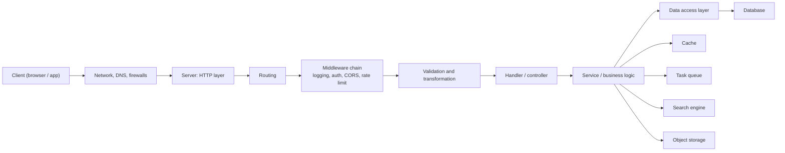
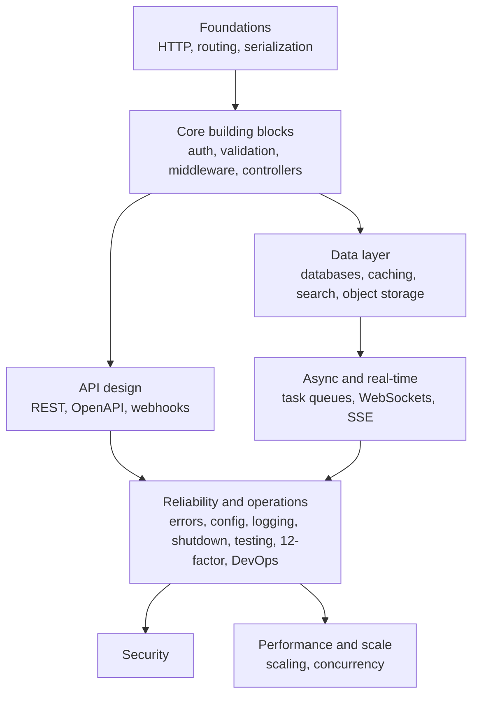
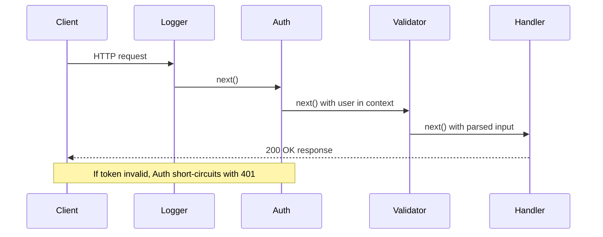
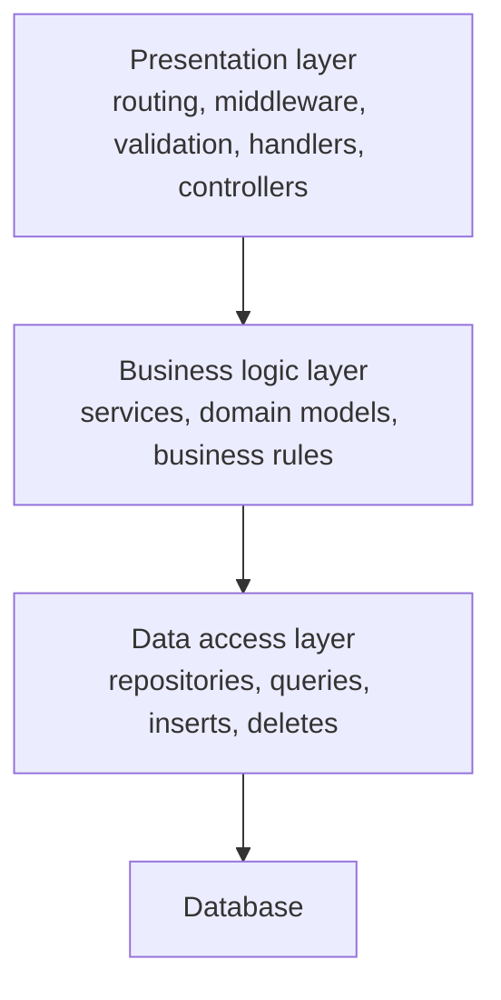
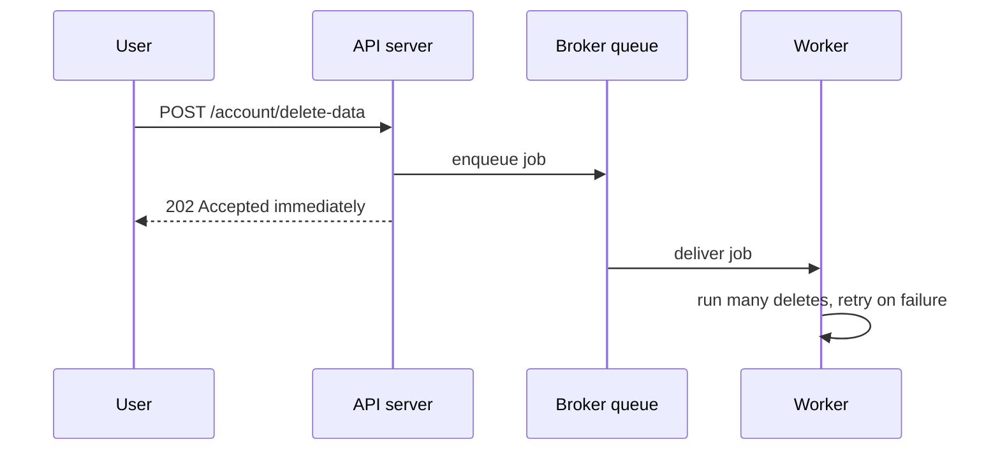
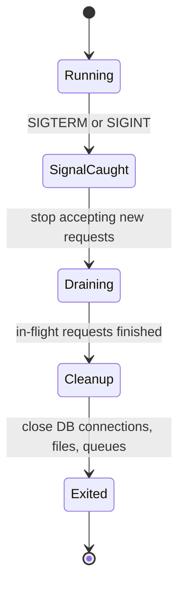
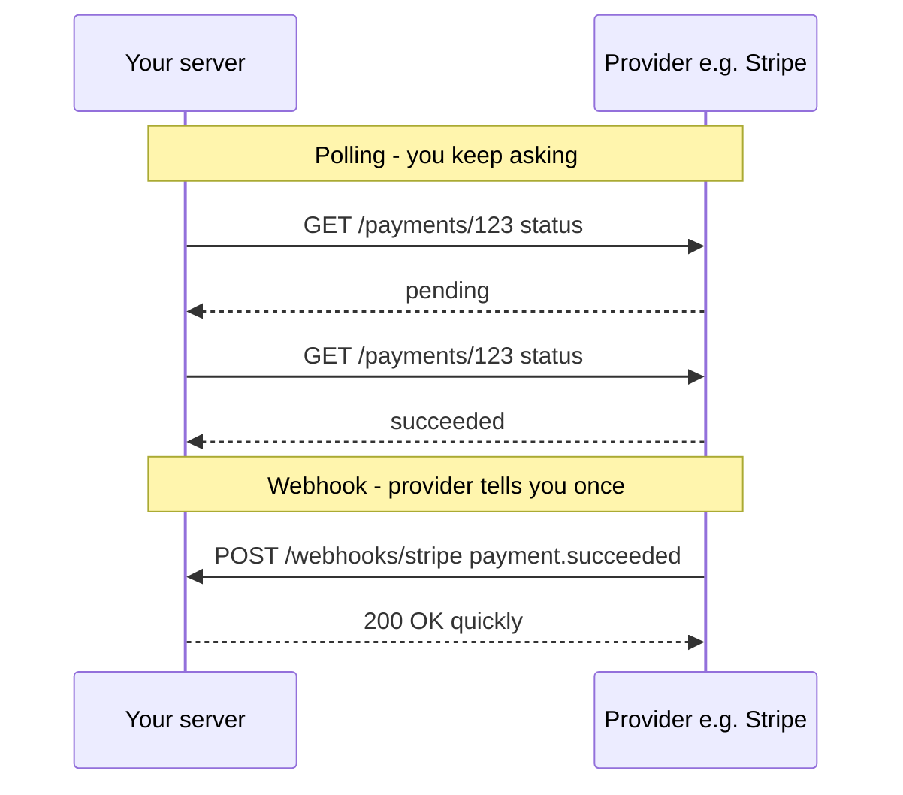

## TL;DR
- Backend engineering is **much more than CRUD APIs**: it is building **reliable, scalable, fault-tolerant and maintainable** codebases and systems.
- Most people learn backend through **one framework** (Express, Spring Boot, Rails). That creates blind spots: when the company switches language, knowledge that is tied to the framework does not transfer.
- This course teaches the **underlying, language-agnostic concepts**, distilled from books and from studying many open-source codebases.
- The journey: how a request travels across the internet → **HTTP** → **routing** → **serialization** → **auth** → **validation** → **middleware & request context** → **controllers/services** → **REST** → **databases** → **business logic layer** → **caching** → **emails & task queues** → **search** → **errors, config, logging, graceful shutdown** → **security** → **scaling, concurrency** → **object storage, real-time** → **testing, 12-factor, OpenAPI, webhooks, DevOps**.
- Use this chapter as the **course map**: each section below summarises what the corresponding chapter covers and the questions you should be able to answer after it.

## Why this matters
There are thousands of backend resources, but no obvious order. Without a map you cannot tell what to learn first, what matters most, or how the pieces connect — which is why it often takes engineers *years* of trial and error to see the big picture.

Interviews test exactly that big picture. A placement interviewer rarely cares whether you know a particular Express API; they care whether you understand *why* a server returns `401` vs `403`, *why* you put validation before business logic, *why* a cache can serve stale data, or *why* a deployment needs graceful shutdown. Those answers are the same in Node, Go, Java, Python or Rust.

> [!IMPORTANT]
> The core idea of the whole course: **frameworks are implementations; concepts are portable.** If you understand the concept (e.g. "middleware is a chain of functions that each can modify the request or end it early"), you can pick up any framework's version of it in a day.

### The problem with framework-first learning

Imagine you spent years with Ruby on Rails, and your company decides to migrate to Go for performance. How much of your knowledge transfers?

| If you learned… | What transfers to a new language |
|---|---|
| "In Rails I write `before_action :authenticate`" | Almost nothing — it's framework syntax |
| "Authentication is a middleware that runs before handlers, reads a token/cookie, verifies it, attaches the user to the request context, or short-circuits with 401" | Everything — Go, Node, Java all do exactly this |

## The big picture: how the pieces fit

The course roughly follows the path of a request: it leaves the client, crosses the network, arrives at your server, passes through layers of code, touches data stores, and returns. Around that path sit the operational concerns (logging, config, shutdown, deployment) and the cross-cutting concerns (security, performance).

## Course map — every topic, in order

Each subsection is one future chapter. Treat the bullet lists as a checklist: after finishing that chapter you should be able to explain each item.

### 1. How a request reaches a backend (chapter 3)
- How a request from the browser flows through **network hops, firewalls and the internet** to a backend running on a remote (e.g. AWS) server.
- What the server sends back and what a response looks like.
- Goal: a vivid mental model of **client ↔ server communication**.

### 2. HTTP (chapter 5)
- The role of HTTP and how communication is established through it; what **raw HTTP messages** look like.
- **Headers** and their categories: request headers, representation headers, general headers, security headers.
- **Methods**: GET, POST, PUT, PATCH, DELETE — their semantics and when to use each.
- **CORS** flow: how a **simple request** differs from a **preflight request**, and how the preflight travels browser → server → browser.
- **Responses** and **status codes**: structure, the most common codes, when to return which.
- **HTTP caching**: ETags, `max-age`, and other cache headers.
- **HTTP/1.1 vs HTTP/2 vs HTTP/3**.
- **Content negotiation**, **persistent connections**, **compression** (gzip, deflate, Brotli/`br`).
- Security: **SSL/TLS and HTTPS**.

### 3. Routing (chapter 6)
- How routing **maps URLs (plus HTTP methods) to server-side logic**.
- Route components: **path parameters** and **query parameters**.
- Route types: static, dynamic, nested/hierarchical, catch-all/wildcard, regex-based.
- **API versioning** techniques, how to **deprecate** old versions, industry best practices.
- **Route grouping** — helps with versioning, permissions and shared middleware.
- Securing routes and optimising route-matching performance.

### 4. Serialization and deserialization (chapter 7)
- **Serialization**: converting in-memory data into a transferable format before sending it over the network. **Deserialization**: converting received data back into the language's native structures.
- Why it's needed: **interoperability** between different languages and systems.
- **Text formats** (JSON, XML) vs **binary formats** (Protocol Buffers) — performance and readability trade-offs.
- JSON deep dive: structure, data types (string, number, boolean, array, object, null), nested objects, mapping into Python dicts / Go structs / JS objects.
- Common pitfalls: missing/extra fields, `null` values, **date and time-zone** issues; custom serialization.
- Error handling: invalid data, conversion errors, unknown fields.
- Security: injection attacks, **validate before/while deserializing**, JSON Schema validation.
- Performance: compression, dropping unnecessary fields; JSON vs Protobuf.

### 5. Authentication and authorization (chapter 8)
- Why we need them; **stateful vs stateless** authentication.
- Basic auth, bearer tokens, **sessions, JWTs, cookies**, **OAuth 2.0 and OpenID Connect**, API keys, **MFA**.
- **Hashing, salting** and other cryptographic techniques.
- Authorization models: **ABAC, RBAC, ReBAC**.
- Security best practices: secure cookies; avoiding **CSRF, XSS, MITM**; **audit logging** of auth events (failed logins, privilege escalation, sensitive access).
- **Generic error messages** to avoid leaking information ("invalid credentials" rather than "wrong password"); consistent responses across failure modes; rate limiting and account lockout.
- **Timing attacks**: a wrong password takes longer to reject than an unknown username (because password checking involves slow hashing), so an attacker can infer which usernames exist from response times.

> [!INTERVIEW]
> "What is a timing attack on login?" — If "user not found" returns instantly but "wrong password" takes ~100 ms (bcrypt comparison), an attacker can enumerate valid usernames by measuring latency. Fix: always do equivalent work (e.g. compare against a dummy hash), use constant-time comparison, and return the same generic error.

### 6. Validation and transformation (chapter 9)
- **Syntactic validation** (is it a valid email / phone / date format?), **semantic validation** (date of birth cannot be in the future; age between 1 and 120), **type validation** (string? integer? array? object?).
- **Client-side vs server-side validation**: client-side is for UX (instant feedback); **server-side is the real security boundary** because it guards your business logic.
- **Fail fast**: return early to avoid unnecessary processing; keep front-end and back-end rules consistent.
- **Transformations**: type casting (path/query params always arrive as strings — convert `"42"` to `42`), date-format conversion.
- **Normalization**: lower-casing emails, trimming whitespace, adding country codes to phone numbers.
- **Sanitization** against attacks such as SQL injection.
- Complex logic: **relationship** validation (password = confirm password), **conditional** validation (`partnerName` required only if `married === true`), **chained** validation (lowercase → strip special chars → check length).
- Error handling: meaningful messages, **aggregate all errors in one response**, obfuscate security-sensitive ones, gracefully handle failed transformations (invalid JSON, bad dates).
- Performance: return early, avoid redundant checks.

### 7. Middleware (chapter 10)
- What middleware is, when to use it, its place in the request cycle (pre-request / post-response).
- **Chaining**: middlewares execute in sequence, each passing control via `next()` until the final handler; any can **exit early / short-circuit** (e.g. 404, 401).
- **Order matters**, e.g. logging → authentication → validation → route handler → error handling.
- Common middlewares: **security headers** (`X-Content-Type-Options`, `Strict-Transport-Security`, `Content-Security-Policy`), **CORS**, **CSRF protection**, **rate limiting**, **authentication**, **logging/monitoring** (structured logs), **error handling** (consistent error format), **compression**, **body parsing** (JSON, URL-encoded forms, multipart file uploads).
- Keep middleware lightweight; wrong order hurts both performance and security.

### 8. Request context (chapter 10)
- **Request-scoped state**: metadata that lives only for one request and is passed through middlewares, controllers and services **without tightly coupling them**.
- Components: request metadata (method, URL, headers, query, body), session/user info (injected by auth middleware), **request IDs / trace IDs**, custom request-specific data (cached values, permission results).
- Use cases: auth, rate limiting, tracing, logging.
- **Timeouts and cancellation signals** (request timeouts, custom timeouts).
- Best practices: keep it small, clean up after the request (avoid memory leaks), don't use it as a dumping ground for passing data.

### 9. Handlers, controllers and services (chapter 10)
- The **MVC** pattern; responsibilities of handlers/controllers vs services; reducing duplication with middleware.
- **Centralised error handling** and **consistent success/error response formats**.
- **CRUD ↔ HTTP mapping**: POST creates (`201 Created`, or `400 Bad Request`), GET fetches a list or one item, PUT/PATCH update, DELETE removes.
- Pagination, search, sorting, filtering APIs.
- Best practices: strict validation, consistent responses, payload limits, **redacting sensitive fields**, auth checks.

### 10. REST API design (chapter 11)
- RESTful architecture: design **around resources**, stick to **HTTP semantics**.
- Filtering and pagination conventions.
- Versioning styles: **URI** (`/v1/...`), **header**, **query string**, **media type**.
- Designing with the **OpenAPI** spec in mind; content negotiation; meaningful error messages; client-side caching with **ETags**; optimising large requests/responses.

### 11. Databases (chapter 12)
- **Relational vs non-relational** — differences and when to use which.
- Theory: **ACID**, **CAP theorem**.
- Querying and **joins**; schema design; **indexing**.
- Optimization: query optimization, caching, **connection pooling**.
- Data integrity: constraints, validations, **transactions and concurrency**.
- **ORMs** — how they work, trade-offs of using one; **migrations**.

### 12. Business logic layer (chapter 10)
- The layered architecture of a request:

- The **presentation layer** deals with user data coming in and going out. The **business logic layer (BLL)** holds core rules. The **data access layer** talks to the database; the BLL uses it behind the scenes.
- Design principles: **separation of concerns, single responsibility, open/closed, dependency inversion**.
- BLL components: services, **domain models** (User, Order), business rules, business validation.
- Error handling and **propagating errors** from the service layer up to the presentation layer.

### 13. Caching (chapter 13)
- Why cache, and how it differs from database persistence.
- Types: in-memory, browser, database caching; client-side vs server-side.
- Strategies: **cache-aside, write-through, write-behind (write-back), read-through**.
- Eviction: **LRU, LFU, TTL, FIFO**.
- **Invalidation**: manual, TTL-based, event-based.
- Levels: **L1** (in-process memory), **L2** (network/distributed, e.g. Redis), **hierarchical** caching (hot data in small fast L1, less-frequent data in larger slower L2).
- Web caching: static assets, API responses via HTTP headers. DB caching: storing results of heavy joins in Redis.
- **Hit/miss ratio** and how to improve it.

### 14. Transactional emails (chapter 14 area)
- Use cases (password reset, OTP, receipts) and anatomy: **subject, preheader, header, main content, CTA, footer**; personalisation with dynamic parameters.

### 15. Task queues and scheduling (chapter 14)
- Use cases: sending emails, processing images, third-party calls (payments, webhooks), offloading heavy work.
- Example: "delete all my data" requires many queries across tables — instead of blocking, **respond immediately and push a background job** onto the queue.
- **Scheduling** (cron-like): DB backups, recurring reminders, data sync, maintenance (clearing logs/caches).
- Components: **producer, queue, consumer (worker), broker, result backend**.
- Task dependencies (chains, parent/child), **task groups** (run concurrently and wait for all), **error handling and retries**, **prioritization** (payments before notifications), rate limiting.

### 16. Full-text search with Elasticsearch (chapter 15)
- Why and how it works: **inverted index**, **TF-IDF** (term frequency / inverse document frequency), segments and **shards**.
- Use cases: **type-ahead**, log analytics, social search over profiles/posts/comments.
- Index management; basic search, full-text search, **relevance scoring**.
- Performance: `text` vs `keyword` fields, **analyzers**, boosting, pagination.
- Advanced: filtering, **aggregations**, **fuzzy search**; **Kibana**.
- Best practices: explicit field mappings, sensible shard count, **batch indexing**, avoid leading wildcards.

### 17. Error handling (chapter 16)
- Error types: syntax, runtime, logical.
- Strategies: **fail-safe vs fail-fast**, **graceful degradation**, prevention.
- Practices: catch early, **never swallow errors**, custom error types, fail gracefully, log with stack traces.
- **Global error handlers**; user-facing errors with friendly, actionable messages.
- Monitoring/logging tools (**Sentry**, **ELK stack**); email/Slack alerts.

### 18. Configuration management (chapter 17)
- **Decouples environment-specific settings from application logic** → flexibility.
- Use cases: multiple environments (dev/staging/prod), safe handling of secrets (API keys, DB passwords, certificates), **feature flags** without code changes.
- Config types: **static** (DB host, API endpoints), **dynamic** (feature flags, rate limits), **sensitive** (credentials, tokens, secrets).
- Sources: `.env`, JSON, YAML; **environment variables vs CLI flags vs static files**.

### 19. Logging, monitoring and observability (chapter 18)
- Differences between **logging, tracing, monitoring and observability**.
- Log types: system, application, access, security. Levels: **DEBUG, INFO, WARN, ERROR, FATAL**.
- **Structured vs unstructured** logging; centralised logging, rotation and retention, contextual logs, **never log passwords or API keys**.
- Monitoring: infrastructure, **APM**, uptime; **Prometheus, Grafana**; alert thresholds and avoiding **alert fatigue** (only actionable alerts).
- **Three pillars of observability: logs, metrics, traces**; security and compliance of log data.

### 20. Graceful shutdown (chapter 19)
- Needed for restarts, scaling in the cloud, microservices, long-running jobs.
- Signal handling: **SIGTERM, SIGINT, SIGKILL** (SIGKILL cannot be caught).
- Steps:

### 21. Security (chapter 20)
- Attacks: **SQL injection, NoSQL injection, XSS, CSRF, broken authentication, insecure deserialization**.
- Secure design principles: **least privilege, defense in depth, fail secure, secure defaults, separation of duties, security by design**.
- Input validation and sanitization, rate limits, **Content Security Policy, CORS, SameSite cookies**, monitoring security events.

### 22. Scaling and performance (chapters 21–22)
- Metrics: **response time, resource utilisation**; finding bottlenecks.
- Database: avoid **N+1 queries**, proper joins, lazy loading where appropriate, **indexes** on frequently queried columns (foreign keys, search fields), **batch processing**.
- Avoid **memory leaks** (close file handles and connections, clean up after long jobs).
- Reduce network overhead: smaller payloads, compression.
- Performance testing and **profiling**.
- Practices: clear, maintainable code first — **no premature optimization**; modular code so components can be optimised independently; **graceful degradation** under load; **offload non-critical work** (emails, logging) to background queues.

### 23. Concurrency and parallelism (chapter 23)
- **Concurrency** (dealing with many things at once, interleaving) helps **I/O-bound** tasks; **parallelism** (doing many things at the same instant on multiple cores) helps **CPU-bound** tasks.

### 24. Object storage and large files (chapters 24–25)
- Use cases for object storage like **AWS S3**; handling large files with **chunking and streaming**; **multipart uploads**.

### 25. Real-time backends (chapter 26)
- **WebSockets**, **Server-Sent Events (SSE)**, **pub/sub** architecture.

### 26. Testing and code quality (chapter 27)
- Test types: **unit, integration, end-to-end**, functional, regression, performance, **load and stress**, user acceptance, security.
- **TDD**; automating tests in **CI/CD**; linters and formatters.
- Metrics: **code coverage**, **cyclomatic complexity** (number of independent paths through a function), **maintainability index** (combines complexity, lines of code, etc.).

### 27. The Twelve-Factor App (chapter 28)
- A set of principles for building portable, deployable, scalable services (config in env, stateless processes, disposability, dev/prod parity, etc.).

### 28. OpenAPI (chapter 29)
- Why standards matter: documentation, automation (client/server code generation), tooling ecosystem (**Swagger UI**, Postman, code generators).
- History: **Swagger → OpenAPI** transition; active versions **3.0 and 3.1**.
- Document structure: **metadata (info), paths, components (schemas, parameters), security definitions, responses**.
- Best practices: avoid duplication via reusable components, stick to standards.
- **API-first development**: write the spec first, then implement.

### 29. Webhooks (chapter 30)
- Use cases: notifications, third-party integrations (Stripe payments, GitHub, Slack, Discord, Twilio).
- **API polling (client-initiated pull) vs webhook (server-initiated push)**.

- Components: webhook URL, event triggers, payload, HTTP method, response handling.
- Best practices: **signature verification**, HTTPS only, **respond quickly** (process async), **retry logic**, logging; testing locally with **ngrok**.

### 30. DevOps for backend engineers (chapter 31)
- **CI, continuous delivery, continuous deployment**.
- **Infrastructure as Code**, config management, version control.
- **Docker** containers, **Kubernetes** orchestration, CI/CD pipelines.
- **Horizontal vs vertical scaling**.
- Deployment strategies: **blue-green**, **rolling**, (and canary).

> [!NOTE]
> The speaker says "red green deployment"; the standard term is **blue-green deployment** — two identical environments, switch traffic from blue (old) to green (new) at once, and switch back if something breaks.

## How to use this course for placement prep

> [!TIP]
> For each chapter, be able to do three things out loud: (1) state the **problem** the concept solves, (2) explain the **mechanism** in 3–4 sentences, (3) name one **trade-off or pitfall**. That is the structure of almost every backend interview answer.

| Priority for interviews | Chapters |
|---|---|
| Very high | HTTP, auth, REST design, databases, caching, scaling |
| High | Routing, validation, middleware/controllers, task queues, error handling, security, concurrency |
| Medium | Serialization, logging/observability, real-time, testing, webhooks, graceful shutdown |
| Good to know | Search, object storage, config, 12-factor, OpenAPI, DevOps |

## Common mistakes & misconceptions
- **"Backend = CRUD APIs."** CRUD is the smallest part; reliability, security, performance and operability are the bulk of real backend work.
- **Learning a framework instead of the concept.** Knowing `app.use()` is not the same as understanding the middleware pattern.
- **Trusting client-side validation.** Anyone can bypass the browser with `curl`; the server must validate everything.
- **Detailed auth errors.** "Wrong password" vs "user not found" leaks which accounts exist.
- **Premature optimization.** Write clear, modular code first; measure; then optimise the real bottleneck.
- **Confusing concurrency with parallelism.** Concurrency is about structure (interleaving tasks), parallelism is about simultaneous execution on multiple cores.

## Interview questions

<strong>Q: What does a backend engineer do beyond writing CRUD APIs?</strong>

They design systems that are **reliable** (handle failures, retries, graceful shutdown), **scalable** (caching, queues, horizontal scaling), **secure** (auth, validation, protection against injection/XSS/CSRF), **observable** (logs, metrics, traces) and **maintainable** (layered architecture, tests, config management). CRUD endpoints are only the surface; the engineering is in making them correct and robust under real-world load and failure.

<strong>Q: Why is learning backend from first principles better than learning one framework deeply?</strong>

Framework knowledge is tied to one ecosystem's syntax and conventions, and creates blind spots — you see every problem through that framework's lens. Concepts like HTTP semantics, middleware chains, request context, caching strategies and transactions are identical across Node, Go, Java or Python. If your team migrates from Rails to Go, conceptual knowledge transfers; framework trivia doesn't.

<strong>Q: Walk me through the layers a request passes through in a typical backend.</strong>

Client → network (DNS, firewalls, load balancer) → HTTP server → **router** (matches method + path) → **middleware chain** (logging, CORS, auth, rate limiting, body parsing) → **validation/transformation** → **handler/controller** (presentation layer) → **service** (business logic) → **repository/data access** → database/cache. The response travels back, often through post-response middleware (compression, logging), and errors are caught by a global error handler.

<strong>Q: Why do we need server-side validation if the frontend already validates?</strong>

Client-side validation is only for user experience — instant feedback. It can be bypassed trivially (DevTools, curl, Postman, a custom script). Server-side validation is the actual security boundary protecting your business logic and database. Both should use consistent rules, but only the server's can be trusted.

<strong>Q: Give examples of syntactic, semantic and type validation.</strong>

- **Syntactic**: is `"abc@x.com"` a valid email format? Is `"2024-13-40"` a valid date format?
- **Semantic**: the value is well-formed but must make sense — date of birth can't be in the future; age must be 1–120.
- **Type**: is `age` an integer, `tags` an array, `address` an object?

<strong>Q: Why does middleware order matter? Give a correct order.</strong>

Each middleware may depend on work done earlier or may stop the chain. A typical order: request logging (so everything is logged, even failures) → security headers/CORS → rate limiting → body parsing → authentication → validation → route handler → error-handling middleware last (to catch everything above). Putting auth after an expensive handler wastes resources; putting rate limiting after auth lets attackers hammer the auth check.

<strong>Q: A user clicks "delete all my data", which needs dozens of queries. How do you design it?</strong>

Don't do it inside the request. Validate and authorise, enqueue a background job on a task queue (with the user ID), and immediately return `202 Accepted`. A worker consumes the job, runs the deletions (ideally in batches/transactions), retries on failure, and notifies the user (e.g. email) when done. This keeps the API responsive and makes the work retryable.

<strong>Q: What is the difference between polling and webhooks?</strong>

**Polling**: the client repeatedly calls the provider's API asking "is it done yet?" — simple but wasteful and laggy. **Webhooks**: the provider sends an HTTP POST to your registered URL when the event happens — server-initiated push, near real-time, efficient. With webhooks you must verify signatures, use HTTPS, respond quickly (process async), and handle retries/duplicates idempotently.

<strong>Q: What are the steps of graceful shutdown?</strong>

Catch the termination signal (SIGTERM/SIGINT) → stop accepting new connections/requests (and fail health checks so the load balancer stops routing) → let in-flight requests finish (with a timeout) → close external resources (DB pools, queues, open files) → exit. SIGKILL can't be caught, so the orchestrator's grace period must be long enough.

<strong>Q: What are the three pillars of observability?</strong>

**Logs** (discrete, timestamped events with context), **metrics** (numeric time series such as request rate, error rate, latency, CPU), and **traces** (the path of a single request across services, made of spans linked by a trace ID). Together they let you answer not just "is it broken?" (monitoring) but "why is it broken?" (observability).

## Cheat sheet
- **Backend goals**: reliable, scalable, fault-tolerant, maintainable.
- **Request path**: client → network → HTTP → router → middleware → validation → controller → service → repository → DB/cache.
- **Layers**: presentation (routing, middleware, validation, controllers) → business logic (services, domain models, rules) → data access (repositories).
- **Validation kinds**: syntactic, semantic, type; plus transformation, normalization, sanitization, relational, conditional, chained.
- **Caching**: cache-aside / read-through / write-through / write-behind; evict LRU/LFU/TTL/FIFO; invalidate manual/TTL/event.
- **Queue parts**: producer, broker/queue, consumer/worker, result backend.
- **Observability**: logs + metrics + traces.
- **Shutdown**: signal → stop accepting → drain → close resources → exit.
- **Security principles**: least privilege, defense in depth, fail secure, secure defaults, separation of duties.
- **Concurrency → I/O-bound; parallelism → CPU-bound.**
- **Webhooks = push; polling = pull.**
- **Deployments**: blue-green, rolling, canary.

## Glossary
- **First principles** — reasoning from fundamental concepts rather than from a specific tool's conventions.
- **CRUD** — Create, Read, Update, Delete: the basic data operations.
- **Middleware** — a function in the request pipeline that can inspect/modify the request/response and pass control on or end the request.
- **Request context** — request-scoped state (user, request ID, deadlines) shared across layers for the lifetime of one request.
- **Serialization** — converting in-memory data into a format (JSON, Protobuf) for transfer or storage; deserialization is the reverse.
- **CORS** — Cross-Origin Resource Sharing: browser mechanism that lets servers declare which other origins may call them.
- **Preflight** — an `OPTIONS` request the browser sends before certain cross-origin requests to ask permission.
- **ETag** — a version identifier for a resource used in HTTP caching/conditional requests.
- **RBAC / ABAC / ReBAC** — role-based, attribute-based and relationship-based access control.
- **Inverted index** — a map from each term to the list of documents containing it; the core of full-text search.
- **Graceful shutdown** — stopping a server without dropping in-flight work.
- **Observability** — ability to understand a system's internal state from its outputs (logs, metrics, traces).
- **Twelve-Factor App** — a methodology of 12 principles for building cloud-ready services.
- **OpenAPI** — a standard, machine-readable format for describing HTTP APIs (formerly Swagger).
- **Webhook** — an HTTP callback: a server notifies another server by POSTing an event to its URL.
- **Blue-green deployment** — run old and new versions side by side and switch traffic between them.

## Video timestamps
- [00:00](https://www.youtube.com/watch?v=0Rwb4Xmlcwc&t=0s) — What backend engineering really is; the problem with scattered resources
- [01:01](https://www.youtube.com/watch?v=0Rwb4Xmlcwc&t=61s) — Why framework-first learning creates blind spots
- [02:02](https://www.youtube.com/watch?v=0Rwb4Xmlcwc&t=122s) — Course approach; how a request flows to a backend
- [03:03](https://www.youtube.com/watch?v=0Rwb4Xmlcwc&t=183s) — HTTP: headers, methods, CORS, status codes, caching, versions
- [04:03](https://www.youtube.com/watch?v=0Rwb4Xmlcwc&t=243s) — Content negotiation, compression, TLS; routing and versioning
- [05:04](https://www.youtube.com/watch?v=0Rwb4Xmlcwc&t=304s) — Serialization and deserialization, JSON
- [07:07](https://www.youtube.com/watch?v=0Rwb4Xmlcwc&t=427s) — Authentication and authorization
- [08:09](https://www.youtube.com/watch?v=0Rwb4Xmlcwc&t=489s) — Timing attacks; validation and transformation
- [11:14](https://www.youtube.com/watch?v=0Rwb4Xmlcwc&t=674s) — Middleware
- [13:15](https://www.youtube.com/watch?v=0Rwb4Xmlcwc&t=795s) — Request context
- [15:18](https://www.youtube.com/watch?v=0Rwb4Xmlcwc&t=918s) — Handlers, controllers, CRUD mapping
- [16:19](https://www.youtube.com/watch?v=0Rwb4Xmlcwc&t=979s) — REST API design; databases
- [17:20](https://www.youtube.com/watch?v=0Rwb4Xmlcwc&t=1040s) — Business logic layer and layered architecture
- [18:21](https://www.youtube.com/watch?v=0Rwb4Xmlcwc&t=1101s) — Caching
- [19:23](https://www.youtube.com/watch?v=0Rwb4Xmlcwc&t=1163s) — Transactional emails; task queues
- [20:23](https://www.youtube.com/watch?v=0Rwb4Xmlcwc&t=1223s) — Scheduling and task-queue components
- [21:26](https://www.youtube.com/watch?v=0Rwb4Xmlcwc&t=1286s) — Elasticsearch
- [22:26](https://www.youtube.com/watch?v=0Rwb4Xmlcwc&t=1346s) — Error handling; config management
- [23:27](https://www.youtube.com/watch?v=0Rwb4Xmlcwc&t=1407s) — Config types; logging, monitoring, observability
- [24:28](https://www.youtube.com/watch?v=0Rwb4Xmlcwc&t=1468s) — Monitoring tools; graceful shutdown
- [25:30](https://www.youtube.com/watch?v=0Rwb4Xmlcwc&t=1530s) — Security; scaling and performance
- [27:31](https://www.youtube.com/watch?v=0Rwb4Xmlcwc&t=1651s) — Concurrency, object storage, real-time, testing
- [28:31](https://www.youtube.com/watch?v=0Rwb4Xmlcwc&t=1711s) — Code quality metrics, 12-factor, OpenAPI
- [29:33](https://www.youtube.com/watch?v=0Rwb4Xmlcwc&t=1773s) — API-first development; webhooks
- [30:34](https://www.youtube.com/watch?v=0Rwb4Xmlcwc&t=1834s) — DevOps concepts
