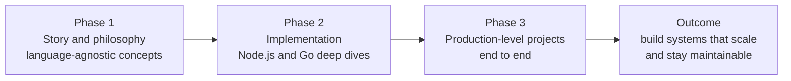
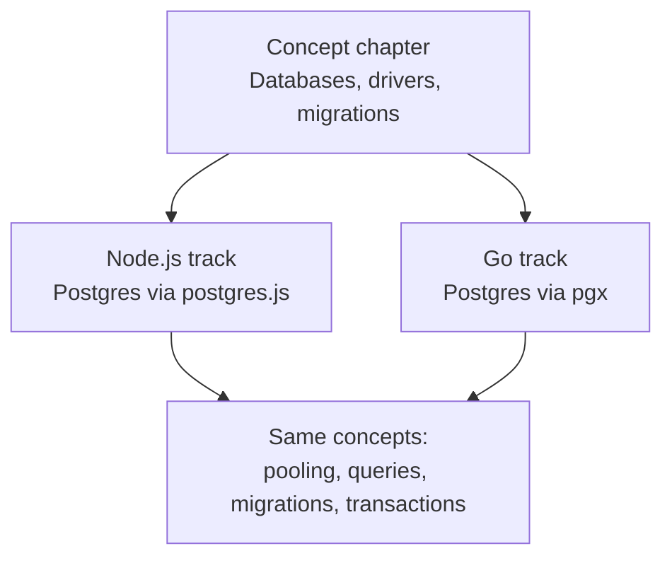
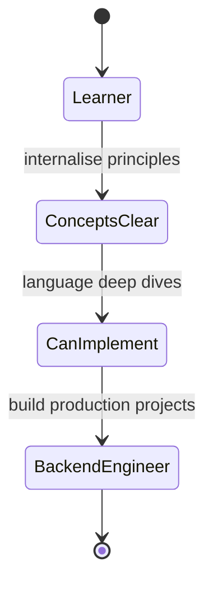

## TL;DR
- The journey has **three phases**: (1) **story and philosophy** (concepts), (2) **implementation** in a specific language, (3) **production-level projects**.
- Phase 1 (this course) builds **language-agnostic skills** — patterns that exist beyond any framework or library.
- It shows the **big picture** of a production-grade backend and the concepts that languages, runtimes, frameworks and libraries **abstract away** from you.
- Phase 2 maps each concept to code in **Node.js** and **Go** (e.g. Postgres with `postgres.js` in Node or `pgx` in Go).
- Phase 3 combines everything into **end-to-end production projects** following industry best practices.
- Goal: be able to build systems that **scale from zero to a million users** and stay **maintainable** for years.

## Why this matters
Most learners jump straight to code. The trouble is that code written without understanding *why* it is shaped that way is fragile: you copy patterns without knowing when they break. Seeing the philosophy first means that when you later write a middleware in Express or Go's `net/http`, you recognise it as an instance of a pattern you already understand.

> [!IMPORTANT]
> Order matters: **concepts → implementation → projects.** Implementation details only make sense once the common patterns behind every backend are clear.

## The three phases

### Phase 1 — Story and philosophy
- The **story of backend engineering**: its philosophies, the big questions, the inner workings, and how different **components and machines collaborate**.
- Focus on the **big picture of a production-grade backend**.
- Appreciate what is **abstracted** by the tools you use daily: a framework hides the HTTP parser, routing table, connection pool, serializer, etc. Phase 1 opens those boxes.
- Output: **skills that are beyond frameworks** — once you see the common patterns behind every backend application, you understand how the dots connect.

### Phase 2 — Implementation
- Only after the foundations are clear do you **choose a language and ecosystem**.
- Two tracks: **Node.js** and **Go**.
- Most concept chapters get a matching **implementation-specific deep dive**.

> [!TIP]
> When you learn any concept, ask "how would this look in two different languages?" If the answer is "basically the same shape", you have understood the concept, not just the syntax.

### Phase 3 — Production-level projects
- Everything comes together: concepts + language deep dives + philosophy.
- Several **end-to-end projects** built with **industry standards and best practices**, which you can follow along with.

## What "being a backend engineer" means at the end
By internalising the concepts and building the projects, you should be able to build **real systems**:
- systems that **scale** — from zero users to a million;
- systems that **people can maintain** over a long period of time.

> [!NOTE]
> "Scale" and "maintainability" are the two recurring yardsticks of the whole course. Nearly every design decision in later chapters (layering, caching, queues, config, observability) is justified by one or both.

## Common mistakes & misconceptions
- **Starting with a framework tutorial** and assuming you've "learned backend". You've learned one tool's API.
- **Skipping the theory because it isn't code.** Interviews test the theory far more than framework syntax.
- **Thinking implementation is language-specific knowledge only.** The implementation phase exists to show the *same* concept realised in different ecosystems.

## Interview questions

<strong>Q: What does "language-agnostic backend skills" mean?</strong>

Understanding backend concepts — HTTP, routing, middleware, auth, caching, databases, queues, observability — independently of any one language or framework. These patterns appear in every backend; only the syntax differs. Someone with these skills can move between Node, Go, Java or Python quickly because they recognise each framework feature as an instance of a known concept.

<strong>Q: Why learn concepts before implementation?</strong>

Frameworks abstract many details (HTTP parsing, connection pooling, serialization). If you only learn the abstraction, you can't debug it when it leaks, can't choose between alternatives, and can't transfer knowledge to another stack. Concepts first gives you the "why"; implementation then gives you the "how" in a specific ecosystem.

<strong>Q: What does it mean for a system to "scale from zero to a million users"?</strong>

The system's design lets it handle growing load without a rewrite: stateless app servers that can be scaled horizontally, databases with indexes, pooling and possibly replicas, caching for hot data, background queues for heavy work, and monitoring to find bottlenecks. Scaling is planned for in architecture, not bolted on.

<strong>Q: What makes a backend "maintainable"?</strong>

Clear separation of layers (controllers, services, repositories), consistent conventions and error formats, tests, configuration separated from code, good logging and observability, and documentation (e.g. OpenAPI). A maintainable codebase lets new engineers change it safely years later.

## Cheat sheet
- Phase 1: **story & philosophy** → language-agnostic concepts, big picture, what frameworks hide.
- Phase 2: **implementation** → Node.js and Go deep dives per concept (e.g. `postgres.js`, `pgx`).
- Phase 3: **production projects** → end-to-end, industry best practices.
- Yardsticks: **scales** (0 → 1M users) and **maintainable** (long-term).

## Glossary
- **Language-agnostic** — not tied to a specific programming language.
- **Abstraction** — a layer (language, runtime, framework, library) that hides lower-level details.
- **Production-grade** — built to run reliably for real users: secure, observable, scalable, maintainable.
- **postgres.js** — a PostgreSQL driver for Node.js.
- **pgx** — a PostgreSQL driver/toolkit for Go.

## Video timestamps
- [00:00](https://www.youtube.com/watch?v=3qFjZbFRSAU&t=0s) — Expectations; phase 1: story and philosophy
- [01:01](https://www.youtube.com/watch?v=3qFjZbFRSAU&t=61s) — Language-agnostic skills; phase 2: implementation in Node.js and Go
- [02:05](https://www.youtube.com/watch?v=3qFjZbFRSAU&t=125s) — Implementation deep dives (Postgres drivers); phase 3: production projects
- [03:07](https://www.youtube.com/watch?v=3qFjZbFRSAU&t=187s) — The goal: systems that scale and stay maintainable
