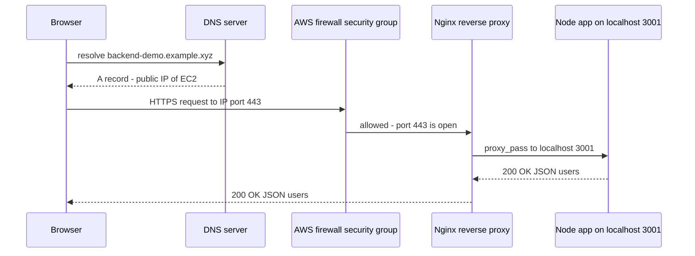
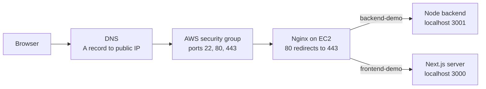
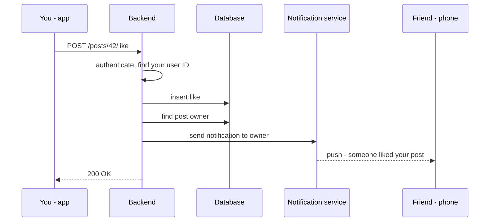
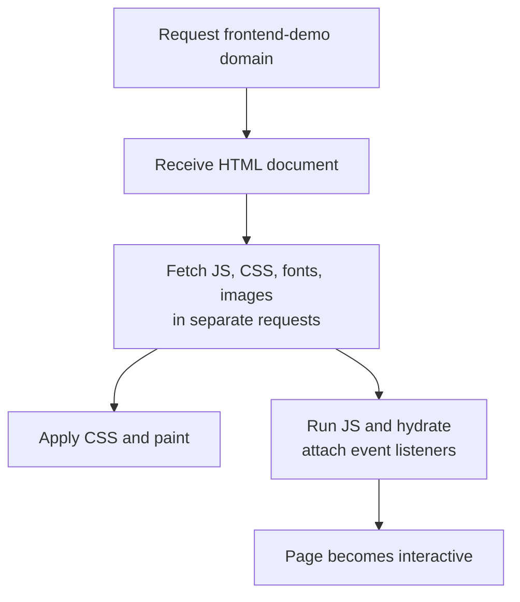
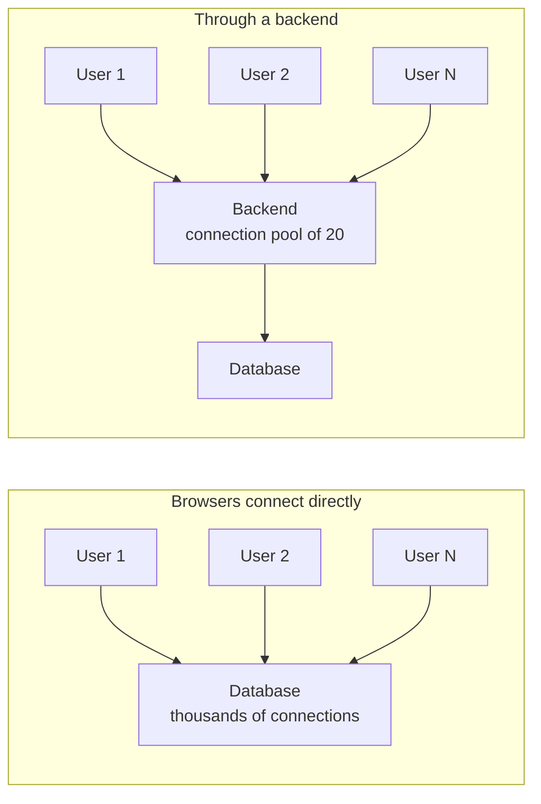

## TL;DR
- A **backend (server)** is a computer **listening on an open port** (typically **80** for HTTP, **443** for HTTPS) reachable over the internet, accepting HTTP / WebSocket / gRPC requests and **serving** content (static files, JSON) or **accepting data**.
- A real request travels: **browser → DNS lookup (A/CNAME records) → server's public IP → cloud firewall (security group) → reverse proxy (Nginx) → app process on `localhost:PORT`**.
- If the firewall doesn't allow ports 80/443, the request is dropped **before it reaches the machine**.
- **Nginx** as a reverse proxy centralises config: HTTP→HTTPS redirect, TLS certificates (via **Certbot**), and routing a domain to a local port (e.g. `backend-demo` → `localhost:3001`).
- The backend's job in one word: **data** — fetching, receiving, persisting it, and every action around it (e.g. Instagram "like" → save → notify friend). It must be **centralised** because it holds state for all users.
- A **frontend server just ships code**; the **browser executes it** (the browser is the runtime). A backend executes code **on the server**.
- Backend logic can't live in the browser because of: **sandbox security** (no file system / env vars), **CORS** restrictions on calling other APIs, **no native DB drivers / persistent socket connections / connection pooling**, and **unreliable client compute power**.

## Why this matters
"What happens when you type a URL into the browser?" is one of the most common interview questions. This chapter builds that mental model concretely with a real deployment, and answers the follow-up "why can't the frontend just talk to the database?"

## What a backend is

### The definition
A backend, in its traditional definition, is:
- a **computer** (a server)
- **listening for requests** — HTTP, WebSocket, gRPC, or other protocols
- on an **open port** (e.g. **80** or **443**)
- that is **accessible over the internet**, so clients (browsers, mobile apps, other servers) can connect, **send data** to it, or **receive data** from it.

It's called a *server* because it **serves** something: static files (images, JS, HTML) or data (usually JSON), and it accepts data the client sends.

> [!NOTE]
> A "port" is just a number (0–65535) that identifies which process on a machine should receive network traffic. One machine has one IP but many ports, so it can run a backend on 3001, a frontend on 3000 and SSH on 22 at the same time.

## Tracing a real request end-to-end

The demo: a Node.js backend on an AWS EC2 instance exposes `GET /users` at a subdomain like `backend-demo.<domain>`. Opening DevTools → Network (with **Disable cache** ticked so you get a fresh status code rather than a cached one) shows the request and its JSON response. Here is every hop.



### Hop 1 — DNS
The browser only knows a **domain name**. It must find the server's **IP address** via **DNS** (Domain Name System). DNS is a large topic; the basics needed here:

| Record | Points to | Example |
|---|---|---|
| **A record** | an **IPv4 address** | `backend-demo` → `13.234.x.x` |
| **AAAA record** | an IPv6 address | (standard, not shown in demo) |
| **CNAME record** | another **domain name** | `www` → `example.xyz` |

In the demo, an **A record** for the `backend-demo` subdomain points to the **public IP of the EC2 instance** (visible in the AWS console under EC2 → Instances).

### Hop 2 — Cloud firewall (security group)
Before traffic enters the machine, it passes through AWS's native firewall, the **security group** attached to the instance. It lists which **inbound ports** are open to the internet. The demo allows three:

| Port | Protocol | Purpose |
|---|---|---|
| 22 | SSH | Log into the instance's terminal for operations |
| 80 | HTTP | Plain web traffic |
| 443 | HTTPS | Encrypted web traffic |

> [!WARNING]
> If 80/443 aren't allowed, AWS drops the request at the firewall and it **never reaches your server** — a classic "my deployed app times out but works on the box with curl" bug. Also: don't leave port 22 open to `0.0.0.0/0` in production; restrict it to your IP.

### Hop 3 — Reverse proxy (Nginx)
A **reverse proxy** is a server that **sits in front of other servers** and forwards requests to them. It lets you manage redirects, TLS and routing **from one central place** instead of configuring each app server.

In the demo, **Nginx**:
1. Listens on **port 80** and **redirects to 443** (HTTPS) — this part is managed by **Certbot**, which obtains and renews free SSL/TLS certificates (Let's Encrypt) automatically.
2. Matches the `server_name` (the subdomain) and forwards the request to **`localhost:3001`**, where the Node server runs.

```nginx
server {
    listen 443 ssl;
    server_name backend-demo.example.xyz;
    # ssl_certificate lines managed by Certbot

    location / {
        proxy_pass http://localhost:3001;
    }
}

server {
    listen 80;
    server_name backend-demo.example.xyz;
    return 301 https://$host$request_uri;   # managed by Certbot
}
```

### Hop 4 — The application process
The Node process is kept alive by a process manager, **PM2** (`pm2 list` shows two processes: frontend and backend). From the instance's own point of view, the backend is just running on localhost:

```bash
curl http://localhost:3001/users   # same JSON as through the public domain
```

This is identical to local development where you open `http://localhost:3000/users`. DNS, firewall and Nginx exist only to **route internet traffic to a local process**.



> [!INTERVIEW]
> "What happens when you hit a URL?" — Crisp version: DNS resolves the domain to an IP → TCP connection (and TLS handshake for HTTPS) to that IP on port 443 → cloud firewall/load balancer lets it through → reverse proxy (Nginx) terminates TLS and forwards to the app on a local port → app routes, runs logic, queries DB → response flows back the same path → browser renders it.

## Why do we need a backend?

### The Instagram "like" example
You tap **Like** on a friend's post; a moment later your friend gets a notification. In between:
1. The app sends a **request** to the server.
2. The server parses it and identifies **who you are** (your user ID).
3. It **persists** the like, usually in a **database**.
4. It finds the **owner** of the post.
5. It **triggers a notification** to that user's phone.



Each user's app shows only *their* feed and *their* notifications, but the server must hold **information about all users and all state**. That requires a **centralised** computer.

> [!IMPORTANT]
> The backend's responsibility condensed into one word: **data** — fetching it, receiving it, persisting it, and every action that deals with it.

## How a frontend actually works (and how it differs)

The same EC2 instance also hosts a **Next.js** frontend at `frontend-demo.<domain>`. Its path is identical — DNS A record → same public IP → ports 80/443 → Nginx — except Nginx forwards to **`localhost:3000`**.

What the browser does next:
1. Fetches the **primary HTML document**.
2. Parses it and fetches every referenced resource in **separate requests**: JS files, CSS, fonts, images.
3. Once CSS arrives, it **paints** the page (styles, colors, fonts).
4. Once JS arrives, it **hydrates** — attaches event listeners — so buttons and interactions start working.



### The key difference

| | Backend server | Frontend server |
|---|---|---|
| What it sends | **Results** of processing (JSON, etc.) | **Code** (HTML, JS, CSS) |
| Where logic runs | **On the server** | **In the user's browser** |
| Runtime | Node/Go/JVM on a machine you control | The **browser** (a sandbox) |

## Why backend logic can't live in the frontend

A natural question: the client device is also a computer — why not connect to the DB from it and distribute the work? Four reasons.

### 1. The browser sandbox (security)
Browser runtimes are **sandboxed**: isolated from the OS, other processes and the file system. Code can only access limited resources: the **DOM**, **browser APIs** (localStorage, cookies), and **external APIs** (only if permitted by CORS).

This makes sense: the browser downloads **code from a remote server you don't know** and runs it on your machine. Without isolation, any website could read your files and send them to its servers.

But a backend often **needs** the file system (writing log files) and **environment variables** (secrets, config) — impossible in a browser.

> [!WARNING]
> Anything shipped to the browser is **public**. Database credentials or API secrets in frontend code can be read by anyone via DevTools. This alone rules out "connect to the database from the frontend".

### 2. CORS restrictions
**CORS** (Cross-Origin Resource Sharing) is a browser security policy: JavaScript on `frontend-demo.example.xyz` may by default only call resources on the **same origin**. Calls to a different origin are **blocked** unless that server sends appropriate CORS **HTTP headers** (covered in the HTTP chapter). Backends must call many third-party APIs whose headers you don't control — servers have no CORS restriction.

> [!NOTE]
> Precisely: "origin" = scheme + host + port, not just "domain". `https://a.com` and `https://api.a.com` are different origins. Also, CORS is enforced by the **browser**; the request may reach the server, but the browser won't let JS read the response.

### 3. Databases and connection pooling
- Server runtimes have **native database drivers** (e.g. `pg` for Postgres, the MongoDB driver). These need **raw TCP socket connections, binary protocols and persistent connections** — things browsers can't do.
- Backends keep a **connection pool**: a set of open, reusable DB connections, so they don't create and destroy a connection for each of thousands of requests per second (which would overwhelm the DB).
- If every browser connected directly, **each user would need their own DB connection** → the database drowns in connections, with no way to pool them or optimise query execution.



### 4. Computing power
Clients range from powerful desktops to a phone with **256 MB RAM and a single core**. Heavy business logic would lag or crash there. A centralised server can be **scaled up (more CPU/RAM) whenever needed** to serve many clients reliably.

> [!TIP]
> Bonus reasons interviewers like: **trust** (the client can be modified — business rules like pricing or permissions must be enforced server-side) and **single source of truth** (consistency across all users).

## Common mistakes & misconceptions
- **"The frontend server runs my React code."** It only *serves* the files; the browser runs them (SSR frameworks render initial HTML on the server, but the interactive JS still runs in the browser).
- **Forgetting the cloud firewall.** App listens fine, Nginx is fine, but the security group blocks 443 → timeouts.
- **Thinking CORS protects your server.** CORS protects *users' browsers*; non-browser clients (curl, other servers) ignore it. Your server still needs auth.
- **Putting secrets in frontend env vars.** Anything bundled into client JS is public.
- **Opening a DB connection per request.** Use a connection pool.
- **Equating "domain" with "origin".** Origin includes scheme and port.

## Interview questions

<details>
<summary><strong>Q: What is a backend server, in one precise definition?</strong></summary>

A process on a machine that listens on a network port (commonly 80/443 behind a proxy) for requests in some protocol (HTTP, WebSocket, gRPC), processes them — often reading/writing a database — and returns responses (JSON, files). It's centralised, holds shared state for all users, and runs in an environment the operator controls.

</details>

<details>
<summary><strong>Q: Walk through every hop from typing a URL to getting a JSON response from a server on EC2.</strong></summary>

1. Browser resolves the domain via DNS (A record → EC2 public IP). 2. Opens a TCP connection (plus TLS handshake for HTTPS) to IP:443. 3. AWS security group checks the port is allowed. 4. Nginx on the instance receives it, matches `server_name`, terminates TLS, and `proxy_pass`es to `localhost:3001`. 5. Node app (kept alive by PM2) routes `/users`, runs logic, returns JSON. 6. Response goes back through Nginx to the browser.

</details>

<details>
<summary><strong>Q: What is a reverse proxy and why use one?</strong></summary>

A server in front of your application servers that receives client requests and forwards them. Benefits: centralised config for redirects (HTTP→HTTPS), TLS termination and certificate management, routing multiple domains/subdomains to different local ports or services, load balancing, caching, compression, rate limiting, and hiding internal servers. Nginx, HAProxy, Caddy and Traefik are common examples. (A *forward* proxy acts on behalf of clients; a *reverse* proxy acts on behalf of servers.)

</details>

<details>
<summary><strong>Q: What is the difference between an A record and a CNAME record?</strong></summary>

An **A record** maps a name directly to an IPv4 address (AAAA for IPv6). A **CNAME** maps a name to another name (an alias), which is then resolved further. Use A records when you have a stable IP (an EC2 Elastic IP); CNAMEs when pointing to another hostname (e.g. a load balancer or CDN hostname that may change IPs). A CNAME can't be used at the zone apex alongside other records.

</details>

<details>
<summary><strong>Q: Your app works with curl on the server but times out from the internet. What do you check?</strong></summary>

Work outward: Is the app listening on the expected port (and on the right interface)? Is Nginx running and its `server_name`/`proxy_pass` correct? Is the OS firewall blocking? Is the cloud **security group** allowing inbound 80/443? Does DNS resolve to the correct public IP (check with `dig`)? A timeout (rather than a refused connection) usually points to a firewall/security group drop.

</details>

<details>
<summary><strong>Q: How does a frontend differ from a backend in where code runs?</strong></summary>

A frontend server sends **code** (HTML, CSS, JS) to the browser; the **browser** is the runtime that executes it — painting after CSS loads and hydrating event listeners after JS loads. A backend executes logic **on the server** and sends only **results**. So frontend logic runs on untrusted, varied client devices; backend logic runs on controlled infrastructure.

</details>

<details>
<summary><strong>Q: Why can't we connect to the database directly from the browser?</strong></summary>

(1) Credentials would be exposed to every user. (2) Browsers can't open raw TCP sockets or speak binary DB protocols, so native drivers don't work. (3) Each user would hold their own connection, overwhelming the DB, with no pooling. (4) You couldn't enforce authorization or business rules — the client can be tampered with. A backend sits in between with a connection pool and enforces all rules.

</details>

<details>
<summary><strong>Q: What is a connection pool and why does it matter?</strong></summary>

A set of pre-opened database connections the server reuses across requests. Opening a connection is expensive (TCP + auth + session setup); doing it per request at thousands of requests/second would overload the DB. A pool caps concurrent connections (e.g. 20), hands one to a request, and returns it afterward — lower latency and protection for the database.

</details>

<details>
<summary><strong>Q: What is the browser sandbox and why does it exist?</strong></summary>

An isolation boundary that keeps web page code away from the OS, file system and other processes; code can only use the DOM, browser APIs (localStorage, cookies) and network calls subject to CORS. It exists because browsers run code downloaded from arbitrary, untrusted servers — without it any site could read your files. The same restriction makes the browser unsuitable for backend work that needs files, env vars or unrestricted network access.

</details>

<details>
<summary><strong>Q: What does CORS do, and does it protect your API from attackers?</strong></summary>

CORS is a browser policy that blocks JS from reading responses from a different origin unless the server opts in via headers like `Access-Control-Allow-Origin`. It protects users from malicious sites using their browser to call other sites. It does **not** protect your API from attackers — curl, Postman or a server-side script ignore CORS entirely. You still need authentication, authorization and rate limiting.

</details>

## Cheat sheet
- **Backend** = process listening on a port, reachable over the internet, serving/accepting data.
- **Ports**: 22 SSH, 80 HTTP, 443 HTTPS; app on e.g. 3000/3001 locally.
- **Path**: browser → DNS → public IP → security group → Nginx → `localhost:PORT` app (PM2-managed).
- **DNS**: A → IPv4, AAAA → IPv6, CNAME → another name.
- **Nginx**: `listen`, `server_name`, `proxy_pass`; Certbot handles TLS + 80→443 redirect.
- **Backend in one word**: data.
- **Frontend**: server ships code; browser fetches HTML → assets → paints → hydrates.
- **Why not backend in the browser**: sandbox (no fs/env), CORS, no DB drivers/sockets/pooling, weak client compute, (plus: secrets exposed, untrusted client).

## Glossary
- **Port** — number identifying a process/service endpoint on a host.
- **DNS** — system that translates domain names into IP addresses.
- **A record / CNAME** — DNS records mapping a name to an IP / to another name.
- **EC2** — AWS virtual machine service.
- **Security group** — AWS virtual firewall controlling allowed inbound/outbound traffic for an instance.
- **Reverse proxy** — server in front of app servers that forwards client requests to them.
- **Nginx** — popular web server and reverse proxy.
- **Certbot** — tool that automatically obtains/renews Let's Encrypt TLS certificates and configures the server.
- **PM2** — Node.js process manager that keeps apps running and restarts them on crash.
- **Hydration** — attaching JS event listeners/state to server-delivered HTML so it becomes interactive.
- **Sandbox** — isolated execution environment with restricted access to system resources.
- **CORS** — browser mechanism controlling cross-origin requests via HTTP headers.
- **Origin** — scheme + host + port of a URL.
- **Connection pool** — reusable set of open database connections.
- **Database driver** — library that speaks a database's wire protocol (e.g. `pg`).

## Video timestamps
- [00:00](https://www.youtube.com/watch?v=6Ss4dJD9Kzg&t=0s) — Definition of a backend server
- [01:00](https://www.youtube.com/watch?v=6Ss4dJD9Kzg&t=60s) — Demo: request in DevTools; starting the trace at the domain
- [02:03](https://www.youtube.com/watch?v=6Ss4dJD9Kzg&t=123s) — DNS records (A, CNAME) pointing to EC2 IP
- [03:03](https://www.youtube.com/watch?v=6Ss4dJD9Kzg&t=183s) — AWS firewall / security group and open ports
- [04:04](https://www.youtube.com/watch?v=6Ss4dJD9Kzg&t=244s) — Reverse proxy with Nginx and Certbot
- [05:05](https://www.youtube.com/watch?v=6Ss4dJD9Kzg&t=305s) — Nginx forwarding to localhost 3001; PM2 processes
- [06:05](https://www.youtube.com/watch?v=6Ss4dJD9Kzg&t=365s) — Summary of all hops
- [07:06](https://www.youtube.com/watch?v=6Ss4dJD9Kzg&t=426s) — Why we need backends: Instagram like example
- [09:10](https://www.youtube.com/watch?v=6Ss4dJD9Kzg&t=550s) — Backend in one word: data; why not do it in the frontend?
- [10:11](https://www.youtube.com/watch?v=6Ss4dJD9Kzg&t=611s) — Demo: how a Next.js frontend is served
- [12:12](https://www.youtube.com/watch?v=6Ss4dJD9Kzg&t=732s) — Painting, hydration; browser as the runtime
- [13:13](https://www.youtube.com/watch?v=6Ss4dJD9Kzg&t=793s) — Browser sandbox and CORS
- [15:15](https://www.youtube.com/watch?v=6Ss4dJD9Kzg&t=915s) — Reasons 1–2: security and CORS
- [16:15](https://www.youtube.com/watch?v=6Ss4dJD9Kzg&t=975s) — Reason 3: database drivers and connection pooling
- [17:16](https://www.youtube.com/watch?v=6Ss4dJD9Kzg&t=1036s) — Reason 4: computing power
