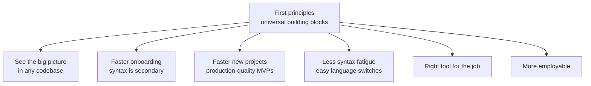
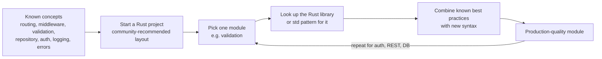
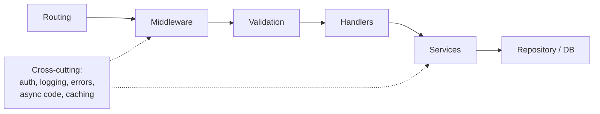

## TL;DR
- **First principles** here = the **foundational building blocks** every backend revolves around (routing, middleware, validation, handlers, data access/repositories, auth, caching, logging, error handling, async code) — a **generic map of the backend territory**, not a list of rules.
- Benefit 1 — **See the big picture**: in a new codebase you can mentally separate core logic, routing, DB connections and over-engineered parts, and fix bugs with confidence.
- Benefit 2 — **Faster onboarding**: once concepts are clear, **syntax is secondary**; you don't need hours of library docs.
- Benefit 3 — **Much faster new projects**: production-quality MVPs without copying boilerplate tutorials.
- Benefit 4 — **Less syntax fatigue**: switching languages becomes "apply known patterns in new syntax", **module by module**.
- Benefit 5 — **Right tool for the job**: Redis for caching, Postgres for relational data, MongoDB for unstructured data, Kafka for event streaming — independent of your current stack.
- Benefit 6 — **More employable**: adaptable engineers who can join any team and contribute quickly.
- You don't need years of experience to build the pattern-recognition seniors have — you can **practise it deliberately from day one**.

## Why this matters
Common situations that overwhelm engineers:
- A **frontend developer** must fix a bug in a backend codebase written in an unfamiliar language — where do you even start?
- You must **build an API from scratch** — how do you form a mental map, follow standards and not break things?
- A TypeScript/Go engineer is moved to **Rust or Python** — how do you get productive without drowning in docs for FastAPI, Pydantic, Axum, SQLAlchemy or Diesel?

The common question: **how do you apply existing knowledge in a new environment without reinventing the wheel?** First principles is the answer.

## The six benefits

### 1. Seeing the big picture
When you enter an existing codebase, instead of being overwhelmed you **decompose it** into known parts and work on each in isolation: the **core logic**, the **routing layer**, the **database connections**, and the **over-engineered pieces** you can filter out as noise.

This is what senior engineers and CTOs do when they glance at a codebase and quickly guess where a bug is: the brain is good at **pattern recognition**, and they've *subconsciously* absorbed the patterns over years. You can learn them **deliberately** in roughly 6–12 months instead.

> [!TIP]
> When opening an unfamiliar backend, look for these in order: entry point (server start) → router/route definitions → middleware registration → one handler → the service it calls → the repository/DB layer → config loading. That path maps almost any codebase in under an hour.

### 2. Faster onboarding
If you understand **how HTTP works**, **how APIs interact with databases**, and **how requests flow through middleware**, you can navigate any framework. Once you know the concepts behind auth, routing, middleware and DB interaction, **the syntax is secondary** — you focus on logic, not language features, and build familiarity with a codebase much faster.

### 3. Faster new projects
Starting from scratch, you move with speed and precision because you understand the **system's needs**, not a tutorial's boilerplate. You already know how to structure routes, set up DB connections, and implement **caching, error handling and logging** without constantly checking documentation — producing **MVPs with production-quality code**.

### 4. Reducing syntax fatigue
Learning a new language is hard enough; not knowing *what to learn after the syntax*, or how to apply syntax to real backend problems, leads to frustration and burnout.

**Example — Node.js developer moving to Rust.** The usual instinct is to search for a 4–5-hour end-to-end production-quality Rust backend tutorial — but Rust has far fewer project-based resources than Node. You know basic Rust syntax and data structures, but how do you cross the threshold to a production project?

The first-principles method:

Each component is tackled separately; you already know what good routing, validation, repository pattern, handlers and auth look like. Repeating this per module, you can have a production-quality codebase in a new language in **days**, not months.

> [!IMPORTANT]
> Concepts are the **target shape**; a new language only changes the **syntax and libraries** used to reach it.

### 5. Choosing the right tool for the job
Engineers often get stuck with labels ("I'm a Node.js developer", "I'm a Ruby developer"). When a module needs **very high concurrency** or **very low latency**, they stay in their usual language instead of reaching for the best tool.

Understanding the **core problems** backend engineering solves — data persistence, request handling, security, scaling — lets you choose independently of your current stack:

| Need | Typical tool |
|---|---|
| Caching | Redis |
| Relational data | PostgreSQL |
| Unstructured / document data | MongoDB |
| Real-time event streaming | Kafka |
| High-concurrency / low-latency service | e.g. Go or Rust instead of the default stack |

### 6. More employable
In a fast-changing tech landscape, being able to apply backend knowledge across languages and frameworks makes you **versatile**. Employers want engineers who **think critically and independently**, can **join any team**, and **contribute quickly**.

## What "first principles" means here

> [!NOTE]
> Not a list of rules. First principles are **foundational components** around which every codebase — small or large — revolves at all times: a **generic map of backend territory** that helps you find your way in any new codebase or project.

The result: you move from a **framework-specific developer** to a **software engineer** who understands the core problems backend engineering solves and can build robust, scalable, maintainable systems in any environment.

## Common mistakes & misconceptions
- **Identifying as "a Node developer"** rather than a backend engineer — it limits tool choices.
- **Hunting for a full tutorial in every new language** instead of mapping known patterns module by module.
- **Assuming pattern recognition only comes with years of experience.** It can be practised deliberately.
- **Reading a codebase line by line** instead of first identifying its layers.

## Interview questions

<strong>Q: You join a team and must fix a bug in a backend written in a language you don't know. How do you approach it?</strong>

Reproduce the bug and find the endpoint involved. Locate the router to find the handler for that route, check the middleware applied to it (auth, validation), then follow the call into the service and repository layers. Read logs/traces for the failing request. Language syntax can be looked up as needed; the request flow (route → middleware → handler → service → DB) is the same everywhere, so you can narrow the bug to a layer quickly.

<strong>Q: How would you build a production-quality service in a language you've only just learned?</strong>

Start with the community-recommended project layout, then implement one building block at a time: routing, config, logging, validation, error handling, DB access via a repository, auth. For each, look up the idiomatic library or standard-library approach and apply the best practices you already know from other stacks. Add tests per module. The concepts define the target; the language only supplies syntax.

<strong>Q: How do you decide which database or infrastructure tool to use for a feature?</strong>

Start from the problem, not the stack: relational data with integrity and transactions → Postgres; flexible/unstructured documents → MongoDB; hot data or ephemeral state → Redis; high-throughput event streams → Kafka; full-text search → Elasticsearch. Then weigh team expertise, operational cost and scale. Being stack-agnostic lets you pick the best fit rather than the familiar one.

<strong>Q: Why might a company prefer an engineer with strong fundamentals over one who knows their exact framework?</strong>

Frameworks and languages change; fundamentals don't. An engineer who understands HTTP, data modelling, caching, concurrency and failure handling can learn any framework quickly, debug issues the framework hides, and make sound design decisions. Framework-only knowledge becomes obsolete when the stack changes.

## Cheat sheet
- First principles = **universal building blocks** + a **map** of backend territory.
- Six benefits: **big picture, faster onboarding, faster projects, less syntax fatigue, right tool, employability**.
- New language recipe: layout → one module at a time → idiomatic library + known best practice → repeat.
- Tool map: Redis = cache, Postgres = relational, MongoDB = unstructured, Kafka = event streaming.
- Seniors' "intuition" = pattern recognition; practise it deliberately.

## Glossary
- **First principles** — fundamental concepts from which more complex systems are built.
- **MVP** — Minimum Viable Product: the smallest version of a product that delivers value.
- **Syntax fatigue** — frustration of learning language syntax without knowing how to apply it to real problems.
- **Repository pattern** — a layer that encapsulates database access behind an interface.
- **Boilerplate** — repetitive setup code often copied from templates/tutorials.
- **Kafka** — distributed event-streaming platform.
- **FastAPI / Pydantic / Axum / SQLAlchemy / Diesel** — Python web framework / Python validation library / Rust web framework / Python ORM / Rust ORM.

## Video timestamps
- [00:00](https://www.youtube.com/watch?v=6fqZs5Z3k9A&t=0s) — Scenarios: unfamiliar codebase, new API, switching languages
- [01:00](https://www.youtube.com/watch?v=6fqZs5Z3k9A&t=60s) — Benefit 1: seeing the big picture
- [02:00](https://www.youtube.com/watch?v=6fqZs5Z3k9A&t=120s) — Pattern recognition; benefit 2: faster onboarding
- [03:02](https://www.youtube.com/watch?v=6fqZs5Z3k9A&t=182s) — Benefit 3: faster new projects; benefit 4: syntax fatigue
- [04:02](https://www.youtube.com/watch?v=6fqZs5Z3k9A&t=242s) — Example: Node.js developer moving to Rust
- [06:05](https://www.youtube.com/watch?v=6fqZs5Z3k9A&t=365s) — Module-by-module method; benefit 5: right tool for the job
- [07:06](https://www.youtube.com/watch?v=6fqZs5Z3k9A&t=426s) — Picking Redis, Postgres, MongoDB, Kafka
- [08:08](https://www.youtube.com/watch?v=6fqZs5Z3k9A&t=488s) — Benefit 6: more employable; deliberate practice
- [09:09](https://www.youtube.com/watch?v=6fqZs5Z3k9A&t=549s) — What "first principles" means: a map of backend territory
