## TL;DR
- HTTP rests on two ideas: **statelessness** (every request is self-contained; the server remembers nothing between requests) and the **client-server model** (the **client always initiates**).
- HTTP needs a **reliable** transport, so it runs on **TCP** (HTTP/1.x, HTTP/2) — except **HTTP/3**, which runs on **QUIC over UDP**. Versions: 1.0 = new connection per request; 1.1 = **persistent connections**, chunked transfer, better caching; 2 = **binary framing, multiplexing, HPACK header compression, server push**; 3 = QUIC, faster setup, **no TCP head-of-line blocking**.
- A message = **start line** (method + URL + version, or version + status) → **headers** (key-value metadata) → **blank line** → optional **body**.
- Header categories: **request** (`User-Agent`, `Authorization`, `Accept`), **general** (`Date`, `Cache-Control`, `Connection`), **representation** (`Content-Type`, `Content-Length`, `Content-Encoding`, `ETag`), **security** (`Strict-Transport-Security`, `Content-Security-Policy`, `X-Frame-Options`, `X-Content-Type-Options`, `Set-Cookie` with `HttpOnly`/`Secure`). Headers make HTTP **extensible** and act as a **remote control** for the server.
- Methods express **intent**: GET read, POST create, PATCH partial update, PUT full replace, DELETE remove, OPTIONS capabilities. **Idempotent**: GET, PUT, DELETE (and HEAD, OPTIONS). **Not idempotent**: POST (and PATCH in general).
- **CORS**: browsers enforce the **same-origin policy**. **Simple requests** go straight through and the browser checks `Access-Control-Allow-Origin`. A **preflight** (`OPTIONS`) happens if the method isn't GET/POST/HEAD, **or** there are non-simple headers (e.g. `Authorization`), **or** `Content-Type` isn't form-urlencoded / multipart / text/plain — so **most JSON APIs trigger preflights**.
- Status codes: 1xx info, 2xx success (**200, 201, 204**), 3xx redirect (**301, 302, 304**), 4xx client error (**400, 401, 403, 404, 405, 409, 429**), 5xx server error (**500, 501, 502, 503, 504**).
- **Caching**: server sends `Cache-Control: max-age`, `ETag`, `Last-Modified`; client revalidates with `If-None-Match` / `If-Modified-Since`; server replies **304 Not Modified** (no body) or **200** with the new version.
- **Content negotiation** via `Accept`, `Accept-Language`, `Accept-Encoding`; **compression** (gzip, deflate, br, zstd) shrank a demo payload from **26 MB to 3.8 MB**. Large uploads use **`multipart/form-data`** with a **boundary**; large downloads can be **streamed** (`text/event-stream`, chunked). **HTTPS = HTTP over TLS** (SSL is obsolete).

## Why this matters
Backend is huge; this course focuses on what ~90% of codebases actually use. HTTP is the medium through which browsers, mobile apps and other services talk to your server. Every framework (Express, Gin, Spring, FastAPI) is ultimately parsing HTTP messages and writing HTTP responses. When something breaks — a CORS error, a stale cached response, a 502 from Nginx, a request that is mysteriously slow — the explanation is almost always in the HTTP layer. It is also the single most interviewed backend topic.

## The two core ideas of HTTP

### 1. Statelessness
**Problem:** a server handling millions of clients can't afford to remember every conversation.

**Idea:** HTTP is **stateless** — the server has **no memory of past interactions**.
- Each request carries **all** the information needed to process it: URL, method, headers (including credentials), body.
- After responding, the server **forgets** the request. The next request from the same client is a **new, unrelated event**.
- Therefore requests must be **self-contained**: to fetch your profile, the client must send its **cookie or token on every request** so the server knows who is asking.

**Benefits**

| Benefit | Why |
|---|---|
| **Simplicity** | Server doesn't need to store per-client session state (memory, complexity) at the protocol level |
| **Scalability** | Any request can go to **any server** behind a load balancer — no server "owns" a session |
| **Resilience** | If a server crashes, no conversational state is lost; the client's next request just goes elsewhere |

Because the protocol is stateless, applications **add state on top** when needed (logins, shopping carts) using **cookies, sessions or tokens** — covered in the auth chapter.

> [!NOTE]
> "Stateless" describes the **protocol**, not your application. Your app still has state — in databases, caches, session stores. The point is that HTTP itself doesn't carry memory between requests, so the state lives somewhere shared rather than inside one server's connection.

### 2. The client-server model
- **Client** (browser, mobile app, another server) **initiates** communication by sending a request containing everything the server needs (URL, headers, body).
- **Server** hosts resources (websites, APIs, files), **waits** for requests, processes them and returns a response: a web page, JSON, a text file, an error message, etc.

> [!IMPORTANT]
> In HTTP, communication is **always initiated by the client**. A server can't spontaneously send a message to a client over plain HTTP request/response — that's why real-time features need WebSockets, SSE or polling, and why server-to-server notifications use webhooks (where the "server" acts as a client).

### HTTP vs HTTPS
For this whole chapter treat HTTP and HTTPS as **interchangeable**: HTTPS is HTTP with **encryption** (TLS, certificates) added. The semantics — methods, headers, status codes — are identical.

## The transport underneath: TCP and the OSI model

Before any message can be sent, client and server need a **connection mechanism**.
- HTTP doesn't strictly require a *connection-based* transport; it requires a **reliable** one that doesn't lose messages (or at least reports an error).
- Of the two main internet transports, **TCP** (reliable, connection-based, ordered) and **UDP** (unreliable, connectionless), TCP fits. So classic HTTP runs on **TCP**, which opens connections with a **3-way handshake** (SYN → SYN-ACK → ACK).

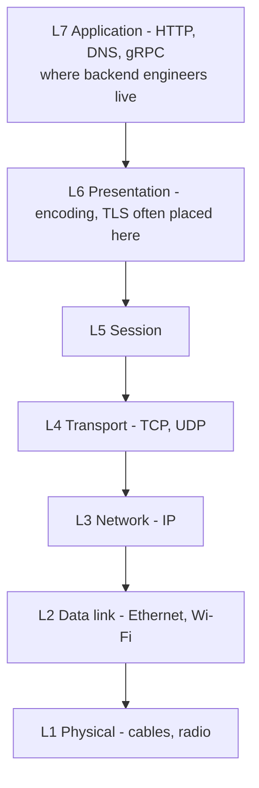

Backend engineers mostly work at **layer 7 (application)**. Handshakes, TLS internals and packet handling border on network engineering — worth knowing at a high level, but a rabbit hole for application work.

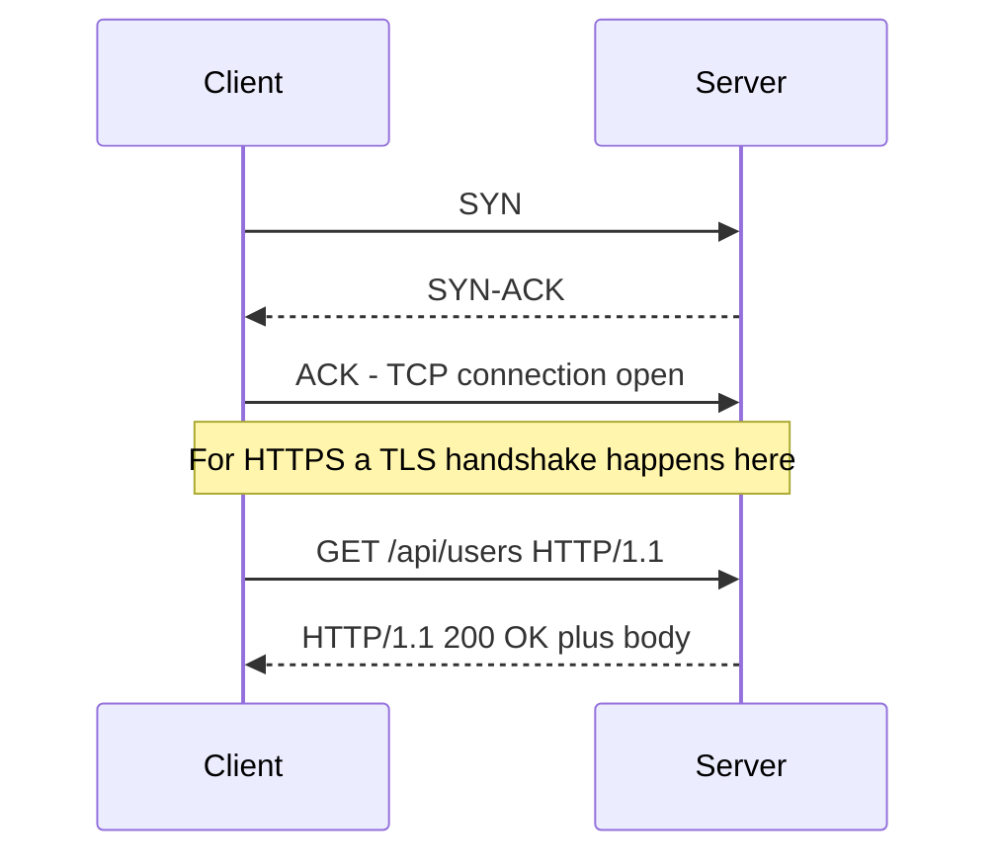

## HTTP versions

| Version | Key change | Problem it solved / left |
|---|---|---|
| **HTTP/1.0** | **New TCP connection for every request/response** | Slow: handshake + teardown per request |
| **HTTP/1.1** | **Persistent connections** (reuse one TCP connection for many requests), **chunked transfer encoding**, better **caching** headers, mandatory `Host` header | Requests on a connection are still sequential → **head-of-line blocking**; browsers open ~6 parallel connections per origin |
| **HTTP/2** | **Binary framing** instead of text, **multiplexing** (many concurrent streams on one connection), **HPACK header compression**, **server push** | Still on TCP: one lost packet stalls **all** streams (TCP-level head-of-line blocking) |
| **HTTP/3** | Built on **QUIC**, a transport over **UDP** | **Faster connection setup** (combined transport + TLS handshake), lower latency, better packet-loss handling, multiplexing **without head-of-line blocking** |

> [!NOTE]
> Server push in HTTP/2 has since been deprecated/removed by major browsers (Chrome removed it in 2022) — it rarely helped in practice. Mention it as an HTTP/2 feature, but know that `103 Early Hints` is the modern replacement.

> [!INTERVIEW]
> "What's the difference between HTTP/1.1, 2 and 3?" — 1.1: text protocol, persistent connections but one request at a time per connection. 2: binary frames, multiplexes many streams over one TCP connection, compresses headers (HPACK). 3: same ideas over QUIC/UDP, so a lost packet only stalls its own stream and connection setup is faster (0-RTT/1-RTT with TLS 1.3 built in).

For application code the takeaway is simple: **client and server establish a connection, then exchange messages**. The version mostly changes performance, not semantics.

## HTTP messages

A **request message** is sent by the client; a **response message** is sent by the server.

### Request structure

```http
POST /api/notes HTTP/1.1
Host: api.example.com
User-Agent: Mozilla/5.0
Accept: application/json
Content-Type: application/json
Content-Length: 41
Authorization: Bearer eyJhbGciOi...

{"title":"Groceries","body":"milk, eggs"}
```

- **Request line**: **method** (`POST`) + **resource URL/path** (`/api/notes`) + **HTTP version** (`HTTP/1.1`, still the most common text form).
- **Host**: the domain being requested.
- **Headers**: key-value lines.
- **Blank line**: signals the end of headers.
- **Body**: data the client sends (optional).

### Response structure

```http
HTTP/1.1 201 Created
Content-Type: application/json
Content-Length: 58
Cache-Control: no-store
Date: Sun, 26 Oct 2026 10:00:00 GMT

{"id":"n_123","title":"Groceries","body":"milk, eggs"}
```

- **Status line**: HTTP version + **status code** (`201`) + **reason phrase** (`Created`).
- **Response headers**, **blank line**, **response body**.

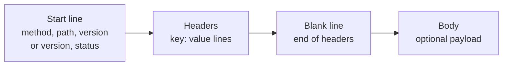

## HTTP headers

### What and why
Headers are **key-value pairs of metadata** about the request or response.

**Why a separate section instead of putting it in the URL or body?** Think of a **courier parcel**. The recipient's name, address, phone and PIN code are written **on the outside**, not packed inside. Every handler along the way (sorting office, truck, delivery person) needs that information *without opening the package*. Headers are the label on the parcel: proxies, load balancers, caches, browsers and servers can read and act on metadata **without parsing the body** (which may be huge, compressed, encrypted or binary).

### Header categories

| Category | Purpose | Examples |
|---|---|---|
| **Request headers** | Tell the server about the client's environment, preferences and capabilities | `User-Agent` (browser, Postman, mobile app, server?), `Authorization` (e.g. Bearer token), `Accept` (JSON? HTML? text?) |
| **General headers** | Metadata about the message itself; used in both requests and responses | `Date`, `Cache-Control` (`no-cache`, `max-age`), `Connection` (`keep-alive` / `close`) |
| **Representation headers** | Describe the **body** so the receiver can interpret it | `Content-Type` (media type, e.g. `application/json`), `Content-Length` (bytes), `Content-Encoding` (`gzip`, `deflate`), `ETag` (version identifier for caching) |
| **Security headers** | Control browser behaviour to prevent attacks | `Strict-Transport-Security`, `Content-Security-Policy`, `X-Frame-Options`, `X-Content-Type-Options`, `Set-Cookie` flags |

### Security headers in detail

| Header | What it does | Attack mitigated |
|---|---|---|
| `Strict-Transport-Security` (HSTS) | Browser must only talk to this site over HTTPS for `max-age` seconds | Protocol downgrade / SSL stripping |
| `Content-Security-Policy` (CSP) | Whitelists sources from which scripts, styles, images can load | Cross-site scripting (XSS) |
| `X-Frame-Options` (`DENY`/`SAMEORIGIN`) | Prevents the page being embedded in an `<iframe>` | Clickjacking |
| `X-Content-Type-Options: nosniff` | Browser must not guess (sniff) the MIME type; trust `Content-Type` | MIME-type sniffing attacks |
| `Set-Cookie: ...; HttpOnly; Secure` | `HttpOnly`: JS can't read the cookie. `Secure`: only sent over HTTPS | Cookie theft via XSS / interception |

```http
Strict-Transport-Security: max-age=31536000; includeSubDomains
Content-Security-Policy: default-src 'self'; img-src 'self' https://cdn.example.com
X-Frame-Options: DENY
X-Content-Type-Options: nosniff
Set-Cookie: session=abc123; HttpOnly; Secure; SameSite=Lax; Path=/
```

### Two big ideas behind headers

**1. Extensibility.** New behaviour can be added just by defining new headers — **without changing the protocol**. Adding a bit of metadata changes the whole interaction:
- security features (`Strict-Transport-Security` forcing secure connections);
- **custom headers** for your own app (e.g. `X-Request-ID`, `X-Custom-Header`);
- content negotiation (`Accept`, `Accept-Language`, `Accept-Encoding`).

> [!NOTE]
> The `X-` prefix for custom headers is a convention that RFC 6648 (2012) officially deprecated, but you'll still see it everywhere (`X-Request-ID`, `X-Forwarded-For`). New custom headers can just use a descriptive name.

**2. Remote control.** Headers let the client **send instructions/preferences** that change how the server responds:
- **Content type negotiation** — `Accept: text/html` gets HTML, `Accept: application/json` gets JSON.
- **Caching and expiration** — server uses `Cache-Control` / `Expires` to tell the client how long to cache.
- **Authentication** — `Authorization` header influences access-control decisions.

## HTTP methods

### Why methods exist
Methods represent the **intent** of the request — what action the client wants on the resource — instead of every request "doing the same thing". This gives each request clear **semantic meaning**.

| Method | Intent | Body? | Notes |
|---|---|---|---|
| **GET** | Fetch data | No | Must **not modify** server state |
| **POST** | Create data / submit | Yes | How else would you send new data? |
| **PATCH** | **Partial update** (selective replacement) | Yes | e.g. update just the user's name |
| **PUT** | **Full replacement** of the resource | Yes | Whatever is in the body **completely replaces** the previous version |
| **DELETE** | Remove a resource | Usually no | |
| **OPTIONS** | Ask the server's **capabilities** for a URL | No | Used by browsers for **CORS preflight** |
| **HEAD** | Like GET but headers only | No | Not covered in depth in the video; standard |

### PUT vs PATCH

```http
# Current resource: {"name":"Asha","email":"asha@x.com","bio":"Hi"}

PATCH /users/7
{"name":"Asha R"}
# Result: {"name":"Asha R","email":"asha@x.com","bio":"Hi"}

PUT /users/7
{"name":"Asha R"}
# Result (strict semantics): {"name":"Asha R"}  -> email and bio are gone
```

> [!TIP]
> Rule of thumb from the video: **use PATCH unless you have a specific reason for PUT.** Many developers use PUT for partial updates, which violates its semantics — a client that sends only changed fields with PUT would, by the spec, wipe the others.

### Idempotency
**Idempotent** = making the same request **once or many times leaves the server in the same state** (same result).

| Method | Idempotent? | Reasoning |
|---|---|---|
| GET | Yes | Fetching 10 times changes nothing (also **safe**: no side effects) |
| PUT | Yes | Replacing a resource with the same data repeatedly gives the same final state |
| DELETE | Yes | Once deleted, it stays deleted; repeating doesn't change state further (the *response* may differ — 204 then 404 — but the *state* is the same) |
| POST | **No** | Submitting "create note" twice creates **two** notes |
| PATCH | Not guaranteed | `{"name":"X"}` is idempotent, but `{"op":"increment"}` is not |
| HEAD, OPTIONS | Yes | Read-only |

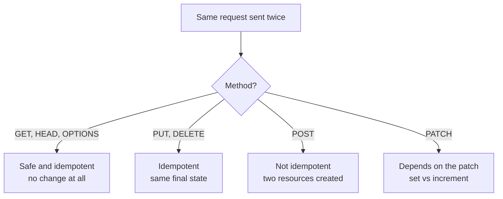

> [!INTERVIEW]
> "Why does idempotency matter?" — Networks fail. If a client times out, it doesn't know whether the server processed the request. Idempotent requests can be **retried safely** by clients, proxies and libraries. For non-idempotent operations like payments (POST), APIs use an **`Idempotency-Key` header** so the server can detect and ignore duplicate submissions.

## CORS — Cross-Origin Resource Sharing

### The problem: same-origin policy
By default browsers follow the **same-origin policy**: a web page may only make requests to the **same origin** that served it. An origin is **scheme + host + port**: `http://localhost:5173` and `http://localhost:3000` are **different origins** (different ports) even on the same machine, as are `example.com` and `api.example.com`.

Without this, any malicious site you visit could use your logged-in browser to read data from your bank's API.

**CORS** is a browser-enforced mechanism that lets **servers declare which other origins may access their resources, and how**. Without CORS headers, a request from `example.com` to `api.example.com` is blocked (the response is withheld from JavaScript).

There are two flows: **simple requests** and **preflighted requests**.

### Simple request flow
Frontend at `https://example.com`, API at `https://api.example.com`, request `GET /data`:

1. The browser automatically adds an **`Origin`** header (`Origin: https://example.com`).
2. The request uses a simple method (**GET, POST or HEAD**) and reaches the server.
3. The server checks `Origin` against its CORS policy. If allowed, it includes **`Access-Control-Allow-Origin`** in the response, either the exact origin or `*` (all origins).
4. The browser sees the page origin differs from the API origin, so it checks for that header. If it is `https://example.com` or `*`, the response is passed to JS. If **missing or not matching**, the browser **blocks** the response — you see a **CORS error** in the console and network tab.

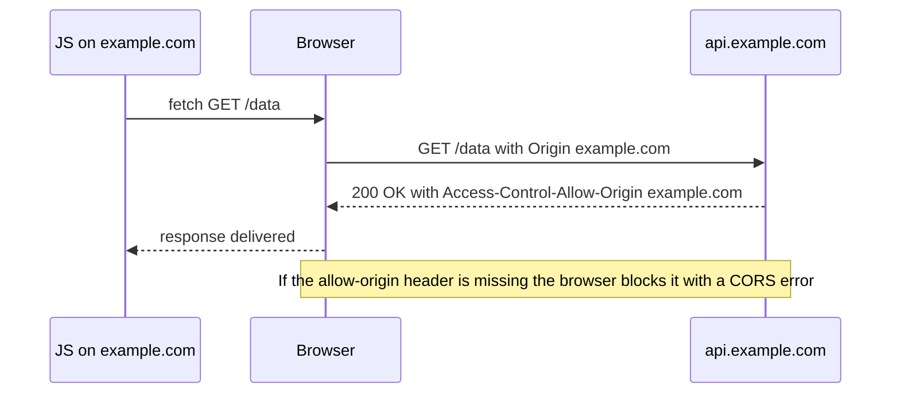

```http
GET /data HTTP/1.1
Host: api.example.com
Origin: https://example.com

HTTP/1.1 200 OK
Access-Control-Allow-Origin: https://example.com
Content-Type: application/json

{"items":[1,2,3]}
```

> [!WARNING]
> CORS errors happen **in the browser**. The server usually *did* receive and process the request — the browser just refuses to hand the response to JS. So a "blocked" simple POST may still have written to your database. CORS is not a server-side access control; non-browser clients (curl, Postman, servers) ignore it completely.

### When does the browser preflight?
A cross-origin request is **preflighted** if it is cross-origin **and any one** of these is true:

1. **Method** is not GET, POST or HEAD (e.g. PUT, DELETE, PATCH).
2. It includes **non-simple headers** — anything beyond the basic CORS-safelisted headers, e.g. **`Authorization`** or a custom `X-...` header.
3. **`Content-Type`** is something other than `application/x-www-form-urlencoded`, `multipart/form-data` or `text/plain` — e.g. **`application/json`**.

> [!IMPORTANT]
> Since almost every modern API sends **JSON** and/or an **`Authorization`** header, **most real API calls from a browser are preflighted.**

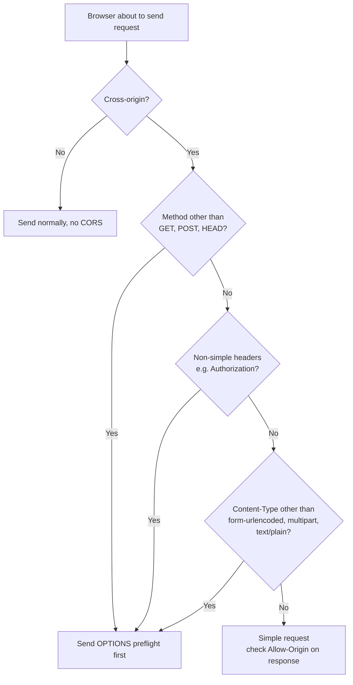

### Preflight request flow
The **preflight** is an **`OPTIONS`** request sent **before** the real request, asking "do you support this?" It carries **no body**.

```http
OPTIONS /api/notes/42 HTTP/1.1
Host: api.example.com
Origin: https://example.com
Access-Control-Request-Method: PUT
Access-Control-Request-Headers: Authorization, Content-Type
```

- `Access-Control-Request-Method`: "Do you allow **PUT** on this route?"
- `Access-Control-Request-Headers`: "Do you allow these **headers**?"

If the server handles CORS, it responds:

```http
HTTP/1.1 204 No Content
Access-Control-Allow-Origin: https://example.com
Access-Control-Allow-Methods: GET, POST, PUT, DELETE
Access-Control-Allow-Headers: Authorization, Content-Type
Access-Control-Max-Age: 86400
Content-Length: 0
```

The four key response headers:

| Header | Meaning | Browser checks |
|---|---|---|
| `Access-Control-Allow-Origin` | This origin (or `*`) may call me | Origin matches |
| `Access-Control-Allow-Methods` | Methods allowed for this resource | Requested method is listed |
| `Access-Control-Allow-Headers` | Non-simple headers allowed | Requested headers are listed |
| `Access-Control-Max-Age` | Cache this preflight result for N seconds (86400 = 24 h) | Skip preflights until it expires |

Status **204 No Content** because the preflight is only an inquiry — the information is in headers. If every check passes, the browser sends the **original request** (e.g. `PUT` with `Authorization` and JSON body), and the server responds normally — again including `Access-Control-Allow-Origin`.

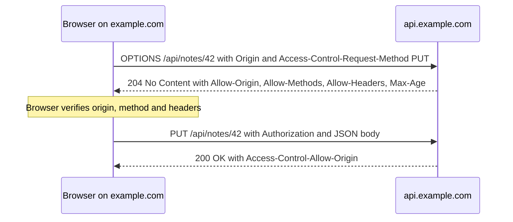

> [!TIP]
> `Access-Control-Max-Age` saves a round trip on every call. In development it may be set to `0` so you can see every preflight; in production use a sensible value (browsers cap it — Chrome at 2 hours, Firefox at 24 hours).

### What the demo shows
Using **Burp Suite** (an HTTP-intercepting tool used by security testers) with a frontend on `localhost:5173` and an API on `localhost:3000`:
- **Simple GET**: request has `Origin: http://localhost:5173` and `Host: localhost:3000` → cross-origin (different ports). Response includes `Access-Control-Allow-Origin: http://localhost:5173` → rendered. After **removing that header on the server**, the same request shows a **CORS error** and the browser blocks the response.
- **Preflighted PUT**: the network tab shows **OPTIONS first, then PUT**. The request qualified for preflight on all three counts (PUT method, `Authorization` header, `Content-Type: application/json`) — any one would have been enough. The OPTIONS response was `204` with allowed origin, methods `GET, POST, PUT, DELETE`, headers `Content-Type, Authorization`, max-age `0` (for testing) and `Content-Length: 0`.

> [!WARNING]
> `Access-Control-Allow-Origin: *` **cannot be combined with credentials** (`credentials: 'include'`, cookies). For cookie-based auth you must echo the specific origin and set `Access-Control-Allow-Credentials: true`. Also, never blindly reflect any `Origin` back — validate it against an allowlist.

```ts
// Minimal CORS middleware (Express-style), for understanding — use a library in practice
const ALLOWED = new Set(["https://example.com"]);

app.use((req, res, next) => {
  const origin = req.headers.origin;
  if (origin && ALLOWED.has(origin)) {
    res.setHeader("Access-Control-Allow-Origin", origin);
    res.setHeader("Vary", "Origin");
  }
  if (req.method === "OPTIONS") {
    res.setHeader("Access-Control-Allow-Methods", "GET, POST, PUT, PATCH, DELETE");
    res.setHeader("Access-Control-Allow-Headers", "Authorization, Content-Type");
    res.setHeader("Access-Control-Max-Age", "86400");
    return res.status(204).end();
  }
  next();
});
```

## HTTP status codes

### Why they exist
**Problem:** without status codes a client would have to **guess** the outcome by inspecting the body: "if it has this shape, it succeeded; if it's `null`, the server crashed…" — inconsistent and fragile.

Status codes communicate the **result in a standardised way**:
- The client can tell at a glance whether it **succeeded, failed, or needs further action**.
- They enable **specific error handling**: on `401` log the user out and ask them to log in again; on `400` show form errors so the user can fix and resubmit.
- They're **standard across all languages and platforms** — Python, Go, Rust, JS, Ruby servers all return `201` for created. A universal language for clients and servers.

They are **three-digit numbers**; the first digit is the class.

| Class | Meaning |
|---|---|
| **1xx** | Informational |
| **2xx** | Success |
| **3xx** | Redirection |
| **4xx** | Client error (the request is wrong) |
| **5xx** | Server error (the server failed) |

### 1xx — Informational (rare in day-to-day work)
- **100 Continue** — the server received the headers and the client may send the body. Used for **large uploads**: client sends headers with `Expect: 100-continue` first; if the server is OK with them, it says 100 and the client sends the rest.
- **101 Switching Protocols** — server is switching protocol as the client asked, e.g. **upgrading HTTP to WebSocket**.

### 2xx — Success
| Code | Meaning | Typical use |
|---|---|---|
| **200 OK** | Request succeeded, returning resource/result | Successful GET; updates returning data |
| **201 Created** | A new resource was created | POST / form submission that creates something (ideally with a `Location` header) |
| **204 No Content** | Success, nothing in the body | CORS preflight responses; DELETE |

### 3xx — Redirection
| Code | Meaning | Typical use |
|---|---|---|
| **301 Moved Permanently** | Resource permanently at new URL; future requests should use it | Renamed `/user` → `/person` while keeping old clients working |
| **302 Found** (temporary redirect) | Temporarily elsewhere; keep using the original URL in future | A few-hour campaign redirect you'll revert |
| **304 Not Modified** | Resource unchanged since last fetch; use your cached copy | Response to conditional GET with ETag / Last-Modified |

> [!NOTE]
> 301 and 302 historically allowed clients to change POST into GET on redirect. **307 Temporary Redirect** and **308 Permanent Redirect** are the method-preserving equivalents — use them for redirecting non-GET requests.

### 4xx — Client errors (where backend engineers spend most time)
| Code | Meaning | When to return it |
|---|---|---|
| **400 Bad Request** | Request is malformed / invalid data | Expected a number, got an array; expected an email, got a phone number; missing required fields |
| **401 Unauthorized** | **Not authenticated** — no valid credentials | Missing JWT/cookie, expired or invalid token |
| **403 Forbidden** | Authenticated but **not permitted** | User A tries to delete user B's resource |
| **404 Not Found** | Resource doesn't exist | Wrong URL or deleted resource |
| **405 Method Not Allowed** | Method not supported on this resource | PUT to a route that only accepts GET/POST (often a frontend typo: PATCH vs PUT) |
| **409 Conflict** | Request conflicts with current state | Creating a folder whose name must be unique but already exists |
| **429 Too Many Requests** | Rate limit exceeded | Client exceeded, say, 60 requests per second (often with `Retry-After`) |

> [!INTERVIEW]
> "401 vs 403?" — **401 = "who are you?"** (authentication missing/invalid; re-login may fix it). **403 = "I know who you are, and you can't do this"** (authorization failed; logging in again won't help). The name "Unauthorized" for 401 is a historical misnomer — it really means unauthenticated.

### 5xx — Server errors
| Code | Meaning | When |
|---|---|---|
| **500 Internal Server Error** | Unexpected condition / unhandled exception | Something broke; respond with 500 instead of hanging or returning empty |
| **501 Not Implemented** | Server doesn't support this method/feature (yet) | Feature planned but not available |
| **502 Bad Gateway** | A proxy/gateway got an **invalid response** from the upstream server | Nginx/load balancer in front of a crashed app — generated by proxies, not usually by your code |
| **503 Service Unavailable** | Temporarily unable to handle requests | Overload or maintenance; "try again later" (with `Retry-After`) |
| **504 Gateway Timeout** | Proxy got **no response in time** from upstream | Nginx waited for your app and timed out |

> [!WARNING]
> For 500 errors, return a **generic message** ("Internal server error") — never stack traces, SQL errors or internal details. They help attackers. Log the details server-side with a request ID instead.

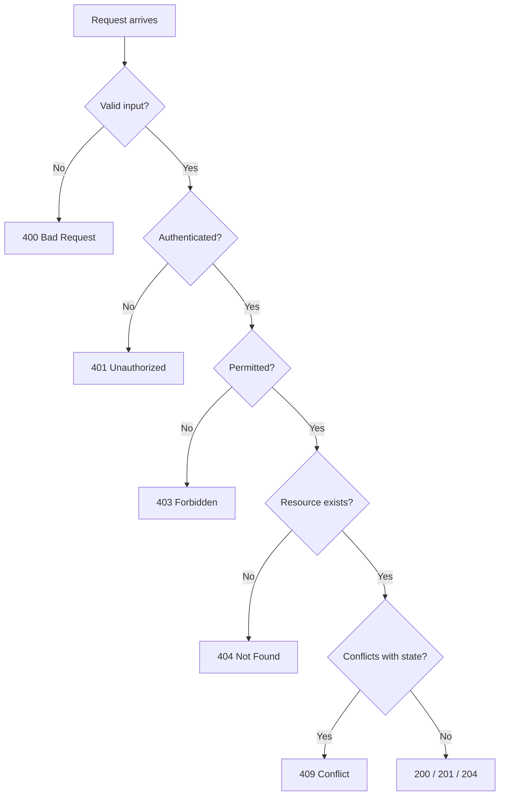

The demo fires mock requests (each preceded by an OPTIONS preflight because they're cross-origin) returning 200 OK, 201 Created ("resource created successfully"), 400 ("missing required data"), 401, 403 ("you do not have access"), 404 ("requested resource could not be found"), 409 ("resource already exists"), 500 (deliberately vague message for security) and 503 ("please try again later"). These cover ~95% of real use cases.

## HTTP caching

### What and why
**HTTP caching** stores copies of responses and **reuses** them instead of repeatedly asking the server. Benefits: **faster load times**, **less bandwidth**, **lower server load** — if data hasn't changed, why download it again?

### The three key response headers
On the first `GET /api/resource`, the server returns `200` with the body plus:

| Header | Meaning |
|---|---|
| `Cache-Control: max-age=10` | Treat this response as fresh for up to **10 seconds** |
| `ETag: "3141"` | A **version identifier**, usually a **hash of the response content** |
| `Last-Modified: <date>` | When the resource last changed |

### Conditional requests and 304
When the client fetches again (after the cache is stale), it sends **conditional headers**:

| Request header | Meaning |
|---|---|
| `If-None-Match: "3141"` | "Send the full resource only if the current ETag is **not** 3141" |
| `If-Modified-Since: <date>` | "Send it only if it changed **after** this date" |

The server compares. If unchanged → **`304 Not Modified`**, **no body** — the client uses its cached copy. If changed → **`200 OK`** with the new body and a **new ETag**.

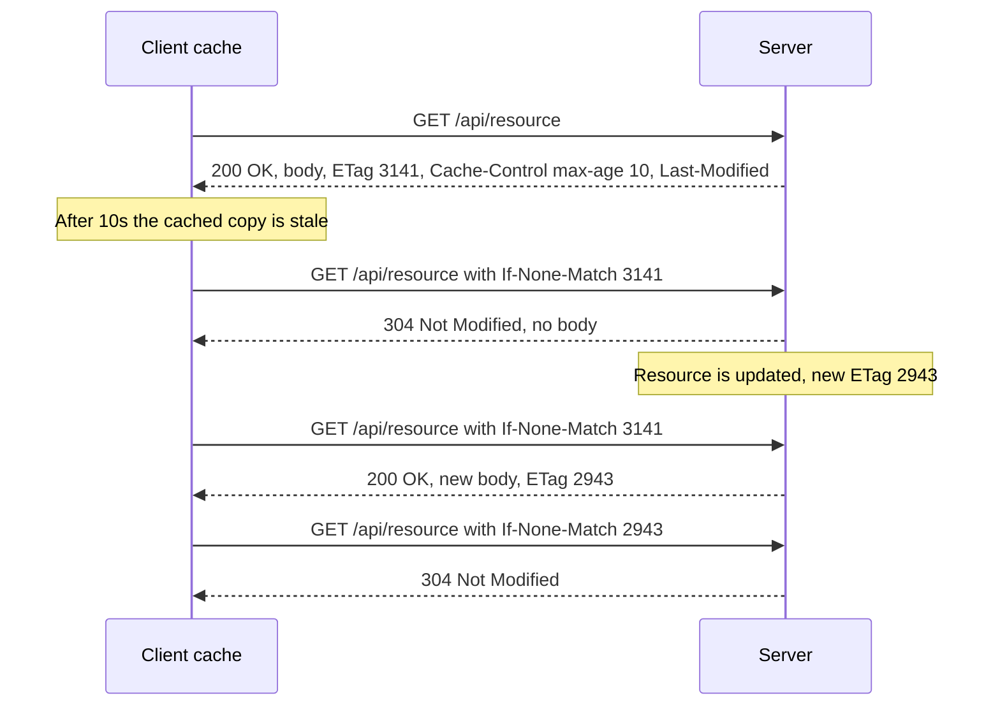

```http
GET /api/resource HTTP/1.1
If-None-Match: "3141"
If-Modified-Since: Sun, 26 Oct 2026 09:00:00 GMT

HTTP/1.1 304 Not Modified
ETag: "3141"
Cache-Control: max-age=10
```

```ts
import crypto from "node:crypto";

app.get("/api/resource", async (req, res) => {
  const data = await loadResource();
  const body = JSON.stringify(data);
  const etag = `"${crypto.createHash("sha1").update(body).digest("hex")}"`;

  res.setHeader("ETag", etag);
  res.setHeader("Cache-Control", "max-age=10");

  if (req.headers["if-none-match"] === etag) {
    return res.status(304).end(); // client copy is current
  }
  res.type("application/json").send(body);
});
```

### Common Cache-Control directives (standard, interview-useful)
| Directive | Meaning |
|---|---|
| `max-age=N` | Fresh for N seconds |
| `no-cache` | May store, but **must revalidate** with the server before each use (not "don't cache"!) |
| `no-store` | Don't store at all (sensitive data) |
| `private` | Only the browser may cache, not shared caches/CDNs |
| `public` | Shared caches (CDNs, proxies) may cache |
| `s-maxage=N` | max-age for shared caches |
| `must-revalidate` | Once stale, must revalidate before use |

> [!WARNING]
> HTTP caching gets complicated in production: the server must correctly compute and update ETags. If it forgets to change the ETag after an update, clients keep using an **outdated cached version**. For complex apps, client-side data libraries like **React Query (TanStack Query)** give the client full control over when to use cached data and when to refetch. HTTP caching is great when the use case is simple (static assets, rarely-changing resources).

## Content negotiation

**Content negotiation** is how client and server **agree on the best representation** of a resource. The client states preferences; the server responds with a compatible format, or a fallback.

| Type | Request header | Example | Response header |
|---|---|---|---|
| **Media type** | `Accept` | `application/json`, `application/xml`, `text/html` | `Content-Type` |
| **Language** | `Accept-Language` | `en`, `es` | `Content-Language` |
| **Encoding** (compression) | `Accept-Encoding` | `gzip, deflate, br, zstd` | `Content-Encoding` |

Demo: the default request (`Accept-Language: en`, `Accept: application/json`, `Accept-Encoding: gzip, deflate, br, zstd`) returns English JSON. Changing to `Accept-Language: es` returns the **same data in Spanish**; switching `Accept: application/xml` returns **Spanish XML**. The server adapted the representation purely from headers.

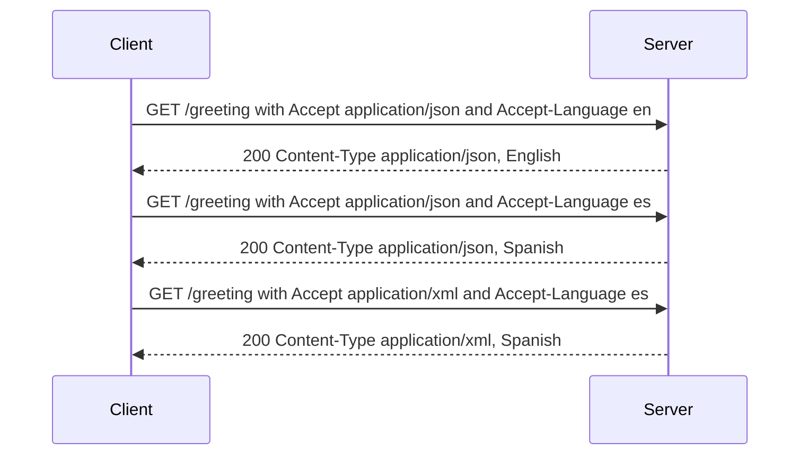

```http
GET /greeting HTTP/1.1
Accept: application/xml;q=0.9, application/json;q=1.0
Accept-Language: es, en;q=0.5
Accept-Encoding: gzip, br
```

> [!NOTE]
> The `q` values (quality factors, 0–1) rank preferences. If the server can't produce any acceptable media type it may return **406 Not Acceptable**. When responses vary by these headers, the server should send `Vary: Accept, Accept-Language` so caches don't serve the wrong variant.

## HTTP compression

Part of the same umbrella (encoding negotiation). The client advertises supported algorithms with `Accept-Encoding`; the server compresses the body and declares it with `Content-Encoding`; the browser **decompresses** transparently.

Demo with a JSON response of **11,000 entries**:

| Setting | Transferred size |
|---|---|
| Compression **on** (`Content-Encoding: gzip`) | **3.8 MB** |
| Compression **off** | **26 MB** |

Same file, roughly 7× smaller. Multiply by every client downloading it, and compression saves enormous bandwidth.

| Algorithm | Notes |
|---|---|
| `gzip` | Universal support, good default |
| `deflate` | Older, similar algorithm, inconsistent historical implementations |
| `br` (Brotli) | Better ratio than gzip for text, widely supported over HTTPS; common for static assets |
| `zstd` | Newer, fast with good ratio; supported in modern browsers |

> [!TIP]
> Compress text (JSON, HTML, CSS, JS); don't bother compressing already-compressed data (JPEG, PNG, MP4, ZIP). Often compression is done by the reverse proxy (Nginx) or a middleware rather than in handler code.

## Persistent connections and Keep-Alive

**Problem:** in HTTP/1.0, every request/response needed its **own TCP connection**. Opening and closing TCP connections (handshake, slow start, teardown) is **resource-intensive and slow**.

**Solution (HTTP/1.1):** **persistent connections** — a single TCP connection is **reused** for many requests and responses, avoiding the open/close overhead.

- In **HTTP/1.1, connections are persistent by default**. Nothing needs to be done explicitly; they stay open unless closed.
- **`Connection: keep-alive`** is the mechanism/header that enables this. It is still sometimes sent explicitly, and a `Keep-Alive` header can specify parameters: **`timeout`** (how long to keep the idle connection open) and **`max`** (how many requests before closing).
- **`Connection: close`** — close the connection after this response. This was the **default in HTTP/1.0** and can still be forced in 1.1.

```http
HTTP/1.1 200 OK
Connection: keep-alive
Keep-Alive: timeout=5, max=100
```

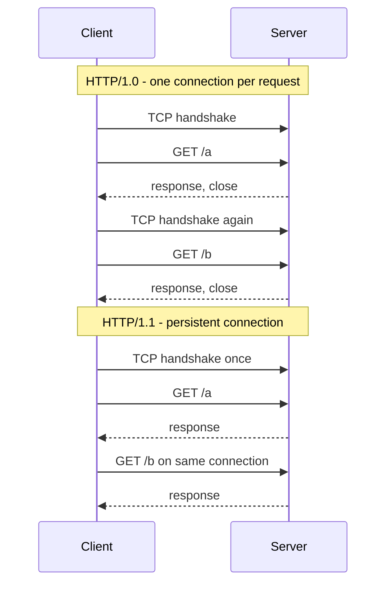

> [!NOTE]
> In HTTP/2 and HTTP/3 the `Connection` and `Keep-Alive` headers are **forbidden** — connection management is built into the protocol. You'll usually rely on defaults; the main backend-relevant knob is the server's keep-alive timeout (e.g. it should be longer than the load balancer's idle timeout to avoid sporadic 502s).

## Handling large requests and responses

### Large uploads: multipart requests
Files (images, video, audio) are far larger than typical JSON. To send them, clients use **`multipart/form-data`**: the body is split into **parts**, each with its own headers, separated by a **boundary** string.

```http
POST /upload HTTP/1.1
Host: api.example.com
Content-Type: multipart/form-data; boundary=----WebKitFormBoundary7MA4YWxk
Content-Length: 284133

------WebKitFormBoundary7MA4YWxk
Content-Disposition: form-data; name="file"; filename="photo.jpg"
Content-Type: image/jpeg

<binary bytes of the image...>
------WebKitFormBoundary7MA4YWxk--
```

- **`boundary`** is the **delimiter** that separates parts. It appears at the start of the binary data and again at the end (the final one with a trailing `--`).
- The server reads the parts, stores the file, and responds with details confirming the upload.

> [!TIP]
> Whenever you transfer files to the server, use **multipart** requests (or direct-to-object-storage uploads with presigned URLs for very large files — covered in the object storage chapter). Never base64-encode big files into JSON: it inflates size by ~33%.

### Large downloads: streaming in chunks
For a large response (the demo uses a big text file), the server **streams** data to the client in chunks rather than building the whole response in memory.

Key response headers in the demo:
- **`Content-Type: text/event-stream`** — the data arrives as a stream of **events** (this is the Server-Sent Events format).
- **`Connection: keep-alive`** — keep the connection open until all data is sent.

The client keeps receiving chunks and **appends** them to reconstruct the full file.

```ts
// Streaming a large file to the client (Node.js)
import fs from "node:fs";

app.get("/stream", (req, res) => {
  res.setHeader("Content-Type", "text/event-stream");
  res.setHeader("Connection", "keep-alive");
  const stream = fs.createReadStream("./big.txt", { encoding: "utf8" });
  stream.on("data", (chunk) => res.write(`data: ${JSON.stringify(chunk)}\n\n`));
  stream.on("end", () => res.end());
});
```

> [!NOTE]
> Precisely: generic HTTP/1.1 streaming uses **`Transfer-Encoding: chunked`** (no `Content-Length` needed — each chunk is prefixed by its size). `text/event-stream` is the SSE format built on top of a long-lived streaming response. Both let the server send data before the full payload is ready.

## SSL, TLS and HTTPS

- **SSL (Secure Sockets Layer)** — the original protocol for securing client-server communication. It **encrypts** data so sensitive information (passwords, card numbers) can't be intercepted. **Outdated** due to security vulnerabilities; all versions are deprecated.
- **TLS (Transport Layer Security)** — the modern, more secure successor. It encrypts **data in transit** so it's protected from **interception and tampering**. It uses **certificates** to **authenticate the server** and establish an encrypted connection, preventing eavesdropping and data breaches. It is continuously updated; the current recommended version is **TLS 1.3** (TLS 1.2 is still widely accepted).
- **HTTPS** — **HTTP over TLS** (originally over SSL). When you visit an HTTPS site, TLS encrypts all communication between browser and server, protecting e.g. login credentials.

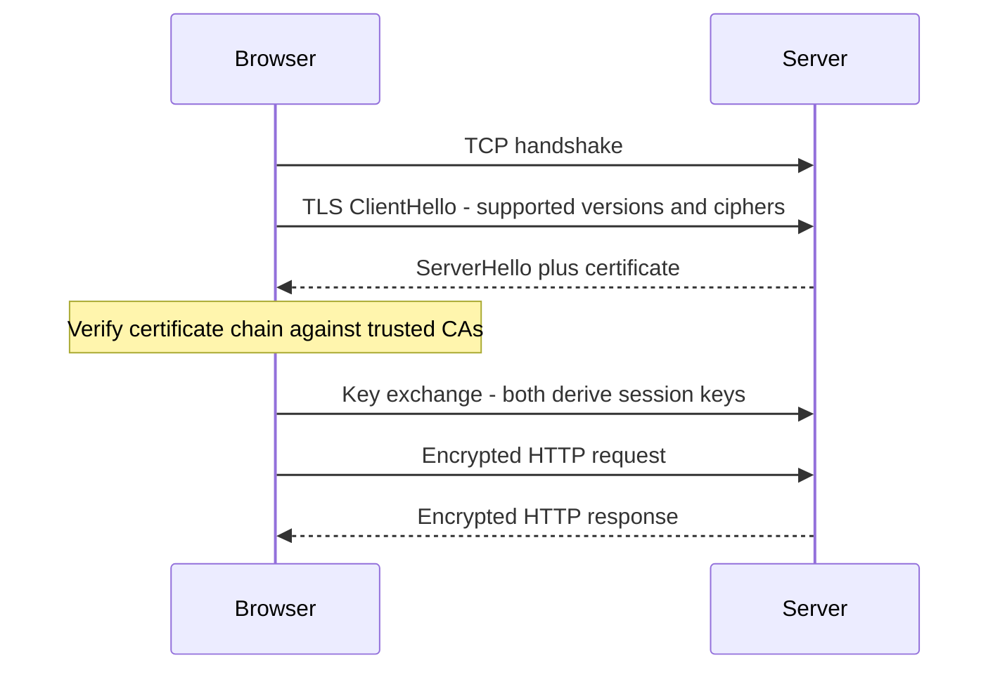

> [!NOTE]
> People still say "SSL certificate", but the certificates are used by TLS. In typical deployments TLS is **terminated** at the reverse proxy or load balancer (e.g. Nginx with Certbot certificates), and the app behind it speaks plain HTTP on a private network.

## Putting it together
If you can visualise all of these pieces — stateless messages over a connection, headers as metadata and remote control, methods as intent, CORS checks in the browser, status codes as outcomes, caching via ETags, negotiation and compression via `Accept-*`, persistent connections, multipart and streaming, TLS underneath — you can understand and debug most backend HTTP issues.

## Common mistakes & misconceptions
- **"Stateless means my app has no state."** The protocol is stateless; app state lives in DBs, caches, session stores.
- **Using PUT for partial updates.** PUT means full replacement; use PATCH.
- **Assuming DELETE must return the same response every time to be idempotent.** Idempotency is about server **state**, not identical responses.
- **Thinking CORS protects the server.** It protects users in browsers; the request often still reaches your server.
- **Fixing CORS in the frontend.** CORS is configured on the **server** (or proxy); the browser just enforces it.
- **`Access-Control-Allow-Origin: *` with cookies.** Not allowed; use explicit origin + `Allow-Credentials`.
- **Forgetting to handle `OPTIONS`.** Auth middleware that rejects the preflight (it has no `Authorization` header) breaks every CORS call.
- **Returning 200 with `{"error": ...}`.** Use proper status codes so clients and monitoring can react.
- **Mixing up 401 and 403**, or 400 and 422/409.
- **`no-cache` means "don't cache".** It means "revalidate before using"; `no-store` means don't cache.
- **Not updating ETags on change** → stale data served forever.
- **Leaking stack traces in 500 responses.**
- **Compressing images/videos** — wasted CPU.
- **Calling it "SSL" in an interview without clarification** — SSL is obsolete; say TLS.

## Interview questions

<details>
<summary><strong>Q: What does it mean that HTTP is stateless, and how do we build logins on top of it?</strong></summary>

The server keeps no memory of previous requests; each request must carry everything needed to process it. This simplifies servers and lets any server behind a load balancer handle any request, and crashes lose no conversational state. To build logins, the app adds state on top: after login the server issues a **session ID cookie** (state stored server-side in a DB/Redis) or a **token** like a JWT (state carried by the client), which the client sends with every request so the server can identify the user.

</details>

<details>
<summary><strong>Q: Explain the structure of an HTTP request and response.</strong></summary>

Request: a request line (`METHOD /path HTTP/1.1`), headers (key-value metadata like `Host`, `Content-Type`, `Authorization`), a blank line, and an optional body. Response: a status line (`HTTP/1.1 200 OK`), headers (`Content-Type`, `Cache-Control`, `Set-Cookie`…), a blank line, and an optional body. Headers sit outside the body so intermediaries can act on metadata without parsing the payload — like the address label on a parcel.

</details>

<details>
<summary><strong>Q: PUT vs PATCH vs POST — when do you use each?</strong></summary>

| | Purpose | Idempotent |
|---|---|---|
| POST | Create a new resource / trigger processing | No |
| PUT | Replace the entire resource with the body | Yes |
| PATCH | Modify only the fields provided | Not guaranteed |

Use POST `/notes` to create, PATCH `/users/7` with `{"name":"X"}` to rename, PUT only when the client sends the full representation (missing fields are removed).

</details>

<details>
<summary><strong>Q: What is idempotency and why does it matter? How do you make a POST payment safe to retry?</strong></summary>

An operation is idempotent if doing it many times has the same effect on server state as doing it once. GET, PUT, DELETE, HEAD, OPTIONS are idempotent; POST isn't. It matters because networks fail — a client that timed out can't tell if the request was processed, so only idempotent requests are safe to retry automatically. For payments, the client generates a unique **Idempotency-Key** header; the server stores the key with the result and, on a duplicate key, returns the stored result instead of charging again.

</details>

<details>
<summary><strong>Q: Walk me through a CORS preflight. When does the browser send one?</strong></summary>

For cross-origin requests the browser sends an `OPTIONS` preflight if the method isn't GET/POST/HEAD, **or** it has non-safelisted headers like `Authorization`, **or** `Content-Type` isn't form-urlencoded, multipart or text/plain (e.g. JSON). The preflight carries `Origin`, `Access-Control-Request-Method` and `Access-Control-Request-Headers`, no body. The server replies (usually 204) with `Access-Control-Allow-Origin`, `-Allow-Methods`, `-Allow-Headers` and `-Max-Age`. If all match, the browser sends the real request; the actual response must also include `Access-Control-Allow-Origin`. `Max-Age` lets the browser cache the result and skip future preflights.

</details>

<details>
<summary><strong>Q: Your frontend gets a CORS error, but Postman works fine. Why, and how do you fix it?</strong></summary>

CORS is enforced only by browsers; Postman doesn't apply the same-origin policy. The fix is on the server (or reverse proxy): return `Access-Control-Allow-Origin` with the frontend's exact origin, handle `OPTIONS` preflights (return 204 with allowed methods/headers, and make sure auth middleware doesn't reject OPTIONS), and if cookies are used set `Access-Control-Allow-Credentials: true` without using `*`. Check that origin includes the right scheme and port (`localhost:5173` ≠ `localhost:3000`).

</details>

<details>
<summary><strong>Q: 401 vs 403 vs 404 — and when might you return 404 instead of 403?</strong></summary>

401: not authenticated (missing/expired token) — re-authenticating may help. 403: authenticated but lacking permission. 404: resource doesn't exist. Some APIs deliberately return **404 instead of 403** for resources the user isn't allowed to see, so attackers can't confirm a resource exists (e.g. GitHub returns 404 for private repos you can't access).

</details>

<details>
<summary><strong>Q: What's the difference between 502, 503 and 504?</strong></summary>

All are server-side. **502 Bad Gateway**: a proxy/load balancer got an invalid response (or connection refused/reset) from the upstream app — e.g. the app crashed. **503 Service Unavailable**: the service is temporarily overloaded or in maintenance and says "try later" (often with `Retry-After`). **504 Gateway Timeout**: the proxy got no response from upstream within its timeout — e.g. a slow DB query made the app take 60 s while Nginx waits 30 s. 502/504 are typically generated by Nginx/ALB, not your code.

</details>

<details>
<summary><strong>Q: Explain how ETag-based caching works end to end.</strong></summary>

On the first GET the server returns 200 with the body, an `ETag` (hash/version of the content), and `Cache-Control: max-age=N` (and possibly `Last-Modified`). Within N seconds the browser uses its copy without asking. After that, it sends a conditional GET with `If-None-Match: <etag>` (and/or `If-Modified-Since`). If the resource is unchanged, the server returns **304 Not Modified** with no body — saving bandwidth; otherwise 200 with the new body and new ETag. The risk: if the server doesn't update the ETag when data changes, clients keep stale data.

</details>

<details>
<summary><strong>Q: What is the difference between Cache-Control no-cache and no-store?</strong></summary>

`no-cache` lets the client store the response but requires revalidation with the server (e.g. via ETag) before every use — you still save bandwidth via 304s. `no-store` forbids storing the response at all — use it for sensitive data like banking pages or tokens. `private` restricts caching to the browser (not CDNs); `public` allows shared caches.

</details>

<details>
<summary><strong>Q: What is content negotiation? Give examples.</strong></summary>

The mechanism by which client and server agree on the representation of a resource. The client sends preferences: `Accept` (media type, e.g. JSON vs XML), `Accept-Language` (e.g. `es`), `Accept-Encoding` (gzip, br). The server picks the best match and labels it with `Content-Type`, `Content-Language`, `Content-Encoding`, falling back to a default or returning 406 if nothing fits. It should add `Vary` so caches store variants separately.

</details>

<details>
<summary><strong>Q: Why compress HTTP responses, and how is the algorithm chosen?</strong></summary>

Text compresses very well — a 26 MB JSON response dropped to 3.8 MB with gzip — saving bandwidth and improving load times, at a small CPU cost. The client advertises supported algorithms in `Accept-Encoding: gzip, deflate, br, zstd`; the server chooses one and sets `Content-Encoding`; the browser decompresses transparently. Brotli usually compresses text better than gzip; skip compression for already-compressed formats like images and video.

</details>

<details>
<summary><strong>Q: What are persistent connections and how do HTTP/2 and HTTP/3 improve on them?</strong></summary>

HTTP/1.0 opened a new TCP connection per request — expensive handshakes every time. HTTP/1.1 made connections persistent by default (`Connection: keep-alive`), reusing one TCP connection for many sequential requests; `Connection: close` ends it. But HTTP/1.1 still processes one request at a time per connection (head-of-line blocking). HTTP/2 multiplexes many concurrent streams over one connection with binary framing and header compression. HTTP/3 does the same over QUIC/UDP, so packet loss on one stream doesn't block others, and connection setup is faster.

</details>

<details>
<summary><strong>Q: How do you upload a large file over HTTP, and how do you send a large response?</strong></summary>

Uploads: `multipart/form-data`, where the body is split into parts separated by a `boundary` string declared in `Content-Type`; each part has its own `Content-Disposition`/`Content-Type`. For very large files, upload directly to object storage with presigned URLs or chunked/multipart uploads. Downloads: stream the data instead of buffering it — `Transfer-Encoding: chunked` or an event stream (`Content-Type: text/event-stream` with `Connection: keep-alive`), and the client appends chunks as they arrive. This keeps server memory flat and lets the client start processing early.

</details>

<details>
<summary><strong>Q: What is the difference between SSL, TLS and HTTPS?</strong></summary>

SSL was the original encryption protocol for client-server traffic; it's obsolete and insecure. TLS is its successor (current version 1.3), which encrypts data in transit and authenticates the server using certificates issued by trusted CAs, preventing eavesdropping and tampering. HTTPS is simply HTTP sent over a TLS-encrypted connection — same methods, headers and status codes, just encrypted. TLS is often terminated at a reverse proxy or load balancer.

</details>

## Cheat sheet
- **Core ideas**: stateless (self-contained requests; credentials every time), client-server (client initiates).
- **Transport**: TCP (reliable, 3-way handshake); HTTP/3 → QUIC over UDP.
- **Versions**: 1.0 new conn/request · 1.1 keep-alive default, chunked, caching · 2 binary, multiplexing, HPACK, push · 3 QUIC, no HOL blocking.
- **Message**: start line → headers → blank line → body.
- **Header categories**: request (`User-Agent`, `Authorization`, `Accept`) · general (`Date`, `Cache-Control`, `Connection`) · representation (`Content-Type`, `Content-Length`, `Content-Encoding`, `ETag`) · security (HSTS, CSP, `X-Frame-Options`, `X-Content-Type-Options: nosniff`, `HttpOnly`/`Secure` cookies).
- **Methods**: GET read · POST create · PATCH partial · PUT replace · DELETE remove · OPTIONS capabilities. Idempotent: GET, PUT, DELETE, HEAD, OPTIONS. Not: POST.
- **CORS**: origin = scheme + host + port. Simple: GET/POST/HEAD + safelisted headers + form/multipart/text content type. Preflight if any of: other method, `Authorization`/custom header, JSON content type. Preflight = OPTIONS → 204 + `Allow-Origin/Methods/Headers/Max-Age`.
- **Status codes**: 100 Continue, 101 Switching Protocols · 200, 201, 204 · 301 perm, 302 temp, 304 not modified (307/308 keep method) · 400, 401 (unauthenticated), 403 (unauthorized), 404, 405, 409, 429 · 500, 501, 502 (bad upstream), 503 (unavailable), 504 (upstream timeout).
- **Caching**: response `Cache-Control: max-age`, `ETag`, `Last-Modified` → request `If-None-Match`, `If-Modified-Since` → 304 or 200. `no-cache` = revalidate, `no-store` = never store.
- **Negotiation**: `Accept` ↔ `Content-Type`, `Accept-Language` ↔ `Content-Language`, `Accept-Encoding` ↔ `Content-Encoding`; add `Vary`.
- **Compression**: gzip, deflate, br, zstd; demo 26 MB → 3.8 MB.
- **Keep-alive**: default in 1.1; `Keep-Alive: timeout=5, max=100`; `Connection: close` = 1.0 behaviour.
- **Large data**: upload `multipart/form-data; boundary=...`; download chunked / `text/event-stream`.
- **Security**: SSL obsolete → TLS 1.3; HTTPS = HTTP over TLS.

## Glossary
- **Stateless** — each request is independent; the server retains no memory between requests.
- **TCP** — reliable, connection-oriented transport protocol.
- **UDP** — connectionless, unreliable transport protocol.
- **QUIC** — UDP-based transport with built-in TLS and multiplexing; basis of HTTP/3.
- **OSI model** — 7-layer conceptual model of networking; HTTP is layer 7.
- **Multiplexing** — sending multiple independent streams concurrently over one connection.
- **Head-of-line blocking** — later requests/packets stuck waiting behind an earlier one.
- **HPACK** — header compression format used by HTTP/2.
- **Header** — key-value metadata attached to an HTTP message.
- **MIME type / media type** — identifier of data format, e.g. `application/json`.
- **Idempotent** — repeating an operation yields the same server state.
- **Safe method** — a method with no side effects (GET, HEAD, OPTIONS).
- **Origin** — scheme + host + port.
- **Same-origin policy** — browser rule restricting scripts to their own origin.
- **CORS** — mechanism letting servers allow cross-origin access via headers.
- **Preflight** — OPTIONS request the browser sends to check CORS permission before the real request.
- **ETag** — opaque version identifier (often a content hash) for a resource.
- **Conditional request** — request with `If-None-Match`/`If-Modified-Since` asking for data only if changed.
- **Content negotiation** — selecting a resource representation based on `Accept-*` headers.
- **Persistent connection / keep-alive** — reusing one TCP connection for multiple requests.
- **Multipart** — body format containing multiple parts separated by a boundary.
- **Chunked transfer encoding** — sending a body in size-prefixed chunks without knowing total length.
- **HSTS** — header forcing browsers to use HTTPS only.
- **CSP** — header restricting allowed content sources to prevent XSS.
- **Clickjacking** — tricking users into clicking hidden framed content.
- **TLS** — protocol for encrypting and authenticating network traffic; successor to SSL.
- **Burp Suite** — HTTP interception proxy used for security testing and traffic inspection.

## Video timestamps
- [00:00](https://www.youtube.com/watch?v=a3C1DMswClQ&t=0s) — Scope; statelessness
- [00:48](https://www.youtube.com/watch?v=a3C1DMswClQ&t=48s) — Self-contained requests; benefits of stateless design
- [01:39](https://www.youtube.com/watch?v=a3C1DMswClQ&t=99s) — State on top (cookies, sessions); client-server model
- [02:29](https://www.youtube.com/watch?v=a3C1DMswClQ&t=149s) — Client initiates; HTTP vs HTTPS; connections
- [03:15](https://www.youtube.com/watch?v=a3C1DMswClQ&t=195s) — TCP, reliability, OSI model
- [04:01](https://www.youtube.com/watch?v=a3C1DMswClQ&t=241s) — HTTP versions: 1.0 and 1.1
- [04:50](https://www.youtube.com/watch?v=a3C1DMswClQ&t=290s) — HTTP/2 and HTTP/3
- [05:39](https://www.youtube.com/watch?v=a3C1DMswClQ&t=339s) — HTTP request and response messages
- [06:26](https://www.youtube.com/watch?v=a3C1DMswClQ&t=386s) — Body, status line; intro to headers
- [07:15](https://www.youtube.com/watch?v=a3C1DMswClQ&t=435s) — Why headers: the parcel analogy
- [08:04](https://www.youtube.com/watch?v=a3C1DMswClQ&t=484s) — Header categories: request headers
- [08:53](https://www.youtube.com/watch?v=a3C1DMswClQ&t=533s) — General headers
- [09:39](https://www.youtube.com/watch?v=a3C1DMswClQ&t=579s) — Representation and security headers
- [10:29](https://www.youtube.com/watch?v=a3C1DMswClQ&t=629s) — Extensibility
- [11:15](https://www.youtube.com/watch?v=a3C1DMswClQ&t=675s) — Headers as remote control
- [12:04](https://www.youtube.com/watch?v=a3C1DMswClQ&t=724s) — HTTP methods and intent
- [12:51](https://www.youtube.com/watch?v=a3C1DMswClQ&t=771s) — GET, POST, PATCH, PUT
- [13:38](https://www.youtube.com/watch?v=a3C1DMswClQ&t=818s) — DELETE; idempotency
- [15:11](https://www.youtube.com/watch?v=a3C1DMswClQ&t=911s) — POST non-idempotent; OPTIONS method
- [16:00](https://www.youtube.com/watch?v=a3C1DMswClQ&t=960s) — Same-origin policy and CORS
- [16:47](https://www.youtube.com/watch?v=a3C1DMswClQ&t=1007s) — Simple request flow
- [18:21](https://www.youtube.com/watch?v=a3C1DMswClQ&t=1101s) — When a request is preflighted
- [19:57](https://www.youtube.com/watch?v=a3C1DMswClQ&t=1197s) — Preflight request structure
- [20:46](https://www.youtube.com/watch?v=a3C1DMswClQ&t=1246s) — Preflight response headers and Max-Age
- [22:20](https://www.youtube.com/watch?v=a3C1DMswClQ&t=1340s) — Original request after preflight; demo setup
- [23:08](https://www.youtube.com/watch?v=a3C1DMswClQ&t=1388s) — Burp Suite; simple request demo
- [25:34](https://www.youtube.com/watch?v=a3C1DMswClQ&t=1534s) — Removing Allow-Origin: CORS error demo
- [26:23](https://www.youtube.com/watch?v=a3C1DMswClQ&t=1583s) — Preflight demo
- [29:37](https://www.youtube.com/watch?v=a3C1DMswClQ&t=1777s) — Status codes: why they exist
- [31:10](https://www.youtube.com/watch?v=a3C1DMswClQ&t=1870s) — Standardisation; status code classes
- [31:59](https://www.youtube.com/watch?v=a3C1DMswClQ&t=1919s) — 1xx and 2xx codes
- [33:33](https://www.youtube.com/watch?v=a3C1DMswClQ&t=2013s) — 3xx codes: 301, 302, 304
- [35:07](https://www.youtube.com/watch?v=a3C1DMswClQ&t=2107s) — 4xx codes: 400, 401, 403
- [36:43](https://www.youtube.com/watch?v=a3C1DMswClQ&t=2203s) — 404, 405, 409, 429
- [38:22](https://www.youtube.com/watch?v=a3C1DMswClQ&t=2302s) — 5xx codes: 500, 501, 502, 503, 504
- [40:01](https://www.youtube.com/watch?v=a3C1DMswClQ&t=2401s) — Status code demo
- [42:26](https://www.youtube.com/watch?v=a3C1DMswClQ&t=2546s) — HTTP caching
- [43:13](https://www.youtube.com/watch?v=a3C1DMswClQ&t=2593s) — Cache-Control, ETag, Last-Modified
- [44:48](https://www.youtube.com/watch?v=a3C1DMswClQ&t=2688s) — Conditional requests and 304
- [45:34](https://www.youtube.com/watch?v=a3C1DMswClQ&t=2734s) — Updating the resource; new ETag
- [47:15](https://www.youtube.com/watch?v=a3C1DMswClQ&t=2835s) — Limits of HTTP caching; React Query
- [48:01](https://www.youtube.com/watch?v=a3C1DMswClQ&t=2881s) — Content negotiation
- [49:36](https://www.youtube.com/watch?v=a3C1DMswClQ&t=2976s) — Content negotiation demo
- [51:09](https://www.youtube.com/watch?v=a3C1DMswClQ&t=3069s) — HTTP compression demo
- [52:43](https://www.youtube.com/watch?v=a3C1DMswClQ&t=3163s) — Persistent connections and Keep-Alive
- [54:20](https://www.youtube.com/watch?v=a3C1DMswClQ&t=3260s) — Connection close; handling large requests and responses
- [55:10](https://www.youtube.com/watch?v=a3C1DMswClQ&t=3310s) — Multipart uploads and boundary
- [55:58](https://www.youtube.com/watch?v=a3C1DMswClQ&t=3358s) — Streaming large responses
- [57:35](https://www.youtube.com/watch?v=a3C1DMswClQ&t=3455s) — SSL, TLS and HTTPS
