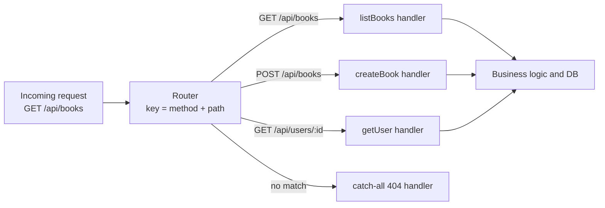
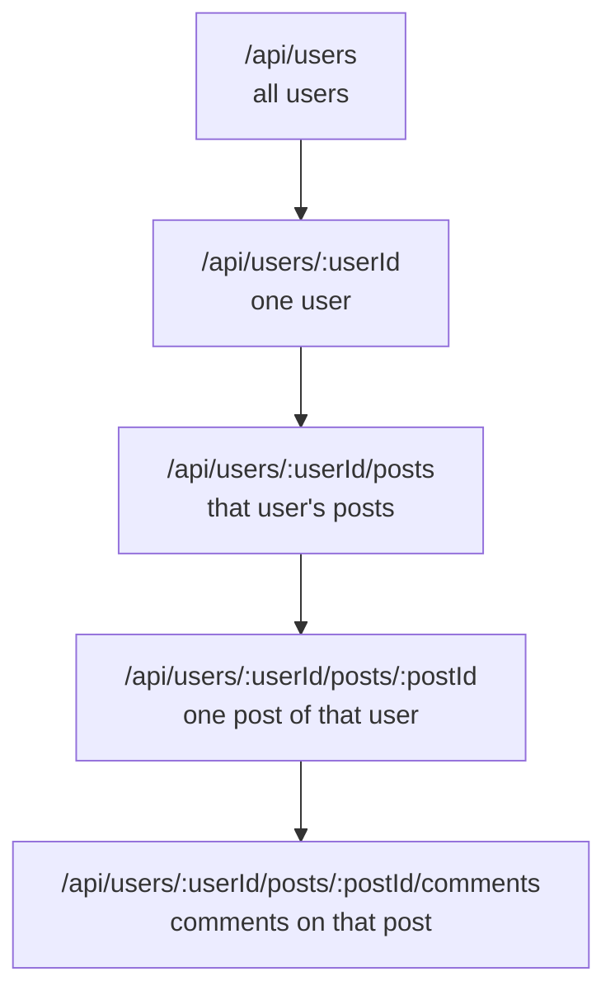
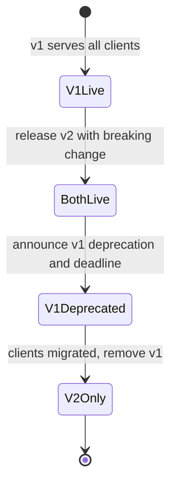
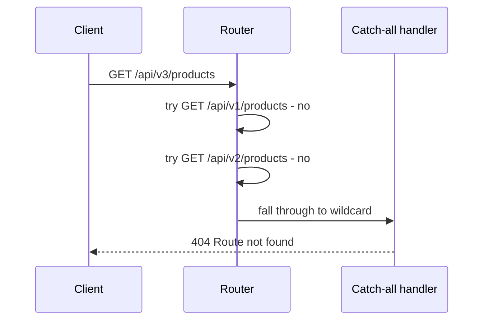

## TL;DR
- **HTTP method = the "what"** (intent: fetch, create, update, delete). **Route = the "where"** (which resource). Routing = **mapping method + URL path to server-side logic (a handler)**.
- The server's route key is effectively **`METHOD + PATH`**: `GET /api/books` and `POST /api/books` share a path but map to **different handlers** and never clash.
- **Static routes** have no variable parts (`/api/books`). **Dynamic routes** contain **path (route) parameters**, conventionally written `:id` (`/api/users/:id`). Path params always arrive as **strings**.
- **Query parameters** (`?key=value&...`) carry **metadata/options** — mainly for GET, which has no body: **pagination** (`page`, `limit`), **filtering**, **sorting** (`sort`, `order`), **search** (`q`).
- Use **path params for identity** (which resource) and **query params for modifiers** (how to slice/filter it).
- **Nested routes** express relationships: `/api/users/123/posts/456` = post 456 of user 123. Each level is its own route and handler.
- **Versioning** (`/api/v1/products` vs `/api/v2/products`) lets you ship **breaking changes** without renaming routes, then **deprecate** v1 after a migration window.
- A **catch-all route** (`*`) registered **last** returns a friendly **404** for unknown paths.

## Why this matters
Every request your backend receives must be dispatched to exactly one piece of code. Getting routing right makes APIs **readable** ("get user 123's post 456"), **evolvable** (versioning) and **predictable** (clean 404s). Interviewers frequently ask about path vs query params, REST URL design, nested resources and versioning strategies.

## What routing is

In the HTTP chapter, methods expressed **intent** — the *what*. Routing expresses the **where** — which resource you want to act on.

| Part | Question it answers | Example |
|---|---|---|
| Method | What do you want to do? | `GET` (fetch) |
| Route / path | Where / on what? | `/users` |
| Combined | Full instruction | "Fetch the users" |

The server takes **method + path**, maps them to a **handler** (a set of instructions), runs business logic and database operations, and returns the result.

> [!IMPORTANT]
> **Routing = mapping (HTTP method + URL path) to server-side logic.** That's all there is to it.



### Same path, different method = different route
In the demo (a React app, traffic inspected with Burp Suite):
- `GET /api/books` → returns the list of books.
- `POST /api/books` → creates a book and returns the books.

The path is identical, but the server **combines method and path into a unique key**, so these are two distinct routes with two handlers.

> [!NOTE]
> `books` here is a **resource** — a REST concept covered in the REST API chapter. For now: a resource is a noun the API exposes (books, users, posts).

## Static routes
A **static route** has **no variable parts**. `/api/books` is a constant string: it never changes between requests and always returns the same kind of data.

```ts
app.get("/api/books", listBooks);
app.post("/api/books", createBook);
```

## Dynamic routes and path parameters

**Problem:** you want details of *one* user. You can't register a route for every user ID.

**Solution:** a **dynamic route** with a placeholder segment: `GET /api/users/:id`.
- A request to `GET /api/users/123` matches: `/api` ✓, `/users` ✓, then **any string** fills the `:id` slot → `id = "123"`.
- The handler extracts the ID and, e.g., fetches that user from the database.
- The `:param` colon syntax is the **industry-wide convention** (Express, Gin, Rails, Spring uses `{id}`, Go 1.22+ `net/http` uses `{id}`).

**Terminology:** these placeholders are **path parameters** or **route parameters**, because they live in the path, after a `/`.

It reads naturally: *"GET me data at /api/users — specifically the user with ID 123."* That human-readable structure is a core idea of REST.

```ts
// TypeScript / Express
app.get("/api/users/:id", async (req, res) => {
  const id = Number(req.params.id);          // "123" -> 123
  if (!Number.isInteger(id)) return res.status(400).json({ error: "invalid id" });
  const user = await db.users.findById(id);
  if (!user) return res.status(404).json({ error: "user not found" });
  res.json(user);
});
```

```go
// Go 1.22+ net/http
mux := http.NewServeMux()
mux.HandleFunc("GET /api/users/{id}", func(w http.ResponseWriter, r *http.Request) {
    id, err := strconv.Atoi(r.PathValue("id")) // path values are strings
    if err != nil {
        http.Error(w, "invalid id", http.StatusBadRequest)
        return
    }
    // fetch user by id ...
    _ = id
})
```

> [!WARNING]
> **Everything in a path is a string.** `123` arrives as `"123"`. Always validate and convert (transform) it before use — this is exactly the "transformation" step covered in the validation chapter. Never interpolate it directly into SQL.

## Query parameters

### The problem they solve
POST/PUT/PATCH requests have a **body** to carry user-supplied values. **GET requests have no body** (in REST practice). So how does a GET carry extra input — like a search term?

You *could* jam it into the path: `/api/search/some-value`. Technically possible, but it **breaks the semantic meaning** of paths (paths identify *resources*), is hard to maintain, and defeats the purpose of readable REST endpoints.

### The solution
**Query parameters**: key-value pairs after a `?`, separated by `&`.

```http
GET /api/search?query=some+value HTTP/1.1
Host: api.example.com
```

- The **route** used for matching is just `/api/search` (plus the method). The query string is **not** part of route matching.
- `query=some+value` is the query parameter (`+` or `%20` encodes a space).

### Pagination example

```http
GET /api/books HTTP/1.1
```

```json
{
  "data": [{ "id": 1, "title": "..." }],
  "total": 100,
  "currentPage": 1,
  "totalPages": 5,
  "limit": 20
}
```

The server applies a **default limit** (e.g. 20) and **default page** (1), and returns metadata: total (100), current page (1), total pages (100 / 20 = 5). The client uses that metadata to request the next page:

```http
GET /api/books?page=2&limit=20 HTTP/1.1
```

### Other typical uses
| Purpose | Example |
|---|---|
| Pagination | `?page=2&limit=20` (or `?cursor=abc`) |
| Filtering | `?status=published&author=42` |
| Sorting | `?sort=createdAt&order=desc` |
| Search | `?q=backend` |
| Field selection | `?fields=id,title` |

```ts
app.get("/api/books", async (req, res) => {
  const page  = Math.max(1, Number(req.query.page ?? 1));
  const limit = Math.min(100, Number(req.query.limit ?? 20)); // cap to protect the DB
  const sort  = req.query.sort === "title" ? "title" : "createdAt"; // allowlist
  const order = req.query.order === "asc" ? "asc" : "desc";
  const { rows, total } = await db.books.list({ page, limit, sort, order });
  res.json({ data: rows, total, currentPage: page, totalPages: Math.ceil(total / limit), limit });
});
```

### Path vs query parameters

| | Path parameter | Query parameter |
|---|---|---|
| Syntax | `/users/:id` → `/users/123` | `/users?role=admin` |
| Part of route matching | **Yes** | **No** |
| Meaning | **Identifies** a specific resource | **Modifies** the request: filter, sort, paginate, search |
| Required? | Usually required (route won't match without it) | Usually optional with defaults |
| Example | `GET /users/123` | `GET /users?page=2&sort=name` |

> [!INTERVIEW]
> "When do you use a path param vs a query param?" — Path params identify **which** resource (`/orders/987`); removing it changes what you're addressing. Query params are optional **modifiers** on a collection or view (`/orders?status=shipped&page=2`). Rule of thumb: if it's an identity, use the path; if it's a filter/sort/pagination option, use the query.

## Nested routes

Not a new routing mechanism — a **practice** that falls out of REST's need to express **relationships between resources**. You'll see it in any API of moderate complexity.

`GET /api/users/123/posts/456` contains a static part (`/api/users`), a path parameter (`123`), another static part (`/posts`) and a second path parameter (`456`). Each prefix is itself a meaningful route with its own handler:

| Route | Meaning |
|---|---|
| `GET /api/users` | List all users |
| `GET /api/users/123` | Details of user 123 |
| `GET /api/users/123/posts` | All posts of user 123 |
| `GET /api/users/123/posts/456` | Post 456 of user 123 |



```ts
app.get("/api/users", listUsers);
app.get("/api/users/:userId", getUser);
app.get("/api/users/:userId/posts", listUserPosts);
app.get("/api/users/:userId/posts/:postId", getUserPost);
```

> [!TIP]
> Keep nesting shallow — usually **at most two levels**. Deep URLs like `/users/1/posts/2/comments/3/likes` become brittle. If a child has a globally unique ID, expose it directly too (`/comments/3`). Also verify the relationship in the handler: post 456 must actually belong to user 123, otherwise return 404 (this prevents IDOR bugs).

## Route versioning and deprecation

Demo: two endpoints that look alike apart from a version segment.

```http
GET /api/v1/products
```
```json
{ "data": [{ "id": 1, "name": "Pen", "price": 10 }] }
```

```http
GET /api/v2/products
```
```json
{ "data": [{ "id": 1, "title": "Pen", "price": 10 }] }
```

v1 returns `name`; v2 renamed it to `title` — a **breaking change** for any client reading `name`.

### Why version?
Requirements change. Say you originally served a web app, and later a React Native / Android / Flutter app needs a different response shape. Options:

1. **Create a differently-named route** (`/api/new-products`) — messy, unclear, routes proliferate.
2. **Version the route** — v1 keeps the old format, v2 serves the new one.

Versioning **expresses intent clearly** (v1 shape vs v2 shape), and you **don't rename the route**.

### Deprecation workflow



1. Release **v2** alongside v1.
2. **Notify** client/frontend engineers that v1 is **deprecated**.
3. Give them a **migration window** to move their calls to v2.
4. **Remove v1**; v2 becomes the stable version.

This gives a stable, complete workflow for introducing breaking changes while clients have time to adapt.

```ts
const v1 = express.Router();
v1.get("/products", (req, res) => {
  res.setHeader("Deprecation", "true");                       // signal deprecation
  res.setHeader("Sunset", "Wed, 31 Dec 2026 23:59:59 GMT");   // removal date
  res.json({ data: products.map(p => ({ id: p.id, name: p.title, price: p.price })) });
});

const v2 = express.Router();
v2.get("/products", (req, res) => res.json({ data: products }));

app.use("/api/v1", v1);
app.use("/api/v2", v2);
```

> [!NOTE]
> URL versioning (`/v1/`) is the most common and visible style. Alternatives (covered in the REST chapter): **header** versioning (`API-Version: 2`), **query** versioning (`?version=2`) and **media-type** versioning (`Accept: application/vnd.example.v2+json`). The `Sunset` header (RFC 8594) and `Deprecation` header are standard ways to warn clients programmatically. Also note: only *breaking* changes need a new version — adding a new optional field doesn't.

## Catch-all routes

What if a client requests a route the server doesn't serve, e.g. `GET /api/v3/products`?

After all the specific routes, the server registers a **catch-all** route (`*` / `/*`) at the very end. Any request that falls through every previous match lands here, and its handler returns a **user-friendly "route not found"** message instead of an empty/null response (which is what you'd otherwise get, or a framework's default page).

```ts
// Registered LAST so it only matches when nothing else did
app.all("*", (req, res) => {
  res.status(404).json({ error: `Route ${req.method} ${req.path} not found` });
});
```



> [!WARNING]
> **Order matters.** Routers generally match in registration order (or by specificity). A catch-all registered first would swallow every request. Similarly, a dynamic route like `/users/:id` registered before `/users/me` may capture `"me"` as an ID in order-based routers — register the static route first.

## Bonus: other route types you'll meet
These are named in the course roadmap; they build on the same ideas.

| Type | Example | Use |
|---|---|---|
| Wildcard segment | `/files/*` → `/files/a/b/c.txt` | Serve file trees, proxies |
| Optional param | `/posts/:id?` | Framework-specific |
| Regex-constrained | `/users/:id(\\d+)` | Only numeric IDs match |
| Route groups | `/api/v1` group with shared auth middleware | Versioning, permissions, shared middleware |

## Common mistakes & misconceptions
- **Putting filters/search in the path** (`/books/search/harry`) instead of the query string.
- **Treating path params as numbers** without parsing/validation — they are strings.
- **Verbs in routes** (`/getUsers`, `/createBook`) — the method already expresses the verb; use nouns (`GET /users`, `POST /books`).
- **Thinking the query string participates in route matching** — `/search?q=a` and `/search?q=b` hit the same route.
- **No pagination limit cap** — `?limit=1000000` can take down your DB.
- **Registering the catch-all first**, or dynamic routes before conflicting static ones.
- **Versioning for non-breaking changes** — adding optional fields doesn't need v2.
- **Not checking nested ownership** — `/users/1/posts/99` must verify post 99 belongs to user 1.
- **Returning 200 with empty body for unknown routes** instead of a clear 404.

## Interview questions

<details>
<summary><strong>Q: What is routing in a backend?</strong></summary>

Routing is mapping an incoming request's **HTTP method and URL path** to the handler that should process it. The method expresses intent (what), the path identifies the resource (where). The router uses method + path as a key, so `GET /books` and `POST /books` are different routes with different handlers. Once matched, the handler runs business logic and returns a response.

</details>

<details>
<summary><strong>Q: What is the difference between path parameters and query parameters?</strong></summary>

Path parameters are part of the route (`/users/:id`), participate in matching, and **identify** a specific resource. Query parameters come after `?` as key-value pairs, don't affect matching, are usually optional, and **modify** the request — pagination, filtering, sorting, searching. Example: `GET /users/42` (which user) vs `GET /users?role=admin&page=2` (which subset, which page).

</details>

<details>
<summary><strong>Q: Why don't we put search terms in the path, e.g. /search/some-value?</strong></summary>

Paths should express the semantic identity of resources. A search term isn't a resource; it's an input/option. Putting it in the path is hard to maintain (multiple options would require ordering conventions like `/search/term/page/2`), breaks REST readability, and complicates routing. Query params (`/search?q=term&page=2`) handle any number of optional key-value inputs cleanly — especially for GET, which has no body.

</details>

<details>
<summary><strong>Q: Design endpoints to list a user's posts with pagination, sorting by date, and fetch a single post.</strong></summary>

- `GET /api/users/:userId/posts?page=1&limit=20&sort=createdAt&order=desc` → `{ data, total, currentPage, totalPages }`
- `GET /api/users/:userId/posts/:postId` → one post (404 if it doesn't exist or isn't this user's)

Validate `userId`/`postId` (strings → ints), cap `limit` (e.g. ≤100), and allowlist sortable fields to prevent injection.

</details>

<details>
<summary><strong>Q: Why version an API, and how do you deprecate an old version?</strong></summary>

Versioning lets you introduce **breaking changes** (renamed/removed fields, changed types) without breaking existing clients, and without inventing new route names. Run v1 and v2 side by side, announce v1's deprecation (docs, emails, `Deprecation`/`Sunset` headers), give a migration window, monitor v1 traffic, and remove v1 once usage drops. Only breaking changes require a new version.

</details>

<details>
<summary><strong>Q: What are the different API versioning strategies and their trade-offs?</strong></summary>

| Strategy | Example | Pros / cons |
|---|---|---|
| URI | `/v1/products` | Visible, easy to route/cache; "pollutes" URLs |
| Header | `API-Version: 2` | Clean URLs; less discoverable, harder to test in a browser |
| Query | `?version=2` | Easy; mixes versioning with filtering |
| Media type | `Accept: application/vnd.x.v2+json` | Most "RESTful"; complex for clients |

URI versioning is the most common in practice.

</details>

<details>
<summary><strong>Q: What happens if a request hits a route that doesn't exist? How should a backend handle it?</strong></summary>

Without handling, you might get an empty response, a hang, or a framework default page. Best practice: register a **catch-all** (`*`) route **after all other routes** that returns `404` with a consistent JSON error (e.g. `{"error":"Route GET /api/v3/products not found"}`). If the path exists but the method doesn't, return `405 Method Not Allowed` (ideally with an `Allow` header).

</details>

<details>
<summary><strong>Q: You registered /users/:id before /users/me and GET /users/me returns "invalid id". Why?</strong></summary>

Many routers match in registration order; `/users/:id` matches any string in that segment, so `"me"` is captured as `id`, and parsing it as a number fails. Fix: register `/users/me` before `/users/:id`, constrain `:id` with a regex (`\d+`), or use a router that ranks static segments above dynamic ones (e.g. radix-tree routers).

</details>

<details>
<summary><strong>Q: What security issue can nested routes introduce?</strong></summary>

**IDOR (Insecure Direct Object Reference)**: if `GET /users/1/posts/99` only looks up post 99 without checking it belongs to user 1 — and that the caller is allowed to see user 1's posts — attackers can read others' data by changing IDs. Always scope queries (`WHERE id = $postId AND user_id = $userId`) and authorize the caller.

</details>

## Cheat sheet
- **Method = what, path = where.** Routing = (method + path) → handler.
- **Static**: `/api/books`. **Dynamic**: `/api/users/:id` (path param, always a string).
- **Query**: `?page=2&limit=20&sort=createdAt&order=desc&q=term` — not used for matching; for GET inputs.
- **Pagination response**: `data`, `total`, `currentPage`, `totalPages`, `limit`.
- **Path = identity; query = modifiers.**
- **Nested**: `/users/:userId/posts/:postId`; each level its own handler; keep ≤ 2 levels; verify ownership.
- **Versioning**: `/api/v1` vs `/api/v2` for breaking changes → announce deprecation → migration window → remove v1. Headers: `Deprecation`, `Sunset`.
- **Catch-all**: `app.all("*")` **last** → 404 JSON. Wrong method on existing path → 405.
- **Order**: static before dynamic; catch-all last.

## Glossary
- **Route** — a (method, path pattern) pair mapped to a handler.
- **Handler** — function that processes a matched request.
- **Router** — component that matches requests to handlers.
- **Static route** — route with no variable segments.
- **Dynamic route** — route containing parameter placeholders.
- **Path / route parameter** — variable segment in a path, e.g. `:id`.
- **Query parameter** — key-value pair after `?` in a URL.
- **Query string** — the whole `?a=1&b=2` part of a URL.
- **Resource** — a noun entity exposed by an API (users, books).
- **Nested route** — path expressing a parent-child relationship between resources.
- **Pagination** — splitting large result sets into pages.
- **API versioning** — exposing multiple versions of an API to manage breaking changes.
- **Deprecation** — marking an API version as obsolete ahead of removal.
- **Breaking change** — a change that makes existing clients fail.
- **Catch-all / wildcard route** — route matching any path not matched earlier.
- **IDOR** — accessing others' objects by manipulating identifiers due to missing authorization checks.

## Video timestamps
- [00:00](https://www.youtube.com/watch?v=SubuU1iOC2s&t=0s) — Methods are the "what", routing is the "where"
- [01:00](https://www.youtube.com/watch?v=SubuU1iOC2s&t=60s) — Routing = mapping URL to server-side logic
- [02:02](https://www.youtube.com/watch?v=SubuU1iOC2s&t=122s) — Demo: GET /api/books
- [03:02](https://www.youtube.com/watch?v=SubuU1iOC2s&t=182s) — POST to the same path; method + path as key
- [04:03](https://www.youtube.com/watch?v=SubuU1iOC2s&t=243s) — Static routes
- [05:04](https://www.youtube.com/watch?v=SubuU1iOC2s&t=304s) — Dynamic routes: /api/users/123
- [06:05](https://www.youtube.com/watch?v=SubuU1iOC2s&t=365s) — The :id convention in route matching
- [08:09](https://www.youtube.com/watch?v=SubuU1iOC2s&t=489s) — Path parameters terminology; query parameters intro
- [09:09](https://www.youtube.com/watch?v=SubuU1iOC2s&t=549s) — Demo: /api/search?query=
- [10:11](https://www.youtube.com/watch?v=SubuU1iOC2s&t=611s) — Why query params: GET has no body
- [12:16](https://www.youtube.com/watch?v=SubuU1iOC2s&t=736s) — Pagination with query params
- [14:17](https://www.youtube.com/watch?v=SubuU1iOC2s&t=857s) — Filtering and sorting; nested routes
- [15:17](https://www.youtube.com/watch?v=SubuU1iOC2s&t=917s) — Demo: /api/users/123/posts/456
- [18:21](https://www.youtube.com/watch?v=SubuU1iOC2s&t=1101s) — Route versioning: v1 vs v2
- [20:27](https://www.youtube.com/watch?v=SubuU1iOC2s&t=1227s) — Why version; deprecation workflow
- [21:30](https://www.youtube.com/watch?v=SubuU1iOC2s&t=1290s) — Migration window; catch-all routes
- [22:33](https://www.youtube.com/watch?v=SubuU1iOC2s&t=1353s) — Catch-all handler returning friendly 404
- [23:33](https://www.youtube.com/watch?v=SubuU1iOC2s&t=1413s) — Wrap-up
