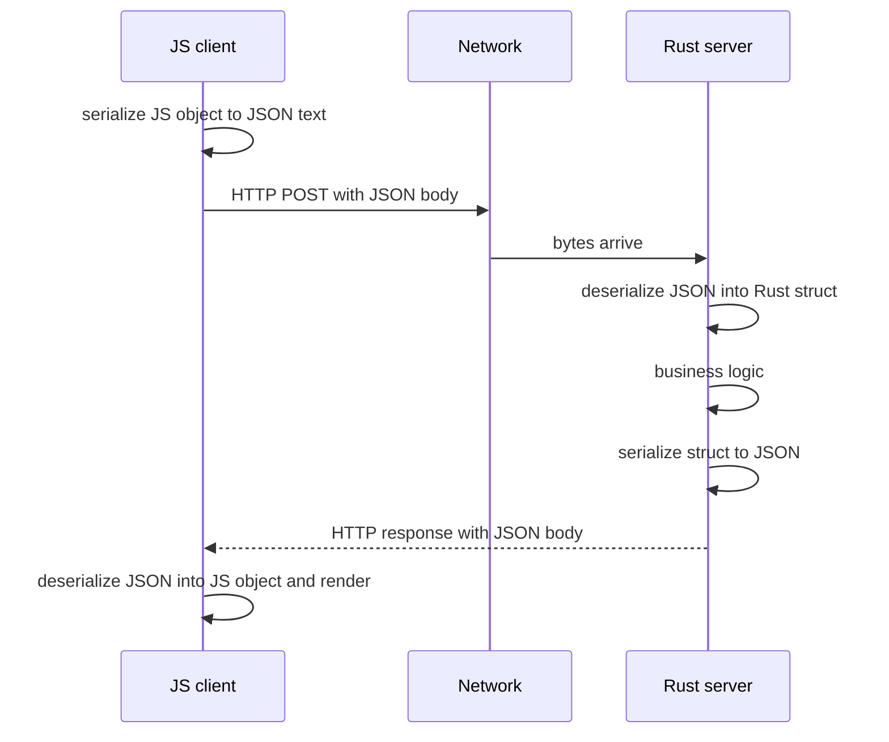
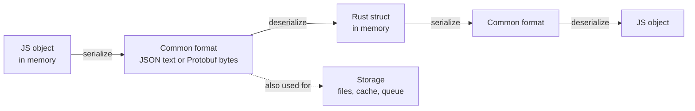
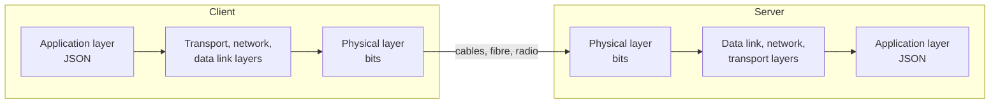
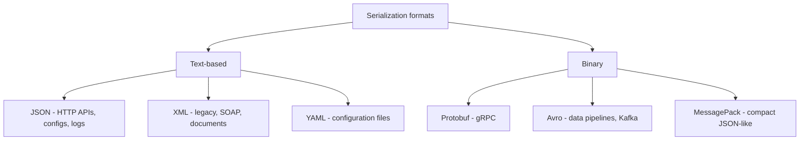

## TL;DR
- **Problem:** a JavaScript client and a Rust (or Go, Python…) server have **completely different type systems** — how can data sent by one be understood by the other?
- **Solution:** agree on a **common standard format**. **Serialization** = converting native data (a JS object, a Rust struct) **into** that format; **deserialization** = converting it **back** into native data. Used for **transmission** and **storage**.
- Formats are **text-based** (**JSON**, XML, YAML — human-readable) or **binary** (**Protocol Buffers**, Avro, MessagePack — compact and fast, not human-readable).
- **JSON** (JavaScript Object Notation) dominates HTTP APIs (roughly 80% of client-server communication). It's language-independent despite the name, and also used in **config files** and **logs**.
- JSON rules: object in `{ }`; **keys must be double-quoted strings**; values are **string, number, boolean, array, object (nested), or null**.
- Mental model: as a backend engineer you work at the **application layer** — data leaves as JSON and arrives as JSON. The lower OSI layers (segments, packets, frames, bits on fibre) are not your concern.

## Why this matters
Every request body you parse and every response you send involves deserialization and serialization. Bugs here are common and subtle: wrong dates and time zones, lost precision on big numbers, missing vs `null` fields, unknown fields silently ignored, injection via unvalidated input. Interviewers ask "JSON vs Protobuf?" and "what happens when you `JSON.parse` a request?" regularly.

## The problem: different languages, same data

Clients and servers communicate over a network via HTTP (REST), gRPC, WebSockets, etc. This chapter assumes HTTP/REST.

Suppose a **JavaScript** frontend (React, Angular, Vue) sends a POST with a body like `{ name: "Asha" }` to a server written in **Rust**.

| JavaScript | Rust |
|---|---|
| Dynamic typing, interpreted/JIT | Strict static typing, compiled |
| `number` is a 64-bit float for everything | `i32`, `u64`, `f64`, … |
| Objects are flexible key-value bags | Structs with fixed, typed fields |

The bytes leaving the browser must become a **Rust struct** on the server, and the Rust response must become a **JS object** on the client. Neither side understands the other's in-memory representation. How?

## The solution: a common standard

If you had to design this yourself, the obvious answer is a **common standard** — a set of rules both sides agree on for how data is written.

1. **Client** converts its native data (JS object) **into the standard format** and sends it.
2. **Server** receives it and converts it **from the standard into its own types** (a Rust struct), runs business logic.
3. Server converts the response **into the standard** and sends it.
4. Client parses it **back into JS** and renders UI.



> [!IMPORTANT]
> **Serialization** = native data → common format. **Deserialization** = common format → native data. The common format makes communication **language-agnostic** (and domain-agnostic), for both **transmission** and **storage** (files, caches, message queues, databases).



## Where serialization sits: the OSI mental model

You don't need to master the **OSI model**, but a high-level awareness helps. Data passes from the **application layer** on one machine down through transport, network, data link to the **physical layer** (bits as voltages/light), across the network, and back **up** the layers on the other machine.



> [!TIP]
> The backend engineer's mental model: **JSON goes in at the client's application layer and JSON comes out at the server's application layer.** What happens in between (TCP segments, IP packets, frames, bits) is the network stack's job, not yours.

## Scope: picking the most-used technologies
Backend has hundreds of technologies, so the course picks the most widely used in each category and lets you learn others later:

| Category | Many options | Course focus |
|---|---|---|
| Communication | HTTP/REST, WebSockets, gRPC | **HTTP / REST** |
| Databases | Postgres, MySQL, SQLite, MongoDB, DynamoDB | **PostgreSQL** |
| Serialization | JSON, XML, YAML, Protobuf, Avro | **JSON** |

## Types of serialization formats

| | Text-based | Binary |
|---|---|---|
| Examples | **JSON**, **XML**, **YAML** | **Protocol Buffers (Protobuf)**, Avro, MessagePack, Thrift |
| Human-readable | Yes — open in any editor, inspect in DevTools | No — opaque bytes |
| Size | Larger (field names repeated, numbers as text) | Smaller |
| Speed | Slower to parse/encode | Faster |
| Schema | Optional (e.g. JSON Schema) | Usually required (`.proto` file) |
| Typical use | Public REST APIs, configs, logs | Internal service-to-service (gRPC), high-throughput data pipelines |



> [!INTERVIEW]
> "JSON vs Protobuf?" — JSON is human-readable, schema-less, universally supported in browsers, easy to debug — ideal for public APIs. Protobuf is a binary format with a required schema (`.proto`), producing smaller payloads and faster encoding/decoding with strong typing and backward-compatible evolution via field numbers — ideal for internal microservice calls (gRPC). Trade-off: **readability and ubiquity vs performance and strict contracts.**

## JSON in depth

**JSON = JavaScript Object Notation.** It looks like a JavaScript object (hence the name) but is a **language-independent** text format. Uses:
- HTTP / REST request and response bodies (our focus);
- **configuration files** (`package.json`, `tsconfig.json`);
- **logs** — structured logging of application/server data at runtime.

Its strength: it was designed to be **human-readable**, and its data types are fundamental ones every language has.

### The rules

```json
{
  "id": 1,
  "name": "Asha",
  "isActive": true,
  "tags": ["admin", "beta"],
  "address": {
    "country": "India",
    "phone": 3456
  },
  "manager": null
}
```

1. An object starts with `{` and ends with `}`.
2. **Keys must be strings in double quotes.** No other type can be a key; single quotes are invalid.
3. **Values** can be:

| Type | Example |
|---|---|
| String | `"India"` (double quotes only) |
| Number | `42`, `3.14`, `-1e10` (no distinction between int and float) |
| Boolean | `true`, `false` |
| Array | `["a", 1, true]` |
| Object (nested) | `{ "country": "India" }` — same rules recursively |
| Null | `null` |

> [!NOTE]
> The video lists string, number, boolean, array and object; **`null`** is the sixth JSON value type. JSON has **no** date type, no `undefined`, no comments, no trailing commas, and no distinction between integers and floats.

### Demo: a real request and response
Inspecting `POST /api/books` in Burp Suite (from the routing chapter):

```http
POST /api/books HTTP/1.1
Host: localhost:3000
Content-Type: application/json

{"id": 3, "title": "Dune", "author": "Frank Herbert"}
```

The request body is JSON: braces, double-quoted string keys, a number value and two string values. The server deserializes it, adds the book, and responds with JSON — an object whose key holds an **array of objects**:

```http
HTTP/1.1 200 OK
Content-Type: application/json

{"books": [{"id": 1, "title": "1984", "author": "George Orwell"},
           {"id": 3, "title": "Dune", "author": "Frank Herbert"}]}
```

The client parses this and renders the list. The client could equally be PHP, Swift or Kotlin — the format is the contract.

### What it looks like in code

```ts
// Client (TypeScript): serialize
const res = await fetch("/api/books", {
  method: "POST",
  headers: { "Content-Type": "application/json" },
  body: JSON.stringify({ id: 3, title: "Dune", author: "Frank Herbert" }), // object -> JSON text
});
const data = await res.json(); // JSON text -> object (deserialize)
```

```go
// Server (Go): deserialize into a typed struct, serialize the response
type Book struct {
    ID     int    `json:"id"`
    Title  string `json:"title"`
    Author string `json:"author"`
}

func createBook(w http.ResponseWriter, r *http.Request) {
    var b Book
    dec := json.NewDecoder(r.Body)
    dec.DisallowUnknownFields()          // reject unexpected keys
    if err := dec.Decode(&b); err != nil {
        http.Error(w, "invalid JSON body", http.StatusBadRequest)
        return
    }
    books = append(books, b)
    w.Header().Set("Content-Type", "application/json")
    json.NewEncoder(w).Encode(map[string][]Book{"books": books})
}
```

```rust
// Server (Rust, serde): the same JSON becomes a struct
#[derive(serde::Deserialize, serde::Serialize)]
struct Book { id: i32, title: String, author: String }
// let book: Book = serde_json::from_str(body)?;   // deserialize
// let out = serde_json::to_string(&books)?;       // serialize
```

## Practical pitfalls (interview-ready additions)
The video keeps the concept simple; these are standard issues you'll hit in practice.

| Pitfall | What happens | Fix |
|---|---|---|
| **Dates** | JSON has no date type; `Date` becomes a string, time zones get lost | Use ISO 8601 UTC strings (`"2026-10-26T10:00:00Z"`) and parse explicitly |
| **Big integers** | JS numbers are 64-bit floats; IDs above 2^53 lose precision | Send large IDs as strings |
| **Missing vs null** | `{}` vs `{"bio": null}` mean different things for PATCH | Distinguish "not provided" from "set to null" in your types |
| **Unknown/extra fields** | Silently ignored by default (or mass-assigned to a model) | Reject unknown fields or allowlist them |
| **Wrong types** | `"age": "20"` instead of `20` | Validate with a schema (Zod, JSON Schema) right after parsing |
| **Malformed JSON** | Parser throws | Catch and return `400 Bad Request` |
| **Huge payloads** | Memory exhaustion / DoS | Enforce body size limits |
| **Insecure deserialization** | Formats that can instantiate arbitrary classes (Java serialization, Python pickle) allow remote code execution | Never deserialize untrusted data with such formats; JSON is data-only |

```ts
import { z } from "zod";

const BookInput = z.object({
  title: z.string().min(1),
  author: z.string().min(1),
  publishedAt: z.string().datetime(), // ISO 8601
}).strict();                          // reject unknown keys

app.post("/api/books", express.json({ limit: "100kb" }), (req, res) => {
  const parsed = BookInput.safeParse(req.body);
  if (!parsed.success) return res.status(400).json({ errors: parsed.error.issues });
  // parsed.data is now typed and trusted
});
```

> [!WARNING]
> Deserialization is where **untrusted input enters your program**. Always set a body size limit, handle parse errors with `400`, and validate the shape/types before using the data. Never pass a deserialized body straight into an ORM `create()` — attackers can add fields like `"isAdmin": true` (mass assignment).

> [!TIP]
> Always send `Content-Type: application/json` with JSON bodies. Many frameworks only parse the body when that header is present — a missing header is a classic cause of `req.body` being `undefined`.

## Common mistakes & misconceptions
- **"JSON is only for JavaScript."** It's language-independent; every major language has a JSON library.
- **"Serialization is only for networks."** It's also used for storage: files, caches (Redis values), message queues, DB JSON columns.
- **Single quotes or unquoted keys** — invalid JSON (valid JS object literal, though).
- **Trailing commas / comments** in JSON — invalid in standard JSON.
- **Assuming JSON numbers are integers** — there's one number type; precision depends on the parser.
- **Worrying about lower OSI layers** when debugging payloads — at the application layer, inspect the JSON.
- **Confusing serialization with encryption or compression** — serialization only changes representation; compression (gzip) and encryption (TLS) are separate steps.

## Interview questions

<details>
<summary><strong>Q: What are serialization and deserialization, and why are they needed?</strong></summary>

Serialization converts an in-memory data structure (a JS object, Go struct, Python dict) into a standard format (JSON text, Protobuf bytes) that can be sent over a network or stored. Deserialization converts it back into the receiving language's native structures. They're needed because different languages and machines represent data differently in memory; a common format lets a JavaScript client and a Rust server understand each other — it makes communication language-agnostic.

</details>

<details>
<summary><strong>Q: What happens from the moment a client sends a JSON body until the server can use it?</strong></summary>

The client serializes its object to JSON text (`JSON.stringify`), sets `Content-Type: application/json`, and sends it. The network stack moves bytes down the OSI layers, over the wire, and up on the server. The framework reads the body (enforcing a size limit), parses the JSON (deserialization) into native structures — failing with 400 if malformed — and the server then validates types/shape against a schema before handing typed data to business logic.

</details>

<details>
<summary><strong>Q: Compare text-based and binary serialization formats.</strong></summary>

Text (JSON, XML, YAML): human-readable, easy to debug, broad tooling, schema optional, but larger and slower to parse. Binary (Protobuf, Avro, MessagePack): compact and fast, usually schema-driven with strong typing and versioning rules, but not human-readable and need tooling. Use JSON for public/browser APIs and configs; binary for high-throughput internal services (gRPC) and data pipelines.

</details>

<details>
<summary><strong>Q: What are the rules of valid JSON?</strong></summary>

Objects in `{}` with key-value pairs separated by commas; keys must be double-quoted strings; values can be string (double quotes), number, boolean (`true`/`false`), array, nested object, or `null`. No comments, no trailing commas, no single quotes, no `undefined`, no functions, no native date type.

</details>

<details>
<summary><strong>Q: How do you handle dates in JSON APIs?</strong></summary>

JSON has no date type, so dates are serialized as strings or numbers. Best practice: use ISO 8601 strings in UTC (`2026-10-26T10:00:00Z`) or Unix timestamps, document which, parse explicitly on the server into a proper date type, and store in UTC (convert to local time only for display). Inconsistent formats and implicit time-zone conversions are a top source of bugs.

</details>

<details>
<summary><strong>Q: Why might a 64-bit ID become wrong when sent to a JavaScript client?</strong></summary>

JavaScript represents all numbers as IEEE-754 doubles, which can exactly represent integers only up to 2^53 − 1. A 64-bit ID like a Twitter/Snowflake ID (e.g. 1234567890123456789) gets rounded when `JSON.parse` reads it. Fix: serialize such IDs as strings (Twitter returns `id_str` for this reason), or use BigInt-aware parsers.

</details>

<details>
<summary><strong>Q: What is insecure deserialization?</strong></summary>

A vulnerability where an application deserializes untrusted data in a format that can encode objects with behaviour (Java native serialization, Python `pickle`, PHP `unserialize`, some YAML loaders). A crafted payload can instantiate arbitrary classes and lead to remote code execution, privilege escalation or DoS. Mitigations: use data-only formats like JSON, never deserialize untrusted input with object-graph serializers, use safe loaders (`yaml.safe_load`), validate schemas, and apply size limits.

</details>

<details>
<summary><strong>Q: Your POST handler's req.body is undefined / empty. What could be wrong?</strong></summary>

Common causes: the client didn't send `Content-Type: application/json`, so the JSON body parser skipped it; the body-parsing middleware isn't registered (or is registered after the route); the client sent an object without `JSON.stringify`; or the body exceeded the size limit. Check the raw request in DevTools/Burp, then the middleware order.

</details>

<details>
<summary><strong>Q: When would you choose Protobuf over JSON?</strong></summary>

For internal, high-volume service-to-service communication where performance, payload size and strict contracts matter — e.g. microservices over gRPC, mobile clients on poor networks, or event streams. Protobuf's schema gives type safety and safe evolution (add fields with new numbers). Stick with JSON for public APIs, browser clients and anywhere debuggability and ecosystem support matter more.

</details>

## Cheat sheet
- **Serialize**: native → common format. **Deserialize**: common format → native.
- Purpose: **language-agnostic** transmission and storage.
- **Text**: JSON, XML, YAML (readable, bigger). **Binary**: Protobuf, Avro, MessagePack (compact, fast, schema).
- **JSON**: `{}` objects, double-quoted string keys, values = string | number | boolean | array | object | null.
- JSON used for: HTTP bodies, configs, logs.
- Mental model: JSON at the application layer on both ends; lower layers are the network's job.
- Practice: `Content-Type: application/json`, body size limits, 400 on parse errors, schema validation, reject unknown fields, ISO 8601 UTC dates, big IDs as strings.

## Glossary
- **Serialization** — converting in-memory data into a transferable/storable format.
- **Deserialization** — reconstructing native data from a serialized format.
- **JSON** — JavaScript Object Notation, a text-based, human-readable data format.
- **XML** — Extensible Markup Language, a verbose tag-based text format.
- **YAML** — human-friendly text format popular for configuration.
- **Protocol Buffers (Protobuf)** — Google's schema-based binary serialization format, used by gRPC.
- **Avro / MessagePack** — binary serialization formats (schema-based / schema-less).
- **Schema** — formal definition of a data structure's fields and types.
- **OSI model** — 7-layer conceptual model of network communication.
- **Application layer** — top OSI layer where HTTP and data formats live.
- **Physical layer** — bottom OSI layer: bits over cables, fibre, radio.
- **Struct** — a typed record type in languages like Rust, Go, C.
- **Mass assignment** — vulnerability where extra client-supplied fields are written to a model.
- **Insecure deserialization** — exploiting deserialization of untrusted data to run code or tamper with objects.

## Video timestamps
- [00:00](https://www.youtube.com/watch?v=vzg90tY3uM0&t=0s) — Client-server communication recap
- [01:01](https://www.youtube.com/watch?v=vzg90tY3uM0&t=61s) — JS client sending an HTTP request with a body
- [02:03](https://www.youtube.com/watch?v=vzg90tY3uM0&t=123s) — The problem: JS client, Rust server, different types
- [04:07](https://www.youtube.com/watch?v=vzg90tY3uM0&t=247s) — OSI model overview
- [06:11](https://www.youtube.com/watch?v=vzg90tY3uM0&t=371s) — The solution: a common standard
- [08:13](https://www.youtube.com/watch?v=vzg90tY3uM0&t=493s) — Definition of serialization and deserialization
- [09:13](https://www.youtube.com/watch?v=vzg90tY3uM0&t=553s) — Choosing the most-used technologies (HTTP, Postgres)
- [11:15](https://www.youtube.com/watch?v=vzg90tY3uM0&t=675s) — Serialization standards: JSON, YAML, XML (text-based)
- [12:17](https://www.youtube.com/watch?v=vzg90tY3uM0&t=737s) — Binary formats: Protobuf; JSON introduction
- [13:18](https://www.youtube.com/watch?v=vzg90tY3uM0&t=798s) — JSON uses: APIs, configs, logs
- [14:20](https://www.youtube.com/watch?v=vzg90tY3uM0&t=860s) — JSON rules: keys, value types, nesting
- [16:24](https://www.youtube.com/watch?v=vzg90tY3uM0&t=984s) — Demo: POST /api/books request JSON
- [17:26](https://www.youtube.com/watch?v=vzg90tY3uM0&t=1046s) — Mental model: JSON at the application layer
- [19:28](https://www.youtube.com/watch?v=vzg90tY3uM0&t=1168s) — Response JSON parsed and rendered by the client
- [20:30](https://www.youtube.com/watch?v=vzg90tY3uM0&t=1230s) — Summary
