## TL;DR

- **Authentication (AuthN)** answers *"Who are you?"* — it assigns an identity to a subject in a given context. **Authorization (AuthZ)** answers *"What can you do?"* — it decides the subject's permissions in that context. AuthN always comes first.
- HTTP is **stateless**, so the web needed a way to "remember" users. **Sessions** store user state on the server (keyed by a random session ID); **JWTs** put signed user claims inside a self-contained token so the server stores nothing.
- **Cookies** are the browser mechanism that lets the server store a small value (session ID or token) in the browser, which the browser then sends back automatically on every request to that server.
- **Stateful auth** (session ID + Redis/DB lookup) gives central control and easy revocation; **stateless auth** (JWT verified with a secret key) scales easily but makes revocation hard. A **hybrid** (JWT + blacklist, or sessions for web and JWT for mobile/third parties) is common.
- **API keys** are for **machine-to-machine** access: a long random secret that a program sends with each request, usually with scoped permissions and expiry.
- **OAuth 2.0** solves **delegation** — letting one app access your data on another app *without your password*, using scoped tokens. **OpenID Connect (OIDC)** adds **authentication** on top of OAuth 2.0 via an **ID token** (a JWT) — this is what powers "Sign in with Google".
- **RBAC** (role-based access control) maps users → roles → permissions; a middleware resolves the user's role early in the request and later code returns **403 Forbidden** if the role lacks permission.
- Security basics: send **generic auth error messages** ("Invalid credentials"), and defend against **timing attacks** with constant-time comparisons and equalised response times.

## Why this matters

Almost every backend you build will have a login screen, protected APIs, and users with different powers (admin vs normal user). Getting authentication wrong means attackers impersonate users; getting authorization wrong means a normal user can delete everyone's data. Auth is also one of the most-asked topics in backend interviews: "sessions vs JWT", "how does OAuth work", "where should I store a token", "401 vs 403" come up constantly. Understanding *why* each mechanism exists (what problem it solved and what new problem it created) lets you reason about trade-offs instead of memorising buzzwords.

## Authentication vs authorization — the two-sentence summary

- **Authentication** is the process of finding the answer to **"Who are you?"** in a given context. The context can be a website, an operating system, a phone — anything that needs to know which subject (user, device, service) it is talking to.
- **Authorization** is the process of finding the answer to **"What can you do?"** in that context — all your capabilities, or *permissions*.

Analogy: at an airport, showing your passport at the counter is **authentication** (proving you are *you*). Your boarding pass deciding whether you can enter the business lounge or only board gate 12 is **authorization** (what you are *allowed* to do).

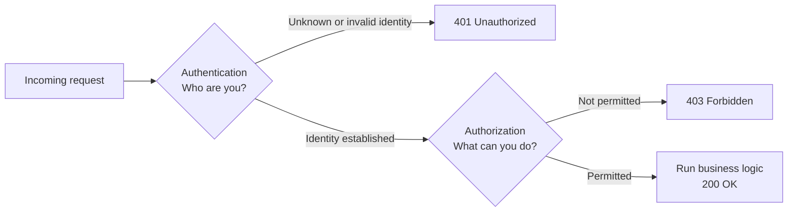

> [!INTERVIEW]
> **"What is the difference between authentication and authorization?"** Authentication verifies identity (who you are — e.g. checking a password or a token). Authorization decides permissions (what you can do — e.g. only admins can delete users). Authentication happens first; authorization uses the identity it produced. A failed authentication is a **401 Unauthorized** (badly named — it really means "unauthenticated"), a failed authorization is a **403 Forbidden**.

## A short history of authentication

The history is useful because each era's weakness motivated the next era's solution — the same pattern repeats in modern auth.

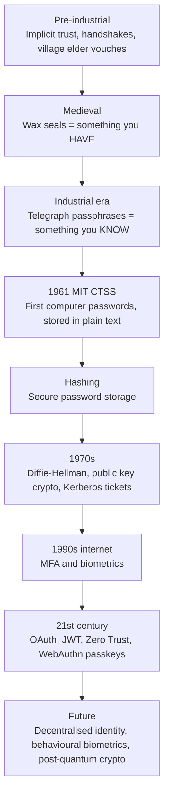

### Pre-industrial societies: implicit, trust-based authentication

Identity was the same as **recognition**. A respected person (a village elder) could vouch for you, and deals were sealed with a handshake symbolising mutual recognition. This is authentication based on **human contextual trust**.

**Why it failed:** it does not scale. As populations grew and people dealt with strangers in other villages, countries, and continents, the elder was not trusted everywhere. Society needed **explicit** proof of identity that worked without personal acquaintance.

### Medieval period: seals — "something you have"

**Wax seals** with unique patterns were stamped on letters and agreements, acting as signatures. They were effectively the first widely adopted **authentication tokens**: a physical representation of identity based on *possession* — if you hold the seal, you are trusted.

**Weakness:** seals could be **forged**. This is the first recorded form of an **authentication bypass attack** (skipping or faking authentication with malicious intent). The response was more sophisticated mechanisms — watermarks and encrypted codes in trade documents — which laid the foundation for cryptographic thinking.

### Industrial Revolution: passphrases — "something you know"

With the **telegraph** becoming critical infrastructure, operators needed to validate messages. They used **pre-agreed passphrases** — an early **shared secret**. These were static (the same string every time), just like a static password. The principle shifted from *something you have* (a seal that can be stolen or forged) to *something you know* (a secret in your head).

### Mainframes (mid-20th century): the first digital passwords

In **1961**, researchers at MIT's Project MAC working on the **Compatible Time-Sharing System (CTSS)** introduced passwords so multiple users could share one computer without seeing each other's data. The passwords were stored in **plain text** — and the vulnerability became obvious when someone printed the password file.

This incident is the origin of **secure password storage**: passwords must never be stored in plain text. It led to **hashing**.

### Hashing in one paragraph

A cryptographic hash function takes any input string and returns a **fixed-length** output (the length depends on the algorithm, not on whether the input was 3 or 100 characters). It is **deterministic** (same input → same hash, every time) and **one-way** (you cannot reverse a hash to get the input). So the server stores `hash(password)`; at login, it hashes the submitted password and compares the two hashes.

> [!NOTE]
> **Precision:** hashing is *not* encryption. Encryption is reversible with a key; hashing is not. For passwords, real systems use **slow, salted** password-hashing algorithms (**bcrypt, scrypt, Argon2**), not fast hashes like SHA-256. A **salt** is a random value stored alongside each hash so that two users with the same password get different hashes, defeating precomputed "rainbow table" attacks. The salt is not secret; it just makes each hash unique.

With these ideas, authentication started aligning with the **CIA triad** — **Confidentiality, Integrity, Availability** — the core tenets of information security.

### 1970s: asymmetric cryptography and Kerberos

- **Whitfield Diffie and Martin Hellman** invented the **Diffie–Hellman key exchange**, introducing **asymmetric (public-key) cryptography**: two parties can establish a shared secret over an untrusted channel. Public-key cryptography is the backbone of modern authentication protocols and **PKI (Public Key Infrastructure)** systems (e.g. TLS certificates).
- **Kerberos** introduced **ticket-based authentication**: a trusted third party issues tickets that verify both the user's and the service's identity. This is a direct precursor of today's **token-based** authentication.

### 1990s: the internet, MFA, and biometrics

Username + password alone was too weak against **brute-force** attacks (trying every combination) and **dictionary attacks** (trying common passwords). This led to **MFA (Multi-Factor Authentication)**, which combines different *factors*:

| Factor | Meaning | Examples |
|---|---|---|
| Something you **know** | A secret in your head | Password, PIN |
| Something you **have** | A physical item | Smart card, phone, OTP generator / authenticator app |
| Something you **are** | Biometric trait | Fingerprint, retina scan, face |

**Biometric authentication** used pattern recognition and statistical models to identify users by physical traits, but brought its own problems: **false positives/negatives** and **template security** (you can change a leaked password, not a leaked fingerprint).

### 21st century: modern frameworks

Cloud computing, mobile devices, and API-based architectures demanded more advanced frameworks. Key modern components:

- **OAuth / OAuth 2.0** — delegated authorization (covered in depth below).
- **JWT** — self-contained, signed tokens.
- **Zero Trust architecture** — "never trust, always verify": no request is trusted just because it comes from inside the network.
- **Passwordless authentication** like **WebAuthn** (passkeys) — eliminates passwords entirely, relying on a public/private key pair where the private key is stored on a hardware device.

### The future

- **Decentralised identity** (e.g. blockchain-based) — still early and experimental, but promising.
- **Behavioural biometrics** — identifying users by how they type, move the mouse, etc.
- **Post-quantum cryptography** — large-scale quantum computers are expected to break today's public-key algorithms like RSA and elliptic-curve crypto. Post-quantum algorithms are designed to stay secure even against quantum computers (some have already been standardised).

## The three building blocks: sessions, JWTs, cookies

Three components appear in almost every auth flow, so it is worth understanding them before the flows themselves.

### Sessions

#### The problem: HTTP is stateless

HTTP was designed **stateless**: every request is an isolated interaction, and the server keeps no memory of previous requests. Each request must carry all the information the server needs. This was perfect for the early web — mostly static pages people just read.

But the web quickly became **dynamic and interactive**:
- An e-commerce site must remember the items in your cart.
- A user must remain logged in while navigating between pages.

Statelessness became a bottleneck. The web needed **stateful interactions**, which HTTP itself did not provide. That is why **sessions** were invented.

#### How sessions work

A **session** is a temporary, **server-side context** for each user — the server's memory of who you are.

1. **Session creation.** When the user logs in, the server creates a **unique session ID** and stores it together with the relevant user data (user ID, role, name, cart items, "is authenticated", etc.) in a persistent store — a database or **Redis** (an in-memory store).
2. **Session ID to client.** The session ID is sent to the browser **as a cookie**. Every subsequent request from the browser automatically includes that cookie, so the server reads the session ID, looks it up in the store, and retrieves the user's data.
3. **Expiry.** Sessions are short-lived. If the session expires (say after 15 minutes of inactivity or a fixed lifetime), the old ID no longer works, and a new session must be created (typically the user logs in again).

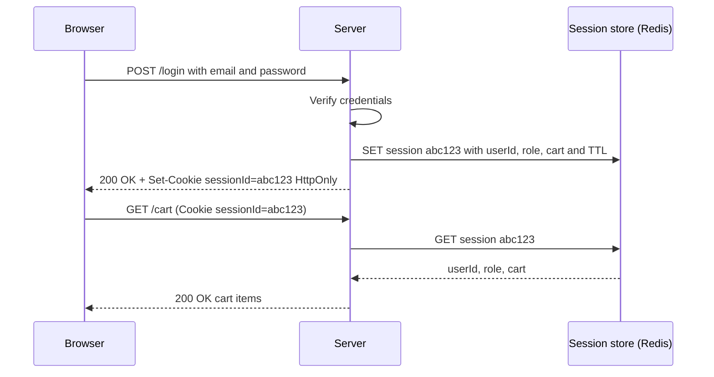

#### Evolution of session storage

| Era | Where sessions lived | Problem / benefit |
|---|---|---|
| Early | **Files on the server** | Simple, but did not scale as users grew; tied to one machine |
| Next | **Database-backed** sessions | Survive server restarts, support large user bases, shareable by multiple servers |
| Distributed era | **In-memory stores** — Redis, Memcached | Data in RAM → much faster lookups than disk-based DB queries |

Sessions are still widely used today for exactly the same purpose: giving the server a memory of the user.

### JWT (JSON Web Token)

#### Why JWTs emerged

By the mid-2000s, web applications became **globally distributed systems**, and stateful sessions created bottlenecks:

1. **Memory cost** — storing session data for millions of users is expensive.
2. **Replication** — with servers in different regions, session data has to be synchronised across them, introducing **latency** (slower authentication) and **consistency** problems (one region's session data may lag behind another's).

Developers wanted to **offload state from the server** while keeping security and integrity. The result was the **JWT**, formalised in **2015** (RFC 7519): a **stateless mechanism for transferring claims** between two parties. The key innovation is that the token is **self-contained** — it carries the user data (user ID, role…) *and* a cryptographic signature in a single string.

#### Structure of a JWT

A JWT is three **Base64URL-encoded** parts joined by dots: `header.payload.signature`. You can paste one into **jwt.io** to inspect it.

```text
eyJhbGciOiJIUzI1NiIsInR5cCI6IkpXVCJ9.eyJzdWIiOiJ1c2VyXzQyIiwicm9sZSI6ImFkbWluIiwiaWF0IjoxNzAwMDAwMDAwfQ.<signature>
```

1. **Header** — metadata about the token itself, mainly the **signing algorithm** (e.g. `HS256`) and type.
2. **Payload** — the **claims** (data about the user). Standard registered claims include:
   - `sub` (**subject**) — the user's ID. It can be the ID from your database or from an external auth provider.
   - `iat` (**issued at**) — when the token was issued (Unix timestamp).
   - Commonly also `exp` (expiry), `iss` (issuer), `aud` (audience).
   - Custom optional claims like `name` or `role` (admin, member, editor, viewer…).
3. **Signature** — computed from the header and payload using a **secret key** only the server knows. It proves the server issued the token and that it has **not been tampered with**.

```json
// Header
{ "alg": "HS256", "typ": "JWT" }

// Payload
{ "sub": "user_42", "name": "Asha", "role": "admin", "iat": 1700000000, "exp": 1700000900 }
```

If anyone modifies the payload (say, changing `role` from `user` to `admin`), the signature check with the server's secret fails, and the token is rejected. That is how the server verifies user data **without storing anything**.

> [!WARNING]
> A JWT is **signed, not encrypted**. Base64URL is just an encoding — anyone who has the token can decode and read the payload. **Never put secrets (passwords, sensitive PII) in a JWT payload.** The signature guarantees *integrity*, not *confidentiality*.

```ts
import jwt from "jsonwebtoken";

const SECRET = process.env.JWT_SECRET!; // must be stored securely, never hard-coded

// Issue at login
const token = jwt.sign({ sub: user.id, role: user.role }, SECRET, { expiresIn: "15m" });

// Verify on each request
try {
  const claims = jwt.verify(token, SECRET) as { sub: string; role: string };
  // claims.sub is the authenticated user ID
} catch {
  // invalid signature, malformed, or expired → 401
}
```

#### Advantages of JWTs

| Advantage | Why |
|---|---|
| **Statelessness** | No server-side storage → no session-store cost or lookup |
| **Scalability** | In microservice/distributed setups, any server instance holding the secret (or public key) can verify the token itself. A cookie set by one domain cannot be read by a server on another domain, but a JWT can be sent to many different services. |
| **Portability** | Compact, URL-safe string → can be sent in headers, cookies, even URLs, and stored in limited-space storage |

> [!NOTE]
> With **HS256** all verifying services share one secret (which also lets them *issue* tokens). With asymmetric algorithms like **RS256/ES256**, only the auth server holds the private key and other services verify with the public key — safer for microservices.

#### Disadvantages of JWTs

1. **Token theft.** Because verification is stateless, whoever holds your JWT *is* you until it expires. The server has no stored record to check, so it cannot invalidate one stolen token — except by **rotating the secret**, which invalidates **every user's** token and forces everyone to log in again.
2. **Revocation.** For the same reason, the server cannot revoke a specific user's access (banned user, compromised account) before the token expires.

#### The hybrid approach: JWT + blacklist

Normal JWT flow: user logs in → server returns a JWT → client sends it on each request (usually `Authorization: Bearer <token>`, or a cookie) → server verifies the signature and reads `sub`. **No storage lookup.**

Hybrid flow: after the signature check passes, the server also checks a **blacklist (denylist)** of revoked tokens or users in Redis/Memcached or the database. Now you can block a compromised or malicious user immediately.

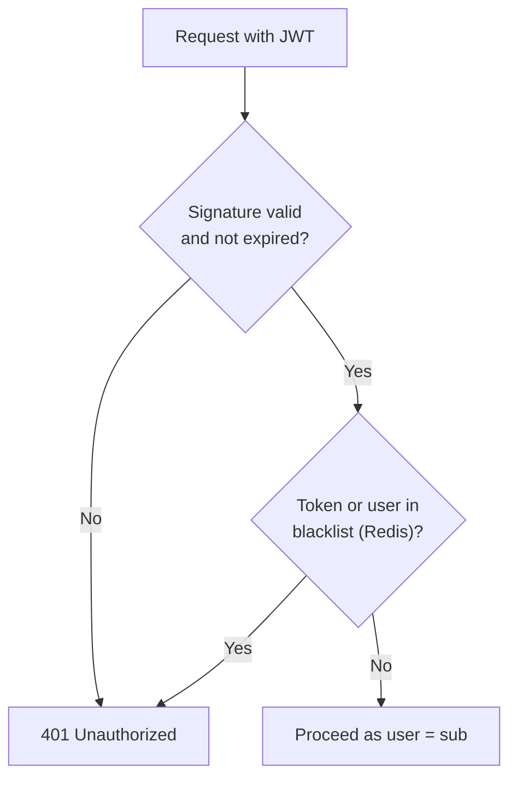

**The obvious question:** the whole point of JWT was statelessness. If you do a storage lookup on every request anyway, why not just use stateful sessions in the first place, which are simpler and considered more secure? This debate is common in the industry and there is no universal answer.

> [!TIP]
> Common production patterns that soften JWT's revocation problem: **short-lived access tokens** (5–15 min) plus a **long-lived refresh token** stored server-side (revocable). Revoking the refresh token means the user is logged out within minutes. Using a `jti` (token ID) claim lets you blacklist just one token.

#### Practical advice: use an auth provider

For **medium to large production systems**, use an external **authentication provider** — Auth0, Clerk, and similar. Choosing algorithms, hashing, salting, token strategies, and keeping everything secure becomes *their* problem. While **learning** backend engineering, implement auth yourself to understand the parts and trade-offs; in production, roll your own only if you are very confident.

### Cookies

A **cookie** is a small piece of data (any string) that the **server stores in the user's browser**. The important part is that it is set **from the server side** (via the `Set-Cookie` response header). Two browser guarantees make cookies useful:

1. A cookie set by a server is **only accessible to that server** (scoped by domain) — one site cannot read another site's cookies. This is a key security feature.
2. The browser **automatically sends** the cookie back with **every subsequent request** to that server.

In an authentication flow: the client logs in with username and password → if successful, the server sets a cookie containing the auth token (a session ID or a JWT) → from then on the browser (Chrome, Firefox, whatever) automatically attaches it, and the server validates it to identify and authorize the user. Cookies **automate** the "server gives token → client sends token back" loop, entirely controlled from the server.

```http
HTTP/1.1 200 OK
Set-Cookie: sessionId=abc123; HttpOnly; Secure; SameSite=Lax; Path=/; Max-Age=900
```

```http
GET /api/notes HTTP/1.1
Host: notes.example.com
Cookie: sessionId=abc123
```

| Cookie attribute | Purpose |
|---|---|
| `HttpOnly` | JavaScript (`document.cookie`) cannot read it → protects against token theft via **XSS** |
| `Secure` | Only sent over HTTPS |
| `SameSite=Strict/Lax/None` | Controls whether the cookie is sent on cross-site requests → main defence against **CSRF** |
| `Domain`, `Path` | Which hosts/paths receive the cookie |
| `Max-Age` / `Expires` | Lifetime; without them it is a "session cookie" deleted when the browser closes |

> [!WARNING]
> Storing JWTs in `localStorage` is possible but risky: any JavaScript on the page (including injected XSS code) can read it. An **HttpOnly, Secure, SameSite** cookie is the safer default for browsers. Because cookies are sent automatically, you then need **CSRF** protection (SameSite, CSRF tokens).

## Types of authentication

The four major types a backend engineer uses daily:

1. **Stateful** authentication (sessions)
2. **Stateless** authentication (JWT)
3. **API key** based authentication
4. **OAuth 2.0 / OpenID Connect**

### Stateful authentication

1. Client (browser) sends username/email + password.
2. Server verifies the credentials.
3. If valid, the server generates a **session ID**, bundles it with the user data, and stores it — usually in **Redis** (fast reads) rather than a traditional database.
4. Server sends the session ID back in an **HttpOnly cookie** (JavaScript cannot read it).
5. Every subsequent request carries the cookie automatically. The server takes the session ID, checks it **exists in Redis**, checks **expiry**, loads the user data, and then identifies/authorizes the user.

The session ID is typically a cryptographically random string (it could even be a JWT — it depends on the implementation). What makes it *stateful* is the **server-side lookup**.

### Stateless authentication

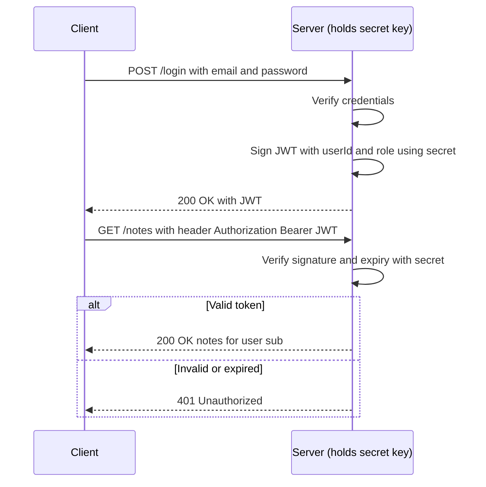

1. Client sends credentials.
2. Server verifies them and generates a **signed JWT** using its **secret key** (which must be stored securely — it is used to both sign and verify).
3. The JWT (with user ID, role, etc.) goes back to the client.
4. On later requests the client sends the JWT, by convention in the **`Authorization`** header (`Authorization: Bearer <token>`).
5. The server extracts it, verifies it with the secret, reads the user ID, and responds — or returns an error (401 Unauthorized if the token is invalid).

It is called **stateless** because all needed user information is inside the signed token itself; no persistent store is consulted.

### Stateful vs stateless: pros, cons, and when to choose

| | Stateful (sessions) | Stateless (JWT) |
|---|---|---|
| Where state lives | Server store (Redis/DB) | Inside the token, on the client |
| Per-request cost | Store lookup | Signature verification only (CPU) |
| **Revocation / logout** | Easy — delete the session | Hard — valid until `exp` (needs blacklist or short expiry) |
| Real-time visibility | Know all active sessions | No central view |
| Scalability | Session store must be shared/replicated; latency across regions | Any server with the key can verify; no shared store |
| Operational complexity in distributed systems | Higher | Lower |
| Best for | Web apps, moderate traffic, strict session requirements | APIs, distributed/microservice systems, mobile clients where cookies are awkward |

The speaker's opinion: **most applications should use stateful authentication** because it is more secure and makes revoking access and seeing active sessions convenient.

**Hybrid strategy:** use **stateful** sessions for your own **browser web app**, and **stateless** JWTs for **mobile apps and third-party/server integrations** that consume your API. Each client type gets the method whose strengths fit it.

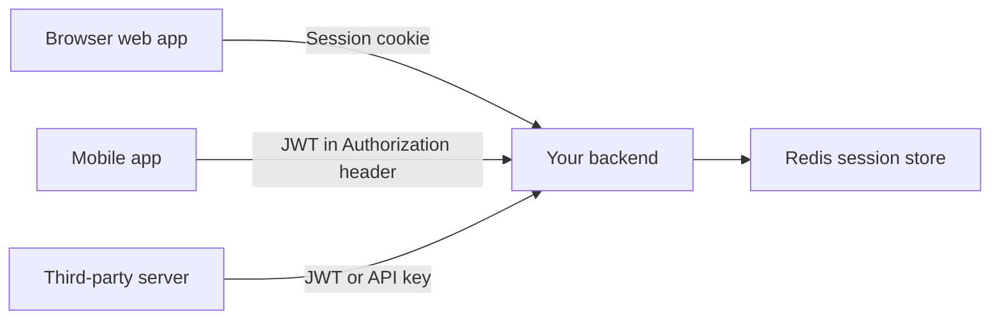

> [!INTERVIEW]
> **"Sessions or JWT?"** Neither is universally better. Sessions: simple, instantly revocable, need a shared store (Redis). JWT: no store, horizontally scalable, cross-service, but you cannot revoke before expiry without adding state back (blacklist / refresh tokens). For a typical web app, sessions in HttpOnly cookies are the safe default; JWTs shine for distributed APIs and mobile/service clients, ideally short-lived with refresh tokens.

### API key based authentication

API keys serve a **completely different use case** from login flows.

**How it works:** on the platform's UI you click "Generate API key" and receive a **cryptographically secure random string**. You send that key (in a header or however the server specifies) with your requests and get **direct, programmatic access to the server** behind the UI.

**Example — OpenAI:** ChatGPT's UI talks to OpenAI's servers. But developers may want the model's responses in their *own* UI, or inside their own server code, without using ChatGPT's interface. OpenAI issues API keys so these users can call its servers programmatically — in a **confined** way: with a set of **permissions**, an **expiry**, and tied to the account's plan and remaining quota. Using the key you can do (some of) what the native platform can do, via the API.

```http
POST /v1/chat/completions HTTP/1.1
Host: api.openai.com
Authorization: Bearer sk-...redacted...
Content-Type: application/json
```

**Advantages:**
1. **Easy to generate** — one click in the UI.
2. **Ideal for machine-to-machine (M2M) communication.**

#### Machine-to-machine communication

- **Client-to-server (human) interaction:** you use a UI with mouse and keyboard; the UI sends requests; the server responds; the UI renders the result for you.
- **Machine-to-machine interaction:** your server calls another server with **no UI and no human involved**. Example: a user on your app asks to "summarise this paragraph"; your server calls OpenAI's server with your API key; OpenAI identifies you (plan, quota, permissions) from the key; your server forwards the result to your UI.

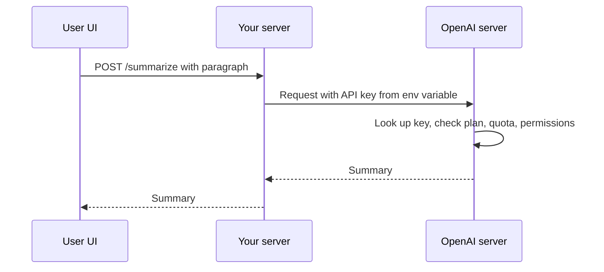

Session and JWT logins need **human triggers** — someone types a username and password into a form, then a token is saved. Machines cannot do that. With API keys the workflow is simple: give the machine a secret, store it in an environment variable or secure secret storage, and send it with every request.

> [!WARNING]
> Treat API keys like passwords: never commit them to Git or ship them in frontend code. Servers should store only a **hash** of each key, show the full key once, support scopes, expiry, and rotation, and allow instant revocation.

### OAuth 2.0 and OpenID Connect

#### The problem: too many passwords, and delegation

With username/password everywhere, the more sites you used, the more credentials you had to remember. Two problems:

1. **Security risk** — people reused passwords (`12345`, `password`). One breach compromised accounts across many sites.
2. **Fatigue** — managing dozens of accounts is overwhelming.

Then a new class of problem appeared: **delegation** — one website needing access to **your resources on another website**:
- A travel app wants to scan your **Gmail** for flight tickets.
- A social media app wants to **import your contacts** from Google.

**The naive solution: share your password.** Users literally gave App A their password for App B. This was disastrous:
- A password grants **full access** to everything — no way to limit permissions.
- **Revocation is impossible** without changing your password — and since passwords were reused, you would have to change it everywhere.

#### OAuth: share tokens, not passwords

In **2007**, engineers from companies like Google and Twitter began standardising **OAuth (Open Authorization)**. The revolutionary idea: instead of sharing a password, the user lets the platform issue a **token with specific, limited permissions** (called **scopes**). A password = access to everything (photos, Maps history, contacts, calendar, delete anything). A token = e.g. *read-only access to contacts* — not add, not delete, nothing else. And the token can be revoked independently.

#### OAuth roles

| Role | Meaning | Example (Facebook importing Google contacts) |
|---|---|---|
| **Resource owner** | The user who owns the data | You |
| **Client** | The app requesting access | Facebook |
| **Resource server** | The server hosting the protected data | Google's contacts API |
| **Authorization server** | Authenticates the user, gets consent, **issues tokens** | Google's OAuth/accounts server |

> [!NOTE]
> The resource server and authorization server are often run by the same company (Google), but they are logically separate roles: one issues tokens, the other accepts them to serve data.

#### OAuth 1.0 flow

1. The **client** (Facebook) **redirects** the user to the **authorization server** (Google).
2. The user **authenticates** with Google and **grants permission** ("Yes, allow read access to contacts").
3. The authorization server sends a **token** to the client.
4. The client uses the token to access the **resource** (your contacts) on the resource server.

Facebook got programmatic, scoped access to your Google contacts **without your password**.

#### OAuth 2.0 (around 2010–2012)

OAuth 1.0 had limitations:
1. **Complex** for developers to implement.
2. Required **cryptographic signatures on every request**, which were error-prone.

OAuth 2.0 (RFC 6749, 2012) changed two things:
1. **Bearer tokens** — whoever holds ("bears") the token can use it. Much simpler (no per-request signing), but more vulnerable if stolen, so it relies on **HTTPS** for protection.
2. **Multiple flows ("grant types") for different app types:**

| Flow | For | Notes |
|---|---|---|
| **Authorization code flow** | Server-side web apps (and, with **PKCE**, SPAs and mobile apps) | The recommended flow; the code is exchanged for tokens on a back channel |
| **Implicit flow** | Browser-based apps (historically) | Token returned directly in the URL — **now discouraged** due to security risks; replaced by code flow + PKCE |
| **Client credentials flow** | Machine-to-machine | Two servers, no user, no browser |
| **Device code flow** | Devices with limited input (smart TVs, consoles) | TV shows a code; you approve on your phone/laptop |

#### OAuth solved authorization, not authentication

OAuth is about **authorization via delegation** ("Facebook may read your contacts"). It did **not** standardise **authentication** ("this user is Asha, email asha@…"). Apps abused access tokens as login proof, which was inconsistent and insecure.

#### OpenID Connect (OIDC, 2014)

**OIDC** is a thin **identity layer built on top of OAuth 2.0**. Its main addition is the **ID token**, which is a **JWT** containing:
- the user's ID (`sub`),
- when they logged in / when it was issued (`iat`, `auth_time`),
- the **issuer** (`iss`) — which platform issued it,
- the audience (`aud`) — which client it is for,
- profile info the client asked for: name, email, profile picture…

This is what powers **"Sign in with Google / Facebook / Discord"**: the app takes your identity from Google and either stores it in its own database or simply uses it to identify you — without building its own password system.

| | OAuth 2.0 | OpenID Connect |
|---|---|---|
| Purpose | Authorization (delegated access) | Authentication (identity) |
| Main artefact | **Access token** (often opaque) | **ID token** (always a JWT) + access token |
| Question answered | "Can this app access X on my behalf?" | "Who is this user?" |
| Example | Note app reads your Google Keep notes | "Sign in with Google" |

#### A typical OIDC + OAuth flow ("Sign in with Google" on a note-taking app)

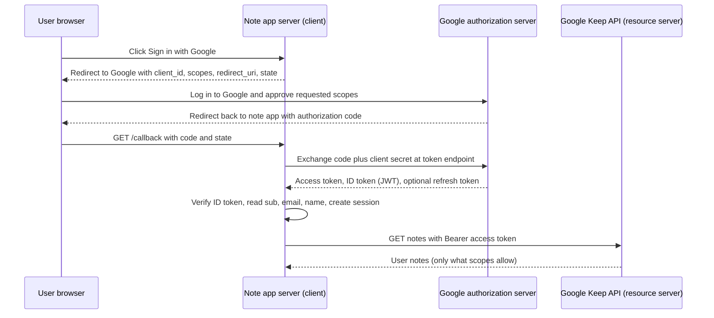

1. On the note-taking app (the **client**) you click "Sign in with Google". The app **redirects** you to Google's **authorization server**.
2. You log in **on Google's page** (not the client's — the client never sees your Google password) and grant the requested permissions (email, name, profile picture, and maybe Google Keep access).
3. Google redirects back to the client with an **authorization code**.
4. The client **exchanges the code** (server-to-server, with its client secret) for an **access token** and an **ID token**.
5. The client verifies the **ID token** (a JWT) to learn who you are → you are **authenticated**.
6. The client stores the **access token** and uses it to call Google Keep **on your behalf** — but only for what you permitted.

> [!NOTE]
> **Precision:** in the standard authorization code flow the code is exchanged at the **authorization server's token endpoint** (not the resource server), and the ID token is returned from that exchange. Some OIDC variants (the "hybrid" flow) can also return an ID token together with the code in the first redirect, which is why you may hear "the ID token is optional at that stage". The `state` parameter protects against CSRF on the callback, and **PKCE** protects the code from interception for public clients (SPAs, mobile).

Think of OAuth 2.0 and OIDC as the **security guards and key makers of the digital age**: no user or platform gets more access than it asked for and was granted. Together they turned the internet from password-sharing chaos into a secure, interconnected system — enabling integrations, resource sharing, and permission sharing between platforms.

> [!INTERVIEW]
> **"Is OAuth an authentication protocol?"** No. OAuth 2.0 is a **delegated authorization** framework — it gives a client an access token to call an API on the user's behalf. **OpenID Connect** adds authentication on top by issuing an **ID token** (a signed JWT with `sub`, `iss`, `aud`, `exp`) that tells the client who the user is. "Sign in with Google" = OIDC.

### When to use which authentication type

| Type | Use it for |
|---|---|
| **Stateful** (session ID + persistent store) | Web apps — most SaaS products — where user session data lives on the server |
| **Stateless** (JWT) | APIs and scalable, globally distributed systems where the token carries user info |
| **OAuth 2.0 / OIDC** | Third-party integrations and login via external providers (Google, Facebook, Discord) |
| **API keys** | Server-to-server / M2M communication, or single-purpose programmatic client access to APIs |

In practice you will use stateful and stateless auth most of the time when building your own APIs.

## Authorization

### The problem

Imagine a note-taking platform. Authenticated users can create, update, and delete notes. Deleting moves a note to a **trash**; after 30 days notes are moved into a hidden **"dead zone"** (gone for the user, but still in the database). As the creator, you want an **admin UI** to manage dead-zone notes — capabilities **normal users must not have**.

**Naive solution — a "god mode" string:** invent a secret string and send it with each API call; if the server sees it, it grants admin powers.

Why it fails:
1. **Security** — if anyone intercepts the string, they can wipe the database or tamper with other users' data.
2. **Doesn't scale to more people** — to give friends or maintainers admin access you must share the string or create more strings and add server support for each. Managing access becomes complicated and error-prone.

Real systems need: **different users have different capabilities** — some more, some fewer, some entirely different. In **multi-tenant** apps (users create organisations), an org admin must be able to give some members read+write and others read-only. Providing specific permissions to specific users is **authorization**.

### RBAC — Role-Based Access Control

The most widely used model. Instead of attaching permissions directly to each user, you attach permissions to **roles**, and assign roles to users.

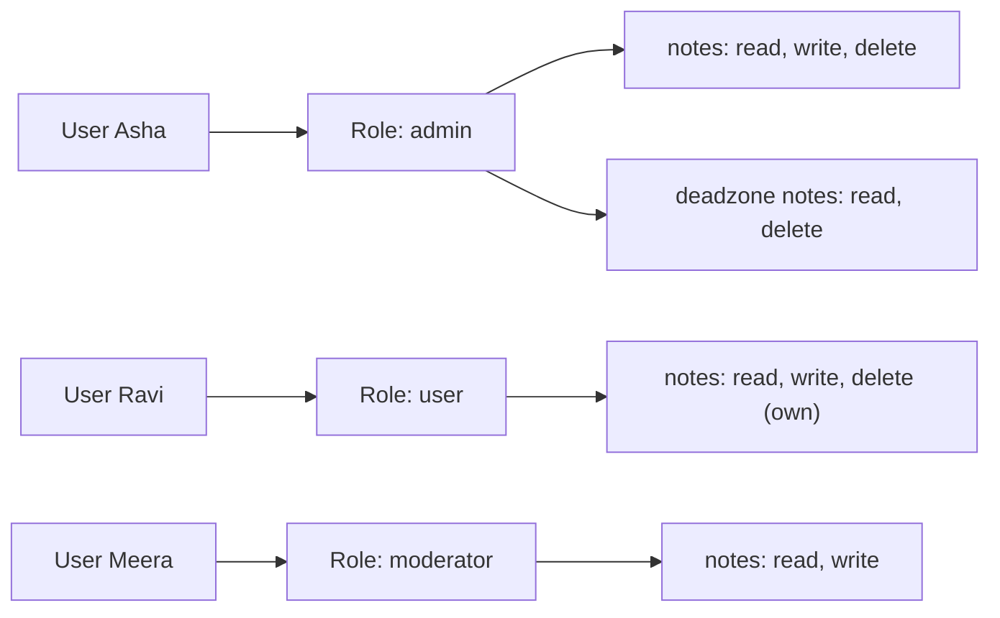

- Example roles: **user**, **admin**, **moderator**, or custom ones.
- Permissions can be as **granular** as you want, per resource: users may read/write/delete their notes, but only admins can access dead-zone notes.

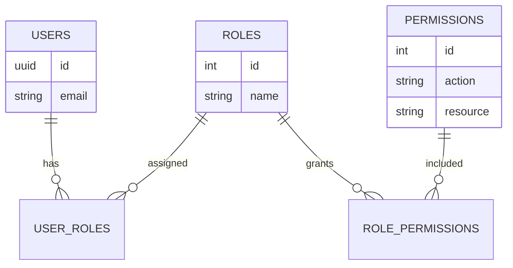

### RBAC request workflow

1. A user **signs up**; the server **assigns a role** (usually `user`; maybe `admin` depending on the use case).
2. On each request, the user sends their identity — a **session ID** (stateful) or a **JWT** (stateless).
3. **Early in the request cycle** (in an auth middleware), the server determines the user's role — either from the token claims or by a **database lookup**.
4. It **attaches** the identity and role to the request context so the next middlewares and handlers can use it.
5. A later check decides: role is `admin` → allow dead-zone access; role is `user` → reject with **403 Forbidden** ("you don't have permission for this action/resource").

```ts
// Authentication middleware: who are you?
function authenticate(req, res, next) {
  const token = req.headers.authorization?.replace("Bearer ", "");
  try {
    const claims = jwt.verify(token, SECRET) as { sub: string; role: string };
    req.user = { id: claims.sub, role: claims.role }; // attach to request context
    next();
  } catch {
    res.status(401).json({ error: "Unauthorized" });
  }
}

// Authorization middleware: what can you do?
const requireRole = (...roles: string[]) => (req, res, next) =>
  roles.includes(req.user.role) ? next() : res.status(403).json({ error: "Forbidden" });

app.get("/admin/dead-zone-notes", authenticate, requireRole("admin"), listDeadZoneNotes);
```

> [!TIP]
> If the role lives inside a JWT, a role change (e.g. demoting an admin) only takes effect when the token is reissued. For sensitive permissions, look the role up from the DB/cache, or keep tokens short-lived.

> [!NOTE]
> Beyond RBAC (standard extra knowledge): **ABAC** (attribute-based — rules on user/resource/environment attributes, e.g. "editors can edit documents in their own department during work hours") and **ReBAC** (relationship-based — "you can edit this doc because you are its owner or a member of its folder", as in Google Zanzibar). Also, **ownership checks** ("is this note yours?") are authorization too — missing them causes **IDOR/BOLA** vulnerabilities, the #1 API security issue.

## Security essentials for auth

### 1. Use generic error messages

During login it is tempting to be helpful:
- "User not found"
- "Incorrect password"
- "Account locked due to too many failed attempts"

These help legitimate users but **leak information to attackers**:
- "User not found" → the attacker learns that email is not registered and moves on to the next one in their list.
- "Incorrect password" → the attacker learns the **username is valid**, so they now only need to brute-force or dictionary-attack the password. Their attack surface just shrank.

**Rule:** for authentication failures, always return one **generic** message, e.g. `"Authentication failed"` / `"Invalid email or password"`, regardless of which step failed. User-friendly, specific messages are fine elsewhere (form validation, other APIs) — just not in the auth workflow.

```json
{ "error": "Invalid email or password" }
```

> [!WARNING]
> The same leak (called **user enumeration**) happens on sign-up ("email already registered") and password-reset ("no account with this email") endpoints. Prefer responses like "If an account exists, we've sent a reset link."

### 2. Defend against timing attacks

A **timing attack** infers secret information from **how long** the server takes to respond. Rare, but real.

Typical login flow:
1. **Find the user** by email/username.
2. **Check whether the account is locked/suspended** (servers temporarily lock accounts — 2 minutes, 4 minutes, a day — after too many failed attempts).
3. **Compare the password**: hash the submitted password with the same algorithm (and the stored salt) and compare it to the hash stored in the DB. Passwords are never stored in plain text and cannot be recovered even by the server.

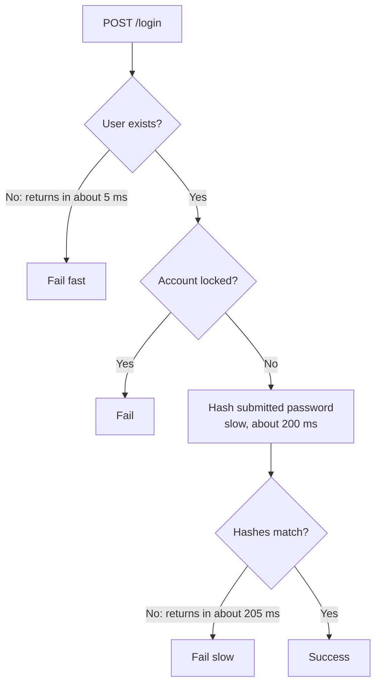

**The leak:** if the username is invalid, the server fails at step 1 and responds quickly. If the username is valid but the password wrong, it fails at step 3 after the (deliberately slow) hash computation, so the response is noticeably slower — say ~200 ms more. By measuring response times, an attacker learns which usernames exist and which step failed, and focuses brute-force/dictionary attacks accordingly. Even though the error message is generic, the *timing* gives it away.

**Defences — equalise response times:**
1. **Constant-time operations** — use cryptographically secure **constant-time comparison** functions, whose execution time does not depend on how similar the inputs are (a normal `===` string comparison stops at the first differing character, leaking how many leading characters matched). When the user does not exist, still run a hash comparison against a **dummy hash** so both paths do the same work.
2. **Simulated delay** — when the user is not found, wait an artificial amount before responding (`setTimeout` in Node, `time.Sleep` in Go) so both failure paths take similar time.

```ts
import bcrypt from "bcrypt";
import crypto from "node:crypto";

const DUMMY_HASH = await bcrypt.hash("dummy-password", 12);

async function login(email: string, password: string) {
  const user = await db.users.findByEmail(email);
  // Always run bcrypt, even when the user does not exist, so timings match
  const ok = await bcrypt.compare(password, user?.passwordHash ?? DUMMY_HASH);
  if (!user || !ok || user.isLocked) {
    throw new AuthError("Invalid email or password"); // generic message
  }
  return createSession(user);
}

// Constant-time comparison for tokens/API keys
function safeEqual(a: string, b: string) {
  const ab = Buffer.from(a), bb = Buffer.from(b);
  return ab.length === bb.length && crypto.timingSafeEqual(ab, bb);
}
```

```go
// Go: simulate delay or use constant-time compare
import (
    "crypto/subtle"
    "time"
)

if user == nil {
    time.Sleep(200 * time.Millisecond) // equalise with the hashing path
    return ErrInvalidCredentials
}
equal := subtle.ConstantTimeCompare([]byte(a), []byte(b)) == 1
```

## Common mistakes & misconceptions

- **"JWTs are encrypted."** No — they are signed and Base64URL-encoded. Anyone can read the payload. Don't put secrets in them.
- **"JWT is always better because it's stateless."** Statelessness costs you revocation. Many apps then add a blacklist and end up stateful anyway.
- **"OAuth is for login."** OAuth 2.0 is delegated *authorization*. Login is OIDC (ID token).
- **Using an access token as proof of identity** in your own client — use the OIDC ID token, and verify its signature, `iss`, `aud`, and `exp`.
- **Storing passwords in plain text or with fast hashes (MD5/SHA-1/SHA-256).** Use bcrypt/scrypt/Argon2 with salts.
- **Rotating the JWT secret to "log out one user"** — logs out everyone.
- **Storing tokens in `localStorage`** and getting them stolen via XSS; prefer HttpOnly cookies.
- **Confusing 401 and 403.** 401 = not authenticated (missing/invalid credentials). 403 = authenticated but not allowed.
- **Specific login error messages** ("user not found") → user enumeration.
- **Only hiding admin buttons in the UI.** Authorization must be enforced on the **server** for every request.
- **Rolling your own auth in production** without deep expertise instead of using a proven provider/library.
- **Using the implicit flow** for new SPAs — use authorization code + PKCE.

## Interview questions

<details>
<summary><strong>Q: What is the difference between authentication and authorization? Which HTTP status codes correspond to failures of each?</strong></summary>

Authentication establishes *who* the subject is (verifying a password, session ID, or token). Authorization decides *what* that identity may do (e.g. only admins can delete users). Authentication must happen first. A failed or missing authentication returns **401 Unauthorized** (really "unauthenticated"); an authenticated user lacking permission gets **403 Forbidden**.

</details>

<details>
<summary><strong>Q: Why do we need sessions at all? Explain how session-based authentication works end to end.</strong></summary>

HTTP is stateless — each request is independent, so the server cannot remember a logged-in user. Sessions add server-side memory. On login, the server verifies credentials, creates a random session ID, stores `sessionId → user data` in Redis or a DB with a TTL, and returns the ID in an `HttpOnly`, `Secure`, `SameSite` cookie. The browser sends that cookie automatically on every request; the server looks up the ID, checks it exists and isn't expired, and loads the user. Logout = delete the session from the store.

</details>

<details>
<summary><strong>Q: What are the three parts of a JWT and what does each contain? Can a user change their role inside a JWT?</strong></summary>

**Header** (algorithm, type), **payload** (claims: `sub` user ID, `iat` issued-at, `exp`, `iss`, custom claims like `role`), and **signature** (HMAC or RSA/ECDSA over header + payload using the server's key). Each part is Base64URL-encoded, joined by dots. A user can *decode and edit* the payload, but the signature will no longer match, so verification fails and the server rejects it — unless the server is misconfigured (e.g. accepts `alg: none` or leaks the secret).

</details>

<details>
<summary><strong>Q: Sessions vs JWT — compare them and say when you'd pick each.</strong></summary>

Sessions: state on the server, a lookup per request, instant revocation and visibility of active sessions, but need a shared store across servers and add cross-region latency. JWT: self-contained, verified with a key, no shared store, easy to scale across services and to mobile clients, but cannot be revoked before expiry and a stolen token is usable until then. Pick sessions for typical browser web apps; JWTs for distributed APIs, microservices, mobile/third-party clients — ideally short-lived with refresh tokens. A hybrid of both is common.

</details>

<details>
<summary><strong>Q: A user reports their account is compromised. Your system uses JWTs with a 24-hour expiry. What can you do?</strong></summary>

Changing the global signing secret would log out every user — too disruptive. Instead: add a **denylist** in Redis (by `jti` token ID or by user ID with a "tokens issued before time T are invalid" timestamp) and check it after signature verification; reset the user's password and revoke their **refresh tokens**. Longer term: shorten access-token lifetime (5–15 min) and use server-side, revocable refresh tokens so revocation takes effect within minutes. Note this reintroduces state — the trade-off is accepted for security.

</details>

<details>
<summary><strong>Q: What is a cookie, and which attributes matter for auth cookies?</strong></summary>

A cookie is a small value the server stores in the browser via `Set-Cookie`; the browser sends it back automatically on every request to that domain, and other sites can't read it. For auth: `HttpOnly` (JS can't read it → protects against XSS theft), `Secure` (HTTPS only), `SameSite=Lax/Strict` (not sent on most cross-site requests → CSRF defence), sensible `Max-Age`, and tight `Domain`/`Path`. Since cookies are sent automatically, also consider CSRF tokens for state-changing requests.

</details>

<details>
<summary><strong>Q: Where should a browser app store its token: localStorage or cookies?</strong></summary>

`localStorage` is readable by any JavaScript on the page, so an XSS bug lets attackers steal the token. An `HttpOnly; Secure; SameSite` cookie is not readable by JS, so XSS can't exfiltrate it (though XSS can still make requests as the user). The cost of cookies is CSRF exposure, which SameSite and CSRF tokens mitigate. The usual recommendation is HttpOnly cookies.

</details>

<details>
<summary><strong>Q: What problem does OAuth solve? Name the four roles.</strong></summary>

The **delegation** problem: letting app A access a user's resources on app B (e.g. import Google contacts) without the user handing over their B password. Sharing passwords gave full, unrevocable access. OAuth instead issues a **scoped, revocable token**. Roles: **resource owner** (the user), **client** (app requesting access), **authorization server** (authenticates the user, gets consent, issues tokens), **resource server** (API holding the data, accepts tokens).

</details>

<details>
<summary><strong>Q: Walk me through the OAuth 2.0 authorization code flow used by "Sign in with Google".</strong></summary>

1) Client redirects the browser to Google's authorize endpoint with `client_id`, `redirect_uri`, `scope` (e.g. `openid email profile`), `state` (and PKCE `code_challenge`). 2) User logs in on Google and consents. 3) Google redirects back to `redirect_uri` with a short-lived **authorization code**. 4) The client's backend exchanges the code (plus client secret / PKCE verifier) at Google's **token endpoint** for an **access token**, **ID token**, and optional **refresh token**. 5) The client verifies the ID token (signature, `iss`, `aud`, `exp`) to identify the user and creates its own session; it uses the access token to call Google APIs within the granted scopes. The code goes via the browser; tokens come via a back channel, so they are never exposed in the URL.

</details>

<details>
<summary><strong>Q: What is the difference between OAuth 2.0 and OpenID Connect? What is an ID token?</strong></summary>

OAuth 2.0 is for authorization: it gives the client an **access token** to call APIs on the user's behalf, but doesn't define who the user is. OIDC (2014) is an identity layer on top of OAuth 2.0 that adds an **ID token** — a signed JWT with claims like `sub` (user ID), `iss` (issuer), `aud` (client), `iat`/`exp`, and profile data such as name and email. The ID token is meant for the client to authenticate the user; the access token is meant for the resource server.

</details>

<details>
<summary><strong>Q: Which OAuth 2.0 flow would you use for (a) a backend web app, (b) a cron job calling another service, (c) a smart TV app, (d) a single-page app?</strong></summary>

(a) **Authorization code** flow. (b) **Client credentials** flow — machine-to-machine, no user. (c) **Device code** flow — the TV shows a code; the user approves on another device. (d) **Authorization code with PKCE** — the old **implicit** flow (token in the URL fragment) is discouraged because tokens leak via browser history, referrers, and XSS.

</details>

<details>
<summary><strong>Q: When would you use API keys instead of user login, and how should a server store them?</strong></summary>

For machine-to-machine/programmatic access where no human can type a password — e.g. your server calling OpenAI, or customers' servers calling your API. Keys are long cryptographically random strings, sent in a header (e.g. `Authorization: Bearer` or `X-API-Key`). The server should store only a **hash** of the key (like a password), show it once, attach scopes/permissions, quotas, and expiry, support rotation, and allow revoking a single key. Clients store keys in environment variables or a secrets manager, never in frontend code or Git.

</details>

<details>
<summary><strong>Q: How would you design authorization for a multi-tenant SaaS where org admins grant read or read/write access to members?</strong></summary>

Use **RBAC scoped per organisation**: tables `users`, `organizations`, `memberships(user_id, org_id, role)`, `roles → permissions`. An auth middleware authenticates the request and loads the user's membership/role for the target org into the request context. Each handler (or a policy layer) checks the required permission, e.g. `notes:write`, and returns 403 if absent. Also enforce **ownership/tenant isolation** in queries (`WHERE org_id = ?`) to prevent cross-tenant access (IDOR). Consider caching role lookups and invalidating on role change.

</details>

<details>
<summary><strong>Q: Why should login errors be generic? What is a timing attack and how do you prevent it?</strong></summary>

Messages like "user not found" vs "incorrect password" let attackers enumerate valid usernames and focus brute-force on passwords. Always return something like "Invalid email or password". A timing attack infers the same information from response time: a missing user fails fast, while an existing user triggers a slow password hash, so the response is measurably slower. Prevent it by doing equal work on every path (hash against a dummy hash when the user doesn't exist), using **constant-time comparison** functions (`crypto.timingSafeEqual`, Go's `subtle.ConstantTimeCompare`), and/or adding a uniform artificial delay.

</details>

<details>
<summary><strong>Q: What happens if your JWT signing secret leaks?</strong></summary>

An attacker can forge valid tokens for any user, including admins, and every service that trusts the secret will accept them. You must rotate the secret immediately (which invalidates all existing tokens and logs everyone out), audit activity, and fix the leak. Mitigations: store the secret in a secrets manager, use asymmetric signing (RS256/ES256) so only the auth service holds the private key, support key IDs (`kid`) for graceful rotation, and keep token lifetimes short.

</details>

## Cheat sheet

- **AuthN** = who are you → failure **401**. **AuthZ** = what can you do → failure **403**.
- **Auth factors:** know (password/PIN), have (phone/smart card/OTP), are (biometrics). MFA = 2+ factors.
- **Password storage:** never plain text; bcrypt/scrypt/Argon2 + per-user salt; compare by re-hashing.
- **HTTP is stateless** → sessions or tokens give continuity.
- **Session:** random ID in HttpOnly cookie → server looks up `id → user` in Redis/DB with TTL. Easy logout/revocation; needs shared store.
- **JWT:** `header.payload.signature`, Base64URL, **signed not encrypted**. Claims: `sub`, `iat`, `exp`, `iss`, `aud`, custom (`role`). Verified with secret (HS256) or public key (RS256). Stateless, scalable, portable; **hard to revoke**.
- **JWT revocation fixes:** short-lived access token + revocable refresh token, `jti` denylist in Redis.
- **Cookies:** set via `Set-Cookie`, auto-sent to same domain. Use `HttpOnly; Secure; SameSite=Lax`. Watch for CSRF.
- **Choose:** web app → stateful sessions; distributed APIs/mobile → JWT; third-party login/integration → OAuth/OIDC; M2M → API keys (or client credentials).
- **API keys:** random secret, scoped, expiring, hashed at rest, sent in header, stored in env/secret manager.
- **OAuth 2.0 roles:** resource owner, client, authorization server, resource server. **Bearer tokens**, **scopes**.
- **OAuth flows:** auth code (+PKCE), client credentials (M2M), device code (TVs), implicit (deprecated).
- **OIDC** = OAuth 2.0 + **ID token (JWT)** → authentication, "Sign in with Google".
- **RBAC:** users → roles → permissions; auth middleware attaches user+role to request context; check → 403.
- **Security:** generic auth errors; avoid user enumeration; constant-time compare; equalise timing (dummy hash / delay); account lockout after failed attempts.
- **Production:** prefer a proven auth provider (Auth0, Clerk, etc.).

## Glossary

- **Authentication (AuthN)** — verifying the identity of a subject; "who are you?"
- **Authorization (AuthZ)** — determining what an authenticated subject may do; "what can you do?"
- **Subject** — the entity being authenticated: a user, device, or service.
- **Authentication bypass attack** — gaining access by skipping or faking the authentication step (e.g. forged seals, forged tokens).
- **Shared secret** — a value known to both parties and used to prove identity (passphrase, password, HMAC key).
- **Hash function** — one-way, deterministic function mapping any input to a fixed-length output.
- **Salt** — random per-user value combined with a password before hashing so identical passwords produce different hashes.
- **CIA triad** — Confidentiality, Integrity, Availability; core goals of information security.
- **Asymmetric cryptography** — uses a public/private key pair; enables key exchange and digital signatures.
- **PKI** — Public Key Infrastructure; the system of keys and certificates built on asymmetric crypto.
- **Kerberos** — ticket-based authentication protocol using a trusted third party; precursor to token auth.
- **Brute-force attack** — trying every possible password.
- **Dictionary attack** — trying a list of common/likely passwords.
- **MFA** — multi-factor authentication combining know / have / are factors.
- **Zero Trust** — security model that never implicitly trusts a request based on network location.
- **WebAuthn / passkeys** — passwordless authentication using hardware-backed public/private keys.
- **Post-quantum cryptography** — algorithms designed to remain secure against quantum computers.
- **Session** — server-side stored context for a user, identified by a session ID.
- **Session ID** — random, unguessable identifier pointing to a server-side session.
- **Redis / Memcached** — in-memory key-value stores commonly used for sessions and caches.
- **JWT** — JSON Web Token; signed, self-contained token of claims (`header.payload.signature`).
- **Claim** — a statement inside a token, such as `sub`, `iat`, `exp`, `role`.
- **`sub` / `iat` / `exp` / `iss` / `aud`** — subject (user ID), issued at, expiry, issuer, audience.
- **Bearer token** — a token that grants access to whoever presents it.
- **Revocation** — invalidating a credential before its natural expiry.
- **Denylist / blacklist** — store of revoked tokens or users checked on each request.
- **Refresh token** — long-lived token used to obtain new short-lived access tokens; can be revoked server-side.
- **Cookie** — small value set by a server in the browser and sent back automatically with requests to that server.
- **HttpOnly / Secure / SameSite** — cookie flags preventing JS access, requiring HTTPS, and limiting cross-site sending.
- **XSS** — cross-site scripting; attacker-injected JavaScript running in your page.
- **CSRF** — cross-site request forgery; tricking a browser into sending an authenticated request.
- **API key** — long random secret identifying a program/account for programmatic API access.
- **Machine-to-machine (M2M)** — communication between servers with no human involved.
- **Delegation** — granting one app limited access to your resources on another app.
- **OAuth 2.0** — framework for delegated authorization via scoped access tokens.
- **Scope** — a named permission requested by an OAuth client (e.g. `contacts.readonly`).
- **Resource owner / client / authorization server / resource server** — the four OAuth roles.
- **Authorization code** — short-lived code returned to the client after consent, exchanged for tokens.
- **PKCE** — Proof Key for Code Exchange; protects the authorization code flow for public clients.
- **Implicit flow** — legacy OAuth flow returning tokens in the URL; deprecated.
- **Client credentials flow** — OAuth flow for M2M, no user involved.
- **Device code flow** — OAuth flow for input-limited devices like smart TVs.
- **OpenID Connect (OIDC)** — identity layer on OAuth 2.0 adding the ID token.
- **ID token** — JWT issued by an OIDC provider describing the authenticated user.
- **RBAC** — role-based access control: permissions attached to roles, roles assigned to users.
- **ABAC / ReBAC** — attribute-based / relationship-based access control.
- **Multi-tenant** — one system serving many organisations with isolated data and per-org permissions.
- **401 Unauthorized** — request lacks valid authentication.
- **403 Forbidden** — authenticated but not permitted.
- **User enumeration** — discovering which usernames/emails exist via responses or timing.
- **Timing attack** — inferring secrets from differences in response time.
- **Constant-time comparison** — comparison whose duration doesn't depend on input contents.

## Video timestamps

- [00:00](https://www.youtube.com/watch?v=A95rliroC8Q&t=0s) — Authentication vs authorization in two sentences
- [02:00](https://www.youtube.com/watch?v=A95rliroC8Q&t=120s) — History: pre-industrial implicit trust
- [04:05](https://www.youtube.com/watch?v=A95rliroC8Q&t=245s) — Seals and the cryptographic era, bypass attacks
- [06:08](https://www.youtube.com/watch?v=A95rliroC8Q&t=368s) — Passphrases and shared secrets (telegraph)
- [08:10](https://www.youtube.com/watch?v=A95rliroC8Q&t=490s) — Mainframes, MIT CTSS, plain-text passwords
- [10:12](https://www.youtube.com/watch?v=A95rliroC8Q&t=612s) — Hashing for password storage
- [11:14](https://www.youtube.com/watch?v=A95rliroC8Q&t=674s) — Diffie-Hellman, asymmetric crypto, Kerberos
- [13:15](https://www.youtube.com/watch?v=A95rliroC8Q&t=795s) — MFA and biometrics
- [14:18](https://www.youtube.com/watch?v=A95rliroC8Q&t=858s) — Modern era: OAuth, JWT, Zero Trust, WebAuthn
- [16:21](https://www.youtube.com/watch?v=A95rliroC8Q&t=981s) — Future: decentralised identity, post-quantum crypto
- [18:24](https://www.youtube.com/watch?v=A95rliroC8Q&t=1104s) — Building blocks: sessions and stateless HTTP
- [21:29](https://www.youtube.com/watch?v=A95rliroC8Q&t=1289s) — How sessions work, storage evolution
- [25:32](https://www.youtube.com/watch?v=A95rliroC8Q&t=1532s) — Why JWTs emerged
- [28:36](https://www.youtube.com/watch?v=A95rliroC8Q&t=1716s) — JWT structure: header, payload, signature
- [30:37](https://www.youtube.com/watch?v=A95rliroC8Q&t=1837s) — JWT advantages: stateless, scalable, portable
- [32:39](https://www.youtube.com/watch?v=A95rliroC8Q&t=1959s) — JWT challenges: token theft and revocation
- [34:43](https://www.youtube.com/watch?v=A95rliroC8Q&t=2083s) — Hybrid approach with a blacklist
- [36:45](https://www.youtube.com/watch?v=A95rliroC8Q&t=2205s) — Advice: use an auth provider in production
- [37:45](https://www.youtube.com/watch?v=A95rliroC8Q&t=2265s) — Cookies
- [40:49](https://www.youtube.com/watch?v=A95rliroC8Q&t=2449s) — Types of authentication
- [41:49](https://www.youtube.com/watch?v=A95rliroC8Q&t=2509s) — Stateful authentication flow
- [43:56](https://www.youtube.com/watch?v=A95rliroC8Q&t=2636s) — Stateless authentication flow
- [47:00](https://www.youtube.com/watch?v=A95rliroC8Q&t=2820s) — Stateful vs stateless pros/cons, hybrid strategy
- [50:04](https://www.youtube.com/watch?v=A95rliroC8Q&t=3004s) — API key authentication
- [55:10](https://www.youtube.com/watch?v=A95rliroC8Q&t=3310s) — Machine-to-machine communication
- [57:13](https://www.youtube.com/watch?v=A95rliroC8Q&t=3433s) — OAuth motivation: password fatigue
- [59:13](https://www.youtube.com/watch?v=A95rliroC8Q&t=3553s) — The delegation problem and password sharing
- [1:02:16](https://www.youtube.com/watch?v=A95rliroC8Q&t=3736s) — Birth of OAuth: tokens instead of passwords
- [1:04:18](https://www.youtube.com/watch?v=A95rliroC8Q&t=3858s) — OAuth roles
- [1:06:20](https://www.youtube.com/watch?v=A95rliroC8Q&t=3980s) — OAuth 1.0 flow
- [1:07:21](https://www.youtube.com/watch?v=A95rliroC8Q&t=4041s) — OAuth 2.0: bearer tokens and flows
- [1:09:24](https://www.youtube.com/watch?v=A95rliroC8Q&t=4164s) — Authorization vs authentication gap, OpenID Connect
- [1:12:30](https://www.youtube.com/watch?v=A95rliroC8Q&t=4350s) — Sign in with Google: OIDC flow
- [1:16:35](https://www.youtube.com/watch?v=A95rliroC8Q&t=4595s) — When to use which authentication type
- [1:18:36](https://www.youtube.com/watch?v=A95rliroC8Q&t=4716s) — Authorization: the need for permissions
- [1:21:39](https://www.youtube.com/watch?v=A95rliroC8Q&t=4899s) — The "god mode string" anti-pattern
- [1:24:42](https://www.youtube.com/watch?v=A95rliroC8Q&t=5082s) — RBAC: role-based access control
- [1:27:48](https://www.youtube.com/watch?v=A95rliroC8Q&t=5268s) — Generic error messages in auth
- [1:29:51](https://www.youtube.com/watch?v=A95rliroC8Q&t=5391s) — Timing attacks
- [1:33:57](https://www.youtube.com/watch?v=A95rliroC8Q&t=5637s) — Defences: constant-time ops and simulated delay
