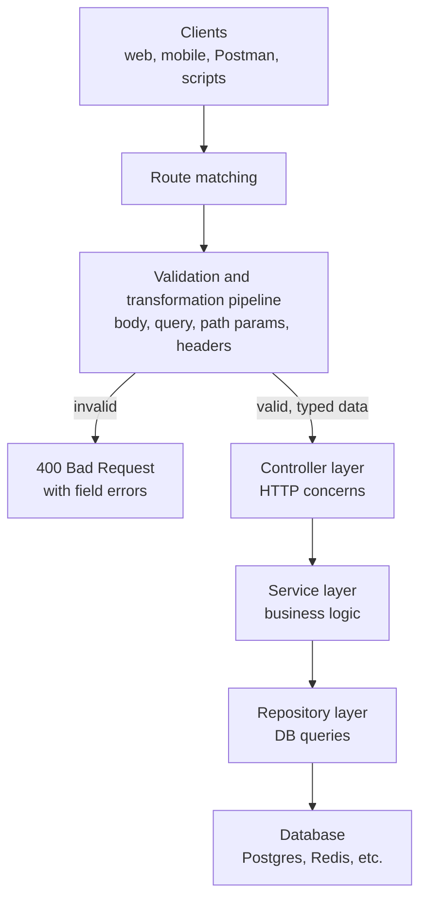
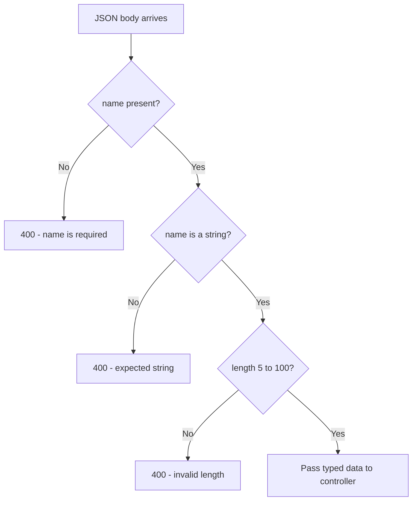
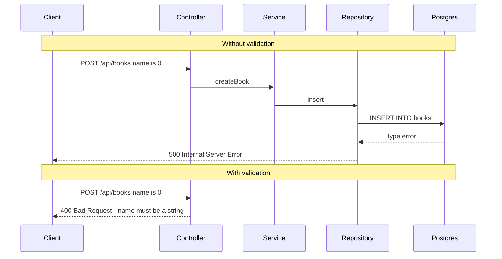
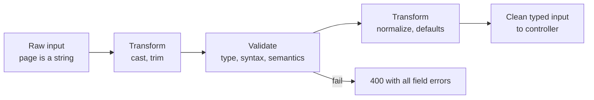
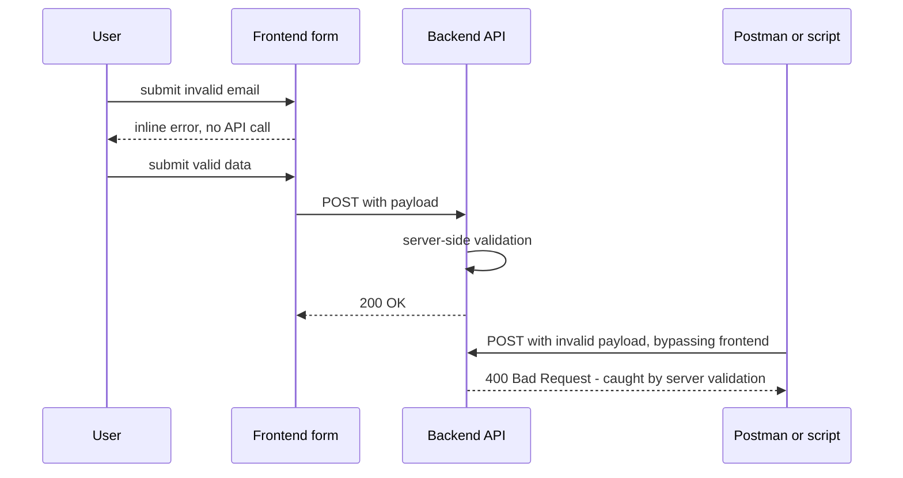

## TL;DR
- A typical backend has three layers: **controller** (HTTP concerns: input, status codes, response format) → **service** (business logic: orchestrates repositories, emails, notifications, webhooks) → **repository** (database queries).
- **Validation and transformation run at the entry point**: after the route is matched and **before any significant logic** in the controller — before calling services or touching the database.
- Validate **all** client input: **JSON body, query params, path params, headers**, against a **schema**, usually via a reusable **middleware / utility**.
- Without validation, bad input (e.g. `"name": 0` where text is expected) travels down to the database, the insert fails, and the client gets a **500** — poor UX and an unpredictable system. With validation the client gets a clear **400 Bad Request** immediately.
- Three main kinds: **syntactic** (structure: email, phone, date format), **semantic** (makes sense: DOB not in the future, age 1–120), **type** (string, number, boolean, array, object — including element types).
- **Transformation** = changing input into the shape the server needs: **type casting** (query params are **always strings** → cast `"2"` to `2` before validating `page`), **normalization** (lower-case emails, add `+` to phone numbers, reformat dates).
- **Complex validation**: **cross-field** (password confirmation must match) and **conditional** (`partner` required only when `married: true`).
- Keep validation and transformation in **one pipeline** so all input rules live in one place.
- **Frontend validation = user experience. Backend validation = security and data integrity.** Clients like Postman/Insomnia bypass the frontend, so **the server must be strict regardless of the client**.

## Why this matters
Every API is a door into your system, and every client — your web app, a mobile app, a script, an attacker — can push any bytes through it. Validation is the bouncer at that door. It protects **data integrity** (no garbage in the database), **security** (no unexpected types or values reaching business logic and queries), and **developer/user experience** (clear error messages instead of 500s). Interviewers frequently ask "where do you validate?", "why validate on the server if the frontend does?", and "what status code for invalid input?".

## Where validation lives: the layered architecture



### Repository layer (bottom)
Deals with **data**: database connections, executing queries, inserts, deletes, updates. The store can be a relational DB, Redis, or any persistent storage.

### Service layer (middle)
Executes **business logic** — everything an API call is supposed to *do*: call one or more repository methods, send notifications to devices, send emails, store data, make webhook calls. A service method typically calls one or more repository methods.

### Controller layer (top)
Calls the service method associated with the API and returns its data to the user over the HTTP connection. It's separate from the service so that **HTTP-related concerns stay in one layer**:
- which **status code** to return (success or error);
- what **format** the response should be in;
- what **validations** to perform on incoming data.

The flow: **request → controller → service → repository (if needed) → back up → response.**

### Exactly where
1. The request arrives (typically with a JSON payload).
2. The **route matching** algorithm finds the matching route and its controller method.
3. **Here — before any significant logic in the controller, before calling services or the database — the validation and transformation pipeline runs.**

> [!IMPORTANT]
> Validate at the **entry point**, after routing and **before business logic**. By the time data reaches the service layer, it should already be guaranteed to have the exact structure, types and constraints the business logic needs.

## What validation does

Clients all over the world make API calls. Whatever they send — **JSON payload, query parameters, path parameters, headers** — must be checked to be in the **exact expected format** before it enters the system.

### Example: a `name` field
Requirement: the body is JSON with a field `name`, which must be a **string of length 5–100**. The pipeline (a middleware or reusable utility given a **schema**) checks in order:

1. **Presence** — is `name` there? If not → error "name is required".
2. **Type** — is it a string (not an array, boolean, number)? If not → "expected string, received boolean".
3. **Constraints** — is the length within 5–100? Too long (a whole paragraph) or too short (2 characters) → a length error.

Each failure is returned **immediately** to the client.



```ts
import { z } from "zod";

const CreateBook = z.object({
  name: z.string().min(5).max(100),
});

// Reusable validation middleware
const validateBody = (schema: z.ZodTypeAny) => (req, res, next) => {
  const result = schema.safeParse(req.body);
  if (!result.success) {
    return res.status(400).json({
      errors: result.error.issues.map(i => ({ field: i.path.join("."), message: i.message })),
    });
  }
  req.body = result.data; // replace with validated (and transformed) data
  next();
};

app.post("/api/books", validateBody(CreateBook), booksController.create);
```

### What goes wrong without it
Suppose there's no validation and the client sends `{"name": 0}`.
1. The controller passes it to the service, which calls the repository.
2. The repository runs an `INSERT` into `books`.
3. The table was created with a typed column:

```sql
CREATE TABLE books (
  id   SERIAL PRIMARY KEY,
  name TEXT NOT NULL
);
```

4. Postgres enforces data types and constraints, so the **DB call fails**.
5. Depending on error handling, the client gets **500 Internal Server Error** — "something unexpected happened on the server".



That's a poor experience for a basic form, and the system reached an **unexpected state** under unexpected input. With validation at the entry point, the client gets **400 Bad Request** ("the data you sent doesn't satisfy our constraints; retry with the right format") and nothing significant ran.

> [!WARNING]
> Relying on the database as your validator is a bug, not a strategy: you waste work (service logic, maybe emails or external calls already happened), you leak 500s, and DB error messages can leak schema details. DB constraints are your **last line of defense**, not the first.

> [!TIP]
> Validation errors double as **documentation**. Hit an endpoint with an empty body and a good API tells you exactly which fields it expects and in what format — useful when docs are missing.

### Demo: syntactic validation endpoint
Using **Insomnia** (an API client), `POST /api/validation/syntactic`:

| Body sent | Response |
|---|---|
| `{}` | Errors: `email`, `phone`, `date` all **required** |
| `{"email":"random","phone":12345,"date":"2025-11-05"}` | `email`: invalid email format; `phone`: expected string, received number |
| email `test@test.com`, phone as a string | **200 OK** |

## Types of validation
These aren't a strict taxonomy — they're categories to keep in mind when deciding **how strict and how specific** each API should be.

| Type | Question | Examples |
|---|---|---|
| **Syntactic** | Does it have the right **structure/format**? | Email `local@domain.tld`; phone `+<country code><digits>`; date `YYYY-MM-DD` |
| **Semantic** | Does it **make sense**? | DOB not in the future; age between 1 and 120 |
| **Type** | Is it the right **data type**? | string, number, boolean, array (and each element's type), object |

### Syntactic validation
Checks a string matches an expected **structure**:
- **Email**: some local part, then `@`, then a domain name, then a top-level domain (`.com`, `.org`, `.co.in`, … thousands exist).
- **Phone**: country code followed by the right number of digits for that country (e.g. 10 digits for India).
- **Date**: matches the format the API expects (e.g. year-month-day).

### Semantic validation
The data may be well-formed but **meaningless**:
- **Date of birth in the future** — if today is 2025-01-11, a DOB of 2025-01-13 is rejected.
- **Age 365** — not a plausible human age (at least not yet); constrain to e.g. 1–120.

Demo (`dateOfBirth`, `age`): empty body → both required; DOB `1995-06-12` and age `43` → 200; DOB year **2026** → "date of birth cannot be in the future"; age **430** → "number must be less than or equal to 120".

### Type validation
Basic checks that each field is a **string, number, boolean, array, or object** — and, for arrays and nested objects, that their **elements/fields** have the right types too.

Demo with `stringField`, `numberField`, `arrayField`, `booleanField` all sent as strings: errors "expected number, received string", "expected array, received string", "expected boolean, received string". After fixing to `10`, `[1, 2]`, `false`: a new error — **`arrayField[0]`: expected string, received number** — because each element must be a string. With `["1","2"]` → 200.

```ts
const Syntactic = z.object({
  email: z.string().email(),
  phone: z.string().regex(/^\+?[1-9]\d{7,14}$/),          // E.164-ish
  date:  z.string().regex(/^\d{4}-\d{2}-\d{2}$/),
});

const Semantic = z.object({
  dateOfBirth: z.coerce.date().refine(d => d <= new Date(), "Date of birth cannot be in the future"),
  age: z.number().int().min(1).max(120),
});

const Types = z.object({
  stringField:  z.string(),
  numberField:  z.number(),
  arrayField:   z.array(z.string()),   // element types enforced too
  booleanField: z.boolean(),
});
```

## Transformation

### The problem: query parameters are always strings
A paginated endpoint: `GET /bookmarks?page=2&limit=20`. Validation rules:
- `page`: a **number**, > 0, < 500.
- `limit`: a **number**, > 0, < 10,000.

But **every value in a query string arrives at the server as a string** (same for path params): the server receives `page = "2"` and `limit = "20"`. They *look* like numbers, but the first check — "is it a number?" — **fails**, and the client gets "page should be a number, received string" — even though the client did nothing wrong.

### The solution: cast before validating
It's the **server's responsibility** to **transform** the input into the expected type. **Casting** means forcing a value of one type into another — here string → number. Then the numeric validations run.

> [!IMPORTANT]
> **Transformation** = converting input data into the format the server needs. It can happen **before** validation (casting `"2"` → `2` so it can be range-checked) or **after** validation (normalizing a valid email to lower case).

```ts
const Pagination = z.object({
  page:  z.coerce.number().int().gt(0).lt(500).default(1),     // "2" -> 2, then validate
  limit: z.coerce.number().int().gt(0).lt(10000).default(20),
});

app.get("/bookmarks", (req, res) => {
  const parsed = Pagination.safeParse(req.query);
  if (!parsed.success) return res.status(400).json({ errors: parsed.error.issues });
  const { page, limit } = parsed.data; // numbers now
  // ...
});
```

```go
// Go: query values are strings; convert, then validate
pageStr := r.URL.Query().Get("page")
page, err := strconv.Atoi(pageStr)
if err != nil || page <= 0 || page >= 500 {
    http.Error(w, `{"error":"page must be an integer between 1 and 499"}`, http.StatusBadRequest)
    return
}
```

### Normalization (another kind of transformation)
Demo (transformation endpoint): the client sends an email with **mixed upper/lower case**, a phone **without the leading `+`**, and a date in some format. The response shows:
- the email converted to **all lower case**;
- **`+` prepended** to the phone number;
- the date **converted to a different (canonical) format**.

The server reshaped the data for the **convenience/requirements of the service layer** before running any logic.

```ts
const Contact = z.object({
  email: z.string().trim().toLowerCase().email(),
  phone: z.string().trim().transform(p => (p.startsWith("+") ? p : `+${p}`)),
  date:  z.coerce.date().transform(d => d.toISOString()),
});
// Input:  { email: " Test@Example.COM ", phone: "919876543210", date: "2025-11-05" }
// Output: { email: "test@example.com", phone: "+919876543210", date: "2025-11-05T00:00:00.000Z" }
```

### One pipeline for both
Validation and transformation are paired in a **single pipeline** so all input-layer logic — requirements and operations — lives **in one place**. Anyone reading the code finds every rule for an endpoint's input in its schema, instead of hunting through controllers and services.



> [!TIP]
> Some standard related terms (from the course roadmap): **normalization** (lower-casing, trimming, canonical formats), **sanitization** (removing/escaping dangerous content, e.g. HTML in user input to prevent XSS), and **chained validation** (lower-case → strip special characters → check length). Return **all** errors in one response so a form can show them together.

## Complex validation

### Cross-field (relationship) validation
Demo: `password`, `passwordConfirmation`, `married`.
- Different strings in the two password fields → `passwordConfirmation`: **"passwords don't match"**.
- A short password → `password`: **"string must contain at least 8 characters"**.
- Fix both → 200.

### Conditional validation
- With `married: false` → `partner` is **optional**.
- With `married: true` and no partner → **"partner name is required when married is true"**.
- Add `partner` → 200.

These rules come from the **service layer's requirements**, encoded in the validation pipeline.

```ts
const Signup = z.object({
  password: z.string().min(8),
  passwordConfirmation: z.string(),
  married: z.boolean(),
  partner: z.string().min(1).optional(),
})
.refine(d => d.password === d.passwordConfirmation, {
  message: "Passwords don't match", path: ["passwordConfirmation"],
})
.refine(d => !d.married || !!d.partner, {
  message: "Partner name is required when married is true", path: ["partner"],
});
```

## Frontend vs backend validation

A common mistake is **replacing** backend validation with frontend validation. Forms usually validate inputs (min/max length, type) and only call the API when the form is valid, so it's tempting to think the server needn't check.

| | Frontend (client-side) validation | Backend (server-side) validation |
|---|---|---|
| Purpose | **User experience** — immediate feedback | **Security and data integrity** |
| Can be bypassed? | **Yes** — Postman, Insomnia, curl, scripts, modified JS | No (it's your code on your server) |
| Required? | Nice to have | **Mandatory** |
| Where | Browser/app forms | API entry point |

A server has **many clients**. A polished web app may validate perfectly, but an API client like **Postman or Insomnia** has no frontend at all — requests hit the API directly. If the backend depends on frontend validation for security/integrity, **it breaks when the client changes**.

> [!IMPORTANT]
> Design server-side validation to be **as strict and specific as possible, without assuming anything about the client.** Client-side validation is for UX; server-side validation is for security and data integrity. Use both.

Demo: a frontend form with email, phone and a date picker. Entering an invalid email and clicking submit makes **no API call** — the client-side check catches it and shows an error. Fix the email (`...@gmail.com`) → submit sends the payload → **200**.



> [!INTERVIEW]
> "If the frontend already validates, why validate on the backend?" — Because the frontend is not the only client and is fully under the user's control. Anyone can call the API directly with curl or Postman, or modify the JS. Frontend validation exists for instant UX feedback; backend validation is the actual security and data-integrity boundary. Keep the rules consistent (sharing schemas, e.g. Zod in a monorepo, helps).

## Common mistakes & misconceptions
- **Validating deep in the service or relying on DB constraints** — work is wasted and the client sees 500s.
- **Forgetting that query/path params are strings** — `"2" > 0` comparisons and failed number checks; cast first.
- **Validating only the body** — query params, path params and headers are client input too.
- **Trusting frontend validation** for security.
- **Returning 500 (or 200 with an error) for invalid input** — use **400** (some APIs use **422 Unprocessable Entity** for semantically invalid but well-formed input).
- **Returning only the first error** — aggregate all field errors so the client can fix everything in one go.
- **Scattering rules across layers** — keep validation + transformation in one schema per endpoint.
- **Not using the validated output** — validating `req.body` but then using the raw, untransformed body.
- **Overly permissive schemas** — accepting unknown fields enables mass assignment (`"role": "admin"`); use strict schemas.
- **Leaking sensitive detail in auth validation errors** — say "invalid credentials", not "wrong password".

## Interview questions

<details>
<summary><strong>Q: Where in the request lifecycle should validation happen, and why there?</strong></summary>

At the API entry point: after route matching, before the controller does anything significant (before service calls or DB access). Validating early guarantees that business logic only ever sees data of the expected shape, prevents the system from reaching unexpected states, avoids wasted work (DB calls, emails), and lets you return a clear 400 instead of an opaque 500. It's typically implemented as reusable middleware that validates against a per-route schema.

</details>

<details>
<summary><strong>Q: Explain the controller, service and repository layers.</strong></summary>

**Controller**: HTTP concerns — reads validated input, calls the service, chooses status codes and response format. **Service**: business logic — orchestrates repository calls, sends emails/notifications, calls webhooks. **Repository**: data access — runs queries against Postgres, Redis, etc. Separation keeps HTTP details out of business logic (so services are reusable from queues/CLIs and testable) and DB details out of services.

</details>

<details>
<summary><strong>Q: A client sends {"name": 0} to an endpoint expecting a string and there's no validation. What happens?</strong></summary>

The controller passes it to the service, which calls the repository to insert it. Postgres checks the column type (`TEXT NOT NULL`) and rejects the insert — or worse, a loosely typed layer coerces it to `"0"` and stores garbage. With typical error handling the client gets a 500 Internal Server Error: bad UX, misleading (it's really a client error), wasted work, and possibly leaked DB error details. With validation, it would get 400 with "name must be a string".

</details>

<details>
<summary><strong>Q: What are syntactic, semantic and type validation? Give examples.</strong></summary>

**Type**: is the value the right data type — string, number, boolean, array (with element types), object. **Syntactic**: does a value follow the required structure — valid email format, phone with country code and correct digit count, `YYYY-MM-DD` date. **Semantic**: does a well-formed value make sense — DOB not in the future, age between 1 and 120, end date after start date.

</details>

<details>
<summary><strong>Q: GET /bookmarks?page=2 fails with "page must be a number". Why, and how do you fix it?</strong></summary>

Query string values (and path params) always arrive as strings, so `page` is `"2"`, failing a strict number check. The server must **transform** (cast) the value to a number first — e.g. `z.coerce.number()` or `strconv.Atoi` — then validate the range (> 0, < 500), returning 400 if the cast fails (e.g. `page=abc`). Apply defaults (page 1, limit 20) when absent.

</details>

<details>
<summary><strong>Q: What is transformation in a validation pipeline? Give examples.</strong></summary>

Changing input into the form the server needs, before or after validation. Examples: type casting (`"20"` → `20`), trimming whitespace, lower-casing emails (`Test@X.com` → `test@x.com`) so uniqueness checks work, adding a `+` country prefix to phone numbers, converting dates to ISO 8601/UTC, applying default values. Combining it with validation in one pipeline keeps all input rules in a single place.

</details>

<details>
<summary><strong>Q: How do you implement "password confirmation must match" and "partner required if married"?</strong></summary>

These are cross-field and conditional rules, implemented as object-level refinements after field-level checks: `refine(d => d.password === d.passwordConfirmation)` with the error attached to `passwordConfirmation`, and `refine(d => !d.married || d.partner)` attached to `partner`. In Joi/Yup you'd use `ref()` and `when()`. Attach errors to the specific field path so the frontend can show them inline.

</details>

<details>
<summary><strong>Q: Why is backend validation mandatory even when the frontend validates?</strong></summary>

Frontend validation is for user experience — instant feedback. It can be bypassed by anyone using curl, Postman, Insomnia, a script, or DevTools, and other clients (mobile apps, partner integrations) might not validate at all. The backend is the only place you control, so it must enforce security and data integrity strictly, regardless of the client.

</details>

<details>
<summary><strong>Q: What status code should invalid input return, and what should the error body look like?</strong></summary>

**400 Bad Request** (some APIs use 422 Unprocessable Entity for well-formed but semantically invalid data). The body should be consistent and machine-readable, listing **all** failures with field paths and human-readable messages, e.g. `{"errors":[{"field":"email","message":"Invalid email format"},{"field":"arrayField.0","message":"Expected string, received number"}]}`. Don't include stack traces; for auth, keep messages generic.

</details>

<details>
<summary><strong>Q: If you validate at the API, do you still need database constraints?</strong></summary>

Yes — defense in depth. API validation catches bad input early with good error messages, but data can also enter via other paths (scripts, migrations, other services, bugs), and some rules (uniqueness under concurrency, foreign keys) can only be guaranteed by the database. DB constraints (`NOT NULL`, `CHECK`, `UNIQUE`, foreign keys, column types) are the last line of defense; map their violations to proper status codes (e.g. unique violation → 409).

</details>

<details>
<summary><strong>Q: What is mass assignment and how does strict validation prevent it?</strong></summary>

Mass assignment happens when the server passes the whole request body into a model update/create, so an attacker can add fields like `"isAdmin": true` or `"balance": 99999`. Strict schemas that only allow known fields (`.strict()` in Zod, `DisallowUnknownFields` in Go) and using only the validated output prevent unexpected fields from reaching the database.

</details>

## Cheat sheet
- **Layers**: controller (HTTP) → service (business logic) → repository (DB).
- **Where**: after route match, **before** any business logic.
- **What to validate**: body, query, path params, headers.
- **Kinds**: syntactic (format), semantic (makes sense), type (data types, incl. array elements).
- **Complex**: cross-field (passwords match), conditional (`partner` if `married`).
- **Transformation**: cast (query/path params are strings), trim, lower-case emails, `+` on phones, ISO dates, defaults.
- **One pipeline** per endpoint: transform → validate → transform → typed output.
- **Errors**: 400 (or 422), all field errors at once, consistent JSON, no internals.
- **Frontend = UX; backend = security + integrity.** Never trust the client.
- **DB constraints** = last line of defense, not the first.

## Glossary
- **Validation** — checking that input conforms to expected structure, types and constraints.
- **Transformation** — converting input into the form the server needs (cast, normalize, default).
- **Type casting / coercion** — converting a value from one data type to another, e.g. string to number.
- **Normalization** — converting data to a canonical form (lower-case email, trimmed strings).
- **Sanitization** — removing or escaping dangerous content from input.
- **Schema** — a declarative definition of the expected shape and rules of data.
- **Syntactic validation** — checking format/structure.
- **Semantic validation** — checking that values make logical sense.
- **Type validation** — checking data types.
- **Cross-field validation** — rules involving multiple fields together.
- **Conditional validation** — rules that apply only when another field has a certain value.
- **Controller** — layer handling HTTP input/output and calling services.
- **Service** — layer containing business logic.
- **Repository** — layer encapsulating database access.
- **Data integrity** — accuracy and consistency of stored data.
- **Mass assignment** — vulnerability where unexpected client fields are written to models.
- **Insomnia / Postman** — API clients for sending HTTP requests directly to an API.
- **Zod** — TypeScript schema validation library.

## Video timestamps
- [00:00](https://www.youtube.com/watch?v=qedj_JjjL-U&t=0s) — Purpose; repository and service layers
- [01:01](https://www.youtube.com/watch?v=qedj_JjjL-U&t=61s) — Service layer responsibilities
- [02:02](https://www.youtube.com/watch?v=qedj_JjjL-U&t=122s) — Controller layer and why it's separate
- [03:03](https://www.youtube.com/watch?v=qedj_JjjL-U&t=183s) — Where validation and transformation happen
- [05:04](https://www.youtube.com/watch?v=qedj_JjjL-U&t=304s) — Validating body, query, path params and headers
- [06:04](https://www.youtube.com/watch?v=qedj_JjjL-U&t=364s) — Example: name string of length 5–100
- [09:10](https://www.youtube.com/watch?v=qedj_JjjL-U&t=550s) — Without validation: the request reaches the database
- [11:14](https://www.youtube.com/watch?v=qedj_JjjL-U&t=674s) — Postgres type constraint fails, client gets 500
- [13:16](https://www.youtube.com/watch?v=qedj_JjjL-U&t=796s) — 400 Bad Request; demo in Insomnia
- [15:17](https://www.youtube.com/watch?v=qedj_JjjL-U&t=917s) — Types of validation: syntactic
- [17:20](https://www.youtube.com/watch?v=qedj_JjjL-U&t=1040s) — Semantic validation
- [19:22](https://www.youtube.com/watch?v=qedj_JjjL-U&t=1162s) — Type validation
- [20:24](https://www.youtube.com/watch?v=qedj_JjjL-U&t=1224s) — Transformation introduced
- [21:28](https://www.youtube.com/watch?v=qedj_JjjL-U&t=1288s) — Pagination query params example
- [23:32](https://www.youtube.com/watch?v=qedj_JjjL-U&t=1412s) — Query params are always strings: casting
- [25:33](https://www.youtube.com/watch?v=qedj_JjjL-U&t=1533s) — Single validation and transformation pipeline
- [26:34](https://www.youtube.com/watch?v=qedj_JjjL-U&t=1594s) — Demo: syntactic recap; errors as documentation
- [28:39](https://www.youtube.com/watch?v=qedj_JjjL-U&t=1719s) — Demo: semantic validation (DOB, age)
- [29:42](https://www.youtube.com/watch?v=qedj_JjjL-U&t=1782s) — Demo: password confirmation
- [31:46](https://www.youtube.com/watch?v=qedj_JjjL-U&t=1906s) — Demo: conditional partner field
- [32:48](https://www.youtube.com/watch?v=qedj_JjjL-U&t=1968s) — Demo: transformation (email, phone, date)
- [34:53](https://www.youtube.com/watch?v=qedj_JjjL-U&t=2093s) — Demo: type validation incl. array elements
- [36:55](https://www.youtube.com/watch?v=qedj_JjjL-U&t=2215s) — Frontend vs backend validation
- [38:56](https://www.youtube.com/watch?v=qedj_JjjL-U&t=2336s) — Why the server can't rely on the client
- [40:56](https://www.youtube.com/watch?v=qedj_JjjL-U&t=2456s) — Demo: client and server validation together
