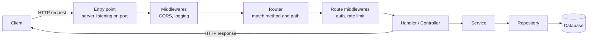
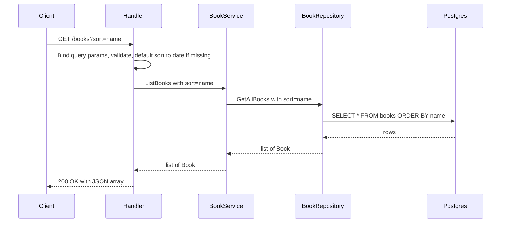
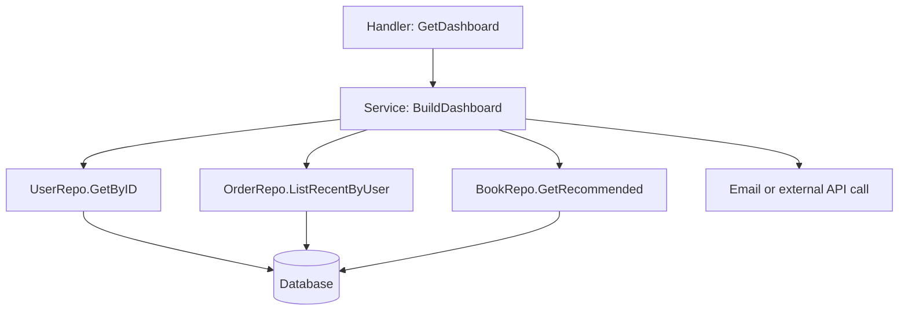
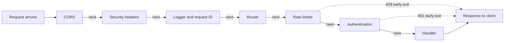
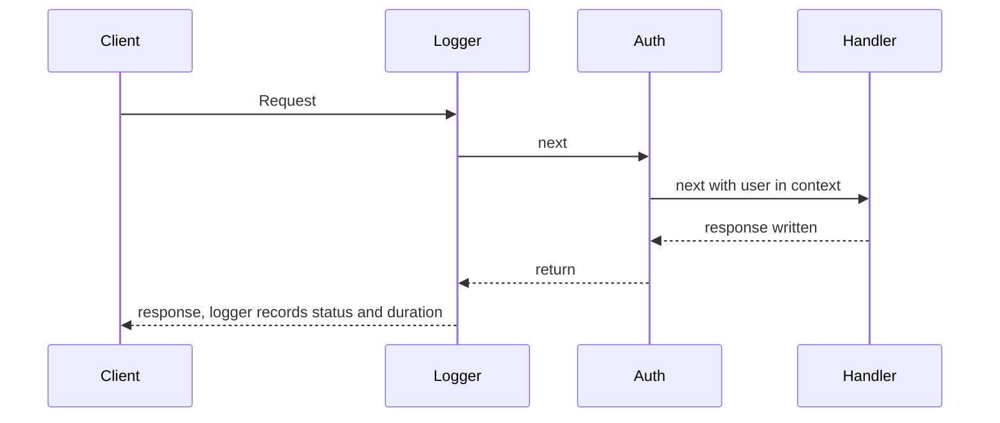
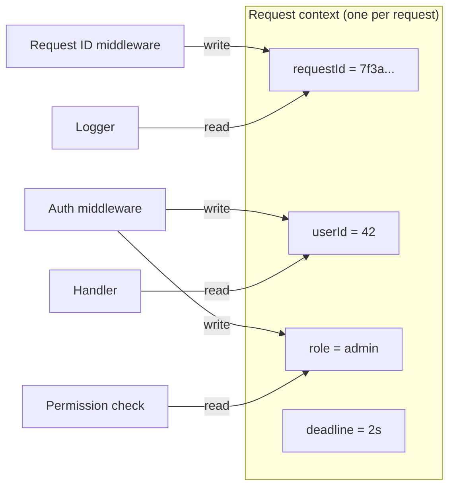
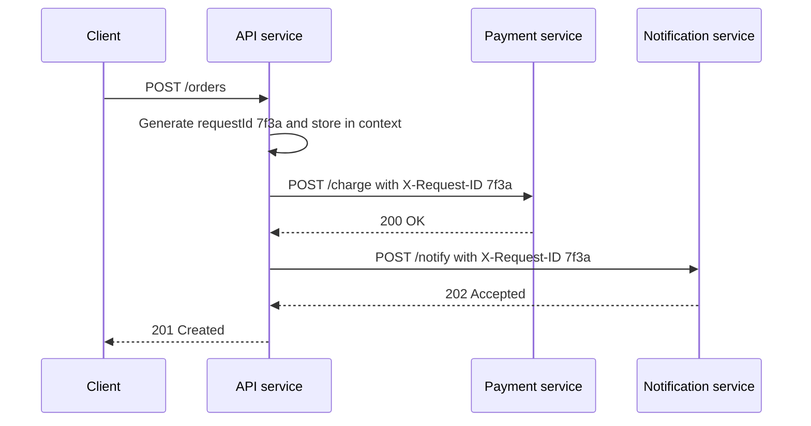

## TL;DR

- The **request lifecycle inside the server**: OS delivers the request to your listening port → **entry point** → **middlewares** → **routing** → more middlewares → **handler/controller** → **service** → **repository** → database, and the response travels back out.
- **Handler / controller** = the HTTP layer. It **binds** (deserialises) request data into native types (400 on failure), **validates** and **transforms** it (e.g. set defaults), calls the service, then picks the **status code** and sends the response.
- **Service** = business logic. It should know **nothing about HTTP** — it takes plain data, does the work (orchestrates multiple repository calls, sends emails, calls external APIs), and returns plain data.
- **Repository** = data access. It builds and runs **one database query** and returns **one kind of data** (e.g. `GetAllBooks` and `GetBookByID` are separate methods).
- **Middleware** = a function that sits between execution boundaries and receives `(request, response, next)`. It can read/modify the request, modify the response, **end the request early**, or call `next()` to pass control on. It removes duplication of cross-cutting concerns: CORS, security headers, authentication, rate limiting (429), logging, global error handling, compression, body parsing.
- **Middleware order matters**: CORS early, then logging, then auth, and the global error handler positioned so it can catch errors from everything.
- **Request context** = a key-value store **scoped to a single request**, shared by all middlewares and handlers without tight coupling. Typical contents: authenticated **user ID and role**, a **request ID** for tracing, and **deadlines/cancellation signals**.
- Always take the user ID from the **authenticated context**, never from the request body — otherwise a malicious client can act as another user.

## Why this matters

Earlier topics followed the request *outside* the server (HTTP) and through individual steps (routing, serialization, validation, auth). This chapter connects them into one picture of how a production backend is **structured**. Almost every framework — Express, NestJS, Gin/Echo in Go, Django/FastAPI — uses these exact ideas. Interviewers ask "what goes in a controller vs a service?", "what is middleware and why does order matter?", and "how would you pass the logged-in user to your handler?" because the answers reveal whether you can build code that stays maintainable as it grows to hundreds of endpoints.

## The request lifecycle inside the server

When a client sends an HTTP request, everything that happens from the moment it reaches your server until the response leaves is the **server-side request lifecycle**.

1. **Entry point.** Your server process is **listening** on a port (3000, 4000, 8080…). The operating system forwards the incoming HTTP request to that port, and your server receives it.
2. **Routing.** The router matches the method and path (`GET /users`, `GET /users/123` with dynamic segments) to a **handler** — a predefined function responsible for that API.
3. **Handler → service → repository**, then back.
4. **Response** goes back to the client.

Between all these boundaries, **middlewares** can run (covered later).



### Why split into handler, service, and repository?

There is **no hard requirement**. You *can* put everything — parsing, validation, business logic, SQL — into one handler function, and it will work. The three-layer split is a **design pattern** that makes the code base:

- **scalable** — adding features doesn't turn files into thousand-line monsters,
- **maintainable** — each piece has one job, so changes are local,
- **easier to debug** — you know which layer owns which kind of bug,
- (standard addition) **testable** — services can be unit-tested without HTTP or a real database.

This is the **separation of concerns** / **single responsibility principle** applied to request handling.

| Layer | Also called | Responsibility | Knows about HTTP? | Knows about the DB? |
|---|---|---|---|---|
| **Handler** | Controller | Extract & bind input, validate, transform, call service, choose status code, send response | **Yes** | No |
| **Service** | Business logic layer, use-case | Do the actual work, orchestrate repositories and external calls | **No** | No (only via repositories) |
| **Repository** | Data access layer, DAO | Build and run DB queries, return results | No | **Yes** |

## The handler (controller) layer

### Request and response objects

In practically every server framework (Go, Node.js, Python, and others), each handler automatically receives at least **two objects** from the runtime/framework — you don't create them yourself:

- the **request object** — to read values from the HTTP request (path params, query params, headers, body),
- the **response object** — to set status, headers, and send the body.

```go
// Go net/http: the runtime gives you w (response) and r (request)
func GetBooks(w http.ResponseWriter, r *http.Request) { /* ... */ }
```

```ts
// Express: the framework gives you req and res
app.get("/books", (req, res) => { /* ... */ });
```

Thanks to routing, the handler already knows *which* API is being called. Its job now is to get the data out of the request, process it (via the service), and respond appropriately — e.g. a `DELETE` per REST conventions returns **204 No Content** with an empty body.

### Step 1 — Extract and bind the data

Where the data comes from depends on the request type:

| Method | Typical data source |
|---|---|
| `GET` | **Query parameters** (and path parameters) |
| `POST` | **Request body** |
| `PUT` / `PATCH` | Request body (plus path params like `/books/:id`) |
| `DELETE` | Path params, sometimes a body |

The client sent the body **serialized as JSON** (a format that can travel over the network and is understood on both sides of the frontend/backend boundary). The handler must **deserialize** that JSON into the language's **native format**:

- Go → a `struct`
- Python → a `dict` or class instance
- Rust → a `struct`
- Node.js → a JavaScript object — but here this usually happens **upstream in a middleware** (`express.json()` / body-parser) before routing, so handlers often don't do it explicitly.

Many frameworks call this step **binding** (binding the request body into a native type).

**If binding fails** (malformed JSON, wrong types), the handler responds immediately with **400 Bad Request** and **terminates** the request — no further processing.

### Step 2 — Validate and transform

Rule from the validation chapter: **validate everything coming from an external client** — path params, query params, body — and be as specific as possible. Validation checks that mandatory fields exist, values have the expected format/type/range, and nothing looks malicious. Failure → **400**.

After validation, optionally **transform** the data to make it convenient for downstream layers.

**Example — default sort.** `GET /books?sort=name|date`.
- Good API practice: **make query parameters optional**.
- The client calls just `GET /books`. Validation passes (sort is optional).
- The **transformation** step sets a default: `sort = "date"` if missing.
- Now the service and repository always receive a valid `sort` value and don't need `if sort is missing then … else …` branches. Code becomes more readable and follows one expected path.

### Step 3 — Call the service

The handler calls the service with the **validated, transformed data** plus anything else the service needs, e.g. authentication info (**user ID, permissions**) taken from the request context.

### Step 4 — Send the response

When the service returns, the handler decides the response based on success or failure:

| Outcome | Status codes |
|---|---|
| Success | **200 OK** (fetch), **201 Created** (create), **204 No Content** (delete) |
| Client's fault | **400** Bad Request, 404, 409, … |
| Server's fault | **500** Internal Server Error |

It sends a proper success payload (e.g. an array of books with 200) or a proper error message. The controller literally **controls the data flow** from client to server and back.



## The service layer

### No HTTP in the service

The service layer should **not deal with anything HTTP-related** — no request/response objects, no status codes, no headers, no JSON parsing, no validation. Think of a service method as **just a function**: data in → processing → data out.

> [!TIP]
> Litmus test: **looking at a service method, you should not be able to tell it is used by an API.** If it could equally be called from a CLI command, a cron job, or a message-queue consumer, you drew the line correctly.

This is where the **responsibility line** is drawn: the handler owns input/output formats; the service owns the actual processing.

### What a service does

- **Business logic** — all the real work of the API happens here.
- **Orchestration** — call **multiple repository methods**, combine/merge the results, pick the needed fields, and return the result to the handler.
- **Side effects / external calls** — send emails and notifications, call third-party APIs.
- Services don't always touch the DB: an email-sending service may receive an email address, send the email, and return `{ success: true }` without calling any repository.

## The repository layer

The repository (or **database layer**) has a **single responsibility**: take data (values to insert, or filter/sort/pagination parameters), **construct the database query**, execute it, and **return the result**.

**One repository method → one kind of data.** Don't write one `getBooks(id?)` that returns all books when `id` is missing and a single book when it's present. Write two:

- `GetAllBooks(sort)` → list of books
- `GetBookByID(id)` → one book

Methods with clear, single outputs are easier to reason about, test, and reuse. The *service* is where you combine several of them.



### Putting the three layers together (Go)

```go
// ---------- Repository: SQL only ----------
type BookRepository struct{ db *sql.DB }

func (r *BookRepository) GetAllBooks(ctx context.Context, sort string) ([]Book, error) {
    // sort is already validated to be "name" or "created_at" — never interpolate raw user input
    q := "SELECT id, title, created_at FROM books ORDER BY " + sort
    rows, err := r.db.QueryContext(ctx, q)
    if err != nil {
        return nil, err
    }
    defer rows.Close()
    var books []Book
    for rows.Next() {
        var b Book
        if err := rows.Scan(&b.ID, &b.Title, &b.CreatedAt); err != nil {
            return nil, err
        }
        books = append(books, b)
    }
    return books, rows.Err()
}

// ---------- Service: business logic, no HTTP ----------
type BookService struct{ repo *BookRepository }

func (s *BookService) ListBooks(ctx context.Context, sort string) ([]Book, error) {
    return s.repo.GetAllBooks(ctx, sort)
}

// ---------- Handler: HTTP only ----------
type BookHandler struct{ svc *BookService }

func (h *BookHandler) GetBooks(w http.ResponseWriter, r *http.Request) {
    sort := r.URL.Query().Get("sort")         // 1. extract
    switch sort {                              // 2. validate + transform
    case "":
        sort = "created_at"                    //    default
    case "name":
    case "date":
        sort = "created_at"
    default:
        http.Error(w, `{"error":"invalid sort"}`, http.StatusBadRequest)
        return
    }
    books, err := h.svc.ListBooks(r.Context(), sort) // 3. call service
    if err != nil {
        http.Error(w, `{"error":"internal error"}`, http.StatusInternalServerError)
        return
    }
    w.Header().Set("Content-Type", "application/json") // 4. respond
    w.WriteHeader(http.StatusOK)
    json.NewEncoder(w).Encode(books)
}
```

### The same idea in TypeScript

```ts
// repository
export const bookRepo = {
  getAll: (sort: "name" | "created_at") =>
    db.query(`SELECT id, title, created_at FROM books ORDER BY ${sort}`), // sort is whitelisted
  getById: (id: string) => db.query("SELECT * FROM books WHERE id = $1", [id]),
};

// service
export const bookService = {
  listBooks: (sort: "name" | "created_at") => bookRepo.getAll(sort),
};

// controller
const querySchema = z.object({ sort: z.enum(["name", "date"]).optional() });

export async function getBooks(req: Request, res: Response, next: NextFunction) {
  const parsed = querySchema.safeParse(req.query);
  if (!parsed.success) return res.status(400).json({ error: "Invalid query" });
  const sort = parsed.data.sort === "name" ? "name" : "created_at"; // default = date
  try {
    const books = await bookService.listBooks(sort);
    res.status(200).json(books);
  } catch (err) {
    next(err); // let the global error handler respond
  }
}
```

> [!NOTE]
> Standard addition: layers are usually connected through **dependency injection** — the handler receives a service, the service receives a repository (often typed as an *interface*). That lets you swap a real Postgres repository for an in-memory fake in unit tests.

> [!INTERVIEW]
> **"What belongs in a controller vs a service vs a repository?"** Controller: everything HTTP — read params/body, bind/deserialise, validate, transform, map results/errors to status codes, send the response. Service: business rules and orchestration, with no HTTP types, so it is reusable and unit-testable. Repository: data access only — construct and run queries, one method per kind of data. The benefits are separation of concerns, testability, and the ability to change one layer (e.g. switch databases) without touching the others.

## Middlewares

### What and where

Revisit the lifecycle and imagine **boundaries** between execution steps: after the entry point, before routing, after routing, before the handler, after the handler… At each boundary you can place functions. Because they run **in the middle** of these execution contexts, they're called **middlewares**.



### The `(req, res, next)` signature

A middleware is like a handler with **one extra capability**. The runtime gives it three things:

1. **request** — read values, or even modify/augment the request,
2. **response** — set headers, or send a response,
3. **next** — a function that **passes execution to the next processing context**.

"Next" isn't always another middleware — it might be the router or the final handler — so it's best thought of as "**whatever comes next in the chain**".

Key properties:
- **Middlewares are optional.** Use only the ones you need; a request may go straight from routing to handler.
- A middleware can **terminate the request early** by sending a response itself (e.g. 401, 429) without calling `next()` — the request never reaches routing or the handler, which **saves server resources**.

```ts
// Express middleware
function logger(req: Request, res: Response, next: NextFunction) {
  const start = Date.now();
  res.on("finish", () =>
    console.log(`${req.method} ${req.path} ${res.statusCode} ${Date.now() - start}ms`)
  );
  next(); // pass control on
}
app.use(logger);
```

```go
// Go: middleware wraps the next handler
func Logger(next http.Handler) http.Handler {
    return http.HandlerFunc(func(w http.ResponseWriter, r *http.Request) {
        start := time.Now()
        next.ServeHTTP(w, r) // the Go equivalent of next()
        log.Printf("%s %s %v", r.Method, r.URL.Path, time.Since(start))
    })
}
```

### Why middlewares instead of just functions?

Same reason we use functions at all: **avoid repeating code**. A backend gets thousands to billions of requests and may have **hundreds or thousands of endpoints**. Many operations must run for *all* (or many) of them: security checks, logging, authentication, body parsing, compression.

- Without middleware → duplicate that code in every handler.
- "Just write a helper function and call it" → still duplication: you must remember to call it in **every** handler, and forgetting once (e.g. the auth check) is a security bug.
- With middleware → register it once and it runs for every matching request, outside the handler.

A good candidate for middleware is code that (1) must run **for every request** (or a group of routes), and (2) needs the **request and/or response objects**.

### Order matters

Each middleware calls `next()` to pass control in a fixed sequence, and the request flows in **one direction**. So the **order you register them in is the order they run**, and it changes behaviour:

- CORS goes **first** — if the origin isn't allowed, find out as early as possible.
- Logging early — so every request (even rejected ones) is logged.
- Authentication before handlers — and before any middleware that needs the user.
- Global error handler positioned so it can catch errors from **everything** before it (registered **last** in Express).

If the error handler is placed in the middle, an error thrown later in the handler is never seen by it, because the execution already passed that point.

> [!NOTE]
> **Precision — the "onion" model.** In Express, the request flows forward through `app.use()` calls, and errors are passed forward with `next(err)` to the **error-handling middleware registered last** (the one with four parameters `(err, req, res, next)`). In Go-style wrappers (and Koa), each middleware wraps the next one, so code runs both *before* `next()` (request phase) and *after* it returns (response phase). There, a recover/error middleware is placed **outermost** so it wraps — and catches errors from — everything inside it. Either way the principle holds: the error handler must be positioned so every other step runs "inside" its reach.



### Common middlewares

#### CORS

**CORS (Cross-Origin Resource Sharing)**: browsers enforce the **same-origin policy** — a web app on `example.com` can't read responses from another origin unless that server responds with headers explicitly allowing it.

CORS middleware on the server:
1. Reads the request's **`Origin`** header (provided by the browser/runtime).
2. If it's an allowed origin (e.g. your own frontend domain), adds headers like `Access-Control-Allow-Origin` to the **response**.
3. Calls `next()`.
4. If not allowed, adds no headers — and the **browser** blocks the response.

Why middleware? It must run for **every** API call and it needs **both** the request (origin) and response (headers). Classic middleware.

> [!NOTE]
> CORS is enforced by **browsers**, not servers. It limits which web apps can read your API's responses from a browser; it does not stop curl, Postman or other servers. It is not an authentication mechanism. Preflight `OPTIONS` requests must also be handled, which is another reason CORS sits at the very start of the chain.

#### Security headers

Set headers like **`Content-Security-Policy`**, `Strict-Transport-Security`, `X-Content-Type-Options`, `X-Frame-Options` on every response (e.g. `helmet` in Express).

#### Authentication

Every protected endpoint needs to: extract the token (JWT or session ID) from headers/cookies/body, verify it, and identify the user.
- **Failure** → respond **401 Unauthorized** right there and terminate; don't call `next()`.
- **Success** → extract user ID, role, permissions → put them into the **request context** → call `next()`.

#### Rate limiting

Prevents one client from sending too many requests in a short period. You choose thresholds (e.g. **30 requests per 2 seconds per IP**, or 500 per minute). Track counts per IP (or per user/API key):
- Over the limit → **429 Too Many Requests**.
- Under the limit → `next()`.

#### Logging and monitoring

For every request, record method (`GET`), path (`/users`), query params, (carefully) body, status, latency — to a terminal or log file / log system. Essential for **debugging, auditing, and reporting**.

#### Global error handling

Every backend should have one. An error can occur **anywhere**: handler, service, repository, or any middleware. The global error handler:
1. Receives the raw, unstructured error.
2. Decides whether it's a **client error** (→ 4xx) or a **server error** (→ 5xx) — e.g. using custom error types/fields.
3. Sends a **properly structured error response**: a message, a machine-readable **code/ID** (so the frontend can show friendly messages), and the status.

```ts
class AppError extends Error {
  constructor(public status: number, public code: string, message: string) { super(message); }
}

// Registered LAST
app.use((err: unknown, req: Request, res: Response, _next: NextFunction) => {
  if (err instanceof AppError) {
    return res.status(err.status).json({ code: err.code, message: err.message });
  }
  console.error(err); // log the real error server-side
  res.status(500).json({ code: "INTERNAL_ERROR", message: "Something went wrong" });
});
```

> [!WARNING]
> Never leak stack traces, SQL errors, or internal details to the client in 500 responses. Log them server-side (with the request ID) and return a generic message.

#### Compression

For large responses (e.g. JSON with thousands of fields), compress with **gzip** (or Brotli) before sending. Modern browsers decompress automatically (`Accept-Encoding` / `Content-Encoding` headers). The payload is small in transit and restored on the client.

#### Data parsing (serialization/deserialization)

Body parsing (JSON → native objects) can be delegated to a middleware so handlers don't repeat it (Express's `express.json()`). Depending on your code base's standards, even validation/transformation can be moved into middleware.

### Typical order

```ts
app.use(cors({ origin: "https://app.example.com" })); // 1. reject bad origins early
app.use(helmet());                                     // 2. security headers
app.use(requestId);                                    // 3. assign request ID
app.use(logger);                                       // 4. log every request
app.use(rateLimit({ windowMs: 2000, max: 30 }));       // 5. 429 when exceeded
app.use(express.json());                               // 6. parse JSON body
app.use(compression());                                // 7. gzip responses
app.use("/api", authenticate, apiRouter);              // 8. auth then routes
app.use(errorHandler);                                 // 9. global error handler, LAST
```

There's no single correct order for every app — think through what must happen first for your requirements, but some rules are firm: CORS early, auth before protected handlers, error handler able to see everything.

> [!INTERVIEW]
> **"What is middleware and why does order matter?"** Middleware is a function in the request pipeline that receives the request, the response and `next`. It can read/modify the request, set response headers, short-circuit with a response, or call `next()` to continue. It centralises cross-cutting concerns (CORS, auth, rate limiting, logging, error handling, compression) so they aren't duplicated in every handler. Order matters because middlewares run in sequence: auth must run before handlers that need the user, CORS/rate limiting should reject early to save resources, and the error handler must be placed where it can catch errors from everything.

## Request context

### The problem

The auth middleware figured out *who* the user is — but the handler is a separate function further down the chain. How does it get that information? Passing extra parameters between independent middlewares and handlers would **tightly couple** them, and the framework's function signatures are fixed anyway.

### The solution

A **request context** is a **storage/state scoped to a single request**, usually a **key-value** store, that every middleware and handler in that request's lifecycle can **read and write**. Each of the thousands of concurrent requests gets **its own** context, created when the request arrives and discarded when it finishes. Every framework and language has an implementation (Go's `context.Context`, Express's `req`/`res.locals`, Node's `AsyncLocalStorage`, Python's `request.state`/context vars) — the details differ, the concept is the same.



### Use case 1 — authenticated user info

After verifying credentials/token, the auth middleware stores **user ID, role (user, admin, sales…), and permissions (read/write)** in the context. Downstream, permission-check middlewares (RBAC) and handlers read them.

**Example — `POST /books`.** The `books` table has a `user_id` column. The handler should take `user_id` **from the context**, not from the request body.

> [!WARNING]
> **Never trust identity sent by the client.** If you read `userId` from the body, a malicious client can send someone else's ID and create, modify, or delete data as them. Identity must come from the **verified authentication result** stored in the context.

```go
type ctxKey string
const userKey ctxKey = "user"

type AuthUser struct {
    ID   string
    Role string
}

func Auth(next http.Handler) http.Handler {
    return http.HandlerFunc(func(w http.ResponseWriter, r *http.Request) {
        user, err := verifyToken(r.Header.Get("Authorization"))
        if err != nil {
            http.Error(w, `{"error":"unauthorized"}`, http.StatusUnauthorized) // stop here
            return
        }
        ctx := context.WithValue(r.Context(), userKey, user)
        next.ServeHTTP(w, r.WithContext(ctx)) // pass enriched request on
    })
}

func (h *BookHandler) CreateBook(w http.ResponseWriter, r *http.Request) {
    user := r.Context().Value(userKey).(AuthUser) // trusted identity
    var in CreateBookInput
    if err := json.NewDecoder(r.Body).Decode(&in); err != nil {
        http.Error(w, `{"error":"bad request"}`, http.StatusBadRequest)
        return
    }
    book, err := h.svc.CreateBook(r.Context(), user.ID, in) // user ID from context, not body
    // ...
    _ = book
    _ = err
}
```

```ts
// Express: attach to req (or res.locals)
function authenticate(req: Request, res: Response, next: NextFunction) {
  try {
    const claims = verifyToken(req.headers.authorization);
    req.user = { id: claims.sub, role: claims.role };
    next();
  } catch {
    res.status(401).json({ error: "Unauthorized" });
  }
}

app.post("/books", authenticate, async (req, res) => {
  const book = await bookService.create(req.user.id, req.body); // not req.body.userId
  res.status(201).json(book);
});
```

### Use case 2 — request ID and tracing

An early middleware generates a unique ID (a **UUID**) and saves it in the context. Throughout the lifecycle:
- every **log line** includes it,
- calls to other services (in a microservice architecture) forward it in a header like **`X-Request-ID`**.

When debugging or auditing, you can **trace one request** across logs and services: where it started and every service it touched.



### Use case 3 — cancellation, abort signals and deadlines

The context can carry **cancellation signals and deadlines** to downstream calls (DB queries, external HTTP calls) so your service **doesn't hang forever**. If the client disconnects or the 2-second deadline passes, everything using that context is cancelled.

```go
ctx, cancel := context.WithTimeout(r.Context(), 2*time.Second)
defer cancel()
rows, err := db.QueryContext(ctx, "SELECT ...") // aborted if the deadline passes or client disconnects
```

```ts
const controller = new AbortController();
const timer = setTimeout(() => controller.abort(), 2000);
req.on("close", () => controller.abort()); // client went away
await fetch("https://api.partner.com/data", { signal: controller.signal });
clearTimeout(timer);
```

> [!TIP]
> Keep the context for **request-scoped metadata** (user, request ID, deadlines, locale). Don't use it as a hidden way to pass ordinary business parameters — those should be explicit function arguments so the code stays readable.

> [!INTERVIEW]
> **"How does the handler know who the logged-in user is?"** The authentication middleware verifies the token or session, then stores the user ID and role in a **request-scoped context** (Go `context.WithValue`, Express `req.user`/`res.locals`) and calls `next()`. Handlers and authorization middlewares read it from there. This avoids coupling middlewares to handlers and, crucially, means identity comes from verified credentials rather than client-supplied data. The same context carries a request ID for tracing and deadlines/cancellation for downstream calls.

## Common mistakes & misconceptions

- **Fat controllers** — business logic and SQL inside handlers; impossible to reuse or unit-test.
- **HTTP leaking into services** — passing `req`/`res` into a service, or a service returning status codes. Return data or typed errors; let the handler map them to HTTP.
- **Multi-purpose repository methods** — one method that returns a list *or* a single item based on an optional parameter.
- **Skipping validation because "the frontend validates"** — validate every external input on the server.
- **Interpolating unvalidated input into SQL** (e.g. a sort column) — whitelist values or use parameterised queries to avoid SQL injection.
- **Forgetting `next()`** — the request hangs until timeout. Or calling `next()` *and* sending a response → "headers already sent" errors.
- **Wrong middleware order** — auth after the handler, body parser after routes that need the body, error handler registered first so it never sees errors.
- **Thinking CORS protects your API** from non-browser clients — it doesn't; use authentication.
- **Trusting `userId` from the body** instead of the authenticated context.
- **Leaking internal error details** in 500 responses.
- **Ignoring context cancellation** — DB queries and outbound calls keep running after the client has gone.

## Interview questions

<details>
<summary><strong>Q: Walk me through what happens inside a backend server from the moment a request arrives until the response is sent.</strong></summary>

The OS delivers the request to the port the server listens on (entry point). Global middlewares run (CORS, security headers, request ID, logging, body parsing). The router matches method and path to a handler, possibly running route-specific middleware (rate limit, authentication, permission checks). The handler binds and validates the input, transforms it, and calls a service. The service runs business logic and calls repositories, which execute DB queries. Results flow back: the handler chooses a status code and sends the response. If an error is thrown anywhere, the global error handler converts it to a structured 4xx/5xx response.

</details>

<details>
<summary><strong>Q: Why separate handlers, services and repositories? Isn't it over-engineering?</strong></summary>

It's not required — a single handler works. But separation of concerns makes large code bases maintainable: HTTP concerns change independently of business rules, which change independently of storage. Services can be unit-tested without HTTP or a database (by injecting fake repositories), reused from CLIs, jobs, or queue consumers, and a database change touches only repositories. For a tiny script or prototype it may be overkill; for a product with hundreds of endpoints it pays off quickly.

</details>

<details>
<summary><strong>Q: What exactly are the responsibilities of a controller/handler?</strong></summary>

(1) Extract data from the request — query params for GET, body for POST/PUT/PATCH, path params. (2) Bind/deserialise JSON into native types; on failure return 400. (3) Validate all inputs (400 on failure) and transform them (defaults, normalisation). (4) Call the service with clean data plus context info like the user ID. (5) Map the result or error to the right status code (200/201/204, 4xx, 5xx) and send a proper response body.

</details>

<details>
<summary><strong>Q: How do you know your service layer is designed correctly?</strong></summary>

It has no HTTP knowledge: no request/response objects, status codes, headers, or JSON parsing. Reading a service method, you can't tell it's called from an API — it could equally be called from a cron job or a CLI. It takes plain data, applies business rules, orchestrates one or more repositories and external calls (email, payments), and returns plain data or domain errors.

</details>

<details>
<summary><strong>Q: Should a repository have a method `getBooks(id?)` that returns one book if an ID is given and all books otherwise?</strong></summary>

No. Each repository method should have a single responsibility and return one kind of data: `GetAllBooks(filters)` returning a list and `GetBookByID(id)` returning one book (or not-found). Mixed-return methods are confusing, harder to type, harder to test, and push branching into callers. Combining results from several repository methods is the service layer's job.

</details>

<details>
<summary><strong>Q: What is a middleware, and what can it do?</strong></summary>

A function placed between steps of the request lifecycle that receives the request, the response, and a `next` function. It can read and modify the request (e.g. attach the user), modify the response (add headers), end the request early by sending a response (401, 403, 429), or call `next()` to pass control to the next middleware, router, or handler. It's used for cross-cutting concerns that apply to many endpoints, so the code isn't duplicated in every handler.

</details>

<details>
<summary><strong>Q: Why is middleware ordering important? Give a concrete example of a bug caused by wrong order.</strong></summary>

Middlewares run in registration order, and the request flows one way. Examples: registering the JSON body parser after a route means `req.body` is undefined in that handler; registering auth after a handler leaves the endpoint unprotected; registering the Express error handler before the routes means errors from handlers never reach it and clients get default HTML error pages; putting rate limiting after expensive work wastes resources. Typical order: CORS → security headers → request ID/logging → rate limit → body parser → auth → routes → error handler.

</details>

<details>
<summary><strong>Q: Why is CORS implemented as middleware and not in each handler?</strong></summary>

Because it's needed on every API response and it uses both the request (the `Origin` header) and the response (adding `Access-Control-Allow-*` headers) — exactly the profile of a middleware. Putting it first also lets the server answer preflight `OPTIONS` requests and reject disallowed origins early. Remember that CORS is enforced by browsers and is not a substitute for authentication.

</details>

<details>
<summary><strong>Q: How would you implement a rate-limiting middleware? What status code does it return?</strong></summary>

Identify the client (IP, user ID, or API key), keep a counter per client per time window (in Redis for multiple server instances, e.g. `INCR` + `EXPIRE`, or a token bucket/sliding window), and compare it to a threshold such as 30 requests per 2 seconds. If exceeded, respond **429 Too Many Requests** (optionally with a `Retry-After` header) without calling `next()`; otherwise increment and call `next()`. It should run early, before expensive work.

</details>

<details>
<summary><strong>Q: What does a global error-handling middleware do, and where should it go?</strong></summary>

It catches any error raised in middlewares, handlers, services, or repositories; classifies it as a client error (4xx) or server error (5xx), often via custom error classes with a status and code; logs the details (with the request ID); and returns a consistent JSON shape like `{ code, message }` without leaking internals. It must be positioned so everything else runs within its reach: registered last in Express (four-argument signature, errors passed via `next(err)`), or as the outermost wrapper in Go-style middleware chains.

</details>

<details>
<summary><strong>Q: What is request context and what would you store in it?</strong></summary>

A key-value state scoped to one request, created when it arrives and discarded when it ends, accessible to all middlewares and handlers in that request's lifecycle without coupling them through parameters. Typical contents: authenticated user ID, role and permissions; a request/correlation ID for logging and distributed tracing; deadlines and cancellation signals; sometimes locale or tenant ID. Implementations: Go `context.Context`, Express `req`/`res.locals`, Node `AsyncLocalStorage`.

</details>

<details>
<summary><strong>Q: In a `POST /books` endpoint, where should the `user_id` for the new book come from, and why?</strong></summary>

From the request context, populated by the authentication middleware after verifying the token or session — never from the request body. If the handler trusted a client-supplied `userId`, any user could create or modify records as someone else (an authorization/IDOR vulnerability). Identity must come from verified credentials.

</details>

<details>
<summary><strong>Q: What happens if a client disconnects while your handler is waiting on a slow database query? How does context help?</strong></summary>

Without cancellation, the query and any outbound calls keep running, wasting DB connections and CPU on a response nobody will read; under load this can exhaust connection pools. With a request context carrying cancellation and deadlines (Go `r.Context()` passed to `QueryContext`, or an `AbortSignal` in Node), the server cancels downstream work when the client goes away or a timeout expires, freeing resources and preventing the service from hanging.

</details>

<details>
<summary><strong>Q: How do you trace a single request across multiple microservices?</strong></summary>

Generate a unique request ID (UUID) in an early middleware — or reuse an incoming `X-Request-ID`/trace header — store it in the request context, include it in every log line, and forward it in a header on every outbound call. Downstream services do the same, so you can search logs across services for that one ID. Standards like W3C Trace Context / OpenTelemetry formalise this with trace and span IDs.

</details>

## Cheat sheet

- **Lifecycle:** port/entry point → global middlewares → router → route middlewares → handler → service → repository → DB → back → response.
- **Handler/controller:** extract → bind/deserialise (400 on failure) → validate (400) → transform (defaults) → call service → status code + response. HTTP lives **only** here.
- **Data sources:** GET → query params; POST/PUT/PATCH → body; IDs → path params.
- **Status codes:** 200 OK, 201 Created, 204 No Content (DELETE), 400 Bad Request, 401 Unauthorized, 403 Forbidden, 429 Too Many Requests, 500 Internal Server Error.
- **Service:** business logic + orchestration (multiple repos, emails, external APIs). No HTTP. "Can't tell it's an API."
- **Repository:** build and run a query, return result. **One method = one kind of data.**
- **Make query params optional**; set defaults in transformation.
- **Middleware signature:** `(req, res, next)`; Go: `func(next http.Handler) http.Handler`.
- **Middleware can:** read/modify req, modify res, short-circuit, call `next()`.
- **Why middleware:** remove duplication of cross-cutting concerns across hundreds of endpoints.
- **Common middlewares:** CORS, security headers (CSP), auth (401), rate limit (429), logging/monitoring, global error handler, compression (gzip), body parsing.
- **Order:** CORS → security headers → request ID/logging → rate limit → body parser → auth → routes → error handler (last in Express / outermost wrapper in Go).
- **Request context:** per-request key-value state shared by middlewares + handlers. Store user ID/role, request ID, deadlines/cancellation.
- **Security rule:** take user ID from context, not from the client.
- **Tracing:** UUID request ID in context, in logs, forwarded via `X-Request-ID`.

## Glossary

- **Request lifecycle** — everything that happens to a request from arrival at the server until the response is sent.
- **Entry point** — where the server receives the request from the OS on its listening port.
- **Routing** — mapping method + path to the handler that should process the request.
- **Handler / Controller** — function owning the HTTP side of an endpoint: input extraction, validation, response.
- **Binding** — deserialising request data (JSON, query, form) into native language types.
- **Deserialisation** — converting a wire format (JSON) into in-memory native data structures.
- **Validation** — checking that input has required fields and correct types, formats, ranges.
- **Transformation** — modifying validated input for convenience (defaults, normalisation).
- **Service layer** — layer holding business logic and orchestration, free of HTTP concerns.
- **Orchestration** — coordinating multiple repository calls and external actions into one operation.
- **Repository** — data-access layer that constructs and runs database queries.
- **Separation of concerns** — design principle of giving each component one clearly defined responsibility.
- **Dependency injection** — passing dependencies (e.g. a repository) into a component instead of creating them inside, enabling testing.
- **Middleware** — function in the request pipeline receiving request, response and `next`.
- **`next()`** — function that passes execution to the next middleware, router, or handler.
- **Short-circuit** — a middleware ending the request by sending a response without calling `next()`.
- **Cross-cutting concern** — functionality needed across many endpoints (auth, logging, CORS).
- **CORS** — browser mechanism allowing cross-origin access only when the server sends permission headers.
- **Same-origin policy** — browser rule restricting a page from reading responses from other origins.
- **Content Security Policy (CSP)** — security header restricting which resources a page may load.
- **Rate limiting** — capping the number of requests a client can make in a time window.
- **429 Too Many Requests** — status returned when a rate limit is exceeded.
- **Global error handler** — central middleware turning any error into a structured 4xx/5xx response.
- **Compression** — encoding responses (gzip, Brotli) to reduce transfer size.
- **Request context** — request-scoped key-value state shared across middlewares and handlers.
- **Request ID / correlation ID** — unique ID per request used to correlate logs and trace calls across services.
- **`X-Request-ID`** — common header used to propagate a request ID between services.
- **Cancellation signal / deadline** — context-carried signal telling downstream work to stop.
- **IDOR** — insecure direct object reference; acting on another user's data via a client-supplied identifier.

## Video timestamps

- [00:00](https://www.youtube.com/watch?v=hyc-7w3pee8&t=0s) — Introduction: why three topics in one
- [01:00](https://www.youtube.com/watch?v=hyc-7w3pee8&t=60s) — The request lifecycle inside the server
- [02:02](https://www.youtube.com/watch?v=hyc-7w3pee8&t=122s) — Entry point and routing to a handler
- [03:03](https://www.youtube.com/watch?v=hyc-7w3pee8&t=183s) — Why separate handlers, services, repositories
- [04:04](https://www.youtube.com/watch?v=hyc-7w3pee8&t=244s) — Handler: request and response objects
- [07:09](https://www.youtube.com/watch?v=hyc-7w3pee8&t=429s) — Extracting data from the request
- [09:11](https://www.youtube.com/watch?v=hyc-7w3pee8&t=551s) — Deserialisation and binding, 400 on failure
- [12:16](https://www.youtube.com/watch?v=hyc-7w3pee8&t=736s) — Validation
- [14:20](https://www.youtube.com/watch?v=hyc-7w3pee8&t=860s) — Transformation and default values
- [18:24](https://www.youtube.com/watch?v=hyc-7w3pee8&t=1104s) — The service layer: no HTTP
- [20:26](https://www.youtube.com/watch?v=hyc-7w3pee8&t=1226s) — The repository layer
- [22:27](https://www.youtube.com/watch?v=hyc-7w3pee8&t=1347s) — Single-responsibility repositories, service orchestration
- [24:29](https://www.youtube.com/watch?v=hyc-7w3pee8&t=1469s) — Back in the controller: status codes and response
- [26:31](https://www.youtube.com/watch?v=hyc-7w3pee8&t=1591s) — Middlewares in the request lifecycle
- [29:35](https://www.youtube.com/watch?v=hyc-7w3pee8&t=1775s) — Request, response and next
- [32:39](https://www.youtube.com/watch?v=hyc-7w3pee8&t=1959s) — Why middlewares: removing duplication
- [35:46](https://www.youtube.com/watch?v=hyc-7w3pee8&t=2146s) — Middleware order matters
- [36:46](https://www.youtube.com/watch?v=hyc-7w3pee8&t=2206s) — CORS middleware
- [40:54](https://www.youtube.com/watch?v=hyc-7w3pee8&t=2454s) — Security headers and authentication middleware
- [42:56](https://www.youtube.com/watch?v=hyc-7w3pee8&t=2576s) — Rate limiting
- [44:58](https://www.youtube.com/watch?v=hyc-7w3pee8&t=2698s) — Logging, monitoring and global error handling
- [48:03](https://www.youtube.com/watch?v=hyc-7w3pee8&t=2883s) — Compression and data parsing middlewares
- [49:04](https://www.youtube.com/watch?v=hyc-7w3pee8&t=2944s) — Typical middleware order
- [51:05](https://www.youtube.com/watch?v=hyc-7w3pee8&t=3065s) — Request context
- [54:09](https://www.youtube.com/watch?v=hyc-7w3pee8&t=3249s) — Storing auth info in context
- [56:11](https://www.youtube.com/watch?v=hyc-7w3pee8&t=3371s) — Using the user ID from context, not the client
- [58:15](https://www.youtube.com/watch?v=hyc-7w3pee8&t=3495s) — Request IDs and tracing
- [59:17](https://www.youtube.com/watch?v=hyc-7w3pee8&t=3557s) — Cancellation signals and deadlines
