## TL;DR

- **REST (Representational State Transfer)** is an *architectural style*, not a protocol. Roy Fielding described it in his 2000 PhD dissertation as the set of constraints that let the web scale: **client–server, uniform interface, layered system, cacheability, statelessness, and (optional) code on demand**.
- A **resource** is any noun your system exposes (books, users, organizations). The client never touches the resource itself; it exchanges **representations** of the resource's **state** (JSON, XML, HTML) over HTTP. That is the "representational state transfer" in the name.
- **URL rules:** `https://api.example.com/v1/books/harry-potter` uses an `api` subdomain, a version segment, **plural, lowercase resource nouns**, `/` for hierarchy, and **hyphenated lowercase slugs** (no spaces, no underscores).
- **Idempotency** = doing the same request N times leaves the server in the same state as doing it once. `GET`, `PUT`, `DELETE` are idempotent. `POST` is not. `PATCH` is not *guaranteed* idempotent by the spec, but a "set these fields to these values" patch is.
- **Method choice:** `GET` read, `POST` create (and any **custom action** that is not CRUD, e.g. `POST /organizations/:id/archive`), `PATCH` partial update, `PUT` full replacement, `DELETE` remove.
- **Status codes:** `201 Created` (+ the created entity) for creates, `200 OK` for reads, updates and most actions, `204 No Content` for successful deletes, `404 Not Found` only when a *specific* resource is missing. **A list endpoint with no matches returns `200` with an empty array, never `404`.**
- **Every list endpoint needs pagination, sorting and filtering**, with **sane defaults**: `page=1`, `limit=10–20`, `sortBy=createdAt`, `sortOrder=desc`. Response shape: `{ data, total, page, totalPages }`.
- **Design first, code second.** Start from wireframes → nouns (resources) → DB schema → actions → API interface (in Swagger/OpenAPI, Insomnia or Postman). Be **consistent** (same field names, same casing — camelCase JSON — same URL patterns), **avoid abbreviations**, and ship **interactive documentation**.

## Why this matters

As a backend engineer, the API is your product's face. The people who consume it (frontend engineers, mobile developers, partner companies, other services) cannot see your code. All they see is URLs, methods, payloads, status codes and docs. If those behave in surprising ways, every integration turns into guesswork: read the source code (if they even have access), or poke the API with different methods until something works. That is slow, error-prone, and leads to endless "sync-up calls".

Even experienced developers still argue about the same small questions:

- Should the path segment be **plural or singular** (`/book/1` or `/books/1`)?
- When updating, should I use **PUT or PATCH**?
- For an action that is not create/read/update/delete (e.g. "send email", "archive"), **which method**?
- **Which status code** for which situation?

These questions keep coming back because REST conventions were written when the web was made of **multi-page applications (MPAs)**, where the server rendered a full HTML page for every navigation. Today we mostly build **single-page applications (SPAs)**: the first request downloads the JavaScript bundle, routing happens in the browser, and the client talks to the backend almost entirely through JSON APIs. The old standards still apply, but they need interpretation.

The goal of this chapter is **not to invent new standards**. It is to extract a clear, practical set of rules from the existing ones, so you can stop debating style and spend your time on business logic.

> [!IMPORTANT]
> The point of following REST conventions is **removing guesswork**. If your API follows the standard ~80% of the time, an integrator can predict most behaviour (routes, methods, status codes, payload shapes) without reading your code.

## A short history: why REST exists

### The World Wide Web project (1990)

In 1990, **Tim Berners-Lee** started a project called the **World Wide Web**, with one goal: share knowledge and information with the whole world. Within roughly a year he had invented the core building blocks we still use:

| Invention | What it is | Still used today as |
|---|---|---|
| **URI** (Uniform Resource Identifier) | A string that names/locates a resource | Every URL you type |
| **HTTP** | The protocol clients and servers use to talk | HTTP/1.1, HTTP/2, HTTP/3 |
| **HTML** | Markup language for documents; the "skeleton" of a page | Every web page |
| **First web server** | Software that serves documents over HTTP | Nginx, Apache, Node servers… |
| **First web browser** | Software that requests and renders documents | Chrome, Firefox, Safari… |
| **First WYSIWYG HTML editor** | "What you see is what you get" editor built into the browser | Browser dev tools / editors |

### The scalability crisis

The web grew **exponentially** in a very short time. The original design had not been built for that many users, and the project was heading towards breakdown. New techniques, standards and components were needed to let the web scale.

### Roy Fielding's constraints (from ~1993 onwards)

**Roy Fielding**, a co-founder of the **Apache HTTP Server** project, became concerned with this scalability problem. To make the web scalable, he proposed a set of **architectural constraints**. Every one of them is still visible in how we build backends today.

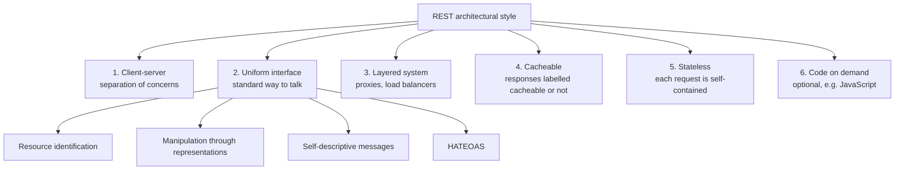

1. **Client–server.** Separate the concerns. The **client** owns the user interface and user experience. The **server** owns data storage and business logic. We call these the **frontend** and **backend**. Because they are separated, each can evolve independently (rewrite the UI without touching the database, or scale the server without shipping a new app), and that improves scalability.

2. **Uniform interface.** All components of the web talk to each other in one **standardized** way, which simplifies the whole architecture. It has four sub-constraints:
   - **Resource identification:** every resource is identified by a URI (e.g. `/books/42`).
   - **Resource manipulation through representations:** the client changes a resource by sending a representation of it (e.g. a JSON body), not by touching the server's internal objects.
   - **Self-descriptive messages:** each message carries enough information to describe how to process it (method, headers such as `Content-Type`, status code).
   - **Hypermedia as the engine of application state (HATEOAS):** responses contain links that tell the client what it can do next (like links on a web page).

3. **Layered system.** The architecture is made of hierarchical layers. Each layer only sees and interacts with the layer immediately next to it. This is what lets us insert **load balancers, reverse proxies, CDNs, API gateways** between client and server without the client knowing or the server's core functionality changing. Better scalability and better security.

4. **Cacheable.** Server responses must be **explicitly labelled** as cacheable or non-cacheable (today via headers like `Cache-Control`, `ETag`). Clients and intermediaries can then cache responses, which reduces server load, improves network efficiency and gives users faster responses.

5. **Stateless.** Every request from client to server must contain **all the information needed** to understand and process it. The server does not remember anything about your previous request; it stores **no client context between requests**. This improves reliability, scalability and visibility: if you run three servers behind a load balancer using round-robin, **any** server can handle **any** request from the same client, because the request itself carries everything (e.g. the auth token).

6. **Code on demand (optional).** Servers may temporarily extend client functionality by sending executable code, such as JavaScript. It is the only optional constraint; it gives flexibility to add client-side functionality when needed. It is not something you lean on when designing REST APIs.

> [!NOTE]
> "Stateless" is about **session/application state on the server between requests**, not about having no data. The server obviously stores data in a database. What it must not do is rely on in-memory memory of "what this client did last request". Auth tokens or session IDs travel with each request instead.

### HTTP/1.1 and the dissertation (2000)

Fielding then worked with Tim Berners-Lee to scale and standardize the web's design. Together (with others) they wrote the specification for **HTTP/1.1** (first published as RFC 2068 in 1997, revised as RFC 2616 in 1999), the first widely adopted standard version of HTTP, still in use today.

In **2000**, once the scalability crisis had been averted, Fielding named and described the web's architectural style in his PhD dissertation, *"Architectural Styles and the Design of Network-based Software Architectures"*. He called it **REST — Representational State Transfer**.

> [!TIP]
> Search "Roy Fielding REST dissertation" and read chapter 5. It is the original source of everything people call "RESTful", and it is a great place to get context on why these patterns exist.

> [!NOTE]
> Precision on versions: HTTP/0.9 (1991) and HTTP/1.0 (RFC 1945, 1996) came before HTTP/1.1. HTTP/1.1 was the first version that was a real, widely implemented standard with persistent connections, the `Host` header, etc.

## What "Representational State Transfer" actually means

Break the name into its three words.

### Representational

Resources on the web (data, objects) are **represented** in a specific **format**. The same resource can have **different representations** depending on who asks:

- Another server or an API client asks for user `42` → it gets a **JSON** representation.
- A web browser asks for user `42`'s profile page → it may get an **HTML** representation.
- A legacy system → maybe **XML**.

Imagine a `user` resource in the database with fields `id`, `name`, `createdAt`. That resource is one thing; JSON and HTML are just two ways of *representing* it. The client and server negotiate which format they want (via `Accept` and `Content-Type` headers).

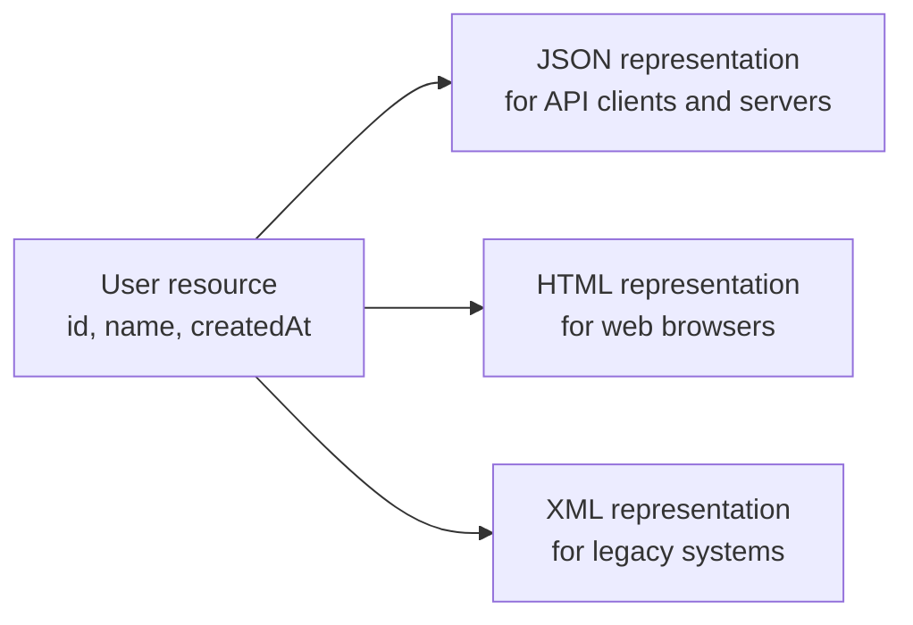

### State

**State** is the current condition or attributes of a resource at a given moment. Example: an Amazon **shopping cart**. Its state is the list of items, the quantity of each, and the total price. That state is what gets transferred between client and server on each API call, and it is carried by the representation.

### Transfer

**Transfer** is the movement of resource representations between client and server. Since we have a client–server model, the whole point is to move data between the two. This happens over a common standard, **HTTP**, using its methods: `GET`, `POST`, `PUT`, `PATCH`, `DELETE`, `OPTIONS`, `HEAD`, … When you `GET` a web page, you are transferring a representation from server to client.

### Putting it together

REST describes an architectural style where:

1. **Resources** are represented in different **formats** (JSON, HTML, XML…).
2. The **state** of those resources is **transferred** between client and server.
3. Client and server **communicate by exchanging representations** of resources.
4. The whole system follows **specific constraints** (the six above) to stay scalable.

> [!INTERVIEW]
> **"What is REST?"** — REST is an architectural style (defined by Roy Fielding in 2000) for distributed systems such as the web. Clients interact with **resources** identified by URIs, by exchanging **representations** (usually JSON) of their **state** over a **uniform interface** (HTTP methods + status codes). It requires client–server separation, statelessness, cacheability and a layered system. A "RESTful API" is an HTTP API that follows those constraints and conventions.

> [!NOTE]
> Strictly by Fielding's definition, most "REST APIs" in industry are not fully RESTful because they skip HATEOAS. In everyday (and interview) usage, "REST API" means "resource-oriented JSON-over-HTTP API that uses methods and status codes properly". Knowing this distinction is a nice bonus point.

## Anatomy of a URL

### A normal website URL

```text
https://sriniously.xyz/blog/rest-api-design?ref=twitter&lang=en#pagination
\___/   \___________/ \___________________/ \__________________/ \_________/
scheme    authority          path                 query           fragment
```

| Part | Example | Purpose |
|---|---|---|
| **Scheme** | `https` | Protocol: `http` or the encrypted `https` |
| **Authority / domain** | `sriniously.xyz` (may include a subdomain like `api.`, and a port like `:3000`) | Which server |
| **Path (resource)** | `/blog/rest-api-design` | Which resource; each `/` expresses a **hierarchical relationship** |
| **Query parameters** | `?ref=twitter&lang=en` | Key–value pairs, mostly on `GET`, to give the server extra info (filters, pagination, sorting) |
| **Fragment** | `#pagination` | Client-side only: the browser scrolls to that section of the page. It is never sent to the server |

### An industry-standard API URL

```text
https://api.example.com/v1/books
https://api.example.com/v1/books/harry-potter
https://api.example.com/v1/books/8f14e45f-ceea-467a-9b1f-1c2d5e6f7a8b
```

These are conventions (best practices most companies follow), not hard rules:

1. **Scheme:** `https` in production.
2. **Subdomain:** an `api.` subdomain, e.g. `api.example.com`, separating the API from the marketing site/frontend.
3. **Version:** a version segment in the path, `/v1`, `/v2`. Lets you ship breaking changes in `v2` while old clients keep using `v1`.
4. **Resource:** the resource name, **plural and lowercase**.

Think of a Goodreads-like API (books, authors, reviews). The endpoint that lists all books:

```http
GET /v1/books HTTP/1.1
Host: api.example.com
```

### Rule 1: resources are always plural

Even when you fetch **one** book, the path still uses the plural collection name:

```text
GET /v1/books        -> the collection of books
GET /v1/books/42     -> one book from the books collection
```

A very common mistake is `GET /v1/book/42` "because it's a single book". Don't. The URL reads as a hierarchy: *"from the collection `books`, give me the item `42`"*. The collection's name doesn't change just because you're picking one item.

### Rule 2: `/` means hierarchy

`/books/harry-potter` says: level one is the **collection** of books stored on the server; level two is **one particular resource** inside that collection. Every extra `/` should mean "go one level deeper", e.g. `/organizations/7/projects/3/tasks`.

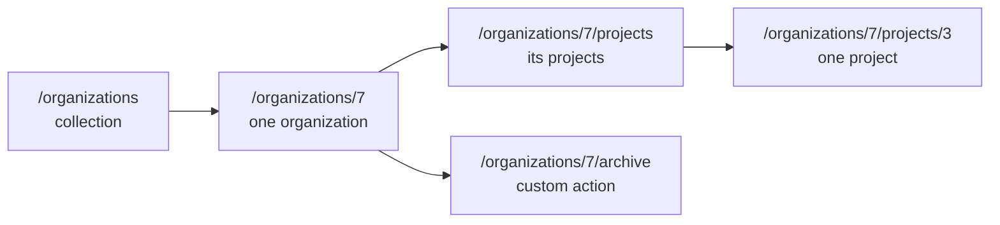

### Rule 3: readable URLs and slugs

URLs travel through browsers, servers, proxies, and different operating systems. Keep them safe and readable:

- **No spaces** (they become `%20` and look ugly / break copy-paste).
- **No underscores** (use hyphens; underscores are hidden by link underlines and are less conventional).
- **Lowercase** (some systems treat paths as case-sensitive; avoid case-mismatch bugs).

A **slug** is a human-readable, URL-safe version of some property of a resource (usually its title). To build a slug from "Harry Potter":

1. Lowercase it → `harry potter`
2. Replace spaces with hyphens → `harry-potter`

```ts
function slugify(text: string): string {
  return text
    .toLowerCase()
    .trim()
    .replace(/[^a-z0-9\s-]/g, "") // drop punctuation
    .replace(/\s+/g, "-")         // spaces -> hyphens
    .replace(/-+/g, "-");         // collapse repeated hyphens
}

slugify("Harry Potter"); // "harry-potter"
```

Result: `GET /v1/books/harry-potter`.

> [!WARNING]
> Slugs must be **unique** if you look resources up by them. Two books called "Harry Potter" would collide; real systems append a suffix (`harry-potter-2`) or combine slug + ID (`/books/42-harry-potter`).

## Idempotency

### The definition

**Idempotency** is the property of an operation where **performing it many times has the same effect as performing it once**. In REST: no matter whether the client sends a request once or a thousand times, the resulting **state on the server** is the same.

Analogy: pressing the "floor 5" button in a lift. Press it once or ten times, the lift still goes to floor 5 once. A "+1 coin" button is not idempotent: ten presses give ten coins.

> [!IMPORTANT]
> Idempotency is about the **side effect on the server's state**, not about the response being byte-for-byte identical. Responses may differ (e.g. a second `DELETE` returns `404`), and data may change because *other* clients did something — the method is still idempotent.

### The five main methods

The main methods for data operations are `GET`, `POST`, `PUT`, `PATCH`, `DELETE`. There are others: `HEAD` (same as GET but returns only headers) and `OPTIONS` (asks which methods/origins are allowed; used in the CORS preflight flow).

#### GET — idempotent (and safe)

`GET` retrieves data. Calling `GET /books` 1,000 times causes **no change** on the server.

*"But what if someone else creates a book between my calls and the response changes?"* That's true, but irrelevant. Idempotency asks: *what side effect does **my** request cause?* A `GET` causes none, so it is idempotent. (It's also called **safe**: it doesn't modify state at all.)

#### PUT and PATCH — idempotent (for "set" style updates)

Both update an existing resource:

- **`PATCH`** — **partial update.** Send only the fields that change. To rename a user, send `{ "name": "B" }`; the server updates just the name.
- **`PUT`** — **full replacement.** Send the **complete** representation (`id`, `name`, `createdAt`, every field). The server replaces whatever it had with your payload.

Why idempotent? Say a user's name is `A` and you send `{ "name": "B" }`:

- 1st call: `A → B` (a side effect happened).
- 2nd call: `B → B` (no new change).
- 1,000,000th call: still `B`.

The state after each call is identical, so the operation is idempotent.

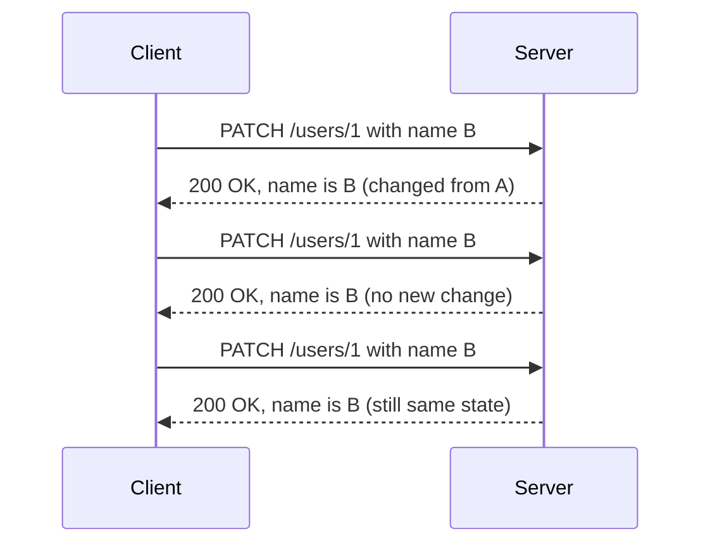

> [!NOTE]
> Precision: RFC 9110 defines `PUT` as idempotent. `PATCH` (RFC 5789) is **not guaranteed** idempotent: a patch like "append item to array" or "increment `views` by 1" changes state on every call. A patch of the form "set field X to value Y" (the common JSON style) *is* idempotent. In interviews, say: "PUT is idempotent by definition; PATCH can be, depending on what the patch does."

| | `PUT` | `PATCH` |
|---|---|---|
| Meaning | Replace the entire resource | Modify part of the resource |
| Body | Full representation (every field) | Only changed fields |
| Missing fields | Treated as removed/reset | Left untouched |
| Idempotent? | Yes, always | Only for "set" style patches |
| Can create? | Yes, if the client chooses the ID (`PUT /users/123`) | Normally no |
| Typical in SPAs/JSON APIs | Rare | Very common |

**Do people mix them up?** Yes, constantly, and for an **internal** API that's tolerable: integrators can see from behaviour what's happening. But for a **public** API, stick to the semantic standard. Engineers integrating it assume you follow the standard; if you use `PUT` while actually doing a partial update, you give them wrong assumptions.

#### DELETE — idempotent

Delete user `1`:

- 1st call: the user is deleted. Side effect happened.
- 2nd call: the server checks, the user doesn't exist, responds **`404 Not Found`**. But **no state changed**.
- 1,000,000th call: same `404`, still no change.

Only the first call changed anything, so `DELETE` is idempotent even though the responses differ (`204` then `404`).

#### POST — NOT idempotent

`POST` usually **creates** a new resource. Send `{ "name": "Clean Code", "description": "...", "weight": ..., "dimensions": ... }` to `POST /books`:

- 1st call: a book is inserted.
- 2nd call (you re-ran the same cURL): unless names must be unique, the server inserts **another** book with identical fields but a **different ID** (IDs are generated by the database: UUIDs or serial integers 1, 2, 3…).
- 1,000 calls → 1,000 books.

Each call causes a **new** side effect, so `POST` is the one major method that is **non-idempotent**.

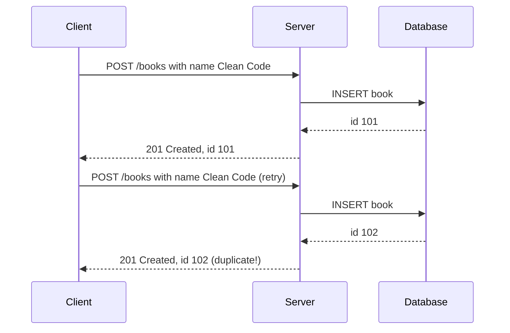

> [!TIP]
> Real-world fix for non-idempotent POSTs (payments, orders): an **idempotency key**. The client generates a unique key (e.g. a UUID) and sends it in a header like `Idempotency-Key: 6f1c...`. The server stores the key with the result; if the same key arrives again (network retry, double click), it returns the stored result instead of creating a duplicate. Stripe popularised this pattern.

| Method | Typical use | Idempotent | Safe (no state change) | Has body |
|---|---|---|---|---|
| `GET` | Read a resource or list | Yes | Yes | No |
| `HEAD` | Read headers only | Yes | Yes | No |
| `OPTIONS` | Ask what is allowed (CORS preflight) | Yes | Yes | Rarely |
| `POST` | Create; custom actions | **No** | No | Yes |
| `PUT` | Replace whole resource | Yes | No | Yes |
| `PATCH` | Partial update | Not guaranteed | No | Yes |
| `DELETE` | Remove | Yes | No | Usually no |

> [!INTERVIEW]
> **"Why does idempotency matter in practice?"** — Networks fail. If a client sends a request and the response is lost, it doesn't know whether the server processed it. For idempotent methods (`GET`, `PUT`, `DELETE`) it can **safely retry**; proxies, load balancers and HTTP client libraries may even retry automatically. For `POST`, a blind retry could create duplicates (two orders, two charges), so you need idempotency keys or deduplication.

### POST is the open-ended method: custom actions

What about an operation that is **not** create, read, update or delete? Example: a "send email" API whose body is `{ "target": "someone@example.com" }`. The server extracts the address and sends an email.

- Is it a fetch? No.
- A create? Not really (we're not adding a resource the client will read back).
- An update or delete? No.

This is called a **custom action** (sometimes "action call" or "controller" resource). The HTTP/REST conventions leave **`POST` open-ended** precisely for these situations: whenever an operation doesn't fit any other method, use `POST`.

```http
POST /v1/emails/send HTTP/1.1
Host: api.example.com
Content-Type: application/json

{ "target": "someone@example.com" }
```

## Design first: why standards matter

### The first job is the interface, not the code

Before writing any business logic, a backend engineer should **design the interface** of the API: the routes, methods, payloads, responses and errors that clients will see. A good interface is:

- **Intuitive** — a newcomer can guess routes and payloads.
- **Delightful to use** — few surprises, sane defaults, helpful errors.
- **Not vague** — it follows REST standards so behaviour is predictable.

### What happens when you ignore standards

Imagine an API that uses `POST` where it should use `PUT` and uses `DELETE` to fetch data. A consumer now has only two ways to learn how it behaves:

1. **Read your code** (only possible if it's open source or they're in your company), or
2. **Trial and error**: try methods and payloads until the outcome looks right.

Both leave huge room for errors, confusion and wrong assumptions. With a common standard (plus docs and an interactive playground), most behaviour is **already known** before integration starts: fewer bugs, fewer misunderstandings, fewer meetings, much less integration time.

## The API design workflow

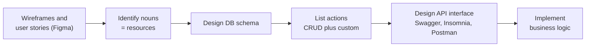

### Step 1: start from the UI design

Start where the product/design team works: **Figma wireframes, user stories, requirement docs**. These show how **end users** (not the frontend engineer — the actual users of the platform) will interact with data.

The chain looks like this: **users → platform UI (built by frontend engineers) → your API → databases.** Looking at the wireframes lets you skip all the middlemen and see directly how the top level (users) relates to the bottom level (data). That clarity is the right starting point for API design.

### Step 2: find the resources (the nouns)

**Resources are the nouns** you find in the requirements (from wireframes or from talking to product people and clients). That's a simplification, but a very reliable thumb rule.

Example: a project-management SaaS like **Jira** or **Linear**. Nouns that appear:

- **Projects** (obviously)
- **Users**
- **Organizations** (users belong to organizations)
- **Tasks** (each project has tasks)
- **Tags** (tasks are organized by tags)

Write them down; these are your top-level entities.

### Step 3: design the database schema

Next comes the DB schema (covered in the databases chapter). For this chapter, assume three tables:

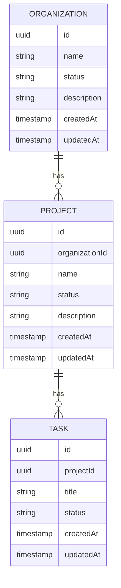

### Step 4: list the actions

For each resource, list what clients need to do. Start from the CRUD template (**Create, Read, Update, Delete**; "read" splits into **list** and **get one**), then add custom actions. For organizations:

| Action | Method + route | Success code |
|---|---|---|
| List organizations | `GET /organizations` | `200` |
| Create organization | `POST /organizations` | `201` |
| Get one organization | `GET /organizations/:id` | `200` |
| Update organization | `PATCH /organizations/:id` | `200` |
| Delete organization | `DELETE /organizations/:id` | `204` |
| Archive organization (custom) | `POST /organizations/:id/archive` | `200` |

### Step 5: design the interface in a tool

Design the endpoints in an API client like **Insomnia** (a lighter alternative to Postman with fewer features) or directly in a **Swagger / OpenAPI** spec. Remember: at this stage you design **how clients will see and use the API**, not the execution (language, framework, DB queries).

## Demo walkthrough: designing the Organizations API

The server runs locally at `http://localhost:3000` (in production: `https`, a real domain, and usually a `/v1` prefix; versioning is skipped in the demo).

### List organizations

```http
GET /organizations HTTP/1.1
Host: localhost:3000
```

- Method `GET` (it's a fetch).
- Path: lowercase, **plural** resource name: `organizations` (not `Organization`, not `organization`).
- Initially returns an empty list.

### Create an organization — `POST`, `201 Created`

```http
POST /organizations HTTP/1.1
Host: localhost:3000
Content-Type: application/json

{
  "name": "org 1",
  "status": "active",
  "description": "some description"
}
```

Notice the URL is **identical** to the list endpoint. The server distinguishes them by **method**: the router sends `GET /organizations` to the "list" controller and `POST /organizations` to the "create" controller.

**What goes in the body?** Look at the schema: `id`, `createdAt`, `updatedAt` are **server-/database-managed** fields, so the client must not send them. The client sends only `name`, `status`, `description`. (JSON requires double-quoted keys and string values.)

Response:

```http
HTTP/1.1 201 Created
Content-Type: application/json

{
  "id": "3f2a9c1e-...",
  "name": "org 1",
  "status": "active",
  "description": "some description",
  "createdAt": "2024-05-01T10:00:00.000Z",
  "updatedAt": "2024-05-01T10:00:00.000Z"
}
```

Two conventions:

1. A successful create returns **`201 Created`**.
2. The response body contains the **newly created entity**, including server-generated fields (`id`, timestamps), so the client doesn't need a second request.

> [!TIP]
> It's also good practice (from the HTTP spec) to add a `Location: /organizations/3f2a9c1e-...` header pointing at the new resource.

Calling the list endpoint again now returns the created organization with status **`200 OK`** — `200` is the generic success; `201` is specifically "something was created".

### Pagination

The list response isn't a bare array:

```json
{
  "data": [ { "id": "…", "name": "org 1", "status": "active" } ],
  "total": 1,
  "page": 1,
  "totalPages": 1
}
```

This is **pagination**: instead of returning every row in the database, the server returns **one portion (page)** of the list.

#### Why paginate?

1. **Serialization cost.** Converting a large list to JSON is CPU- and memory-heavy (see the serialization chapter). Serializing 1,000 organizations on every request adds latency and load.
2. **Network and perceived latency.** A large payload takes longer to transfer, so the frontend waits and the user notices a 3–4 second delay.
3. **Nobody looks at 1,000 rows.** At first glance a user sees maybe 10–20 items. To see more they scroll or click "page 2".

So the first call returns, say, the latest 10 (sorted by `createdAt`). When the user goes to page 2 (or scrolls in an infinite list), the client asks "I already have this part, give me the next portion". Users aren't overwhelmed, the network isn't overwhelmed, client and server both perform better.

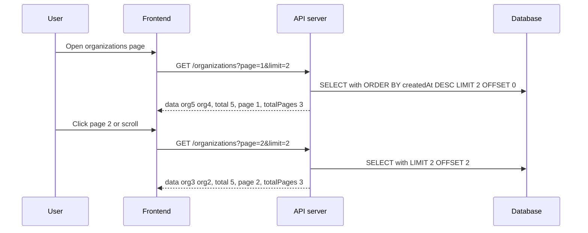

#### The paginated response fields

| Field | Meaning | What the client does with it |
|---|---|---|
| `data` | The portion (page) of items | Renders them |
| `total` | Total count of matching items in the DB, independent of the page | Shows "showing 10 of 50" |
| `page` | Which page this response is | Highlights the current page |
| `totalPages` | `ceil(total / limit)` | Renders page buttons; for infinite scroll, **stop fetching when `page === totalPages`** |

#### Query parameters: `page` and `limit`

Since it's a `GET`, the only way to pass this information is **query parameters**:

- **`limit`** — how many items per response.
- **`page`** — which portion you want.

With 5 organizations (created in order org 1 … org 5) and default sort newest-first:

| Request | `data` | `total` | `page` | `totalPages` |
|---|---|---|---|---|
| `?limit=2&page=1` | org 5, org 4 | 5 | 1 | 3 |
| `?limit=2&page=2` | org 3, org 2 | 5 | 2 | 3 |
| `?limit=2&page=3` | org 1 | 5 | 3 | 3 |

With limit 2 and 5 items, the server needs 3 pages: 2 + 2 + 1.

**Defaults:** if the client sends neither, the server must not fail with a validation error. It should default to `page = 1` and `limit = 10` (or 20).

```ts
// Express-style handler sketch
app.get("/organizations", async (req, res) => {
  const page = Math.max(1, Number(req.query.page) || 1);
  const limit = Math.min(100, Math.max(1, Number(req.query.limit) || 10)); // cap it!
  const offset = (page - 1) * limit;

  const [rows, total] = await Promise.all([
    db.organization.findMany({ skip: offset, take: limit, orderBy: { createdAt: "desc" } }),
    db.organization.count(),
  ]);

  res.status(200).json({ data: rows, total, page, totalPages: Math.ceil(total / limit) });
});
```

> [!WARNING]
> Always **cap `limit`** (e.g. max 100). Otherwise a client can send `?limit=1000000` and recreate the exact problem pagination was supposed to solve.

> [!NOTE]
> What's shown here is **offset (page-based) pagination**. It's simple and supports "jump to page 7", but `OFFSET` gets slow on huge tables (the DB still scans the skipped rows), and items can shift between pages if rows are inserted while the user is paging. The common alternative is **cursor (keyset) pagination**: the client sends "give me 20 items after `createdAt = X, id = Y`" (`?cursor=...&limit=20`). It's fast and stable, ideal for infinite feeds, but can't jump to arbitrary pages.

| | Offset / page pagination | Cursor / keyset pagination |
|---|---|---|
| Request | `?page=3&limit=20` | `?cursor=eyJpZCI6...&limit=20` |
| SQL | `LIMIT 20 OFFSET 40` | `WHERE (created_at, id) < (X, Y) ORDER BY ... LIMIT 20` |
| Jump to page N | Yes | No |
| Performance on deep pages | Degrades | Constant |
| Stable under inserts | No (duplicates/skips) | Yes |
| Best for | Admin tables, page numbers | Feeds, infinite scroll, big data |

### Sorting

A list API should support sorting with two parameters:

- **`sortBy`** — which field to sort by (`name`, `status`, `createdAt`…, from the resource's fields).
- **`sortOrder`** — `asc` or `desc`.

```http
GET /organizations?sortBy=name&sortOrder=asc HTTP/1.1
```

- `?sortBy=name` alone → sorted by name **descending** (org 5 … org 1), because the default order is `desc`.
- `?sortBy=name&sortOrder=asc` → org 1, 2, 3, 4, 5.

**Why must there always be a default sort?** A relational database doesn't guarantee any order without `ORDER BY`. If you don't sort, the same request can return rows in different orders on different calls, and pagination becomes nonsense (items appear on two pages or none). The natural default is **`sortBy=createdAt`, `sortOrder=desc`**: newest first, which is what users expect.

### Filtering

Clients often want a subset: "show only archived organizations". Add a query parameter **named after the field**:

```http
GET /organizations?status=archived HTTP/1.1
GET /organizations?status=active HTTP/1.1
GET /organizations?name=org%204 HTTP/1.1
```

In the demo, a sixth organization was created with `"status": "archived"` (response `201`). `?status=archived` returns only org 6; `?status=active` returns the rest; `?name=org 4` returns just that one. Filters can be combined.

> [!IMPORTANT]
> **Every list endpoint should support pagination, sorting and filtering**, all with sane defaults, so `GET /organizations` with no parameters still returns a sensible first page.

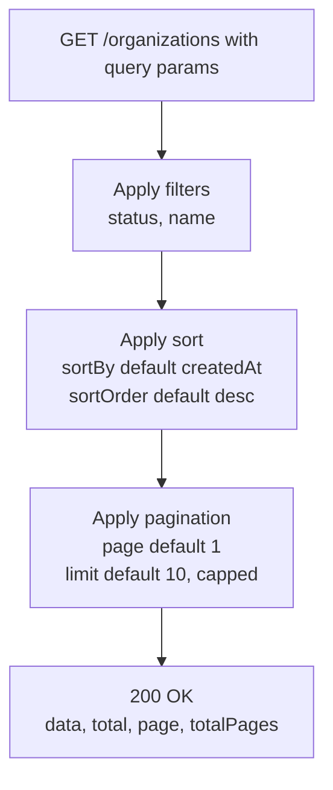

> [!WARNING]
> Never interpolate `sortBy` straight into SQL (`ORDER BY ${sortBy}`): that's SQL injection. **Whitelist** allowed sort fields (`["name","createdAt","status"]`) and reject or ignore anything else. Same for filter fields.

### Update an organization — `PATCH`, `200 OK`

In modern SPAs with JSON payloads you almost always update **some** fields, not replace the whole entity. Full replacement (`PUT`) was a more natural fit for the multi-page form-post era. So in practice **`PATCH`** is the usual choice for update APIs, and it conveys the semantics (partial update) better.

To update a specific organization we need a **dynamic path parameter** (covered in the routing chapter): the organization's ID.

```http
PATCH /organizations/6b1d... HTTP/1.1
Content-Type: application/json

{ "status": "active" }
```

```http
HTTP/1.1 200 OK
Content-Type: application/json

{ "id": "6b1d...", "name": "org 6", "status": "active", "description": "...", "createdAt": "...", "updatedAt": "..." }
```

- Body contains only the fields to change.
- Response is **`200 OK`** (nothing was created) with the **updated entity**.

### Get one organization — `GET /:id`, `200 OK`

```http
GET /organizations/6b1d... HTTP/1.1
```

No body; returns the organization with `200`.

Notice the pattern: **get one, update one, delete one share the exact same route** (`/organizations/:id`); only the method differs. Likewise **list and create share `/organizations`**.

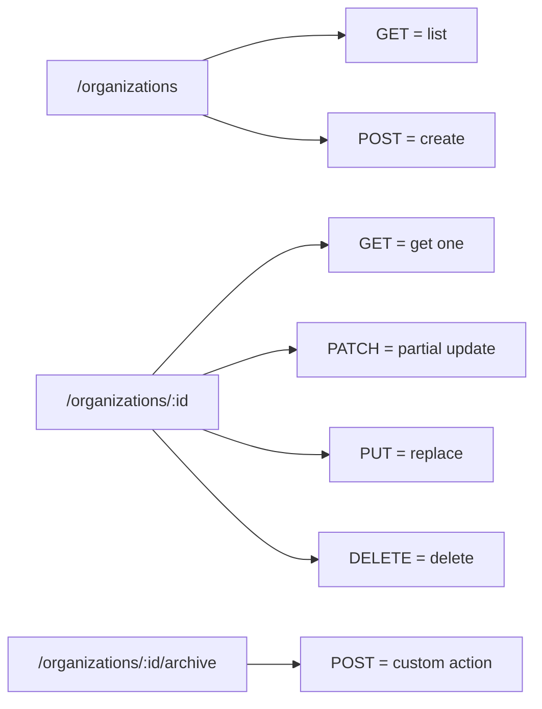

### Delete an organization — `DELETE /:id`, `204 No Content`

```http
DELETE /organizations/6b1d... HTTP/1.1
```

```http
HTTP/1.1 204 No Content
```

The response has an **empty body** and status **`204 No Content`**: "Your operation succeeded (2xx), but I have nothing to send back — the thing you asked about no longer exists." This is the usual practice for deletes.

> [!NOTE]
> Returning `200 OK` with the deleted entity (or a message) is also valid HTTP. `204` is the most common convention; just be consistent across your API.

### 404 vs empty list — a classic

After deleting org 6:

- `GET /organizations` → org 5 is now first. Fine.
- `GET /organizations/<org-6-id>` → **`404 Not Found`** with an error message like `"organization not found"`. This is exactly what 404 is for: the client asked for a **specific** resource (by ID) that doesn't exist.

Now filter the list by a value that matches nothing:

```http
GET /organizations?status=some-random-value HTTP/1.1
```

```json
{ "data": [], "total": 0, "page": 1, "totalPages": 0 }
```

Status: **`200 OK`**. The client didn't ask for a particular resource; it asked for a **list**, and the correct answer is "here is the list, it happens to be empty".

> [!IMPORTANT]
> **Thumb rule:** list endpoint with no results → `200` + empty array. `404` only when the client requests a **specific** resource (by ID/slug, or a specific set of IDs) that doesn't exist.

> [!INTERVIEW]
> **"Your search endpoint finds nothing. 404 or 200?"** — `200` with an empty array. The collection resource `/organizations` exists; the query just has zero matches. Returning 404 would make clients treat a normal situation as an error (and confuse "route doesn't exist" with "no results").

### Custom action: archive an organization

We want to **archive** org 5. At first glance that's just `PATCH /organizations/:id` with `{ "status": "archived" }`. But archiving is more than flipping a field. When an organization is archived, the server may need to:

- archive or delete all projects in it, and all tasks in those projects,
- notify or email all users in that organization,
- revoke access, stop billing, etc.

So "set status to archived" is not the same as "archive". It's a **custom action**. Since it isn't create/read/update/delete, use **`POST`**, and put the action name at the end of the resource's path:

```http
POST /organizations/5c9e.../archive HTTP/1.1
```

```http
HTTP/1.1 200 OK
Content-Type: application/json

{ "id": "5c9e...", "name": "org 5", "status": "archived", "...": "..." }
```

The route reads as a clean **hierarchy**: *all organizations → this particular organization → perform `archive` on it.*

The response is **`200`**, not `201`: nothing was created.

> [!WARNING]
> Don't assume **every `POST` returns `201`**. `201` means "a new resource was created". A custom action that only changes something returns `200` (or `202 Accepted` if the work is queued for later, or `204` if there's nothing to return).

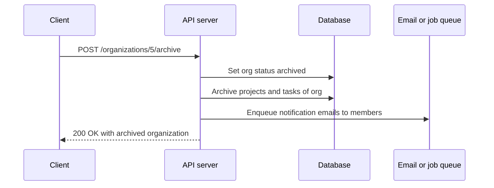

## Demo walkthrough: the Projects API (same patterns, faster)

To internalise the patterns, the same design is repeated for **projects**. (In Insomnia, endpoints are grouped into folders per resource, `org` and `project`, which keeps things manageable.)

### Create project

```http
POST /projects HTTP/1.1
Content-Type: application/json

{
  "name": "project 1",
  "organizationId": "3f2a9c1e-...",
  "status": "planned",
  "description": "some description"
}
```

→ `201 Created` with the new project. Again `id`, `createdAt`, `updatedAt` are server-managed and are **not** accepted from the client.

### JSON fields are camelCase

Notice `organizationId`, not `organization_id` or `OrganizationID`. **JSON field names should be camelCase** — both in request payloads and in responses. That's the common convention for JSON APIs (it matches JavaScript, the primary consumer), and following it means clients don't have to guess.

> [!NOTE]
> Some well-known APIs use `snake_case` JSON (e.g. Stripe, GitHub). That's fine *if consistent everywhere*. The real rule is: pick one casing for the whole API and never mix. camelCase is the safest default for JSON.

### List, get, update, delete projects

| Action | Request | Result |
|---|---|---|
| List | `GET /projects?limit=1&page=2` | `200`, second project in sort order, with `total`, `page`, `totalPages`. Also supports sorting/filters |
| Get one | `GET /projects/:id` | `200` with the project |
| Update | `PATCH /projects/:id` body `{ "description": "new description" }` | `200` with updated project |
| Delete | `DELETE /projects/:id` | `204`, empty body |

### Consistency across resources

Within one API, **query parameters and JSON payloads should look the same across all resources**.

- Organizations accept `description`. Projects must also use `description`, never `desc` or `dsc` for the same concept.
- Organizations live at the plural `/organizations`. Projects must be `/projects`, not `/project`.
- List endpoints all use `page`, `limit`, `sortBy`, `sortOrder` — not `page` here and `pageNumber` there.

**Why so strict?** Once a frontend engineer integrates **one** of your endpoints, they form assumptions about **all** of them. If they integrated create-organization, they'll assume create-project also takes `name` and `description` and lives at a plural path. If you broke the pattern (`dsc`, `/project`), they hit validation errors or 404s and must go back to docs/specs or ask you. During development some of this is normal, but you shouldn't waste integrators' time and effort or make them guess.

> [!IMPORTANT]
> Consistency of style — routes, payloads, responses, naming — is one of the most important traits of a good backend engineer. Once you choose a style, stick to it everywhere.

### Custom action: clone a project

Requirement: the frontend can **clone** a project. Couldn't the client simulate this by reading the project and calling `POST /projects` with the same values? No, because the client doesn't know what "clone" means on the server. Cloning might also mean:

- cloning all of the project's tasks,
- emailing the project owner that their project was cloned,
- other server-side bookkeeping.

So it's an explicit **custom action**:

```http
POST /projects/7a3b.../clone HTTP/1.1
Content-Type: application/json

{ "name": "project 2 clone" }
```

Structure: **server address / plural resource / specific resource ID / action name.** The body is optional; you might accept fields the client wants to override in the copy.

Two results from the demo:

- Calling it on a **deleted** project ID → **`404 Not Found`** ("project not found").
- Calling it on an existing project → **`201 Created`** with the new project. Here `201` *is* correct, because cloning **created** a new resource.

> [!TIP]
> Status codes follow **what actually happened on the server**, not the HTTP method. `POST /orgs/:id/archive` → `200` (modified), `POST /projects/:id/clone` → `201` (created), `POST /reports/generate` that queues a job → `202 Accepted`.

Tasks would follow the exact same pattern: list, get one, create, update, delete, plus custom actions. The number of resources doesn't matter; the patterns are the same.

## Best practices for a delightful API

### 1. Interactive documentation (Swagger / OpenAPI)

Always provide **interactive documentation**: an **OpenAPI** (formerly Swagger) spec rendered with **Swagger UI** (or Redoc, Scalar, etc.) gives a playground where people can read every endpoint and **try it** in the browser. Plan it from day one:

- **You** use it to test your endpoints.
- **Integrators** use it as both documentation and a testing tool.

How consistently and how frequently you create, maintain and update your OpenAPI docs is one of the things that sets a backend engineer apart.

```yaml
openapi: 3.0.3
info:
  title: Project Management API
  version: 1.0.0
paths:
  /organizations:
    get:
      summary: List organizations
      parameters:
        - { name: page, in: query, schema: { type: integer, default: 1 } }
        - { name: limit, in: query, schema: { type: integer, default: 10, maximum: 100 } }
        - { name: sortBy, in: query, schema: { type: string, default: createdAt, enum: [createdAt, name, status] } }
        - { name: sortOrder, in: query, schema: { type: string, default: desc, enum: [asc, desc] } }
        - { name: status, in: query, schema: { type: string, enum: [active, archived] } }
      responses:
        "200": { description: Paginated list of organizations }
    post:
      summary: Create organization
      responses:
        "201": { description: Organization created }
        "400": { description: Validation error }
  /organizations/{id}/archive:
    post:
      summary: Archive an organization (custom action)
      parameters:
        - { name: id, in: path, required: true, schema: { type: string, format: uuid } }
      responses:
        "200": { description: Archived organization }
        "404": { description: Organization not found }
```

### 2. Intuitive and consistent

All routes, dynamic parameters, custom actions and JSON payloads should follow **one** pattern. Following the global REST standards is ideal. But even if, for some reason, you don't, **follow something and stick to it**. Changing style between endpoints or resources is a huge pain point for integrators. Keep behaviour, data format and naming consistent and intuitive.

### 3. Sane defaults

Don't make the client send obvious things.

- **GET/list:** no `page` → `1`; no `limit` → `10`/`20`; no `sortBy` → `createdAt`; no `sortOrder` → `desc`.
- **POST/create:** require only the **minimum** information needed to create the entity; default the rest. An organization's `status` can be `active` or `archived`; common sense says a new organization is `active`, so if the client omits `status`, set it to `active`. If `description` is optional, a client can create an organization by sending only `{ "name": "Acme" }`.

```ts
import { z } from "zod";

const CreateOrganization = z.object({
  name: z.string().min(1),
  description: z.string().optional(),
  status: z.enum(["active", "archived"]).default("active"), // sane default
});
```

### 4. No abbreviations

Don't name fields `desc`, `qty`, `usrNm`. **You** have full context while designing; integrators don't. They can't be expected to decode abbreviations and fill them correctly. Keep field names, payloads and query parameters **readable and explicit**: `description`, `quantity`, `userName`.

### 5. Design before you code

A REST API is **designed first**, not coded first. There are many decisions to make (resources, routes, methods, payloads, status codes, defaults). Dedicate a **separate session** to designing the interface in an OpenAPI editor or an API client like Insomnia/Postman, **without thinking about programming languages or frameworks**. Seeing the API from the consumer's side gives insight into how it will be used, and leads to a more intuitive design. Then implement it in Go, Node or anything else.

## Reference: status codes for REST APIs

The chapter's demo uses `200`, `201`, `204` and `404`. In interviews and real APIs you'll need the rest of the common set (see also the HTTP chapter):

| Code | Name | When to use |
|---|---|---|
| `200` | OK | Successful read, update, or action with a response body |
| `201` | Created | A new resource was created (`POST /x`, clone). Return it, plus `Location` header |
| `202` | Accepted | Request accepted, processing happens later (background job) |
| `204` | No Content | Success with no body (typical for `DELETE`) |
| `301/308` | Moved permanently | Resource URL changed for good |
| `304` | Not Modified | Cached copy still valid (`ETag` / `If-None-Match`) |
| `400` | Bad Request | Malformed request, validation failed |
| `401` | Unauthorized | Not authenticated (missing/invalid credentials) |
| `403` | Forbidden | Authenticated but not allowed |
| `404` | Not Found | The specific resource (or route) doesn't exist |
| `405` | Method Not Allowed | Route exists, method doesn't (e.g. `PUT /organizations`) |
| `409` | Conflict | State conflict: duplicate unique field, version conflict |
| `415` | Unsupported Media Type | Wrong `Content-Type` (e.g. XML to a JSON API) |
| `422` | Unprocessable Content | Well-formed but semantically invalid (some APIs use this for validation) |
| `429` | Too Many Requests | Rate limit exceeded |
| `500` | Internal Server Error | Unexpected server bug |
| `502/503/504` | Bad Gateway / Unavailable / Gateway Timeout | Upstream or availability problems |

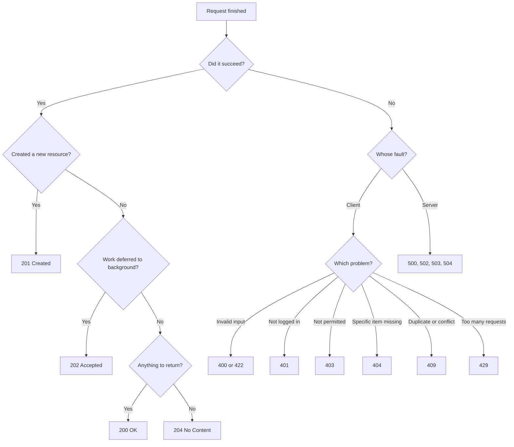

### A consistent error shape

Just like success responses, error responses should have **one consistent shape** across the API:

```json
{
  "error": {
    "code": "ORGANIZATION_NOT_FOUND",
    "message": "Organization not found",
    "details": [
      { "field": "name", "message": "name is required" }
    ]
  }
}
```

> [!NOTE]
> There's an IETF standard for this, **RFC 9457 "Problem Details for HTTP APIs"** (`application/problem+json` with `type`, `title`, `status`, `detail`, `instance`). Using it, or any single consistent format, is what matters.

## Reference: API versioning strategies

The chapter recommends a version segment in the URL (`/v1/…`). For completeness, the common options:

| Strategy | Example | Pros | Cons |
|---|---|---|---|
| URL path | `/v1/books` | Obvious, cache-friendly, easy to route | URL changes per version |
| Query param | `/books?version=1` | Easy to add | Easy to forget, messy caching |
| Header | `Accept: application/vnd.example.v1+json` or `API-Version: 2024-05-01` | Clean URLs | Harder to test in a browser, less visible |

URL-path versioning is the most widespread. Only bump the major version for **breaking** changes (removing/renaming fields, changing types or semantics). Adding an optional field is non-breaking.

## Common mistakes & misconceptions

- **Singular resource names** — `/book/42`, `/user`. Use plural collections: `/books/42`, `/users`.
- **Verbs in CRUD routes** — `GET /getBooks`, `POST /createBook`, `POST /deleteBook/42`. The method is the verb; the path is the noun. Verbs only appear for **custom actions** at the end: `POST /orders/42/cancel`.
- **Mixed case, spaces, underscores in URLs** — `/Books/Harry_Potter`. Use lowercase + hyphens: `/books/harry-potter`.
- **"Every POST returns 201."** — Only if something was created. Archive → `200`; clone → `201`.
- **Returning 404 for an empty list or a search with no matches.** — Return `200` with `data: []`.
- **"DELETE is not idempotent because the second call returns 404."** — Idempotency is about server state, not identical responses. DELETE is idempotent.
- **"PATCH is always idempotent."** — Only for "set field" patches; "increment" or "append" patches are not.
- **Using PUT for partial updates.** — PUT means full replacement; omitted fields may be wiped. Use PATCH for partial updates.
- **Accepting server-managed fields from the client** — `id`, `createdAt`, `updatedAt` must be generated by the server/DB, not trusted from the payload (mass-assignment bug).
- **Treating a custom action as a plain update** — `PATCH {status:"archived"}` skips all the side effects that "archive" implies. Use `POST /…/archive`.
- **No default sort** — leads to random order and broken pagination.
- **No pagination or no `limit` cap** on list endpoints.
- **Inconsistent naming between resources** — `description` here, `desc` there; `page` here, `pageNo` there; camelCase here, snake_case there.
- **Abbreviated field names** — `qty`, `desc`, `amt`.
- **Coding before designing** — routes end up shaped by whatever the framework made easy, not by what consumers need.
- **Thinking REST is a protocol or a standard document.** — It's an architectural style; HTTP is the protocol.

## Interview questions

<details>
<summary><strong>Q: What does REST stand for, and what are its constraints?</strong></summary>

REST = **Representational State Transfer**, an architectural style described by Roy Fielding in his 2000 PhD dissertation. Clients interact with **resources** (identified by URIs) by transferring **representations** (JSON, HTML, XML) of their **state** over HTTP. Constraints:

1. **Client–server** — separate UI from data/logic so each evolves independently.
2. **Stateless** — every request contains everything needed; the server keeps no client context between requests, so any server instance can serve any request.
3. **Cacheable** — responses are labelled cacheable or not.
4. **Uniform interface** — resource identification, manipulation via representations, self-descriptive messages, HATEOAS.
5. **Layered system** — proxies, load balancers, gateways can sit in between transparently.
6. **Code on demand** (optional) — server can send executable code like JS.

</details>

<details>
<summary><strong>Q: What is idempotency? Which HTTP methods are idempotent?</strong></summary>

An operation is idempotent if performing it N times leaves the server in the same state as performing it once. It's about **server-side side effects**, not identical responses.

- `GET`, `HEAD`, `OPTIONS` — idempotent and **safe** (no state change).
- `PUT` — idempotent: replacing with the same representation repeatedly yields the same state.
- `DELETE` — idempotent: the first call deletes; later calls return 404 but change nothing.
- `PATCH` — not guaranteed; "set name to B" is idempotent, "increment counter" is not.
- `POST` — **not** idempotent: each call can create a new resource.

It matters because clients and proxies can safely **retry** idempotent requests after timeouts.

</details>

<details>
<summary><strong>Q: PUT vs PATCH — what's the difference, and which would you use for a profile edit form?</strong></summary>

`PUT` **replaces** the whole resource with the payload: you must send every field, and anything omitted is treated as removed/reset. `PATCH` **partially** updates: only the fields sent are changed. `PUT` is always idempotent; `PATCH` is idempotent only for "set" style updates.

For a profile edit form in a modern SPA, where the user changes a couple of fields, use `PATCH /users/:id` with only the changed fields. Use `PUT` when the client really owns the whole document (e.g. replacing a config blob, or uploading a file to a known path).

</details>

<details>
<summary><strong>Q: A client calls POST /payments, the request times out, and the client retries. What can go wrong, and how do you prevent it?</strong></summary>

`POST` isn't idempotent. If the first request actually reached the server and was processed (only the response was lost), the retry charges the customer **twice**.

Fix: **idempotency keys**. The client generates a unique key per logical operation and sends it, e.g. `Idempotency-Key: <uuid>`. The server stores (key → result) in a table or Redis, ideally with a unique constraint. On a repeat key, it returns the stored response instead of reprocessing. Keys expire after some time (e.g. 24h). Additional safety: unique business constraints in the DB (e.g. unique `orderId` per payment).

</details>

<details>
<summary><strong>Q: Design the REST endpoints for a blog with posts and comments.</strong></summary>

| Action | Endpoint | Success |
|---|---|---|
| List posts | `GET /v1/posts?page=1&limit=20&sortBy=createdAt&sortOrder=desc&tag=go` | 200 |
| Create post | `POST /v1/posts` | 201 + post |
| Get post | `GET /v1/posts/:id` (or `/posts/:slug`) | 200 / 404 |
| Update post | `PATCH /v1/posts/:id` | 200 |
| Delete post | `DELETE /v1/posts/:id` | 204 |
| List comments on post | `GET /v1/posts/:id/comments` | 200 |
| Add comment | `POST /v1/posts/:id/comments` | 201 |
| Delete comment | `DELETE /v1/comments/:commentId` (or nested) | 204 |
| Publish (custom action) | `POST /v1/posts/:id/publish` | 200 |

Plural nouns, hierarchy via `/`, methods as verbs, custom actions as `POST` on the resource, consistent pagination/sorting/filtering params.

</details>

<details>
<summary><strong>Q: Why should resource names be plural even when fetching a single item?</strong></summary>

Because the path is a **hierarchy**: `/books` is the collection, `/books/42` is "item 42 within the books collection". The collection's name doesn't change based on how many items you pick. Using plural everywhere also keeps the API **consistent**: list, create, get, update and delete all share the same base (`/books`), so integrators can predict every route from one example.

</details>

<details>
<summary><strong>Q: GET /users?name=xyz returns no results. Should you return 404?</strong></summary>

No. Return **`200 OK`** with an empty list (`{"data": [], "total": 0, "page": 1, "totalPages": 0}`). The client requested a **collection** filtered by a query; the collection exists, it just has zero matches. `404` is for when a **specific** resource identified in the path (e.g. `GET /users/123`) doesn't exist. Returning 404 for empty lists forces clients to treat normal "no results" as an error.

</details>

<details>
<summary><strong>Q: How do you model an action that isn't CRUD, like "archive organization" or "send email"? Why not just PATCH the status?</strong></summary>

As a **custom action**: `POST /organizations/:id/archive`. `POST` is the open-ended method in HTTP semantics, meant for operations that don't fit the others. The URL stays hierarchical: collection → item → action.

Not a PATCH because archiving is more than flipping a field: it may archive child projects and tasks, notify members, revoke access, stop billing. A PATCH on `status` implies "just change this field", hides those side effects, and lets clients set states in invalid ways. The custom action makes the business operation explicit, and its response code reflects the outcome (`200` here; `201` for something like clone that creates a new resource; `202` if queued).

</details>

<details>
<summary><strong>Q: How would you implement pagination for a list API? Compare offset and cursor pagination.</strong></summary>

Accept `page` and `limit` query params with defaults (`page=1`, `limit=10–20`, capped at ~100) and a default sort (`createdAt desc`, plus `id` as tie-breaker). Return `{ data, total, page, totalPages }`.

**Offset**: `LIMIT limit OFFSET (page-1)*limit`. Simple, allows jumping to any page, gives a total count. But deep offsets are slow (the DB walks skipped rows) and concurrent inserts shift items between pages.

**Cursor/keyset**: client sends the last seen sort key (`?cursor=...`), server does `WHERE (createdAt,id) < (…) ORDER BY … LIMIT n`. Constant-time with an index and stable under inserts, ideal for feeds/infinite scroll, but no random page jumps and total counts are separate.

</details>

<details>
<summary><strong>Q: Why must a list endpoint always have a default sort order?</strong></summary>

Databases don't guarantee row order without `ORDER BY`. Without a default sort, the same request may return items in different orders on different calls, and with pagination an item can appear on two pages or on none. A deterministic default (usually `createdAt DESC`, with a unique tiebreaker such as `id`) makes responses stable and matches the natural expectation of "newest first".

</details>

<details>
<summary><strong>Q: What should the response of a successful POST /organizations look like?</strong></summary>

Status **`201 Created`**, ideally a `Location: /organizations/<id>` header, and the body containing the **full newly created entity**, including server-generated fields (`id`, `createdAt`, `updatedAt`) and any defaults the server applied (e.g. `status: "active"`). This saves the client a follow-up `GET`. The request body should contain only client-settable fields; the server must ignore or reject `id`/timestamps from the client.

</details>

<details>
<summary><strong>Q: What happens if you call DELETE /organizations/5 twice?</strong></summary>

First call: the organization is deleted, response `204 No Content`. Second call: the server looks it up, doesn't find it, returns `404 Not Found`. The **state** after both calls is the same (org 5 doesn't exist), so DELETE is still idempotent; only the response differs. (Some APIs return `204` both times to make retries look identical; either is acceptable if documented and consistent.)

</details>

<details>
<summary><strong>Q: What makes an API "good" from the consumer's perspective?</strong></summary>

- **Predictable**: follows REST conventions (plural nouns, correct methods/status codes).
- **Consistent**: same field names, casing (camelCase JSON), pagination/sort/filter params and error shapes everywhere.
- **Sane defaults**: list calls work with zero params; creates need only the minimum fields.
- **Readable**: no abbreviations, clear field names.
- **Documented**: interactive OpenAPI/Swagger docs that stay up to date.
- **Versioned**: breaking changes go to a new version (`/v2`).
- **Clear errors**: consistent error format with helpful messages.

</details>

<details>
<summary><strong>Q: Explain "stateless" and why it helps horizontal scaling.</strong></summary>

Stateless means each request carries everything the server needs (e.g. an auth token, all parameters), and the server stores no per-client context in memory between requests. Because no instance holds special knowledge about a client, a load balancer can send any request to any instance (round-robin etc.). You can add or remove servers freely, and a server crashing doesn't lose a user's "session". Shared state lives in databases/caches (Postgres, Redis), not in a particular server's memory.

</details>

<details>
<summary><strong>Q: Where do you start when designing a new API?</strong></summary>

From the product side, not the code: read wireframes (Figma), user stories and requirements to understand how users interact with data. Extract the **nouns** → these are resources (users, organizations, projects, tasks, tags). Design the **DB schema**. List the **actions** per resource (CRUD + custom actions). Then design the **interface** (routes, methods, payloads, responses, status codes, defaults) in an OpenAPI spec or a tool like Insomnia/Postman, before writing any business logic.

</details>

## Cheat sheet

- **REST** = architectural style (Fielding, 2000). Constraints: client–server, stateless, cacheable, uniform interface, layered system, code on demand (optional).
- **Uniform interface sub-constraints**: resource identification, manipulation via representations, self-descriptive messages, HATEOAS.
- **Representation** = format (JSON/HTML/XML) of a resource; **state** = its current data; **transfer** = moving representations via HTTP.
- **URL**: `scheme://authority/path?query#fragment`. Fragment never reaches the server.
- **API URL**: `https://api.example.com/v1/<plural-resource>/<id-or-slug>/<sub-resource-or-action>`
- **Paths**: plural, lowercase, hyphens, no spaces/underscores; `/` = hierarchy; slugs = lowercase + hyphens.
- **JSON fields**: camelCase, consistent, no abbreviations.

| Operation | Route | Method | Success | Body in response |
|---|---|---|---|---|
| List | `/organizations` | GET | 200 | `{data,total,page,totalPages}` |
| Create | `/organizations` | POST | 201 | Created entity |
| Get one | `/organizations/:id` | GET | 200 (404 if missing) | Entity |
| Partial update | `/organizations/:id` | PATCH | 200 | Updated entity |
| Replace | `/organizations/:id` | PUT | 200 | Updated entity |
| Delete | `/organizations/:id` | DELETE | 204 | Empty |
| Custom action | `/organizations/:id/archive` | POST | 200 / 201 / 202 | Depends on what happened |

- **Idempotent**: GET, HEAD, OPTIONS, PUT, DELETE. **Not**: POST. **Depends**: PATCH.
- **Safe** (read-only): GET, HEAD, OPTIONS.
- **List defaults**: `page=1`, `limit=10|20` (cap ~100), `sortBy=createdAt`, `sortOrder=desc`. Filters = `?<field>=<value>`.
- **Empty list → 200 + `[]`**. Missing specific resource → **404**.
- **POST ≠ always 201**: 201 only if a resource was created.
- Don't accept `id`, `createdAt`, `updatedAt` from clients. Default optional fields (e.g. `status=active`).
- Whitelist `sortBy`/filter fields; cap `limit`.
- **Design first** (OpenAPI/Insomnia/Postman), ship **interactive docs** (Swagger UI), be **consistent**.

## Glossary

- **REST** — Representational State Transfer; an architectural style for networked systems built around resources, representations and a uniform interface.
- **RESTful API** — an HTTP API that follows REST constraints and conventions.
- **Resource** — any named entity the API exposes (a noun): book, user, organization.
- **Representation** — a concrete format of a resource's state sent over the wire (JSON, HTML, XML).
- **State** — the current data/attributes of a resource (e.g. a cart's items, quantities, total).
- **URI / URL** — identifier / locator of a resource; a URL is a URI that also says how to reach it.
- **Collection** — a set of resources, e.g. `/books`.
- **Path parameter (dynamic parameter)** — a variable segment in the route, e.g. `:id` in `/books/:id`.
- **Query parameter** — key–value pairs after `?`, used for filtering, sorting, pagination.
- **Slug** — human-readable, URL-safe identifier derived from a property (e.g. `harry-potter`).
- **Idempotent** — repeating the operation has the same effect on server state as doing it once.
- **Safe method** — a method that does not modify server state (GET, HEAD, OPTIONS).
- **Custom action** — a non-CRUD operation on a resource, modelled as `POST /resource/:id/action`.
- **Pagination** — returning a list in portions (pages) instead of all at once.
- **Offset pagination** — page/limit based, `LIMIT … OFFSET …`.
- **Cursor (keyset) pagination** — "items after this key" pagination; fast and stable.
- **Sane default** — a sensible value the server applies when the client omits a parameter.
- **HATEOAS** — Hypermedia as the Engine of Application State; responses include links to possible next actions.
- **Stateless** — server keeps no client context between requests; each request is self-contained.
- **Layered system** — architecture where intermediaries (proxies, load balancers) can sit transparently between client and server.
- **OpenAPI / Swagger** — standard machine-readable format for describing HTTP APIs; Swagger UI renders it as interactive docs.
- **Insomnia / Postman** — API clients used to design, send and test HTTP requests.
- **Idempotency key** — a client-generated unique key that lets the server deduplicate retried non-idempotent requests.
- **MPA / SPA** — multi-page application (server renders each page) / single-page application (client-side routing, JSON APIs).

## Video timestamps

- [00:00](https://www.youtube.com/watch?v=RG6q57DwV8Y&t=0s) — Why API design matters; common confusions (plural vs singular, PUT vs PATCH, status codes)
- [02:00](https://www.youtube.com/watch?v=RG6q57DwV8Y&t=120s) — MPAs vs SPAs; the goal of standardizing
- [04:03](https://www.youtube.com/watch?v=RG6q57DwV8Y&t=243s) — History: Tim Berners-Lee and the World Wide Web
- [07:12](https://www.youtube.com/watch?v=RG6q57DwV8Y&t=432s) — The web's scalability crisis
- [08:13](https://www.youtube.com/watch?v=RG6q57DwV8Y&t=493s) — Roy Fielding's constraints: client–server, uniform interface
- [09:15](https://www.youtube.com/watch?v=RG6q57DwV8Y&t=555s) — Layered system, cacheable, stateless, code on demand
- [13:19](https://www.youtube.com/watch?v=RG6q57DwV8Y&t=799s) — HTTP/1.1 and Fielding's 2000 dissertation naming REST
- [14:22](https://www.youtube.com/watch?v=RG6q57DwV8Y&t=862s) — What "Representational State Transfer" means
- [17:29](https://www.youtube.com/watch?v=RG6q57DwV8Y&t=1049s) — State and transfer explained (shopping cart)
- [21:33](https://www.youtube.com/watch?v=RG6q57DwV8Y&t=1293s) — Anatomy of a URL
- [23:37](https://www.youtube.com/watch?v=RG6q57DwV8Y&t=1417s) — API URL structure: api subdomain, versioning, plural resources
- [27:43](https://www.youtube.com/watch?v=RG6q57DwV8Y&t=1663s) — Readable URLs, slugs, hierarchy with `/`
- [30:48](https://www.youtube.com/watch?v=RG6q57DwV8Y&t=1848s) — Idempotency
- [32:52](https://www.youtube.com/watch?v=RG6q57DwV8Y&t=1972s) — HTTP methods and GET's idempotency
- [34:54](https://www.youtube.com/watch?v=RG6q57DwV8Y&t=2094s) — PUT vs PATCH, and why they're idempotent
- [38:00](https://www.youtube.com/watch?v=RG6q57DwV8Y&t=2280s) — DELETE is idempotent
- [40:03](https://www.youtube.com/watch?v=RG6q57DwV8Y&t=2403s) — POST is non-idempotent
- [43:09](https://www.youtube.com/watch?v=RG6q57DwV8Y&t=2589s) — Custom actions use POST
- [46:14](https://www.youtube.com/watch?v=RG6q57DwV8Y&t=2774s) — Design the interface first; why standards remove guesswork
- [49:17](https://www.youtube.com/watch?v=RG6q57DwV8Y&t=2957s) — Start from wireframes and user stories
- [52:20](https://www.youtube.com/watch?v=RG6q57DwV8Y&t=3140s) — Resources are the nouns (Jira/Linear example)
- [55:26](https://www.youtube.com/watch?v=RG6q57DwV8Y&t=3326s) — Schema: organizations, projects, tasks; listing actions
- [57:28](https://www.youtube.com/watch?v=RG6q57DwV8Y&t=3448s) — Designing in Insomnia
- [59:33](https://www.youtube.com/watch?v=RG6q57DwV8Y&t=3573s) — List organizations endpoint
- [1:01:38](https://www.youtube.com/watch?v=RG6q57DwV8Y&t=3698s) — Create organization: POST, payload, 201
- [1:04:40](https://www.youtube.com/watch?v=RG6q57DwV8Y&t=3880s) — Why pagination
- [1:08:43](https://www.youtube.com/watch?v=RG6q57DwV8Y&t=4123s) — Paginated response fields: data, total, page, totalPages
- [1:11:47](https://www.youtube.com/watch?v=RG6q57DwV8Y&t=4307s) — `limit` and `page` query params and defaults
- [1:15:51](https://www.youtube.com/watch?v=RG6q57DwV8Y&t=4551s) — Sorting: `sortBy`, `sortOrder`, sane defaults
- [1:20:56](https://www.youtube.com/watch?v=RG6q57DwV8Y&t=4856s) — Filtering
- [1:22:56](https://www.youtube.com/watch?v=RG6q57DwV8Y&t=4976s) — Update organization with PATCH
- [1:26:59](https://www.youtube.com/watch?v=RG6q57DwV8Y&t=5219s) — Get single organization
- [1:28:01](https://www.youtube.com/watch?v=RG6q57DwV8Y&t=5281s) — Delete organization, 204 No Content
- [1:30:03](https://www.youtube.com/watch?v=RG6q57DwV8Y&t=5403s) — 404 for missing resource vs 200 empty list
- [1:33:05](https://www.youtube.com/watch?v=RG6q57DwV8Y&t=5585s) — Custom action: archive organization
- [1:39:14](https://www.youtube.com/watch?v=RG6q57DwV8Y&t=5954s) — Projects endpoints
- [1:42:17](https://www.youtube.com/watch?v=RG6q57DwV8Y&t=6137s) — JSON fields in camelCase
- [1:44:23](https://www.youtube.com/watch?v=RG6q57DwV8Y&t=6263s) — Consistency across resources
- [1:51:35](https://www.youtube.com/watch?v=RG6q57DwV8Y&t=6695s) — Custom action: clone project (201)
- [1:55:39](https://www.youtube.com/watch?v=RG6q57DwV8Y&t=6939s) — Best practices: interactive docs (Swagger/OpenAPI)
- [1:57:42](https://www.youtube.com/watch?v=RG6q57DwV8Y&t=7062s) — Consistency and sane defaults
- [1:59:43](https://www.youtube.com/watch?v=RG6q57DwV8Y&t=7183s) — Avoid abbreviations
- [2:01:45](https://www.youtube.com/watch?v=RG6q57DwV8Y&t=7305s) — Design before you code
