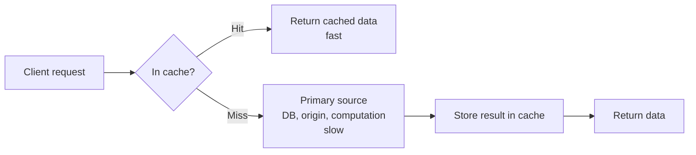
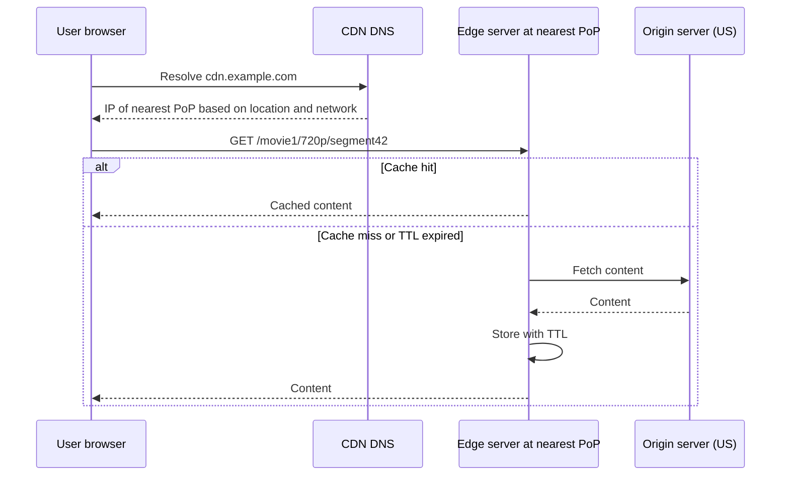
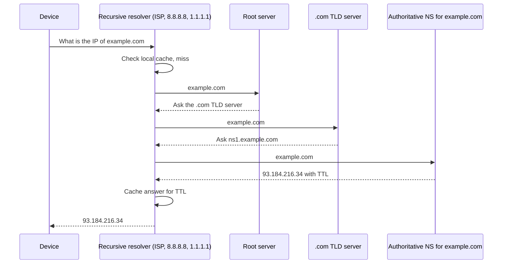
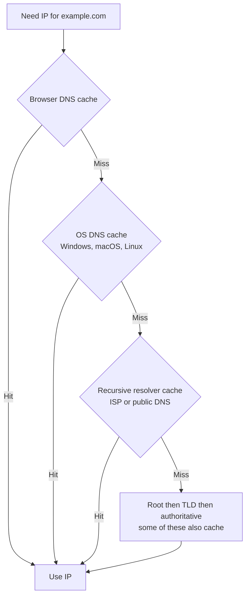
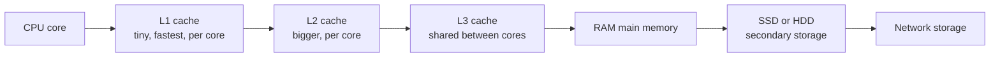
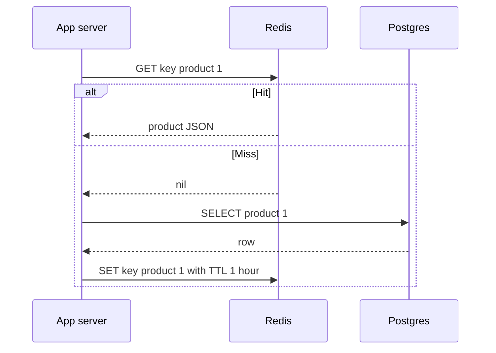
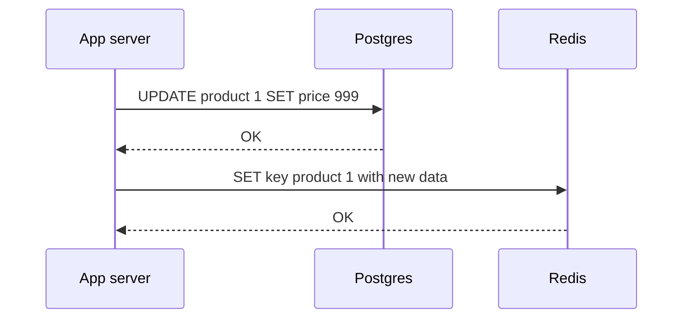
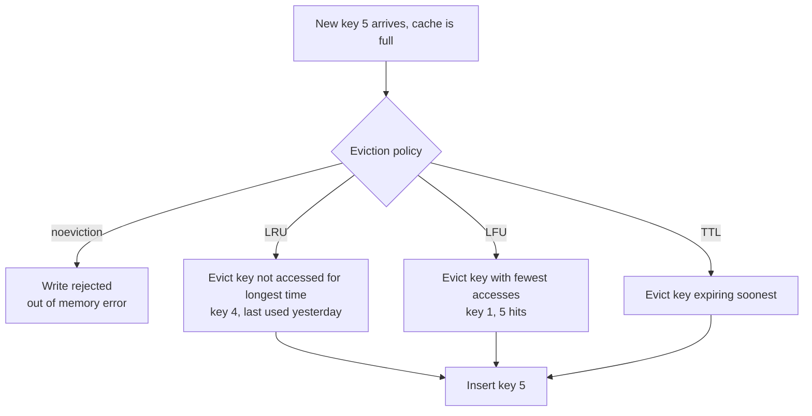
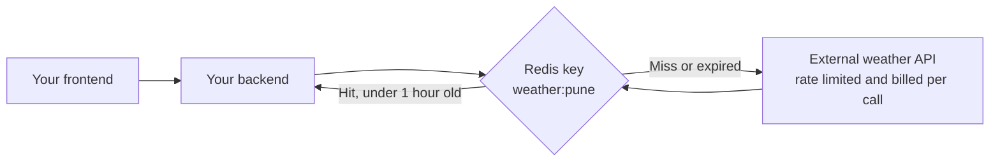

## TL;DR

- **Caching** = keeping a **subset** of data in a location that is **faster and cheaper to access** than the primary source, so work takes less **time** and **effort**. You cache when you want to avoid (1) **repeating heavy computation** or (2) **repeatedly moving heavy data**.
- **Cache hit** = data found in the cache → return instantly. **Cache miss** = not found → do the slow work (or go to the origin), then store the result for next time.
- Real systems: **Google** caches search results in a distributed in-memory cache; **Netflix** serves video from **CDN edge servers** near users; **X/Twitter** precomputes trending topics every few minutes and serves them from Redis.
- Three levels a backend engineer meets: **network** (CDN, DNS), **hardware** (CPU L1/L2/L3, RAM), and **software** (Redis, Memcached, AWS ElastiCache — software on top of RAM).
- **CDN**: DNS routes you to the nearest **PoP** (point of presence = cluster of edge servers); edge returns cached content or fetches from the **origin**; content lives for a **TTL**. **DNS** is cached at browser, OS, recursive resolver, and sometimes authoritative levels.
- **Redis/Memcached** are **in-memory key-value NoSQL** stores: fast because RAM is random-access and electronic, but RAM is **limited** and **volatile**, so a cache only holds a subset.
- **Strategies**: **cache-aside / lazy** (populate on miss) and **write-through** (update DB and cache together on every write — always fresh, slower writes). **Eviction policies** when memory fills: **no-eviction**, **LRU**, **LFU**, **TTL-based**.
- Backend use cases: caching **expensive DB queries**, read-heavy data (product pages, profiles), **sessions**, **external API responses** (save cost, avoid rate limits), and **rate-limit counters**.

## Why this matters

The difference between an API that responds in 5 ms and one that responds in 500 ms is very often a cache. High-performance applications measure latency in double-digit microseconds or milliseconds, and nearly all of them rely on caching at several layers simultaneously. Caching is also one of the first tools you reach for when a database is overloaded or an external API bill explodes. In interviews, caching shows up everywhere: system design ("how would you scale this read-heavy endpoint?"), Redis questions, "explain LRU", "how do you keep a cache consistent", and "what's a CDN".

## What is caching?

**One-line definition:** caching is a mechanism to **decrease the time and effort** it takes to perform some work.

**Technical definition:** caching is keeping a **subset** of some primary data — chosen based on how often it's used, how likely it is to be used next, and similar factors — in a location that is **faster** (less time) and **easier** (less effort/compute) to access than the primary store.

Analogy: a chef keeps salt, oil and chopped onions on the counter (the cache) instead of walking to the storeroom (the database) every time. The counter is small, so only the most-used items live there.



> [!IMPORTANT]
> A cache is always a **subset**. It is faster but more expensive per byte and smaller than the primary storage. Caching *everything* defeats the purpose and costs too much — choosing *what* to cache is the real engineering decision.

## Real-world examples

### Google Search — caching expensive computation

When you search, Google's pipeline involves crawling, indexing and ranking billions of pages — **computationally expensive** (CPU, memory). Queries like "what is the weather today" are searched millions of times per day. Without caching, Google would recompute results for every single query → very high latency and server load.

Instead Google uses a **distributed in-memory caching system** — cache servers spread across the world — storing the results produced by its ranking algorithms:
- **Cache hit**: the query's results are in the cache → returned instantly.
- **Cache miss**: a new query → run the full pipeline, then cache the results so the next user (or the same user) gets them instantly.

### Netflix — caching heavy data close to users (CDN)

Netflix streams huge amounts of data (multiple terabytes and more) to millions of users. Each movie is **encoded** into multiple resolutions (1080p, 720p, 480p…) so the right version can be sent depending on the device and network speed, saving bandwidth and server load.

To deliver this globally with minimal buffering, Netflix uses a **CDN (Content Delivery Network)**:
- **Origin servers** in its data centres (say, in the US) hold the actual movies.
- **Edge locations** around the world — strategically placed based on available infrastructure and connectivity — hold copies.
- A user in India is served from a nearby edge, not from the US origin, so latency is much lower — just as low as for US users near the origin.

Netflix doesn't cache its whole catalogue at every edge (too costly). It uses trend analysis, real-time data and machine-learning models to decide **which subset** of content is likely to be watched in each region.

CDNs aren't just for video: images, web pages and static assets (HTML, CSS, JavaScript) are routinely served from CDNs. Platforms like **Vercel** have an **edge network** — your frontend is served from the region closest to you instead of the origin.

### X (Twitter) — caching precomputed results

The **trending topics** section is computed by analysing millions of tweets in real time with ML and trend-detection algorithms — terabytes of data, lots of GPUs. If every user opening the trending tab triggered that computation, the servers would crash within seconds.

Trends don't change in seconds (an election stays trending for hours or days), so they're **safe to cache**. X recomputes them every few minutes (exact details unknown) and stores the results in an **in-memory key-value store like Redis**. Users get the cached data instantly.

> [!TIP]
> **The pattern:** cache when you'd otherwise **repeat heavy computation** (Google ranking, X trends) or **repeatedly transfer heavy data** over long distances (Netflix video). Also ask: *how fast does this data change?* Slow-changing data is safe to cache.

## Three levels of caching

For a backend engineer, caching appears most often at three levels:

| Level | Examples | What you interact with |
|---|---|---|
| **Network** | CDN, DNS caches | Configuration of CDN / DNS TTLs |
| **Hardware** | CPU L1/L2/L3 caches, RAM | Mostly transparent; affects data-structure performance |
| **Software** | Redis, Memcached, AWS ElastiCache | A client library in your code |

"Software caching" isn't purely software — Redis stores data in RAM (hardware) — but it's called software-based because you interact with it via a library/program.

## Network-level caching

### CDN (Content Delivery Network) in depth

The idea: **cache content on servers geographically closer to end users**. These are called **edge servers** or **edge nodes** ("edge" anything = happening on a server close to you rather than at the origin). The goals: minimise latency for users and minimise load on the origin.

**Terms:**
- **Origin server** — where the original, authoritative content lives.
- **Edge server** — a cache server near users.
- **PoP (Point of Presence)** — a location/region containing **multiple edge servers**.
- **TTL (Time To Live)** — how long content may be served from the cache before it must be refreshed.

**How a CDN request works:**



1. The user requests a resource (image, video, web page) via a URL.
2. The browser sends a **DNS query** to resolve the domain name to an IP address.
3. The **CDN's DNS system routes the request to the nearest PoP**, based on the user's **geographic location** and **network conditions**. E.g. a user in New York is directed to a PoP near New York.
4. The **edge server** checks its cache:
   - **Hit** → serves the content immediately (happy path).
   - **Miss** → fetches it from the **origin** (e.g. US servers for a user in India), caches it, and serves it. The cached copy is a real copy of the origin's resource.
5. Content is kept for its **TTL** (e.g. a few hours, a sensible default chosen by the company). After it expires, the next request triggers a fresh fetch from the origin, which is cached with a new TTL. This prevents serving stale content forever when new versions or regional changes appear.

> [!NOTE]
> **Precision:** CDNs route users to a PoP using **GeoDNS** (DNS answers depend on the resolver's location) and/or **anycast** (many PoPs advertise the same IP, and internet routing picks the nearest). Picking a lower video quality for bad networks is mainly done by the **client player** via **adaptive bitrate streaming** (HLS/DASH), which requests lower-resolution segments — the CDN just serves whichever segments are requested. Netflix's own CDN is called **Open Connect**.

> [!TIP]
> Standard addition: origins tell CDNs and browsers how to cache via HTTP headers — `Cache-Control: public, max-age=3600` (cacheable for an hour), `s-maxage` (CDN-specific), `no-store` (never cache), `ETag` / `Last-Modified` (revalidation). Static assets are often given long TTLs with **content-hashed filenames** (`app.3f9a1c.js`), so a new deploy simply uses a new URL instead of needing a CDN purge.

### DNS caching

DNS turns domain names (`example.com`) into IP addresses. Doing a full lookup is a lot of work, so DNS relies heavily on caching at many layers.

**Full resolution (when nothing is cached):**

1. You type `example.com` and press Enter. Your device sends a DNS query to a **recursive resolver** — provided by your **ISP** (e.g. Jio, ACT, Airtel in India) or a **public DNS provider** (Google `8.8.8.8`, Cloudflare `1.1.1.1`).
2. The resolver checks its **local cache**. **Hit** → returns the IP immediately.
3. **Miss** → it queries a **root server**. Root servers don't know `example.com`'s IP, but they know where the **TLD (top-level domain)** servers are (`.com`, `.in`, …), so they return a referral to the `.com` TLD server.
4. The **`.com` TLD server** doesn't know the IP either, but returns the address of the **authoritative name server** for `example.com`.
5. The **authoritative name server** returns the actual IP address.
6. The resolver returns the IP to your device (and caches it for the record's TTL).

It's called **recursive** because the resolver keeps going deeper, server after server, until it finds the answer.



> [!NOTE]
> **Precision:** there are **13 named root server identities** (`a.root-servers.net` to `m.root-servers.net`), operated by 12 organisations, but each is replicated via anycast into **hundreds of physical servers** worldwide.

**Where DNS answers are cached (checked roughly in this order):**



- **Browser cache** — Chrome, Firefox, etc. keep their own DNS cache from previous requests.
- **OS cache** — Windows, macOS and Linux keep a local DNS cache, checked before asking the resolver.
- **Recursive resolver cache** — shared across all users of that ISP/public DNS, so popular domains are almost always hits.
- **Authoritative/other servers** — some also cache to avoid further requests.

Each cached record lives for the **TTL** set by the domain owner — which is why DNS changes "take time to propagate".

> [!NOTE]
> The video describes the OS cache first and then the browser cache. In practice browsers usually check **their own cache first**, then ask the OS resolver (which has its cache), then the recursive resolver. The key point is the same: multiple layers of caching so the expensive recursive lookup rarely happens.

## Hardware-level caching

### CPU caches

From computer architecture: the CPU has multiple layers of very fast memory:



Moving right, each level is **larger and cheaper but slower**. The CPU keeps frequently used data and repeated computations in L1/L2/L3.

**Example — why sequential array access is fast:** when you traverse an array `[1, 2, 3, 4, 5]` in order, the CPU's predictive mechanisms (prefetching) load the surrounding block of memory into cache. The next elements are already in cache when you need them. (This is **spatial locality**: data near recently used data is likely to be used soon. Data actually moves in chunks called **cache lines**, typically 64 bytes.)

### Why RAM is fast — and why it can't replace disks

Redis and Memcached are **in-memory** databases: they store data in **RAM (main memory)**.

- **Hard disks** are mechanical: platters spin and a read/write head must physically move to the right location to find data. (SSDs have no moving parts but are still much slower than RAM.)
- **RAM** is made of capacitors and transistors; any address can be reached directly with electrical signals. It's called **random access** memory because accessing any location takes roughly **constant time**, regardless of where it is or the order you access it in.

| | RAM (primary storage) | Disk — HDD/SSD (secondary storage) |
|---|---|---|
| Speed | Very fast (~100 ns) | Slower (SSD ~100 µs, HDD ~ms) |
| Capacity | Limited | Large |
| Cost per GB | High | Low |
| Volatile? | **Yes** — data lost on power off | **No** — data persists |

RAM trades **non-volatility and capacity for speed**. So it can't replace disk storage: disks give **persistence**, RAM gives **fast access**. Each has its role.

**How in-memory databases handle this:** Redis keeps all data in RAM for reads and writes, and (optionally) **persists to disk** in the background; on restart it reloads data from disk into memory. All access happens against RAM, which is why operations are so fast.

> [!NOTE]
> Redis persistence options: **RDB** (periodic point-in-time snapshots) and **AOF** (append-only log of every write), or both. **Memcached** has no persistence at all — restart and it's empty. Either way, a cache should be treated as **disposable**: your system must still work (more slowly) if the cache is lost.

## Software-level caching: in-memory key-value stores

In backend development, the main tools are **Redis**, **Memcached**, and managed cloud versions like **AWS ElastiCache** (and open-source Redis forks such as **Valkey**). They're described as **in-memory, key-value, NoSQL databases**:

- **In-memory** — data lives in RAM, unlike Postgres/MySQL which store data on disk → very fast.
- **Key-value** — no tables, rows or strict schemas like relational databases. You store a value under a key. The value can be a string, number, JSON, list, etc., depending on what the technology supports (Redis has strings, lists, sets, sorted sets, hashes, and more).
- **NoSQL** — no strict SQL schema enforcement.

Using them is simple: install the client library for your language (e.g. `node-redis` / `ioredis` for Node.js), `SET` a key with a value, `GET` it by key. No complex SQL queries or aggregations.

```bash
SET user:42:profile '{"name":"Asha","city":"Pune"}' EX 3600   # store with 1-hour TTL
GET user:42:profile
TTL user:42:profile        # seconds remaining
DEL user:42:profile        # invalidate
INCR ratelimit:203.0.113.7 # atomic counter
```

## Caching strategies

### Cache-aside (lazy caching)

The application checks the cache first; on a miss it fetches from the primary store, **stores the result in the cache**, then returns it. The next request (from anyone) is a hit. It's called **lazy** because you don't proactively predict and preload data — you cache it **only when someone actually asks for it**. This is the most common pattern in backend development.



```ts
import { createClient } from "redis";
const redis = createClient();
await redis.connect();

async function getProduct(id: string) {
  const key = `product:${id}`;
  const cached = await redis.get(key);
  if (cached) return JSON.parse(cached);              // cache hit

  const product = await db.products.findById(id);     // cache miss → DB
  if (product) {
    await redis.set(key, JSON.stringify(product), { EX: 3600 }); // cache for 1h
  }
  return product;
}
```

**Pros:** only requested data is cached; the cache failing just means slower reads. **Cons:** the first request is always slow (miss); data can be **stale** until the TTL expires or you invalidate it.

### Write-through

This is a **cache update strategy**. On every write (POST/PUT/PATCH creating or changing a resource), in the **same execution flow** you update the **database and the cache together**.



```ts
async function updateProductPrice(id: string, price: number) {
  const product = await db.products.update(id, { price });           // 1. write DB
  await redis.set(`product:${id}`, JSON.stringify(product), { EX: 3600 }); // 2. write cache
  return product;
}
```

**Pros:** the cache is **always fresh** — you never serve old data. **Cons:** every write has extra overhead (two writes), and you may cache data that's never read.

### Other strategies worth knowing (standard additions)

| Strategy | How it works | Trade-off |
|---|---|---|
| **Cache-aside (lazy)** | App reads cache, on miss reads DB and fills cache | Simple, resilient; first read slow, possible staleness |
| **Read-through** | Cache library itself loads from DB on a miss | Cleaner app code; needs cache-provider support |
| **Write-through** | Write DB and cache together | Fresh cache; slower writes |
| **Write-behind (write-back)** | Write to cache, flush to DB asynchronously later | Very fast writes; risk of data loss if cache dies |
| **Write-around** | Write only to DB; cache filled on later reads | Avoids caching write-only data; first read is a miss |
| **Invalidate on write** | Write DB, then **delete** the cache key | Very common with cache-aside; avoids race-prone double writes |

> [!WARNING]
> **Cache invalidation is the hard part.** "There are only two hard things in computer science: cache invalidation and naming things." When data changes you must either update or delete the cached copy, or accept staleness up to the TTL. Common pitfalls: forgetting to invalidate on one of several write paths, race conditions between concurrent writers, and a **cache stampede** (a popular key expires and thousands of requests hit the DB at once — mitigate with locks/single-flight, early refresh, or TTL jitter).

## Eviction policies

RAM is limited (and managed services like ElastiCache have a fixed memory limit), so eventually the cache fills up. Since a cache is only a subset of data, you must decide **which old data to throw away** to make room for new, higher-priority data. That rule is the **eviction policy**.

Running example: the cache holds keys 1, 2, 3, 4 and is full; key 5 arrives.

| Policy | Evicts | Example outcome |
|---|---|---|
| **No eviction** | Nothing — new writes **fail** with an out-of-memory error | Insert of 5 fails. This is what you get if you configure no policy. |
| **LRU — Least Recently Used** | The key whose **last access** is oldest | 1, 2, 3 accessed today, 4 accessed yesterday → **evict 4**, insert 5 |
| **LFU — Least Frequently Used** | The key with the **fewest accesses** | Access counts 1→5, 2→10, 3→6, 4→23 → **evict 1**, insert 5 |
| **TTL-based** | The key **closest to expiring** (lowest remaining TTL) | Evict whichever key would expire soonest |



Separately from eviction, every key can have a **TTL**, after which Redis **expires** it automatically regardless of memory pressure.

> [!NOTE]
> Actual Redis `maxmemory-policy` values: `noeviction`, `allkeys-lru`, `volatile-lru`, `allkeys-lfu`, `volatile-lfu`, `allkeys-random`, `volatile-random`, `volatile-ttl`. "allkeys-" considers every key; "volatile-" only keys that have a TTL set. Redis implements LRU/LFU **approximately** (sampling a few keys) to save memory and CPU.

> [!INTERVIEW]
> **"Implement an LRU cache."** Use a **hash map + doubly linked list**: the map gives O(1) lookup from key to node; the list keeps nodes ordered by recency. On `get`, move the node to the front. On `put`, insert at the front; if over capacity, remove the node at the tail (least recently used) and delete it from the map. Both operations are O(1). LRU suits recency-driven workloads; LFU suits stable "popular items" workloads but adapts slowly when popularity changes.

```ts
// O(1) LRU using Map's insertion order (a common interview shortcut)
class LRUCache<K, V> {
  private map = new Map<K, V>();
  constructor(private capacity: number) {}
  get(key: K): V | undefined {
    if (!this.map.has(key)) return undefined;
    const val = this.map.get(key)!;
    this.map.delete(key);
    this.map.set(key, val); // move to most-recent
    return val;
  }
  put(key: K, val: V) {
    if (this.map.has(key)) this.map.delete(key);
    this.map.set(key, val);
    if (this.map.size > this.capacity) {
      const lruKey = this.map.keys().next().value as K; // oldest entry
      this.map.delete(lruKey);
    }
  }
}
```

## Backend use cases for in-memory caches

### 1. Database query caching

You have a query with many **joins** and **aggregations** over millions of rows that ends up returning a few rows — very compute-intensive. Monitoring shows the API calling it is hit frequently (e.g. on the landing or dashboard page), putting heavy load on the DB.

Solution: cache the result with a TTL (e.g. 1 hour). On each request, check the cache; on a miss, run the query once and store it. When the underlying data changes, update or delete the cached entry. Users get lower latency and the DB load drops.

**Read-heavy data** is the ideal candidate:
- **E-commerce (Amazon)** caches product details, prices and (in some cases) inventory. During a MacBook sale, millions of users hit the same product page; product descriptions rarely change, so serving them from the DB every time is pointless load. The DB is freed for important work.
- **Social media (X, Facebook)** caches **user profiles**, which change maybe a few times a year. A celebrity's profile may be fetched thousands or millions of times a day (e.g. around a movie release). When the user edits it, invalidate and re-cache.

> [!TIP]
> Rule of thumb: **cache read-heavy data with infrequent writes.** The higher the read/write ratio and the more expensive the computation, the bigger the win.

### 2. Session storage

From the authentication chapter: after successful login, a session is created and must be looked up on **every request**. Storing sessions in a database means a DB round trip per API call. Storing them in **Redis** is much faster (RAM access) and keeps load off the DB. That's why session tokens are usually stored in Redis or another in-memory store.

```ts
await redis.set(`session:${sessionId}`, JSON.stringify({ userId, role }), { EX: 900 });
const session = await redis.get(`session:${sessionId}`); // on every request
```

### 3. External API caching

Your backend calls an external **weather API**, does some computation, and serves your frontend. Without caching, every frontend request triggers another external call → thousands of external calls → you quickly **hit their rate limit** or **inflate your bill** (they're often priced per call).

Weather data doesn't change every second, so it's safe to cache: fetch once, cache it with a **TTL of 1 hour**; for that hour all requests use the cached value. After expiry, the next request fetches fresh data and re-caches it. **Whenever you integrate with an external API, think about caching.**



### 4. Rate limiting

Rate limiting is usually a **middleware** that runs before the request reaches routes/controllers. It identifies the client, commonly by the **`X-Forwarded-For`** header, which holds the client's public IP and is typically added by a **reverse proxy** (e.g. Nginx) or load balancer in front of the app.

Example rule: at most **50 requests per minute** per IP (protects compute-intensive APIs and blocks bots).

1. Request arrives from IP `203.0.113.7`.
2. Middleware increments a counter in Redis for that IP for the current window: 1, 2, 3, …
3. If the counter exceeds 50 within the minute → block with **429 Too Many Requests**.
4. When the minute passes, the counter resets (the key expires).

```ts
async function rateLimit(req: Request, res: Response, next: NextFunction) {
  const ip = req.ip; // with app.set("trust proxy", ...) Express derives it from X-Forwarded-For
  const key = `ratelimit:${ip}:${Math.floor(Date.now() / 60000)}`; // fixed 1-minute window
  const count = await redis.incr(key);
  if (count === 1) await redis.expire(key, 60);
  if (count > 50) return res.status(429).json({ error: "Too many requests" });
  next();
}
```

**Why Redis and not Postgres/MySQL for counters?** You *could* store them in a relational DB, but:
1. **Latency** — a DB call on *every* request adds, say, 20–30 ms to every API, just for rate limiting.
2. **Load** — with thousands of users making 100 requests a minute each, the DB gets flooded purely with rate-limit reads/writes.

An in-memory store keeps the check fast and isolates the load. Redis's atomic `INCR` and key expiry also make counters simple and race-free.

> [!WARNING]
> `X-Forwarded-For` is just a header — clients can send fake values. Only trust it when it's set by **your own** proxy/load balancer, and take the right-most entry added by trusted proxies (configure `trust proxy` in Express accordingly). Otherwise attackers bypass IP-based rate limits by spoofing the header.

## Getting hands-on

Install **Redis** (or its open-source alternative **Valkey**), add the client library for your language, and compare the latency of reading data from Postgres versus Redis yourself.

## Common mistakes & misconceptions

- **Caching everything.** A cache is a subset; caching rarely used data wastes expensive memory and evicts useful keys.
- **Treating the cache as the source of truth.** RAM is volatile; Memcached doesn't persist; Redis persistence may lag. The DB must remain authoritative, and the app must work when the cache is empty.
- **No TTL and no invalidation** → stale data served forever.
- **Caching highly dynamic or per-request data** (e.g. real-time balances) where staleness is unacceptable.
- **Forgetting cache invalidation** on one of several code paths that modify data.
- **Leaving the default `noeviction`** on a cache and then getting write errors when memory fills (or the opposite: using an evicting policy on a Redis instance also used as a primary store).
- **Thinking "random access" means unpredictable** — it means any address can be read in about the same time.
- **Thinking CDNs are only for video** — they serve images, JS/CSS, HTML, and even API responses.
- **Ignoring cache stampedes** when a hot key expires.
- **Trusting `X-Forwarded-For` blindly** for rate limiting.
- **Caching user-specific data under a shared key** (or in a public CDN cache) → leaking one user's data to another. Include the user ID in the key and mark private responses `Cache-Control: private`.

## Interview questions

<details>
<summary><strong>Q: What is caching, and when should you use it?</strong></summary>

Caching stores a subset of data in a faster, cheaper-to-access location than the primary source (RAM vs disk, an edge server vs a distant origin) so repeated work takes less time and effort. Use it when you'd otherwise repeat expensive computation (complex queries, ranking, ML results) or repeatedly transfer heavy data over long distances (video, images), and especially when data is read far more often than it changes and some staleness is acceptable.

</details>

<details>
<summary><strong>Q: Explain cache hit, cache miss and TTL.</strong></summary>

A **hit** is when requested data is found in the cache and returned immediately. A **miss** is when it isn't, so the system goes to the primary source (DB, origin server, computation), returns the data, and usually stores it in the cache. **TTL (time to live)** is how long an entry may be served before it expires and must be refetched; it bounds staleness. The **hit ratio** (hits divided by total lookups) is the main metric of cache effectiveness.

</details>

<details>
<summary><strong>Q: How does a CDN work? What happens on a cache miss?</strong></summary>

A CDN places edge servers in many PoPs around the world. When a user requests `cdn.example.com/img.png`, the CDN's DNS (GeoDNS or anycast) routes them to the nearest PoP. The edge server checks its cache: on a hit it serves the content immediately; on a miss (or expired TTL) it fetches the content from the origin server, caches it with a TTL, and serves it. Benefits: lower latency for distant users, much less origin load and bandwidth, and resilience against traffic spikes.

</details>

<details>
<summary><strong>Q: Walk through DNS resolution for example.com and where caching happens.</strong></summary>

The browser checks its DNS cache, then the OS cache, then asks a recursive resolver (ISP or 8.8.8.8/1.1.1.1), which checks its cache. On a full miss, the resolver asks a root server (which refers it to the `.com` TLD servers), then the `.com` TLD server (which refers it to example.com's authoritative name server), then the authoritative server, which returns the IP. The resolver caches the answer for the record's TTL and returns it. Because of these layered caches, most lookups never go past the browser, OS, or resolver.

</details>

<details>
<summary><strong>Q: Why are Redis and Memcached so fast? What is the trade-off?</strong></summary>

They keep data in RAM, which is electronic and random-access (about 100 ns), whereas disk-based databases must read from SSD/HDD (microseconds to milliseconds), plus they use simple key-value lookups with no query planning or joins. The trade-off: RAM is limited, expensive per GB, and volatile — data is lost on power loss unless persisted (Redis RDB/AOF; Memcached has no persistence). So they hold a subset of data and need eviction policies.

</details>

<details>
<summary><strong>Q: Compare cache-aside and write-through caching.</strong></summary>

**Cache-aside (lazy):** read from the cache; on a miss read the DB, populate the cache, return. Only requested data is cached and a cache failure just slows things down, but the first read is slow and data can be stale until TTL/invalidation. **Write-through:** every write updates the DB and the cache in the same flow, so reads are always fresh, but writes are slower and you may cache data nobody reads. Many systems combine cache-aside reads with **delete-on-write** invalidation.

</details>

<details>
<summary><strong>Q: What eviction policies exist? Which would you choose for a general-purpose cache?</strong></summary>

**No eviction** (writes fail when memory is full), **LRU** (evict the least recently accessed key), **LFU** (evict the least frequently accessed key), **TTL-based** (evict keys closest to expiry), and random. For a general cache, `allkeys-lru` is the usual default because recently used data tends to be used again. LFU is better when there's a stable set of hot keys and occasional scans shouldn't flush them. Use `noeviction` when Redis holds data that must not silently disappear (e.g. queues).

</details>

<details>
<summary><strong>Q: Design an LRU cache with O(1) get and put.</strong></summary>

Combine a hash map (key → node) with a doubly linked list ordered by recency. `get(key)`: look up the node in the map; if found, unlink it and move it to the head; return the value. `put(key, value)`: if it exists, update and move to the head; otherwise create a node at the head and add it to the map; if size exceeds capacity, remove the tail node and delete its key from the map. All steps are O(1) because the map gives direct node access and the list allows O(1) unlink/insert.

</details>

<details>
<summary><strong>Q: A dashboard API runs a heavy aggregation query and is overloading the database. How would you fix it with caching?</strong></summary>

Cache the query result in Redis with cache-aside under a key that includes the query parameters (e.g. `dashboard:org:42:2024-06`) and a TTL that matches acceptable staleness (e.g. 5–60 minutes). On writes that affect it, delete or refresh the key. Protect against stampedes on expiry with a lock/single-flight or by refreshing in the background before expiry. Measure the hit ratio and DB load afterwards. If results must be fresher, consider precomputing (materialised views or a periodic job writing to the cache, like X's trending topics).

</details>

<details>
<summary><strong>Q: How do you keep cache and database consistent when data changes?</strong></summary>

Options: **write-through** (update both on write); **invalidate on write** (update the DB, then delete the cache key so the next read repopulates it); **TTL** as a safety net bounding staleness; and, for complex systems, **event-driven invalidation** (change-data-capture or messages triggering cache deletes). Be careful with races — two concurrent writers can leave the cache holding the older value — so deleting is generally safer than setting, and short TTLs limit damage. Accept that caches are usually eventually consistent, and don't cache data that must be strictly consistent.

</details>

<details>
<summary><strong>Q: Why store sessions in Redis instead of the main database?</strong></summary>

Sessions are read on every authenticated request. A Redis lookup is a sub-millisecond RAM access while a DB query adds latency and load to every API call. Redis also has built-in key TTLs, matching session expiry naturally, and is easily shared by all app servers. The downside is that sessions are lost if Redis loses data without persistence (users have to log in again), which is usually acceptable.

</details>

<details>
<summary><strong>Q: Your app calls a paid third-party weather API on every request and the bill is exploding. What do you do?</strong></summary>

Cache the API's responses in Redis keyed by the request parameters (e.g. `weather:pune`) with a TTL matching how often the data meaningfully changes (e.g. 30–60 minutes). All requests within the TTL are served from the cache, so the external API is called at most once per key per TTL — cutting cost and avoiding the provider's rate limits. Add a fallback to serve slightly stale data if the external API is down.

</details>

<details>
<summary><strong>Q: Why implement rate limiting with Redis rather than Postgres? How does it work?</strong></summary>

A rate-limit check runs on every request; doing it in Postgres adds a DB round trip (tens of ms) to every API and floods the DB with counter writes. Redis gives sub-millisecond atomic `INCR` and automatic key expiry. A fixed-window implementation: identify the client (IP from a trusted `X-Forwarded-For`, user ID, or API key), `INCR ratelimit:{client}:{minute}`, set `EXPIRE 60` on first increment, and return 429 if the count exceeds the limit. Redis is also shared across all app instances, so the limit holds globally.

</details>

<details>
<summary><strong>Q: What happens if your Redis cache goes down?</strong></summary>

With cache-aside, every request falls through to the database, so latency rises and the DB can be overwhelmed by the sudden load (a thundering herd), potentially causing a cascading outage. Mitigations: run Redis with replication/failover (Sentinel, Cluster, or managed ElastiCache), use timeouts and circuit breakers so the app degrades gracefully, size the DB to survive cold-cache load, and warm the cache on recovery. Sessions or rate-limit counters stored only in Redis are lost unless persisted — design for that.

</details>

## Cheat sheet

- **Caching** = subset of data in a faster/cheaper location → less time and effort. Use for **heavy computation** or **heavy data**; best for **read-heavy, rarely changing** data.
- **Hit** = found → fast. **Miss** = fetch from source, then store. **TTL** = expiry, bounds staleness.
- **Examples:** Google (distributed in-memory result cache), Netflix (CDN edge locations, multiple encodings), X (trending topics precomputed every few minutes into Redis).
- **Levels:** network (CDN, DNS), hardware (L1/L2/L3, RAM), software (Redis, Memcached, ElastiCache).
- **CDN:** DNS → nearest **PoP** (cluster of edge servers) → hit or fetch from **origin** → cache with TTL. Also serves static assets (Vercel edge).
- **DNS:** browser → OS → recursive resolver (ISP / 8.8.8.8 / 1.1.1.1) → root → TLD → authoritative. Caches at every layer, per-record TTL.
- **CPU:** L1 < L2 < L3 < RAM < disk (size up, speed down). Sequential array access is fast because of prefetching/locality.
- **RAM:** random-access, ~constant time, fast; but limited, expensive, **volatile**. Disk: slow, big, cheap, persistent.
- **Redis/Memcached:** in-memory key-value NoSQL. Redis persists via RDB/AOF; Memcached doesn't.
- **Cache-aside (lazy):** check cache → miss → DB → fill cache. **Write-through:** write DB + cache together → always fresh, slower writes.
- Also: read-through, write-behind (fast, risky), write-around, delete-on-write invalidation.
- **Eviction:** noeviction (errors), **LRU** (oldest access), **LFU** (fewest accesses), **TTL** (soonest expiry). Redis: `allkeys-lru`, `volatile-ttl`, etc.
- **LRU implementation:** hash map + doubly linked list, O(1).
- **Use cases:** expensive DB queries, product pages, profiles, sessions, external API responses, rate-limit counters (`INCR` + `EXPIRE`, 429).
- **Pitfalls:** stale data, invalidation bugs, stampedes, caching per-user data under shared keys, spoofed `X-Forwarded-For`.

## Glossary

- **Cache** — fast storage holding a subset of data from a slower primary source.
- **Cache hit / miss** — requested data found / not found in the cache.
- **Hit ratio** — fraction of lookups served from the cache.
- **TTL (Time To Live)** — duration an entry stays valid before expiring.
- **Stale data** — cached data that no longer matches the source of truth.
- **Cache invalidation** — removing or updating cached entries when the underlying data changes.
- **Cache stampede (thundering herd)** — many requests simultaneously missing on the same key and overloading the backend.
- **CDN** — Content Delivery Network; globally distributed servers caching content near users.
- **Origin server** — the server holding the original content behind a CDN.
- **Edge server / edge node** — CDN cache server close to users.
- **PoP (Point of Presence)** — a CDN location containing multiple edge servers.
- **Anycast / GeoDNS** — techniques to route users to the nearest server.
- **Adaptive bitrate streaming** — client switching video quality based on network conditions.
- **Encoding** — producing multiple resolutions/formats of a video.
- **DNS** — Domain Name System; maps domain names to IP addresses.
- **Recursive resolver** — DNS server that performs the full lookup on a client's behalf (ISP, Google, Cloudflare).
- **Root server** — top of the DNS hierarchy; refers resolvers to TLD servers.
- **TLD server** — server for a top-level domain like `.com` or `.in`.
- **Authoritative name server** — DNS server holding the actual records for a domain.
- **ISP** — Internet Service Provider.
- **L1/L2/L3 cache** — progressively larger, slower CPU caches; L3 shared between cores.
- **Spatial locality / prefetching** — nearby data is likely needed soon, so hardware loads it in advance.
- **Cache line** — fixed-size block (typically 64 bytes) moved between memory and CPU cache.
- **RAM** — Random Access Memory; fast, volatile main memory with roughly constant access time to any address.
- **Volatile memory** — memory that loses its contents when power is removed.
- **Secondary storage** — persistent disk storage (HDD, SSD).
- **In-memory database** — database storing its working data in RAM (Redis, Memcached).
- **Key-value store** — database mapping unique keys to values without a relational schema.
- **NoSQL** — non-relational databases without strict SQL schemas.
- **RDB / AOF** — Redis snapshot persistence / append-only-file persistence.
- **AWS ElastiCache** — managed Redis/Memcached service on AWS.
- **Valkey** — open-source fork of Redis.
- **Cache-aside (lazy caching)** — app populates the cache on read misses.
- **Write-through** — writes update both the DB and the cache synchronously.
- **Write-behind (write-back)** — writes go to the cache and are flushed to the DB later.
- **Eviction policy** — rule deciding which entries to remove when the cache is full.
- **LRU** — Least Recently Used eviction.
- **LFU** — Least Frequently Used eviction.
- **Rate limiting** — restricting the number of requests a client may make per time window.
- **X-Forwarded-For** — header carrying the original client IP, added by proxies/load balancers.
- **Reverse proxy** — server in front of app servers that forwards client requests (e.g. Nginx).
- **429 Too Many Requests** — HTTP status for exceeded rate limits.

## Video timestamps

- [00:00](https://www.youtube.com/watch?v=estH64OkwxU&t=0s) — What is caching: definition
- [01:02](https://www.youtube.com/watch?v=estH64OkwxU&t=62s) — Why caching matters for high-performance apps
- [02:02](https://www.youtube.com/watch?v=estH64OkwxU&t=122s) — Example: Google search results cache
- [05:08](https://www.youtube.com/watch?v=estH64OkwxU&t=308s) — Example: Netflix and video encoding
- [07:09](https://www.youtube.com/watch?v=estH64OkwxU&t=429s) — CDNs and edge locations
- [11:15](https://www.youtube.com/watch?v=estH64OkwxU&t=675s) — Caching a subset: cost and selection
- [12:17](https://www.youtube.com/watch?v=estH64OkwxU&t=737s) — Example: X trending topics
- [14:18](https://www.youtube.com/watch?v=estH64OkwxU&t=858s) — The pattern: heavy computation or heavy data
- [17:23](https://www.youtube.com/watch?v=estH64OkwxU&t=1043s) — Three levels: network, hardware, software
- [18:25](https://www.youtube.com/watch?v=estH64OkwxU&t=1105s) — Network-level caching
- [19:29](https://www.youtube.com/watch?v=estH64OkwxU&t=1169s) — CDN in depth
- [21:34](https://www.youtube.com/watch?v=estH64OkwxU&t=1294s) — CDN DNS routing and points of presence
- [23:38](https://www.youtube.com/watch?v=estH64OkwxU&t=1418s) — Edge cache hit vs miss, fetching from origin
- [25:39](https://www.youtube.com/watch?v=estH64OkwxU&t=1539s) — CDN TTL and DNS caching intro
- [26:39](https://www.youtube.com/watch?v=estH64OkwxU&t=1599s) — DNS: recursive resolver
- [29:42](https://www.youtube.com/watch?v=estH64OkwxU&t=1782s) — Root, TLD and authoritative name servers
- [31:44](https://www.youtube.com/watch?v=estH64OkwxU&t=1904s) — DNS cache layers: OS, browser, resolver
- [34:49](https://www.youtube.com/watch?v=estH64OkwxU&t=2089s) — Hardware caching: L1, L2, L3
- [36:53](https://www.youtube.com/watch?v=estH64OkwxU&t=2213s) — RAM and why in-memory is fast
- [38:56](https://www.youtube.com/watch?v=estH64OkwxU&t=2336s) — Volatility, capacity and persistence trade-offs
- [40:59](https://www.youtube.com/watch?v=estH64OkwxU&t=2459s) — Redis, Memcached, ElastiCache: in-memory key-value NoSQL
- [42:01](https://www.youtube.com/watch?v=estH64OkwxU&t=2521s) — Caching strategies: lazy caching (cache-aside)
- [44:07](https://www.youtube.com/watch?v=estH64OkwxU&t=2647s) — Write-through caching
- [45:09](https://www.youtube.com/watch?v=estH64OkwxU&t=2709s) — Eviction policies and no-eviction
- [47:10](https://www.youtube.com/watch?v=estH64OkwxU&t=2830s) — LRU
- [48:10](https://www.youtube.com/watch?v=estH64OkwxU&t=2890s) — LFU
- [49:12](https://www.youtube.com/watch?v=estH64OkwxU&t=2952s) — TTL-based eviction
- [50:13](https://www.youtube.com/watch?v=estH64OkwxU&t=3013s) — Using Redis from your code
- [51:15](https://www.youtube.com/watch?v=estH64OkwxU&t=3075s) — Use case: database query caching
- [53:16](https://www.youtube.com/watch?v=estH64OkwxU&t=3196s) — Read-heavy data: Amazon products, social profiles
- [55:18](https://www.youtube.com/watch?v=estH64OkwxU&t=3318s) — Use case: session storage
- [56:18](https://www.youtube.com/watch?v=estH64OkwxU&t=3378s) — Use case: external API caching
- [58:23](https://www.youtube.com/watch?v=estH64OkwxU&t=3503s) — Use case: rate limiting with Redis
- [1:01:25](https://www.youtube.com/watch?v=estH64OkwxU&t=3685s) — Why Redis instead of a relational DB for counters
- [1:03:29](https://www.youtube.com/watch?v=estH64OkwxU&t=3809s) — Wrap-up and next steps
