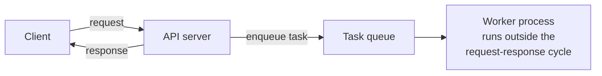
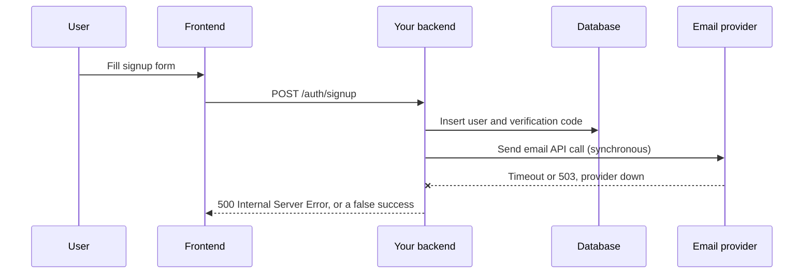
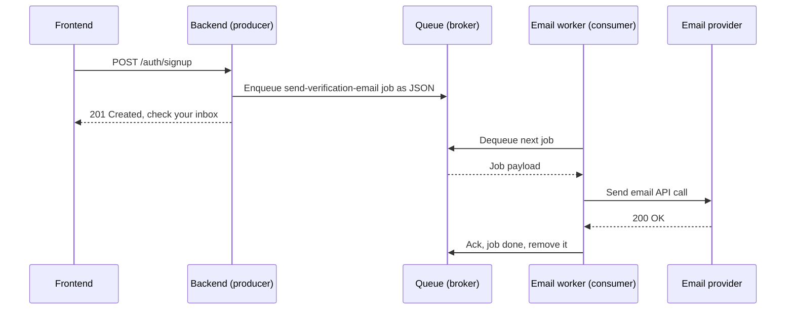
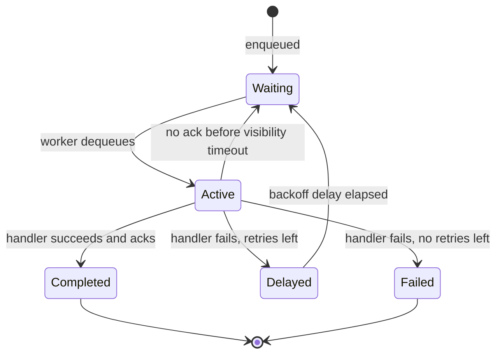
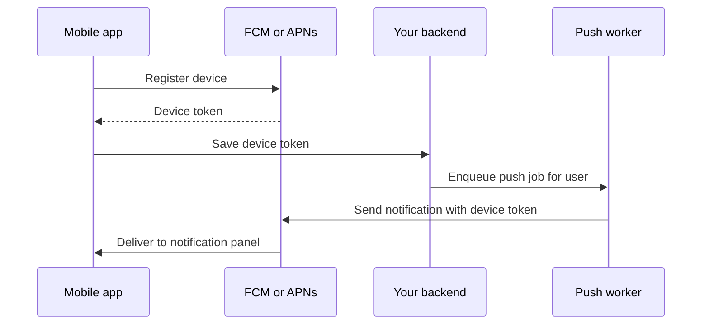
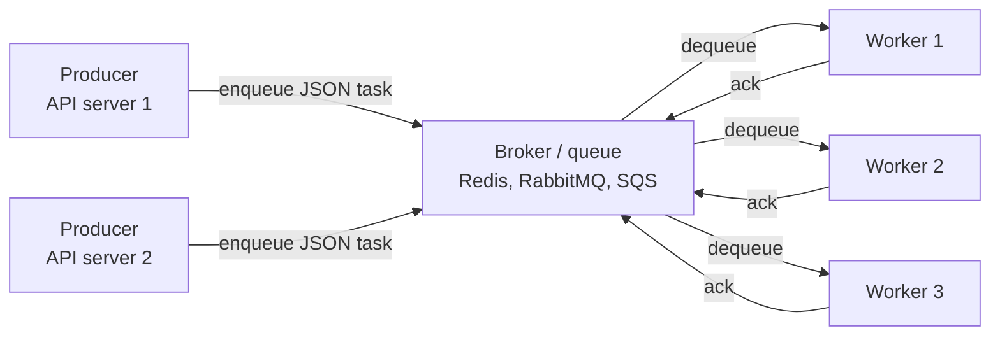
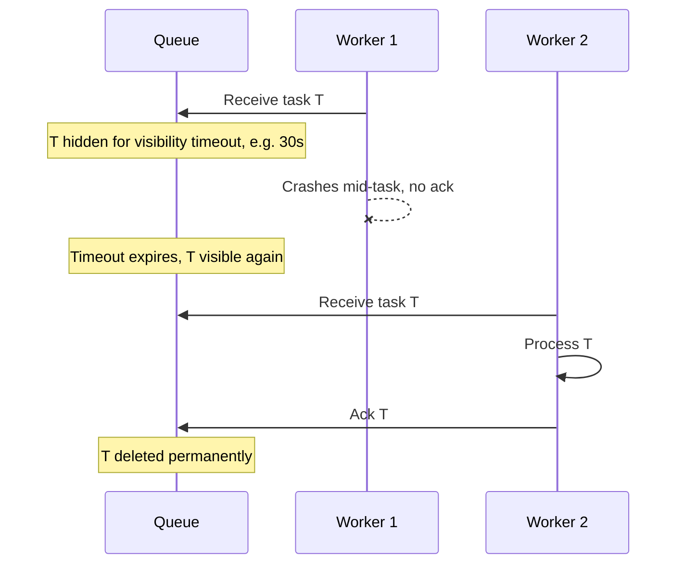
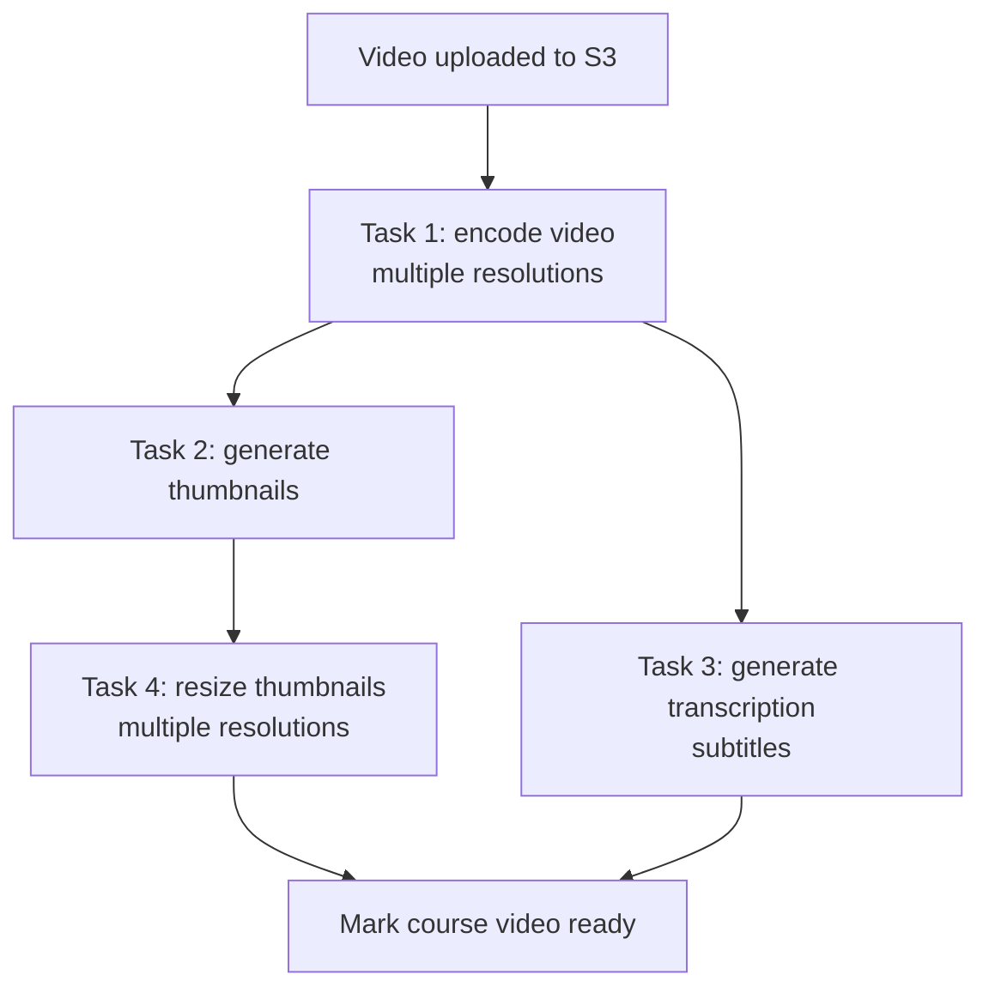

## TL;DR

- A **background job (task)** is any code that runs **outside the request–response life cycle**. It doesn't have to finish before the user gets a response, so we hand it to a separate process.
- Classic example: **signup → verification email**. Calling the email provider (Resend, Mailgun, Brevo) synchronously makes your signup endpoint slow and fragile. Instead, **serialize the email job to JSON, push it to a queue, return `201` immediately**; a worker sends it later and retries on failure.
- Architecture: **producer** (your API code) → **enqueue** → **broker/queue** (Redis, RabbitMQ, Amazon SQS) → **dequeue** → **consumer/worker** (separate process) that deserializes the payload and runs a registered **handler**.
- **Reliability mechanics:** the worker **acknowledges** a task when done; if it doesn't ack within the **visibility timeout** (crash, hang), the broker makes the task visible again for another worker. Failed tasks are **retried with exponential backoff** (1, 2, 4, 8 min…) up to a max retry count.
- Common use cases: **emails, image/video processing, report generation, push notifications** (via Google FCM / Apple APNs), cleanup jobs.
- Task types: **one-off**, **recurring** (cron/scheduled), **chained** (parent → child, with fan-out in parallel), **batch** (one trigger spawning many tasks).
- Design considerations: **idempotency** (safe to re-run), **robust error handling**, **monitoring** (Prometheus + Grafana), **horizontal scaling of workers**, **ordering** if required, **rate limiting** calls to external services.
- Best practices: keep tasks **small and focused**, **avoid long-running tasks** (split them), **log everything**, **alert on queue length and worker health**.

## Why this matters

Your API is judged by how fast and reliably it responds. But many things a backend must do are **slow** (encoding a video), **unreliable** (calling a third-party email API), or **huge** (deleting all of a user's data across shards). If you do them inside the request handler, the user waits, requests time out, and a failure in someone else's service becomes a failure in yours.

Background jobs let you say: *"I've recorded what needs to happen; it will happen soon, reliably, with retries, and you don't have to wait for it."* That's how you build **scalable and responsive** backends, and it's a standard system-design interview building block.

## What is a background task?



A **background task** is any piece of code, logic or workflow that runs **outside the request–response life cycle** between client and server. Properties:

- It **doesn't need to happen immediately**; it isn't required to build the response.
- It's **not synchronous** with the request.
- So we can **offload it to a separate process**, which finishes it however we've programmed it (and reports results somewhere else, e.g. a DB row, an email, a notification).

## The motivating example: signup and the verification email

### The flow

1. A user signs up on your SaaS: enters name, email, password, clicks "Sign up".
2. The frontend calls your backend, e.g. `POST /auth/signup`.
3. The backend validates (email format, password length/complexity), stores the user, generates a **verification code or link**.
4. It must **send a verification email** containing a link (which redirects to the frontend) or a 6–8 digit **one-time password (OTP)**, proving the user really owns that address.

### How sending an email works

You don't run your own mail servers. You use an **email provider** (Resend, Mailgun, Brevo, SendGrid… or a raw SMTP provider):

1. Build the content: fill an **HTML template** with the user's name and verification link/code.
2. Set recipient, subject, sender address, etc.
3. Your backend makes an **HTTP API call to the provider's servers**.
4. The provider checks your API key, sender domain, etc., sends the email, and returns success or failure.



### Why doing it synchronously is bad

You **don't control** the provider's servers. Traffic spikes, outages, slow responses — all possible. If the provider is down:

- **Case 1: no error handling around the email call.** The exception bubbles up and the **whole signup request fails** (500). The user can't even sign up because a third party is down. Terrible UX.
- **Case 2: you catch the error.** Signup succeeds, the frontend says *"We've sent you a verification email"*… but it was never sent. The user waits, comes back, clicks **"Resend email"** (another API call). If the provider is still down, it fails again while telling them it succeeded. Equally bad.
- And even when the provider is **up**, the user waits for its full round-trip latency on every signup.

### The same flow with a task queue

Instead of calling the provider inside the handler, the server:

1. Does all initial processing (validate, store user, generate code, build the email content).
2. **Packages everything needed to send the email** (template data, recipient, subject, user ID…) and **serializes** it, e.g. to JSON.
3. **Pushes it into a queue** as a new task. The email API is **not** called now; we've only recorded "this function must be executed at some point, somewhere".
4. **Returns immediately** with `201 Created` (or `200`, per your semantics).

The user instantly sees *"We've sent a verification email to you@example.com"*.



### The consumer side

A **consumer** (a.k.a. **worker**) is a program running in a **different process** from your main API process. It:

1. Is configured with **which queue** it listens to (e.g. `email` queue; there might be separate queues for in-app notifications, mobile push notifications, etc., each with its own consumers).
2. Is configured with **what data shape** it expects (the deserialization/validation layer).
3. **Picks up** (dequeues) a task.
4. **Deserializes** the JSON into the language's native structure: a **dictionary** in Python, an **object** in JavaScript, a **struct** in Go.
5. Calls the **registered handler**: the same function you would have run synchronously, now running in the background. It calls the email provider's API.

```ts
// producer.ts — inside the signup handler (BullMQ, Node.js)
import { Queue } from "bullmq";
const emailQueue = new Queue("email", { connection: { host: "localhost", port: 6379 } });

app.post("/auth/signup", async (req, res) => {
  const user = await createUser(req.body);            // validate + insert
  const code = await createVerificationCode(user.id);

  await emailQueue.add(
    "send-verification-email",
    { userId: user.id, to: user.email, firstName: user.firstName, code }, // serialized to JSON
    { attempts: 5, backoff: { type: "exponential", delay: 60_000 } }      // retry policy
  );

  res.status(201).json({ id: user.id, message: "Verification email sent" });
});
```

```ts
// worker.ts — runs as a separate process: `node worker.js`
import { Worker } from "bullmq";

new Worker(
  "email",
  async (job) => {
    const { to, firstName, code } = job.data;          // already deserialized
    const html = renderTemplate("verify", { firstName, code });
    await emailProvider.send({ to, subject: "Verify your email", html }); // throws on failure
  },
  { connection: { host: "localhost", port: 6379 }, concurrency: 10 }
);
```

**Latency is not a problem here.** With a near-empty queue, the email goes out within milliseconds; under heavy load maybe 5–10 seconds. Verification links typically expire after 15–20 minutes, so that delay is irrelevant.

### When the task fails: retries with exponential backoff

If the provider is down, the provider call fails → the handler throws → **the task fails**. In a synchronous design this would break the request and return `500`. In the background design, the task framework (**Celery** in Python, **BullMQ** in Node.js, **Asynq** in Go) **puts the task back into the queue to be retried**.

**Exponential backoff** is the most popular retry strategy: each failure doubles the wait before the next attempt, up to a configured **max retries** (say 5).

| Attempt | Fails, then wait | Cumulative time |
|---|---|---|
| 1 | 1 min | 1 min |
| 2 | 2 min | 3 min |
| 3 | 4 min | 7 min |
| 4 | 8 min | 15 min |
| 5 | give up → mark failed | — |

Big providers like Resend or Mailgun rarely stay down for minutes; outages are usually seconds. So a task might fail once or twice, and the third attempt almost certainly succeeds. **Even though the external service was down, the user still got their email.** That built-in retry and failure detection is a major benefit of background processing.



> [!TIP]
> Add **jitter** (a random component) to backoff delays. If 10,000 tasks all fail during the same outage and all retry at exactly +1 min, +2 min…, they hit the recovering service in synchronized waves (the *thundering herd*). Randomising each delay spreads the load.

> [!NOTE]
> Tasks that exhaust all retries are usually moved to a **dead-letter queue (DLQ)** (SQS, RabbitMQ) or kept in a "failed" set (BullMQ, Celery result backends), so you can inspect them, fix the bug, and replay them, instead of silently losing them.

### Summary: the two big advantages

1. **Responsiveness / faster processing time.** Your API calls aren't blocked by external services or heavy processing, which prevents timeouts and improves UX.
2. **Retry mechanisms** for work that's prone to failure.

## Typical use cases

### 1. Sending emails

Verification, welcome, password reset, notification emails — anything that depends on an external email provider.

### 2. Processing images and videos

A user uploads an image; you must **resize/convert it into multiple sizes and formats**, so you can serve small images to smartphones and large ones (2XL, XL…) to desktops, depending on device and network conditions. Same for videos (transcoding into multiple resolutions). This is CPU-heavy and slow → background.

### 3. Generating reports

An enterprise project-management SaaS sends **daily/weekly/monthly reports**: stats, completed tasks, pending tasks in the sprint, etc., built as HTML emails or **PDFs**, sent e.g. every midnight or every Sunday at 12:00. These run as scheduled background jobs, i.e. **cron jobs**. Libraries like Celery (Celery beat) and BullMQ (repeatable jobs) support **scheduled tasks** that execute at a given date/time or interval.

### 4. Push notifications

Push notifications are the ones that appear in the phone's **notification panel** ("Your Swiggy/Zomato delivery partner has reached the restaurant"), not inside the app. Your backend **cannot push directly to a phone**:

1. When the app is installed, the device registers with the OS vendor's push service: **Google** (Firebase Cloud Messaging, FCM) or **Apple** (Apple Push Notification service, APNs).
2. The app sends its **device token** to your backend, which stores it in the DB.
3. To notify a user, your backend calls Google's/Apple's service with that token and the message.
4. The OS vendor's service actually delivers it to the device.

Since step 3 is an external service call, it goes into a background task.



## How a task queue works

### Definition

A **task queue** is a system for **managing and distributing background jobs**. It's the behind-the-scenes engine that lets you **reliably hand off work** to a separate process. Analogy: **a to-do list for your backend**. Your application code adds items; workers pick them off one by one and do them.



### Producer

The **producer** is your application code (Node.js, Python, Go…). Its only job:

1. **Create the task** with *all* the information the consumer will need: user ID, name, email for an email task; the image (or, better, a reference to it) for an image task; the report data for a report task.
2. **Serialize** it (JSON or whatever format the library uses).
3. **Push it to the queue.** Adding an item to a queue is called **enqueueing** (same term as in data structures).

### Broker (the queue)

The queue is also called the **broker**. It **stores tasks until a worker is ready** to process them: a temporary holding area. Typical technologies:

| Broker | Notes |
|---|---|
| **Redis** | Very common backend for BullMQ (Node), Asynq (Go), Celery (Python). Uses lists/sorted sets/streams |
| **RabbitMQ** | Dedicated message broker (AMQP); acks, routing, DLQs built in. Classic Celery broker |
| **Amazon SQS** | Fully managed queue from AWS, multi-region and highly scalable; good when workers are spread across the world and you don't want to operate a broker |
| Others | Google Cloud Tasks / Pub/Sub, Kafka (log-based, more for event streaming), Postgres-based queues |

> [!NOTE]
> The video mentions Redis **Pub/Sub**. Precision: Redis Pub/Sub itself is fire-and-forget (if no subscriber is listening, the message is lost; no persistence, no acks), so task libraries don't rely on it for storing jobs. They use Redis **lists, sorted sets or streams**, which persist the job until a worker takes and acknowledges it.

### Consumer (worker)

The **consumer/worker** runs in a **separate process** (or thread, depending on the library). It can live in the same codebase as your API (started with a different command) or in a separate codebase. It **constantly monitors the queue**; when a new task appears, it **dequeues** it (removes it from the queue) and executes the handler registered for that task type.

### Acknowledgements

When a worker finishes a task, it sends an **acknowledgement (ack)** back to the queue: *"processed successfully, you can delete it."* If no ack arrives, the queue decides, based on configuration, whether the task was **unresponsive** or **failed**, and applies the retry policy. Celery, BullMQ, Asynq and similar frameworks handle these edge cases for you.

### Visibility timeout

**Problem:** a worker dequeued a task and then **crashed** (or the external service hung). The task is no longer visible in the queue, nobody is working on it, and nobody will ever ack it. Without a safeguard it would be **lost forever**.

**Solution: visibility timeout** (SQS's term; RabbitMQ uses unacked-message redelivery, BullMQ uses "stalled job" detection). When a worker takes a task, it becomes **invisible / in progress** for a configured period. If the worker doesn't ack (success or failure) within that period, the broker makes the task **visible again** so another worker can pick it up.



> [!IMPORTANT]
> Someone must always **ack** a task (success or final failure). The combination of "remove only on ack" + "redeliver after timeout" means tasks are delivered **at least once**: a task may run **more than once** (e.g. the worker finished but crashed right before acking). That's exactly why tasks must be **idempotent**.

> [!WARNING]
> Set the visibility timeout **longer than the task's maximum normal run time**. If a video encode takes 10 minutes but the timeout is 30 seconds, the broker will hand the same task to a second worker while the first is still working on it, causing duplicate work.

## Types of background tasks

### 1. One-off tasks

Triggered once by something that happens in a request. The most frequent kind.

- User registered → send verification email.
- Verification successful → send welcome email.
- Forgot password → send reset-password link.
- Someone messaged you in a social app → send a notification.

### 2. Recurring (periodic / scheduled) tasks

Executed on a schedule, typically via **cron** expressions.

- **Reports**: daily, monthly, quarterly, annual stats emails.
- **Cleanup / maintenance**: with **stateful (session-based) auth**, every login creates a row in a `sessions` table. Over time users log in and out, leaving many **abandoned ("orphan") sessions** that are no longer active but still occupy storage. A recurring job (monthly, or every 2–3 months) deletes expired/inactive sessions.

```yaml
# Example schedule (cron syntax: minute hour day-of-month month day-of-week)
daily-report:      "0 0 * * *"    # every day at 00:00
weekly-report:     "0 0 * * 0"    # every Sunday at 00:00
session-cleanup:   "0 3 1 * *"    # 03:00 on the 1st of every month
```

### 3. Chained tasks (parent–child / workflows)

Tasks with **dependencies**: a child task can start only after its parent **completes successfully**. Independent children of the same parent can run **in parallel**.

Example: an **LMS** (learning management system, like Udemy). An instructor uploads a course video:

1. The frontend uploads the file (e.g. directly to **S3 using a pre-signed URL**); the backend acknowledges immediately so nothing blocks.
2. **Encode the video** into multiple resolutions/formats for different devices and networks (served via CDNs).
3. After encoding: **generate thumbnails**, and **in parallel**, **generate the audio transcription** (subtitles). These two don't depend on each other, only on encoding.
4. After thumbnails are generated: **process thumbnail images** into multiple resolutions.



### 4. Batch tasks

One trigger spawns **many** tasks, or a single task orchestrates many sub-tasks.

**Example A — delete account.** A big platform can't delete all of a user's data inside one request: the data may be spread across many tables, **shards** and regions; even if possible, it might take 40–60+ seconds, and you can't block an API call that long.

- **With a grace period:** respond `200` immediately ("deletion in progress"), log the user out, and give them e.g. 3 or 7 days to log back in and cancel. After that, the real deletion runs.
- **Without a grace period:** respond `200` immediately and log the user out (for them the account is gone), and enqueue a `delete-account` task. The worker then walks through everything: remove the user from all projects they own/belong to, delete their profile, delete assets (logos, cover images from object storage), finally delete the account row, then send a "your account has been deleted" email. The `delete-account` task may itself spawn many smaller tasks.

> [!TIP]
> Semantically, `202 Accepted` is the most precise status for "your request was accepted and will be processed asynchronously". `200` is also common; be consistent.

**Example B — mass reports.** At midnight on Sunday, trigger **thousands of tasks** at once, one per user, each generating and sending that user's report.

| Type | Trigger | Example |
|---|---|---|
| One-off | An event in a request | Verification email, password reset, notification |
| Recurring | A schedule (cron) | Daily reports, session cleanup |
| Chained | Parent task completing | Encode → thumbnails + transcription → resize thumbnails |
| Batch | One action fans out to many tasks | Delete account, weekly reports for all users |

## Design considerations at scale

### 1. Idempotency

Design tasks so they can be **safely executed multiple times without unintended side effects**, because retries and at-least-once delivery *will* run some tasks more than once.

For the **delete-account** task: you walk through all the user's entities and delete or null them. If something fails halfway (a DB error, an external API call to fetch user data), you don't want a half-deleted user with no way to finish. Do the DB work **inside a transaction** so a failure **rolls back** to a clean state; then the retry starts **from scratch (0%)** and produces the same final result.

Other idempotency techniques:

- **Check before acting**: "if email for (userId, type=verification, code) already sent, skip".
- **Idempotency keys** when calling external APIs (Stripe, many email APIs support them), so a retried call isn't processed twice.
- **Upserts / unique constraints** instead of blind inserts.
- Prefer "set state to X" over "increment by 1".

```ts
// Idempotent handler sketch
async function sendVerificationEmail(job: { id: string; data: { userId: string; code: string } }) {
  const already = await db.emailLog.findUnique({ where: { jobId: job.id } });
  if (already) return; // ran before (e.g. crashed after send but before ack)

  await emailProvider.send({ /* ... */ }, { idempotencyKey: job.id });
  await db.emailLog.create({ data: { jobId: job.id, userId: job.data.userId } });
}
```

### 2. Error handling

Everything runs in a **different process**, out of sight. If a task fails silently, nobody notices. You need **robust, extensive error handling**: catch and **log** errors with context (task ID, payload, attempt number), distinguish **retryable** errors (timeouts, 5xx from a provider) from **permanent** ones (invalid email address), and let the framework **retry** the retryable ones.

### 3. Monitoring

You need a complete, live view of the system:

- How many tasks are **in the queue** right now?
- How many **succeeded**, how many **failed**?
- **Why** do they fail — an external service, an internal bug?

Use **metrics**: emit a metric on every event (task created, started, succeeded, failed), collect them with **Prometheus**, and visualise/alert with **Grafana**. (Logs, metrics, traces and the ELK stack are covered in the observability chapter.)

### 4. Scalability

If your user base doubles, so does the task volume. Design so that you can **scale consumers horizontally**: add more worker processes/nodes reading from the same queue, keeping processing as responsive as ever. Because producers and workers are decoupled, you can scale them independently.

### 5. Ordering

If tasks **must** execute in a specific order (e.g. "create invoice" before "email invoice"), make sure your library/broker supports **ordered delivery** (e.g. SQS FIFO queues with message groups, a single-concurrency queue, or explicit chaining). Many queues with multiple workers do **not** guarantee order by default.

### 6. Rate limiting

Tasks that call **external services** must respect their **rate limits** (and their per-call pricing). Configure worker-side rate limiting (e.g. "max 100 emails/second") so a burst of 50,000 tasks doesn't get you throttled or banned, or produce a surprise bill.

```ts
new Worker("email", handler, {
  connection,
  concurrency: 20,
  limiter: { max: 100, duration: 1000 }, // at most 100 jobs per second across this worker
});
```

## Best practices

1. **Keep tasks small and focused.** One task = one unit of processing. Divide responsibilities so one failure doesn't affect others. If one step depends on another, use **chained tasks**: a failed child is retried on its own (with backoff) without redoing the parent. A giant task that fails at the last step must repeat everything, wasting CPU. Small tasks are easier to scale, debug, monitor and retry.
2. **Avoid long-running tasks.** A task that takes a long time is a signal to **split it**, into concurrent tasks or a parent–child chain. Long tasks also clash with visibility timeouts and make deploys/restarts painful.
3. **Proper error handling and logging.** Gives the queue the chance to retry, and gives you the information to debug: was it an external service or an internal error?
4. **Monitor queue length and worker health, with alerts.** If queue length exceeds a threshold, scale workers or investigate; if workers keep crashing, find out why. You should always know whether the background system is running smoothly.

> [!INTERVIEW]
> **"How would you send 1 million emails reliably?"** — Don't loop in a request. Enqueue one small task per email (or per batch of ~100) into a durable broker (SQS/RabbitMQ/Redis with BullMQ). Run a horizontally scalable worker pool with **rate limiting** matching the provider's quota, **exponential backoff with jitter** on retryable failures, a **DLQ** for permanent failures, **idempotency** (a sent-log keyed by message ID, plus provider idempotency keys) so at-least-once redelivery doesn't double-send, and **metrics/alerts** on queue depth, success/failure rate and worker health.

## Common mistakes & misconceptions

- **Doing slow external calls inside the request handler** — the endpoint's latency and availability become those of the third party.
- **Catching the error and lying to the user** — "email sent" when it wasn't. Enqueue + retry instead.
- **Assuming exactly-once execution** — most queues are **at-least-once**; non-idempotent tasks will double-charge, double-email, double-insert.
- **Putting huge payloads in the task** (an entire video or image bytes) — put the file in object storage (S3) and pass a **reference** (key/URL) and IDs.
- **Passing stale data** — serializing a whole user object at enqueue time; by the time the task runs, data may have changed. Often better to pass the **ID** and reload in the worker (unless you need the snapshot).
- **Visibility timeout shorter than task duration** — duplicate processing.
- **Unlimited retries / no DLQ** — poison messages retry forever and clog the queue; or failures vanish silently.
- **Retrying non-retryable errors** — an invalid email address will never succeed; fail fast.
- **No rate limiting** toward providers — throttling, bans, unexpected bills.
- **Assuming order** with multiple concurrent workers.
- **Using Redis Pub/Sub as a job queue** — no persistence or acks; messages are lost if no worker is listening.
- **No monitoring** — the queue silently grows to millions of tasks and nobody notices until users complain.

## Interview questions

<details>
<summary><strong>Q: What is a background job, and when should you use one?</strong></summary>

A background job is work executed **outside the request–response cycle**, by a separate worker process, so the API can respond immediately. Use it when the work is **slow** (video encoding, reports, bulk deletes), **unreliable** (third-party APIs like email/SMS/push providers), **not needed for the response**, or **scheduled** (cron jobs). The API enqueues a task and returns (`201`/`202`); workers process it with retries.

</details>

<details>
<summary><strong>Q: Walk me through what happens when a user signs up and you need to send a verification email using a queue.</strong></summary>

1. API validates input, stores the user and a verification code in the DB.
2. API (producer) serializes `{ userId, email, firstName, code }` to JSON and **enqueues** a `send-verification-email` task to the broker (e.g. Redis via BullMQ, or SQS).
3. API returns `201` immediately; the UI says "check your inbox".
4. An email worker (separate process) **dequeues** the task, deserializes it into a native object, renders the HTML template, calls the email provider's API.
5. On success it **acks** and the task is removed. On failure, the framework re-queues it with **exponential backoff** up to N attempts, then moves it to a failed/dead-letter queue.

</details>

<details>
<summary><strong>Q: Explain producer, broker and consumer.</strong></summary>

- **Producer**: application code that creates a task with all the data needed, serializes it and **enqueues** it.
- **Broker (queue)**: durable storage that holds tasks until a worker is ready: Redis, RabbitMQ, Amazon SQS. It tracks in-flight tasks, acks and redelivery.
- **Consumer (worker)**: separate process that watches the queue, **dequeues** tasks, deserializes them and runs the registered handler, then acks.

They're decoupled: producers and consumers can be scaled, deployed and fail independently.

</details>

<details>
<summary><strong>Q: What is a visibility timeout and what problem does it solve?</strong></summary>

When a worker receives a task, the broker hides it from other workers for a period: the visibility timeout. If the worker acks within that time, the task is deleted. If the worker **crashes or hangs** and never acks, the timeout expires and the task becomes **visible again**, so another worker can process it. This prevents tasks from being lost when workers die mid-task. It must be longer than the normal processing time, otherwise healthy long-running tasks get processed twice.

</details>

<details>
<summary><strong>Q: What is exponential backoff and why use it for retries?</strong></summary>

After each failure, wait exponentially longer before retrying: e.g. 1, 2, 4, 8 minutes, up to a max attempts count. Most external failures are transient (seconds), so early retries usually succeed; increasing delays avoid hammering a struggling service and give it time to recover. Add **jitter** (randomness) so many failed tasks don't retry in synchronized waves. After the max attempts, send the task to a dead-letter queue for inspection.

</details>

<details>
<summary><strong>Q: Why must background tasks be idempotent? How do you make them so?</strong></summary>

Because queues usually guarantee **at-least-once** delivery: a task may run twice (retry after a partial failure, or a worker finishes but crashes before acking, so the visibility timeout redelivers it). Without idempotency you double-send emails, double-charge cards, duplicate rows.

Techniques: wrap DB changes in a **transaction** so a failure rolls back fully and a retry starts clean; record processed task IDs and **skip** duplicates; use **unique constraints/upserts**; pass **idempotency keys** to external APIs; prefer "set" operations over "increment".

</details>

<details>
<summary><strong>Q: Design the video-upload pipeline for an LMS like Udemy.</strong></summary>

Client uploads directly to S3 via a **pre-signed URL**; backend records the video as `processing` and enqueues an `encode` task. **Chained tasks**: `encode` (multiple resolutions, HLS) → on success, fan out in parallel to `generate-thumbnails` and `generate-transcription`; `generate-thumbnails` → `resize-thumbnails`. When all branches finish, mark the video `ready` and notify the instructor. Each task is small, idempotent (writes to deterministic S3 keys), retried with backoff, has a visibility timeout longer than its run time, and runs on a dedicated, autoscaled worker pool (encoding is CPU-heavy).

</details>

<details>
<summary><strong>Q: A user clicks "Delete account" and their data is spread across many tables and shards. How do you handle it?</strong></summary>

Don't do it in the request (could take a minute+, timeouts, partial failure). Respond immediately (`202 Accepted` / `200`), mark the account `pending_deletion`, log the user out. Optionally give a grace period (e.g. 7 days) to cancel. Then enqueue a `delete-account` **batch task** that fans out sub-tasks: remove memberships, delete projects/entities per shard, delete assets from object storage, finally delete the user row and send a confirmation email. Each sub-task is idempotent (deleting already-deleted data is a no-op) and transactional where possible, so retries are safe.

</details>

<details>
<summary><strong>Q: How does sending a push notification to a phone work? Why is it a background task?</strong></summary>

Your backend can't reach a phone directly. The app registers with the OS vendor's push service (**FCM** for Android, **APNs** for iOS), receives a **device token** and sends it to your backend, which stores it. To notify, your backend calls FCM/APNs with the token and payload, and they deliver it to the device's notification panel. Because that's an external network call that can be slow or fail, and often happens in bulk, it's done by a worker with retries.

</details>

<details>
<summary><strong>Q: What happens if the worker crashes after sending the email but before acknowledging?</strong></summary>

The broker never got the ack, so after the visibility timeout it redelivers the task to another worker, which sends the email **again**: a duplicate. This is the at-least-once trade-off. Mitigate with idempotency: store a "sent" record keyed by task/message ID and check it first (and/or use the provider's idempotency key), accepting that a tiny window may remain.

</details>

<details>
<summary><strong>Q: What would you monitor in a task-queue system?</strong></summary>

Queue length/depth per queue (and age of the oldest task), enqueue rate vs processing rate, success and failure counts and rates, failure reasons (external vs internal), retry counts, DLQ size, task duration (p50/p95/p99), worker count, health, crashes and memory/CPU. Export as metrics to Prometheus, dashboard in Grafana, and alert when queue depth or failure rate crosses a threshold or workers go down.

</details>

<details>
<summary><strong>Q: One-off vs recurring vs chained vs batch tasks — give an example of each.</strong></summary>

- **One-off**: triggered once by an event, e.g. password-reset email.
- **Recurring**: on a cron schedule, e.g. nightly report, monthly cleanup of orphan sessions.
- **Chained**: child runs only after parent succeeds, e.g. encode video → generate thumbnails → resize thumbnails (with transcription in parallel).
- **Batch**: one trigger creates many tasks, e.g. delete-account fan-out, or weekly reports to thousands of users at midnight.

</details>

## Cheat sheet

- **Background task** = runs outside request–response cycle; API enqueues and returns immediately.
- **Use for**: emails, image/video processing, reports (cron), push notifications (FCM/APNs), cleanup, bulk deletes, anything slow/unreliable/external.
- **Flow**: producer → serialize (JSON) → **enqueue** → broker → **dequeue** → worker deserializes → handler → **ack**.
- **Brokers**: Redis (BullMQ, Asynq, Celery), RabbitMQ, Amazon SQS (managed, multi-region).
- **Libraries**: Python **Celery**, Node **BullMQ**, Go **Asynq**.
- **Ack**: worker confirms completion → task deleted.
- **Visibility timeout**: un-acked in-progress task becomes visible again → no lost tasks; set > max task duration.
- **Delivery**: at-least-once → **idempotent tasks**.
- **Retries**: exponential backoff (1, 2, 4, 8…) + jitter, max attempts, then **DLQ**.
- **Task types**: one-off, recurring (cron), chained (parent → child, parallel branches), batch (fan-out).
- **Design**: idempotency (transactions, dedupe, idempotency keys), error handling + logging, monitoring (Prometheus/Grafana), horizontal worker scaling, ordering if needed (FIFO), rate limiting external calls.
- **Best practices**: small focused tasks, no long-running tasks (split), log everything, alert on queue length + worker health.
- **Payloads**: small; pass IDs/S3 keys, not big blobs.
- **Async response code**: `202 Accepted` (or `200`/`201` per your semantics).

## Glossary

- **Background job / task** — work executed outside the request–response cycle, usually by a worker process.
- **Task queue** — system that stores and distributes background tasks to workers.
- **Producer** — code that creates and enqueues tasks.
- **Consumer / worker** — process that dequeues and executes tasks.
- **Broker** — the queue server that holds tasks (Redis, RabbitMQ, SQS).
- **Enqueue / dequeue** — add a task to / remove a task from the queue.
- **Handler** — the function registered to run for a given task type.
- **Acknowledgement (ack)** — signal from worker to broker that a task is finished and can be deleted.
- **Visibility timeout** — period an in-progress task is hidden; if not acked in time, it's redelivered.
- **At-least-once delivery** — guarantee that a task is processed one or more times (never lost, may be duplicated).
- **Exponential backoff** — retry delays that grow exponentially after each failure.
- **Jitter** — randomness added to retry delays to avoid synchronized retries.
- **Dead-letter queue (DLQ)** — where tasks go after exhausting retries.
- **Idempotent task** — a task that produces the same final result no matter how many times it runs.
- **Cron job** — a task scheduled by a time expression (e.g. every day at midnight).
- **Chained task** — a task that runs only after its parent completes successfully.
- **Batch task** — a single trigger that fans out into many tasks.
- **Orphan session** — an inactive, abandoned session row left in the database.
- **Pre-signed URL** — a time-limited URL that lets a client upload/download directly to/from object storage (S3).
- **FCM / APNs** — Google's and Apple's push notification services.
- **Rate limiting** — capping how many operations (e.g. API calls) happen per unit of time.

## Video timestamps

- [00:00](https://www.youtube.com/watch?v=r-nQsyguU1Y&t=0s) — What a background task is
- [01:01](https://www.youtube.com/watch?v=r-nQsyguU1Y&t=61s) — Example: signup and the verification email
- [04:07](https://www.youtube.com/watch?v=r-nQsyguU1Y&t=247s) — How sending email through a provider works
- [06:10](https://www.youtube.com/watch?v=r-nQsyguU1Y&t=370s) — Why doing it synchronously fails users
- [09:17](https://www.youtube.com/watch?v=r-nQsyguU1Y&t=557s) — Same flow with a queue: serialize, enqueue, return
- [11:20](https://www.youtube.com/watch?v=r-nQsyguU1Y&t=680s) — Consumers/workers: dequeue, deserialize, separate queues
- [14:23](https://www.youtube.com/watch?v=r-nQsyguU1Y&t=863s) — Registered handler sends the email; latency is fine
- [16:27](https://www.youtube.com/watch?v=r-nQsyguU1Y&t=987s) — Failure, retries and exponential backoff
- [19:32](https://www.youtube.com/watch?v=r-nQsyguU1Y&t=1172s) — Advantages summarised
- [20:33](https://www.youtube.com/watch?v=r-nQsyguU1Y&t=1233s) — Use cases: emails, image and video processing
- [21:35](https://www.youtube.com/watch?v=r-nQsyguU1Y&t=1295s) — Use case: reports and scheduled jobs
- [22:36](https://www.youtube.com/watch?v=r-nQsyguU1Y&t=1356s) — Use case: push notifications (Google/Apple services)
- [24:40](https://www.youtube.com/watch?v=r-nQsyguU1Y&t=1480s) — What a task queue is
- [25:41](https://www.youtube.com/watch?v=r-nQsyguU1Y&t=1541s) — Producer
- [26:43](https://www.youtube.com/watch?v=r-nQsyguU1Y&t=1603s) — Consumer; the to-do list analogy
- [27:44](https://www.youtube.com/watch?v=r-nQsyguU1Y&t=1664s) — Enqueue and the broker
- [28:44](https://www.youtube.com/watch?v=r-nQsyguU1Y&t=1724s) — Dequeue
- [29:47](https://www.youtube.com/watch?v=r-nQsyguU1Y&t=1787s) — Broker technologies: RabbitMQ, Redis, Amazon SQS
- [30:48](https://www.youtube.com/watch?v=r-nQsyguU1Y&t=1848s) — Acknowledgements
- [31:50](https://www.youtube.com/watch?v=r-nQsyguU1Y&t=1910s) — Visibility timeout
- [33:55](https://www.youtube.com/watch?v=r-nQsyguU1Y&t=2035s) — Task types: one-off
- [34:55](https://www.youtube.com/watch?v=r-nQsyguU1Y&t=2095s) — Recurring tasks: reports, session cleanup
- [36:58](https://www.youtube.com/watch?v=r-nQsyguU1Y&t=2218s) — Chained tasks: LMS video pipeline
- [41:05](https://www.youtube.com/watch?v=r-nQsyguU1Y&t=2465s) — Batch tasks: delete account, mass reports
- [45:09](https://www.youtube.com/watch?v=r-nQsyguU1Y&t=2709s) — Design considerations: idempotency
- [47:11](https://www.youtube.com/watch?v=r-nQsyguU1Y&t=2831s) — Error handling
- [48:11](https://www.youtube.com/watch?v=r-nQsyguU1Y&t=2891s) — Monitoring with Prometheus and Grafana
- [50:16](https://www.youtube.com/watch?v=r-nQsyguU1Y&t=3016s) — Scalability, ordering, rate limiting
- [51:18](https://www.youtube.com/watch?v=r-nQsyguU1Y&t=3078s) — Best practices: small, focused tasks
- [53:21](https://www.youtube.com/watch?v=r-nQsyguU1Y&t=3201s) — Avoid long-running tasks; error handling and logging
- [54:23](https://www.youtube.com/watch?v=r-nQsyguU1Y&t=3263s) — Monitor queue length and worker health
- [55:25](https://www.youtube.com/watch?v=r-nQsyguU1Y&t=3325s) — Recap
