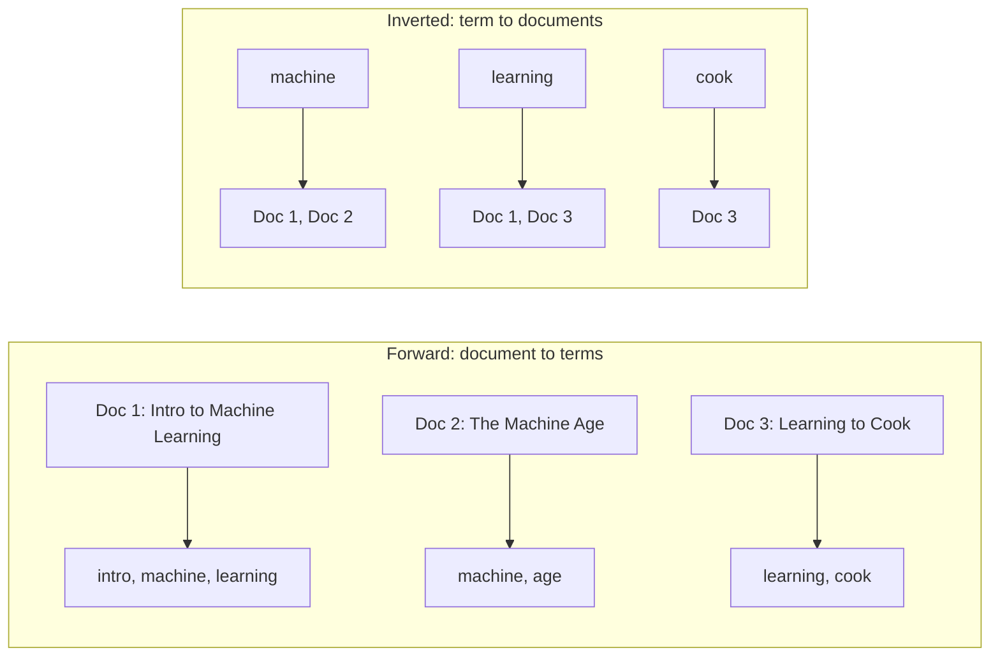
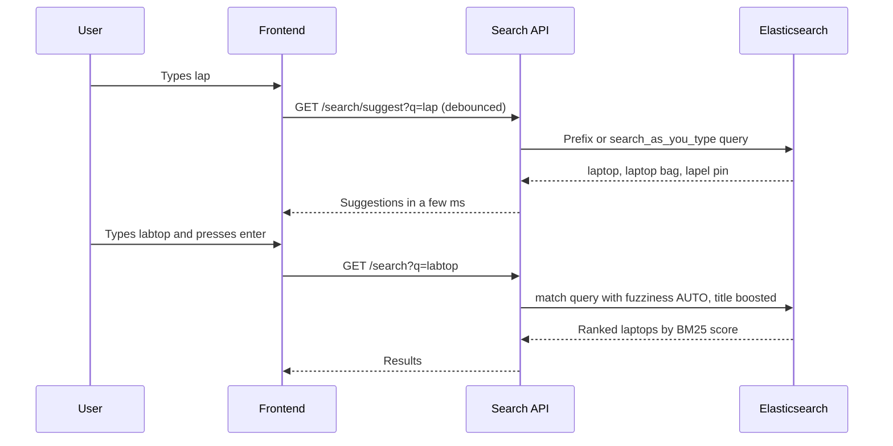
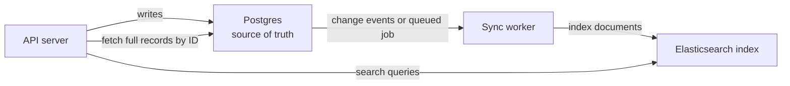

## TL;DR

- `SELECT * FROM products WHERE name ILIKE '%laptop%'` works for 5,000 rows but **collapses at millions**: a leading `%` means the database must **scan every row** and pattern-match **character by character** (50 ms → 30 s).
- It also has **no notion of relevance** (a laptop bag can rank above a MacBook Pro) and **no typo tolerance** (`labtop` finds nothing).
- The fix, from decades of information-retrieval research (since the 1960s), is the **inverted index**: at write time, map each **term → list of documents (and positions)** that contain it. At search time you look up the term instead of scanning documents.
- **Apache Lucene** is the library that implements inverted-index search. **Elasticsearch** (and others like OpenSearch, Solr) are distributed servers built on Lucene. Postgres also has built-in full-text search.
- Elasticsearch ranks results with **BM25**, based on **term frequency**, **inverse document frequency** (rarer terms matter more), **document length**, plus **field boosting** (title matches beat description matches beat body matches).
- It supports **typo tolerance (fuzzy matching)** and **type-ahead/autocomplete**, via a JSON **Query DSL**.
- Mapping types: **`text`** = analyzed (split into terms) for full-text search; **`keyword`** = stored as-is for exact match, filters, sorting, aggregations.
- Demo with 50,000 reviews: Elasticsearch ~0.5–1 s vs Postgres `ILIKE` ~3–7.5 s for the same result count. **Rule of thumb:** use Postgres full-text search if you're already on Postgres; use Elasticsearch if search is central or your company already runs it (e.g. as part of the **ELK** logging stack). Master databases deeply; Elasticsearch you can use from docs.

## Why this matters

Almost every product has a search box: products, users, messages, docs, logs. Users expect results in **milliseconds**, ranked sensibly, even with typos. A naive SQL query gives none of that at scale. Knowing *why* `LIKE '%x%'` is slow, what an inverted index is, and when to reach for Elasticsearch versus Postgres full-text search is a frequent backend and system-design interview topic ("design search for an e-commerce site", "design a type-ahead").

## The problem: searching with LIKE

### 2005, an e-commerce company with 5,000 products

You must build an API that takes user input and returns matching products. In a relational database:

```sql
SELECT *
FROM products
WHERE name ILIKE '%laptop%'
   OR description ILIKE '%laptop%';
```

- `ILIKE` = case-insensitive `LIKE` (Postgres).
- `%` = "any sequence of characters", so `%laptop%` matches "laptop" anywhere in the string.

Customers search "laptop", get results, life is simple.

### Then the company explodes to millions of products

The same query that took ~**50 ms** now takes ~**30 seconds**. Customers and your manager are frustrated. And the product team wants more than speed:

1. **Speed**: results in milliseconds.
2. **Relevance**: searching "laptop" should show a **MacBook Pro** before a **laptop bag**.
3. **Typo tolerance**: rushed shoppers during a sale type `labtop`, `laptpo`; they should still see laptops.

These three requirements are the story of why **search engines like Elasticsearch** exist.

## Intuition: the database as a librarian

Picture your Postgres database as a **librarian** who knows exactly where every book is on the shelves. But the librarian has one fatal flaw. Ask *"I want books about machine learning"* and they must:

1. Take the first book: *Harry Potter and the Philosopher's Stone*. No "machine learning". Next.
2. *Game of Thrones*. No. Next.
3. *Introduction to Machine Learning*. Match!
4. …keep going through **every single book on every shelf**, because there may be more matches.


Two problems:

1. **Time.** For a library of 10 million or 1 billion books this takes hours or days. That's the database doing a **full table scan**, examining every text field and pattern-matching **character by character**.
2. **No relevance.** If one book is *titled* "An Introduction to Machine Learning" and another mentions "machine learning" once on its last page, the librarian returns both **in arbitrary order**. The irrelevant one might come first, and the truly relevant result might sit at position 1,000 or 10,000. You might not even want the second book at all.

The scan is **thorough** (it finds every match), but painfully slow and with no idea which results matter most.

> [!NOTE]
> Why can't a normal index help? A **B-tree** index on `name` is sorted by the full string's prefix, so it can speed up `LIKE 'laptop%'` (known prefix), but **not** `LIKE '%laptop%'`: with a leading wildcard, the match can start anywhere, so the sorted order is useless and the DB falls back to a sequential scan. (Postgres's `pg_trgm` extension with a GIN index can accelerate `ILIKE '%x%'`, but still gives no relevance ranking.)

## Why search became urgent: the information explosion

Around the same time (mid-2000s) there was an **information explosion**: Google was crawling and indexing billions of web pages, Amazon cataloguing millions of products, LinkedIn indexing millions of profiles. None of them could make users wait 30 seconds; by today's standards even **2 seconds** is a huge delay. Search must return in **milliseconds**, because latency directly hurts conversion and revenue.

The answer wasn't new: **information retrieval** had been studied by computer scientists **since the 1960s**. The key idea was to **flip the problem**.

## The inverted index

### Flip the problem

Instead of going through every book looking for the words, do the work **when the books arrive**: take every word in every book and build an index that says, for each word, **which books contain it and where**.

| Term | Postings (document → positions) |
|---|---|
| `machine` | *Introduction to Machine Learning* → pages 1, 15, 23 · *The Machine Age* → pages 5, 89 · *Coffee Machine Manual* → page 1 |
| `learning` | *Introduction to Machine Learning* → pages 1, 16, 24 · *Learning to Cook* → 2 places · *Deep Learning Fundamentals* → 3 places |

(In reality "machine" and "learning" would appear on hundreds of pages of *Introduction to Machine Learning*; three is just for illustration.)

A normal ("forward") index goes **document → words**. This goes **word → documents**, so it's called an **inverted index**. Instead of going through the content to find the terms, we have the terms and through them find the content.



Now the librarian handles "machine learning" by looking up `machine` and `learning` in the index and combining the two posting lists. No scanning of books at all.

### How documents get into the index: analysis

The index only works if documents and queries are broken into **the same terms**. Elasticsearch runs every `text` field through an **analyzer** at index time (and the query through the same analyzer at search time):

1. **Character filters** — e.g. strip HTML.
2. **Tokenizer** — split into tokens: `"The Laptops are GREAT!"` → `The`, `Laptops`, `are`, `GREAT`.
3. **Token filters** — lowercase (`laptops`, `great`), remove stop words (`the`, `are`), optionally **stem** (`laptops` → `laptop`), add synonyms.


> [!IMPORTANT]
> The inverted index trades **write-time work and storage** for **very fast reads**. Indexing a document costs more (analyze + update postings), but a search becomes a few lookups in sorted term dictionaries instead of a full scan. It's the same trade-off as any database index.

### Apache Lucene, Elasticsearch and friends

- **Apache Lucene** — a Java library (created by Doug Cutting, first released 1999) implementing inverted-index full-text search and scoring. It's the core technology.
- **Elasticsearch** — a distributed search and analytics server (first released 2010) built **on top of Lucene**: adds a REST/JSON API, clustering, sharding, replication. **OpenSearch** (AWS's fork) and **Apache Solr** are also Lucene-based.
- Elasticsearch isn't the only option: **Postgres** and other relational databases now ship **full-text search** too, and there are newer engines (Meilisearch, Typesense).

In Elasticsearch, each stored entity (a product, a book, a review) is a **document**: a JSON document, similar to a MongoDB document. Documents live in an **index** (roughly like a table).

## Relevance scoring

Speed is one win; the other huge win is **relevance**. Elasticsearch doesn't just return *matching* documents, it **scores** them and returns the **most meaningful first**.

Intuition with our books for the term `machine`:

1. *Introduction to Machine Learning* — the term is in the **title** (big boost) and appears **frequently** (another boost) → rank 1.
2. *The Machine Age* — in the title, but less frequent → rank 2.
3. *Coffee Machine Manual* — in the title, but very infrequent → rank 3.

### BM25

Elasticsearch's default similarity algorithm is **BM25** ("Best Match 25"), a refinement of classic TF-IDF. Its factors:

| Factor | Question it asks | Effect |
|---|---|---|
| **Term frequency (TF)** | How often does `machine` appear **in this document**? | More occurrences → higher score, with **diminishing returns** (saturation), so spamming a word doesn't help much |
| **Inverse document frequency (IDF)** | How common is `machine` **across all documents**? | Rare terms are more informative → higher weight. "the" appears everywhere → nearly worthless |
| **Document length** | How long is this document (or field)? | A match in a short field ("title: Machine Age") counts more than one match in a 500-page book |
| **Field boosting** | *Which field* matched? | You can say title matches matter more than description, which matter more than content |

> [!NOTE]
> The video calls the second factor "document frequency". Precisely: BM25 uses **inverse** document frequency. The *more* documents contain a term, the *less* that term contributes to the score.

You don't need to master the maths to use it. Treat Elasticsearch as a tool: know when the use case calls for it, follow the docs, and move on. The Elasticsearch docs are a good place to dig deeper if you're curious.

### Field boosting

A term in the **title** is more relevant than in the **description**, which is more relevant than in the **body/content**. You set this per query (it's not fixed), and can flip it if your use case wants content matches to matter more.

```json
GET /books/_search
{
  "query": {
    "multi_match": {
      "query": "machine learning",
      "fields": ["title^3", "description^2", "content"]
    }
  }
}
```

`^3` means title matches count 3× as much as an un-boosted field.

### The Query DSL

Elasticsearch's query language is a **JSON-based DSL** (domain-specific language) with many query types and parameters: `match`, `multi_match`, `bool` (combine `must`, `should`, `filter`, `must_not`), `range`, `term`, fuzzy options, aggregations, highlighting, etc.

## Typo tolerance and type-ahead

### Typo tolerance (fuzzy search)

Type "what is treading today" into Google and it understands you meant "what is **trending** today". (Google uses its own proprietary technology, not necessarily Elasticsearch, but the idea is the same.) Full-text engines can derive the intended query despite typos.

In Elasticsearch, `fuzziness` matches terms within a small **edit distance** (Levenshtein distance: number of single-character inserts, deletes, substitutions or transpositions):

```json
GET /products/_search
{
  "query": {
    "match": {
      "name": { "query": "labtop", "fuzziness": "AUTO" }
    }
  }
}
```

`labtop` → `laptop` is one substitution, so it matches. `"AUTO"` allows 0 edits for very short terms, 1 for medium, 2 for longer.

### Type-ahead (autocomplete)

The **type-ahead** interface (Google's suggestions as you type "what is…", Amazon's search bar) shows results on every keystroke, so each query must return in a few milliseconds. Elasticsearch supports this with features like `search_as_you_type` fields, edge n-grams, and completion suggesters.



## Postgres full-text search vs Elasticsearch

When you build a search feature you have two main options:

1. **Postgres full-text search.** A modern Postgres offers built-in FTS: `tsvector` (the analyzed document), `tsquery` (the analyzed query), `to_tsvector` / `plainto_tsquery` / `websearch_to_tsquery`, ranking with `ts_rank`, and a **GIN index** (which is itself an inverted index).
2. **Elasticsearch.** A separate, distributed search engine.

```sql
-- Postgres full-text search
ALTER TABLE products
  ADD COLUMN search tsvector
  GENERATED ALWAYS AS (
    setweight(to_tsvector('english', coalesce(name, '')), 'A') ||
    setweight(to_tsvector('english', coalesce(description, '')), 'B')
  ) STORED;

CREATE INDEX products_search_idx ON products USING GIN (search);

SELECT id, name, ts_rank(search, q) AS rank
FROM products, websearch_to_tsquery('english', 'laptop') AS q
WHERE search @@ q
ORDER BY rank DESC
LIMIT 20;
```

(`setweight` 'A' vs 'B' is Postgres's version of field boosting.)

Elasticsearch isn't only for product search. It's famous for **log management** as part of the **ELK stack**: **E**lasticsearch (store and search), **L**ogstash (ingest/transform), **K**ibana (visualize). Because it searches huge volumes fast and computes statistics/aggregations, it's widely used for logs and analytics. **If your company already runs Elasticsearch (e.g. for ELK), using it for full-text search too makes a lot of sense**, instead of using Postgres FTS.

| | `LIKE/ILIKE '%x%'` | Postgres full-text search | Elasticsearch |
|---|---|---|---|
| Speed at scale | Slow (full scan) | Fast with GIN index | Very fast, distributed |
| Relevance ranking | None | Basic (`ts_rank`, weights) | Rich (BM25, boosting, function scores) |
| Typo tolerance | No | Limited (needs `pg_trgm`) | Built-in `fuzziness` |
| Autocomplete | Poor | Possible with effort | Built-in features |
| Extra infrastructure | None | None | Separate cluster to run, sync and monitor |
| Consistency with DB | Same transaction | Same transaction | Near-real-time, must be synced from the DB |
| Best when | Tiny datasets | Already on Postgres, moderate search needs | Search is core, large scale, or ES already in use |

> [!WARNING]
> Elasticsearch is usually a **secondary store**, not your source of truth. You must keep it in sync with the primary database (dual writes from the app, a background job/queue after each write, or **change data capture** from the DB's WAL). Search results can lag the DB slightly (Elasticsearch is **near-real-time**: newly indexed docs become searchable after a refresh, ~1 s by default).



## Demo: Postgres ILIKE vs Elasticsearch on 50,000 reviews

### Setup

- A small **Next.js** app (chosen only because LLMs prototype it quickly) with a UI that runs the same search against both backends side by side.
- **Postgres** on **Neon** (serverless cloud Postgres) and an **Elastic Cloud** deployment, **both in the US-West region**, so network distance doesn't skew the comparison.
- Postgres table `reviews(id, review TEXT, sentiment)` where sentiment is `positive`/`negative`.
- A CSV dataset of **50,000 reviews** with `review` and `sentiment` columns.

### The populate script (Node.js)

1. Read `DATABASE_URL`, the Elasticsearch address and the **Elasticsearch API key** from environment variables; throw if any is missing.
2. Create the **Neon** client and the **Elasticsearch** client.
3. Read the CSV (`readFileSync`) and parse it.
4. **Postgres:** `CREATE TABLE IF NOT EXISTS reviews …`, reset the ID sequence, filter out records missing `review` or `sentiment`, then insert in **batches of 1,000** (Neon limits how much one statement can insert): `INSERT INTO reviews (review, sentiment) VALUES …`.
5. **Elasticsearch:** if the `reviews` index exists, delete it (start fresh); create it with a **mapping**; then **bulk insert** all 50,000 documents.

```ts
await es.indices.create({
  index: "reviews",
  mappings: {
    properties: {
      review: { type: "text" },       // analyzed: tokenized for full-text search
      sentiment: { type: "keyword" }, // exact value: filter/sort/aggregate
    },
  },
});

await es.bulk({
  refresh: true,
  operations: records.flatMap((r) => [{ index: { _index: "reviews" } }, r]),
});
```

**`text` vs `keyword`:**

| Type | Stored as | Use for | Example |
|---|---|---|---|
| `text` | Analyzed into terms (tokenized, lowercased…) | Full-text search, relevance | Review body, product description |
| `keyword` | One exact, unanalyzed value | Exact match filters, sorting, aggregations | `sentiment: positive`, status, tags, email |

(The video describes `text` as "no discrimination around the different words" and `keyword` as "exactly match that word". Precisely: `text` is broken into individual terms so you can match any word in it; `keyword` is kept whole and only matches the exact full value.)

Verification: Elastic Cloud shows **50,000 documents**; in Neon's SQL editor `SELECT count(*) FROM reviews;` returns **50000**.

### The search API route

1. Read the search term from the JSON body; if missing/invalid → **`400 Bad Request`**.
2. Open a **stream** to the frontend. The two backends finish at different times, and we don't want the slower one to delay the faster one, so each result is streamed as soon as it's ready.
3. **Postgres:** start a timer, run `SELECT id, review, sentiment FROM reviews WHERE review ILIKE '%' || $1 || '%'`, stream result + elapsed time.
4. **Elasticsearch:** start a timer, run a `query_string` search on the `reviews` index with the lowercased term wrapped in wildcards (to match the same rows as `ILIKE`), stream result + elapsed time.

```ts
// Postgres side (parameterized, never string-concatenate user input)
const t0 = performance.now();
const rows = await sql`SELECT id, review, sentiment FROM reviews WHERE review ILIKE ${"%" + term + "%"}`;
send({ source: "postgres", count: rows.length, ms: performance.now() - t0 });

// Elasticsearch side
const t1 = performance.now();
const result = await es.search({
  index: "reviews",
  query: { query_string: { query: `*${term.toLowerCase()}*`, default_field: "review" } },
});
send({ source: "elasticsearch", count: result.hits.total, ms: performance.now() - t1 });
```

> [!NOTE]
> The demo deliberately uses wildcard matching on both sides so they return the **same result count** and only speed is compared. In real code you'd use a normal `match` query in Elasticsearch: leading wildcards (`*term`) are expensive even there, and `match` gives you analysis, relevance and fuzziness.

### Results

| Query | Elasticsearch | Postgres `ILIKE` | Matches |
|---|---|---|---|
| `laptop` | ~1 s | ~3–4 s | same on both |
| `something` (1st run) | ~500 ms | slower | ~8,000 on both |
| `something` (2nd run) | ~500 ms | ~7.5 s | ~8,000 on both |

Same number of results, dramatically different latency, and this is only 50,000 rows. At millions of rows, the gap widens.

### The takeaway

When you have search, type-ahead or similar features, use **full-text search**: Postgres FTS or a tool like Elasticsearch. It belongs in a backend engineer's arsenal, but you **don't need to master it**. **Databases are what you must master** (queries, optimization, indexes, every part), because they touch ~99% of a backend codebase. For most search use cases, snippets from the docs (or an LLM) are enough; read deeper only when you need to optimize.

## Common mistakes & misconceptions

- **Using `LIKE '%term%'` for user-facing search** at scale — full scan, no ranking, no typo tolerance.
- **Thinking a B-tree index fixes `LIKE '%x%'`** — it only helps known-prefix patterns (`'x%'`).
- **Treating Elasticsearch as the primary database** — it's typically a derived, eventually consistent search index; keep the source of truth in Postgres (or similar) and sync.
- **Mapping everything as `text`** — then you can't do exact filters/sorts/aggregations on fields like `status`; use `keyword` (or multi-fields: `text` + `.keyword`).
- **Mapping searchable prose as `keyword`** — then only the exact full string matches.
- **Wildcard queries in Elasticsearch for normal search** — slow and skip relevance; use `match`/`multi_match`.
- **Assuming "document frequency" boosts scores** — it's *inverse* document frequency: common terms count less.
- **Forgetting near-real-time behaviour** — a document indexed a moment ago may not be searchable until the next refresh.
- **Adding Elasticsearch for a small app** where Postgres FTS would do — extra cluster, syncing and ops cost.
- **Over-investing in BM25 theory** before shipping — use the docs, tune later.

## Interview questions

<details>
<summary><strong>Q: Why is `WHERE name LIKE '%laptop%'` slow on a large table?</strong></summary>

A leading wildcard means the match can start at any character, so a sorted B-tree index can't narrow the search. The database does a **sequential scan** of every row and pattern-matches each text value character by character: O(rows × text length). With millions of rows that's seconds. It also returns matches in no meaningful order (no relevance) and can't handle typos. Fixes: an inverted index (Postgres FTS with GIN, or Elasticsearch); `pg_trgm` GIN indexes can accelerate `ILIKE` but still don't rank.

</details>

<details>
<summary><strong>Q: What is an inverted index?</strong></summary>

A mapping from each **term** to the list of **documents** (and often positions/frequencies) containing it, called a posting list. It's "inverted" because a normal view goes document → words. Built at index time by analyzing text (tokenize, lowercase, remove stop words, stem). A query is analyzed the same way; the engine looks up each term's postings and intersects/unions them, so it never scans documents. It powers Lucene/Elasticsearch, and Postgres's GIN index for full-text search.

</details>

<details>
<summary><strong>Q: How does Elasticsearch decide which results are most relevant?</strong></summary>

It scores each matching document with **BM25** by default:

- **Term frequency**: more occurrences in the doc → higher, with saturation.
- **Inverse document frequency**: rarer terms across the corpus weigh more.
- **Field length normalization**: matches in shorter fields count more.

On top of that, **field boosting** (e.g. `title^3`) makes title matches outweigh description/content matches, and queries can add function scores (popularity, recency). Results are sorted by score.

</details>

<details>
<summary><strong>Q: How would you support typo-tolerant search ("labtop" → "laptop")?</strong></summary>

Use fuzzy matching: in Elasticsearch, a `match` query with `"fuzziness": "AUTO"`, which matches terms within a Levenshtein edit distance of 1–2 depending on term length. Alternatives: Postgres `pg_trgm` similarity (`%` operator, `similarity()`), or "did you mean" suggestions using term suggesters. Combine with relevance ranking so exact matches still beat fuzzy ones.

</details>

<details>
<summary><strong>Q: `text` vs `keyword` fields in Elasticsearch?</strong></summary>

`text` fields are **analyzed**: split into lowercase terms and put in the inverted index, so you can search any word inside and get relevance scores (descriptions, reviews). `keyword` fields are stored as a **single exact value**: used for exact-match filters, sorting and aggregations (status, sentiment, tags, IDs, emails). A common pattern is a multi-field: `name` as `text` plus `name.keyword` for sorting/aggregations.

</details>

<details>
<summary><strong>Q: When would you choose Postgres full-text search over Elasticsearch, and vice versa?</strong></summary>

**Postgres FTS** if you're already on Postgres, the dataset is moderate, and search needs are basic: no extra infrastructure, transactional consistency, `tsvector` + GIN index + `ts_rank`.

**Elasticsearch** if search is a core product feature (rich relevance tuning, fuzziness, autocomplete, facets/aggregations), data is large and needs horizontal scaling, or the company already runs Elasticsearch (e.g. the ELK stack for logs). Cost: a separate cluster to operate and keep in sync with the source-of-truth DB.

</details>

<details>
<summary><strong>Q: How do you keep Elasticsearch in sync with your primary database?</strong></summary>

Options: (1) **dual write** from the application after the DB commit (simple but can drift if one write fails); (2) enqueue an **index job** in a background queue after each write (retries make it reliable, eventual consistency); (3) **change data capture** (e.g. Debezium reading the Postgres WAL → Kafka → indexer), most robust and decoupled. Plus periodic full **reindexing** to repair drift. The DB remains the source of truth; search results may lag by about a second.

</details>

<details>
<summary><strong>Q: Design the search for an e-commerce site with millions of products.</strong></summary>

Postgres holds products (source of truth); changes flow via CDC or a queue to an **Elasticsearch** index. Mapping: `name`, `description` as `text` (with English analyzer, maybe synonyms), `brand`, `category`, `inStock` as `keyword`/boolean, `price` numeric. Query: `multi_match` on `name^3`, `description` with `fuzziness: AUTO`; `bool.filter` for category/price/stock (filters don't affect score and are cached); boost by popularity/rating with `function_score`; aggregations for facets. Separate **type-ahead** endpoint with `search_as_you_type` or a completion suggester, debounced on the client. Paginate results, shard/replicate the index for scale, monitor latency.

</details>

<details>
<summary><strong>Q: What is the ELK stack?</strong></summary>

**Elasticsearch** (stores and searches data), **Logstash** (ingests, parses and transforms logs/events, often alongside lightweight shippers like Beats), and **Kibana** (dashboards and visualization). It's a popular stack for centralized log management and analytics, because Elasticsearch can search and aggregate huge volumes of log data quickly.

</details>

<details>
<summary><strong>Q: What happens to search results right after you index a new document in Elasticsearch?</strong></summary>

It may not appear immediately. Elasticsearch is **near-real-time**: new documents are buffered and become searchable after a **refresh**, which by default happens about every 1 second (on indices that have been searched recently). You can force `refresh=true` (e.g. in tests or a bulk load), but doing it on every write hurts indexing throughput.

</details>

## Cheat sheet

- `LIKE/ILIKE '%x%'` → full scan, char-by-char, no ranking, no typos. B-tree helps only `'x%'`.
- **Requirements of real search**: fast (ms), relevant (ranked), typo-tolerant, autocomplete.
- **Inverted index**: term → [doc IDs + positions]. Built at write time; reads are lookups.
- **Analyzer**: char filters → tokenizer → token filters (lowercase, stop words, stemming, synonyms). Same analyzer for docs and queries.
- **Lucene** = library; **Elasticsearch / OpenSearch / Solr** = distributed servers on Lucene. Elasticsearch docs are JSON; stored in an **index**.
- **BM25** = TF (saturating) × IDF (rare terms weigh more) × length normalization; plus **field boosting** (`title^3`).
- **Query DSL** (JSON): `match`, `multi_match`, `bool` (`must`/`should`/`filter`/`must_not`), `range`, `term`, `fuzziness`.
- **Fuzziness** = Levenshtein edit distance (`AUTO`: 0/1/2 by term length).
- **`text`** = analyzed, full-text; **`keyword`** = exact, filter/sort/aggregate.
- **Postgres FTS**: `tsvector`, `tsquery`, `@@`, `ts_rank`, `setweight`, **GIN** index.
- **ELK** = Elasticsearch + Logstash + Kibana (logs).
- Elasticsearch is a **secondary, near-real-time** store, synced via dual writes / queue / CDC.
- Demo: 50k rows: ES ~0.5–1 s vs Postgres ILIKE ~3–7.5 s, same counts.
- Choose: already on Postgres + simple search → Postgres FTS; search-centric, large scale, or ES already in house → Elasticsearch.

## Glossary

- **Full-text search** — searching natural-language text by words/terms with ranking, rather than exact string patterns.
- **Information retrieval (IR)** — the field studying how to find relevant documents for a query (since the 1960s).
- **Full table scan (sequential scan)** — reading every row of a table to evaluate a condition.
- **Inverted index** — term → list of documents (postings) containing it.
- **Posting list** — the list of documents (and positions) for one term.
- **Analyzer** — pipeline that turns text into index terms (tokenizer + filters).
- **Tokenization** — splitting text into tokens/words.
- **Stemming** — reducing words to a root form (`laptops` → `laptop`).
- **Stop words** — very common words (the, is, are) often removed.
- **Apache Lucene** — Java library implementing inverted-index search and scoring.
- **Elasticsearch** — distributed, RESTful search and analytics engine built on Lucene.
- **Document (Elasticsearch)** — a JSON object stored and indexed; the unit of search.
- **Index (Elasticsearch)** — a collection of documents with a mapping; roughly a table.
- **Mapping** — the schema of an index: field names and types (`text`, `keyword`, …).
- **Relevance score** — number expressing how well a document matches a query.
- **BM25** — Elasticsearch's default ranking function (TF, IDF, length normalization).
- **TF / IDF** — term frequency in a document / inverse of how many documents contain the term.
- **Field boosting** — weighting matches in some fields more than others.
- **Query DSL** — Elasticsearch's JSON query language.
- **Fuzzy matching** — matching terms within a small edit distance to tolerate typos.
- **Levenshtein distance** — minimum single-character edits to turn one word into another.
- **Type-ahead / autocomplete** — suggestions shown while the user types.
- **tsvector / tsquery** — Postgres types for analyzed documents and queries.
- **GIN index** — Generalized Inverted Index in Postgres, used for full-text search and arrays/JSONB.
- **ELK stack** — Elasticsearch, Logstash, Kibana for log management.
- **Near-real-time (NRT)** — newly indexed data becomes searchable after a short refresh interval.
- **Change data capture (CDC)** — streaming database changes (e.g. from the WAL) to other systems.

## Video timestamps

- [00:00](https://www.youtube.com/watch?v=7_sovzAhRSM&t=0s) — 2005 e-commerce: searching products with ILIKE
- [01:02](https://www.youtube.com/watch?v=7_sovzAhRSM&t=62s) — Millions of products: 50 ms becomes 30 s
- [02:03](https://www.youtube.com/watch?v=7_sovzAhRSM&t=123s) — New requirements: relevance and typo tolerance
- [03:05](https://www.youtube.com/watch?v=7_sovzAhRSM&t=185s) — The database as a librarian scanning every book
- [05:06](https://www.youtube.com/watch?v=7_sovzAhRSM&t=306s) — No concept of relevance
- [06:08](https://www.youtube.com/watch?v=7_sovzAhRSM&t=368s) — How ILIKE scans every row character by character
- [07:10](https://www.youtube.com/watch?v=7_sovzAhRSM&t=430s) — The information explosion: Google, Amazon, LinkedIn
- [08:11](https://www.youtube.com/watch?v=7_sovzAhRSM&t=491s) — Decades of information-retrieval research; flipping the problem
- [09:13](https://www.youtube.com/watch?v=7_sovzAhRSM&t=553s) — The inverted index
- [11:15](https://www.youtube.com/watch?v=7_sovzAhRSM&t=675s) — Apache Lucene, Elasticsearch, Postgres FTS
- [13:19](https://www.youtube.com/watch?v=7_sovzAhRSM&t=799s) — Relevance scoring
- [15:23](https://www.youtube.com/watch?v=7_sovzAhRSM&t=923s) — BM25 algorithm
- [16:23](https://www.youtube.com/watch?v=7_sovzAhRSM&t=983s) — Term frequency, document frequency, document length
- [17:24](https://www.youtube.com/watch?v=7_sovzAhRSM&t=1044s) — Field boosting
- [18:26](https://www.youtube.com/watch?v=7_sovzAhRSM&t=1106s) — Query DSL, typo tolerance and type-ahead
- [20:28](https://www.youtube.com/watch?v=7_sovzAhRSM&t=1228s) — Postgres FTS vs Elasticsearch; the ELK stack
- [21:28](https://www.youtube.com/watch?v=7_sovzAhRSM&t=1288s) — Demo setup: Next.js, Neon, Elastic Cloud
- [23:31](https://www.youtube.com/watch?v=7_sovzAhRSM&t=1411s) — Populate script: 50,000 reviews in batches
- [25:33](https://www.youtube.com/watch?v=7_sovzAhRSM&t=1533s) — Elasticsearch mapping: text vs keyword; bulk insert
- [26:34](https://www.youtube.com/watch?v=7_sovzAhRSM&t=1594s) — The search API route with streaming
- [29:38](https://www.youtube.com/watch?v=7_sovzAhRSM&t=1778s) — Benchmark results
- [30:40](https://www.youtube.com/watch?v=7_sovzAhRSM&t=1840s) — Takeaway: use full-text search, master databases
