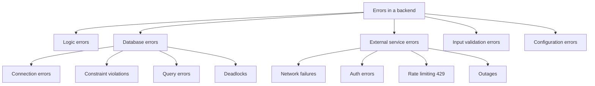
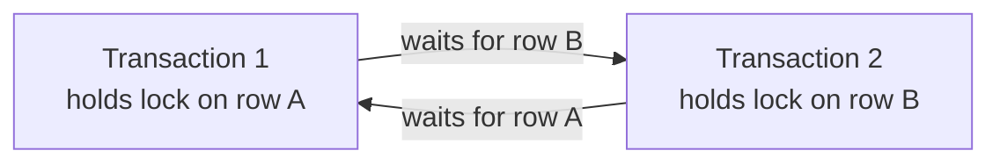
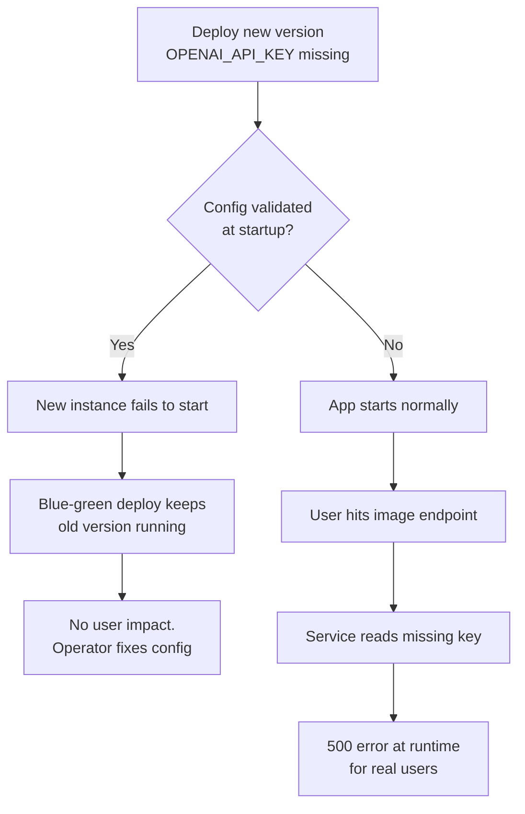
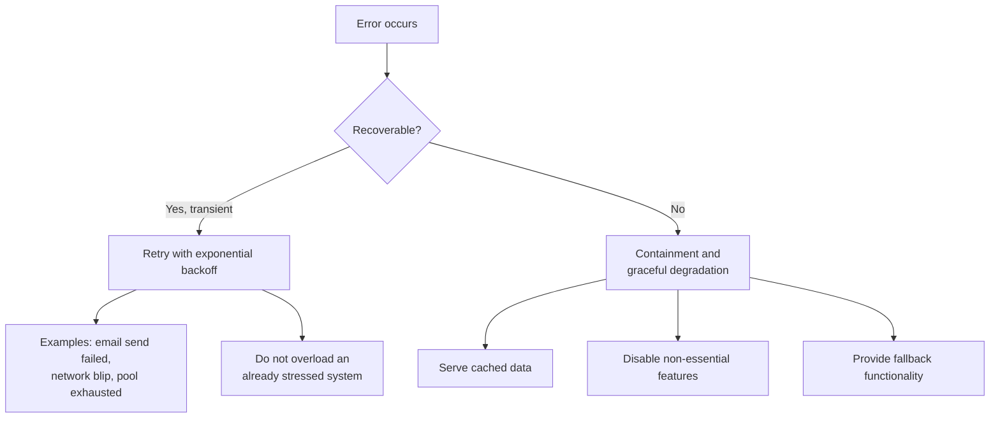
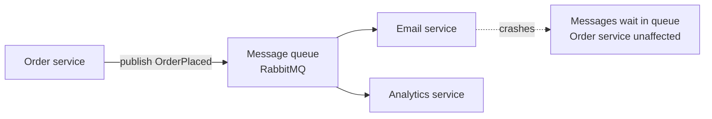
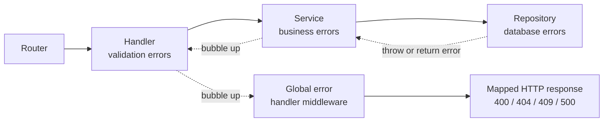
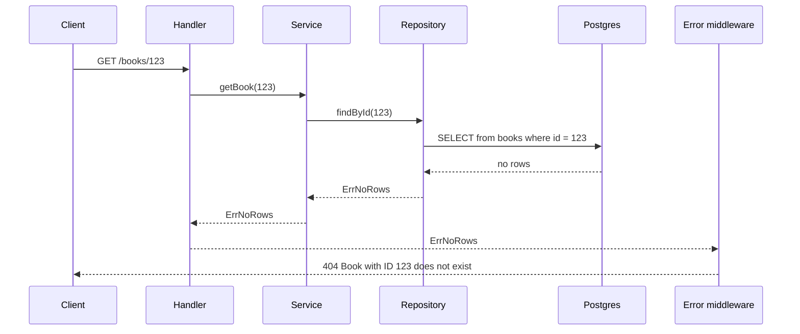
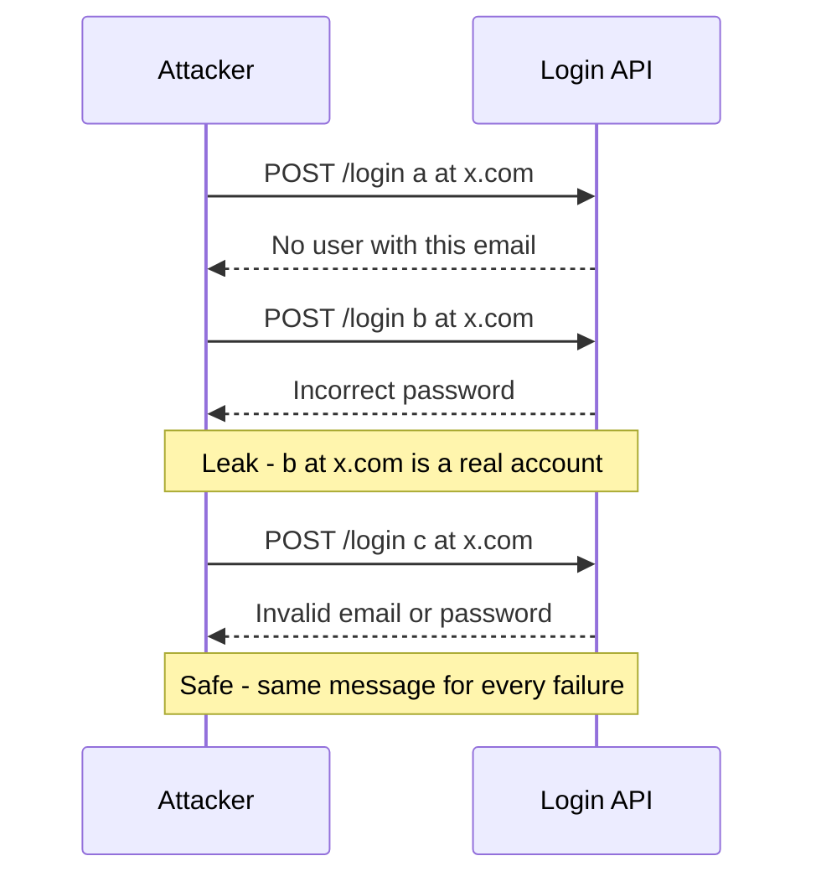

## TL;DR

- Errors are **normal**, not exceptional. The question is never *whether* they happen but *how* your system detects, contains and recovers from them.
- Five big categories: **logic errors** (silent, most dangerous), **database errors** (connection, constraint violation, query errors, deadlocks), **external service errors** (network, auth, rate limits / 429, outages), **input validation errors** (easiest to handle, 400), and **configuration errors** (missing env vars — validate at startup and crash early).
- The best error handling starts **before** the error happens: health checks (server, database, external services, core functionality) and monitoring of errors, performance and *business* metrics.
- Respond by error type: **recoverable** → retry with exponential backoff (without overloading a stressed system); **non-recoverable** → containment and graceful degradation (cached data, disable non-essential features, fallbacks).
- Control **propagation**: wrap low-level errors with context, bubble them up deliberately, and use **error boundaries** (separate processes, timeouts, message queues) so one failure does not cascade.
- A **global error-handling middleware** is the final safety net: every layer throws/returns typed errors, and one place maps them to HTTP responses (validation → 400, unique violation → 400/409, no rows → 404, FK violation → 404/400, unknown → 500 "Something went wrong").
- Security: **never leak internals** (table, constraint, stack trace) in error messages, use generic auth messages ("Invalid email or password") to prevent user enumeration, and **never log sensitive data** — log user IDs and correlation IDs instead.

## Why this matters

A backend is responsible for every transaction and every user action going through correctly. Databases go down, third-party APIs time out, users send garbage, and your own code has bugs. A system that assumes everything works will fail in the worst possible way: wrong data, confusing 500s, cascading outages, or leaked internals. A **fault-tolerant mindset** means you know what can break, you notice early, you limit the blast radius, and you tell users something useful and safe. This chapter is not about a tool or framework — it is about the way of thinking that every production backend needs.

> [!IMPORTANT]
> Fault tolerance = the system keeps providing acceptable service even when some of its parts fail. It does not mean "nothing fails"; it means failures are **detected, contained and recovered from**.

## Types of errors



### 1. Logic errors — the sneaky ones

**What they are:** the code runs without crashing, but it does the *wrong thing*. No exception, no stack trace, no alert — just incorrect results.

**Example:** an e-commerce store applies a discount twice, producing negative shipping costs. The app is "healthy", but the business loses money on every single order. Such bugs can go unnoticed for weeks or months if nobody monitors business outcomes and users do not report them.

**Why they happen:**
- **Misunderstood requirements** — a confusing point in a discussion with a product manager or client becomes a wrong implementation that ships (often with weak testing).
- **Incorrect algorithms** — e.g. a complex discount engine based on purchase history with one small miscalculation.
- **Unhandled edge cases** — an unexpected user behaviour in a payment or discount workflow.

> [!WARNING]
> Logic errors are arguably the most dangerous category because they **corrupt data and business results silently**. In payment, money or security flows, they can do lasting damage before anyone notices. Defences: clear requirements, tests for edge cases, and monitoring of business metrics (see below).

### 2. Database errors

Most backends depend heavily on their database, so database errors can take down the whole system. If the backend cannot reach the source of truth, the frontend has nothing to show — often just empty screens and 500s.

#### Connection errors
The app cannot talk to the database because:
- the network is down,
- the database server is overloaded,
- the **connection pool is exhausted**.

> [!NOTE]
> A **connection pool** keeps a set of already-open TCP connections to the database so each request does not pay for a new TCP handshake (plus TLS and database authentication). It is a performance optimisation — but if all connections are busy (slow queries, leaked connections, traffic spike), new requests wait and eventually fail.

#### Constraint violations
The operation breaks a rule the database enforces:
- **Unique constraint:** creating a user with an email that already exists.
- **Foreign key constraint:** inserting an `orders` row whose `customer_id` does not exist in `customers`.
- (Also: `NOT NULL`, `CHECK` constraints.)

Many of these come from a weak **validation layer** — validate edge cases on both frontend and backend. But some cannot be prevented by validation: only the database knows whether an email is unique *right now*. For those, the job is **error formatting** — translate the database error into a friendly message like "This email already exists, try another one" instead of letting it bubble up as a 500.

#### Query errors
The SQL itself is wrong:
- typos / malformed SQL, e.g. `SELECT * FROM custmers` → "relation does not exist",
- queries too complex or slow, hitting a **timeout**.

#### Deadlocks
Two or more transactions each hold a lock the other needs, forming a circular wait. The database detects this and aborts one of them.



> [!TIP]
> Deadlock errors are usually **safe to retry** (the database rolled the victim transaction back). To reduce them, always acquire locks in a consistent order and keep transactions short.

### 3. External service errors

Modern SaaS apps depend on many external services: payment processors (Stripe), email providers (Resend), object storage (S3), caches (Redis), authentication providers (Auth0, Clerk), AI APIs (OpenAI). Each one is a **point of failure you do not control**. You cannot avoid them (rebuilding all that from scratch is impractical), so you must **expect them to fail** and plan what happens when they do.

#### Network failures
Whether you connect over HTTP, raw TCP or WebSocket, the medium is the network, and the network is not perfect: **connection timeouts, DNS failures, network partitions** (parts of the network can't reach each other due to routing issues).

#### Authentication errors
External services reject your requests because of bad credentials, expired tokens or insufficient permissions.

> [!WARNING]
> Using an external auth provider does not make your system automatically secure. You still own a backend that integrates with it, and you can still create security holes — for example by **logging sensitive user information**.

#### Rate limiting
Almost every external API limits how many requests a client may send in a time window, to protect itself from abuse. If a spike in your traffic — or a bug like an accidental loop — makes you call the API too often, it starts rejecting you with **HTTP 429 Too Many Requests**.

The standard defence is **exponential backoff**: after a 429, wait, retry; if it fails again, double the wait; keep going until success (or a max number of attempts).

```ts
async function withBackoff<T>(fn: () => Promise<T>, maxAttempts = 5): Promise<T> {
  let delayMs = 500;
  for (let attempt = 1; ; attempt++) {
    try {
      return await fn();
    } catch (err: any) {
      const retryable = err.status === 429 || err.status >= 500 || err.code === "ETIMEDOUT";
      if (!retryable || attempt === maxAttempts) throw err;
      const jitter = Math.random() * delayMs;      // spread retries out
      await new Promise(r => setTimeout(r, delayMs + jitter));
      delayMs *= 2;                                 // 500, 1000, 2000, 4000...
    }
  }
}
```

> [!NOTE]
> Production backoff adds **jitter** (randomness) so thousands of clients don't retry at the exact same instant (the "thundering herd"), caps the maximum delay and attempts, and honours a `Retry-After` header if the server sends one.

#### Service outages
Big cloud providers (AWS, GCP) occasionally have incidents, and everyone depending on them goes down. Outages can be unexpected or planned maintenance. You need **fallbacks**: if Redis goes down, fall back to an in-memory cache or a second Redis node, so critical functions like payments and order processing keep working.

### 4. Input validation errors

Users (consumers of your API) send data that does not meet your rules. The **validation layer** at the entry point of the backend is your first line of defence against bad and malicious data.

| Validation type | What it checks | Example |
|---|---|---|
| Format | Data has the expected shape | Valid email, phone number, date |
| Range | Numbers and lengths within limits | Amount ≤ max, string length, array has 3–100 items |
| Required fields | Mandatory fields are present | `name` must exist to create a book |

These return **400 Bad Request** with details the user can fix. They are the **easiest errors to handle** because you already know your data requirements — just enforce them at the entry point. Unlike external dependencies (no control) or logic errors (hard to detect), validation is fully in your hands, so every backend should have a robust validation layer. Be explicit about the exact format you accept, and accept only that.

### 5. Configuration errors

Configuration errors show up when moving between **development, staging and production**. Example: during development you add `OPENAI_API_KEY` to your local `.env`, the PR is merged, but nobody adds the variable to the production config (manual setup, AWS Parameter Store, etc.). Two outcomes are possible:



- **Best case (fail fast):** the app validates all required configuration before the server starts. Missing or malformed → crash immediately with a meaningful message. With a **blue-green** style deployment, the old version keeps running until the new one starts successfully, so there is no downtime.
- **Worst case:** no startup validation. The app runs, and only when a user hits the endpoint that needs the key does it fail with a 500 at runtime.

```ts
import { z } from "zod";

const Env = z.object({
  DATABASE_URL: z.string().url(),
  OPENAI_API_KEY: z.string().min(1),
  PORT: z.coerce.number().default(8080),
});

const parsed = Env.safeParse(process.env);
if (!parsed.success) {
  console.error("Invalid configuration:", parsed.error.flatten().fieldErrors);
  process.exit(1); // crash BEFORE serving any traffic
}
export const config = parsed.data;
```

> [!IMPORTANT]
> Always prefer crashing at startup over failing at runtime. Validate every **required** configuration value (from env vars or remote stores) as the very first step.

## Prevention: find errors before they spread

> [!IMPORTANT]
> The key idea of the chapter: **the best error handling starts before the error happens.** Detect problems the moment they appear, before they cause real damage — this applies to frontend, backend and infrastructure alike.

### Health checks

**Basic health endpoint.** Expose something like `GET /health` or `GET /status`. The body hardly matters — the **status code** does: 200 means running; 4xx/5xx means something is wrong. Load balancers, orchestrators and monitoring tools ping it continuously.

```http
GET /health HTTP/1.1
Host: api.example.com

HTTP/1.1 200 OK
Content-Type: application/json

{"status":"ok"}
```

But "the process is running" is not enough. You must also verify the system is **actually doing its job**:

| Health check | What it verifies | How |
|---|---|---|
| Server | Process is alive and responding | `/health` returns 200 |
| Database | Connectivity, query performance, data integrity | Run a representative query, track its latency vs. normal (500 ms suddenly 4–5 s = trouble) |
| Payment processor | Payments actually work | Periodic test transactions |
| Email service | Emails are delivered | Send test emails to internal addresses |
| Auth service | Tokens issue and validate | Generate test tokens, validate them against the provider's endpoint |
| Core functionality | App internals are sane | Config loaded, essential caches populated, internal data structures consistent |

Together these are **proactive error detection**: you are prepared for worst cases, you have ways to prevent them, and you can fix them quickly when they happen.

> [!NOTE]
> Kubernetes formalises this as **liveness** (is the process alive? restart if not) and **readiness** (can it serve traffic now? remove from the load balancer if not) probes. Deep dependency checks usually belong in readiness, not liveness, so a database blip doesn't cause a restart storm.

### Monitoring and observability

Covered in depth in the logging/monitoring chapter. For fault tolerance, the essentials:

- Monitoring **detects errors quickly while they happen** and gives enough **context to debug** them.
- **Don't track only error rates — track performance too.** Performance degradation is an early warning sign: a service that is getting slower is often about to fail.
- Cover **every source** of errors: HTTP errors, database errors, external service failures, business-logic errors.
- **Performance metrics:** response times, resource usage (CPU, memory, connections), throughput.
- **Business metrics:** e.g. a sudden drop in successful transactions or successful logins can indicate a technical problem *even when error rates look normal* — this is how you catch logic errors.
- **Structured logging:** log as JSON so logs can be parsed, enriched with metadata and shipped to aggregation tools (Grafana, Loki), where you can search, visualise and store them.

```json
{"level":"error","time":"2026-01-10T12:00:00Z","msg":"payment failed","userId":"u_123","correlationId":"req_9f2a","provider":"stripe","latencyMs":5012}
```

## Responding to errors

### Immediate error response

How you react in the first moments decides whether an error stays minor or becomes a major failure. The strategy depends on **error type and context**.



**Recoverable errors** — transient problems that will likely succeed later:
- An email send through Resend failed. Email does not need to arrive within milliseconds, so retrying later is fine.
- Network errors, temporarily unavailable resources, running out of database connections.
- Strategy: **retries with exponential backoff**.

> [!WARNING]
> Retry logic must not add more stress to a system that is already struggling. Aggressive immediate retries against an overloaded database or API can turn a slowdown into a full outage (a **retry storm**). Use backoff, jitter, max attempts — and a **circuit breaker** (stop calling a failing dependency for a while) is the standard complement.

**Non-recoverable errors** — retrying won't help:
- Strategy: **containment and graceful degradation** — switch to cached data, disable non-essential features, provide alternative functionality, and keep the damage contained to the smallest possible scope.

### Error recovery strategies

Recovery depends on the error's nature and how critical the affected functionality is.

**Automatic recovery** handles many errors without humans:
- **Restart** a failed or unresponsive service/process automatically (process managers, Kubernetes, systemd) — works most of the time.
- **Clean up** bad state, e.g. clear corrupted caches.
- **Fail over** to backup systems.

Design these carefully — a badly designed automatic recovery can make things worse (e.g. restart loops). Test them deliberately: push the system to its error thresholds ahead of time and learn which strategy works for which service.

**Manual recovery** is needed when human judgement is required. For these:
- **Document** the procedures (runbooks) so every team member and new hire knows what to do during an incident.
- **Test** them so you know they work, and can execute them quickly under stress.

**Data recovery** — data is the only truly tangible asset; code and services can be redeployed, user data and transactions cannot be recreated. **Data integrity is priority number one**:
- take backups at key moments,
- restore from backups,
- replay transaction logs (e.g. Postgres WAL for point-in-time recovery),
- use specialised recovery tools.

### Propagation control

Not every error should be handled at the exact place it occurs. Often the low-level code lacks context (a repository knows "unique violation on `books_name_key`" but not "user tried to create a duplicate book"). So errors should **propagate upward deliberately** to where there's enough context — and this bubbling must be **under your control**, otherwise errors can crash the main process or spread to other services.

In exception-based languages (JavaScript, Python, Java) you use `try/catch` and exception hierarchies: catch low-level exceptions, **wrap them with context**, rethrow higher-level ones. At the top you have enough business context to log properly, return a meaningful error, or trigger recovery. In Go, you return errors up the call chain, wrapping with `fmt.Errorf("...: %w", err)`.

```go
func (r *BookRepo) Insert(ctx context.Context, b Book) error {
    _, err := r.db.Exec(ctx, `INSERT INTO books (name, description) VALUES ($1, $2)`, b.Name, b.Description)
    if err != nil {
        return fmt.Errorf("insert book %q: %w", b.Name, err) // add context, keep original
    }
    return nil
}
```

### Error boundaries

An **error boundary** is the point where you stop an error from propagating further. In a service architecture, boundaries keep a failure in one service from taking down others:
- run services in **separate processes**,
- put **timeouts** on every call across a service boundary,
- use **message queues** (e.g. RabbitMQ) for asynchronous communication instead of direct in-process coupling, so a bug in one service doesn't cause another to fail.



## Global error handling: the final safety net

A one-time setup effort that pays off immediately and forever: you design it when setting up the project, then only add conditions occasionally. It is arguably the most important error-handling component in a backend.

### Where errors come from in a layered backend

Recall the typical architecture:
- **Router** — picks the handler for the request.
- **Handler (controller)** — extracts data from the request, deserialises, validates, binds, calls a service.
- **Service** — business logic; orchestrates one or more repository methods (e.g. "get user with posts" calls `getUserById` and `getPostsByUser`).
- **Repository** — leaf functions that each run one database operation.

Each layer can produce different errors: handlers throw **validation errors**, services throw **business/internal errors**, repositories throw **database errors**. The pattern: **no matter where an error originates, bubble it up to a global error-handling middleware**, which sits in the middleware layer and therefore sees all requests and responses.



- In **throwing languages** (JS/TS, Python), just `throw` and catch in the final error middleware.
- In **Go**, return the error from repository → service → handler until it reaches the middleware.
- Every language lets you define **custom error types**, so the middleware can inspect the error kind and decide the response.

### Worked examples (a book-management API)

**1. Validation error.** `POST /books` with `{ name, description? }`. Rule: name ≤ 500 characters. A user sends a 700-character name. The handler's validation fails → middleware returns **400 Bad Request** with field-level errors so the user can fix the input.

**2. Unique constraint violation.** Validation passes, the repository runs `INSERT INTO books ...` in Postgres, but a book with that name already exists (unique constraint). The middleware sees a database error of kind *unique violation* — caused by user data — and returns **400** with a message like "Book already exists".

> [!NOTE]
> Many APIs use **409 Conflict** for "resource already exists". The video uses 400; both are defensible — be consistent across your API.

**3. No rows → 404.** Frontend route `/books/123` calls `GET /books/123`. No body to validate, the ID is a number, so it reaches the repository: `SELECT * FROM books WHERE id = 123`. The book doesn't exist, and the driver returns a **no rows** error (e.g. `sql.ErrNoRows` in Go, `pgx.ErrNoRows`). The middleware recognises it and deduces the requested resource doesn't exist → **404 Not Found**, "Book with ID 123 does not exist".

**4. Foreign key violation.** `POST /books` with `{ name, description, authorId }`. The `author_id` column references `authors`. The client sends an `authorId` that doesn't exist → Postgres raises a foreign key violation. The referenced resource doesn't exist, so the middleware can return **404** ("Author not found") — or 400/422, since it's invalid input in the body.

**5. Anything else → 500** with a generic message.

```http
HTTP/1.1 400 Bad Request
Content-Type: application/json

{
  "code": 400,
  "message": "Validation failed",
  "errors": [
    { "field": "name", "message": "must be at most 500 characters" }
  ]
}
```

### Implementation sketch (Express + Postgres)

```ts
// errors.ts
export class AppError extends Error {
  constructor(public status: number, message: string, public details?: unknown) {
    super(message);
  }
}
export class ValidationError extends AppError {
  constructor(details: unknown) { super(400, "Validation failed", details); }
}
export class NotFoundError extends AppError {
  constructor(message: string) { super(404, message); }
}

// error-middleware.ts
import type { ErrorRequestHandler } from "express";

export const globalErrorHandler: ErrorRequestHandler = (err, req, res, _next) => {
  // 1. Our own typed errors
  if (err instanceof AppError) {
    return res.status(err.status).json({ code: err.status, message: err.message, errors: err.details });
  }
  // 2. Postgres errors (SQLSTATE codes)
  switch (err?.code) {
    case "23505": // unique_violation
      return res.status(409).json({ code: 409, message: "Resource already exists" });
    case "23503": // foreign_key_violation
      return res.status(404).json({ code: 404, message: "Referenced resource not found" });
  }
  // 3. Unknown: log full details internally, return nothing internal
  req.log?.error({ err, correlationId: req.headers["x-request-id"] }, "unhandled error");
  return res.status(500).json({ code: 500, message: "Something went wrong" });
};
```

### Why a global handler wins

1. **More robust and secure.** Without it, each layer must remember to translate every error. Forget one condition in one repository method and the unhandled error falls through to the default **500 "Internal Server Error"** — the user gets "something went wrong" instead of "book already exists". A central handler catches every kind of error in one place, so nothing slips through.
2. **Less redundancy.** Otherwise every repository method running SQL needs the same checks ("is this a unique violation? an FK violation? no rows?"). Duplicated logic means more code and more bugs.



## Security aspects of error handling

### Don't leak internal details

Be careful what leaves your backend in error messages. Database errors often contain **table names, index names, constraint names, column names**. If your middleware just copies the bubbled-up error message into the response, attackers learn your schema and can craft more targeted attacks (e.g. advanced SQL injection) — and your platform becomes a target.

- Control every message: understand which error was thrown and generate a **user-oriented** message.
- In the **default (fallback) branch** — reached only after you've checked for validation, unique, FK, business errors, etc. — you truly don't know what happened, and the raw message probably contains internals. Return **500** with a generic message: "Something went wrong" / "Internal Server Error". Log the details internally.

> [!WARNING]
> Never return stack traces, raw SQL errors or driver messages to clients in production.

### Don't enable user enumeration

Naive login flow: look up user by email → if missing, "No user with this email" → else check password → if wrong, "Incorrect password". An attacker can try many emails with one password; every "no user" response tells them that email isn't registered, and the moment they see "incorrect password" they know they've found a real account. Then they brute-force common passwords against it.

Fix: return the same message for both cases — **"Invalid email or password"**. Follow the **OWASP Cheat Sheet Series** (e.g. Authentication cheat sheet) for this and similar practices.



> [!TIP]
> Also keep response *timing* similar for both cases (e.g. still run a password hash comparison when the user doesn't exist), otherwise attackers can enumerate users by measuring latency.

### Don't log sensitive data

Logs feel internal, but large companies generate hundreds of GBs of logs daily and ship them to multiple external services for storage, analysis and observability. In many major breaches, **logs are what leak**. If they contain emails, passwords, API keys or credit card numbers, all of that is exposed.

- Never log passwords, API keys, tokens, card numbers, or PII like emails.
- In error logs (e.g. an auth failure), log the **user ID** and a **correlation ID** — enough context to debug, nothing sensitive.

## Common mistakes & misconceptions

- **"If it didn't crash, it works."** Logic errors don't crash. Monitor business metrics.
- **Returning raw database errors to clients.** Leaks schema and gives a confusing UX. Map them in a global handler.
- **Letting unique/FK violations become 500s.** They're caused by client data — return 4xx with a helpful message.
- **Only a `/health` that returns 200.** Process alive ≠ system working. Check DB, dependencies and core functionality.
- **Reading config lazily.** A missing env var then fails at runtime for real users. Validate at startup and crash.
- **Retrying everything immediately and forever.** Causes retry storms. Retry only transient errors, with backoff, jitter and limits.
- **Retrying non-idempotent operations blindly** (e.g. charging a card) — use idempotency keys.
- **Handling errors in every layer separately.** Redundant and easy to forget; centralise.
- **Detailed auth errors** ("user not found" vs "wrong password") enable account enumeration.
- **Logging emails, passwords, tokens.** Logs leak; log IDs and correlation IDs.
- **Tracking only error rates.** Performance degradation is the early warning sign.

## Interview questions

<details>
<summary><strong>Q: What categories of errors does a backend have to deal with?</strong></summary>

1. **Logic errors** — code runs but produces wrong results (e.g. discount applied twice). Silent and dangerous.
2. **Database errors** — connection failures/pool exhaustion, constraint violations (unique, FK), malformed or slow queries, deadlocks.
3. **External service errors** — network timeouts/DNS/partitions, auth failures, rate limiting (429), outages.
4. **Input validation errors** — bad client data, 400.
5. **Configuration errors** — missing/invalid config between environments.

</details>

<details>
<summary><strong>Q: Why are logic errors considered the most dangerous?</strong></summary>

Because nothing fails visibly: no exception, no 500, no alert. The system keeps running while producing wrong outcomes — losing money on every order, corrupting data — potentially for weeks. You catch them with good requirements, edge-case tests, code review and **business-metric monitoring** (e.g. average order value or successful transactions suddenly changing).

</details>

<details>
<summary><strong>Q: An external API starts returning 429. How do you handle it?</strong></summary>

429 means Too Many Requests — you hit their rate limit. Retry with **exponential backoff** (wait 1s, 2s, 4s… with jitter and a cap), honour `Retry-After` if present, and stop after a max number of attempts. Longer term: throttle your own outgoing calls, batch requests, cache responses, move non-urgent calls (emails) to a background queue, and find the bug or traffic pattern that caused the spike.

</details>

<details>
<summary><strong>Q: What happens if a required environment variable is missing in production? How do you prevent damage?</strong></summary>

If the app doesn't validate config at startup, it starts fine and fails only when a user hits the code path needing the variable → 500s at runtime. Prevent it by validating all required config before the server starts and exiting with a clear error if anything is missing. Combined with blue-green/rolling deployments, the broken version never receives traffic and the old version keeps serving.

</details>

<details>
<summary><strong>Q: Is a /health endpoint that returns 200 enough?</strong></summary>

No — it only proves the process is running. You also need to verify the system does its job: database connectivity and representative-query latency, external dependencies (test payments, test emails, test tokens against the auth provider), and core functionality (config loaded, essential caches warm, internal state consistent). Also monitor performance and business metrics, because degradation precedes failure.

</details>

<details>
<summary><strong>Q: How do you handle recoverable versus non-recoverable errors?</strong></summary>

**Recoverable** (transient: network blip, pool exhausted, email provider hiccup): retry with exponential backoff and jitter, limited attempts, without overloading an already stressed dependency; often via a background job. **Non-recoverable**: containment and graceful degradation — serve cached data, disable non-essential features, use a fallback, and limit the blast radius so core flows (payments, orders) keep working.

</details>

<details>
<summary><strong>Q: What is graceful degradation? Give an example.</strong></summary>

Continuing to offer reduced but acceptable functionality when a component fails, instead of failing completely. Example: the recommendation service is down → show "popular items" from cache instead of personalised recommendations; Redis is down → fall back to an in-memory cache or a replica; the review service is down → render the product page without reviews.

</details>

<details>
<summary><strong>Q: What is a global error handler and why use one?</strong></summary>

A middleware at the outermost layer that receives every error bubbled up from handlers, services and repositories, inspects its type, and maps it to an HTTP response (validation → 400, unique violation → 400/409, no rows → 404, FK violation → 404/400, unknown → 500 "Something went wrong"). Benefits: **robustness** (no forgotten conditions turning into confusing 500s), **consistency** (one error format), **less redundancy** (no duplicated checks in every repository), and **security** (one place to ensure internals are never leaked).

</details>

<details>
<summary><strong>Q: A client requests GET /books/123 and the book doesn't exist. Walk through what happens.</strong></summary>

Router → handler (nothing to validate beyond the numeric ID) → service → repository runs `SELECT ... WHERE id = 123`. The driver returns a "no rows" error. The repository returns/throws it (optionally wrapped with context), it bubbles through service and handler to the global error middleware, which recognises "no rows" and returns **404 Not Found** with "Book with ID 123 does not exist".

</details>

<details>
<summary><strong>Q: Why shouldn't a login endpoint say "user not found"?</strong></summary>

It enables **user enumeration**: an attacker tries many emails, and the different message for existing accounts ("wrong password") reveals which emails are registered. They then brute-force passwords for those accounts. Always return a generic "Invalid email or password", keep response times similar, and add rate limiting/lockouts. OWASP's Authentication Cheat Sheet recommends this.

</details>

<details>
<summary><strong>Q: What should and shouldn't you put in error responses and logs?</strong></summary>

**Responses:** status code, a user-friendly message, field-level validation errors, optionally a request/correlation ID. Never stack traces, SQL, table/constraint names or driver messages. **Logs:** structured JSON with error details, user ID, correlation ID, route, latency. Never passwords, tokens, API keys, card numbers or PII like emails — logs are shipped to many systems and frequently leak in breaches.

</details>

<details>
<summary><strong>Q: What are error boundaries in a distributed system?</strong></summary>

Points where errors are stopped from propagating to other components. Techniques: separate processes/services, timeouts on every remote call, message queues for async communication (if the consumer crashes, messages wait instead of the producer failing), circuit breakers, bulkheads (separate resource pools). The goal is that a bug in one service can't cascade into others.

</details>

<details>
<summary><strong>Q: What happens if your retry logic is too aggressive during an outage?</strong></summary>

You get a **retry storm**: every client multiplies its request rate against a dependency that's already overloaded, preventing recovery and possibly exhausting your own resources (threads, connections). Mitigate with exponential backoff, jitter, max attempts, retry budgets, and circuit breakers that fail fast for a cool-down period.

</details>

<details>
<summary><strong>Q: How would you handle a unique constraint violation when creating a user?</strong></summary>

You can't fully prevent it with validation — only the database knows uniqueness at insert time (and checking first is racy). So let the insert fail, detect the specific error (Postgres SQLSTATE `23505`), and map it in the global handler to a 409/400 with "Email already in use", without exposing the constraint name.

</details>

## Cheat sheet

| Error | Typical cause | Response / strategy |
|---|---|---|
| Logic error | Misread requirements, bad algorithm, edge case | Tests, reviews, business-metric monitoring |
| DB connection | Network down, DB overloaded, pool exhausted | Retry with backoff, alert, pool tuning |
| Unique violation (`23505`) | Duplicate email/name | 400 or 409, friendly message |
| FK violation (`23503`) | Referenced row missing | 404 or 400/422 |
| No rows | Resource doesn't exist | 404 |
| Query error | Typo, malformed SQL, timeout | Fix bug, 500 to client, optimise query |
| Deadlock | Circular lock wait | Retry transaction, consistent lock order |
| 429 from API | Rate limit hit | Exponential backoff + jitter, Retry-After |
| External outage | Provider down/maintenance | Fallbacks, cache, degrade gracefully |
| Validation | Bad input | 400 with field errors |
| Config missing | Env var not set in prod | Validate at startup, crash early |
| Unknown | Anything else | 500 "Something went wrong", log internally |

- Best error handling starts **before** errors happen: health checks + monitoring.
- Health checks: server, DB (latency of representative query), external services (test transactions/emails/tokens), core functionality.
- Monitor errors **and** performance **and** business metrics; structured JSON logs.
- Recoverable → retry/backoff (don't overload). Non-recoverable → contain + degrade.
- Recovery: automatic (restart, clear cache, failover), manual (documented, tested runbooks), data (backups, transaction-log replay).
- Wrap errors with context, bubble up deliberately; boundaries = separate processes, timeouts, queues.
- Global error middleware = final safety net: robust + less redundant.
- Security: no internals in messages, "Invalid email or password", no sensitive data in logs (use user ID + correlation ID).

## Glossary

- **Fault tolerance** — ability of a system to keep working acceptably when parts of it fail.
- **Logic error** — bug where code runs without crashing but produces incorrect results.
- **Connection pool** — set of reusable open database connections that avoids per-request connection setup.
- **Constraint violation** — database rejects an operation that breaks a rule (unique, foreign key, not null, check).
- **Deadlock** — two or more transactions waiting on each other's locks in a cycle.
- **Network partition** — a network failure that splits systems into groups that can't communicate.
- **Rate limiting** — restricting how many requests a client can make per time window; exceeding it returns 429.
- **Exponential backoff** — retry strategy where the wait doubles after each failure.
- **Jitter** — random variation added to retry delays to avoid synchronized retries.
- **Health check** — endpoint or probe that reports whether a service (and its dependencies) is working.
- **Graceful degradation** — serving reduced functionality instead of failing completely.
- **Containment** — limiting the scope of damage from a failure.
- **Error propagation** — passing an error up the call stack to a layer with more context.
- **Error boundary** — point beyond which an error is not allowed to propagate.
- **Global error handler** — central middleware that converts all errors into consistent HTTP responses.
- **Blue-green deployment** — running the new version alongside the old and switching traffic only once the new one is healthy.
- **User enumeration** — attack that discovers valid accounts from differing responses.
- **Correlation ID** — unique ID attached to a request and its logs to trace it across services.
- **Structured logging** — logging in a machine-parseable format such as JSON.
- **OWASP Cheat Sheet Series** — community security guidance for common workflows such as authentication.

## Video timestamps

- [00:00](https://www.youtube.com/watch?v=8NaM_9aKS24&t=0s) — Errors are normal: the fault-tolerant mindset
- [02:00](https://www.youtube.com/watch?v=8NaM_9aKS24&t=120s) — Logic errors
- [05:06](https://www.youtube.com/watch?v=8NaM_9aKS24&t=306s) — Database errors: connections and pooling
- [07:10](https://www.youtube.com/watch?v=8NaM_9aKS24&t=430s) — Constraint violations (unique, foreign key)
- [09:13](https://www.youtube.com/watch?v=8NaM_9aKS24&t=553s) — Query errors and deadlocks
- [10:13](https://www.youtube.com/watch?v=8NaM_9aKS24&t=613s) — External service errors: network, auth
- [13:16](https://www.youtube.com/watch?v=8NaM_9aKS24&t=796s) — Rate limiting, 429 and exponential backoff
- [15:18](https://www.youtube.com/watch?v=8NaM_9aKS24&t=918s) — Service outages and fallbacks
- [17:20](https://www.youtube.com/watch?v=8NaM_9aKS24&t=1040s) — Input validation errors
- [19:23](https://www.youtube.com/watch?v=8NaM_9aKS24&t=1163s) — Configuration errors and fail-fast startup
- [23:29](https://www.youtube.com/watch?v=8NaM_9aKS24&t=1409s) — Prevention: finding errors before they spread
- [24:31](https://www.youtube.com/watch?v=8NaM_9aKS24&t=1471s) — Health checks: server, database, external services, core
- [29:39](https://www.youtube.com/watch?v=8NaM_9aKS24&t=1779s) — Monitoring and observability
- [32:43](https://www.youtube.com/watch?v=8NaM_9aKS24&t=1963s) — Immediate error response: recoverable vs non-recoverable
- [35:48](https://www.youtube.com/watch?v=8NaM_9aKS24&t=2148s) — Error recovery strategies: automatic, manual, data
- [38:53](https://www.youtube.com/watch?v=8NaM_9aKS24&t=2333s) — Propagation control and exception hierarchies
- [40:54](https://www.youtube.com/watch?v=8NaM_9aKS24&t=2454s) — Error boundaries
- [41:54](https://www.youtube.com/watch?v=8NaM_9aKS24&t=2514s) — Global error handling: the final safety net
- [44:58](https://www.youtube.com/watch?v=8NaM_9aKS24&t=2698s) — Worked example: book API validation and unique errors
- [51:06](https://www.youtube.com/watch?v=8NaM_9aKS24&t=3066s) — No rows to 404, foreign key violations
- [57:15](https://www.youtube.com/watch?v=8NaM_9aKS24&t=3435s) — Advantages of global error handling
- [1:00:19](https://www.youtube.com/watch?v=8NaM_9aKS24&t=3619s) — Security: not leaking internal details
- [1:03:21](https://www.youtube.com/watch?v=8NaM_9aKS24&t=3801s) — Auth error messages and user enumeration
- [1:07:27](https://www.youtube.com/watch?v=8NaM_9aKS24&t=4047s) — Sensitive data in logs
