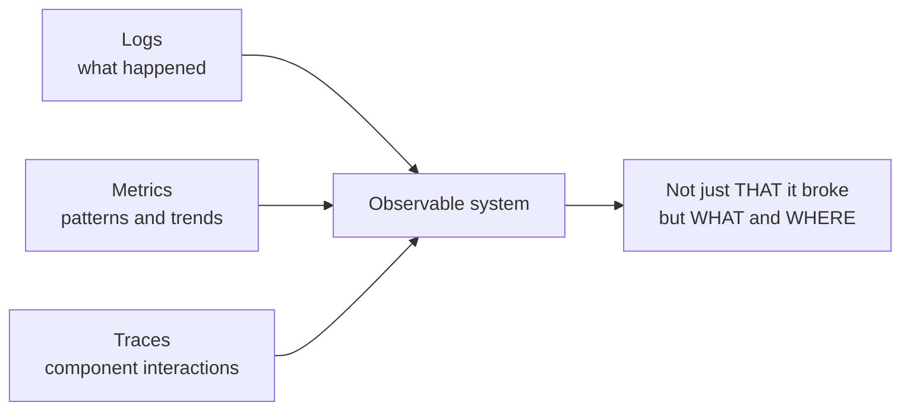
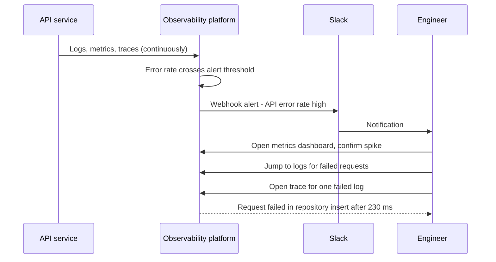
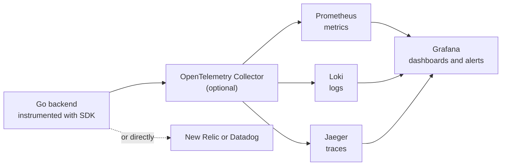
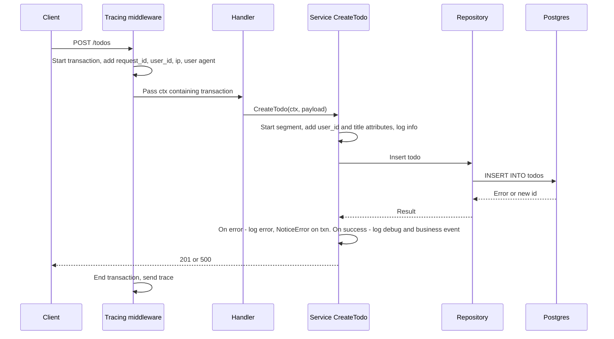

## TL;DR

- **Logging** = recording important events (with metadata like user ID, request ID, latency, function) — a diary of *what happened*.
- **Monitoring** = continuously tracking the health and performance of the system (CPU, memory, requests/sec, DB connections) in near real time (typically 10–15 s delay) — tells you *that* something is wrong.
- **Observability** = being able to infer the system's **internal state from its external outputs**. A system is observable when it has the **three pillars: logs, metrics, traces** — tells you *what* and *where* it is wrong.
- **Logs → what happened**, **metrics → patterns and trends (numbers)**, **traces → how components interacted for one request**.
- The real workflow: **alert (Slack) → metrics dashboard → related logs → trace → exact failing function**.
- **Log levels**: `debug` (dev only), `info` (business events, successes), `warn` (not our fault / unusual, e.g. wrong password), `error` (failures), `fatal` (app must shut down). Production runs at `info`.
- **Unstructured, colorful console logs in development; structured JSON logs in production** so tools (ELK, Loki, New Relic) can parse fields like `user_id`, `request_id`.
- **Instrumentation** = adding code that measures your functions; **OpenTelemetry** = the open, vendor-neutral standard (SDKs + collector) for doing it. Tools: Grafana + Prometheus + Loki + Jaeger (open source) or New Relic / Datadog (proprietary, all-in-one).

## Why this matters

Modern backends are **distributed**: many servers, many regions, users all over the world, plus databases, caches, queues and third-party APIs. When something breaks at 3 a.m., you cannot SSH into a box and "look around". You need the system to *tell* you what is happening — continuously, with enough context to find the exact cause.

> [!NOTE]
> These are **practices on a spectrum**, not rules. No company "does all of observability". Every team implements some subset — don't be intimidated by the sea of tools and buzzwords.

## The three concepts

### Logging: the application's diary

**Logging** is recording every important event in the life of the application and its requests:

- Business events: a user logged in, a to-do was created, a payment succeeded.
- Technical events: a DB query ran, a background job started, the server started.
- Failures: something threw an error — logged with timestamp, user ID, query, and all context needed to debug.
- Security events: failed logins, permission denials.

Each event is recorded with **metadata**: which user triggered it, request ID, latency, which method/function handled it, etc. Later, you can answer "what happened, when, and why".

### Monitoring: the health dashboard

**Monitoring** is continuously checking the **health and performance** of your system and tracking **patterns over time**:

- Server CPU and memory usage.
- Requests processed per second (throughput).
- Error rate, latency (response time).
- Number of open DB connections in the pool.

It's "real time" with a small delay (commonly ~10–15 seconds) because sending data every millisecond would overwhelm the monitoring system itself. Monitoring gives you **aggregates** — the behaviour of the application over time, including now.

### Observability: understanding the inside from the outside

A system is **observable** if you can determine its **internal state by looking at its external outputs**. In practice, a system is called observable when it has all **three pillars**:

| Pillar | Answers | Example |
|---|---|---|
| **Logs** | *What* exactly happened? | `{"level":"error","msg":"db insert failed","user_id":"u_42","request_id":"r_9"}` |
| **Metrics** | What are the *patterns and trends*? | Error rate 12% in the last 30 min, p95 latency 800 ms |
| **Traces** | How did the *components interact* for one request? | middleware → handler → service → repository → DB (failed here, 230 ms) |

A **trace** is like a **transaction**: it follows one request from where it originated (frontend, load balancer, or your backend) through every component it touches — middleware, handler, validation, service, repository, database — with timing for each step (each step is a **span**).



### Monitoring vs observability

A decade ago, infrastructure-level error detection relied mainly on **monitoring**: set up alerts (e.g. with Grafana), get notified that something is wrong — and that's it. You know *there is* a problem, not *what* it is.

**Observability** (a more recent movement) tells you that something is wrong **and** exactly what and where — provided you've implemented logs, metrics *and* traces.

| | Monitoring | Observability |
|---|---|---|
| Question answered | Is something wrong? | What is wrong, where, and why? |
| Approach | Predefined dashboards and alerts on known metrics | Explore logs, metrics, traces correlated together |
| Handles | Known failure modes ("known unknowns") | New, unexpected failures ("unknown unknowns") |
| Output | Alert: error rate high | Alert → logs → trace → failing function |

> [!INTERVIEW]
> **"What's the difference between monitoring and observability?"** — Monitoring tracks predefined health metrics and alerts you *that* something is wrong. Observability is the property of a system that lets you understand its internal state from its outputs — using correlated logs, metrics and traces — so you can find *what* and *where* it went wrong, including failures you never anticipated.

## How the pillars work together: from alert to root cause

A typical production debugging session:

1. **Alert.** You configured a rule like "if the error rate of the API service crosses a threshold, notify us". A **webhook** posts to Slack: "Something is wrong with your API service".
2. **Metrics.** You open the dashboard (Grafana or New Relic). Metrics are numbers, current and historical: requests processed, requests failed, to-dos created, to-dos failed, average latency, throughput. You confirm the error rate spiked.
3. **Logs.** From the metric you jump to the **logs related to it** — all the failed requests in that window. You see, say, a series of `500` errors.
4. **Traces.** Clicking a log opens its **trace**: the request started in this middleware, went to this handler, this service, this repository — and **failed at this exact point**.
5. **Fix.** You know exactly where things broke and can debug instantly.



> [!NOTE]
> The speaker counts any request with a non-2xx status as "failed". In practice, **error-rate alerts usually focus on 5xx** (server faults); 4xx like 401/404 are often client mistakes and tracked separately. Thresholds are also usually much lower than the 80% used in the demo — e.g. alert when 5xx exceed 1–5% for a few minutes.

> [!IMPORTANT]
> The magic is **correlation**: logs, metrics and traces share identifiers (request ID, trace ID, span ID, service name). Without shared IDs you have three disconnected piles of data.

## Tooling landscape

| Need | Open source | Proprietary / all-in-one |
|---|---|---|
| Metrics collection | **Prometheus** | New Relic, Datadog |
| Dashboards & alerts | **Grafana** | New Relic, Datadog |
| Log aggregation | **Loki** (+ **Promtail** shipper), **ELK** (Elasticsearch, Logstash, Kibana) | New Relic Logs, Datadog Logs |
| Tracing | **Jaeger** (also Tempo, Zipkin) | New Relic APM, Datadog APM |
| Instrumentation standard | **OpenTelemetry** SDKs + Collector | (Vendors accept OpenTelemetry data) |

- The **Grafana stack** (Prometheus + Grafana + Loki/Promtail + Jaeger) is common in enterprises, but configuring and maintaining all those pieces takes time and expertise.
- **New Relic / Datadog** are one-stop solutions: easier integration, good when you lack team size or resources to run open-source tools yourself.



## Logging in practice

### Log levels

When logging an event you assign it a **level**. Common levels, in increasing severity:

| Level | When to use | Example | In production? |
|---|---|---|---|
| `debug` | Troubleshooting during development; as much detail as possible | "todo created with id=..., payload=..." | Usually **disabled** |
| `info` | Normal operations, successful operations, business events | "todo created", "server started" | Yes (the default prod level) |
| `warn` | Not a success, but not an error on our side; unusual but expected | "login failed: wrong password for user u_42" | Yes |
| `error` | Failures: DB query failed, unexpected exceptions, external call failed | "insert todo failed: connection reset" | Yes |
| `fatal` | Unrecoverable — the app is shutting down (then restarted by infra) | "cannot connect to database at startup" | Yes |

- A failed login is a **warning**, not an error: the user typed the wrong password — that's not *our* fault.
- Setting the level to `info` means only `info` and above are emitted; `debug` lines are dropped.

> [!TIP]
> Pick the level by asking "who needs to act?" — `error` means an engineer may need to investigate; `warn` means "keep an eye on patterns"; `info` is the business timeline; `debug` is for you, locally.

> [!WARNING]
> Running production at `debug` can leak stack traces, SQL queries and user data into log storage (a security issue — see the security chapter) and costs a lot in log volume. Never log passwords, tokens, or full card numbers at any level.

### Structured vs unstructured logs

| | Unstructured (console/text) | Structured (JSON) |
|---|---|---|
| Format | Human-readable lines, colored | One JSON object per line with fields |
| Best for | **Development** — easy to read and spot issues | **Production** — easy for machines to parse |
| Parsing by tools | Hard, error-prone (regex on text) | Trivial: fields like `user_id`, `request_id`, `status` |
| Querying | grep | "all `level=error` where `route=/todos` in last 1h" |

Development (console):

```text
10:42:01 INF connected to database
10:42:01 INF started background job server
10:42:01 INF starting server port=8080
```

Production (JSON):

```json
{"level":"info","time":"2025-03-01T10:42:01Z","service":"todo-api","env":"production","message":"starting server","port":8080}
{"level":"error","time":"2025-03-01T10:45:13Z","service":"todo-api","request_id":"9b1f","user_id":"u_42","method":"POST","route":"/todos","status":500,"error":"pq: connection reset","message":"create todo failed"}
```

In production, logs are shipped to a log management system (ELK, Loki/Promtail/Grafana, New Relic). Parsing free text to extract the user ID or request ID is inefficient and error-prone; JSON makes every field directly searchable.

### Configuring the logger by environment (Go)

The demo app is a to-do backend in **Go**. Before the app starts, it creates a logger whose **level** and **format** depend on the environment:

```go
package logger

import (
	"os"
	"time"

	"github.com/rs/zerolog"
)

func getLogLevel(env string) zerolog.Level {
	if env == "production" {
		return zerolog.InfoLevel
	}
	return zerolog.DebugLevel // local/dev: show everything
}

func New(env, format string) zerolog.Logger {
	zerolog.SetGlobalLevel(getLogLevel(env))
	if format == "console" {
		// Human-friendly, colored output for local development
		return zerolog.New(zerolog.ConsoleWriter{Out: os.Stdout, TimeFormat: time.Kitchen}).
			With().Timestamp().Logger()
	}
	// JSON for production log pipelines
	return zerolog.New(os.Stdout).With().Timestamp().Str("service", "todo-api").Str("env", env).Logger()
}
```

TypeScript equivalent with **pino**:

```ts
import pino from "pino";
const isProd = process.env.NODE_ENV === "production";
export const logger = pino({
  level: isProd ? "info" : "debug",
  base: { service: "todo-api", env: process.env.NODE_ENV },
  transport: isProd ? undefined : { target: "pino-pretty" }, // pretty in dev, JSON in prod
});
```

## Monitoring and tracing in practice

### Instrumentation and OpenTelemetry

- **Instrumentation** = adding code (manually or via libraries/middleware) that **measures** your functions and requests: timings, attributes, errors. It's what makes a system observable.
- **OpenTelemetry (OTel)** = an **open standard** plus an ecosystem of APIs, SDKs, tools and best practices for instrumentation in every major language (Node.js, Go, Python, ...). Its **Collector** receives telemetry and forwards it to any backend. Even when using a proprietary tool like New Relic, you can put an OTel Collector in between for more control and less vendor lock-in.

### Request flow with a transaction in context

In the demo app:

1. A **New Relic middleware** wraps the whole app at the router level: every incoming request is instrumented automatically (timing, status, route).
2. An **"enhanced tracing" middleware** — the first point of contact in the request life cycle — starts a **transaction** and attaches attributes: service name (from config), environment (local/production), client IP, user agent, request ID, user ID, user email, tenant ID.
3. The transaction is stored in the **request context**, so every downstream layer (handler, service, repository) can pull it out and add its own segment/attributes.
4. Result: a single request produces **one trace** spanning middleware → validation → service → repository → DB.



### The instrumented service method

```go
func (s *TodoService) CreateTodo(ctx context.Context, userID string, in CreateTodoInput) (*Todo, error) {
	txn := newrelic.FromContext(ctx)                 // transaction created by middleware
	defer txn.StartSegment("todo.service.create").End() // end this segment when the function returns

	txn.AddAttribute("user_id", userID)
	txn.AddAttribute("todo_title", in.Title)
	log := s.logger.With().Str("operation", "create_todo").Str("title", in.Title).Logger()

	if in.Priority != nil {
		txn.AddAttribute("priority", *in.Priority)
		log = log.With().Str("priority", *in.Priority).Logger()
	}
	log.Info().Msg("creating new todo")

	// ... validate parent/child relationship ...

	todo, err := s.repo.Create(ctx, userID, in)
	if err != nil {
		log.Error().Err(err).Msg("failed to create todo")
		txn.NoticeError(err)                      // error appears on the trace
		txn.AddAttribute("operation", "create")
		return nil, err
	}

	txn.AddAttribute("operation", "create")
	txn.AddAttribute("todo_id", todo.ID)
	log.Debug().Str("todo_id", todo.ID).Msg("todo created successfully") // hidden in production

	// Business event log
	log.Info().
		Str("event", "todo_created").
		Str("todo_id", todo.ID).
		Str("category_id", todo.CategoryID).
		Msg("todo created")
	return todo, nil
}
```

What this shows:

- **Trace attributes** (`AddAttribute`) and **log fields** carry the same context (user ID, title, priority, todo ID) so you can search and correlate.
- **Errors** are both **logged** (level `error`) and **attached to the trace** (`NoticeError`).
- A **debug** log for local troubleshooting that disappears in production.
- A dedicated **business event** log (`todo_created` with ID, title, category, priority) — useful for analytics and audits.

> [!TIP]
> Generate a **request ID** in the first middleware (or accept one from the load balancer, e.g. `X-Request-ID`), put it in the context, attach it to every log line, and return it in the response headers. When a user reports an error, that ID takes you straight to the logs and trace.

### What the dashboard shows

In the New Relic demo (production mode, JSON logs), hitting `GET /todos` without a token a few times produces `401 Unauthorized` errors:

- **Summary (metrics):** average transaction time, **throughput**, **error rate** — actual numbers that quantify system state.
- **Errors → logs:** the 401s appear under HTTP errors; clicking one shows the log with app name, environment, error code, host name, IP, level, message, HTTP method, route `/todos`, **span ID**, and timestamp.
- **Log → trace:** each log links to its trace — the full path the request took.
- **Transactions:** per-endpoint data for `/todos` — error rate, response time.
- **Go runtime:** garbage collection time, memory usage (about 3 MB), throughput, average response time of the process itself.

### The RED and USE methods (standard practice)

Not named in the video, but useful for deciding *which* metrics to track:

| Method | For | Metrics |
|---|---|---|
| **RED** | Request-driven services (APIs) | **R**ate (req/s), **E**rrors (failed req/s), **D**uration (latency percentiles, p50/p95/p99) |
| **USE** | Resources (CPU, memory, disks, DB pool) | **U**tilization, **S**aturation (queueing), **E**rrors |
| **Golden signals** (Google SRE) | Any service | Latency, traffic, errors, saturation |

> [!INTERVIEW]
> **"What metrics would you monitor for a REST API?"** — RED: request rate, error rate (especially 5xx), and latency percentiles (p95/p99, not just averages) per endpoint; plus USE for resources: CPU, memory, GC, DB connection-pool usage and saturation, queue depth. Alert on symptoms users feel (error rate, latency SLO breaches) rather than every internal blip.

## A shared responsibility

Observability is a collective effort:

- **Developers** must instrument the code: meaningful logs with the right levels and fields, attributes on traces, errors reported, business events recorded. The dashboard can only show what the code emits.
- **DevOps / infrastructure** must run the pipeline: collectors, storage, dashboards, alerting rules, retention.

There's no single "skill" to learn here — it's a habit: every important event, error and interaction should leave a trace you can follow later.

## Common mistakes & misconceptions

- **"Monitoring = observability."** Monitoring says *that* it's broken; observability (logs + metrics + traces, correlated) says *what and where*.
- **Logging plain text in production.** Tools can't reliably parse it; use JSON.
- **Logging JSON in development.** Unreadable; use a pretty console writer locally.
- **Leaving production at debug level.** Noise, cost, and potential leaks of sensitive data.
- **Logging everything as `error`.** A wrong password is a `warn`; alert fatigue follows if every 4xx is an "error".
- **No request/trace IDs.** Without correlation IDs, logs from concurrent requests are an unsearchable mess.
- **Logging secrets or PII** (passwords, tokens, card numbers).
- **Relying on averages.** Average latency hides tail latency; use p95/p99.
- **Expecting the tool to do it all.** New Relic/Grafana display what you instrument; missing attributes in code means missing answers.
- **Thinking you must do everything at once.** It's a spectrum — start with structured logs + key metrics + basic tracing.

## Interview questions

<details>
<summary><strong>Q: Define logging, monitoring and observability.</strong></summary>

Logging records discrete important events (with metadata like user ID, request ID, latency) — what happened. Monitoring continuously tracks health and performance metrics (CPU, memory, throughput, error rate) and alerts on them — whether something is wrong. Observability is the ability to infer a system's internal state from its external outputs, achieved through the three pillars — logs, metrics, and traces — correlated so you can find what and where the problem is.

</details>

<details>
<summary><strong>Q: What are the three pillars of observability and what does each answer?</strong></summary>

Logs answer "what exactly happened?" (detailed event records). Metrics answer "what are the patterns/trends?" (numeric time series like error rate, latency, throughput). Traces answer "how did components interact for this request?" (the path of one request through middleware, services, DB, with timing per span). Together, an alert on a metric leads to the related logs, which link to the trace that pinpoints the failing component.

</details>

<details>
<summary><strong>Q: Walk me through debugging a production error spike with a good observability setup.</strong></summary>

An alert rule on error rate fires and posts to Slack via webhook. I open the metrics dashboard to confirm the spike, scope it (which endpoint, region, version, since when). I jump to the logs filtered to that time and endpoint at error level, look at messages and fields. I open the trace of a failing request to see which span failed and how long each step took — e.g. the repository insert timing out. Then I fix, deploy, and watch the metric recover.

</details>

<details>
<summary><strong>Q: Explain log levels. How would you log a failed login versus a failed database insert?</strong></summary>

Debug (verbose dev troubleshooting), info (normal operations and business events), warn (unusual but not our fault), error (failures needing attention), fatal (unrecoverable, app shuts down). A failed login due to a wrong password is `warn` — expected user behaviour, not a system fault (though many of them may indicate an attack). A failed DB insert is `error` with the error, query context, and request ID. Production typically runs at `info`.

</details>

<details>
<summary><strong>Q: Why use structured (JSON) logging in production but console logs in development?</strong></summary>

In production, logs are ingested by systems like ELK, Loki or New Relic; JSON makes each field (level, user_id, request_id, route, status) directly parseable and queryable, whereas extracting values from free text is slow and error-prone. In development, a human reads the terminal, so colored, plain-text output is easier to scan. The format is chosen by configuration per environment.

</details>

<details>
<summary><strong>Q: What is a trace and a span? How is a trace propagated through a backend?</strong></summary>

A trace is the end-to-end record of one request (a "transaction"); it consists of spans, each representing a unit of work (middleware, service method, DB query) with start time, duration, attributes, and errors. The first middleware starts the trace and stores it in the request context; each downstream layer pulls it from the context and starts child spans. Across services, the trace ID is propagated in headers (e.g. W3C `traceparent`) so the trace continues in the next service.

</details>

<details>
<summary><strong>Q: What is OpenTelemetry and why would you use it with a commercial tool like New Relic?</strong></summary>

OpenTelemetry is an open, vendor-neutral standard with APIs, SDKs for all major languages, and a Collector for generating and exporting logs, metrics and traces. Using it, you instrument once and can send data to New Relic, Datadog, Jaeger, Prometheus, etc. Putting an OTel Collector in between gives more control (sampling, filtering, enrichment) and avoids vendor lock-in.

</details>

<details>
<summary><strong>Q: What information should every log line in a backend request include?</strong></summary>

Timestamp, level, message, service name, environment, request ID / trace ID / span ID for correlation, user ID (and tenant ID if multi-tenant), HTTP method, route, status code, latency, and for errors the error message (and stack trace internally). Never passwords, tokens or other secrets; minimize PII.

</details>

<details>
<summary><strong>Q: Open-source stack vs New Relic/Datadog — how do you choose?</strong></summary>

Open source (Prometheus, Grafana, Loki/Promtail or ELK, Jaeger, OTel Collector) is free to license and flexible but requires engineers to deploy, scale, and maintain multiple systems. Proprietary all-in-one tools integrate quickly with correlated logs/metrics/traces out of the box but cost money as volume grows and risk lock-in. Small teams without ops bandwidth often start proprietary; larger orgs with platform teams often run the open-source stack.

</details>

<details>
<summary><strong>Q: What happens if your production log level is accidentally set to debug?</strong></summary>

Log volume explodes, raising storage and ingestion costs and making real issues harder to find. Debug logs often contain stack traces, raw SQL, configs and user data, so sensitive information lands in log storage — a security risk if logs leak. It can also add CPU/IO overhead. Set level per environment via config and verify it at startup.

</details>

<details>
<summary><strong>Q: Which metrics would you alert on, and why not alert on everything?</strong></summary>

Alert on user-facing symptoms: 5xx error rate above a threshold for N minutes, p99 latency breaching the SLO, availability, plus critical saturation (DB pool exhausted, disk full). Alerting on every internal fluctuation causes alert fatigue, and people start ignoring alerts. Use dashboards for investigation, alerts only for things requiring action.

</details>

## Cheat sheet

- **Logging** = events (what happened). **Monitoring** = health metrics over time (is it wrong?). **Observability** = infer internal state from outputs (what/where is it wrong).
- **Three pillars:** logs, metrics, traces — correlated by request/trace/span IDs.
- **Workflow:** alert → metrics → logs → trace → fix.
- **Levels:** debug (dev) < info (business events, default prod) < warn (wrong password) < error (DB failure) < fatal (shutdown).
- **Format:** console/pretty in dev, **JSON** in prod.
- **Trace:** one request's journey; made of **spans**; started in first middleware, carried in request **context**.
- **Instrumentation:** code that measures functions. **OpenTelemetry:** open standard + SDKs + Collector.
- **Open source:** Prometheus (metrics), Grafana (dashboards/alerts), Loki + Promtail or ELK (logs), Jaeger (traces).
- **Proprietary:** New Relic, Datadog.
- **Monitoring delay:** ~10–15 s typical.
- **Metric sets:** RED (rate, errors, duration) for APIs; USE (utilization, saturation, errors) for resources.
- **Log fields:** time, level, msg, service, env, request_id, trace_id, user_id, method, route, status, latency.
- **Never log:** passwords, tokens, secrets, card numbers.
- **Responsibility:** devs instrument code; DevOps runs collection, storage, dashboards, alerts.

## Glossary

- **Log** — timestamped record of an event with metadata.
- **Log level** — severity label (debug, info, warn, error, fatal) used for filtering.
- **Structured logging** — emitting logs as machine-parseable key-value data (usually JSON).
- **Unstructured logging** — free-form human-readable text logs.
- **Metric** — numeric measurement over time (counter, gauge, histogram), e.g. requests/sec, error rate.
- **Monitoring** — continuously tracking metrics and alerting on thresholds.
- **Observability** — ability to understand internal state from external outputs (logs, metrics, traces).
- **Trace** — end-to-end record of a single request across components/services.
- **Span** — one timed unit of work inside a trace.
- **Transaction** — New Relic's term for a traced request/unit of work.
- **Segment** — New Relic's term for a timed sub-part of a transaction (like a span).
- **Instrumentation** — code that measures and reports telemetry from your application.
- **Telemetry** — the logs, metrics and traces emitted by a system.
- **OpenTelemetry (OTel)** — open standard and toolkit for telemetry; includes SDKs and the Collector.
- **Request ID / correlation ID** — unique ID attached to all telemetry of one request.
- **Throughput** — requests processed per unit time.
- **Latency / response time** — time to serve a request; track percentiles (p95, p99).
- **Error rate** — fraction of requests that fail.
- **Alert** — notification when a metric crosses a threshold (e.g. via Slack webhook).
- **Prometheus** — open-source metrics collection and time-series database.
- **Grafana** — open-source dashboards and alerting UI.
- **Loki / Promtail** — Grafana's log aggregation system / its log shipping agent.
- **ELK** — Elasticsearch, Logstash, Kibana log stack.
- **Jaeger** — open-source distributed tracing system.
- **New Relic / Datadog** — proprietary all-in-one observability platforms.
- **RED / USE** — metric frameworks for services (rate, errors, duration) and resources (utilization, saturation, errors).

## Video timestamps

- [00:00](https://www.youtube.com/watch?v=5PEuwgLOQQM&t=0s) — Intro: a huge topic and a spectrum of practices
- [02:01](https://www.youtube.com/watch?v=5PEuwgLOQQM&t=121s) — Why we need it: distributed systems; logging and monitoring defined
- [05:06](https://www.youtube.com/watch?v=5PEuwgLOQQM&t=306s) — Observability and its three pillars: logs, metrics, traces
- [07:07](https://www.youtube.com/watch?v=5PEuwgLOQQM&t=427s) — Traditional monitoring vs observability
- [08:07](https://www.youtube.com/watch?v=5PEuwgLOQQM&t=487s) — Deeper definitions of each concept
- [10:12](https://www.youtube.com/watch?v=5PEuwgLOQQM&t=612s) — How they work together
- [11:12](https://www.youtube.com/watch?v=5PEuwgLOQQM&t=672s) — Alert to metrics to logs to traces workflow
- [13:15](https://www.youtube.com/watch?v=5PEuwgLOQQM&t=795s) — Tools: Grafana, Prometheus, Jaeger, New Relic
- [18:18](https://www.youtube.com/watch?v=5PEuwgLOQQM&t=1098s) — Log levels: debug, info, warn, error, fatal
- [20:21](https://www.youtube.com/watch?v=5PEuwgLOQQM&t=1221s) — Structured vs unstructured logging
- [23:24](https://www.youtube.com/watch?v=5PEuwgLOQQM&t=1404s) — Demo: Go to-do app with New Relic
- [25:26](https://www.youtube.com/watch?v=5PEuwgLOQQM&t=1526s) — Logger setup: level and format per environment
- [27:29](https://www.youtube.com/watch?v=5PEuwgLOQQM&t=1649s) — Monitoring middleware
- [28:32](https://www.youtube.com/watch?v=5PEuwgLOQQM&t=1712s) — Instrumentation and OpenTelemetry
- [29:32](https://www.youtube.com/watch?v=5PEuwgLOQQM&t=1772s) — Tracing a create-todo request through context
- [33:36](https://www.youtube.com/watch?v=5PEuwgLOQQM&t=2016s) — New Relic dashboard tour
- [35:38](https://www.youtube.com/watch?v=5PEuwgLOQQM&t=2138s) — Metrics, logs and traces linked in the UI
- [37:43](https://www.youtube.com/watch?v=5PEuwgLOQQM&t=2263s) — Wrap-up: a spectrum and a shared responsibility
