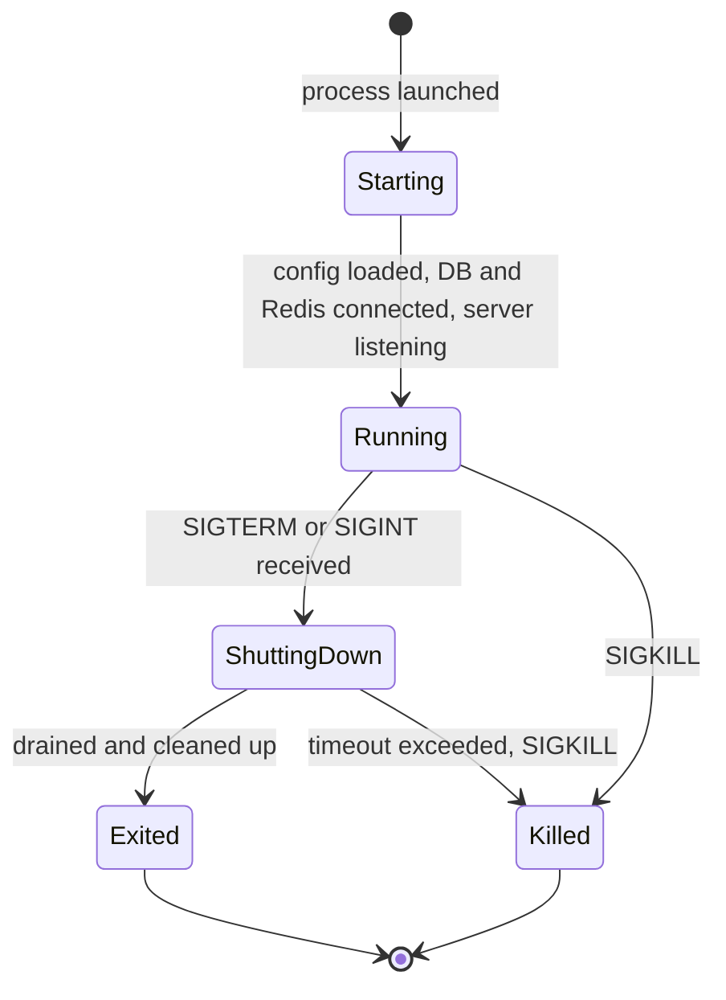
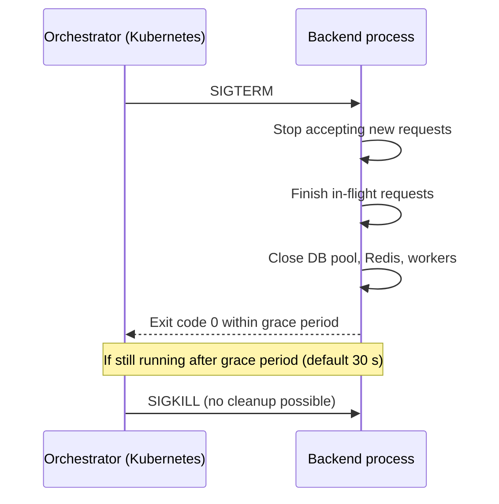
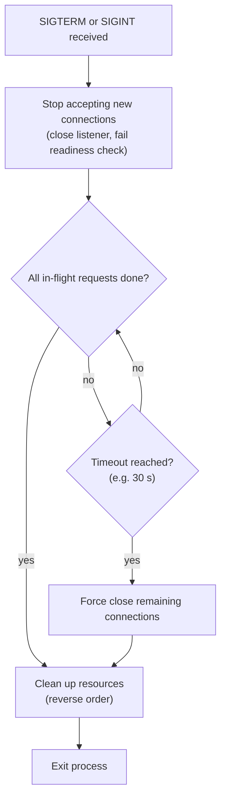
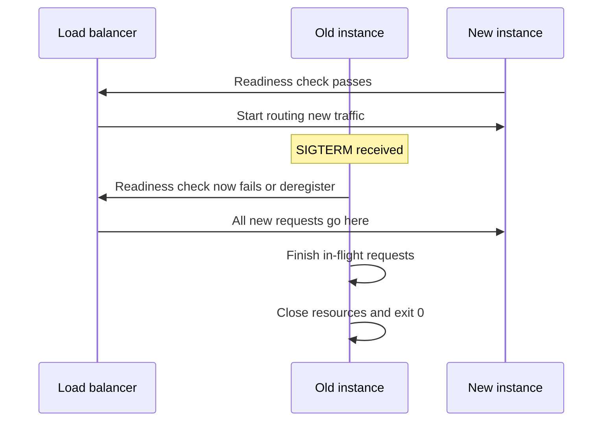
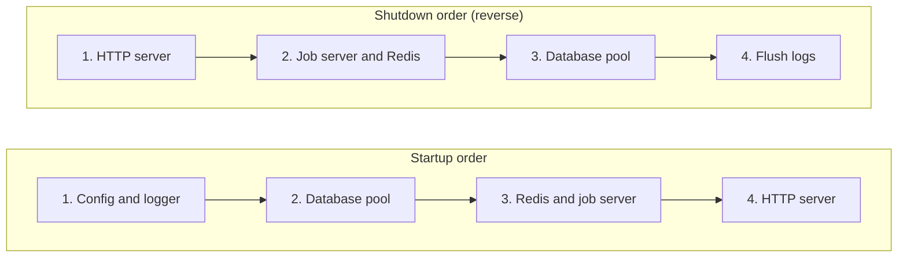

## TL;DR

- **Graceful shutdown** = when asked to stop, the server **stops taking new work, finishes in-flight work, cleans up resources, then exits** — instead of dying mid-request.
- Without it, a deploy or restart can **lose a payment, double-charge a customer, corrupt data, or leave transactions half-done**.
- Every app runs as an OS **process** with a **life cycle** (start → run → stop). The OS talks to processes through **signals** (a form of inter-process communication).
- **SIGTERM** = polite "please finish up and leave" (sent by Kubernetes, systemd, PM2, Docker). **SIGINT** = interrupt, usually **Ctrl+C** from a developer. Handle **both the same way**.
- **SIGKILL** = immediate death. It **cannot be caught or ignored** — no cleanup. Orchestrators send it if you ignore SIGTERM for too long.
- **Connection draining**: stop accepting new connections/requests → let in-flight ones finish → close. Bound it with a **timeout** (commonly **30 s**), tuned to your typical request duration.
- **Resource cleanup**: close HTTP server, DB pool (commit/roll back transactions), Redis/queue workers, file handles — in the **reverse order** they were acquired.
- Coordinate with **load balancers / service discovery / health checks** so traffic stops arriving before you stop serving.

## Why this matters

Picture this: a customer is mid-checkout, the payment is being processed, and at that exact moment someone deploys to production and the server restarts.

- Does the payment get lost?
- Does the customer get charged twice because of a race condition?
- Is the order row written but the payment row not?

**Zero-downtime deployments** make sure the new version is up and ready before traffic switches over — but at some point the **old server still has to shut down**, and that's the critical moment. This problem is as old as servers, and the solution is **graceful shutdown**.

> [!TIP]
> Analogy: **good manners**. When it's late and your guests must go, you don't shove them out and slam the door. You finish the conversation, say goodbye, tidy up, and *then* close the door. Your backend should do the same.

## Process life cycle

Everything that runs on an operating system runs as a **process** — including your backend. Like living things, a process has a **life cycle**:



When the OS (or a process manager) decides your app must stop, it doesn't just pull the plug immediately. It follows an established **protocol** — conceptually a conversation:

- OS: "It's time for you to stop."
- App: "Give me a few seconds to wrap up, then I'll exit."

Programs don't converse in text; this conversation happens through **signals**.

## Unix signals

**Signals** are a Unix mechanism for **inter-process communication (IPC)** — a way for the kernel or one process to notify another process of an event. "Unix" here covers Linux (Ubuntu, Arch, ...) and macOS. It matters because servers almost always run **Linux** (Windows servers are rare, specialized cases).

Your application **registers signal handlers**: code that waits in the background for specific signals and runs your shutdown routine when they arrive. In effect, the app tells the OS: "when you want me to stop, send me *this* signal and I'll shut myself down properly."

### SIGTERM — the polite request

- **SIG** = signal, **TERM** = terminate.
- A gentle tap on the shoulder: *"Excuse me, could you please finish up and leave?"*
- The app gets a **window** (a grace period, typically seconds) to:
  1. **Finish existing requests** (a busy server might have 10, 500, or thousands in flight).
  2. **Clean up resources.**
  3. **Exit.**
- **Who sends it:** deployment systems, **process managers** and **orchestrators** — **Kubernetes**, **systemd**, **PM2**, Docker (`docker stop`), the `kill <pid>` command (default signal).

### SIGINT — the interrupt

- **INT** = interrupt. Sent when a user presses **Ctrl+C** in the terminal running the process.
- A **user-initiated** shutdown; mostly seen in **development**. (Programs rarely use it to talk to each other.)
- In the demo, pressing Ctrl+C on the local Go server logs "signal received: interrupt" and then runs the graceful shutdown.

> [!IMPORTANT]
> **Handle SIGINT exactly like SIGTERM.** Whether a human (Ctrl+C locally) or a program (PM2 on an EC2 instance, Kubernetes) initiates it, the intent is the same — shut down cleanly.

### SIGKILL — the nuclear option

- **Cannot be caught, handled, or ignored.** The kernel terminates the process immediately. No handler runs; no cleanup happens.
- Equivalent to **pulling your computer's power plug** instead of clicking "Shut down".
- This is why graceful shutdown matters: if you don't respond to the polite signals (SIGTERM/SIGINT) in time, the orchestrator **escalates to SIGKILL**, and you lose the chance to clean up.

| Signal | Number | Sent by | Can be handled? | Typical meaning |
|---|---|---|---|---|
| `SIGTERM` | 15 | Kubernetes, systemd, PM2, Docker, `kill` | Yes | Please shut down gracefully |
| `SIGINT` | 2 | Ctrl+C in terminal | Yes | User interrupt — shut down gracefully |
| `SIGKILL` | 9 | `kill -9`, orchestrator after grace period, OOM killer | **No** | Die now |

```bash
kill -TERM 4242   # polite (same as plain: kill 4242)
kill -INT  4242   # like Ctrl+C
kill -KILL 4242   # same as kill -9: immediate, uncatchable
```



> [!NOTE]
> In Kubernetes, the grace period is `terminationGracePeriodSeconds` (default **30 s**). Docker's `docker stop` waits 10 s by default before SIGKILL. Your app's internal shutdown timeout should be **shorter** than the platform's grace period so you finish before being killed.

> [!INTERVIEW]
> **"What's the difference between SIGTERM and SIGKILL?"** — SIGTERM is a request to terminate; the process can catch it and shut down gracefully (drain requests, close connections). SIGKILL cannot be caught or ignored; the kernel kills the process instantly with no cleanup. Orchestrators send SIGTERM first and SIGKILL only if the process hasn't exited after the grace period.

## Step 1: finish in-flight requests (connection draining)

**In-flight requests** are requests the server is already processing when the shutdown signal arrives — tens, hundreds, or thousands, since an HTTP server handles many concurrently.

### The restaurant analogy

At closing time, a restaurant doesn't switch off the lights and throw diners out. Instead:

1. Someone at the door **stops letting new customers in**.
2. Staff **announce** to seated customers: "We're closing — you have 15–20 minutes to finish."
3. Customers finish, **pay their bills**, and leave.
4. Then the restaurant closes.

### Connection draining

The backend equivalent is called **connection draining**:

1. **Stop accepting new connections/requests** — new work only makes the situation messier.
2. **Let in-flight requests complete.**
3. **Close** connections.



The *idea* is the same everywhere; the *implementation* depends on the kind of server:

| Server type | Draining means |
|---|---|
| HTTP backend | Stop accepting new HTTP requests; let in-flight requests finish and send their responses |
| Database (also "a backend") | Stop accepting new queries/transactions; finish existing ones; then close connections |
| WebSocket server | **Notify clients** that the server is closing (close frame), then close sockets — not abruptly |
| Background workers / queue consumers | Stop pulling new jobs; finish (or re-queue) jobs in progress |

### The timeout: how long to wait?

You want to give in-flight work enough time, but you **can't wait forever** — a stuck or blocking operation would stall shutdown indefinitely. So production systems set a **hard limit**, commonly **30 seconds** (sometimes 60). Since no new requests are coming in, 30 s is usually plenty for a normal backend. After that, remaining work is forcibly stopped.

Choosing it is a trade-off:

| Timeout too short | Timeout too long |
|---|---|
| Interrupts legitimate operations (e.g. a slow report, an upload, a payment call) | Shutdowns become sluggish; deployments slow down; system responsiveness suffers |

Base it on your **typical request duration** and operational needs. Traditional REST APIs: ~30 s is generous. WebSockets, long polling, large uploads, or long-running jobs need more thought (or a design where work can be resumed/re-queued).

### Coordinating with load balancers and service discovery

Draining needs cooperation from the infrastructure in front of you:

- **Health checks**: on shutdown, start failing the **readiness** check so the load balancer stops routing new traffic to this instance.
- **Service discovery**: **deregister** the instance so other services stop sending it requests. (Service discovery = how deployed components — backend, database, Elasticsearch — find and talk to each other.)



> [!WARNING]
> In Kubernetes, endpoint removal and SIGTERM happen **concurrently**, so a pod can still receive a few requests right after SIGTERM. A common fix is a short **pre-stop delay** (e.g. a `preStop` sleep of a few seconds, or sleeping briefly before closing the listener) so the load balancer catches up before you stop accepting connections.

## Step 2: clean up resources

Like tidying your desk before leaving — putting the coffee cup in the sink — the app must release everything it acquired while running:

- **File handles** (file descriptors)
- **Network connections** (outgoing HTTP clients, sockets)
- **Database connections** (the pool) and **open transactions**
- **Redis / cache connections**, message-queue consumers, background job workers
- **Temporary files**, in-memory buffers that must be flushed (e.g. batched logs/metrics)

### Why it matters

- **File handles / network connections**: the OS mediates all file and network access (requests arrive via the network card, through the OS, to your app) and **limits how many file descriptors and connections a process can hold** at once. Leaking them during a process's life leads to exhaustion (`too many open files`), memory growth and performance problems.
- **Database transactions**: before shutdown, every open transaction must be explicitly **committed or rolled back**. Otherwise you risk inconsistent state, locks held until the DB notices the dead connection (deadlocks / blocked queries), or partially applied work.
- **Buffered data**: logs, metrics and traces batched in memory are lost if not flushed.

> [!NOTE]
> Precision: when a process exits, the OS reclaims its memory and file descriptors anyway. The real dangers of skipping cleanup are **semantic**: half-finished transactions, unflushed buffers, jobs marked "in progress" forever, peers (DB, clients, WebSocket users) that see an abrupt connection reset instead of a clean close.

### Clean up in reverse order of acquisition

If you acquired resources in the order **Redis → DB → HTTP server**, release them in the order **HTTP server → DB → Redis**. Later components often **depend on** earlier ones (HTTP handlers use the DB; the DB-backed jobs use Redis). Closing a dependency first would make still-running work fail.



> [!TIP]
> In Go, `defer` naturally gives you LIFO (reverse) order: resources deferred first are closed last.

## Implementation (Go)

The demo backend is written in **Go**. The flow:

1. **Register a handler** for OS signals using a context that is cancelled on interrupt/terminate.
2. On signal, call `shutdown`:
   - **HTTP server**: call the framework's shutdown method (Go's `http.Server.Shutdown`, Echo's `e.Shutdown`), which stops accepting new connections and waits for active ones to finish.
   - **Database**: close the pool. The backend talks to Postgres over **TCP connections**; with pooling there are many. Closing stops new queries, waits for in-progress ones, then closes each connection.
   - **Background job server** (**Asynq**, backed by Redis): shut it down; it waits for workers to finish and closes its Redis connections.
3. Log and exit.

```go
package main

import (
	"context"
	"errors"
	"log/slog"
	"net/http"
	"os"
	"os/signal"
	"syscall"
	"time"
)

func main() {
	db := mustOpenDB()          // acquired 1st
	jobs := mustStartJobServer() // acquired 2nd (Asynq, uses Redis)
	srv := &http.Server{Addr: ":8080", Handler: newRouter(db)}

	// Context cancelled on SIGINT (Ctrl+C) or SIGTERM (Kubernetes, systemd, PM2)
	ctx, stop := signal.NotifyContext(context.Background(), os.Interrupt, syscall.SIGTERM)
	defer stop()

	go func() {
		slog.Info("starting server", "addr", srv.Addr)
		if err := srv.ListenAndServe(); err != nil && !errors.Is(err, http.ErrServerClosed) {
			slog.Error("server error", "err", err)
			stop()
		}
	}()

	<-ctx.Done() // block until a signal arrives
	slog.Info("shutdown signal received")

	// Hard limit for draining; keep it below the platform grace period
	shutdownCtx, cancel := context.WithTimeout(context.Background(), 25*time.Second)
	defer cancel()

	// Reverse order of acquisition
	if err := srv.Shutdown(shutdownCtx); err != nil { // stop new conns, wait for in-flight
		slog.Error("http shutdown forced", "err", err)
	}
	jobs.Shutdown() // wait for workers, close Redis
	if err := db.Close(); err != nil {
		slog.Error("db close", "err", err)
	}
	slog.Info("server exited properly")
}
```

Node.js / TypeScript equivalent:

```ts
import http from "node:http";

const server = http.createServer(app);
server.listen(8080);

let shuttingDown = false;
async function shutdown(signal: string) {
  if (shuttingDown) return;
  shuttingDown = true;
  logger.info({ signal }, "shutdown signal received");

  const force = setTimeout(() => {
    logger.error("forced shutdown after timeout");
    process.exit(1);
  }, 25_000);

  server.close(async () => {       // stops accepting, resolves when in-flight requests finish
    await queue.close();           // stop background workers
    await redis.quit();
    await pool.end();              // close Postgres pool
    clearTimeout(force);
    logger.info("server exited properly");
    process.exit(0);
  });
  server.closeIdleConnections?.(); // close keep-alive sockets that are idle
}

process.on("SIGTERM", () => shutdown("SIGTERM"));
process.on("SIGINT", () => shutdown("SIGINT"));
```

### What the demo logs show

Start-up logs: connected to database → starting background job server → starting server. After **Ctrl+C**:

```text
INF signal received signal=interrupt
INF database connection closed
INF Starting graceful shutdown          (asynq)
INF Waiting for all workers to finish... (asynq)
INF All workers have finished           (asynq)
INF Exiting                             (asynq)
INF server exited properly
```

Even with no in-flight requests on a local machine, it took about a second — draining and closing take real time.

> [!TIP]
> You rarely write this from scratch: Node.js, Go, Rust and Python frameworks all have well-known graceful-shutdown snippets. What you must understand is **what** happens and **why**, so you can adapt it (timeouts, ordering, workers, WebSockets) to your system.

## Kubernetes deployment example (standard practice)

```yaml
spec:
  terminationGracePeriodSeconds: 30   # SIGTERM -> wait up to 30 s -> SIGKILL
  containers:
    - name: api
      image: todo-api:1.4.0
      readinessProbe:
        httpGet: { path: /readyz, port: 8080 }
        periodSeconds: 5
      lifecycle:
        preStop:
          exec:
            command: ["sh", "-c", "sleep 5"]  # let the load balancer stop routing first
```

> [!WARNING]
> If your container's entrypoint is a shell script (`sh -c "node server.js"`), the **shell** may receive SIGTERM and not forward it to your app — so the app never drains and gets SIGKILLed. Use exec form (`CMD ["node", "server.js"]`), `exec` in the script, or a tiny init like `tini`.

## Making shutdown safe for critical work

Graceful shutdown greatly reduces risk, but SIGKILL, crashes, OOM kills and power loss can still happen. For things like payments, combine it with:

- **Database transactions** so partial work is rolled back.
- **Idempotency keys** so a retried payment request doesn't double-charge.
- **Background jobs with acknowledgements/retries** so a job interrupted mid-way is re-delivered.

## Common mistakes & misconceptions

- **"Zero-downtime deploys make graceful shutdown unnecessary."** The old instance still stops at some point; without draining, its in-flight requests are cut off.
- **Handling SIGTERM but not SIGINT (or vice versa).** Treat them identically.
- **Trying to handle SIGKILL.** Impossible — it can't be caught or ignored.
- **No timeout.** A stuck request blocks shutdown forever (until the platform SIGKILLs you anyway).
- **App timeout longer than the platform grace period.** You get killed mid-cleanup; keep yours shorter.
- **Closing the DB before the HTTP server.** In-flight handlers then fail; clean up in reverse order.
- **Leaving transactions open.** Commit or roll back explicitly.
- **Forgetting background workers, WebSockets, and buffered telemetry.** They need draining/flushing too.
- **Not failing readiness / deregistering.** The load balancer keeps sending traffic to a dying instance.
- **Shell entrypoint swallowing signals in Docker.**
- **Assuming graceful shutdown guarantees no loss.** Pair it with transactions, idempotency and retries.

## Interview questions

<details>
<summary><strong>Q: What is graceful shutdown and why do we need it?</strong></summary>

Graceful shutdown means that when a server is asked to stop, it stops accepting new work, lets in-flight requests and jobs finish (within a timeout), releases resources like DB pools and Redis connections, and then exits. Without it, deploys, scale-downs and restarts would cut requests mid-way — causing lost or duplicated payments, half-written data, broken client connections, and errors visible to users.

</details>

<details>
<summary><strong>Q: Explain SIGTERM, SIGINT and SIGKILL.</strong></summary>

All are Unix signals (IPC). SIGTERM (15) is the polite termination request sent by Kubernetes, systemd, PM2, Docker or plain `kill`; the app can catch it and shut down gracefully. SIGINT (2) is the interrupt sent by Ctrl+C in a terminal — user-initiated, usually in development; handle it the same as SIGTERM. SIGKILL (9) cannot be caught or ignored; the kernel kills the process immediately with no cleanup — orchestrators use it when the grace period expires.

</details>

<details>
<summary><strong>Q: What is connection draining?</strong></summary>

Draining is the first phase of graceful shutdown: stop accepting new connections/requests, allow in-flight ones to complete, then close connections. For HTTP that's closing the listener and waiting for active requests (e.g. Go's `http.Server.Shutdown`); for a database, finishing current queries/transactions before closing; for WebSockets, sending close frames to clients before closing sockets. It's bounded by a timeout, and coordinated with the load balancer by failing readiness or deregistering.

</details>

<details>
<summary><strong>Q: How do you choose the shutdown timeout?</strong></summary>

Based on typical (and worst acceptable) request duration and operational needs. Too short interrupts legitimate work; too long makes deploys and scale-downs slow. 30 seconds is a common default for REST APIs. Long-lived connections (WebSockets, streaming, uploads) need special handling. The app's internal timeout must be less than the platform's grace period (e.g. Kubernetes `terminationGracePeriodSeconds`, default 30 s) so cleanup completes before SIGKILL.

</details>

<details>
<summary><strong>Q: In what order should resources be cleaned up and why?</strong></summary>

In reverse order of acquisition. If startup is DB → Redis/job server → HTTP server, shutdown is HTTP server → job server/Redis → DB → flush logs. Later components depend on earlier ones; closing the DB first would make in-flight HTTP handlers and jobs fail. Go's `defer` gives this LIFO order naturally.

</details>

<details>
<summary><strong>Q: What happens if your app ignores SIGTERM in Kubernetes?</strong></summary>

Kubernetes waits `terminationGracePeriodSeconds` (default 30 s), then sends SIGKILL. The process dies instantly: in-flight requests are cut (clients see connection resets or 502s), transactions are left for the DB to roll back when it notices, background jobs are interrupted, and buffered logs/metrics are lost. Deploys also take the full grace period every time.

</details>

<details>
<summary><strong>Q: During a rolling deploy, users still see a few 502 errors even though you implemented graceful shutdown. Why?</strong></summary>

Most likely the instance stops accepting connections before the load balancer has stopped routing to it — in Kubernetes, SIGTERM and endpoint removal happen concurrently. Fix: fail the readiness probe on shutdown and/or add a short `preStop` sleep (a few seconds) before closing the listener. Also check keep-alive connections are closed properly and that the container actually receives SIGTERM (no shell entrypoint swallowing it).

</details>

<details>
<summary><strong>Q: A payment request is in progress when SIGTERM arrives. Walk through what should happen.</strong></summary>

The server stops accepting new requests but lets the payment handler finish: it completes the call to the payment provider, commits the DB transaction, and sends the response. Then the DB pool and other resources close and the process exits. If the timeout is hit or the process is SIGKILLed anyway, safety relies on transactions (partial writes roll back) and idempotency keys (the client's retry doesn't double-charge), plus reconciliation with the provider.

</details>

<details>
<summary><strong>Q: How do background job workers fit into graceful shutdown?</strong></summary>

On shutdown, workers should stop fetching new jobs, finish the jobs in progress (within a timeout), and then close their broker connections (e.g. Redis for Asynq/BullMQ). Jobs not finished in time should be returned to the queue or rely on visibility timeouts/acknowledgements so another worker retries them. Jobs must be idempotent because they may run twice.

</details>

<details>
<summary><strong>Q: Why should the database transactions be committed or rolled back explicitly before exit?</strong></summary>

An open transaction holds locks and represents partial work. If the process just dies, the DB eventually detects the dropped connection and rolls back, but until then locks may block other queries, and the application's view of what happened is unknown. Explicitly finishing transactions keeps data consistent and releases locks promptly.

</details>

## Cheat sheet

- **Graceful shutdown = stop new work → finish in-flight → clean up → exit.**
- **Process life cycle:** start → run → stop.
- **Signals (IPC):** SIGTERM (15, polite, orchestrators/`kill`), SIGINT (2, Ctrl+C), SIGKILL (9, uncatchable, no cleanup).
- **Handle SIGTERM and SIGINT the same way.**
- **Who sends SIGTERM:** Kubernetes, systemd, PM2, Docker.
- **Draining:** close listener / fail readiness → wait for active requests → close.
- **Per type:** HTTP (finish requests), DB (finish queries/transactions), WebSocket (notify clients then close), workers (finish or re-queue jobs).
- **Timeout:** ~30 s typical; shorter than platform grace period (K8s default 30 s, Docker stop 10 s).
- **Cleanup:** HTTP server, DB pool (commit/rollback), Redis, job workers, file handles, temp files, flush logs.
- **Order:** reverse of acquisition (LIFO; Go `defer`).
- **Go:** `signal.NotifyContext(ctx, os.Interrupt, syscall.SIGTERM)` + `srv.Shutdown(ctxWithTimeout)`.
- **Node:** `process.on("SIGTERM")` + `server.close()` + force-exit timer.
- **K8s:** `terminationGracePeriodSeconds`, readiness probe, `preStop` sleep; exec-form entrypoint so signals reach the app.
- **Safety net:** transactions, idempotency keys, job retries.

## Glossary

- **Graceful shutdown** — stopping a server by draining work and releasing resources before exiting.
- **Process** — a running instance of a program managed by the OS.
- **Process life cycle** — the start, run and termination phases of a process.
- **Signal** — an asynchronous notification sent to a process by the kernel or another process.
- **IPC (inter-process communication)** — mechanisms by which processes exchange information; signals are one.
- **Signal handler** — code registered by a process to run when a given signal arrives.
- **SIGTERM** — catchable termination request (graceful).
- **SIGINT** — catchable interrupt, typically from Ctrl+C.
- **SIGKILL** — uncatchable, unignorable immediate kill.
- **In-flight request** — a request already being processed when shutdown begins.
- **Connection draining** — refusing new connections while letting existing ones complete.
- **Shutdown timeout / grace period** — maximum time allowed for draining before forced termination.
- **Process manager** — tool that runs and supervises processes (PM2, systemd).
- **Orchestrator** — platform managing containers across machines (Kubernetes).
- **Zero-downtime deployment** — releasing a new version without the service becoming unavailable.
- **Readiness probe** — health check telling the load balancer whether an instance should receive traffic.
- **Service discovery** — mechanism for services to find and register/deregister with each other.
- **preStop hook** — Kubernetes hook run before SIGTERM is sent to a container.
- **File handle / file descriptor** — OS reference to an open file or socket; limited per process.
- **Connection pool** — set of reusable open TCP connections to a database.
- **Asynq** — Go background job library backed by Redis.
- **Idempotency key** — client-supplied ID ensuring a retried request has the same effect only once.

## Video timestamps

- [00:00](https://www.youtube.com/watch?v=6rfBgphiCWM&t=0s) — The payment-during-deploy scenario
- [02:04](https://www.youtube.com/watch?v=6rfBgphiCWM&t=124s) — Graceful shutdown as good manners
- [03:05](https://www.youtube.com/watch?v=6rfBgphiCWM&t=185s) — Process life cycle management
- [05:07](https://www.youtube.com/watch?v=6rfBgphiCWM&t=307s) — Signals and inter-process communication
- [07:10](https://www.youtube.com/watch?v=6rfBgphiCWM&t=430s) — Registering signal handlers
- [08:10](https://www.youtube.com/watch?v=6rfBgphiCWM&t=490s) — SIGTERM: the polite request
- [11:14](https://www.youtube.com/watch?v=6rfBgphiCWM&t=674s) — Who sends SIGTERM: Kubernetes, systemd, PM2
- [12:15](https://www.youtube.com/watch?v=6rfBgphiCWM&t=735s) — SIGINT and Ctrl+C
- [15:17](https://www.youtube.com/watch?v=6rfBgphiCWM&t=917s) — SIGKILL: cannot be caught or ignored
- [17:20](https://www.youtube.com/watch?v=6rfBgphiCWM&t=1040s) — In-flight requests
- [18:22](https://www.youtube.com/watch?v=6rfBgphiCWM&t=1102s) — The restaurant closing analogy
- [20:25](https://www.youtube.com/watch?v=6rfBgphiCWM&t=1225s) — Connection draining
- [21:25](https://www.youtube.com/watch?v=6rfBgphiCWM&t=1285s) — Draining for HTTP, databases, WebSockets
- [22:28](https://www.youtube.com/watch?v=6rfBgphiCWM&t=1348s) — Shutdown timeouts
- [24:30](https://www.youtube.com/watch?v=6rfBgphiCWM&t=1470s) — Choosing the timeout, load balancers and service discovery
- [25:31](https://www.youtube.com/watch?v=6rfBgphiCWM&t=1531s) — Resource cleanup
- [27:35](https://www.youtube.com/watch?v=6rfBgphiCWM&t=1655s) — Network connections and database transactions
- [29:37](https://www.youtube.com/watch?v=6rfBgphiCWM&t=1777s) — Clean up in reverse order
- [30:39](https://www.youtube.com/watch?v=6rfBgphiCWM&t=1839s) — Go implementation walkthrough
- [32:42](https://www.youtube.com/watch?v=6rfBgphiCWM&t=1962s) — Live demo with Ctrl+C and shutdown logs
- [34:44](https://www.youtube.com/watch?v=6rfBgphiCWM&t=2084s) — Summary
