## TL;DR

- **Latency** is how long one request takes end to end; it is what users mean when they say "your app is slow". It is a *distribution*, not a single number, so we describe it with **percentiles (P50, P90, P95, P99)**, never with averages.
- **Throughput** is how many requests per unit time the system handles (requests per second). Latency and throughput are linked: as load rises, latency stays flat for a while and then shoots up.
- **Utilization** is the fraction of capacity in use. Latency grows *non-linearly* with utilization; near 100% queues explode. Production systems typically run at **60–80% utilization** and keep headroom for **bursty** traffic.
- A slow system is slow because of a specific **bottleneck**. **Never guess, always measure**: use timing logs, **profilers / flame graphs** (good for CPU-bound work) and **distributed tracing** (good for I/O-bound work, which is most backend work).
- The usual database culprits: the **N+1 query** problem (fix with joins / bulk fetch / ORM eager loading), **missing indexes** (find them with `EXPLAIN ANALYZE`; but indexes cost space and slow writes), and **connection overhead** (fix with **connection pooling**, ideally an **external pooler like PgBouncer** when you scale horizontally).
- **Caching** stores results of expensive operations. The hard part is **invalidation** (time-based TTL vs event-based). Caches can be **local** (in-process), **distributed** (Redis, Memcached, Valkey) or **tiered**. Patterns: **cache-aside**, **write-through**, **write-behind**. Track the **cache hit rate**.
- **Vertical scaling** (bigger machine) is simple but has a hardware ceiling, is a single point of failure and has no geographic distribution. **Horizontal scaling** (more machines) removes those limits but introduces distributed-systems complexity: load balancing, shared state, network partitions, health checks.

## Why this matters

"Make it scale" and "make it fast" are the most common hand-wavy requirements in backend work and in system-design interviews. Without a precise vocabulary (P99, throughput, utilization, bottleneck) and a disciplined method (measure first, then fix the actual bottleneck), engineers burn weeks adding Redis or more servers to problems they do not have. This chapter builds the mental models first, so that later techniques (load balancing, replication, sharding, CDNs, covered in Part 2) feel like natural answers to concrete problems rather than buzzwords to memorise.

## What does "fast" actually mean?

### The life of a click

Consider a user clicking a button in a web app:

1. The browser sends an HTTP request across the internet to your server.
2. The server receives it and runs your handler.
3. The handler probably talks to the database (read or write some data).
4. It may call external APIs, e.g. an email provider such as Resend to send an email.
5. The server builds a response (usually JSON) and sends it back over the internet.
6. The browser parses the JSON, runs some JavaScript and renders, say, a few cards.

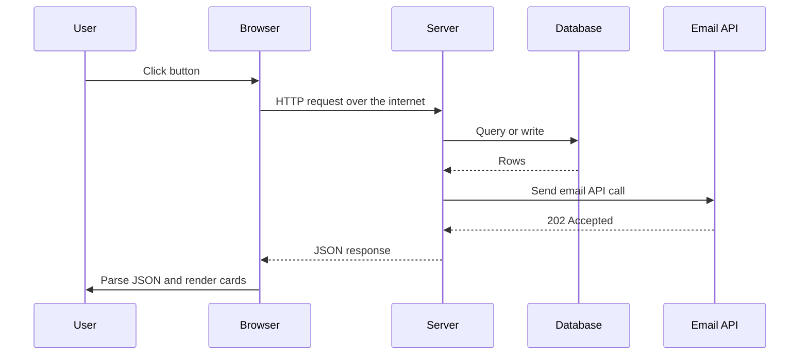

The total time from the click to the cards appearing is the **latency** the user experiences. Latency is the first and most fundamental performance metric, because performance has to be expressed as a *measurable number*, not as feelings like "fast" or "slow". When anyone says "your app is slow", whether or not they know the word, they are talking about latency.

> [!NOTE]
> In backend monitoring we usually measure **server-side latency** (time from request arrival to response sent) and sometimes **end-to-end latency** (what the user sees, including network and rendering). The user feels the second one; you can directly control mostly the first one plus network payload size.

### Latency is a distribution, not a number

Two requests to the same endpoint can take very different times:

- Request A: **50 ms**. Maybe it hit a cache (a CDN edge or an in-memory cache such as Redis) close to the user, or it arrived when the server was idle.
- Request B: **200 ms**. Maybe it missed the cache and had to travel to the origin server and run a database query, or it arrived while the server was already concurrently processing 50 other requests.

Real-world traffic over the internet is never as predictable as a whiteboard model. So "our latency is 500 ms" is a meaningless statement on its own.

### Why averages lie

The average of the two requests above is 125 ms, which describes neither of them. Averages are fine in many contexts, but for performance the *variation* is the whole story, and averages hide it.

Worked example:

| Measurement | Value |
|---|---|
| Requests measured | 1,000 |
| 99% of requests | under 50 ms |
| 1% of requests | about 5 s |
| Average | about 100 ms (looks great) |

Scale it to **1 million requests per day**: **10,000 requests per day** wait 5 seconds staring at a loader. The average says "a hundred-ish milliseconds, all good" while ten thousand real users have a terrible experience. You will never discover your system's limits by looking at averages.

> [!IMPORTANT]
> For performance, **use percentiles, not averages**. Averages hide the tail, and the tail is where real users suffer.

### Percentiles: P50, P90, P95, P99

A percentile tells you the latency value below which a given percentage of requests fall.

| Term | Meaning | Intuitive reading |
|---|---|---|
| **P50** (median) = 400 ms | 50% of requests finish in 400 ms or less | Half your users wait at least 400 ms |
| **P90** = 900 ms | 90% of requests finish in 900 ms or less | **10%** of users wait 900 ms or more |
| **P95** | 95% finish within this value | 5% of users wait at least this long |
| **P99** = 2 s | 99% of requests finish in 2 s or less | **1%** of users wait 2 s or more |

The quick trick: subtract the percentile from 100 to get the share of users who see that latency *or worse*. P99 = 2 s means 1 in 100 requests takes 2 seconds or longer.

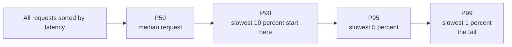

### Why engineers obsess over P95 and P99 (tail latency)

Backend engineers focus heavily on **P95 and P99** ("tail latency"), and not only out of empathy for unhappy users:

- The slowest requests are usually the ones running the **most complex business logic**, the **most complex database queries** and the most **cross-service coordination**: calling external services, sending emails, waiting for webhooks.
- Those complex workflows usually belong to your **most valuable users**. A user making a payment or a purchase triggers heavier queries and logic than a user casually browsing. So the tail is often the checkout flow, i.e. your revenue.

> [!INTERVIEW]
> **"Why do you monitor P99 instead of average latency?"** Because latency is a skewed distribution. An average of 100 ms can hide 1% of requests taking 5 s; at 1M requests per day that is 10,000 bad experiences. The tail usually contains the most complex, most valuable workflows (checkout, payment). Also, in a page that makes many backend calls, the chance that *at least one* call hits the tail is high, so tail latency dominates what users feel.

> [!NOTE]
> Extra standard fact: if one page load fans out to 100 backend calls, the probability that none of them hits the P99 is 0.99^100, about 37%. So 63% of page loads experience at least one P99-level call. This is why tail latency matters even more in microservice architectures.

## Throughput

**Latency** = how long one request takes. **Throughput** = how many requests the system handles in a time window, typically **requests per second (RPS)** or per minute (also QPS, queries per second, for databases).

Why track both? Because a system can look great at low load and collapse at high load:

| Load | Latency |
|---|---|
| 10 requests per second | 150 ms |
| 1,000 requests per second | 2 s |

Throughput together with latency answers very practical questions:

- Can our e-commerce site survive the **Black Friday** spike, when traffic jumps to hundreds of thousands or millions of requests?
- Will we survive if we start an **email campaign**, or get featured on a popular podcast, blog or website?
- How many **concurrent users** can we support, and how many RPS, before we need more resources?

The relationship between them is not intuitive: as throughput increases, latency rises **slowly at first, then dramatically** after some point. Understanding why is the next section.

## Utilization and the latency curve

### The ice cream shop analogy

- **Sunday evening**: the shop is empty. You order, pay and get your ice cream instantly. The worker is barely busy. This is **low utilization, low latency**.
- **Tuesday lunchtime**: there is a long queue and you are somewhere in the middle, grumpy. The worker still takes exactly **2 minutes per ice cream**, the same rate as on Sunday. But your **perceived wait** is much longer because you wait for everyone ahead of you.

The key insight: the **service rate did not change; the queueing did**. Servers behave identically. At low utilization the CPU picks up each request and responds almost immediately. As more requests arrive, each request waits for the ones ahead of it, forming a **queue**. Higher utilization means a longer queue and a longer wait per request.

### Utilization defined

**Utilization** = the percentage of the system's capacity currently in active use.

- 0% = idle, using none of its resources.
- 100% = maxed out, cannot take anything else, on the brink of collapse.

### The counterintuitive curve

We intuitively expect latency to grow linearly with utilization. In reality it stays fairly flat, then grows **explosively** as utilization approaches 100%. (The speaker calls it exponential; in queueing theory the classic M/M/1 model gives waiting time proportional to `1 / (1 - utilization)`, which blows up towards infinity as utilization approaches 1. The shape is what matters: a hockey stick.)

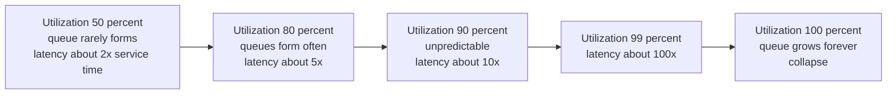

> [!NOTE]
> The multipliers above come from the simple M/M/1 queue formula, response time = service time / (1 - utilization). Real systems differ in detail but show the same hockey-stick shape.

### The highway analogy

- **50% capacity**: cars have room to overtake and change lanes; traffic flows smoothly and everyone arrives in predictable time.
- **80% capacity**: slowdowns appear. Overtaking and lane changes need planning and caution.
- **90% capacity**: traffic becomes **unpredictable**. Sometimes it flows when gaps line up; sometimes one impatient driver braking or merging causes a **ripple effect** and a jam behind them.
- **100% capacity**: every spot is occupied. Nobody moves.

### Headroom and bursty traffic

The practical conclusion: **you cannot run a system at 100% utilization and expect it to perform**. You need **headroom**, spare capacity to absorb traffic.

- Real production systems typically run at around **60–80% utilization**, keeping the remaining 20% or more as a buffer.
- Traffic is **bursty**, not a metronome. One minute you get a flood of requests, the next minute zero, then a thousand more half an hour later.
- Even if your *average* load is 40–50% of capacity, a burst can instantly push you past 100%. Without headroom, the system crashes.

> [!IMPORTANT]
> Latency is non-linear in utilization. Keep headroom (run at roughly 60–80%) because traffic arrives in bursts. "Our average CPU is 50%" does not mean you are safe.

> [!INTERVIEW]
> **"Our servers are at 85% CPU and latency doubled, but throughput only went up 10%. Why?"** Because of queueing. As utilization nears 100%, each request spends more time waiting in queues than being processed, so latency grows sharply while throughput barely increases (the system is already near its maximum processing rate). The fix is to add capacity or reduce work per request so utilization drops back into the 60–80% range.

## Bottlenecks: never guess, always measure

### What a bottleneck is

When a system is slow, *something specific* is making it slow. Finding that something is **identifying the bottleneck**. It sounds obvious, but in practice engineers often skip this step and jump straight to "by-the-book" solutions:

- "Latency? Add caching."
- "Database slow? Upgrade Postgres 16 to Postgres 18. Upgrade the packages."
- "Server slow? Add more servers" (horizontal scaling).

Sometimes this works by luck. More often you spend days or weeks solving a problem you do not have, while the real bottleneck stays untouched and the system stays slow.

### A cautionary story

1. `GET /products/:productId` seems slow.
2. Assumption: "The database is always the problem." The team spends a week adding a Redis cache in front of the query and deploys it.
3. The API is **still slow**.
4. Now they actually add granular timing logs: when the request arrives, when the DB query starts and ends, when the cache is called.
5. Findings:

| Step | Time |
|---|---|
| Database query | ~10 ms |
| New Redis cache lookup | ~5 ms |
| **Synchronous write to a remote logging service** (e.g. Elasticsearch) | **~500 ms** |

The real culprit was a logging call that **blocked the request** while it shipped the log line to a remote service, instead of doing it asynchronously. The database was never the problem.

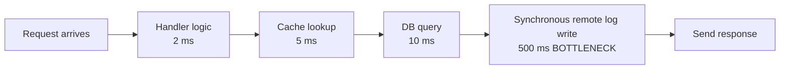

The fix is to log asynchronously (buffer locally, ship in the background) so the request does not wait:

```ts
// Bad: request waits for the remote logging service
app.get("/products/:id", async (req, res) => {
  const product = await getProduct(req.params.id);
  await remoteLogger.send({ event: "product_viewed", id: req.params.id }); // ~500 ms
  res.json(product);
});

// Better: fire-and-forget into a local buffer, shipped in the background
app.get("/products/:id", async (req, res) => {
  const product = await getProduct(req.params.id);
  logger.info({ event: "product_viewed", id: req.params.id }); // buffered, non-blocking
  res.json(product);
});
```

Other non-obvious culprits that frequently turn out to be the real bottleneck:

- **JSON or XML serialization** of large objects.
- A **huge response payload**, where the code is fast but network transmission is slow.
- Calling an **external API inside a loop**.

> [!WARNING]
> The most expensive performance mistake is optimising the wrong component. Before adding a cache, a server or an upgrade, prove with measurements which step consumes the milliseconds.

### Profiling and flame graphs

**Profiling** is measuring where your application actually spends its time. A profiler attaches to the running application, samples what is executing while it serves real requests, and records which functions run, when they start and when they return.

Raw profiler output is overwhelming (thousands of functions, each with a fraction of total time), so we visualise it with a **flame graph**:

- It shows the **call stack** (which function called which).
- **Wider boxes = more time** spent in that function (including its children), so your eye goes to the expensive parts.
- Functions called by other functions are **stacked on top** of their callers.

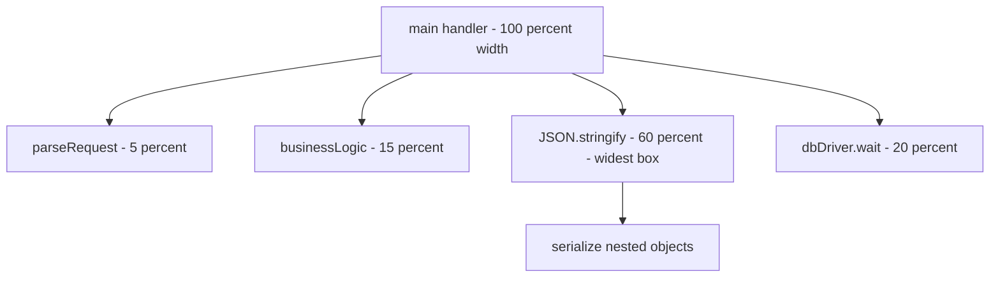

The first time you look at a flame graph, you will be surprised: the bottleneck is rarely where you expected. You assume the complex business logic is the CPU hog, but it is actually JSON serialization. You assume database queries dominate, but it is an external API call inside a loop.

### CPU-bound vs I/O-bound work

| | CPU-bound | I/O-bound |
|---|---|---|
| What the time is spent on | Computing (CPU cycles) | Waiting for input/output |
| Examples | Image processing, ML math, matrix operations, compression, heavy serialization | Database queries, file access, network calls to external APIs, queues |
| Best measurement tool | CPU profiler + flame graph | Distributed tracing |
| Typical in SaaS backends? | Less common | **Most performance problems** |

CPU profilers are good at CPU-bound work but poor at showing time spent *waiting* on I/O, because a waiting thread is not consuming CPU. Typical SaaS backends are mostly I/O-bound, unless you do image processing or ML-style computation.

### Distributed tracing

**Distributed tracing** (part of **observability**, alongside logs and metrics) follows one request as it flows through the system, recording timed **spans**: when it entered a component, when a DB query started and finished, when an external API call was made, and so on.

With tracing set up, you can see something like: `GET /products/5` spent **2 ms** in business code and **800 ms** in the database query. Now you know exactly where to focus.

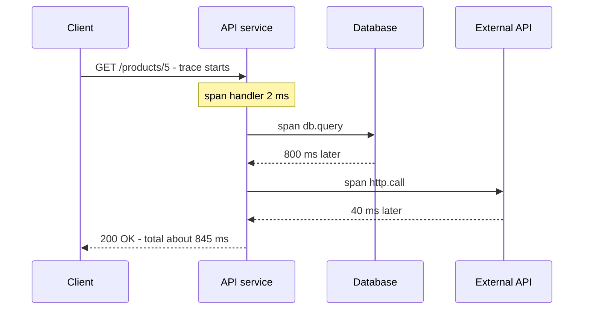

> [!TIP]
> Standard tooling: OpenTelemetry for instrumentation, with backends such as Jaeger, Zipkin, Grafana Tempo, Datadog or Honeycomb. Each trace has a trace ID propagated across services (usually via a `traceparent` HTTP header) so spans from different services join into one timeline.

## Databases as the usual bottleneck

Databases are among the first places to look, and for good reason, not because they are badly built. They do hard work:

- Store data **durably** on disk so it survives restarts, across inserts, updates and deletes, while surviving crashes and failures.
- Provide **consistency** under concurrent reads and writes, using locking and other sophisticated techniques.
- Execute **complex queries over millions or billions of rows**.

All of that takes time. But there are well-known low-hanging fruits: **N+1 queries, missing indexes, and connection overhead**.

### The N+1 query problem

#### The problem

A blog homepage shows 20 posts, each with its author's name. The list API does not include author details. So the client:

1. Calls the list endpoint once (1 call), getting 20 posts.
2. Loops over the posts and calls the author endpoint for each (20 calls).

Total: **21 calls**. This pattern is **N+1**: one query to fetch N items, then N more queries to fetch one detail for each.

| Items shown | Calls made |
|---|---|
| 20 | 21 |
| 100 | 101 |
| 1,000 | 1,001 |

The number of calls grows linearly with the number of items, which is clearly wrong.

#### Why it is slow even if each query is fast

Every query has fixed overhead:

- A network round trip between the app server and the DB server.
- Possibly a TCP connection setup (if no pooling).
- The database must **parse** the query, **plan** its execution, **execute** it and **return** results.

Even at a very fast 5 ms per query, 1,000 queries = **5,000 ms = 5 seconds** of loader for the user.

#### The fix: fetch in bulk

Collect all author IDs into one array and fetch them in **one query**. Now it is 2 queries total (posts, then authors), whether you show 20, 100 or 1,000 posts. Or use a single JOIN.

#### Where N+1 really lives: the server and the ORM

The frontend example is just intuition. The classic N+1 is on the **server**, because the server is effectively the "frontend" of the database. ORMs make it easy to write accidentally, because database access looks like ordinary code:

```ts
// N+1: 1 query for posts + N queries for authors
const posts = await db.select().from(postsTable).where(eq(postsTable.userId, userId));
for (const post of posts) {
  post.author = await db.select().from(users).where(eq(users.id, post.authorId)); // runs N times
}
```

```ts
// Fix 1: bulk fetch (2 queries total)
const posts = await db.select().from(postsTable);
const authorIds = [...new Set(posts.map((p) => p.authorId))];
const authors = await db.select().from(users).where(inArray(users.id, authorIds));
const byId = new Map(authors.map((a) => [a.id, a]));
const result = posts.map((p) => ({ ...p, author: byId.get(p.authorId) }));
```

```sql
-- Fix 2: one query with a JOIN
SELECT p.id, p.title, u.name AS author_name
FROM posts p
JOIN users u ON u.id = p.author_id
ORDER BY p.created_at DESC
LIMIT 20;
```

ORM primitives for eager loading:

| ORM / framework | Eager-loading primitive |
|---|---|
| Django | `select_related` (foreign key / one-to-one, uses JOIN), `prefetch_related` (many-to-many / reverse FK, separate bulk query) |
| Ruby on Rails (ActiveRecord) | `includes` (also `preload`, `eager_load`) |
| TypeORM | `leftJoinAndSelect` in the query builder, or `relations` |
| Prisma | `include` / nested `select` |
| Drizzle | relational queries `with`, or explicit joins |
| Raw SQL | `JOIN` (inner / left) or `WHERE id IN (...)` / `= ANY($1)` |

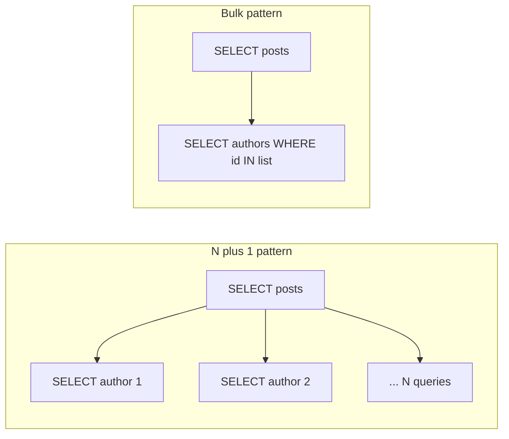

> [!TIP]
> Turn on your ORM's SQL query logging in development. Most modern ORMs can print the exact SQL they run. If a single page triggers dozens of near-identical queries, you have found an N+1.

### Indexes

The most common source of database performance problems is the **absence** of the right index.

#### The library analogy

A library has a million books across floors, rooms, sections and shelves, with **no catalog**. A reader asks for every book by John Green. You must walk through the entire library examining every book. It takes, say, 3 days. And when the next reader asks the same question, you do it all over again (the books were re-shelved randomly).

That full walk is a **sequential scan** (also called a **full table scan**): the database examines every row to see whether it matches. On a large table that may take one to several seconds, which is slow by modern standards.

Now keep a **catalog sorted by author name**, with each entry pointing to the exact shelf locations of that author's books. You look up "J ... John Green", go straight to those shelves and are done in minutes. That catalog is an **index**.

#### How an index works

- An index is a separate data structure, usually a **B-tree** (other types exist, such as hash, GIN, GiST, BRIN).
- It keeps a **sorted copy of a column's values** with **pointers** to the matching rows.
- E.g. index `books.author_id`: sorted values 1, 2, 3, 4 ... each pointing to rows. "All books by author 3" becomes a fast tree lookup instead of scanning every row.
- Illustrative numbers from the video: on a million rows, a few seconds with a sequential scan vs well under 100 ms with an index. (B-tree lookups are O(log n), so on indexed equality lookups you often see single-digit milliseconds.)

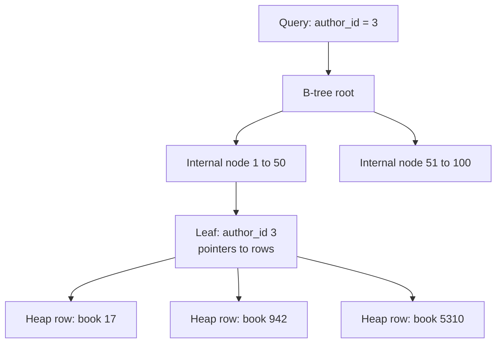

#### Indexes are not free

1. **Storage**: the index stores sorted values plus pointers; it grows with the table.
2. **Write amplification (the bigger problem)**: every `INSERT`, `UPDATE` or `DELETE` on the table must also update **every index** on that table, so reads stay correct. Index every column "for performance" and all your writes slow down significantly.

> [!WARNING]
> Do not index every column. Each extra index makes every write slower and uses disk and memory. Index based on measured query patterns.

#### Deciding what to index

- The **primary key** is indexed automatically (in Postgres and most relational databases). Searching by `id` already uses an index.
- **Obvious access paths** can be indexed up front in the migration, e.g. `books.author_id`, because "all books by an author" is clearly a core query. (Note: Postgres does **not** automatically index foreign-key columns; you must add them.)
- For **non-obvious columns**, wait. Monitor logs and traces in production. When tracing shows a hot endpoint whose query is slow because, say, `isbn` is unindexed, add an index on `isbn`. Indexes also speed up **joins**, so check join columns too.

```sql
CREATE INDEX idx_books_author_id ON books (author_id);
CREATE INDEX idx_books_isbn ON books (isbn);
```

#### Composite indexes

A **composite (multi-column) index** covers several columns in a specific order. If you often query by `user_id` and `created_at` together, an index on `(user_id, created_at)` is better than two separate single-column indexes.

**Column order matters** (the leftmost-prefix rule):

| Query filters on | Uses index `(user_id, created_at)`? |
|---|---|
| `user_id` and `created_at` | Yes |
| `user_id` only | Yes (leftmost prefix) |
| `created_at` only | **No** (generally not efficiently) |

```sql
CREATE INDEX idx_orders_user_created ON orders (user_id, created_at);

-- Uses the index: equality on the first column, range/sort on the second
SELECT * FROM orders
WHERE user_id = 42 AND created_at > now() - interval '30 days'
ORDER BY created_at DESC;
```

#### Covering indexes

A `departments` table has 100 columns, but the UI only needs `id` and `name`. A **covering index** contains *every column the query needs*, so the database answers entirely from the index without visiting the table (an **index-only scan**). The trade-off: more columns in the index means a bigger index.

```sql
-- Postgres 11+: key column name, plus id stored in the index leaf
CREATE INDEX idx_departments_name_cover ON departments (name) INCLUDE (id);

SELECT id, name FROM departments WHERE name LIKE 'Eng%';  -- can be an index-only scan
```

> [!NOTE]
> Precision: an index "covers" a *query*, not a column. A covering index for `SELECT id, name ... WHERE name = ...` must contain both `name` and `id`. In Postgres, index-only scans also depend on the visibility map being up to date (VACUUM).

#### Finding missing indexes with EXPLAIN ANALYZE

Once tracing points you to a slow complex query (joins, GROUP BY, HAVING...), how do you know which column to index? Prefix the query with **`EXPLAIN ANALYZE`**. The database executes it and shows the **query plan**: which table it started from, the join order and method, which indexes it used, and the actual time and rows of each step.

- Look for **`Seq Scan`** on large tables (thousands or millions of rows), a likely cause of latency.
- Add an index, re-run `EXPLAIN ANALYZE`, and confirm the plan now shows **`Index Scan`** (or `Index Only Scan` / `Bitmap Index Scan`) and the time dropped.

```sql
EXPLAIN ANALYZE
SELECT * FROM books WHERE isbn = '978-0142424179';

-- Before:
-- Seq Scan on books  (cost=0.00..21500.00 rows=1 width=120) (actual time=0.03..412.8 rows=1 loops=1)
--   Filter: (isbn = '978-0142424179')
--   Rows Removed by Filter: 999999
-- After CREATE INDEX:
-- Index Scan using idx_books_isbn on books (actual time=0.02..0.03 rows=1 loops=1)
```

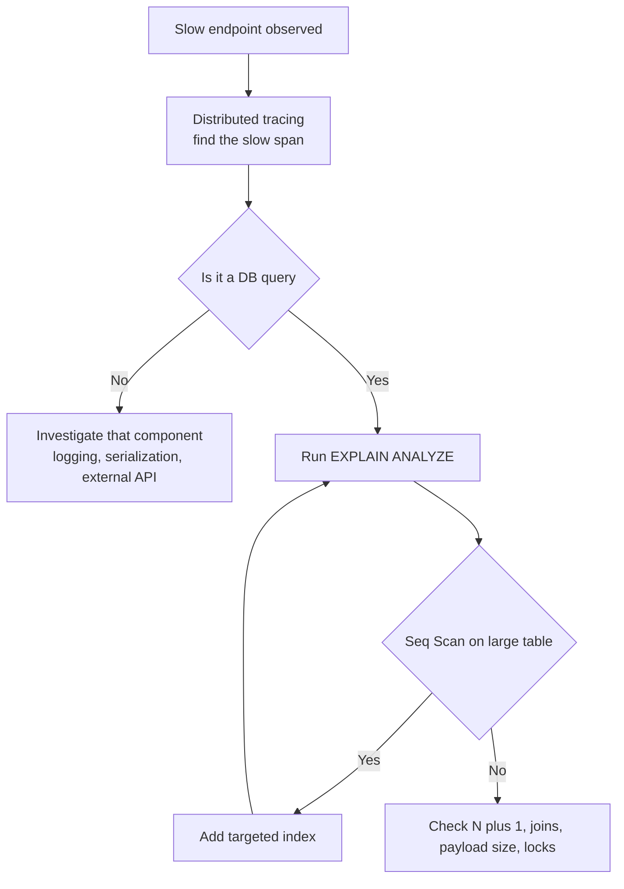

### The cost of database connections

Locally, DB connections feel free. At scale they become expensive. What happens when your server opens a connection to the database:

1. Establish a **TCP connection** (three-way handshake: SYN, SYN-ACK, ACK).
2. **TLS** negotiation if encryption is enabled (key exchange, cipher selection).
3. **Authentication** of the client.
4. **Session setup** (session state, parameters).
5. The database **allocates memory** for the connection (in Postgres, each connection is a separate backend process using several MB).

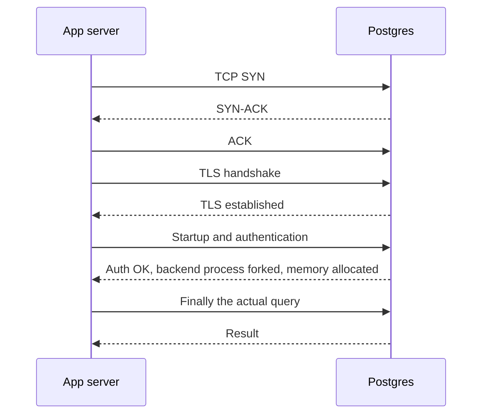

Two problems if you open a fresh connection per query or per HTTP request:

1. **Repeated latency**: you pay this whole setup cost again and again.
2. **Connection limits**: databases cap concurrent connections. A typical Postgres deployment allows a few hundred (Postgres default `max_connections` is 100; managed instances often allow a few hundred depending on memory and CPU). During a traffic spike, thousands of concurrent requests each grabbing a connection will exhaust the limit, and new connections fail (the database refuses them, and under memory pressure it may fall over).

### Connection pooling

A **connection pool** is a middleman that keeps a set of **already-open connections** ready:

1. The server **borrows** a connection from the pool.
2. It runs the query.
3. It **returns** the connection to the pool instead of closing it.
4. The pool keeps it open (subject to idle timeout configuration) for the next query.

This removes the per-query setup cost and caps the number of connections hitting the database.

```ts
import { Pool } from "pg";

const pool = new Pool({
  host: process.env.DB_HOST,
  max: 20,                    // at most 20 connections from this process
  idleTimeoutMillis: 30_000,  // close idle connections after 30 s
  connectionTimeoutMillis: 2_000,
});

export async function getUser(id: string) {
  // pool.query borrows a connection, runs the query, and returns it to the pool
  const { rows } = await pool.query("SELECT id, name FROM users WHERE id = $1", [id]);
  return rows[0];
}
```

#### Internal vs external pooling

**Internal (application-level) pooling**: the database driver inside each server process maintains its own pool. Simple, and every modern driver supports it. But with **horizontal scaling**, each instance has its own pool.

Failure scenario: each instance's pool allows up to 150 connections. Traffic spikes and the Kubernetes autoscaler goes from 1 to 3 instances: 3 x 150 = **450** potential connections. The database only supports **300**. The next spike pushes you past 300 and the database starts rejecting connections or crashes.

**External pooling**: a separate pooler process sits between all app instances and the database. For Postgres the popular one is **PgBouncer** (lightweight, open source). It holds, say, 250–300 real database connections, and *all* app instances connect to PgBouncer over the network. No matter how many instances the autoscaler adds, the database never sees more connections than the pooler is configured to open.

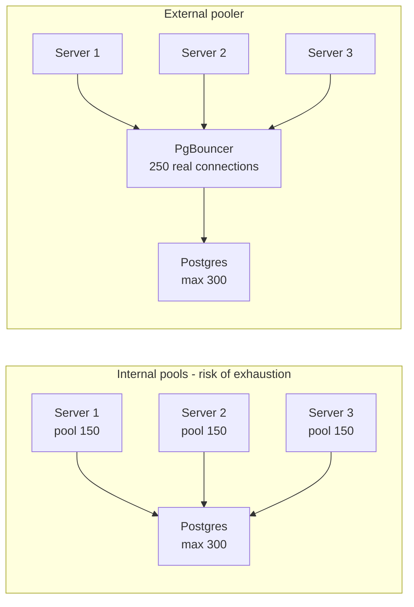

> [!TIP]
> PgBouncer has pooling modes: **session** (a client keeps a server connection for its whole session), **transaction** (a server connection is assigned only for the duration of a transaction, the most common choice for web apps), and **statement**. Transaction mode gives the biggest multiplexing benefit but breaks session-level features such as some prepared-statement usage, `SET` session variables and advisory locks held across transactions.

> [!INTERVIEW]
> **"Why use PgBouncer if my driver already pools connections?"** Driver pools are per-process. With autoscaling, total connections = instances x pool size, which can silently exceed Postgres `max_connections` during a spike. An external pooler puts a single global cap in front of the database and multiplexes many client connections onto a small set of real ones.

## Caching

You have optimised queries, added indexes and configured pooling, but the database is still the bottleneck. The natural next step is **caching** (covered in depth in the dedicated caching chapter; here we focus on what matters for performance).

The idea: **store the result of an expensive operation** (e.g. a complex query) in a fast store such as Redis. Next time, check the cache first. Hit: return immediately (e.g. 50 ms instead of 800 ms). Miss: do the expensive work, store the result, return it.

### Cache invalidation

> "There are only two hard things in computer science: cache invalidation and naming things." (Phil Karlton)

It is not an exaggeration. Multi-layer caching spans your servers, reverse proxies, CDNs and the client's browser. When the underlying data changes, you must stop serving the old cached copy and keep caches in sync with the source of truth, across all those layers.

Two main techniques:

| | Time-based expiration (TTL) | Event-based invalidation |
|---|---|---|
| How | Each entry expires after a fixed time (e.g. 5 or 10 minutes); next request goes to the source | When data changes, the write path deletes (or updates) the cache entry |
| Pros | Automatic, cannot "forget" | Precise: no guessing, data is fresh right after the change |
| Cons | Choosing the right TTL is hard; it depends on access patterns and update frequency, and differs per endpoint and service. Data can be stale until expiry | You must invalidate in **every** code path that modifies the data. Miss one and you serve stale data |

Example of event-based invalidation for a user profile:

```ts
async function updateUserProfile(userId: string, patch: Partial<User>) {
  await db.update(users).set(patch).where(eq(users.id, userId));
  await redis.del(`user:${userId}:profile`); // invalidate after the write commits
}
```

> [!TIP]
> In practice teams combine both: event-based invalidation for correctness plus a TTL as a safety net, so a forgotten invalidation path heals itself eventually.

### Where does the cache live? Local vs distributed vs tiered

| | Local (in-process) cache | Distributed cache |
|---|---|---|
| What | A map/dictionary (ideally an LRU structure) in the server's own memory | External service: Redis, Memcached, or Valkey (the open-source Redis fork) |
| Latency | Essentially instant (memory access, microseconds; the video says 2–3 ms including serialization) | Requires a network round trip (typically sub-millisecond to a few ms inside the same data centre; the video's "50 ms" is a pessimistic figure) |
| Consistency across servers | **Each instance has its own copy**: 10 servers = 10 possibly different caches | One shared cache: all instances see the same data |
| Capacity | Limited by each server's RAM | Can be scaled independently |

**Tiered (multi-level) caching** combines them: a small local cache (L1) for the **hottest** data, backed by a distributed cache (L2). Lookups go L1, then L2, then the database. After fetching from L2, the app may decide to keep the item in L1 depending on how hot it is, which depends on the eviction algorithm (LRU = least recently used, LFU = least frequently used).

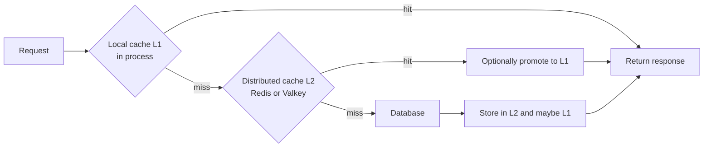

### Caching patterns

A caching pattern decides **when data gets written to the cache**. The right one depends on your application's, your users' and the endpoint's access patterns.

#### Cache-aside (lazy loading)

The most common pattern, the one everyone implements even without knowing its name.

- **Read**: check the cache. Hit: return. Miss: query the DB, store the result in the cache, return.
- **Write**: update the DB, then **delete** (invalidate) the cache entry, so the next read fetches fresh data.

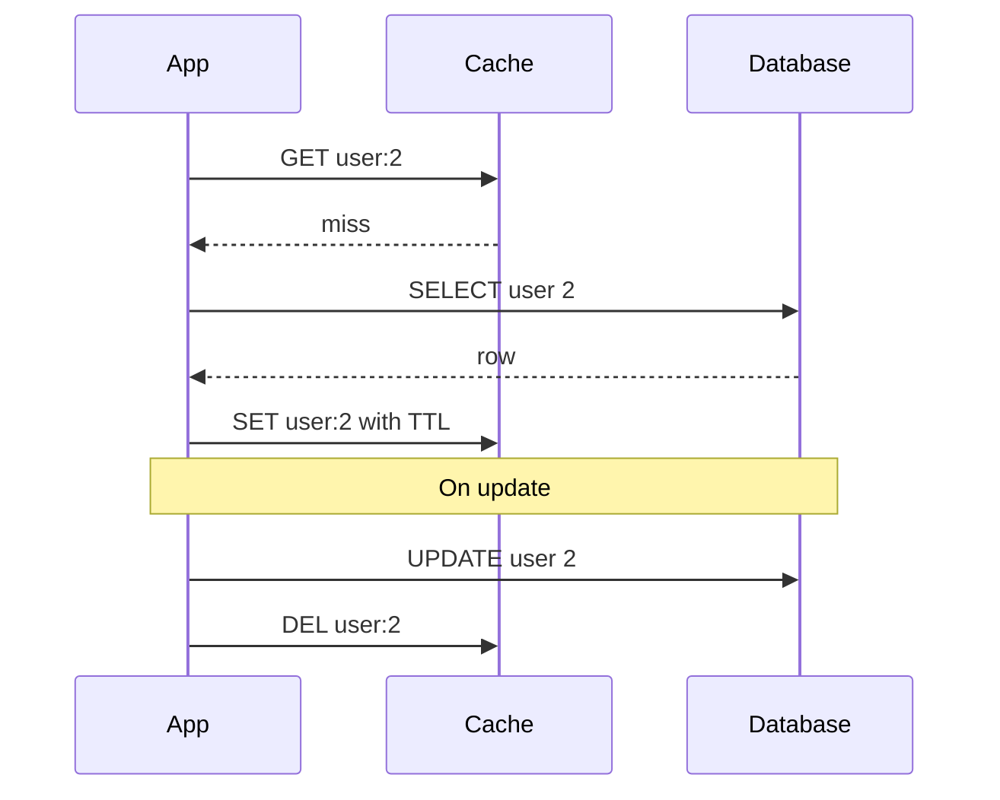

```ts
async function getUser(id: string) {
  const key = `user:${id}`;
  const cached = await redis.get(key);
  if (cached) return JSON.parse(cached);                 // hit

  const user = await db.query.users.findFirst({ where: eq(users.id, id) }); // miss
  if (user) await redis.set(key, JSON.stringify(user), "EX", 300);         // TTL 5 min
  return user;
}
```

#### Write-through

On every write, update **both the database and the cache** (instead of deleting the cache entry).

- Pro: reads (almost) never miss for recently written data.
- Con: writes are slower, because you must write to both before returning success.

#### Write-behind (write-back)

On a write, update **only the cache**, return success immediately, and write to the database **asynchronously** afterwards.

- Pro: very fast writes.
- Con: if the asynchronous DB write fails (or the cache node dies before flushing), the cache and database become **inconsistent**, and data can be lost.

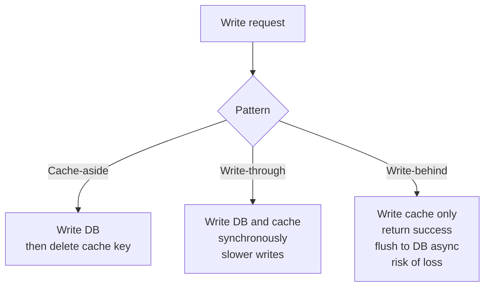

| Pattern | Write latency | Read freshness | Risk |
|---|---|---|---|
| Cache-aside | Normal | Fresh after invalidation; first read after a change is a miss | Forgetting to invalidate; race conditions |
| Write-through | Higher (two writes) | Cache always populated | Caching data that is never read |
| Write-behind | Lowest | Cache is the newest copy | DB and cache inconsistency, data loss on failure |

### Cache hit rate

**Cache hit rate** = hits / (hits + misses). A 90% hit rate means 90% of requests are served from the cache and only 10% reach the database. Around 90% is very good. A low rate like 20% means something is wrong with what you cache or how.

Factors that drive hit rate:

1. **TTL**: longer TTL means entries live longer and are more likely to be hit, but increases **staleness**. A 7-day TTL largely defeats the point of a TTL.
2. **Cache size**: more memory holds more entries, so more hits (fewer evictions).
3. **Data access patterns**: you must understand which endpoints are hot and when, i.e. your users' behaviour. Caching the wrong things yields poor hit rates.

> [!INTERVIEW]
> **"Your cache hit rate dropped from 90% to 40% after a deploy. What do you check?"** Whether cache keys changed (e.g. including a timestamp or request ID in the key), whether the TTL was shortened, whether memory limits cause evictions (check eviction metrics), whether the new code invalidates too aggressively, and whether traffic patterns changed (new endpoints, a long tail of unique keys).

## Vertical vs horizontal scaling

As users and traffic grow, your servers' resources become insufficient and you need more capacity. There are two fundamental ways to get it.

### Vertical scaling (scaling up)

Replace the server with a **bigger, more powerful** one:

- **CPU**: more cores (2, 4, 8, ...).
- **Memory (RAM)**: 2 GB, 4, 8, 16, 32 GB ...
- **Storage**: more capacity (30 GB to 300 GB to 1 TB) and faster media (SSD, NVMe SSD).
- **Network card**: higher bandwidth (e.g. 10 Gbps).

**Why it is attractive**:

- **Simplicity**: the architecture does not change. No statelessness requirements, no code changes. Just upgrade the machine.
- **Roughly linear gains** for many workloads: twice the CPUs handles roughly twice the requests; twice the RAM caches roughly twice the data locally.
- **Economics**: one machine with twice the power often costs less than two half-size machines, and you avoid operational overhead (security, backups and maintenance across many machines, load balancers, distributed state).

**Why everyone does not just do this**:

1. **Hard ceiling**: there is a biggest machine your cloud provider (AWS, GCP, DigitalOcean...) sells. When you outgrow it, you cannot scale vertically any further.
2. **Single point of failure (SPOF)**: one beast of a machine (32 cores, 96 GB RAM) still crashes, from a bad dependency, a kernel issue, hardware failure. If it is down for 2 hours, your entire service is down for 2 hours. Standby servers and automatic failover mitigate this but do not remove the fundamental risk.
3. **No geographic distribution**: if the one server is in the USA and 40% of users are in India, those users always pay the extra network latency.

### Horizontal scaling (scaling out)

Instead of a bigger server, add **more instances** of the same server and let them share the load.

**Theoretical advantages** ("theoretical" because reality adds complexity):

- **Linear capacity**: if one server handles 1,000 RPS, five handle ~5,000 RPS. For a big campaign, add instances.
- **No hard limit**: you can keep adding instances.
- **Redundancy**: if one instance fails, traffic is redistributed to the others, and the service continues.
- **Geographic distribution**: place instances in different regions and route each user to the nearest (via load balancers / DNS-based routing), minimising latency.

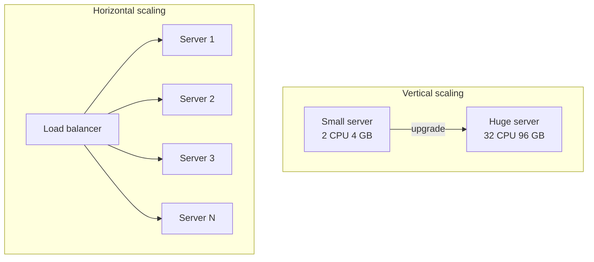

### The price of horizontal scaling: complexity

Adding even one more instance immediately raises questions that a single big server never had:

1. **How do requests get distributed?** You need a **load balancer**, a brand-new component in the infrastructure. And then you must choose a **load-balancing algorithm** (round robin, least connections, etc.; see Part 2).
2. **How do servers stay in sync?** If a user updates their name via server 1, how does server 2 know? (Answer: make servers **stateless** and keep state in shared stores such as the database and Redis.)
3. **What if the network between servers fails?** Servers that cannot talk to each other may make **conflicting decisions** (a network partition).
4. **What if one instance dies?** How do you detect it (**health checks**), when do you stop routing traffic to it, and when do you start again once it recovers?

All of these have known answers, but every answer involves **trade-offs**, because you are now building a **distributed system**.

> [!IMPORTANT]
> Distributed systems do not eliminate problems; they **transform one set of problems into another**. Choosing horizontal scaling means choosing to deal with load balancing, shared state, partial failures and consistency, because that set of problems is more solvable for your situation than the hardware ceiling, SPOF and latency problems of a single machine.

| | Vertical scaling | Horizontal scaling |
|---|---|---|
| Also called | Scale up | Scale out |
| How | Bigger machine | More machines |
| Code/architecture changes | None | Statelessness, shared state, load balancer |
| Limit | Hardware ceiling | Practically none (but coordination costs grow) |
| Failure | Single point of failure | Redundant; tolerates instance loss |
| Geography | One location | Multi-region possible |
| Cost profile | Cheap at first, very expensive at the top end | More ops overhead, commodity hardware |
| Best for | Early stage, databases that are hard to distribute, quick wins | Large or spiky traffic, high availability, global users |

> [!TIP]
> A common real-world path: start vertical (it is cheap and simple), make the app tier **stateless** early, then scale the app tier horizontally behind a load balancer, and scale the database vertically as long as possible before reaching for replicas and sharding.

## Common mistakes & misconceptions

- **Reporting average latency.** Averages hide the tail. Use P50/P95/P99.
- **"P99 = 2 s means requests take 2 s."** It means 1% of requests take 2 s *or more*; 99% are faster.
- **Thinking latency grows linearly with load.** It is a hockey stick; near 100% utilization it explodes.
- **Running hot to "save money".** 95% utilization leaves no room for bursts, and the next spike causes an outage.
- **Optimising before measuring.** Adding Redis when the real bottleneck is synchronous logging, serialization or payload size.
- **Using a CPU profiler to diagnose I/O waits.** Use distributed tracing for I/O-bound latency.
- **Writing ORM loops that query per item.** Classic N+1; use eager loading or bulk fetch.
- **Indexing every column.** Slows every write and wastes space.
- **Forgetting that Postgres does not auto-index foreign keys.** Only primary keys and unique constraints get indexes automatically.
- **Wrong composite index order.** `(user_id, created_at)` does not help a query filtering only on `created_at`.
- **Per-instance pools with autoscaling.** Total connections = instances x pool size; can exceed `max_connections`.
- **Caching write endpoints.** Caching is for reads; writes should invalidate or update the cache.
- **Event-based invalidation in some code paths but not all.** One forgotten path serves stale data forever (add a TTL as a safety net).
- **Assuming horizontal scaling is free.** It adds load balancers, state synchronisation, partial failures and network partitions.

## Interview questions

<details>
<summary><strong>Q: What is the difference between latency and throughput, and how are they related?</strong></summary>

Latency is the time a single request takes from start to response (measured per request and summarised with percentiles). Throughput is how many requests the system completes per unit of time (RPS). They are related through utilization: as throughput approaches the system's capacity, requests queue up, so latency rises slowly at first and then sharply. A system can have 150 ms latency at 10 RPS and 2 s at 1,000 RPS. Capacity planning means finding the throughput at which latency is still within your target (e.g. P99 under 500 ms).

</details>

<details>
<summary><strong>Q: Why are averages misleading for latency? What do P50, P90 and P99 mean?</strong></summary>

Latency distributions are skewed with a long tail. If 99% of requests take 50 ms and 1% take 5 s, the average is about 100 ms, which looks fine while 10,000 out of every 1M daily requests take 5 s. Percentiles describe the distribution: P50 is the median (half of requests are faster), P90 means 90% are at or below that value (10% are slower), P99 means 1% of requests are at that value or slower. Teams set SLOs on P95/P99 because the tail contains the most complex and often most valuable workflows, like checkout.

</details>

<details>
<summary><strong>Q: Why can't you run servers at 100% utilization? What target would you choose?</strong></summary>

Because of queueing: response time behaves roughly like service time / (1 - utilization), so as utilization approaches 100% waiting time grows without bound. At 50% a request takes about 2x its service time, at 90% about 10x. Traffic is also bursty, so even a 50% average can spike past capacity. Production systems typically target 60–80% utilization and autoscale before reaching the knee of the curve.

</details>

<details>
<summary><strong>Q: An endpoint is slow. Walk me through how you would find the cause.</strong></summary>

First measure, do not guess. Check metrics to see whether it is slow for all requests or only at the tail, and whether it correlates with load. Use distributed tracing to break a slow request into spans (handler, DB queries, cache, external calls, serialization) and find the dominant span. If it is a DB query, run EXPLAIN ANALYZE and look for sequential scans, bad joins or N+1 patterns. If it is CPU-heavy, profile and read the flame graph. Also check payload size and synchronous side effects such as blocking logging. Fix the biggest contributor, then re-measure.

</details>

<details>
<summary><strong>Q: What is a flame graph and when would you use a profiler vs distributed tracing?</strong></summary>

A flame graph visualises sampled call stacks: the x-axis width of a box is the share of time spent in that function (including children), and callees are stacked on callers. Wide boxes are where the time goes. CPU profilers and flame graphs are best for CPU-bound problems (serialization, computation, regex, compression). Most backend latency is I/O-bound (DB, network, external APIs), where a thread is waiting rather than using CPU, so distributed tracing, which timestamps each operation along a request's path, is the better tool.

</details>

<details>
<summary><strong>Q: Explain the N+1 query problem and how to fix it.</strong></summary>

You run 1 query to fetch N parent rows and then 1 query per row to fetch related data, so N+1 queries total. Each query has fixed overhead (network round trip, parse, plan, execute), so 1,000 items at 5 ms each is 5 seconds. It commonly appears with ORMs, where a loop with `await` inside looks like normal code. Fix it by fetching in bulk: a JOIN, or a second query with `WHERE id IN (...)`, or the ORM's eager-loading feature (Django `select_related`/`prefetch_related`, Rails `includes`, Prisma `include`). That gives 1–2 queries regardless of N.

</details>

<details>
<summary><strong>Q: How does a B-tree index speed up queries, and what does it cost?</strong></summary>

A B-tree index stores the indexed column's values in sorted order in a balanced tree, with pointers to the table rows. A lookup walks the tree in O(log n) instead of scanning every row (a sequential scan), and it also supports range queries and ORDER BY on that column. The costs: extra disk and memory, and slower writes, because every INSERT, UPDATE or DELETE must also update every index on the table. So you index based on actual query patterns, not every column.

</details>

<details>
<summary><strong>Q: What is the difference between a composite index and a covering index?</strong></summary>

A composite index is an index on multiple columns in a specific order, e.g. `(user_id, created_at)`. It serves queries that filter on a leftmost prefix: `user_id` alone, or `user_id` plus `created_at`, but not `created_at` alone. A covering index is one that contains every column a particular query needs, so the database can answer from the index alone (index-only scan) without reading the table. In Postgres you can add non-key columns with `INCLUDE`. A composite index can also be covering; the terms describe different properties.

</details>

<details>
<summary><strong>Q: How do you decide which columns to index?</strong></summary>

Primary keys are indexed automatically. Obvious, core access paths (foreign keys like `author_id` used in joins and lookups) can be indexed when you create the table. For everything else, use production evidence: tracing shows which endpoints and queries are slow and hot, and EXPLAIN ANALYZE shows sequential scans on large tables. Add a targeted index, re-run EXPLAIN ANALYZE to confirm an index scan is used, and keep the number of indexes on write-heavy tables small.

</details>

<details>
<summary><strong>Q: Why is opening a database connection expensive, and how does connection pooling help?</strong></summary>

Each new connection needs a TCP handshake, possibly a TLS handshake, authentication, session setup and server-side memory (Postgres forks a process per connection). Doing this per request adds latency and, under load, can exhaust the database's connection limit. A pool keeps a set of open connections; requests borrow one, run the query and return it. This removes the setup cost from the hot path and caps how many connections the database sees.

</details>

<details>
<summary><strong>Q: What happens if you autoscale app servers that each have their own connection pool? How do you fix it?</strong></summary>

Total possible connections become instances x pool size. With a pool of 150 and three instances you can reach 450 connections against a database that allows 300, so during the next spike the database rejects connections or becomes unstable. Fixes: put an external pooler like PgBouncer in front of the database so there is a global cap (usually in transaction pooling mode), and/or size per-instance pools as max_connections divided by the maximum instance count, with headroom for admin connections.

</details>

<details>
<summary><strong>Q: Compare TTL-based and event-based cache invalidation.</strong></summary>

TTL-based invalidation expires entries after a fixed time. It is automatic and cannot be forgotten, but data can be stale until expiry, and choosing the TTL is hard because it depends on access and update patterns per endpoint. Event-based invalidation deletes or updates the cache entry whenever the data changes, giving fresh data immediately, but every write path must remember to do it, or stale data lingers indefinitely. Most systems combine them: invalidate on write and keep a TTL as a safety net.

</details>

<details>
<summary><strong>Q: Explain cache-aside, write-through and write-behind. When would you use each?</strong></summary>

Cache-aside: the app reads from the cache, on a miss reads the DB and populates the cache, and on writes updates the DB and deletes the cache key. It is the default for read-heavy workloads. Write-through: writes update both DB and cache synchronously, so reads always hit, at the cost of slower writes; good when data is read right after it is written. Write-behind: writes go to the cache only and are flushed to the DB asynchronously, giving very fast writes but risking inconsistency or data loss if the flush fails; acceptable for data like counters or analytics where small loss is tolerable.

</details>

<details>
<summary><strong>Q: Local cache vs distributed cache: what are the trade-offs, and what is tiered caching?</strong></summary>

A local in-process cache is the fastest (no network), but every instance has its own copy, so 10 instances can serve 10 different versions of the data and memory is duplicated. A distributed cache like Redis, Memcached or Valkey is shared by all instances, so it is consistent and larger, but each lookup costs a network round trip. Tiered caching uses a small local L1 for the hottest keys (often with a short TTL) in front of a distributed L2, getting most of the speed of local caching with most of the consistency of a shared cache.

</details>

<details>
<summary><strong>Q: Vertical vs horizontal scaling: what are the trade-offs and when would you choose each?</strong></summary>

Vertical scaling means a bigger machine (more CPU, RAM, faster disk and network). It is simple, needs no code changes and is often cost-effective at first, but it has a hardware ceiling, remains a single point of failure, and cannot put servers closer to users in different regions. Horizontal scaling adds more instances behind a load balancer. It gives near-linear capacity, redundancy and geographic distribution, but requires stateless services, a load balancer and algorithm, health checks, and handling distributed-systems problems such as shared state and network partitions. Start vertical, make the app tier stateless, scale it horizontally; databases usually scale vertically first because distributing them is much harder.

</details>

## Cheat sheet

- **Latency** = time per request; what users feel. **Throughput** = requests per second. **Utilization** = percentage of capacity in use.
- Use **P50 / P90 / P95 / P99**, never averages. P99 = X means 1% of requests take X or longer.
- Tail latency (P95/P99) = complex workflows = valuable users (checkout, payments).
- Latency vs utilization is a **hockey stick**: roughly service_time / (1 - utilization). 50% gives 2x, 90% gives 10x.
- Run at **60–80% utilization**; traffic is **bursty**; keep headroom.
- **Bottleneck** = the specific component causing slowness. **Never guess, always measure.**
- **Profiler + flame graph** = CPU-bound work. Wide box = expensive function.
- **Distributed tracing** = I/O-bound work (most backend latency). Spans per DB call, external call, etc.
- Hidden culprits: synchronous logging, JSON serialization, huge payloads, external calls in loops.
- **N+1**: 1 query + N queries. Fix: JOIN / `WHERE id IN (...)` / ORM eager loading (`select_related`, `prefetch_related`, `includes`, `include`).
- **Index** = sorted B-tree copy of a column + row pointers. O(log n) lookup vs full **sequential scan**.
- Index costs: **storage + slower writes** (every index updated on INSERT/UPDATE/DELETE).
- PK auto-indexed. FKs in Postgres are **not**. Index obvious paths up front, others from traces.
- **Composite** `(a, b)` serves `a` and `a+b`, not `b` alone. **Covering** = index has all columns the query needs, so index-only scan (`INCLUDE`).
- **`EXPLAIN ANALYZE`**: look for `Seq Scan` on big tables; after indexing expect `Index Scan`.
- New DB connection = TCP + TLS + auth + session + memory. Expensive; limited (`max_connections`).
- **Connection pool**: borrow, query, return. **Internal** pools multiply with instances; **external** pooler (**PgBouncer**) gives a global cap.
- Caching: hard part is **invalidation**. **TTL** (automatic, may be stale) vs **event-based** (precise, easy to forget). Combine.
- **Local** cache (fast, inconsistent across instances) vs **distributed** (Redis/Memcached/Valkey; shared, network hop) vs **tiered** (L1 local + L2 distributed).
- **Cache-aside** (read: check cache, miss loads DB and fills; write: DB then delete key). **Write-through** (write both, slower writes). **Write-behind** (write cache, async DB, risk of loss).
- **Hit rate** = hits / total. ~90% is good. Driven by TTL, cache size, access patterns.
- **Vertical**: simple, no code change, cheap at first; ceiling, SPOF, no geo.
- **Horizontal**: linear-ish capacity, redundancy, geo; needs LB, LB algorithm, statelessness, health checks, partition handling.
- Distributed systems **transform** problems; they do not remove them.

## Glossary

- **Latency** — Time taken for a single request to complete, from when it is sent to when the response is received.
- **Tail latency** — Latency at high percentiles (P95, P99, P99.9), experienced by the slowest requests.
- **Percentile (Pxx)** — The value below which xx% of observations fall; P99 = 2 s means 99% of requests took 2 s or less.
- **P50 / median** — The latency that half of requests are faster than.
- **Throughput** — Number of requests (or operations) completed per unit time, e.g. RPS or QPS.
- **Utilization** — Percentage of a resource's capacity currently in use.
- **Headroom** — Spare capacity kept free to absorb bursts.
- **Bursty traffic** — Traffic that arrives in irregular spikes rather than at a steady rate.
- **Queueing** — Requests waiting for a busy resource; the main reason latency rises with utilization.
- **Bottleneck** — The specific component that limits performance.
- **Profiling** — Measuring where a running program spends its time.
- **Flame graph** — Visualization of sampled call stacks where box width shows time spent.
- **CPU-bound** — Work limited by computation speed.
- **I/O-bound** — Work limited by waiting on disk, network, database or other I/O.
- **Distributed tracing** — Following a request across components/services and recording timed spans.
- **Span** — One timed operation within a trace (e.g. one DB query).
- **Observability** — The ability to understand system behaviour from its outputs: logs, metrics and traces.
- **N+1 query problem** — Fetching N items with one query, then issuing one more query per item.
- **Eager loading** — Fetching related data up front in bulk (via JOIN or batched query) instead of lazily per item.
- **ORM** — Object-Relational Mapper; library that maps database rows to language objects (Prisma, Drizzle, TypeORM, Django ORM, ActiveRecord).
- **Sequential scan / full table scan** — Reading every row of a table to find matches.
- **Index** — Auxiliary data structure that speeds up lookups on one or more columns.
- **B-tree** — Balanced, sorted tree structure; the default index type in most relational databases.
- **Composite index** — Index over multiple columns in a defined order.
- **Covering index** — Index containing all columns a query needs, enabling an index-only scan.
- **EXPLAIN ANALYZE** — Command that executes a query and shows its actual execution plan and timings.
- **Write amplification** — Extra writes caused by maintaining indexes (or other structures) on every data change.
- **Connection pool** — A set of reusable open database connections shared by requests.
- **PgBouncer** — Lightweight open-source external connection pooler for Postgres.
- **max_connections** — Postgres setting limiting concurrent connections.
- **Cache hit / miss** — Whether a requested item was found in the cache.
- **Cache hit rate** — Fraction of requests served from the cache.
- **TTL (time to live)** — How long a cache entry stays valid before expiring.
- **Cache invalidation** — Removing or updating cached data when the source data changes.
- **Stale data** — Cached data that no longer matches the source of truth.
- **Cache-aside (lazy loading)** — App checks cache, loads from DB on miss and fills cache; deletes on write.
- **Write-through** — Writes update cache and DB synchronously.
- **Write-behind (write-back)** — Writes update cache immediately and DB asynchronously.
- **Tiered caching** — Multiple cache levels, e.g. local in-process L1 plus distributed L2.
- **Valkey** — Open-source fork of Redis.
- **Vertical scaling (scale up)** — Increasing a single machine's resources.
- **Horizontal scaling (scale out)** — Adding more machines/instances that share the load.
- **Single point of failure (SPOF)** — A component whose failure takes down the whole system.
- **Load balancer** — Component that distributes requests across multiple servers.
- **Health check** — Periodic probe that determines whether an instance can receive traffic.
- **Network partition** — Failure where parts of a distributed system cannot communicate with each other.

## Video timestamps

- [00:00](https://www.youtube.com/watch?v=z7kt_p44rjs&t=0s) — Introduction: what scaling and performance mean for backends
- [02:05](https://www.youtube.com/watch?v=z7kt_p44rjs&t=125s) — What does "fast" mean: the life of a click
- [04:08](https://www.youtube.com/watch?v=z7kt_p44rjs&t=248s) — Latency as the core performance metric
- [05:10](https://www.youtube.com/watch?v=z7kt_p44rjs&t=310s) — Latency varies per request (cache hits, server load)
- [07:12](https://www.youtube.com/watch?v=z7kt_p44rjs&t=432s) — Why averages are misleading
- [09:16](https://www.youtube.com/watch?v=z7kt_p44rjs&t=556s) — Percentiles: P50, P90, P99
- [12:19](https://www.youtube.com/watch?v=z7kt_p44rjs&t=739s) — Why engineers focus on P95 and P99
- [14:20](https://www.youtube.com/watch?v=z7kt_p44rjs&t=860s) — Throughput and its relation to latency
- [17:24](https://www.youtube.com/watch?v=z7kt_p44rjs&t=1044s) — Ice cream shop analogy: queueing
- [20:28](https://www.youtube.com/watch?v=z7kt_p44rjs&t=1228s) — Utilization and the latency curve
- [22:31](https://www.youtube.com/watch?v=z7kt_p44rjs&t=1351s) — Highway analogy
- [25:37](https://www.youtube.com/watch?v=z7kt_p44rjs&t=1537s) — Headroom, 60–80% utilization and bursty traffic
- [28:39](https://www.youtube.com/watch?v=z7kt_p44rjs&t=1719s) — Bottlenecks and by-the-book solutions
- [30:42](https://www.youtube.com/watch?v=z7kt_p44rjs&t=1842s) — Case study: caching the wrong thing, synchronous logging
- [35:46](https://www.youtube.com/watch?v=z7kt_p44rjs&t=2146s) — Never guess, always measure
- [36:47](https://www.youtube.com/watch?v=z7kt_p44rjs&t=2207s) — Profiling
- [37:49](https://www.youtube.com/watch?v=z7kt_p44rjs&t=2269s) — Flame graphs
- [38:50](https://www.youtube.com/watch?v=z7kt_p44rjs&t=2330s) — CPU-bound vs I/O-bound
- [39:52](https://www.youtube.com/watch?v=z7kt_p44rjs&t=2392s) — Distributed tracing
- [41:56](https://www.youtube.com/watch?v=z7kt_p44rjs&t=2516s) — Databases as the usual bottleneck
- [42:57](https://www.youtube.com/watch?v=z7kt_p44rjs&t=2577s) — The N+1 query problem
- [49:04](https://www.youtube.com/watch?v=z7kt_p44rjs&t=2944s) — N+1 in ORMs and eager-loading primitives
- [53:08](https://www.youtube.com/watch?v=z7kt_p44rjs&t=3188s) — Indexes and the library analogy
- [57:17](https://www.youtube.com/watch?v=z7kt_p44rjs&t=3437s) — B-tree indexes
- [58:18](https://www.youtube.com/watch?v=z7kt_p44rjs&t=3498s) — The cost of indexes
- [1:00:19](https://www.youtube.com/watch?v=z7kt_p44rjs&t=3619s) — Deciding what to index
- [1:02:21](https://www.youtube.com/watch?v=z7kt_p44rjs&t=3741s) — Composite indexes
- [1:04:25](https://www.youtube.com/watch?v=z7kt_p44rjs&t=3865s) — Covering indexes
- [1:05:25](https://www.youtube.com/watch?v=z7kt_p44rjs&t=3925s) — EXPLAIN ANALYZE
- [1:07:30](https://www.youtube.com/watch?v=z7kt_p44rjs&t=4050s) — The cost of database connections
- [1:11:34](https://www.youtube.com/watch?v=z7kt_p44rjs&t=4294s) — Connection pooling
- [1:13:36](https://www.youtube.com/watch?v=z7kt_p44rjs&t=4416s) — Internal vs external pooling
- [1:15:37](https://www.youtube.com/watch?v=z7kt_p44rjs&t=4537s) — PgBouncer
- [1:17:40](https://www.youtube.com/watch?v=z7kt_p44rjs&t=4660s) — Caching for performance
- [1:19:42](https://www.youtube.com/watch?v=z7kt_p44rjs&t=4782s) — Cache invalidation
- [1:20:44](https://www.youtube.com/watch?v=z7kt_p44rjs&t=4844s) — Time-based vs event-based invalidation
- [1:23:48](https://www.youtube.com/watch?v=z7kt_p44rjs&t=5028s) — Local vs distributed caching
- [1:24:49](https://www.youtube.com/watch?v=z7kt_p44rjs&t=5089s) — Tiered caching
- [1:25:51](https://www.youtube.com/watch?v=z7kt_p44rjs&t=5151s) — Caching patterns overview
- [1:26:53](https://www.youtube.com/watch?v=z7kt_p44rjs&t=5213s) — Cache-aside
- [1:28:56](https://www.youtube.com/watch?v=z7kt_p44rjs&t=5336s) — Write-through
- [1:29:56](https://www.youtube.com/watch?v=z7kt_p44rjs&t=5396s) — Write-behind
- [1:30:59](https://www.youtube.com/watch?v=z7kt_p44rjs&t=5459s) — Cache hit rate and what affects it
- [1:34:04](https://www.youtube.com/watch?v=z7kt_p44rjs&t=5644s) — Vertical vs horizontal scaling
- [1:35:05](https://www.youtube.com/watch?v=z7kt_p44rjs&t=5705s) — Vertical scaling and its benefits
- [1:38:08](https://www.youtube.com/watch?v=z7kt_p44rjs&t=5888s) — Limits of vertical scaling
- [1:41:12](https://www.youtube.com/watch?v=z7kt_p44rjs&t=6072s) — Horizontal scaling
- [1:44:14](https://www.youtube.com/watch?v=z7kt_p44rjs&t=6254s) — The complexity cost of horizontal scaling
- [1:46:15](https://www.youtube.com/watch?v=z7kt_p44rjs&t=6375s) — Distributed systems transform problems
