## TL;DR

- **Statelessness** makes horizontal scaling possible: no instance may hold data (sessions, files, local DB files, caches) that other instances cannot see. Push state into shared stores: **Redis** for sessions, **S3 / R2 / MinIO** for files, **Postgres / RDS** for data.
- A **load balancer** sits between clients and instances and picks a server per request using an algorithm: **round robin**, **weighted round robin**, **least connections**, **weighted least connections**, **least response time**, **resource-based**. **Health checks** remove dead instances and re-add recovered ones.
- Databases are **stateful** and hard to scale. **Read replicas** move reads (often 70–90% of traffic) off the primary and closer to users, at the cost of **replication lag** and stale reads (fix with read-your-writes routing, lag-aware reads, or delayed refetch). **Sharding** splits a table across physical database instances by a **shard key**, reducing per-node data size and multiplying capacity. **Distributed databases** (PlanetScale, Neon, CockroachDB, YugabyteDB) and managed services hide most of this.
- **CDNs** beat the speed-of-light limit by serving content from **edge PoPs** close to users: lower latency, less origin load, and **DDoS protection**. Cache static assets and some API responses; **purge** by tag when data changes. **Edge computing** (e.g. Cloudflare Workers on V8 isolates) runs small logic at the edge (auth rejection, localization, routing) but is resource- and runtime-constrained.
- **Asynchronous processing**: respond as soon as the user-visible part is done and push the rest (emails, notifications, video processing, account deletion) into a **queue** (Redis/BullMQ, RabbitMQ, Kafka) for **workers**. This cuts *perceived* latency dramatically.
- **Microservices** mainly scale **teams**, not machines: independent deploys, independent scaling, different tech stacks. They cost network latency and failures, harder debugging (needs tracing), and data consistency problems. Default to a **monolith** unless you have a large org and clear needs.
- **Serverful + autoscaling** suffers from capacity planning, slow and reactive scale-up, min/max limits and always-on cost. **Serverless** (functions + events behind an API gateway, pay per execution) removes server management but brings **cold starts**, execution **time limits** and forced **statelessness**.
- Principles: **start with the problem and measure**, **prefer simple solutions**, **scale for the problems you have**, **observability from day one**, and treat performance as a **mindset**.

## Why this matters

Part 1 showed why one machine eventually is not enough and that horizontal scaling "transforms problems". This part is the catalogue of those new problems and their standard answers. Nearly every system-design interview ("design a URL shortener / Instagram / Uber") expects you to draw exactly these boxes: load balancer, stateless app tier, cache, primary plus replicas, shards, CDN, queue and workers, and to explain the trade-off each box introduces.

## Statelessness: the key enabler of horizontal scaling

### The problem

Horizontal scaling means running **multiple instances** of the same backend code, with client requests distributed among them. This only works if it **does not matter which instance handles a request**. If you deleted instance B, instances A, C and D together must behave exactly the same.

A server is **stateful** when it holds some data **exclusive to itself**: it remembers something about a client in its own memory or disk. If instance D holds data that A and C cannot access, horizontal scaling breaks and you see weird, intermittent errors.

This is why horizontal scaling, unlike vertical scaling, must be **planned from the ground up**: it affects your code, infrastructure and whole stack, while vertical scaling is just clicking "more CPU and RAM" in a dashboard.

> [!IMPORTANT]
> **Stateless** means no instance stores information that is not accessible to all instances. Anything that must persist lives *outside* the servers, in a shared store every instance can reach.

### Example 1: sessions

Typical stateful authentication: the user submits email and password, the server verifies them, creates a **session**, sets the **session ID in a cookie**, and stores the session server-side. On later requests the server looks up the session ID from the cookie to identify the user.

The bug with in-memory sessions:

1. User logs in; the request lands on **instance A**, which stores the session in an in-memory array.
2. The next request lands on **instance B** (the load balancer spreads requests).
3. B has no such session in its memory, so it returns **401 Unauthorized**. The user is "randomly logged out", a confusing and frustrating experience.

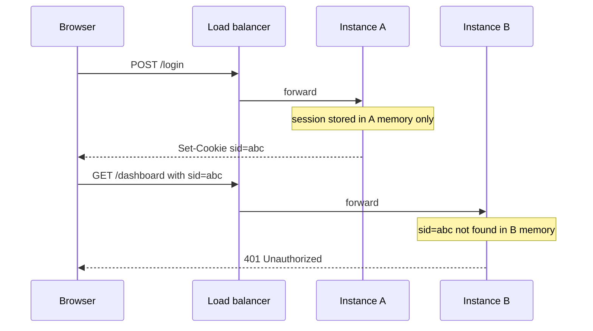

The fix: store sessions in a **shared store** such as **Redis**, reachable from all instances. A writes the session to Redis; B looks it up in Redis and finds it.

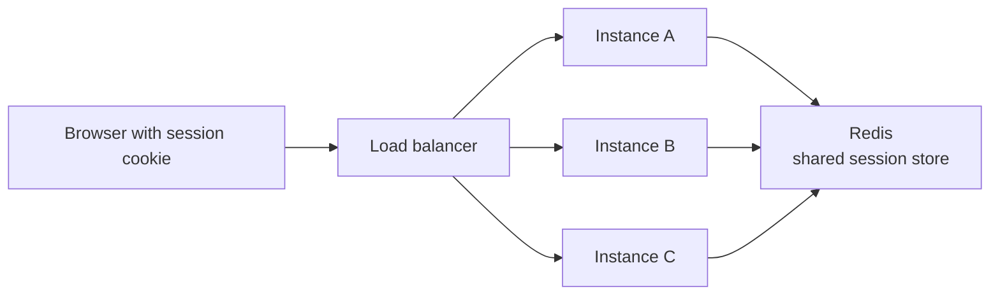

```ts
import session from "express-session";
import { RedisStore } from "connect-redis";
import { createClient } from "redis";

const redisClient = createClient({ url: process.env.REDIS_URL });
await redisClient.connect();

app.use(
  session({
    store: new RedisStore({ client: redisClient }), // shared across all instances
    secret: process.env.SESSION_SECRET!,
    resave: false,
    saveUninitialized: false,
    cookie: { httpOnly: true, secure: true, sameSite: "lax" },
  })
);
```

> [!NOTE]
> Stateless JWT access tokens avoid the shared session store for verification (any instance can verify the signature), but you still need shared state for things like revocation lists or refresh-token rotation.

### Example 2: file storage

A user uploads a file; the request lands on instance A, which saves it on its own local disk (SSD). Later the user's request to view the file lands on instance C, which does not have it, so it errors. Fix: upload to **object storage** accessible to all instances: **AWS S3**, **Cloudflare R2**, or a self-hosted **MinIO**.

### The thumb rule

Once you choose horizontal scaling, **nothing** may be stored on a single instance:

| Kind of state | Wrong (instance-local) | Right (shared) |
|---|---|---|
| Sessions / in-memory data | Array or map in process memory | Redis (or Valkey, Memcached) |
| Uploaded files | Local disk | S3, R2, MinIO, other blob storage |
| Database | SQLite file on the server's disk | Centralized Postgres / MySQL / RDS (or a networked SQLite service) |
| Cache | Per-instance map (unless acceptable to be inconsistent) | Distributed cache, or a tiered cache with short local TTLs |

## Load balancers

### Why you need one

With multiple instances, *where* and *how* do you decide which instance gets each request? That is the **load balancer (LB)**. It is a mandatory component of horizontal scaling.

- All client requests go to the **load balancer**, not directly to servers.
- The LB picks an instance using a **load-balancing algorithm**, forwards the request, receives the response, and returns it to the client over the same connection.
- It is essentially a smart middleman (a reverse proxy).

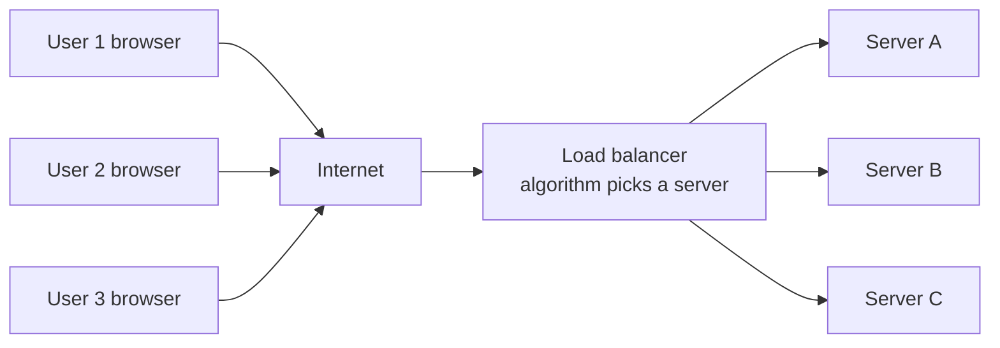

> [!NOTE]
> Extra context: load balancers operate at **Layer 4** (TCP/UDP, routes by IP and port, very fast) or **Layer 7** (HTTP, can route by path, headers, cookies, and terminate TLS). Examples: Nginx, HAProxy, Envoy, AWS ALB (L7) and NLB (L4), GCP Load Balancing, Cloudflare Load Balancing.

### Round robin

Send requests in a **rotating order**: 1 to A, 2 to B, 3 to C, 4 to A, 5 to B, 6 to C, and so on.

Works best when:

- Requests are **similar in cost** (similar DB and queue operations), and
- Servers have the **same capacity** (e.g. each 4 GB RAM, 2 CPU cores).

In that setup, simple round robin carries a lot of traffic.

**Where it breaks**: two request types.

- **Request type 1 (cheap)**: a simple `SELECT` for a user profile, ~200–300 ms.
- **Request type 2 (expensive)**: calls an external service (Elasticsearch, an email provider), then writes to a big table with many indexes (every write updates every index, as covered in Part 1). ~**2 seconds**.

Round robin is blind to request cost. With an unlucky arrival order, it can keep sending the expensive requests to the **same server**, which becomes overloaded and may crash while others sit idle.

### Weighted round robin

Same rotation, but servers with more capacity get proportionally more requests. If A has 8 GB RAM and 4 cores, while B and C each have 4 GB and 2 cores, give A weight 2: out of each burst of 4 requests, A gets 2, B gets 1, C gets 1. Still blind to request cost.

### Least connections

The LB tracks how many **active connections** each server currently has and sends the next request to the server with the **fewest**.

Why this works: HTTP is request/response. While the server is processing (calling external APIs, writing to the DB), the client's connection stays **open** (active). Expensive requests keep connections open longer. (With HTTP/1.1, the request finishes when the response is sent; HTTP/2 and HTTP/3 multiplex many requests on one connection, so LBs then count active *requests/streams*.)

Walkthrough with A, B, C all equal:

1. Request 1 (expensive, 2 s): all servers have 0 connections; goes to A.
2. Request 2 (cheap): B and C have 0; goes to B.
3. Request 3 (cheap): goes to C.
4. Request 4 arrives ~200 ms later: A is still busy (1 active), B or C has finished (0 active). It goes to B or C, **not** A.

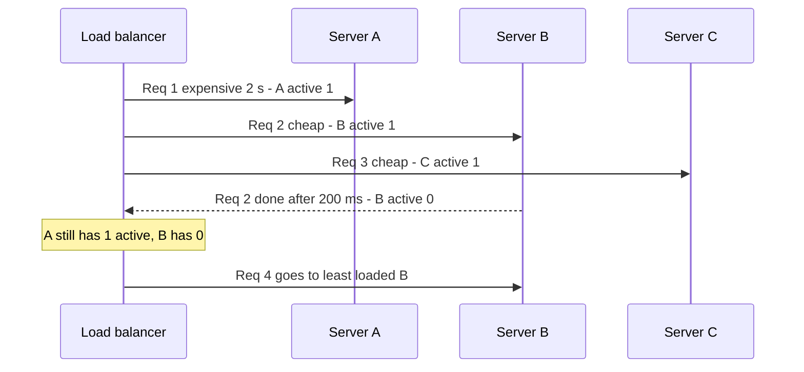

**Weighted least connections** combines this with capacity weights, so a server twice as powerful is allowed proportionally more active connections.

### Other algorithms

| Algorithm | How it chooses | Good for | Weakness |
|---|---|---|---|
| Round robin | Rotate in order | Uniform requests, identical servers | Blind to cost and load |
| Weighted round robin | Rotate, proportional to weights | Mixed server sizes | Still blind to request cost |
| Least connections | Fewest active connections | Requests of varying duration | Connection count is a proxy for load, not exact |
| Weighted least connections | Fewest connections relative to weight | Varying durations plus mixed sizes | More configuration |
| Least response time | Fastest recent responses (often combined with fewest connections) | Avoiding struggling servers | Needs continuous measurement |
| Resource-based | Lowest CPU / memory usage reported by agents | Heavy, uneven workloads | Requires agents and metrics on servers |
| IP hash / consistent hashing (extra) | Hash of client IP or key picks the server | Sticky routing, cache locality | Uneven if keys are skewed |

The idea is always the same: some logic decides which instance receives the next request.

### Health checks

**Problem**: server A crashes (overloaded by blind round robin, or an infrastructure misconfiguration). The LB keeps sending it every third request; those users get **502 Bad Gateway / 503 Service Unavailable**. Worse, with rotation, a user who succeeded via B might hit A on their next request, so failures spread to everyone intermittently.

**Solution**: **health checks**. Besides forwarding real user traffic, the LB periodically (say every second) sends its own lightweight test request, e.g. `GET /health`, to every instance and expects a **200**.

- The endpoint is cheap, so it adds negligible load.
- If an instance fails the check (error, non-2xx, timeout), the LB marks it **unhealthy** and stops sending user traffic to it; remaining traffic is spread over B and C.
- The LB **keeps probing** the unhealthy instance. When it returns 200 again, it is put back into rotation.

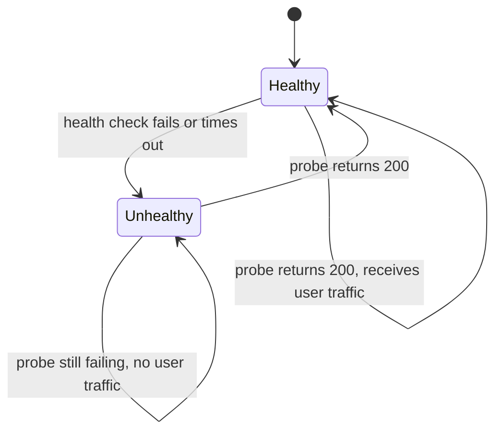

```ts
// Liveness: is the process up?
app.get("/health", (_req, res) => res.status(200).json({ status: "ok" }));

// Readiness: can it actually serve? (checks dependencies, cheaply)
app.get("/ready", async (_req, res) => {
  try {
    await pool.query("SELECT 1");
    res.status(200).json({ status: "ready" });
  } catch {
    res.status(503).json({ status: "not ready" });
  }
});
```

> [!TIP]
> Real LBs use thresholds to avoid flapping: e.g. mark unhealthy after 3 consecutive failures, healthy after 2 consecutive successes, with a timeout per probe. Keep health endpoints fast and avoid making them depend on slow downstream services, or one slow dependency can mark your whole fleet unhealthy.

> [!INTERVIEW]
> **"How does a load balancer know a server is dead?"** Active health checks: it periodically calls a cheap endpoint like `/health` and expects a 2xx within a timeout. After N failures it removes the instance from rotation, keeps probing, and re-adds it after M successes. Many LBs also use passive checks: if real requests to an instance fail or time out, it is temporarily ejected.

## Scaling the database

### Why databases are the hard part

Once state is externalized, scaling the app tier is easy: add servers behind the LB and capacity grows roughly linearly. The **database** is the **stateful** component and cannot simply be duplicated: every instance holds data on its local storage, and multiple instances must return **consistent** data. Coordinating that is what makes database scaling tricky.

Meanwhile, all those new app servers hammer the **same single database** (say 4 GB RAM, 4 cores), which eventually runs out of resources. Two industry-standard approaches: **read replicas** and **sharding**.

### Read replicas

**Architecture**:

- One **primary** (also called master or leader) handles **all writes** (INSERT, UPDATE, DELETE), and reads too if needed.
- Several **replicas** (secondary, follower; older term slave) hold a copy of the data and serve **only reads** (`SELECT`). Rule number one: you never write to a replica.
- A **replication** mechanism (native in Postgres and MySQL; SQLite via tools like Litestream or LiteFS) streams changes from the primary to replicas.
- Replicas can be spread **geographically**: primary in the US, replicas in India, Japan, etc., near app servers that serve those users.

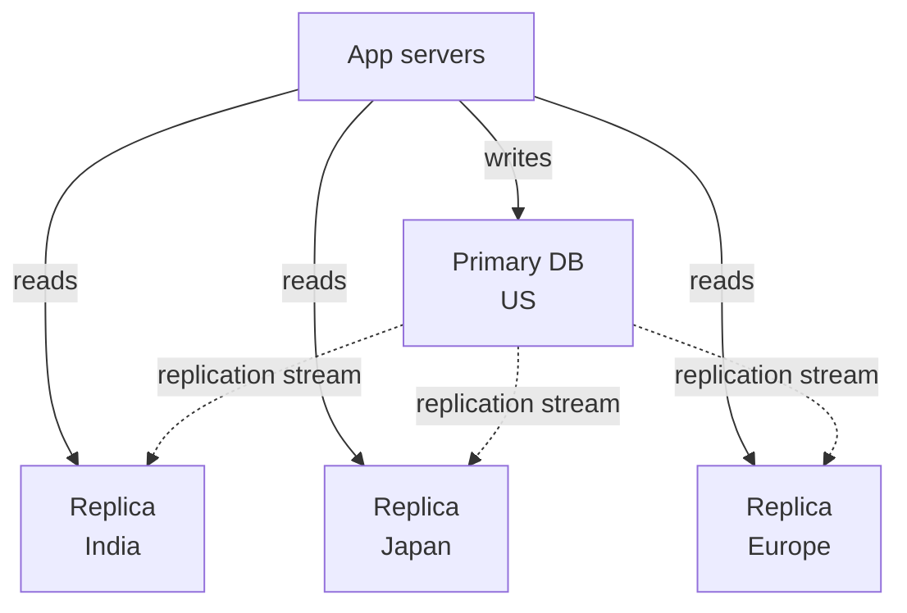

**Benefits**:

1. **Less load on the primary**: most SaaS traffic is reads. Even conservatively, ~70% reads and ~30% writes; often 90%+ reads. The primary drops from 100% of queries to ~30%.
2. **Lower latency**: users read from a nearby replica (assuming app servers are also nearby).

```ts
// Simple read/write splitting
const primary = new Pool({ connectionString: process.env.PRIMARY_URL });
const replica = new Pool({ connectionString: process.env.REPLICA_URL });

export const db = {
  write: (sql: string, params?: unknown[]) => primary.query(sql, params),
  read: (sql: string, params?: unknown[]) => replica.query(sql, params),
};
```

### The consistency problem: replication lag

Scenario:

1. A user in **India** changes their name from "A" to "AB". It is a write, so it goes to the **primary in the US**.
2. The primary commits and the API returns **200**.
3. The frontend (SPA or server-rendered) immediately refetches the profile, a **read**, which goes to the **India replica**.
4. Physics: data crosses undersea fiber, so US to India replication takes, say, ~200 ms. This delay is **replication lag**. The refetch happens within that window.
5. The replica still has "A". The user was told "updated" and then sees the old name. For payments or invoices, this kind of stale read can cause real damage.

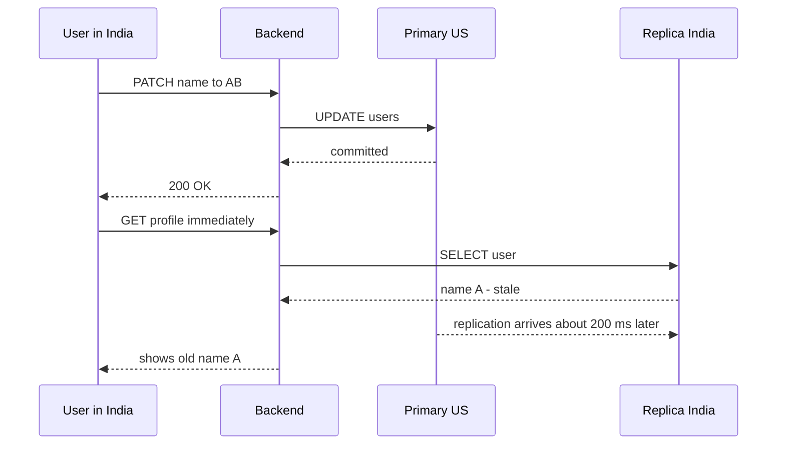

**Solutions** (each is a trade-off):

| Technique | How | Trade-off |
|---|---|---|
| Read-your-writes routing | After a write to a table/entity (e.g. `users`), route that user's subsequent reads of it to the **primary** (for a short window) | More load on the primary |
| Lag-aware reads | Track replication lag; make reads wait until the replica has caught up (e.g. to the write's log position) | Reads may block for the lag duration |
| Client-side delay | Design the frontend to refetch after a planned delay (e.g. 300 ms), or use the write response / optimistic UI instead of refetching | Hacky; depends on lag staying small |

> [!IMPORTANT]
> Every distributed-system solution involves a trade-off, and most of the time it is about **consistency**: how to make sure all instances have up-to-date data.

> [!NOTE]
> Extra precision: most replica setups use **asynchronous replication** (primary does not wait for replicas, so there is lag but writes are fast). **Synchronous replication** waits for at least one replica to confirm, which removes lag for that replica but adds write latency. This is the CAP / PACELC trade-off in miniature: during normal operation you trade latency for consistency.

**In practice**, managed providers (AWS RDS, Google Cloud SQL, etc.) let you create read replicas in chosen regions with a few toggles and ship robust handling for these issues. You will rarely implement replication yourself, but you must understand the trade-offs to configure it.

> [!INTERVIEW]
> **"A user updates their profile and immediately sees the old value. What is going on?"** Likely read-after-write inconsistency due to replication lag: the write went to the primary, the following read hit an asynchronous replica that had not yet applied the change. Fixes: route a user's reads to the primary for a short time after they write (read-your-writes), use session consistency / wait for the replica to reach the write's LSN, or return the updated entity in the write response so the client does not refetch.

### Sharding (partitioning)

**The problem**: an e-commerce `orders` table (Amazon, Flipkart scale) grows to **billions of rows**. A query such as:

```sql
SELECT * FROM orders WHERE user_id = 5;
```

stays slow even with an index on `user_id` because of sheer volume (and the index itself becomes huge). Also, one database instance can only serve so many requests per second; we need **more instances**.

**The solution**: split the table so that parts live on **physically separate database instances**. Toy example with 10 rows (imagine each row is a billion): rows 1–5 on database instance 1, rows 6–10 on instance 2.

The central decision is the **shard key**: the attribute that decides which shard a row lives on. Example: shard by **order date**: January to June on shard 1, July to December on shard 2 (or one shard per month at larger volumes).

Benefits:

1. **More capacity**: two (or N) instances serve more requests per second.
2. **Lower query latency**: each shard has only a fraction of the rows.

Some **routing layer** (in your backend, a proxy such as Vitess, or the database itself) decides which shard to query before sending the request.

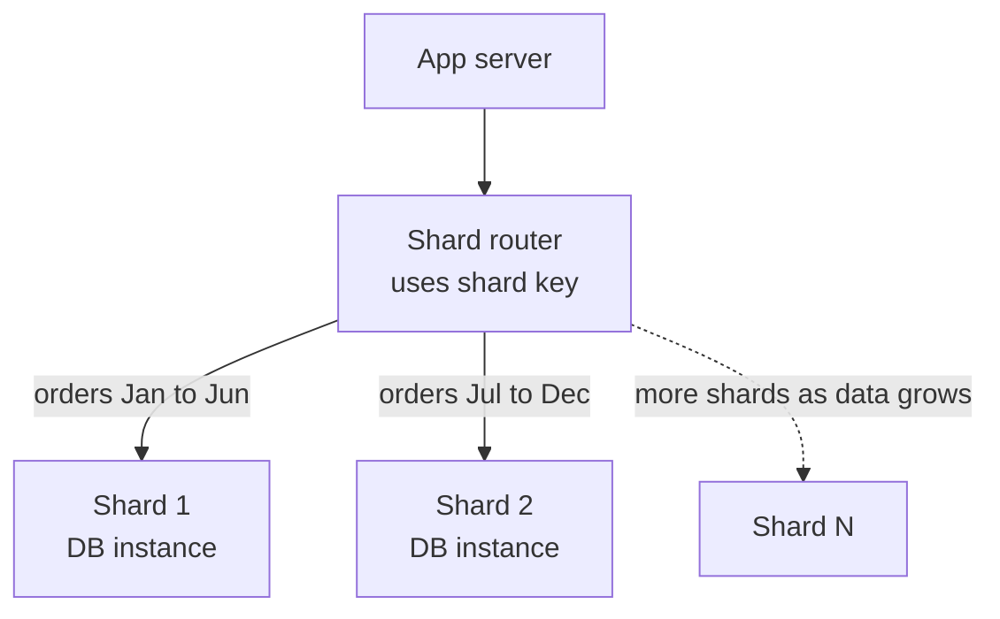

**Choosing a shard key** (well-known extra detail interviewers expect):

| Strategy | Example | Pros | Cons |
|---|---|---|---|
| Range-based | `order_date` by month, `user_id` 1–1M, 1M–2M | Simple, efficient range queries | **Hot shards**: with date sharding, all *new* orders hit the latest shard |
| Hash-based | `hash(user_id) % N` | Even distribution | Range queries span all shards; resharding moves lots of data (mitigated by consistent hashing) |
| Directory / lookup | Table mapping tenant to shard | Flexible, easy to move tenants | Lookup service is extra infrastructure and a dependency |
| Geo-based | Users by region | Data locality, compliance | Uneven region sizes |

> [!WARNING]
> Pick a shard key that matches your main access pattern. If you shard `orders` by date but almost every query is "orders for user X", each query must hit every shard (scatter-gather). Sharding by `user_id` would keep a user's orders together. Cross-shard joins and transactions are expensive or unsupported, so sharding is usually a last resort after indexing, caching and replicas.

> [!NOTE]
> Terminology: **partitioning** generally means splitting a table into pieces; **sharding** is horizontal partitioning where the pieces live on **different servers**. Postgres native partitioning splits a table into partitions on the *same* server; sharding spreads them across machines.

### Distributed databases and managed services

The modern trend is **distributed databases** that handle sharding, replication and distributed transactions for you:

| Product | Notes |
|---|---|
| **PlanetScale** | Built on **Vitess** (the MySQL sharding system from YouTube); MySQL compatible |
| **Neon** | Serverless Postgres; separates storage and compute; storage layer written in Rust |
| **CockroachDB** | Distributed SQL, Postgres-wire compatible, automatic sharding and replication |
| **YugabyteDB** | Distributed SQL, Postgres compatible |

Realistic advice:

- **Do not roll your own database infrastructure** unless you have deep DBA expertise. Replication, sharding and backups (keeping data safe in multiple places) are hard.
- In practice you pick a provider (RDS, Neon, PlanetScale...) based on features, price and team preference, sign up, get a connection URL with credentials, and plug it into your backend.
- You still need to understand the concepts so you can **configure** the console correctly: backup frequency, replica regions, sharding plans.

## CDNs: caching at the global level

### The physics problem

Caching inside your data center (Redis, etc.) does not fix the biggest remaining source of latency: **geographic distance**.

- Light in **fiber optic cable** travels at about **200,000 km/s** (about two-thirds of its speed in vacuum). Intercontinental data travels through **undersea cables**, so this is a hard cap.
- **Tokyo to North Virginia (AWS `us-east-1`)**: a round trip is roughly 20,000+ km, so about **100 ms minimum** just for the request and response to travel. No optimization can beat it.

And that is before any server work:

| Step | Rough cost |
|---|---|
| Network round trip Tokyo to us-east-1 | ~100 ms (physics floor) |
| Routing (usually regex/trie matching) | negligible |
| JSON deserialization into language objects | depends on payload size |
| Business logic + mid-complexity DB query (same region) | 50–100 ms |
| External API call | ~200 ms |
| **Total** | easily **500–800 ms** |

Even with all DB and cache optimizations from Part 1, distance remains.

### Edge locations (PoPs)

A **CDN (Content Delivery Network)** places **edge locations**, also called **PoPs (points of presence)**, all over the world. A Tokyo user hits a Tokyo PoP ~100–200 km away; latency drops from ~100 ms to ~2–3 ms for cached content.

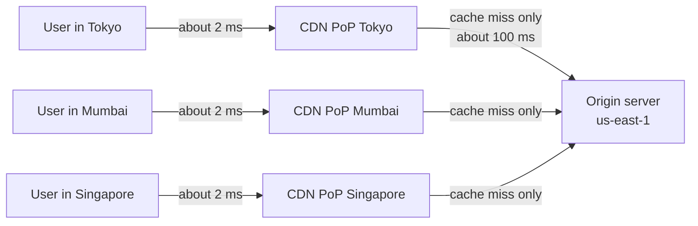

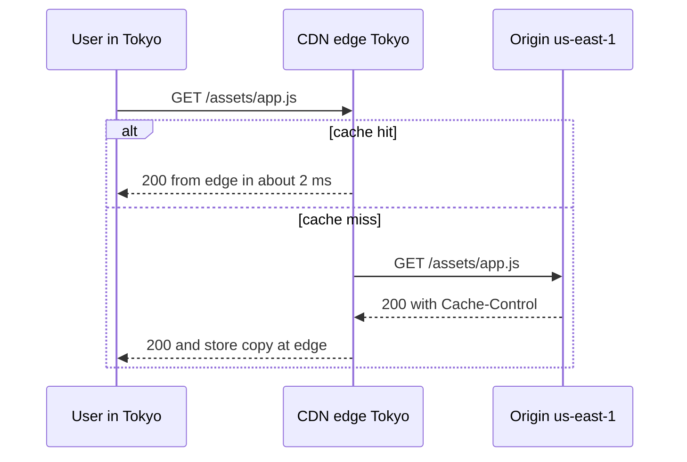

### Benefits of a CDN

1. **Latency**: content is served from a node near the user.
2. **Load**: the origin server receives far fewer requests (traffic is spread across CDN nodes), so you need to scale it less often.
3. **Security / DDoS protection** (a key Cloudflare selling point): see below.

### What to put on a CDN

- **Static content**: JavaScript and CSS bundles, HTML, images, videos, fonts. A built SPA (React) is just a bundle of JS/CSS/HTML; instead of every request going to the origin or an S3 bucket, it is cached across CDN nodes. This is the standard way to deploy SPAs and static sites like blogs.
- **Some API responses**: e.g. a product catalog that rarely changes.

**Invalidation (purging)**: CDNs let you purge cached content. Cloudflare supports **cache tags**: tag responses (e.g. with a user ID for all their blog posts), and when that user publishes a new post, purge everything with that tag so the next request fetches fresh data from the origin and re-caches it.

```http
HTTP/1.1 200 OK
Content-Type: application/json
Cache-Control: public, max-age=60, s-maxage=600, stale-while-revalidate=30
Cache-Tag: user-42-posts
ETag: "v17"
```

> [!TIP]
> Use content-hashed filenames for static assets (`app.3f9a1c.js`) with `Cache-Control: public, max-age=31536000, immutable`. A new deploy produces new filenames, so you never need to purge them. Keep `index.html` short-lived so it picks up new asset names.

### DDoS protection

A **DDoS (Distributed Denial of Service)** attack: an attacker controls a **botnet** (e.g. 20,000 machines infected with malware) and floods your server.

- Without protection, either your servers **crash** (hard limits), or, with aggressive autoscaling, they keep spinning up instances and you get a massive bill (e.g. $50,000 in a day). Damage is operational or financial.
- With a CDN like Cloudflare **in front** of your origin, all traffic passes through it. It serves cached content itself, detects attack patterns using years of experience, challenges suspicious clients (e.g. CAPTCHA), and absorbs the flood across its enormous global network, so even terabytes of attack traffic do not reach your servers.

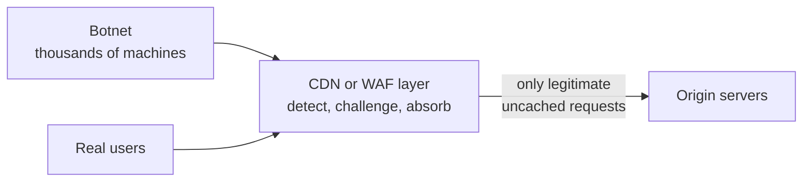

### Edge computing

**"Edge"** originally referred to CDN nodes being at the **edge of the network**: placed in collaboration with ISPs at the first point where a user's traffic enters the network, which is why CDN responses are so fast.

**Traditional CDN**: serves files. Request a filename, get the file; no processing.

**Edge computing**: runs **your code** at the CDN node, processing the request before responding. Because CDN nodes vastly outnumber primary data centers (which need huge financial and operational investment), and they sit close to users, round trips are short. The computation itself is not faster, but the total response feels much faster.

Use cases:

1. **Authentication at the edge**: a Tokyo user with an invalid session would otherwise travel ~100 ms to the US just to get a **401**. Instead, the edge validates the session or token and rejects immediately in ~2–3 ms. The origin only receives legitimate, authenticated traffic, cutting a lot of unnecessary load.
2. **Localization / personalization**: the edge knows the user's region and can read headers like `Accept-Language: ja`, so it serves the Japanese version directly.
3. Validation, A/B routing, deciding which backend a request should go to, redirects.

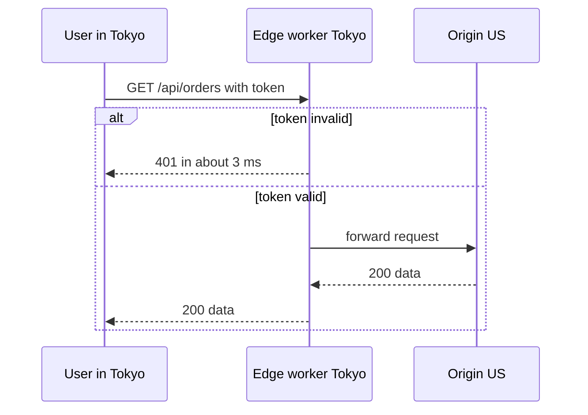

```ts
// Cloudflare Worker sketch: reject unauthenticated requests at the edge
export default {
  async fetch(request: Request, env: Env): Promise<Response> {
    const token = request.headers.get("Authorization")?.replace("Bearer ", "");
    if (!token || !(await verifyJwt(token, env.JWT_PUBLIC_KEY))) {
      return new Response("Unauthorized", { status: 401 });
    }
    return fetch(request); // pass through to origin
  },
};
```

**Why not run everything at the edge? Constraints**:

1. **Resource limits**: edge infrastructure is primarily ISP-hosted routing infrastructure, with CDN functionality added in partnership. Nodes have limited resources (think ~1 core, small memory) compared with data-center servers (8–16+ GB).
2. **Runtime limits**: edge is designed for very low-latency compute. **Cloudflare Workers** run on **V8 isolates** (Chrome's JavaScript engine) and cannot use a normal file system, open arbitrary raw TCP connections the way a server can, or run long CPU-heavy tasks.

So the edge **complements** the origin: offload strategic logic (auth, customization, validation, routing) and keep core processing in robust data-center servers.

| | Traditional CDN | Edge computing | Origin servers |
|---|---|---|---|
| What runs | Nothing; serves cached files | Small functions | Full application |
| Distance to user | Very close | Very close | Far (one or a few regions) |
| Resources | n/a | Tiny (CPU time, memory limits) | Large |
| Good for | Static assets, cacheable API responses | Auth checks, redirects, localization, A/B routing | Business logic, DB transactions, heavy compute |

## Asynchronous processing

### The idea

Unlike horizontal scaling (adopted at some threshold, e.g. 10k–50k users), asynchronous processing is usually adopted **from the start**, because the benefit is obvious: it reduces the **perceived latency** users feel.

Some operations need **synchronous behaviour**: when a user changes their name, you must commit the DB update before returning 200, so a refresh shows the new name. You cannot say "updated" before the database confirms.

But many operations do **not** require the user to see the result immediately. Those can be **offloaded**.

### Example: inviting a team member

In a SaaS app (Jira, Notion...), you type `user1@gmail.com` and click Invite. The handler (ignoring validation and auth) does:

1. DB check: is this email already a member? (validation)
2. Insert into an `invites` / `team_members` table with status `pending` (later `accepted` / `rejected`).
3. Send an invite email via an external provider (Mailchimp, SendGrid, Resend).

Steps 1–2 take ~50–100 ms (DB in the same region). Step 3, an external API whose infrastructure you do not control, takes ~200–300 ms (and could be down). Synchronously, the user stares at a loader for ~400 ms.

But the user does not need the email to have been sent before seeing "Invited (pending)". So after step 2, **respond 200 immediately** (~100 ms) and send the email in the background.

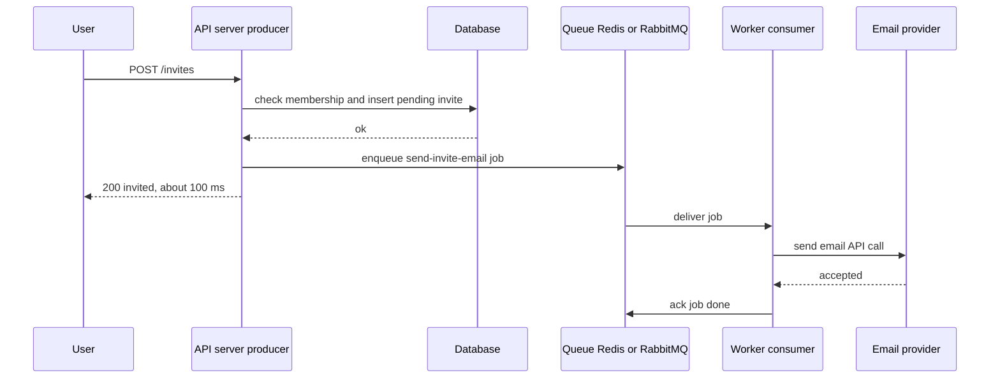

### How it is implemented: producers, queues, consumers

- The task (send email) is packaged as a **job**.
- The API server acts as the **producer**, pushing the job into a **queue**: Redis-based queues (e.g. **BullMQ** for Node.js), **RabbitMQ**, or event-streaming systems like **Kafka**.
- **Consumers** (also called **workers**) pick jobs from the queue and execute them (call SendGrid/Resend).
- Workers can run in the **same codebase/process** as the server, or as a **separate deployment** so you can **scale workers horizontally** independently. (See the background jobs and message queues chapter for depth.)

```ts
import { Queue, Worker } from "bullmq";

const connection = { url: process.env.REDIS_URL };
export const emailQueue = new Queue("emails", { connection });

// Producer (in the HTTP handler)
app.post("/invites", async (req, res) => {
  const { email } = req.body;
  await assertNotMember(email);
  const invite = await db.insert(invites).values({ email, status: "pending" }).returning();
  await emailQueue.add(
    "send-invite",
    { inviteId: invite[0].id, email },
    { attempts: 5, backoff: { type: "exponential", delay: 1000 } }
  );
  res.status(200).json(invite[0]); // respond without waiting for the email
});

// Consumer (can be a separate process / deployment)
new Worker(
  "emails",
  async (job) => {
    await resend.emails.send({ to: job.data.email, subject: "You are invited", html: "..." });
  },
  { connection, concurrency: 10 }
);
```

### Typical candidates for async processing

| Task | Why it can be async |
|---|---|
| Sending emails, notifications | Users do not expect them within the same millisecond |
| Video processing (YouTube) | After the upload finishes, jobs for thumbnails, HD encoding, subtitles run in the background; users expect it to take 10–20 minutes. (The upload itself must keep the tab open because the browser is reading bytes from disk.) |
| Image uploads / resizing | Generate variants in the background |
| Account deletion | Can be a huge multi-table delete |
| Reports, exports, webhooks out | Long running, retryable |

### Example: account deletion

A to-do app user clicks **Delete account**. Naively, the handler runs a **transaction** deleting from ~7–8 tables (categories, calendar schedules, to-dos, profile data, and finally `users` last because the other tables have foreign keys to it). For a 10-year user with millions of rows per table, if each table's delete takes ~500 ms, that is ~4 s, plus business logic and network: ~**8 s of spinner**. Unacceptable, unless you explicitly warn the user to wait.

Async version: the server does quick sanity checks (user exists, authenticated; ~50–80 ms), enqueues a `delete-user` job with the user ID, responds **200**, and the browser logs the user out. A worker later runs the heavy deletes; it does not matter if it takes 5, 10 or 30 seconds.

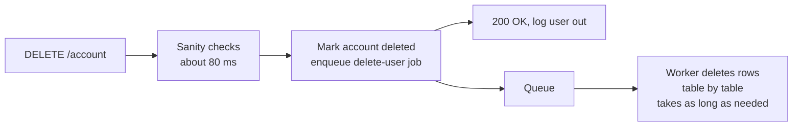

> [!WARNING]
> Async jobs must be **idempotent** and **retryable**: workers crash, queues redeliver. Use job IDs or deduplication keys, configure retries with exponential backoff, and route repeatedly failing jobs to a dead-letter queue. Also mark the entity's state (e.g. `deleted_at`, `invite.status`) synchronously so the UI is correct even before the job runs.

> [!TIP]
> The easiest production setup: a managed Redis (e.g. Upstash or your cloud's managed Redis) plus **BullMQ** in Node.js. BullMQ uses Redis under the hood and handles retries, error handling, rate limiting, delays and concurrency. First identify which tasks users do not need to see immediately, then offload them.

## Microservices

### Monolith first

A **monolith** is a backend application deployed as a **single deployable unit**. Authentication, order processing, notifications, payments, webhooks are just different modules/files in **one codebase** (one GitHub repo), running in one process (or several identical processes when horizontally scaled).

Monoliths are simple to:

- **Develop**: all code in one place.
- **Refactor**: change one module and the others in the same commit.
- **Test**: everything runs in one process.
- **Deploy**: build once, ship once.

And you can always **horizontally scale a monolith**. So why consider anything else?

### Microservices scale teams, not machines

**Microservices** split the application into multiple **independently deployable services**. Their main benefit is organizational: scaling the **humans** behind the machine. The first prerequisite is a **large team**, think more than 100–200 developers on the same application.

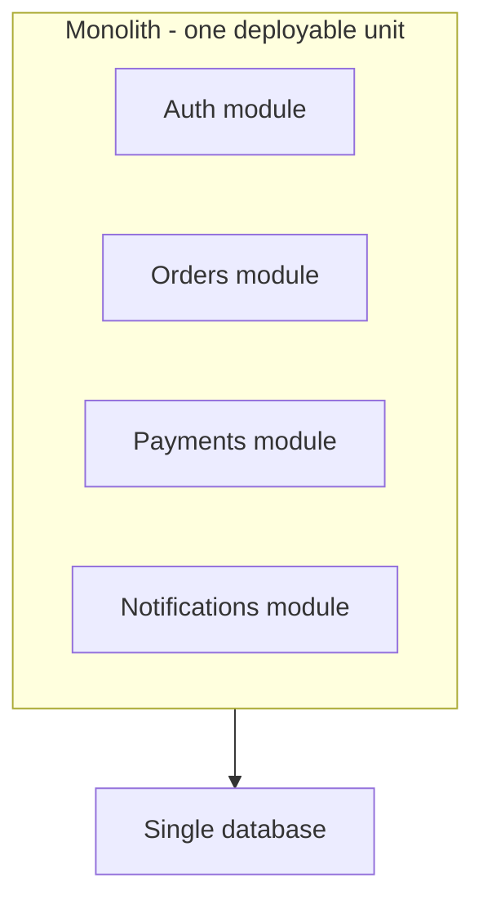

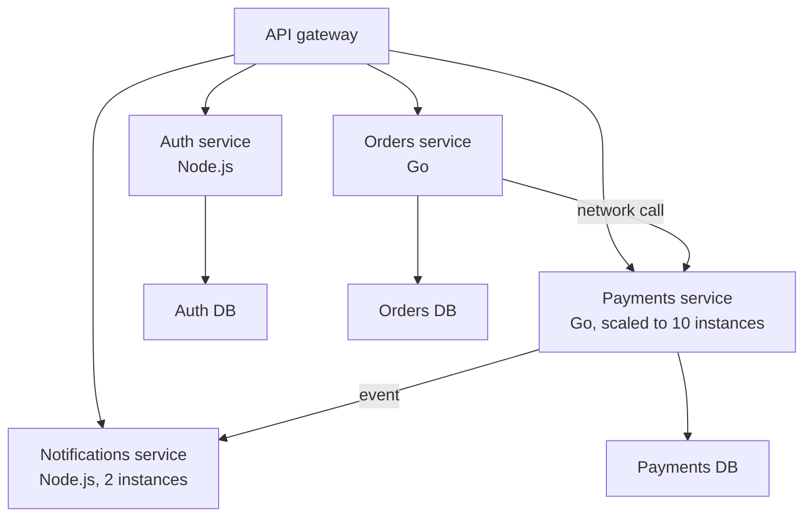

### Problems with monoliths at scale (benefits of microservices)

1. **Deployment coupling**: the payments team has a critical change ready to ship, but the notifications team has merged unfinished (not broken, just not ready) work into `main`. Since everything deploys as one unit, payments is blocked. Feature flags and disciplined git workflows help, and in a 10–30 person startup everyone knows what everyone is doing, so it rarely bites. With 500–1,000 developers working rapidly across modules, it becomes a real bottleneck.
2. **Independent scaling**: notifications (some DB inserts, WebSocket pushes) is light; orders and payments are CPU- and memory-heavy, and must never fail during a big sale. With a monolith you scale **everything** together. With microservices you scale only payments and orders.
3. **Technology choice per service**: a blogging platform (Medium, Hashnode, dev.to) needs Markdown parsing/rendering where the Node.js or Python ecosystem has the best library, and image manipulation where Go or Rust is far faster for CPU-bound work (e.g. 50 ms vs 500 ms). A single deployable unit forces one language; microservices let each service pick.

### Costs of microservices

1. **Network**: what used to be an in-process function call is now a **network call** (HTTP or gRPC). That adds **latency** and, worse, **failures**: you must handle timeouts, retries, partial failures.
2. **Debugging**: one request goes LB, router, order service, payment service, notification service. Understanding it means correlating logs from four services. You need **distributed tracing** and must design for cross-service debuggability.
3. **Data consistency**: each service usually owns its own database. Keeping data consistent across databases (with lag, no shared transactions) is hard; you need patterns like sagas, outbox, eventual consistency.
4. Plus: more infrastructure, deployments, monitoring, versioned APIs between services.

| | Monolith | Microservices |
|---|---|---|
| Deployable units | One | Many |
| Inter-module calls | In-process function calls | Network calls (HTTP/gRPC/events) |
| Scaling | Whole app together | Per service |
| Tech stack | One | Per service |
| Deploy independence | Low (shared release) | High |
| Debugging | Stack traces, single log | Distributed tracing required |
| Data | One DB, ACID transactions | DB per service, eventual consistency |
| Best for | Small/medium teams, most products | Large orgs with clear domain boundaries |

### When to choose microservices

Consider them only with clear answers to:

- **Large team** with clear boundaries (so the human org chart aligns with the service boundaries; this is Conway's law).
- **Different scaling needs** for different parts.
- **Different technology needs** for different parts.
- **Deployment velocity** problems caused by coupling.

Otherwise, the complexity outweighs the benefits. It is a big decision.

> [!INTERVIEW]
> **"Should we split our monolith into microservices to improve performance?"** Usually no. Microservices mostly solve organizational problems (independent deploys for large teams), independent scaling and tech heterogeneity. For performance they often make things worse: function calls become network calls with latency and failure modes, and consistency gets harder. First measure, then fix bottlenecks inside the monolith (indexes, caching, async jobs) and scale it horizontally. A modular monolith is a good middle ground.

## Serverless

Serverless has become a go-to scaling model, popularized by Vercel, Netlify and Cloudflare. To appreciate it, start with what came before.

### The traditional (serverful) model

You rent a **VM** (e.g. AWS EC2) with an OS (Ubuntu), install your stack (Nginx, Docker, runtime), configure it to fetch/build/run your code, and keep managing it for its lifetime (configuration, DNS, patches). You know exactly what you get, e.g. 2 or 4 cores, 4/16/32 GB RAM, 30 GB SSD, 1 TB/month bandwidth, and your app serves requests as they arrive.

### Problem 1: capacity planning

You must decide **before serving users** how many servers and what size, which means predicting traffic and user behaviour, which is impossible to do accurately.

- **Under-provision** (4 GB) and a campaign or viral blog post arrives: the server crashes or becomes unresponsive (3–4 s responses, error toasts). New users leave before converting; paid users start looking for alternatives. Financial and reputational loss.
- **Over-provision** (32 GB when 8 GB would do): it survives, but you pay for unused capacity, e.g. ~$5,000 for a week vs ~$500, while using 20% of the machine.

### The standard fix: autoscaling, and its limits

**Autoscaling** adds instances based on metrics: e.g. 2 instances of 4 GB; when memory/CPU crosses **70%**, spin up a third; load per instance drops to ~40%.

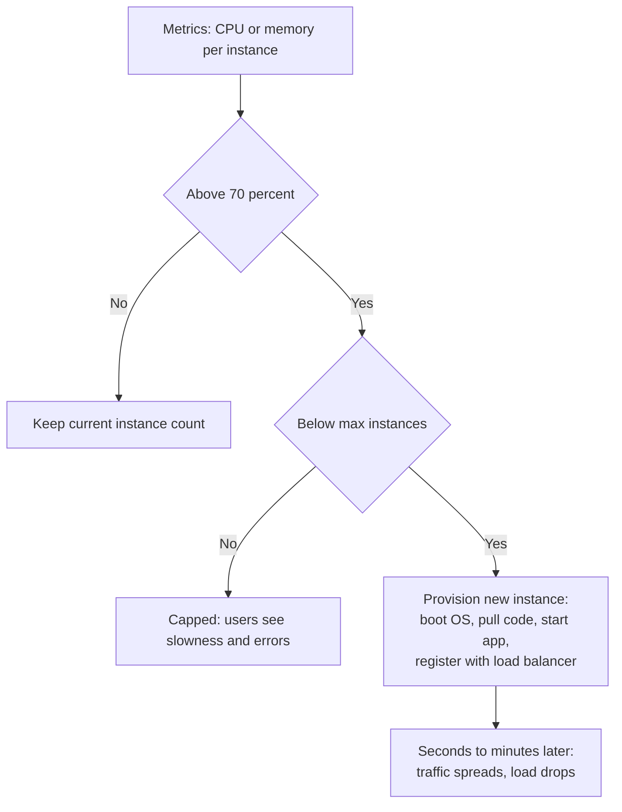

Drawbacks:

1. **Time to scale**: a new instance must boot the OS, fetch/build the code, start the process and register with the load balancer: seconds to minutes. A spike within 3–4 seconds can outrun it.
2. **Min/max limits**: max too low (e.g. 10) and you are back to under-provisioning; max too high (e.g. 1,000) and an attack or a genuine Black Friday spike scales you to 500–600 instances and a ~$100,000 bill in a day.
3. **Reactive, not proactive**: it only scales *after* crossing the threshold, when you are already overloaded. If the window is short you still crash.
4. **Always-on cost**: there is always a minimum (e.g. 2 instances, or one machine's size). Whether you get 500 RPS or 0 RPS, you pay for it 24/7.

Despite this, autoscaling is a standard practice, and the serverful model makes a lot of sense for **steady, predictable traffic** (most SaaS apps). Serverless targets workloads where that is not true.

### What serverless actually is

"Serverless" does not mean no servers; there are still machines, VMs and OSes. It means **you do not manage them**: no choosing RAM/CPU, no OS, no server configuration. You provide only:

1. **Functions** (your code), and
2. **Events** that trigger them (HTTP routes, queue messages, file uploads, DB changes, schedules).

**Execution model**: an **API gateway** receives HTTP requests and maps routes to functions. On a request, the provider (AWS Lambda, Cloudflare Workers, Vercel Functions...) finds or **spins up** an execution environment with your code, runs it, returns the response, then keeps the instance warm for a while (seconds to minutes) for reuse, or tears it down. Before the first request, nothing is provisioned at all.

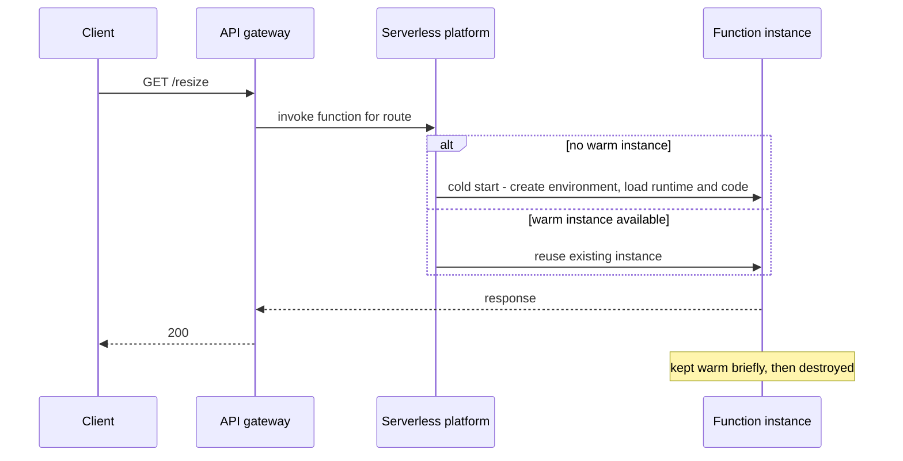

**Pricing model**: serverful = pay 24/7 while running. Serverless = pay **only for execution** (CPU/memory time per invocation, plus request count). Monthly cost = sum of all invocations, which can save a lot for spiky or low traffic.

```ts
// AWS Lambda handler behind API Gateway
import type { APIGatewayProxyHandlerV2 } from "aws-lambda";

export const handler: APIGatewayProxyHandlerV2 = async (event) => {
  const id = event.pathParameters?.id;
  const item = await getItem(id!); // use an HTTP-based or pooled DB client
  return { statusCode: 200, body: JSON.stringify(item) };
};
```

### The catches

#### 1. Cold starts

Because there is no pre-assigned machine, the **first** request (or one after idle) must wait while an environment is created: the **cold start**. The two biggest contributors:

1. **Booting the VM/OS**.
2. **Starting the language runtime** (JVM, Node.js, Python...) and loading your code.

Mitigations:

- **Keep-warm pings**: send automated requests every few seconds so an instance is always ready. Do not overdo it, or you are paying for always-on instances again, defeating the purpose. (AWS also offers paid *provisioned concurrency*.)
- **Faster VM tech**: AWS built **Firecracker**, lightweight **microVMs** on top of KVM, for Lambda; it boots in a fraction of a second and is an industry reference.
- **V8 isolates**: Cloudflare Workers run code in V8 isolates (lightweight sandboxes inside one process) instead of separate VMs; Cloudflare claims near-zero startup (under ~5 ms).
- **Language choice**: JavaScript and Python start fast (no heavy ahead-of-time setup); Java's JVM startup and class loading make cold starts slower (mitigations exist, e.g. SnapStart, GraalVM native images). Combining V8 isolates and JavaScript gives Workers extremely low cold starts.

Cold starts can be reduced but **never eliminated**; an always-on server will always beat them.

#### 2. Execution limits

Providers cap execution time: **AWS Lambda functions can run at most 15 minutes**. A long-running request (e.g. 30 minutes) fails midway. Memory and payload sizes are also capped.

#### 3. Forced statelessness

Traditional servers rely on stateful behaviour: long-lived **TCP connections to the database** (connection pools), **WebSocket connections** to browsers, in-memory caches. Serverless instances live seconds and are replaced constantly, so you cannot hold data or connections reliably. All of that must be re-imagined: HTTP-based or serverless databases (Neon, PlanetScale), external poolers/proxies (e.g. RDS Proxy, PgBouncer), managed WebSocket services.

> [!WARNING]
> Classic serverless pitfall: each function instance opens its own DB connection pool. A traffic spike creates hundreds of instances and exhausts Postgres `max_connections` (Part 1's connection problem, amplified). Use a pooler/proxy or an HTTP-based serverless driver.

### When to use serverless

**Avoid** it for:

- **Latency-sensitive** user-facing paths that cannot tolerate cold starts (banking, payments).
- **Long-running** work: long HTTP calls, persistent WebSocket connections.
- Apps needing **many persistent DB connections** (unless you adopt serverless databases and proxies).

**Ideal** for:

- **Irregular, heavy jobs**: video processing, image resizing, which you would otherwise pay for 24/7.
- **Event-driven operations**: a message arrives in a queue, a file is uploaded, a database row changes, a scheduled trigger.

| | Serverful (VMs/containers + autoscaling) | Serverless (functions) |
|---|---|---|
| You manage | OS, runtime, scaling config | Just code and triggers |
| Cost model | Pay while running (24/7 minimum) | Pay per invocation and execution time |
| Scale-up speed | Seconds to minutes, reactive | Near-instant fan-out, with cold starts |
| Long-running work | Fine | Limited (e.g. 15 min on Lambda) |
| Persistent connections | Natural (pools, WebSockets) | Hard; must redesign |
| Latency | Predictable, no cold starts | Cold-start tail latency |
| Best fit | Steady traffic, core APIs | Spiky or rare jobs, event-driven glue |

The industry is somewhat over-hyped about serverless: it is powerful for specific use cases, but not a universal replacement for servers.

## Guiding principles (summary of both parts)

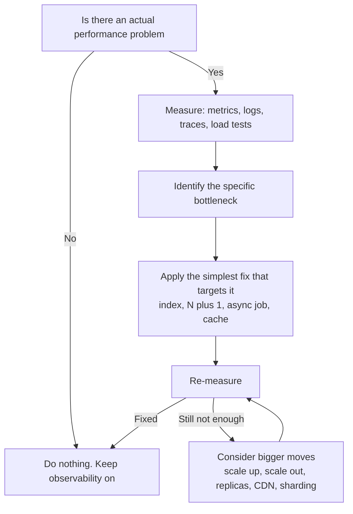

1. **Start with the problem.** Everything in these chapters is a *solution*. First establish whether the system is actually slow, how slow, and which component, via **observability** (logs, metrics, traces) and **performance/load testing**. Know the specific cause ("this query lacks this index", "this table needs sharding") before acting; otherwise it is **premature optimization**. Tools: **Prometheus + Grafana** (self-hosted metrics and dashboards, with tracing backends), or managed tools like **New Relic** or Datadog. The worst outcome is fixing the wrong bottleneck: it gives a false sense of having solved the problem, which grows into a bigger one.
2. **Prefer simple solutions.** Complexity always has a cost: every component can fail, must be monitored, understood and operated. Simpler examples:
   - A large vertically scaled server is simpler than horizontal scaling from day one.
   - Proper indexes are simpler than putting Redis in front of every query.
   - A monolith is simpler than microservices.
   - Avoid Kubernetes unless you genuinely need it.
   Accept complexity only when simplicity is genuinely insufficient, and justify it.
3. **Scale for the problems you have.** Do not build for a million users on day one; most platforms never get there. Build for current scale plus reasonable headroom, and learn your real bottlenecks as you grow. Advice from Netflix, Google or Facebook engineering blogs may not apply to your system; your own measurements are more valuable.
4. **Measure, from day one.** The exception to "keep it simple": production-grade **observability** (logs, metrics, traces) pays off from the start. No guessing, no mystery crashes, early warning to scale before problems hit users.
5. **Performance is a mindset.** Like security, it is learned continuously through experience: build, watch systems struggle, optimize, learn what helps. The job is not to predict every problem but to build systems that **handle problems gracefully**, and to develop the skills to **measure, diagnose and resolve** them quickly.

## Putting it together: a reference architecture

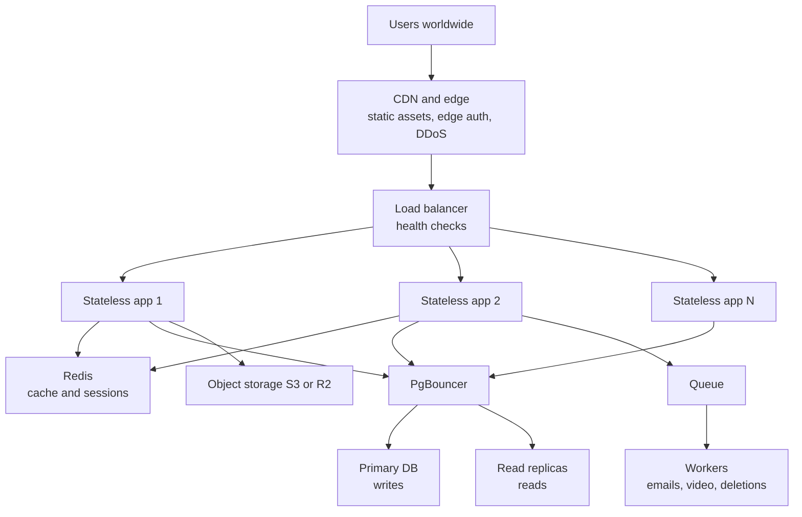

## Common mistakes & misconceptions

- **Storing sessions or uploads on the instance.** Breaks as soon as there are two instances; use Redis and object storage.
- **"Sticky sessions fix statelessness."** They hide it; when that instance dies or scales in, users lose state. Externalize state instead.
- **Assuming round robin balances load.** It balances *request counts*, not *work*; heavy requests can pile onto one server.
- **Health endpoints that check every dependency.** A slow downstream can mark all instances unhealthy at once; separate liveness and readiness.
- **Writing to a read replica / ignoring replication lag.** Leads to read-after-write bugs.
- **Choosing a shard key that does not match access patterns.** Causes scatter-gather queries or hot shards (date-based sharding puts all new writes on one shard).
- **Sharding too early.** Indexes, caching, replicas and vertical scaling are simpler and usually enough.
- **Rolling your own database cluster** without deep expertise.
- **Thinking a CDN is only for images.** It also cuts origin load, can cache API responses, and absorbs DDoS.
- **Running heavy logic at the edge.** Edge runtimes have tight CPU/memory limits and restricted APIs.
- **Doing slow side effects synchronously** (emails, video processing, mass deletes) instead of queueing them.
- **Non-idempotent jobs.** Queues redeliver; duplicates cause double emails or charges.
- **Adopting microservices for performance.** They mainly solve team-scaling problems and add latency and failure modes.
- **"Serverless means no servers / always cheaper."** There are servers; at steady high load, always-on instances are often cheaper and have no cold starts.
- **Premature optimization.** Optimizing without measurements, or building for a million users on day one.

## Interview questions

<details>
<summary><strong>Q: What does it mean for a service to be stateless, and why does horizontal scaling require it?</strong></summary>

A stateless service stores no client-specific data that only that instance can see: no in-memory sessions, no local files, no local database. Any instance can serve any request and produce the same result, so the load balancer can route freely and instances can be added or removed at any time. If state lives on an instance, the next request may hit another instance that lacks it (e.g. a 401 because the session is missing). So state is externalized to shared stores: Redis for sessions and cache, S3/R2 for files, a central database for data.

</details>

<details>
<summary><strong>Q: Compare round robin, weighted round robin and least connections. When does round robin fail?</strong></summary>

Round robin rotates requests across servers; it is ideal for uniform requests on identical servers. Weighted round robin gives bigger servers proportionally more requests. Least connections sends each request to the server with the fewest active connections, which adapts to requests of different durations, since slow requests keep connections open longer. Round robin fails with mixed workloads: if some requests take 2 s (external call plus heavy write) and others 200 ms, round robin can stack expensive requests on one server and overload it, while least connections steers new requests away from busy servers.

</details>

<details>
<summary><strong>Q: A backend instance crashes. How does the load balancer avoid sending it traffic, and how does it come back?</strong></summary>

Through health checks. The load balancer periodically calls a lightweight endpoint like `/health` on each instance and expects a 200 within a timeout. When an instance fails (error, 5xx, timeout), typically after a few consecutive failures, it is marked unhealthy and removed from rotation, so users stop seeing 502/503 errors. The LB keeps probing it; after it returns 200 again (often a few consecutive successes) it is re-added. Without health checks, round robin would keep sending a share of requests to the dead instance.

</details>

<details>
<summary><strong>Q: Why is scaling the database harder than scaling the application tier?</strong></summary>

The app tier can be made stateless, so you just add identical instances behind a load balancer. The database is inherently stateful: it holds the data on its storage and must give consistent answers. Copying it means keeping copies in sync (replication, with lag and consistency trade-offs); splitting it means deciding where each row lives and routing queries (sharding, with cross-shard query and transaction problems). Either way you face distributed-systems consistency issues the app tier does not have.

</details>

<details>
<summary><strong>Q: How do read replicas work and what problems do they introduce?</strong></summary>

One primary handles all writes; replicas receive a stream of changes and serve read-only queries. Since most workloads are read-heavy (70–90% reads), this offloads most traffic from the primary and lets you place replicas near users for lower latency. The main problem is replication lag: with asynchronous replication, replicas are slightly behind, so a user who just wrote and immediately reads from a replica may see stale data. Replicas also do not help write throughput, and failover and promoting a replica need care.

</details>

<details>
<summary><strong>Q: A user saves their profile, the UI says "Saved", then shows the old value. How do you fix it?</strong></summary>

This is a read-after-write inconsistency from replication lag: the write hit the primary, the immediate refetch hit a replica that had not yet applied it. Options: route that user's reads of the changed entity to the primary for a short window after a write (read-your-writes); track the write's log position and only read from a replica that has caught up, or wait; return the updated entity in the write response (or use optimistic UI) so the client does not need to refetch; for critical data like payments, always read from the primary.

</details>

<details>
<summary><strong>Q: What is sharding, how do you choose a shard key, and what are its downsides?</strong></summary>

Sharding splits a large table across multiple independent database instances, each holding a subset of rows, so each node has less data (faster queries) and total capacity multiplies. The shard key decides placement: range-based (by date or ID range) is simple but creates hot shards; hash-based spreads load evenly but makes range queries hit all shards; directory-based is flexible but needs a lookup service. Choose a key that matches the dominant access pattern (e.g. `user_id` for "orders of a user") and has high cardinality and even distribution. Downsides: cross-shard joins and transactions, resharding pain, and operational complexity, so it is usually a last resort after indexing, caching, replicas and vertical scaling.

</details>

<details>
<summary><strong>Q: Why can a CDN reduce latency even if your server code is perfectly optimized?</strong></summary>

Because a large share of latency is physical distance. Light in fiber travels at about 200,000 km/s, so a Tokyo to us-east-1 round trip has a floor of roughly 100 ms, before any processing. A CDN caches content at edge PoPs near users (often inside or next to ISP networks), so cached responses travel a few hundred km and return in a few ms. It also reduces origin load, since most requests are served at the edge, and protects against DDoS by absorbing and filtering traffic across a huge network.

</details>

<details>
<summary><strong>Q: What is edge computing, what is it good for, and why can't everything run at the edge?</strong></summary>

Edge computing runs your code on CDN edge nodes close to users instead of only serving cached files. Good uses: rejecting unauthenticated requests with a 401 in a few ms instead of a 100 ms round trip to the origin, localization based on region or Accept-Language, redirects, A/B routing and request validation. Limits: edge nodes have small CPU and memory budgets and restricted runtimes (e.g. Cloudflare Workers run in V8 isolates with no normal file system and limited networking and CPU time), and your database is usually far away in one region anyway. So the edge complements the origin rather than replacing it.

</details>

<details>
<summary><strong>Q: How does asynchronous processing reduce latency? Give examples and the pitfalls.</strong></summary>

It reduces perceived latency: the request does only the work the user must see (e.g. inserting a pending invite), responds immediately, and pushes slow side effects into a queue processed by background workers. Examples: sending invite emails, notifications, video transcoding and thumbnails, image resizing, deleting an account's data across many tables. A 400 ms invite becomes 100 ms; an 8-second account deletion becomes about 100 ms. Pitfalls: jobs must be idempotent (queues redeliver), need retries with backoff and a dead-letter queue, and you need monitoring of queue depth, plus a synchronous state flag (like `status = pending`) so the UI is correct before the job runs.

</details>

<details>
<summary><strong>Q: Your team of 12 engineers wants to move to microservices to scale. What do you say?</strong></summary>

Microservices mainly solve organizational problems: independent deployments for large teams (hundreds of developers), independent scaling of very different components, and different tech stacks per service. A 12-person team rarely has those problems, and microservices would add network latency and failures between services, require distributed tracing to debug, and make data consistency across per-service databases hard. I would keep a well-structured modular monolith, measure, fix actual bottlenecks and scale it horizontally, and only extract a service when there is a concrete reason (e.g. a CPU-heavy image pipeline that needs Rust and separate scaling).

</details>

<details>
<summary><strong>Q: What are the limitations of autoscaling?</strong></summary>

It is reactive: it scales only after a metric like CPU crosses a threshold, when you are already under pressure. New instances take seconds to minutes to boot the OS, start the app and register with the load balancer, so sharp spikes can outrun it. The max instance limit is a dilemma: too low and you under-provision, too high and an attack or a huge sale can create a giant bill. And there is always a minimum footprint you pay for 24/7 even with zero traffic. Mitigations include scheduled or predictive scaling, keeping headroom, faster startup (small images) and queue-based buffering.

</details>

<details>
<summary><strong>Q: What is a cold start in serverless and how do you mitigate it?</strong></summary>

Because serverless functions have no pre-provisioned machine, the first request (or the first after idle, or during scale-out) must wait while the platform creates an execution environment, boots the microVM or sandbox, starts the language runtime and loads your code. Mitigations: keep-warm pings or provisioned concurrency (at the cost of paying for idle capacity), lightweight isolation such as Firecracker microVMs or V8 isolates (Cloudflare Workers), fast-starting runtimes (JavaScript or Python rather than a heavy JVM, or native images), and small bundles with lazy initialization. Cold starts can be reduced but not eliminated.

</details>

<details>
<summary><strong>Q: When would you choose serverless and when would you avoid it?</strong></summary>

Choose it for spiky or infrequent workloads and event-driven glue: image or video processing triggered by uploads, queue consumers, webhooks, scheduled jobs, low-traffic APIs. You pay only per execution and get automatic fan-out without managing servers. Avoid it for latency-critical paths that cannot tolerate cold-start tails, long-running work beyond limits (Lambda caps at 15 minutes), persistent connections like WebSockets, and workloads needing many database connections, unless you add proxies or serverless databases. For steady high traffic, always-on servers are often cheaper and more predictable.

</details>

<details>
<summary><strong>Q: Design question: your e-commerce site expects 20x traffic on Black Friday. How do you prepare?</strong></summary>

First measure: load test the current system to find the knee of the latency curve and the first bottleneck. Make sure the app tier is stateless and behind a load balancer with health checks, then pre-scale (scheduled scaling) rather than relying on reactive autoscaling, keeping headroom so utilization stays around 60–80%. Put static assets and the product catalog behind a CDN, cache hot product data in Redis, and send reads to replicas. Use an external pooler like PgBouncer so new instances do not exhaust database connections. Move non-critical work (emails, analytics, notifications) to queues. Protect the origin with CDN-level DDoS and rate limiting, and watch P99 latency, error rates and queue depth on dashboards throughout.

</details>

## Cheat sheet

- **Stateless** app tier = any instance can serve any request. Sessions in **Redis**, files in **S3/R2/MinIO**, data in a **central DB**.
- **LB** = middleman that picks a server per request. L4 (TCP) vs L7 (HTTP).
- **Round robin** (uniform work, equal servers), **weighted RR** (unequal servers), **least connections** (varied request duration), **weighted least connections**, **least response time**, **resource-based**, **IP hash / consistent hashing**.
- **Health checks**: LB pings `/health` regularly; failures remove the instance from rotation; keeps probing; re-adds on 200.
- DB is **stateful**; scaling it means consistency trade-offs.
- **Read replicas**: primary = writes, replicas = reads. Offloads 70–90% read traffic, reduces latency by region. Problem: **replication lag**, leading to stale reads.
- Lag fixes: **read-your-writes** to primary, **wait for replica catch-up**, return data in write response or delay refetch.
- **Sharding**: split rows across DB instances by **shard key**. Range (hot shards) vs hash (no range queries) vs directory vs geo. Cross-shard joins are hard. Last resort.
- **Distributed DBs**: PlanetScale (Vitess, MySQL), Neon (serverless Postgres), CockroachDB, YugabyteDB. Do not roll your own DB infra.
- **Speed of light in fiber** ~200,000 km/s; Tokyo to us-east-1 round trip ~100 ms floor.
- **CDN PoPs** near users: ~2–3 ms for cached content. Benefits: **latency, origin load, DDoS protection**.
- Cache on CDN: static bundles, images, fonts, video, some API responses. **Purge** by URL or **cache tag**; hashed filenames + `immutable`.
- **Edge computing**: code at PoPs (Cloudflare Workers, V8 isolates). Auth rejection, localization, routing. Limited CPU/memory/APIs.
- **Async processing**: respond after the user-visible part; **producer to queue to worker**. BullMQ (Redis), RabbitMQ, Kafka. Emails, notifications, video, image resizing, account deletion. Jobs must be **idempotent** with retries.
- **Monolith**: one deployable unit; simple to develop, test, deploy. Can scale horizontally.
- **Microservices** scale **teams**: independent deploys, independent scaling, per-service tech. Costs: network latency and failures, distributed debugging, data consistency. Need a large org (100–200+ devs).
- **Serverful** issues: capacity planning (under vs over-provision). **Autoscaling**: slow boot, min/max dilemma, reactive, always-on minimum cost.
- **Serverless** = functions + events via **API gateway**, pay per execution. Catches: **cold starts** (Firecracker microVMs, V8 isolates, keep-warm, provisioned concurrency), **limits** (Lambda 15 min), **statelessness** (DB connections, WebSockets).
- Serverless good for: irregular heavy jobs, event-driven tasks. Bad for: latency-critical, long-running, connection-heavy.
- Principles: **measure first**, **simple first**, **scale for today plus headroom**, **observability from day one**, **performance is a mindset**.

## Glossary

- **Stateless service** — A service whose instances keep no exclusive client data, so any instance can handle any request.
- **Stateful service** — A service that keeps data in a specific instance's memory or disk.
- **Session store** — Shared storage (e.g. Redis) holding server-side session data keyed by session ID.
- **Object storage** — Storage for files/blobs accessed over HTTP APIs, e.g. AWS S3, Cloudflare R2, MinIO.
- **Load balancer (LB)** — Component that receives client traffic and distributes it across backend instances.
- **Layer 4 / Layer 7 load balancing** — Balancing based on TCP/UDP connection info vs HTTP-level data.
- **Round robin** — Algorithm that assigns requests to servers in rotating order.
- **Weighted round robin** — Round robin where higher-capacity servers get proportionally more requests.
- **Least connections** — Algorithm that picks the server with the fewest active connections.
- **Least response time** — Algorithm favouring servers that respond fastest.
- **Resource-based balancing** — Algorithm routing based on servers' reported CPU/memory usage.
- **Health check** — Periodic probe used by an LB to decide whether an instance should receive traffic.
- **502 Bad Gateway / 503 Service Unavailable** — Errors returned when an upstream server fails or is unavailable.
- **Primary (leader, master)** — The database node that accepts writes.
- **Read replica (follower, secondary)** — A read-only copy of the primary that receives its changes.
- **Replication** — Copying data changes from one database node to others.
- **Replication lag** — Delay between a write on the primary and its appearance on a replica.
- **Read-your-writes consistency** — Guarantee that a user always sees their own recent writes.
- **Asynchronous / synchronous replication** — Primary does not wait / does wait for replicas to confirm writes.
- **Sharding** — Splitting a dataset across multiple database servers, each holding a subset of rows.
- **Partitioning** — Splitting a table into pieces; sharding is partitioning across machines.
- **Shard key** — The column(s) that determine which shard a row belongs to.
- **Hot shard** — A shard receiving disproportionately more traffic than others.
- **Scatter-gather query** — A query that must be sent to all shards and merged.
- **Distributed database** — A database that natively spreads data across nodes with built-in sharding and replication (CockroachDB, YugabyteDB, PlanetScale/Vitess).
- **Vitess** — Open-source MySQL sharding and clustering system, the base of PlanetScale.
- **CDN (Content Delivery Network)** — Global network of servers caching content near users.
- **PoP (Point of Presence) / edge location** — A CDN data center close to users.
- **Origin server** — Your actual backend that the CDN fetches from on a cache miss.
- **Cache purge** — Explicitly removing content from a CDN cache.
- **Cache tag** — Label attached to cached responses so they can be purged as a group.
- **DDoS** — Distributed Denial of Service; flooding a target with traffic from many machines.
- **Botnet** — Network of malware-infected machines controlled by an attacker.
- **Edge computing** — Running application code on CDN edge nodes near users.
- **V8 isolate** — Lightweight sandboxed JavaScript execution context inside the V8 engine, used by Cloudflare Workers.
- **Asynchronous processing** — Doing work after responding to the user, typically via queues.
- **Job / task** — A unit of background work placed on a queue.
- **Producer / consumer (worker)** — Component that enqueues jobs / component that processes them.
- **Message queue** — Middleware that stores jobs/messages until consumers process them (RabbitMQ, Redis-based queues, Kafka).
- **BullMQ** — Node.js job queue library built on Redis.
- **Idempotent** — Safe to run more than once with the same effect as running once.
- **Dead-letter queue** — Queue holding jobs that repeatedly failed processing.
- **Perceived latency** — How long the user feels they wait, as opposed to total work time.
- **Monolith** — Application built and deployed as a single unit.
- **Microservices** — Architecture of small, independently deployable services communicating over the network.
- **gRPC** — High-performance RPC framework over HTTP/2, common for service-to-service calls.
- **Conway's law** — Systems tend to mirror the communication structure of the organization that builds them.
- **Feature flag** — Runtime toggle to enable/disable code paths without redeploying.
- **Capacity planning** — Deciding in advance how many/what size servers are needed.
- **Under-provisioning / over-provisioning** — Allocating too little / too much capacity.
- **Autoscaling** — Automatically adding/removing instances based on metrics.
- **Serverless** — Model where you deploy functions triggered by events and the provider manages servers and scaling; billed per execution.
- **Function as a Service (FaaS)** — Serverless compute model (AWS Lambda, Cloudflare Workers, Vercel Functions).
- **API gateway** — Front door that maps HTTP routes to backend functions/services.
- **Cold start** — Extra latency when a serverless platform must create a new execution environment.
- **Firecracker** — AWS's lightweight KVM-based microVM technology used by Lambda.
- **Provisioned concurrency** — Paid option to keep serverless instances pre-initialized.
- **Premature optimization** — Optimizing before measuring that there is a real problem.
- **Observability** — Understanding system behaviour via logs, metrics and traces (e.g. Prometheus, Grafana, New Relic).

## Video timestamps

- [00:00](https://www.youtube.com/watch?v=sOhAopEwjH4&t=0s) — Recap and statelessness as the key to horizontal scaling
- [02:03](https://www.youtube.com/watch?v=sOhAopEwjH4&t=123s) — Stateful vs stateless servers
- [04:05](https://www.youtube.com/watch?v=sOhAopEwjH4&t=245s) — Example: sessions in memory vs Redis
- [07:08](https://www.youtube.com/watch?v=sOhAopEwjH4&t=428s) — Example: file uploads and object storage
- [08:09](https://www.youtube.com/watch?v=sOhAopEwjH4&t=489s) — Thumb rule: externalize all state
- [09:11](https://www.youtube.com/watch?v=sOhAopEwjH4&t=551s) — Load balancers
- [11:14](https://www.youtube.com/watch?v=sOhAopEwjH4&t=674s) — Load-balancing algorithms and round robin
- [13:18](https://www.youtube.com/watch?v=sOhAopEwjH4&t=798s) — Where round robin fails: cheap vs expensive requests
- [15:22](https://www.youtube.com/watch?v=sOhAopEwjH4&t=922s) — Weighted round robin
- [16:23](https://www.youtube.com/watch?v=sOhAopEwjH4&t=983s) — Least connections
- [20:25](https://www.youtube.com/watch?v=sOhAopEwjH4&t=1225s) — Weighted least connections
- [21:26](https://www.youtube.com/watch?v=sOhAopEwjH4&t=1286s) — Least response time and resource-based algorithms
- [22:28](https://www.youtube.com/watch?v=sOhAopEwjH4&t=1348s) — What happens when a server crashes
- [23:30](https://www.youtube.com/watch?v=sOhAopEwjH4&t=1410s) — Health checks
- [26:37](https://www.youtube.com/watch?v=sOhAopEwjH4&t=1597s) — Database scaling: why it is hard
- [29:42](https://www.youtube.com/watch?v=sOhAopEwjH4&t=1782s) — Read replicas
- [32:48](https://www.youtube.com/watch?v=sOhAopEwjH4&t=1968s) — Benefits of read replicas
- [33:48](https://www.youtube.com/watch?v=sOhAopEwjH4&t=2028s) — The consistency problem
- [36:53](https://www.youtube.com/watch?v=sOhAopEwjH4&t=2213s) — Replication lag
- [38:53](https://www.youtube.com/watch?v=sOhAopEwjH4&t=2333s) — Solutions to stale reads
- [40:55](https://www.youtube.com/watch?v=sOhAopEwjH4&t=2455s) — Managed databases handle replicas
- [41:57](https://www.youtube.com/watch?v=sOhAopEwjH4&t=2517s) — Sharding
- [45:03](https://www.youtube.com/watch?v=sOhAopEwjH4&t=2703s) — Shard keys
- [48:06](https://www.youtube.com/watch?v=sOhAopEwjH4&t=2886s) — Distributed databases and managed providers
- [51:11](https://www.youtube.com/watch?v=sOhAopEwjH4&t=3071s) — CDNs: caching at the global level
- [52:12](https://www.youtube.com/watch?v=sOhAopEwjH4&t=3132s) — Speed of light and the physics of latency
- [54:15](https://www.youtube.com/watch?v=sOhAopEwjH4&t=3255s) — Where else latency comes from
- [56:16](https://www.youtube.com/watch?v=sOhAopEwjH4&t=3376s) — Edge locations and PoPs
- [57:18](https://www.youtube.com/watch?v=sOhAopEwjH4&t=3438s) — CDN benefits: latency and load
- [59:19](https://www.youtube.com/watch?v=sOhAopEwjH4&t=3559s) — What to cache on a CDN: static content
- [1:00:19](https://www.youtube.com/watch?v=sOhAopEwjH4&t=3619s) — Caching API responses and purging
- [1:01:22](https://www.youtube.com/watch?v=sOhAopEwjH4&t=3682s) — DDoS protection
- [1:04:25](https://www.youtube.com/watch?v=sOhAopEwjH4&t=3865s) — Edge nodes and edge computing
- [1:07:27](https://www.youtube.com/watch?v=sOhAopEwjH4&t=4047s) — Edge use case: authentication
- [1:09:28](https://www.youtube.com/watch?v=sOhAopEwjH4&t=4168s) — Edge use case: localization
- [1:10:29](https://www.youtube.com/watch?v=sOhAopEwjH4&t=4229s) — Constraints of edge computing
- [1:13:32](https://www.youtube.com/watch?v=sOhAopEwjH4&t=4412s) — Asynchronous processing
- [1:15:35](https://www.youtube.com/watch?v=sOhAopEwjH4&t=4535s) — Example: inviting a team member
- [1:20:40](https://www.youtube.com/watch?v=sOhAopEwjH4&t=4840s) — Producers, queues and workers
- [1:22:42](https://www.youtube.com/watch?v=sOhAopEwjH4&t=4962s) — Example: video processing
- [1:24:44](https://www.youtube.com/watch?v=sOhAopEwjH4&t=5084s) — Example: account deletion
- [1:28:48](https://www.youtube.com/watch?v=sOhAopEwjH4&t=5328s) — Implementing with Redis and BullMQ
- [1:29:51](https://www.youtube.com/watch?v=sOhAopEwjH4&t=5391s) — Microservices
- [1:31:56](https://www.youtube.com/watch?v=sOhAopEwjH4&t=5516s) — Monoliths
- [1:33:58](https://www.youtube.com/watch?v=sOhAopEwjH4&t=5638s) — Microservices scale teams
- [1:34:58](https://www.youtube.com/watch?v=sOhAopEwjH4&t=5698s) — Problem 1: deployment coupling
- [1:35:59](https://www.youtube.com/watch?v=sOhAopEwjH4&t=5759s) — Problem 2: independent scaling
- [1:37:00](https://www.youtube.com/watch?v=sOhAopEwjH4&t=5820s) — Problem 3: different tech stacks
- [1:40:03](https://www.youtube.com/watch?v=sOhAopEwjH4&t=6003s) — Costs of microservices
- [1:43:06](https://www.youtube.com/watch?v=sOhAopEwjH4&t=6186s) — When to choose microservices
- [1:44:07](https://www.youtube.com/watch?v=sOhAopEwjH4&t=6247s) — Serverless
- [1:45:08](https://www.youtube.com/watch?v=sOhAopEwjH4&t=6308s) — The traditional serverful model
- [1:47:10](https://www.youtube.com/watch?v=sOhAopEwjH4&t=6430s) — Capacity planning: under and over-provisioning
- [1:50:14](https://www.youtube.com/watch?v=sOhAopEwjH4&t=6614s) — Autoscaling
- [1:51:16](https://www.youtube.com/watch?v=sOhAopEwjH4&t=6676s) — Limits of autoscaling
- [1:54:19](https://www.youtube.com/watch?v=sOhAopEwjH4&t=6859s) — Always-on cost
- [1:55:21](https://www.youtube.com/watch?v=sOhAopEwjH4&t=6921s) — What serverless means
- [1:57:23](https://www.youtube.com/watch?v=sOhAopEwjH4&t=7043s) — API gateway and the execution model
- [1:59:26](https://www.youtube.com/watch?v=sOhAopEwjH4&t=7166s) — Pricing model
- [2:00:27](https://www.youtube.com/watch?v=sOhAopEwjH4&t=7227s) — Cold starts
- [2:01:29](https://www.youtube.com/watch?v=sOhAopEwjH4&t=7289s) — Cold-start mitigations: warm pings, Firecracker, V8 isolates
- [2:04:34](https://www.youtube.com/watch?v=sOhAopEwjH4&t=7474s) — Execution limits and statelessness
- [2:06:37](https://www.youtube.com/watch?v=sOhAopEwjH4&t=7597s) — When to use serverless
- [2:08:37](https://www.youtube.com/watch?v=sOhAopEwjH4&t=7717s) — Summary and thumb rules
- [2:09:39](https://www.youtube.com/watch?v=sOhAopEwjH4&t=7779s) — Rule 1: start with the problem, measure
- [2:11:41](https://www.youtube.com/watch?v=sOhAopEwjH4&t=7901s) — Rule 2: prefer simple solutions
- [2:13:46](https://www.youtube.com/watch?v=sOhAopEwjH4&t=8026s) — Rule 3: scale for the problems you have
- [2:14:48](https://www.youtube.com/watch?v=sOhAopEwjH4&t=8088s) — Rule 4: observability from day one
- [2:16:52](https://www.youtube.com/watch?v=sOhAopEwjH4&t=8212s) — Rule 5: performance is a mindset
