## TL;DR

- A backend must handle **many requests at once**. A server that processes one request at a time leaves its CPU idle while waiting for the database, and makes everyone else wait.
- Typical API calls are **IO-bound**: e.g. ~250 ms waiting on the network vs ~10 ms of CPU work, so the CPU is idle about **95%** of the time. **Concurrency** fills that idle time with other work.
- **Concurrency = *dealing with* many things at once** (structuring a program so tasks can start, pause and resume — possible on one core). **Parallelism = *doing* many things at the same instant** (needs multiple cores).
- **IO-bound** work (DB, network, files, logs) needs **concurrency**. **CPU-bound** work (image processing, hashing/crypto, video encoding, ML) benefits from **parallelism**. Most backends are IO-bound.
- Almost every concurrency primitive is built on two mechanisms: **OS threads** (preemptively scheduled by the kernel, each with its own stack, sharing process memory; costly in memory, creation and context switches) and the **event loop** (one thread, non-blocking IO via **epoll/kqueue**, callbacks; very cheap, but you must **never block the loop**).
- **async/await** is syntactic sugar over callbacks/promises; the compiler turns an async function into a **state machine** that advances at each `await`.
- **Go** uses **goroutines** — lightweight "virtual threads" multiplexed by the Go runtime scheduler onto a few OS threads (M:N, `GOMAXPROCS`). `net/http` spawns one goroutine per request because they are so cheap.
- Concurrency's main danger is **shared mutable state**: race conditions such as the **lost update** (`counter++` is read-modify-write) — and they happen **even in single-threaded async code** when state is checked before an `await` and used after it. Fixes: **locks/mutexes**, atomics, and **message passing (Go channels)**.

## Why this matters

When you write `await db.query(...)` in Node or `go handle(conn)` in Go, you are relying on machinery most developers never look at. You can go a long way without knowing it — until your Node server freezes because someone hashed passwords synchronously, your thread-per-request Java service runs out of memory at 10,000 connections, or two concurrent withdrawals leave a balance at −100. Understanding how the OS and your language runtime juggle work lets you debug these issues, structure code correctly, and make architectural choices (Node vs Go vs Java, threads vs processes vs workers) on purpose rather than by accident.

> [!IMPORTANT]
> The single goal of this chapter: be able to tell whether a workload is **IO-bound** or **CPU-bound**, and know that IO-bound work needs **concurrency** while CPU-bound work needs **parallelism**.

## The problem: what is the server doing while it waits?

### A request's life

A browser sends a request; the backend routes it, runs the handler/service/repository code, sends a query to the database, **waits** for the database to execute it, then builds and sends the response.

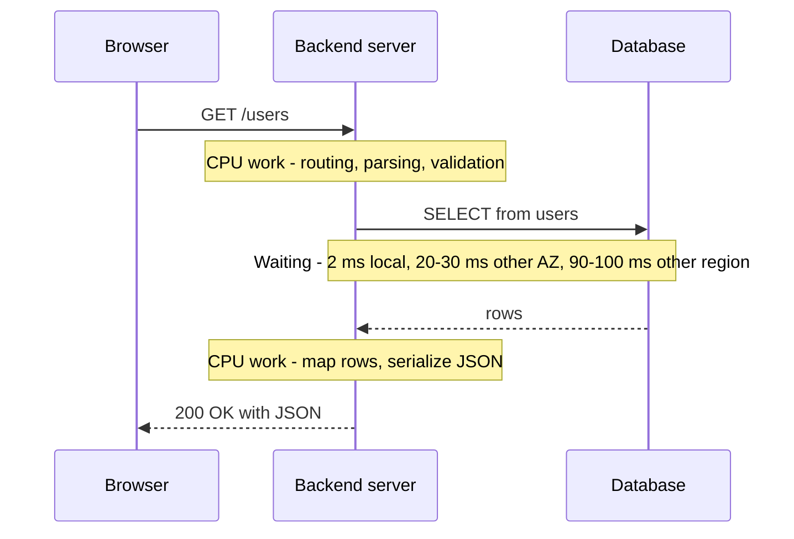

How long is the wait?
- Same machine / localhost: ~1–2 ms for a simple query.
- Database in a different availability zone: ~20–30 ms.
- Database in a far-away region: ~90–100 ms.

The question the whole chapter answers: **during that wait, what is the server doing?**

### The naive answer: nothing

If the server is **synchronous** (line-by-line, one request at a time, no concurrency), then during the wait the CPU is **idle**, waiting for network packets to arrive.

Let's quantify the waste:
- A modern CPU core executes roughly **3 billion instructions per second** = **3 million per millisecond**.
- Waiting 100 ms ⇒ it could have executed **~300 million instructions**. It executed **zero**.

A realistic mid-complexity API call:
- 3–5 database queries, plus 1–2 external calls (send an email, read/write Redis).
- Say **5 network operations × 50 ms = 250 ms** waiting.
- Actual CPU work (parsing, validation, logic, serialization): **~10 ms**.

So the CPU and memory sit idle about **95%** of the request's lifetime.

> [!NOTE]
> **IO (input/output)** means any operation where the CPU waits on something outside itself: network (DB queries, HTTP calls, Redis), disk/file system, standard input/output (logs to stdout, keyboard, display). In typical backends **70%+ of time is spent on IO**.

**This is exactly the problem concurrency solves:** while one task waits for IO, use the CPU for other tasks.

## Concurrency vs parallelism

### Parallelism

A program is **parallel** when it executes multiple instructions **at the same physical moment**. This needs **hardware support**: one CPU core executes one instruction stream at a time, so two simultaneous instructions need at least **two cores**. Four cores ⇒ up to four things truly at once.

### Concurrency

Concurrency also means "multiple things at once" — but it's possible on **a single core**, because it's primarily about **structure**: writing the program (with help from the OS or language runtime) so tasks can **start, pause and resume** at any point. At any instant only one task runs, but many are *in progress*, so it *feels* simultaneous.

> [!IMPORTANT]
> **Parallelism is about *doing* multiple things at once. Concurrency is about *dealing with* multiple things at once.** (Rob Pike's famous phrasing.) Concurrency is a property of program structure; parallelism is a property of execution.

**Analogy:** one chef with three dishes (concurrency): puts pasta water on, chops vegetables while it boils, stirs the sauce while the oven heats — always doing one thing, but juggling three. Three chefs each cooking one dish at the same time (parallelism).

### Timeline: two requests on one core (concurrency)

Requests A and B arrive at the same time; there is **one CPU core**.

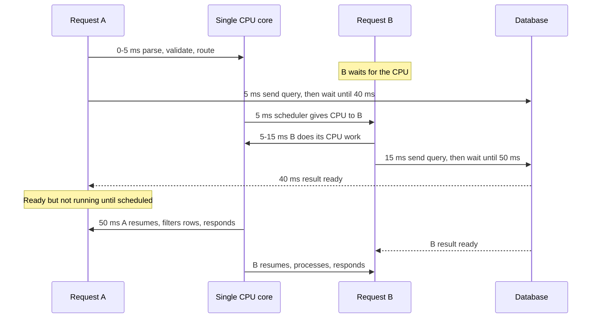

Key observations:
1. While A had the CPU, B waited. B only got the CPU once A **paused because it was waiting for IO**.
2. When A's database result arrived at 40 ms, A did **not** instantly get the CPU — it became *ready*, and the scheduler gave it the CPU later (50 ms) according to its scheduling/priority logic.
3. Even with one core, **no CPU time was wasted**: whenever one task waits on IO, another runs.
4. From the client's view **both requests are "in progress"** simultaneously; zoom into any time slice and only one is actually executing. That's the definition of concurrency.

In reality the server isn't juggling two requests but hundreds of things: requests, writing logs to stdout (IO), sending telemetry (external calls), background jobs. The CPU jumps between all of them; whenever a task needs IO, the CPU moves on.

### Timeline with two cores (parallelism)

With two cores, when B arrives it immediately gets the second core. Both are in progress **and** both are executing in the same time window.

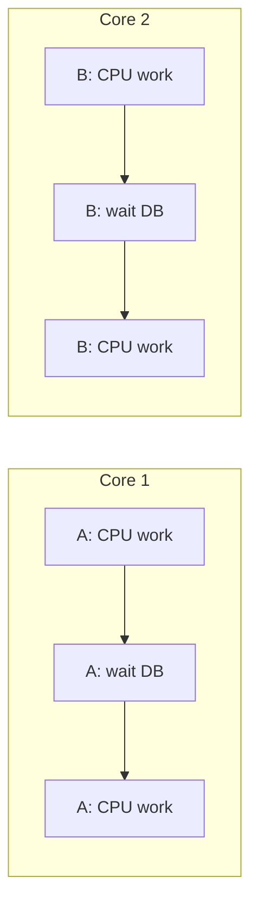

## IO-bound vs CPU-bound

| | IO-bound | CPU-bound |
|---|---|---|
| Time spent | Waiting on external resources | Executing instructions on the CPU |
| Examples | DB queries, HTTP/API calls, Redis, file reads, logging, stdin/stdout | Image/video processing, password hashing, crypto/signature verification, compression, ML inference, big JSON parsing |
| Bottleneck | Latency of the network/disk | Number and speed of cores |
| What helps | **Concurrency** (overlap the waits) | **Parallelism** (spread across cores) |
| More cores help? | Barely — bottleneck is IO | Yes, roughly linearly |
| Typical backend | Most SaaS/web/API work | Niche: media pipelines, ML, encryption-heavy services |

- Small CPU-bound pieces exist in every request (validating, deserializing JSON) but they usually finish in 1–2 ms — you won't notice them.
- **Heavy** CPU-bound examples: image processing (lots of matrix math), cryptography — e.g. verifying a JWT signature in auth middleware, hashing passwords with bcrypt/argon2.

> [!NOTE]
> Precision: verifying a JWT is **signature verification** (HMAC or RSA/ECDSA), not encryption. It's cheap-ish per call but adds up at high RPS. Password hashing with bcrypt/argon2 is *deliberately* expensive (tens of ms) and is the classic CPU-bound task that can stall a Node server.

> [!IMPORTANT]
> For IO-bound backends, whether you have 1 core or 8, **the bottleneck is IO**. Concurrency is *mandatory*; parallelism is a bonus. Real systems need both: concurrency for DB/API/files/logging/background jobs, parallelism for heavy computation.

## How computers do many things at once: two mechanisms

Every language-level concurrency feature — Go **goroutines**, JS/Node **async/await**, Java **virtual threads**, Python **asyncio**, Rust **async** — is built (mostly) on one or both of:

1. **Threads** (OS-level)
2. **Event loops**

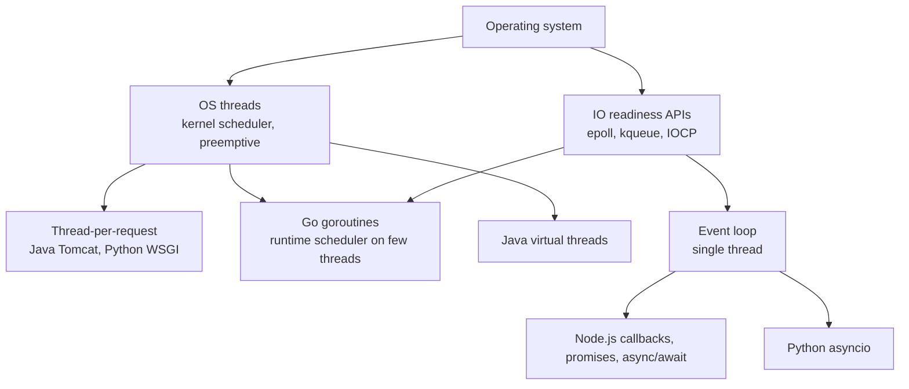

## Model 1: Threads

### What a thread is

A **thread** is an independent unit of execution that the **operating system** schedules on a CPU core. (We're talking OS threads, not language abstractions.) When a thread is created, the OS allocates:

- **A stack** — tracks function calls (main calls `getUsers` calls ... each pushed as a frame) and **local variables** (`let a = 3` inside `main` lives in the stack frame).
- **An instruction pointer** (program counter) and register state — where exactly execution is, so it can resume after a **context switch**.
- Kernel bookkeeping structures for scheduling.

### The OS scheduler and preemption

A **scheduler** decides which thread runs, pauses, blocks and resumes — and for threads, **the scheduler belongs to the operating system**. (This matters later: some runtimes add their own scheduler on top.)

- The scheduler gives each thread a **time slice** (on the order of milliseconds or less).
- When it expires, the scheduler **pauses** the thread, saves its state (last instruction, registers), and **switches** to another thread; after its slice, switches to the next, and so on.
- This is **preemptive scheduling**: threads are stopped before they finish, *whether they like it or not* — it's not in their control.

> [!TIP]
> Want the deep version? *Operating Systems: Three Easy Pieces* (OSTEP) is the classic, free book on scheduling, threads and concurrency.

### Blocking operations

A **blocking operation** is any operation during which the CPU can't make progress on that thread — IO: logging, network calls (network card, TCP packets, HTTP), database calls (a special case of network calls), disk reads. The CPU can only crunch numbers; it can't speed up a packet crossing the network.

When a thread performs a blocking call:
1. The thread tells the OS (via the syscall) it's waiting on IO.
2. The OS marks it **blocked** and switches to another runnable thread.
3. When the IO completes (e.g. DB response packets arrive), the thread becomes **runnable** again — *not* immediately running; it waits until the scheduler picks it.

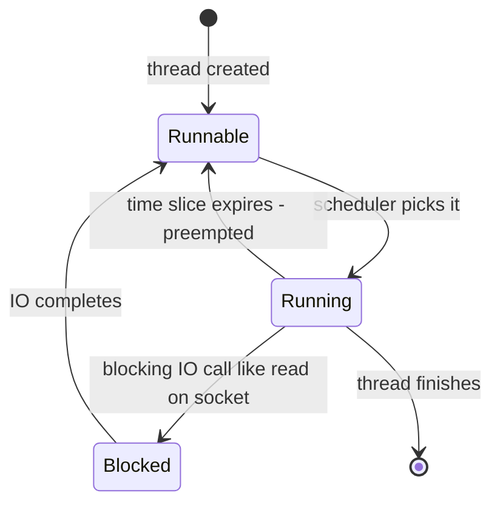

### Processes vs threads: memory sharing

Every running program is a **process**. Two processes — even from the same program — are **isolated**: they can't see each other's memory (security, and protection from memory corruption).

**Threads within the same process share memory**: the **heap**, global variables, anything dynamically allocated. If thread 1 allocates an object (a struct in Go, an object in JS) on the heap, thread 2 can access it via its pointer/address. Each thread still has its **own stack**.

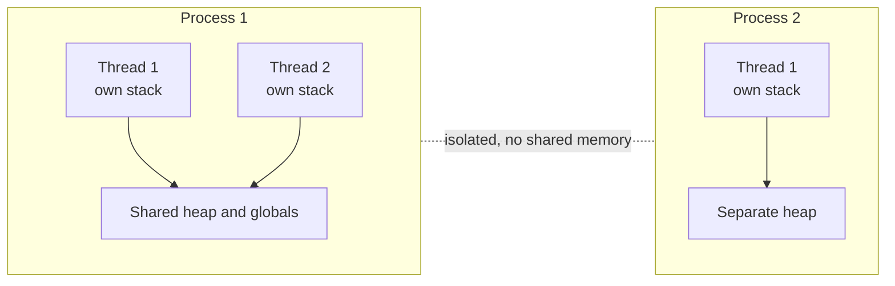

- **Benefit:** threads communicate simply by reading/writing the same memory (a map, a variable). No copying or serialization ⇒ **very fast**.
- **Danger:** shared memory is the root cause of race conditions (covered at the end).

| | Process | Thread |
|---|---|---|
| Memory | Own address space, isolated | Shares heap/globals with other threads in process |
| Stack | — | Own stack per thread |
| Creation cost | High | Lower, but still a syscall |
| Communication | IPC: pipes, sockets, shared memory segments | Direct memory access (needs synchronization) |
| Crash impact | Isolated | One thread crashing can kill the whole process |

### Threads give real parallelism

With 2 cores, thread 1 and thread 2 can run in the **same time window** (say 0–50 ms) on different cores — true parallelism. With 4 cores, 4 threads. This genuinely speeds up CPU-bound work.

### The cost (overhead) of threads

**1. Memory.** Each thread gets its own stack. On Linux the default thread stack is **8 MB** of *virtual* memory; physical memory is only committed as it's touched, but each thread still costs real memory (tens of KB to MB) plus kernel structures. Thread-per-request at a 10,000-request spike with ~0.5–1 MB each ⇒ **~5–10 GB** just for request threads, on top of everything else the server needs. You run out of memory and crash.

**2. Creation.** Creating a thread requires a **system call** into the kernel, which sets up the stack, allocates bookkeeping data structures, and registers the thread with the scheduler. That takes **microseconds to milliseconds** — negligible to humans, significant at function-call scale.

**3. Context switching** — the biggest latency cost. To switch threads the scheduler must:
1. save the current thread's CPU registers,
2. update bookkeeping/state,
3. choose the next thread,
4. restore that thread's registers and state.

That's roughly **1–10 µs per switch** on modern hardware, more if the thread's data is no longer in CPU cache (cache misses after a switch are a big hidden cost). 4 cores juggling 100 threads switch constantly; with thousands of threads, the total switching time adds up to many milliseconds of **pure maintenance work** that produces nothing.

> [!IMPORTANT]
> This is why the **thread-per-request** model struggles with high concurrency (the "C10K problem"): memory per thread, creation cost, and context-switch overhead grow with the number of concurrent connections.

> [!NOTE]
> Real thread-based servers (classic Java/Tomcat, Python WSGI/gunicorn sync workers, Ruby Puma) usually use a **thread pool** — a fixed number of pre-created threads reused across requests — which removes creation cost and caps memory, but limits concurrency to the pool size: if all threads are blocked on slow IO, new requests queue.

### Threading model: handling two requests

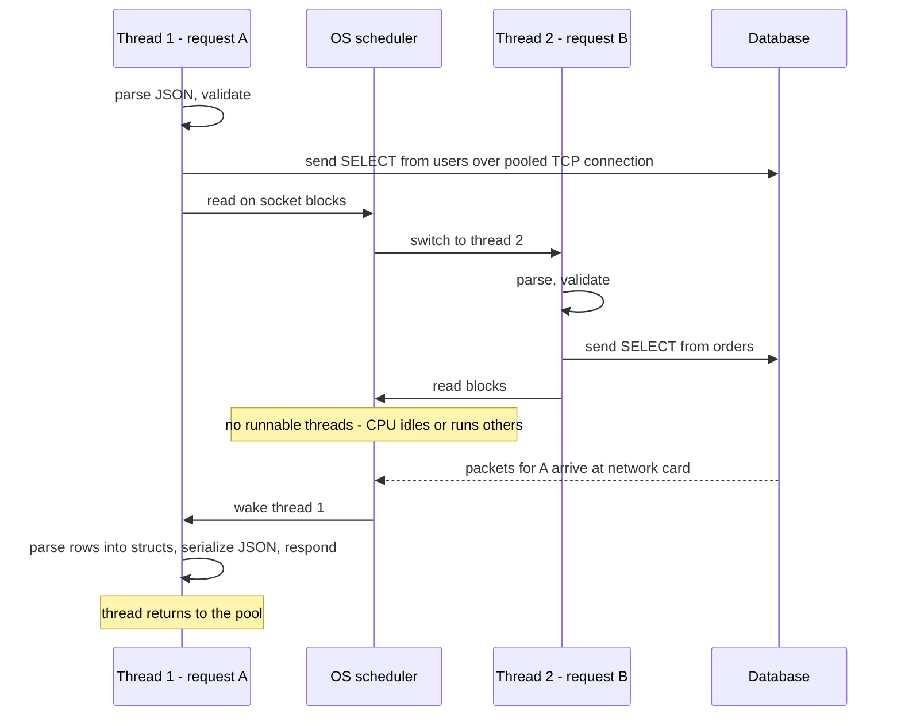

Step by step for request A:
1. Receive request, parse JSON body/query params — **CPU** work (reading bytes into memory).
2. Validate/transform.
3. Get a TCP connection (new or from the **pool**) and send the query bytes, e.g. `SELECT * FROM users`.
4. Call `read` on the database socket — **blocking IO**. The thread blocks; the OS switches to another thread (request B, which does the same thing for `SELECT * FROM orders`). If a thread 3 exists it switches there; if none are runnable, the CPU waits.
5. Response packets arrive at the network card; the OS wakes thread 1.
6. Thread 1 **deserializes** the DB bytes into native structures (objects in JS, dicts in Python, structs in Go), processes them, **serializes** to JSON, sends the HTTP response.
7. The thread returns to the thread pool.

In code (Python, thread-per-request style, no async):

```python
def handle_request(request):
    # Looks sequential. The blocking happens invisibly inside db.query:
    # this thread is parked by the OS until the DB replies.
    user = db.query("SELECT * FROM users WHERE id = %s", (request.user_id,))
    return {"user": user}
```

> [!TIP]
> In the threading model, the blocking and thread switching are **invisible** in the code. It reads top-to-bottom like sequential code — which is why it's easy to write — while the OS does the pausing and resuming behind the scenes.

## Model 2: The event loop

### The idea

Instead of many threads, use **one thread** that never waits. When a task needs IO, it **registers interest** ("tell me when this socket has data, then run this code") and **hands control back** to the loop, which runs other tasks. When IO completes, the loop runs the continuation.

**Analogy:** a restaurant with one waiter. A thread-per-request restaurant assigns one waiter per table who stands there while the kitchen cooks. The event-loop waiter takes an order, hands it to the kitchen, serves other tables, and comes back when the kitchen rings the bell.

### How it works

1. Task (request A) starts a DB query and, instead of blocking, says (via `async`/callbacks): "resume me when the result arrives; meanwhile run other things."
2. The task's continuation is stored; the loop is free.
3. The loop continuously iterates: **check which IO operations have completed → queue their callbacks → run ready callbacks → repeat**.
4. To check thousands of sockets efficiently, the runtime uses OS facilities: **epoll** (Linux), **kqueue** (macOS/BSD), **IOCP** (Windows). These let one thread ask the kernel "which of these 10,000 sockets are ready?" in one call.

> [!NOTE]
> The language can't do this alone — non-blocking IO must be supported by the **operating system**. Node.js uses **libuv**, which wraps epoll/kqueue/IOCP. Real event loops have multiple queues and phases with priorities (in Node: timers, pending callbacks, poll, check, close; plus microtasks for promises), but you can picture a single queue.

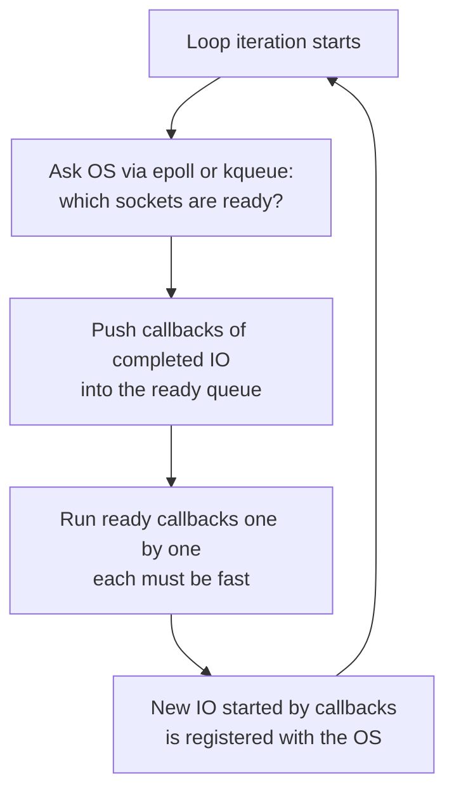

### Event loop: handling two requests

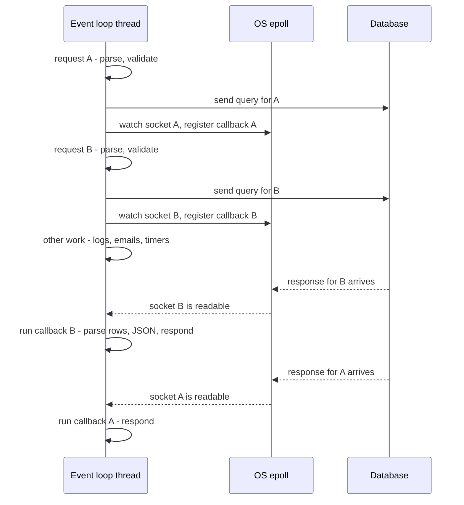

The **sequence of operations and the results are the same** as the threading model. The difference is **how pausing and resuming happens**:

| | Threading model | Event loop model |
|---|---|---|
| Pause | OS blocks the thread | Task registers a callback and returns |
| Resume | OS restores thread registers, stack, instruction pointer | Loop calls the stored callback |
| Who schedules | OS kernel, preemptive | Runtime, cooperative — tasks yield at IO points |
| Memory per task | A whole thread stack | A small closure/promise object |
| Context switches | Many, expensive | None between tasks — one thread |

### Why the event loop is efficient for IO

- **No context switching** between threads — there is one thread.
- **No per-task stack** of megabytes — each pending task is just a small object.
- One thread can track **thousands of connections**.

For **IO-bound** work, adding threads doesn't help; more threads mean more context switching, which can make things *slower*. For **CPU-bound** work, more threads (on more cores) are faster.

### The trade-off: never block the event loop

> [!WARNING]
> If any callback does **CPU-heavy work** (say 100 ms of hashing, image resizing, a huge synchronous JSON parse, a tight loop), the single thread is busy and the **entire server stops**: no other request is accepted, no callbacks run, health checks time out. Callbacks must be **fast**.

In typical SaaS backends this rarely bites, because there's seldom a 100 ms CPU task — latency is dominated by IO. It becomes a problem with animation/image/video rendering, ML workloads, or crypto in the hot path.

```ts
import { Worker } from "node:worker_threads";
import bcrypt from "bcrypt";

// BAD: blocks the event loop for every login
const okSync = bcrypt.compareSync(password, hash);

// GOOD: async version runs on libuv's thread pool, loop stays free
const ok = await bcrypt.compare(password, hash);

// For your own heavy CPU work: move it off the loop
const worker = new Worker("./resize-image.js", { workerData: { path } });
```

> [!NOTE]
> Node is "single-threaded" for **your JavaScript**, but libuv keeps a small **thread pool** (default 4) for operations without good non-blocking OS APIs: file system, DNS `lookup`, some `crypto` and `zlib`. For CPU-bound JS, use `worker_threads`, or run multiple processes (`cluster`, PM2, multiple containers) to use all cores.

### Callbacks → promises → async/await

**Callbacks (pre-ES6 style):** pass a function to run when IO completes. Error-first convention: `(err, result)`.

```js
function handler(req, sendResponse) {
  db.query("SELECT * FROM users WHERE id = ?", [req.userId], function (err, user) {
    if (err) return sendResponse(500, { error: "db error" });
    sendResponse(200, user); // runs later, when the event loop sees the DB reply
  });
}
```

**The problem — callback hell:** each dependent IO step nests another callback:

```js
db.query("SELECT ... users", [id], (err, user) => {
  db.query("SELECT ... orders", [user.id], (err, orders) => {
    api.get("/recommendations/" + user.id, (err, recs) => {
      cache.set("user:" + id, { user, orders, recs }, (err) => {
        // ...the "pyramid of doom"
      });
    });
  });
});
```

**async/await (modern JS):** same mechanism, flat code.

```ts
async function handler(req: Request) {
  const user = await db.query("SELECT * FROM users WHERE id = $1", [req.userId]);
  return { status: 200, body: user };
}
```

> [!IMPORTANT]
> `async/await` is **syntactic sugar over callbacks/promises**. When you write `await`, everything after it *in that function* is effectively packaged as the callback for that IO operation. At `await` you **hand control to the event loop**; when the result arrives, the function continues from that point. No new thread, no context switch.

Callbacks, promises and `async/await` exist so you **don't write blocking code** that gets in the loop's way — they mark exactly where you give up control (every DB query, every API call).

## Model 3: Goroutines (Go)

### Virtual threads

Go takes a third approach: **goroutines**, conceptually **virtual threads**. They're called "virtual" because an OS **thread** is managed by the operating system (heavy: creation, memory, switching), while a goroutine is managed by the **Go runtime**. (Go docs never say "virtual thread"; they say goroutine. Java 21+ has an equivalent called virtual threads.)

- A Go program starts in the **main goroutine**, which can spawn others with the `go` keyword: `go f()` runs `f` in a new goroutine.
- Go's standard `net/http` server creates **a new goroutine per incoming connection/request**: inside `Server.Serve`, the accept loop ends with `go c.serve(ctx)`, which runs your configured handler.

This is exactly the thread-per-request model that we said runs out of memory with OS threads — but goroutines are cheap enough that it's fine.

```go
// Simplified from net/http's Server.Serve
for {
    conn, err := listener.Accept()
    if err != nil { /* handle */ continue }
    c := srv.newConn(conn)
    go c.serve(ctx) // one goroutine per connection
}
```

### The Go runtime scheduler (M:N scheduling)

There are two layers:

1. **OS threads** (Go calls them **M**, "machine") — limited in number, scheduled by the OS as before.
2. **Goroutines** (**G**) — scheduled by the **Go runtime's own scheduler** onto those threads.

`GOMAXPROCS` (defaults to the number of CPU cores) sets how many goroutines can **execute Go code simultaneously**. With 4 cores, picture 4 threads M1–M4, each with a **run queue** of goroutines. The runtime pushes each new goroutine into one of these queues; one OS thread multiplexes many goroutines.

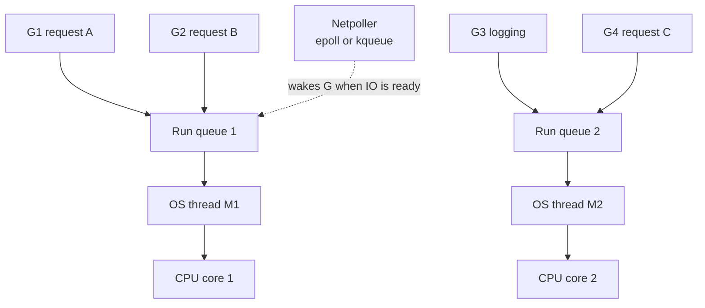

> [!NOTE]
> Precisely, Go uses a **G-M-P** model: **P** (processor) is a logical scheduling context holding a local run queue; `GOMAXPROCS` sets the number of Ps. Ms (OS threads) must hold a P to run Go code, and there can be more Ms than Ps (e.g. threads stuck in blocking syscalls). Idle Ps **steal work** from other Ps' queues. Under the hood, network IO uses a **netpoller** built on epoll/kqueue/IOCP — so Go combines a thread-like programming model with event-loop-style IO efficiency.

### What happens on IO

When goroutine G1 runs `db.Query(...)` and has to wait for the network, the **Go scheduler** (not the OS) parks G1 and has M1 run G2 — maybe another request, maybe a logging goroutine. When the DB response arrives, G1 is made runnable again and later resumes and writes the response. It's the threading model, one level up: Go scheduler instead of OS scheduler, goroutines instead of OS threads.

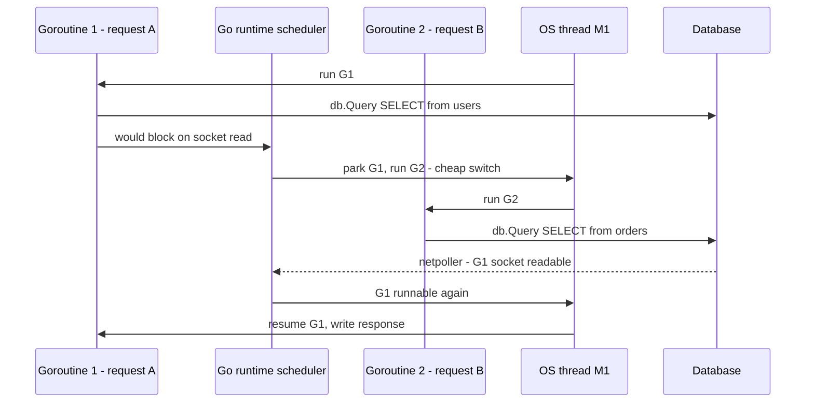

```go
func getUser(w http.ResponseWriter, r *http.Request) {
    id := r.PathValue("id")
    var u User
    // Looks blocking. Only this goroutine is parked; the OS thread keeps working.
    err := db.QueryRowContext(r.Context(), "SELECT id, name FROM users WHERE id = $1", id).Scan(&u.ID, &u.Name)
    if err != nil {
        http.Error(w, "not found", http.StatusNotFound)
        return
    }
    json.NewEncoder(w).Encode(u)
}
```

### Why goroutines are cheap

- **Small stacks:** a goroutine starts with a ~2 KB stack that grows and shrinks on demand (vs ~MBs for OS threads).
- **Cheap switches:** switching goroutines happens in user space — essentially saving a few registers and swapping a pointer — no kernel involvement.
- **Cheap creation:** no syscall.

So you can run **hundreds of thousands to millions** of goroutines (eventually memory runs out), far more than OS threads. Go is efficient at **both IO** (cheap parking + netpoller) and **CPU** work (goroutines spread across all cores — real parallelism), which is why it's popular for backends.

## Comparing the models

| | OS threads | Event loop (Node, asyncio) | Goroutines / virtual threads |
|---|---|---|---|
| Scheduled by | OS kernel, preemptive | Runtime, cooperative at await | Language runtime, mostly preemptive since Go 1.14 |
| Cost per task | ~MB stack, syscalls | Tiny closure/promise | ~2 KB growable stack |
| Context switch | Kernel, 1–10 µs | None between tasks | User-space, very cheap |
| Max concurrent tasks | Thousands | Tens of thousands+ | Hundreds of thousands+ |
| Parallelism | Yes, across cores | No, for your code — need workers/processes | Yes, across GOMAXPROCS |
| Code style | Sequential, blocking | async/await, callbacks | Sequential, blocking-looking |
| Main pitfall | Memory, switches, races | Blocking the loop with CPU work | Races, goroutine leaks |
| Best for | CPU-bound parallel work | IO-bound servers | Both |

> [!INTERVIEW]
> **"Node is single-threaded — how can it handle 10,000 concurrent connections?"** Because most of those connections are *waiting on IO*, not using the CPU. Node's event loop hands IO to the OS (epoll/kqueue via libuv) and only runs JavaScript when a socket is ready. One thread is enough to drive thousands of waiting connections, as long as no callback hogs the CPU. CPU-heavy work must go to worker threads or separate processes.

## async/await under the hood: a state machine

Consider:

```ts
async function fetchUserData(userId: number) {
  const user = await db.getUser(userId);      // pause point 1
  const orders = await db.getOrders(user.id); // pause point 2
  return { user, orders };
}
```

Conceptually: at the first `await`, control returns to the event loop and everything after becomes a callback; when `getUser` resolves, execution resumes and hits the second `await`, and so on.

More precisely, the runtime/compiler transforms an `async` function into a **state machine**. A hand-written equivalent:

```js
function fetchUserData(userId) {
  let state = 0;
  let user, orders;

  return new Promise((resolve, reject) => {
    function step() {
      switch (state) {
        case 0:
          state = 1;
          db.getUser(userId).then(r => { user = r; step(); }, reject);
          return; // event loop is free while the DB works
        case 1:
          state = 2;
          db.getOrders(user.id).then(r => { orders = r; step(); }, reject);
          return; // free again
        case 2:
          resolve({ user, orders }); // done
      }
    }
    step();
  });
}
```

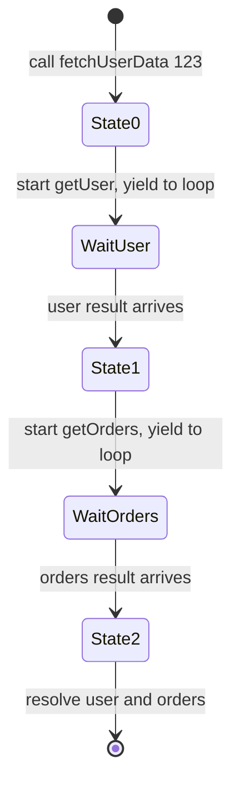

Between states, the event loop is **not** executing this function — it's running other async functions.

This model explains two rules:
1. **Why `await` only works inside `async` functions** — `async` tells the compiler to transform the function into a state machine (and make it return a Promise); without that transformation there are no states for `await` to split.
2. **Why blocking the event loop is so bad** — state machines only advance when the loop runs their next step. If the loop is blocked, *no* state machine anywhere can move from state 0 to state 1. Every in-flight request freezes.

> [!NOTE]
> The same idea underlies Python `async def`/`await` (coroutines), C# `async`, and Rust `async fn` (compiled into a `Future` state machine polled by an executor such as Tokio).

## The cost of concurrency: shared state and race conditions

Almost every concurrency bug comes from one source: **shared mutable state** (shared memory).

### The counter example: lost update

Two threads increment a shared `counter` (starting at 0). `counter++` is **not one operation** — it's three:
1. **Read** the current value into a CPU register.
2. **Add** 1 to the register.
3. **Write** the register back to memory.

An unlucky interleaving:

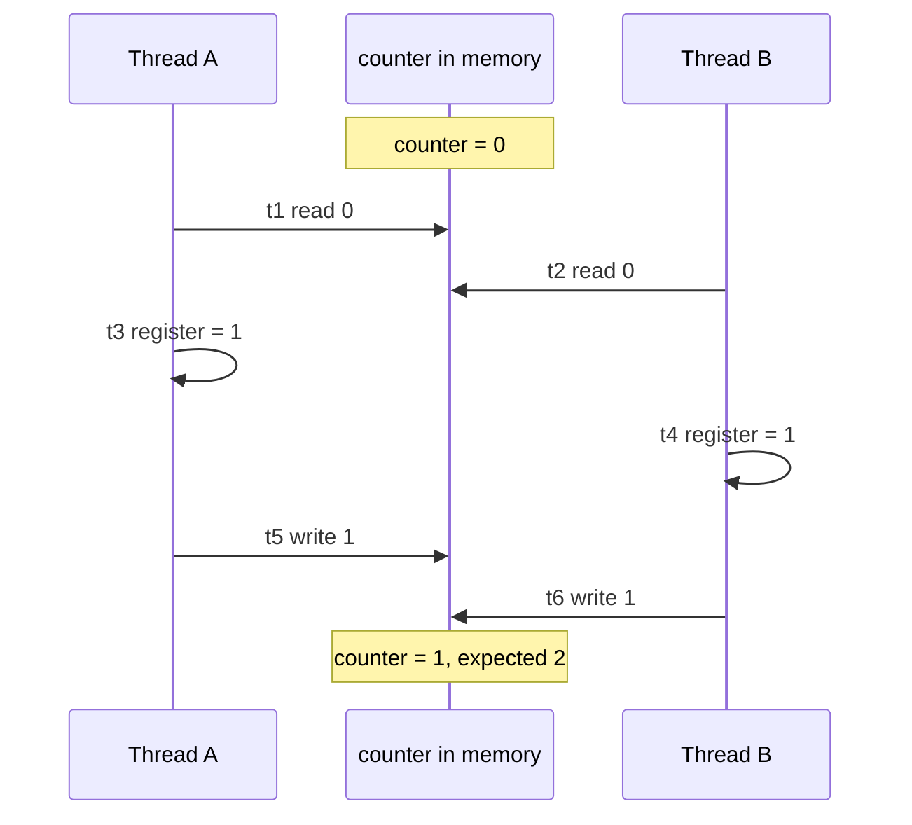

Expected 2, got 1. One increment was silently lost — the **lost update problem**. In general, a **race condition** is when correctness depends on the timing/interleaving of concurrent operations on shared state.

### "I use single-threaded JavaScript, so I'm safe" — no

```ts
let balance = 100;

async function withdraw(amount: number) {
  if (balance >= amount) {             // 1. check
    await processWithdrawal(amount);   // 2. yield to event loop (DB/API call)
    balance -= amount;                 // 3. act on a stale check
  }
}

withdraw(100);
withdraw(100);
```

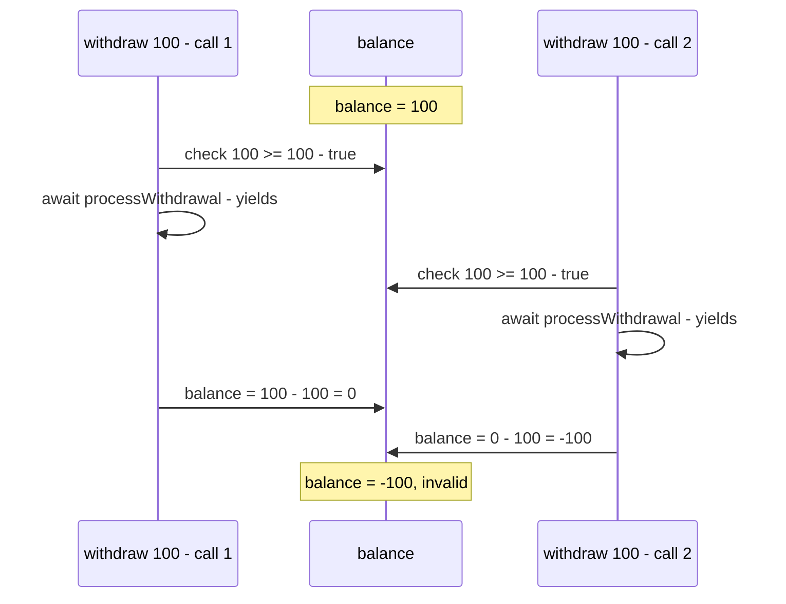

The check happened in **one state** of the state machine, the deduction in **another**, and the other call ran in between. Every `await` is a point where other code can run and change shared state. This is a **check-then-act** race (a TOCTOU — time-of-check-to-time-of-use — bug).

> [!WARNING]
> Single-threaded async code is free from *data races at the instruction level* (no two pieces of JS run at the same instant), but **not** from logical race conditions across `await` points. The same bug appears across multiple server instances sharing a database — which is why real balance updates use DB transactions, row locks (`SELECT ... FOR UPDATE`) or atomic conditional updates.

```sql
-- Atomic check-and-deduct in the database: no race across instances
UPDATE accounts
SET balance = balance - 100
WHERE id = 42 AND balance >= 100;
-- 0 rows affected means insufficient funds
```

### Solution 1: Locks / mutexes

A **lock** (mutex = **mut**ual **ex**clusion) guards a **critical section**: only one thread can be inside at a time; others wait until the holder releases it.

```python
import threading

counter = 0
lock = threading.Lock()

def increment():
    global counter
    with lock:          # acquire; other threads block here
        counter += 1    # critical section: read-add-write is now safe
                        # lock released on exiting the block
```

```go
var (
    mu      sync.Mutex
    counter int
)

func increment() {
    mu.Lock()
    defer mu.Unlock()
    counter++
}
```

> [!TIP]
> Keep critical sections small, never hold a lock across slow IO if you can avoid it, and acquire multiple locks in a consistent order to avoid **deadlocks**. For simple counters, **atomics** (`sync/atomic`, `AtomicInteger`) are cheaper than mutexes. In async JS, an async mutex/queue or moving the invariant into the database solves the withdraw bug.

### Solution 2: Message passing — Go channels

Instead of many goroutines touching a shared variable, **only one goroutine owns the state** and others **send it messages** over a **channel**. "Don't communicate by sharing memory; share memory by communicating."

```go
func counterOwner(incs <-chan int, reads chan<- int) {
    count := 0 // owned by this goroutine only
    for {
        select {
        case n := <-incs:
            count += n
        case reads <- count:
        }
    }
}

// elsewhere: incs <- 1   (from any number of goroutines, no lock needed)
```

There are many more tools (semaphores, read-write locks, condition variables, lock-free structures, actors, transactions); the OS book covers them in depth. The point here is to recognise **shared mutable state** as the root of concurrency bugs.

> [!TIP]
> Go ships a race detector: `go test -race` / `go run -race` flags unsynchronised concurrent access at runtime.

## Summary and choosing the right model

- **IO-bound, high-concurrency workloads** — web servers, API gateways, services calling many other services: lightweight concurrency primitives (**async/await on an event loop**, **goroutines**, **Java virtual threads**) are far more efficient than the classic OS-thread-per-request model.
- **CPU-bound workloads** — number crunching, string/image/video manipulation, compression, crypto, ML: **threads/processes with parallelism** across cores beat an event loop.
- **Concurrency** keeps the program productive instead of wasting CPU cycles during IO (network card, stdin/stdout, external APIs, databases). **Parallelism** uses multiple cores to do multiple things at the same moment.
- Most backend work leans on **concurrency**; some needs both, or parallelism more. Knowing the difference lets you pick the right tool.

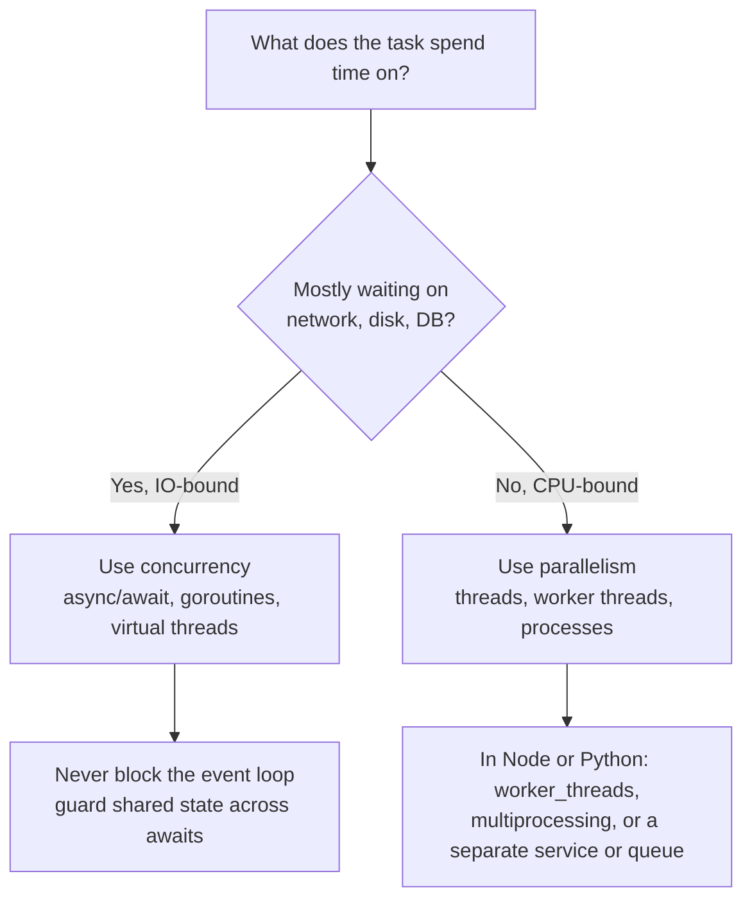

> [!NOTE]
> **Python specifics:** CPython's **GIL** (Global Interpreter Lock) lets only one thread execute Python bytecode at a time, so Python threads give concurrency for IO but **not** parallelism for CPU-bound Python code (the GIL is released during blocking IO and in many C extensions). Use `multiprocessing`/process pools for CPU-bound work, or `asyncio` for IO. (Python 3.13+ offers an experimental free-threaded build.)

## Common mistakes & misconceptions

- **"Concurrency and parallelism are the same."** Concurrency is structure (juggling tasks, possible on one core); parallelism is simultaneous execution (needs multiple cores).
- **"More threads = faster."** Only for CPU-bound work up to the core count. For IO-bound work, extra threads add memory and context-switch overhead.
- **"async makes code run in parallel."** `async/await` on an event loop is concurrency on one thread; CPU work inside an async function still blocks everything.
- **"Marking a function async makes it non-blocking."** A synchronous CPU loop or `fs.readFileSync` inside an `async` function still blocks the loop.
- **"Node is single-threaded, so no race conditions."** Logical races happen across `await` points (check-then-act).
- **"`counter++` is atomic."** It's read-modify-write; concurrent increments get lost.
- **Running bcrypt/image processing synchronously on the main thread** in Node — use async APIs, worker threads, or a job queue.
- **"Goroutines are OS threads."** They're runtime-managed, multiplexed onto a few OS threads.
- **Forgetting that a thread unblocked by IO isn't immediately running** — it becomes runnable and waits for the scheduler.
- **Sequential awaits for independent IO.** `await a(); await b();` waits twice; use `Promise.all([a(), b()])` when they're independent.

## Interview questions

<details>
<summary><strong>Q: What is the difference between concurrency and parallelism?</strong></summary>

Concurrency is *dealing with* many tasks at once: structuring a program so tasks can start, pause and resume, interleaving them — possible on a single core. Parallelism is *doing* many tasks at the same instant on multiple cores. A single-core server handling 1,000 requests by switching during IO waits is concurrent but not parallel; a 4-core machine running 4 threads simultaneously is parallel. You can have concurrency without parallelism, and parallelism is one way to execute a concurrent program.

</details>

<details>
<summary><strong>Q: What does IO-bound vs CPU-bound mean? Give examples and the right strategy for each.</strong></summary>

IO-bound: time is dominated by waiting on external resources — DB queries, HTTP calls, Redis, disk, logging. Strategy: concurrency (event loop, goroutines, async) so the CPU does other work during waits; more cores barely help. CPU-bound: time is spent executing instructions — image/video processing, password hashing, compression, ML. Strategy: parallelism across cores (threads, processes, worker threads). Most web backends are IO-bound: e.g. 250 ms waiting vs 10 ms CPU, ~95% idle without concurrency.

</details>

<details>
<summary><strong>Q: How does the Node.js event loop work?</strong></summary>

A single thread runs JavaScript. When code starts IO (socket read, DB query), libuv registers it with the OS's readiness API (epoll on Linux, kqueue on macOS, IOCP on Windows) and the JS function yields — via a callback or `await`. The loop repeatedly asks the OS which IO has completed, queues the corresponding callbacks/promise continuations, and runs them one at a time. Because no thread blocks on IO and there are no thread context switches, one thread handles thousands of connections. File system, DNS lookup and some crypto use libuv's small thread pool. The rule: never run long CPU work on the loop.

</details>

<details>
<summary><strong>Q: What happens if you run a 200 ms CPU-heavy computation inside an Express handler?</strong></summary>

The event loop is blocked for 200 ms: no new connections are accepted, no other requests' callbacks run, timers fire late, health checks can time out. Under load, latency for *every* request spikes and throughput collapses to ~5 such requests per second per process. Fix: use async/native-threaded versions (`bcrypt.compare`), move work to `worker_threads`, a job queue with separate workers, or a separate service; run multiple processes to use all cores.

</details>

<details>
<summary><strong>Q: Why is thread-per-request expensive at high concurrency?</strong></summary>

Three overheads: (1) **memory** — each OS thread has its own stack (Linux default 8 MB virtual, real usage tens of KB to MB) plus kernel structures, so 10,000 threads can cost gigabytes; (2) **creation** — each thread needs a syscall to set up stack, structures and register with the scheduler (µs to ms); (3) **context switching** — saving/restoring registers and state, ~1–10 µs each plus cache misses, multiplied across thousands of threads. Thread pools cap the cost but also cap concurrency.

</details>

<details>
<summary><strong>Q: What is a context switch and why is it costly?</strong></summary>

When the scheduler stops one thread and runs another, it saves the current thread's registers and instruction pointer, updates bookkeeping, picks the next thread, and restores its saved state. It's pure overhead — no useful work — costing roughly 1–10 µs on modern hardware, plus indirect costs: CPU caches and TLB entries become cold for the new thread. With many threads on few cores, these costs add up to significant latency.

</details>

<details>
<summary><strong>Q: Difference between a process and a thread?</strong></summary>

A process is a running program with its own isolated address space; processes can't see each other's memory (for security and fault isolation) and communicate via IPC. Threads are execution units within a process: each has its own stack and instruction pointer, but they share the heap and globals, so they communicate by reading/writing shared memory — fast, no serialization, but requiring synchronization to avoid races. Processes are heavier to create; a crash in one thread can take down the whole process.

</details>

<details>
<summary><strong>Q: How do goroutines differ from OS threads, and why can Go spawn one per request?</strong></summary>

Goroutines are managed by the Go runtime, not the OS. They start with ~2 KB growable stacks, are created without syscalls, and switch in user space (cheap pointer/register swap). The runtime scheduler multiplexes many goroutines onto a few OS threads (M:N; `GOMAXPROCS` Ps, defaulting to core count), uses work stealing, and parks goroutines waiting on network IO using a netpoller built on epoll/kqueue. So `net/http` can do `go c.serve()` for every connection — hundreds of thousands of goroutines are fine — while also using all cores in parallel.

</details>

<details>
<summary><strong>Q: Explain what async/await actually does.</strong></summary>

It's syntactic sugar over promises/callbacks. An `async` function is compiled into a state machine that returns a promise. Each `await` is a split point: the function starts the operation, registers the rest of the function as the continuation, and yields to the event loop. When the awaited promise settles, the loop resumes the state machine at the next state. That's why `await` is only allowed inside `async` functions (only they're transformed), and why blocking the loop stalls all async functions (no state machine can advance).

</details>

<details>
<summary><strong>Q: Two threads each increment a shared counter 1,000 times. The result is 1,734. Why?</strong></summary>

`counter++` is three steps: read into a register, add one, write back. When threads interleave — both read 5, both write 6 — one increment is lost (the lost update problem, a race condition). Fix with a mutex around the increment, an atomic increment (`atomic.AddInt64`, `AtomicInteger`), or by giving one goroutine ownership of the counter and sending it increments via a channel.

</details>

<details>
<summary><strong>Q: Can race conditions happen in single-threaded Node.js? Give an example.</strong></summary>

Yes. Any `await` lets other code run. Example: `if (balance >= amt) { await processWithdrawal(amt); balance -= amt; }` called twice concurrently with balance 100 and amount 100: both checks pass before either deducts, ending at −100. It's a check-then-act (TOCTOU) race. Fixes: re-check after the await, serialise with an async mutex/queue, or — best for multi-instance servers — make the operation atomic in the database (`UPDATE ... SET balance = balance - 100 WHERE id = ? AND balance >= 100`, or a transaction with `SELECT ... FOR UPDATE`).

</details>

<details>
<summary><strong>Q: What is a mutex? What problems can locks introduce?</strong></summary>

A mutex (mutual exclusion lock) ensures only one thread at a time executes a critical section; others block until it's released. Problems: **deadlocks** (two threads each hold a lock the other needs — avoid with consistent lock ordering and timeouts), **contention** (threads queue on a hot lock, killing parallelism — keep critical sections short), **priority inversion**, and forgetting to unlock (use `defer mu.Unlock()` / `with lock:`).

</details>

<details>
<summary><strong>Q: What does "don't communicate by sharing memory; share memory by communicating" mean?</strong></summary>

It's Go's guidance to prefer message passing over shared state. Instead of multiple goroutines mutating a shared map under locks, one goroutine owns the data and others send requests/updates over channels. Since only the owner touches the state, there's no race by construction, and the channel operations provide synchronisation.

</details>

<details>
<summary><strong>Q: Your Node API is IO-bound but you have an 8-core server. How do you use all the cores?</strong></summary>

A Node process runs JS on one core. Run multiple processes: Node's `cluster` module or PM2 to fork ~8 workers sharing the listening port, or run 8 containers/pods behind a load balancer. Each process has its own event loop and memory, so shared state must move to external stores (Redis, DB). For occasional CPU-heavy tasks inside a process, use `worker_threads`.

</details>

<details>
<summary><strong>Q: A Python Flask API using threads is slow on CPU-heavy image processing even with 16 threads on 16 cores. Why?</strong></summary>

CPython's GIL allows only one thread to execute Python bytecode at a time, so threads give concurrency for IO but no parallel speed-up for pure-Python CPU work. Use `multiprocessing`/`ProcessPoolExecutor`, libraries that release the GIL (NumPy, Pillow's C code), offload to a task queue with multiple worker processes, or a free-threaded Python build.

</details>

## Cheat sheet

- **CPU speed:** ~3 billion instructions/s = 3 million/ms. 100 ms idle = 300 M wasted instructions.
- **DB latency:** local 1–2 ms, cross-AZ 20–30 ms, cross-region 90–100 ms.
- **Typical request:** 5 IO ops × 50 ms = 250 ms waiting vs 10 ms CPU ⇒ ~95% idle without concurrency. 70%+ of backend time is IO.
- **Concurrency** = dealing with many things (structure, one core OK). **Parallelism** = doing many things at the same instant (multiple cores).
- **IO-bound → concurrency. CPU-bound → parallelism.** Most backends are IO-bound.
- **Two building blocks:** OS threads and event loops.
- **Thread:** own stack + instruction pointer, shares heap with threads in its process, OS-scheduled, **preemptive** time slices. States: runnable → running → blocked → runnable.
- **Thread costs:** memory (8 MB virtual stack on Linux), creation syscall (µs–ms), context switch (1–10 µs + cache misses).
- **Processes:** isolated memory. **Threads:** shared memory (fast, but races).
- **Event loop:** single thread, epoll (Linux) / kqueue (macOS) / IOCP (Windows), callbacks; loop = check IO completion → run callbacks → repeat. **Never block it.**
- **async/await** = syntactic sugar over callbacks/promises = compiled **state machine**; each `await` yields to the loop; `await` needs `async`.
- **Go:** goroutines (~2 KB stacks), runtime scheduler (G-M-P, `GOMAXPROCS` = cores), netpoller, `net/http` = goroutine per connection. Java 21: virtual threads.
- **Race condition:** result depends on interleaving. **Lost update:** read-modify-write interleaved. Async code races across `await`s.
- **Fixes:** mutex/lock (critical section), atomics, channels (message passing), DB atomic updates/transactions.
- **Node CPU work:** async native APIs, `worker_threads`, `cluster`/multiple processes, job queues. **Python CPU work:** multiprocessing (GIL).

## Glossary

- **Concurrency** — structuring a program so multiple tasks make progress by interleaving; possible on one core.
- **Parallelism** — executing multiple instructions at the same instant on multiple cores.
- **IO (input/output)** — operations involving devices outside the CPU: network, disk, stdin/stdout.
- **IO-bound** — workload whose time is dominated by waiting on IO.
- **CPU-bound** — workload whose time is dominated by computation.
- **Process** — a running program with its own isolated memory space.
- **Thread** — OS-scheduled unit of execution within a process, with its own stack, sharing the process heap.
- **Stack** — per-thread memory holding function call frames and local variables.
- **Heap** — dynamically allocated memory shared by threads of a process.
- **Instruction pointer** — register holding the address of the next instruction to execute.
- **Scheduler** — component deciding which task runs on a CPU and when.
- **Preemptive scheduling** — scheduler forcibly pauses tasks after their time slice.
- **Cooperative scheduling** — tasks voluntarily yield control (e.g. at `await`).
- **Time slice** — the amount of CPU time a thread may run before being preempted.
- **Context switch** — saving one task's state and restoring another's so it can run.
- **Blocking operation** — call that makes the caller wait until IO completes.
- **Thread pool** — fixed set of reusable threads that execute tasks.
- **Event loop** — single-threaded loop that waits for IO events and runs their callbacks.
- **epoll / kqueue / IOCP** — Linux / BSD-macOS / Windows kernel APIs for efficiently watching many IO handles.
- **libuv** — C library providing Node.js's event loop and thread pool.
- **Callback** — function passed to be run when an operation completes.
- **Callback hell** — deeply nested callbacks from sequential async steps.
- **Promise** — object representing a future result of an async operation.
- **async/await** — syntax for writing promise-based code sequentially; compiled to a state machine.
- **Goroutine** — lightweight, Go-runtime-managed concurrent function (a "virtual thread").
- **GOMAXPROCS** — number of goroutines that can execute Go code simultaneously (default = CPU cores).
- **M:N scheduling** — mapping M user-level tasks onto N OS threads.
- **Virtual thread** — runtime-managed lightweight thread (Java 21+, conceptually goroutines).
- **Race condition** — bug where outcome depends on the timing of concurrent operations on shared state.
- **Lost update** — one write overwrites another because both read the same old value.
- **Critical section** — code that accesses shared state and must not run concurrently.
- **Mutex / lock** — primitive ensuring mutual exclusion in a critical section.
- **Atomic operation** — operation that completes indivisibly, with no interleaving.
- **Channel** — Go primitive for passing values between goroutines, enabling message passing instead of shared memory.
- **GIL** — CPython's Global Interpreter Lock; one thread runs Python bytecode at a time.

## Video timestamps

- [00:00](https://www.youtube.com/watch?v=bs9MEYRTA30&t=0s) — Why a server must handle multiple things at once
- [02:01](https://www.youtube.com/watch?v=bs9MEYRTA30&t=121s) — What async/await and threads really do: the goal
- [03:03](https://www.youtube.com/watch?v=bs9MEYRTA30&t=183s) — A request's life and database wait times
- [05:06](https://www.youtube.com/watch?v=bs9MEYRTA30&t=306s) — Synchronous servers waste CPU: quantifying idle time
- [07:09](https://www.youtube.com/watch?v=bs9MEYRTA30&t=429s) — What IO is, and why the CPU is idle 95% of the time
- [09:12](https://www.youtube.com/watch?v=bs9MEYRTA30&t=552s) — Parallelism vs concurrency definitions
- [12:16](https://www.youtube.com/watch?v=bs9MEYRTA30&t=736s) — Timeline: two requests on one core vs two cores
- [18:25](https://www.youtube.com/watch?v=bs9MEYRTA30&t=1105s) — IO-bound vs CPU-bound workloads
- [21:27](https://www.youtube.com/watch?v=bs9MEYRTA30&t=1287s) — Two mechanisms: threads and event loops
- [22:28](https://www.youtube.com/watch?v=bs9MEYRTA30&t=1348s) — Threads: stack and instruction pointer
- [24:32](https://www.youtube.com/watch?v=bs9MEYRTA30&t=1472s) — The OS scheduler and time slices
- [26:33](https://www.youtube.com/watch?v=bs9MEYRTA30&t=1593s) — Preemptive scheduling and blocking operations
- [28:36](https://www.youtube.com/watch?v=bs9MEYRTA30&t=1716s) — Processes vs threads: shared memory
- [31:38](https://www.youtube.com/watch?v=bs9MEYRTA30&t=1898s) — Parallel threads and thread overhead: memory, creation
- [34:38](https://www.youtube.com/watch?v=bs9MEYRTA30&t=2078s) — Context switching cost
- [36:41](https://www.youtube.com/watch?v=bs9MEYRTA30&t=2201s) — The event loop model
- [38:42](https://www.youtube.com/watch?v=bs9MEYRTA30&t=2322s) — epoll, kqueue and the loop iteration
- [40:44](https://www.youtube.com/watch?v=bs9MEYRTA30&t=2444s) — Trade-off: never block the event loop
- [42:47](https://www.youtube.com/watch?v=bs9MEYRTA30&t=2567s) — Callbacks, promises, async/await as helpers
- [43:47](https://www.youtube.com/watch?v=bs9MEYRTA30&t=2627s) — Walkthrough: threading model with two requests
- [48:55](https://www.youtube.com/watch?v=bs9MEYRTA30&t=2935s) — Threaded handler code in Python
- [50:57](https://www.youtube.com/watch?v=bs9MEYRTA30&t=3057s) — Walkthrough: event loop with two requests
- [56:05](https://www.youtube.com/watch?v=bs9MEYRTA30&t=3365s) — Callback-style JavaScript code
- [57:07](https://www.youtube.com/watch?v=bs9MEYRTA30&t=3427s) — Callback hell and async/await syntactic sugar
- [1:00:08](https://www.youtube.com/watch?v=bs9MEYRTA30&t=3608s) — Go goroutines as virtual threads
- [1:01:10](https://www.youtube.com/watch?v=bs9MEYRTA30&t=3670s) — net/http creates a goroutine per request
- [1:04:13](https://www.youtube.com/watch?v=bs9MEYRTA30&t=3853s) — The Go runtime scheduler
- [1:06:17](https://www.youtube.com/watch?v=bs9MEYRTA30&t=3977s) — GOMAXPROCS and mapping goroutines to OS threads
- [1:09:20](https://www.youtube.com/watch?v=bs9MEYRTA30&t=4160s) — Go handler code
- [1:10:22](https://www.youtube.com/watch?v=bs9MEYRTA30&t=4222s) — How async/await works
- [1:11:22](https://www.youtube.com/watch?v=bs9MEYRTA30&t=4282s) — Async functions as state machines
- [1:14:28](https://www.youtube.com/watch?v=bs9MEYRTA30&t=4468s) — Why await needs async, why blocking is bad
- [1:15:29](https://www.youtube.com/watch?v=bs9MEYRTA30&t=4529s) — Shared state: the root of concurrency problems
- [1:16:30](https://www.youtube.com/watch?v=bs9MEYRTA30&t=4590s) — Counter example: read, add, write
- [1:18:33](https://www.youtube.com/watch?v=bs9MEYRTA30&t=4713s) — Lost update and race conditions
- [1:19:36](https://www.youtube.com/watch?v=bs9MEYRTA30&t=4776s) — Race conditions in async/await code
- [1:22:40](https://www.youtube.com/watch?v=bs9MEYRTA30&t=4960s) — Locks and mutexes
- [1:24:41](https://www.youtube.com/watch?v=bs9MEYRTA30&t=5081s) — Go channels and message passing
- [1:25:43](https://www.youtube.com/watch?v=bs9MEYRTA30&t=5143s) — Summary: choosing concurrency vs parallelism
