## TL;DR
- Saving uploaded files on the server's local disk and storing the path in the DB is the **naive approach**; it breaks because container disks are **ephemeral**, servers are **horizontally scaled**, disks have **fixed size**, a single disk is **not durable**, serving downloads ties up **workers**, and the file system and DB have **no shared transaction**.
- There are three storage families: **block** (raw numbered blocks, microseconds, one machine), **file** (POSIX hierarchy, rich but needs coordination), and **object** (minimal PUT/GET/DELETE/LIST over HTTP, milliseconds, scales without limit).
- An object = **key + bytes + metadata** (system + user), living in a **bucket**. Objects are **immutable** — you replace, never edit. **Folders are an illusion**: keys are flat strings, "folders" come from prefix + delimiter grouping.
- **Key design**: never use the user's file name; generate keys yourself; put **high-entropy** parts early to avoid hot partitions; encode **ownership** (tenant/user) in the key.
- Internally, object storage splits into a **data plane** (stores bytes durably using **erasure coding**, e.g. 14 data + 6 parity shards ≈ 1.43x overhead) and a **metadata plane** (a strongly consistent, distributed sorted index). S3 is **strongly read-after-write consistent** since Dec 2020.
- **Durability is not backup**: 11 nines protects against disk failures, not your own deletes/overwrites. Use **versioning** and cross-account replication.
- **Conditional writes** (`If-None-Match: *`, `If-Match: <etag>`, since 2024 on S3) give object storage a compare-and-swap primitive → 412 on conflict.
- Production uploads: browser uploads **directly to the bucket** via a **pre-signed URL** (or better, a **pre-signed POST with a policy** that enforces size/type/prefix). Use a **two-phase flow** (pending row → upload → complete + HEAD check → ready) plus a cleanup job, and configure bucket **CORS**.

## Why this matters
Almost every real product eventually needs users to upload something: avatars, documents, videos, CSV imports. It looks like a trivial feature ("just save the file"), but files have a completely different **shape** from the JSON your backend handles 95% of the time: they are large, binary, rarely modified, grow forever, and are read far more than written. They need a different **access pattern**, a different **cost profile**, and a different **storage system**. Getting it wrong causes lost files, random 404s, out-of-memory crashes, and surprise cloud bills. Interviewers like this topic because it tests whether you understand statelessness, durability vs availability, distributed-system trade-offs, and secure delegation of access (pre-signed URLs).

## The naive approach: save the file on the server's disk

### The intuitive flow
Requirement: users must upload a profile picture. The obvious design:
1. The browser sends the file as **`multipart/form-data`** (the standard way to send files from an HTML form or `FormData`).
2. The backend extracts the file from the request.
3. It writes it to the server's **local file system** (e.g. ext4 or XFS on a Linux server) — say `/var/uploads/123.png`.
4. It records that **path** in the database (`users.avatar_path`).
5. On the next request, the backend reads the path from the DB, reads the file from disk and sends it back.

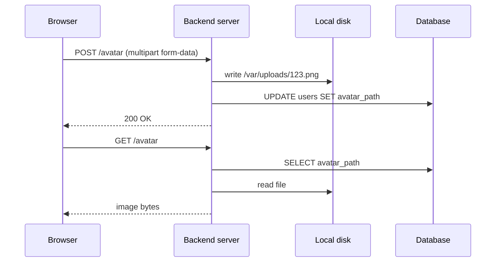

For small files on a single server this "works" in the happy case. It is still the wrong design, and it can break **the very next second** after upload (see horizontal scaling below).

### The first crack: file size
Profile pictures are small (~300 KB to ~10 MB, maybe 15–20 MB from a fancy camera), so they fit in memory and nothing goes wrong. Then a new requirement arrives: **videos** (feed posts, messages). Videos range from a few MB to **several GB**.

Scenario: a user uploads a **4 GB video**. Your server instance has **4 GB of RAM**. Your framework "helpfully" reads the entire request body into memory before handing it to you. Result:
1. The process runs **out of memory** (OOM) and the container is killed.
2. The orchestrator restarts the container. Every file stored on that container's local disk is **gone**, because container file systems are **ephemeral**.
3. You run **three instances** behind a load balancer. Files that survived live only on the other two instances. The restarted instance can't see them, so roughly **1 in 3** avatar requests returns **404**.

The root wrong assumption: **"a file is something my application owns."** It isn't. Files need their own storage system — **object storage**.

## Six problems with storing files on the server

### Problem 1: The server's disk is ephemeral
**Ephemeral** = not persistent; it only lasts until the container restarts.

If you deploy with Docker/Kubernetes, a PaaS (Railway, Render), or serverless (Vercel, Netlify), your app runs in a container. Every restart or deploy creates a **new container instance** from the same **image**. The image contains your code, not your users' files. CI/CD deploys a new image version and destroys the old container — so **every deploy wipes all user files** stored inside it. This is part of why containers are called **stateless**.

**Partial fix — persistent volumes.** You can attach a persistent volume (storage that outlives the container). That solves ephemerality, but it was designed for that problem, not as a file store, and it still fails problems 2 and 3.

### Problem 2: Horizontal scaling breaks statelessness
Three instances sit behind a load balancer using **round-robin**.
- Upload request → routed to **instance 1** → file written to instance 1's disk.
- Two minutes later, the browser fetches the avatar → load balancer routes to **instance 3** → instance 3 has never heard of the file → **404**.

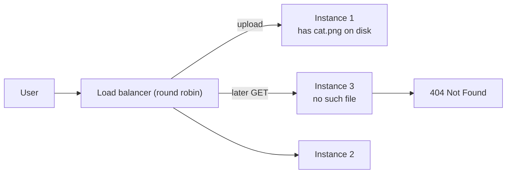

The chance of hitting the instance that has the file is roughly **1 / number of instances**, so the more you scale, the worse it gets. Storing files locally breaks the single most important property of a horizontally scalable server:

> [!IMPORTANT]
> A horizontally scalable server must be **stateless**: no server should hold state that the other servers don't have. User files on local disk are state.

### Problem 3: Disks are fixed-size and scale vertically
You scale **compute** horizontally (add instances), but a disk grows only **vertically** (make it bigger). Resizing typically means detaching, resizing/copying and reattaching, often with **downtime**, and every cloud provider has a **maximum disk size** (a ceiling). Meanwhile, user uploads are usually the **fastest-growing data** in an app and they almost never shrink (people delete far less than they upload). Example: 1,000 users × 100 MB each = 100 GB of new data per month, forever.

### Problem 4: Durability — one disk, one copy
Disks die (hardware faults, power failures — even laptop disks fail). If the only copy of your users' files was on that disk, they're gone.

Two terms you must keep separate:

| Term | Question it answers | How you recover |
|---|---|---|
| **Availability** | Can I reach the data *right now*? | Wait / fail over; the outage eventually ends |
| **Durability** | Does the data still *exist anywhere*? | You can't wait it out — lost data is lost |

The only real solution to durability is **replication** (keep multiple copies elsewhere), which in turn requires **checksums** to detect corruption and **background repair processes** to re-create lost copies. That is a whole engineering discipline — not something you want to build for your to-do app.

### Problem 5: Serving downloads ties up your workers
Your server must also send files back. A **50 MB** file to a phone on a **2 Mbps** (megabits, not megabytes) connection takes about **3.5 minutes** (50 MB × 8 = 400 Mb ÷ 2 Mbps ≈ 200 s). For that whole time, one of your workers (a goroutine in Go, a connection being serviced on Node's event loop, a thread in other runtimes) is doing nothing but slowly copying bytes to a distant phone.

Your server is not a **CDN**. Used like this, it is a very expensive, very slow CDN with a limited number of concurrent connections. Recall the two kinds of work a server does:
- **CPU-bound** — actually computing on CPU cores.
- **I/O-bound** — sending or waiting for data (DB, external APIs, disk, clients).

Long-running byte-shoveling is pure I/O work you'd rather offload entirely.

### Problem 6: No transaction between the file system and the database
The file system and the database are two independent systems; there is no transaction spanning both.

- **Write file, then insert row** — if the insert fails, you have an **orphan file** nobody can reach, which just costs money.
- **Insert row, then write file** — if the write fails, you have a DB row pointing at a **non-existent path**; every fetch errors (500 or 404 depending on your error handling).

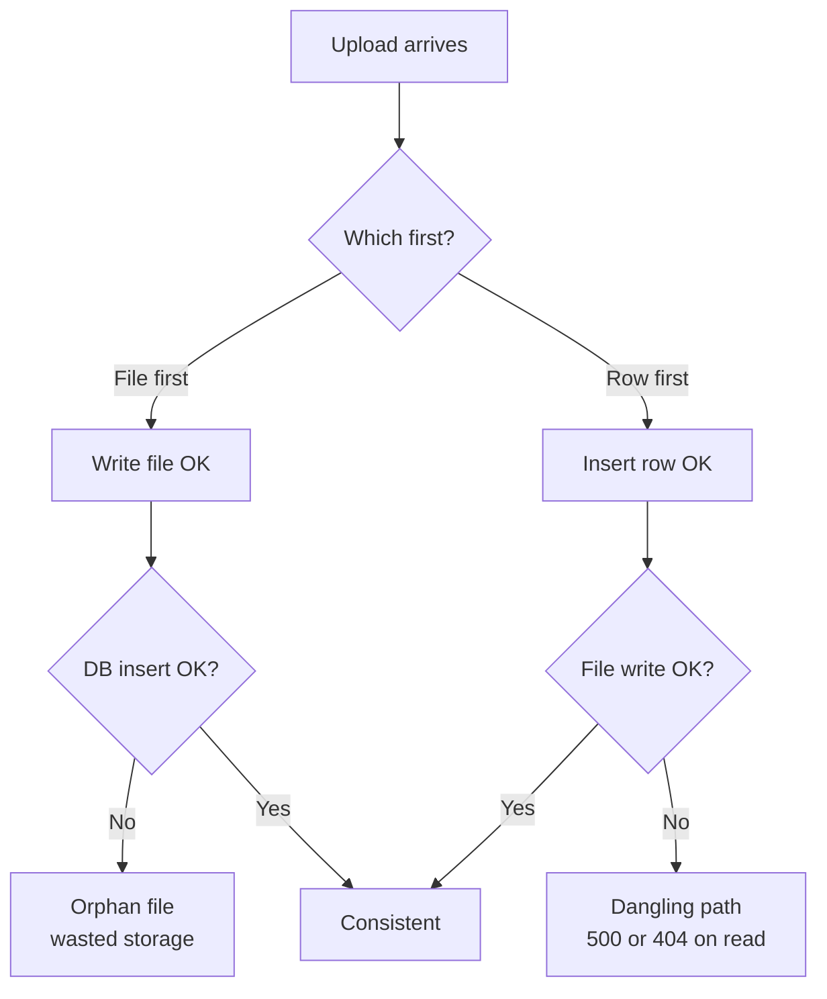

> [!NOTE]
> Object storage does **not** magically fix this cross-system consistency problem. It only makes it easier to solve with a pattern (the two-phase pending/ready flow plus cleanup), covered later in this chapter.

## The three kinds of storage

### Block storage
- Exposes a **raw array of fixed-size blocks** (typically 512 bytes or 4 KB), each with a number. The whole interface is "read/write block N".
- No concept of files, names or folders. An SSD is block storage; **Amazon EBS** (Elastic Block Store) is block storage as a service.
- **Lowest level and fastest**: latency in **microseconds**.
- Databases like **Postgres** and **MySQL** sit on block storage (through a file system, but using it in a low-level, carefully controlled way) to keep that low latency.
- Trade-offs: the interface is too primitive to build apps on directly, and a block device can be attached to **exactly one machine at a time** (no sharing).

### File storage
- A **file system** (ext4, XFS, NTFS…) is an abstraction on top of blocks: directories, files, paths, permissions, inodes.
- Rich interface: open/close, **seek** to byte N, overwrite 4 bytes in the middle, **atomic rename**, **locking**, append. These are part of **POSIX** semantics — POSIX is a standard describing what operations an operating system should offer; an OS that implements it is "POSIX-compliant".
- Convenience costs **coordination**:
  - **Rename must be atomic** — many programs rely on "it either fully happened or didn't".
  - **Writes must appear consistently** — editors like VS Code write to a temp file and then swap it in on save, so readers see either the old or the new version, never a half-written one.
  - **Locking** when two processes write the same file (classic with log files).
- This coordination **does not scale across networks/data centers/continents**. Network file systems like **NFS** exist, with their own painful trade-offs.

### Object storage
Starts from a different question: *not* "what's the richest interface we can offer?" but **"what's the absolute minimum interface we can get away with, so it can scale to unlimited (exabyte, 'planet-scale') capacity?"**

The whole interface is essentially four operations:

| Operation | Meaning |
|---|---|
| `PUT key` | Upload (create or **replace**) an object under a name |
| `GET key` | Download an object by name |
| `DELETE key` | Delete an object by name |
| `LIST prefix` | List names |

**What you give up:**
- No in-place modification: no update, no append, no seek-and-write. To change one byte in a 1 GB object, download it, modify it, upload all 1 GB back under the same key. Objects are **immutable** — they can only be **replaced**. That's why we say "object" rather than "file": "file" implies features objects don't have.
- No real directories (only prefixes — an illusion, see below).
- No rename: "rename" = copy to a new key + delete the old one, so it costs the full object size.
- No file locking.
- Latency of **milliseconds to tens of milliseconds**, because every operation is an **HTTP request over the network**.

**What you get in return:**
- No in-place modification → nothing to coordinate → an entire class of distributed-systems problems disappears.
- No hierarchy → no tree to maintain, lock or rebalance.
- Every operation is a **self-contained HTTP request** → any of thousands of servers can serve any request → **unlimited horizontal scaling**.
- Effectively **infinite capacity**: no provisioning, no resizing.
- Very high durability (S3 advertises **11 nines**).
- Every object is **directly addressable over HTTP**, so browsers, video players and mobile apps can talk to storage **without your server in the middle**.

| | Block | File | Object |
|---|---|---|---|
| Unit | Numbered fixed-size block | File in a directory tree | Immutable object under a key |
| Interface | Read/write block N | POSIX: open, seek, rename, lock, append | PUT, GET, DELETE, LIST over HTTP |
| Latency | Microseconds | Microseconds (local) | Milliseconds to tens of ms |
| Sharing | One machine at a time | Local, or NFS with trade-offs | Anyone with HTTP + permission |
| Scaling | Vertical | Hard across networks | Effectively unlimited |
| Example | SSD, AWS EBS | ext4, XFS, NTFS, NFS, AWS EFS | AWS S3, Cloudflare R2, Backblaze B2, GCS |
| Typical use | Databases, OS disks | Apps needing POSIX | User uploads, media, backups, data lakes |

> [!NOTE]
> This trade-off — **give up mutability to gain scale** — is not unique to storage. You see it in caching, stateless servers and immutable deployments. In distributed systems, reaching "infinite" scale almost always means giving up in-place mutation. Object storage is one of its purest examples.

## Anatomy of an object

An object has four parts:
1. **Key** — a string that is the object's **entire identity** (e.g. `uploads/2026/cat.png`).
2. **Value** — the bytes (a binary blob).
3. **System metadata** — size, last-modified time, `Content-Type`, **ETag** (a fingerprint of the content/version).
4. **User metadata** — arbitrary key-value pairs you attach yourself, e.g. `uploaded-by: <userId>` (on S3 these are sent as `x-amz-meta-*` headers).

Objects live in a **bucket** — a named container one level above objects (not a folder). Bucket names must be **globally unique** within the provider (e.g. across all of AWS S3), and bucket + key uniquely identifies an object.

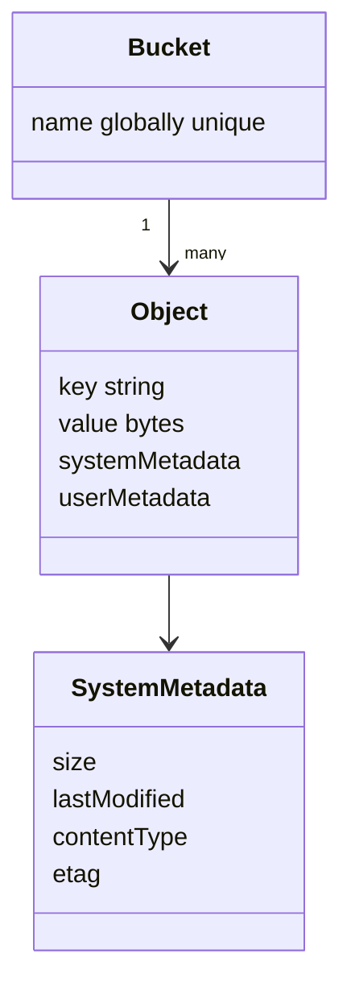

## Folders are an illusion

When you open the AWS console or the Cloudflare dashboard you see a folder `uploads`, inside it `2026`, inside that `cat.png`. That hierarchy **does not exist**. There is exactly **one object** whose key is the whole string `uploads/2026/cat.png`. The `/` is just another character — you could use `-`, `@` or `#` and it would mean nothing special to storage. The bucket is one flat namespace of (potentially trillions of) string keys.

### How "folders" are computed
A LIST request can take a **prefix** and a **delimiter**:

```bash
aws s3api put-object --bucket my-bucket --key uploads/2026/cat.png --body cat.png

# Raw listing: just one key
aws s3api list-objects-v2 --bucket my-bucket
# -> Contents: [ { Key: "uploads/2026/cat.png" } ]

# "Folder" view
aws s3api list-objects-v2 --bucket my-bucket --prefix uploads/ --delimiter /
# -> CommonPrefixes: [ { Prefix: "uploads/2026/" } ]
```

The algorithm: find every key starting with the prefix; for each, look at the rest of the string; if it contains the delimiter, chop at the first delimiter and report that piece **once** as a **common prefix**. Folders are just a **group-by on strings**.

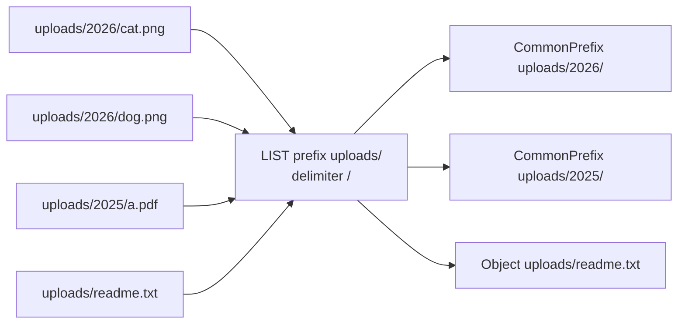

### Consequences
- **Moving/renaming a "folder" is slow and costs money**: there's no folder to move — e.g. 40,000 individual objects must each be copied to a new key and the old ones deleted.
- **Empty folders can't exist**: a folder has no identity. Tools fake one with a **zero-byte object whose key ends in `/`**, which the grouping algorithm then displays as a folder.

## Designing object keys

Since the key *is* the identity, key design is a real backend decision.

### Rule 1 (non-negotiable): never use the user's file name as the key
Three reasons:
1. **Collisions** — two users upload `resume.pdf`; the second silently **overwrites** the first. The upload operation is `PUT`, and (as in HTTP semantics) PUT means "replace the entity at this identifier", not "create new" like POST. No error, no warning.
2. **Path traversal** — file names can contain `..`, `/` and other special characters; depending on what you do downstream (local temp files, building paths, prefixes), they can escape the prefix/folder you intended.
3. **Garbage input** — names can contain emoji, right-to-left override characters, null bytes… anything a random user can produce becomes a bug in your system.

**Fix:** generate the key yourself (random, e.g. a UUID). Store the original file name in your **database** (and optionally in the object's user metadata), and use it only for display or for the `Content-Disposition` filename when downloading.

### Rule 2: put high-entropy parts at the front
Object stores partition their giant **sorted index by key prefix**. If you write keys like `uploads/2026-10-26T14/…`, every upload for the next hour shares the same prefix and lands on the **same index partition** — a **hot partition** — which under load produces **503 SlowDown** errors.

Fix: put something **high-entropy** (very random) early in the key — a UUID, a generated ID, or the first few characters of a hash.

```text
Bad:   uploads/2026-10-26/<userId>/<file>
Good:  <tenantId>/<userId>/<uuid>
```

> [!NOTE]
> AWS has greatly improved automatic partitioning (S3 now supports thousands of requests per second per prefix and splits hot prefixes automatically), so at small scale you'll rarely hit this. But doing it right from day one costs nothing.

### Rule 3: make the key carry ownership
With keys like `tenantId/userId/objectId`:
- Authorization can be a **string prefix check** in middleware, before you even call S3 or the DB.
- IAM/bucket policies can scope a credential to **exactly one prefix**.

With flat random UUIDs, every authorization check needs a database lookup to find the owner. A naming decision saves a network hop.

```ts
// Rule 1–3 in practice
import { randomUUID } from "node:crypto";

function avatarKey(tenantId: string, userId: string): string {
  return `${tenantId}/${userId}/${randomUUID()}`; // no user-supplied file name
}

function canAccess(key: string, tenantId: string, userId: string): boolean {
  return key.startsWith(`${tenantId}/${userId}/`); // cheap ownership check
}
```

## Behind the interface: what happens on a PUT

When you `PUT` a 100 MB object to S3:
1. The request lands on one of thousands of **stateless front-end nodes**.
2. That node **authenticates** the request by recomputing its **signature** (AWS Signature V4, see pre-signed URLs).
3. The work splits into two separate systems — the core architectural idea of object storage:

| | Data plane | Metadata plane |
|---|---|---|
| Job | Store the bytes so they survive | Remember "bucket + key → where the pieces are" |
| Volume | Huge | Small by comparison |
| Operations | Simple | Enormous number of them |
| Requirement | Durability, cheap per byte | **Strongly consistent** and extremely fast |
| Difficulty | Decades-old solved problem | The genuinely hard part |

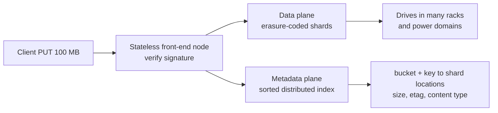

### Strong vs eventual consistency
- **Strongly consistent**: once a write succeeds, *any* subsequent read by *anyone* sees it — even one millisecond later.
- **Eventually consistent**: after a write there's a window during which reads may return old data or 404; replicas converge later.

Storing exabytes on drives is a solved problem. Maintaining a **strongly consistent, globally distributed, sorted index over trillions of keys** with millisecond lookups is the hard part — and countless systems depend on it.

## The data plane: durability via replication vs erasure coding

### Naive: replication
Keep **3 copies** on 3 machines in 3 different **failure domains** (so one failure can't hit all of them). Simple: if one machine dies, copy from another. Problem: **cost** — storing 1 PB of customer data needs 3 PB of drives, i.e. **200% overhead**. At cloud scale, that's billions of dollars.

### Erasure coding
1. Split the object into, say, **14 data shards**.
2. Run **Reed–Solomon** coding over them to produce **6 parity shards** → **20 shards** total.
3. Scatter the 20 shards across 20 drives in different racks, power domains, ideally buildings.
4. Magic property: **any 14 of the 20** shards are enough to reconstruct the whole object — no matter which 14.

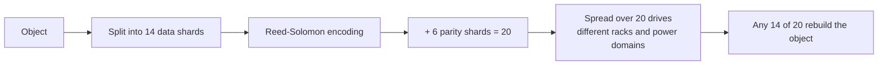

| | 3x replication | Erasure coding 14+6 |
|---|---|---|
| Storage overhead | 3.0x (200% extra) | 20/14 ≈ **1.43x** (43% extra) |
| Simultaneous failures tolerated | 2 | **6** |
| Cost | High (drives) | Roughly half the drives |
| Extra price | — | CPU for encoding, extra reads on recovery |

Drives cost much more than CPU, so erasure coding is a great trade: cheaper **and** more durable.

### 11 nines of durability
S3 advertises **99.999999999%** (11 nines) durability. Roughly: if you store **10 million objects**, you should expect to lose **one object every 10,000 years** on average. The number comes from shard math like the above (independent failure probabilities, fast repair).

### Durability is not backup
11 nines protects you against **hardware dying**, not against **your own actions**.
- Run `DELETE` on the wrong prefix (bug or human error)? The system will durably, reliably and accurately delete everything under it. Nothing to recover.
- App bug overwrites objects with garbage? The corrupted version is stored with the same 11 nines.

> [!WARNING]
> Durability ≠ backup. Protect important data with:
> - **Versioning** — overwrites and deletes create a new version (or a delete marker) instead of destroying the old one.
> - **Replication to a second bucket in a different cloud account** — so a compromised credential can't destroy both copies.

## The metadata plane: a giant sorted index

Conceptually the metadata plane is a huge **sorted key-value index** — think of a **distributed B-tree** (the balanced tree that also powers database indexes) mapping `bucket + key → shard locations, size, ETag, content type, …`. It is **partitioned by key range** — which is exactly why sequential prefixes create hot partitions.

Consequences:
- **LIST is slow**: it's a **range scan** over a distributed sorted index, paginated (S3 returns up to 1,000 keys per page). Range scans are fundamentally more expensive than point lookups.
- **No atomic rename**: renaming changes the key, and the key determines the partition — so it's not a cheap pointer update.
- **Size/metadata are instant**: a `HEAD` request answers from the index without touching any data drive.

> [!IMPORTANT]
> **Never call LIST in the request path.** Your **database is the index** of which files exist (and who owns them). The bucket stores the bytes. "What files does user X have?" must be a DB query, not `ListObjects`.

### Read-after-write consistency (December 2020)
Historically S3 was **eventually consistent** for some operations: upload an object, immediately `GET` it, and you might get **404**, because the read hit an index replica that hadn't caught up. Old blog posts and Stack Overflow answers recommend sleeps or retry loops after uploading. Since **December 2020**, S3 provides **strong read-after-write consistency** for all PUTs, GETs and LISTs — those workarounds are obsolete.

## Conditional writes: compare-and-swap for object storage

For almost 20 years, a `PUT` always overwrote. If two processes wrote the same key concurrently, one silently won (last writer wins) — and there was **no way to detect** that you lost, nor to say "only write if it doesn't exist." In **2024**, S3 added **conditional writes**:

| Header | Meaning | On failure |
|---|---|---|
| `If-None-Match: *` | Create only if **no object exists** at this key | `412 Precondition Failed` |
| `If-Match: "<etag>"` | Replace only if the current object's ETag is still the one I read | `412 Precondition Failed` |

### If-None-Match: create-only
```bash
aws s3api put-object --bucket my-bucket --key locks/job-42 --body x.txt --if-none-match "*"
# first call:  200 OK, returns ETag
aws s3api put-object --bucket my-bucket --key locks/job-42 --body x.txt --if-none-match "*"
# second call: 412 Precondition Failed (object already exists)
```

### If-Match: optimistic concurrency
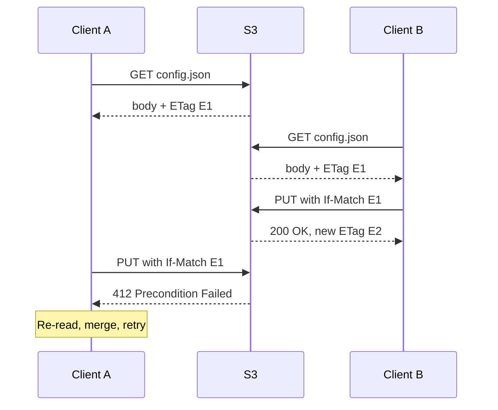

Without conditions, client A's later write would have silently destroyed client B's update. With `If-Match`, B's data is protected and A learns it must re-read and retry — the classic **compare-and-swap (CAS)** / optimistic locking pattern.

### Why this is a big deal
Exactly-one-winner semantics is the primitive for **coordination**: distributed locks, **leader election**, and even databases storing their **write-ahead logs (WAL)** directly on S3. A WAL needs (1) exactly one writer to win each log position and (2) readers to see the latest writes — conditional writes + strong consistency provide both. For everyday backends, the immediate value is simpler: **an upload can never silently clobber an existing object** (e.g. the duplicate-key bug).

> [!WARNING]
> **"S3-compatible" ≠ feature-complete.** S3-compatible (e.g. Cloudflare R2, Backblaze B2, MinIO) means "speaks roughly the same API, so the AWS SDK works". It doesn't guarantee every feature. Backblaze B2, for example, was cited as not supporting conditional writes. Check your provider's docs before relying on them.

## Getting the file from the user into the bucket

### Architecture 1: proxy through your server
Browser → `POST` to your API → backend forwards to S3.

**Pros:** your backend sees every byte — it can validate content, virus-scan, compute hashes, reject before storage; authorization is your normal middleware; no CORS setup. Fine for small files (avatars, CSVs, small documents).

**The hidden problem: buffering.** `r.ParseMultipartForm` in Go (which keeps up to the given memory limit in RAM and spills the rest to temp files) or a default body parser in a Node framework typically read the **whole file** into memory. 100 MB upload = 100 MB RAM. 20 concurrent 100 MB uploads = 2 GB → the container hits its memory limit, gets **OOM-killed**, restarts — back to the opening disaster. It's invisible in local development (small test files, fast network, 16+ GB RAM).

**Fix: stream.** Read the body in chunks and pipe them to the storage SDK as they arrive; memory stays at one small buffer (a few KB) regardless of file size. Also **wrap the body in a size limit** before reading anything.

```go
func uploadHandler(w http.ResponseWriter, r *http.Request) {
    // Hard cap: reject anything over 100 MB before reading it
    r.Body = http.MaxBytesReader(w, r.Body, 100<<20)

    mr, err := r.MultipartReader() // streaming, no full parse into memory
    if err != nil {
        http.Error(w, "bad multipart", http.StatusBadRequest)
        return
    }
    part, err := mr.NextPart() // an io.Reader over the file field
    if err != nil {
        http.Error(w, "no file", http.StatusBadRequest)
        return
    }
    key := newObjectKey()
    _, err = uploader.Upload(r.Context(), &s3.PutObjectInput{
        Bucket: aws.String(bucket),
        Key:    aws.String(key),
        Body:   part, // streamed chunk by chunk
    })
    if err != nil {
        http.Error(w, "upload failed", http.StatusBadGateway)
        return
    }
    w.WriteHeader(http.StatusCreated)
}
```

```ts
// Node/Express equivalent idea: stream with busboy into the AWS SDK's Upload helper
import Busboy from "busboy";
import { Upload } from "@aws-sdk/lib-storage";

app.post("/upload", (req, res) => {
  const bb = Busboy({ headers: req.headers, limits: { fileSize: 100 * 1024 * 1024 } });
  bb.on("file", async (_name, stream) => {
    try {
      await new Upload({ client: s3, params: { Bucket: BUCKET, Key: newKey(), Body: stream } }).done();
      res.sendStatus(201);
    } catch {
      res.sendStatus(502);
    }
  });
  req.pipe(bb);
});
```

Demo result from the video: uploading the same 500 MB file twice — the buffered server's memory climbs by ~500 MB; the streaming server's memory stays flat. Both take the same time (~6.5 s), because bandwidth is the bottleneck either way.

**Limits you can't stream around:**
- **Load balancer idle timeouts** (often 60 s by default) — slow mobile uploads die.
- **Reverse proxy body limits** — Nginx is notorious for **`413 Request Entity Too Large`** (its `client_max_body_size` defaults to 1 MB); Caddy and others have similar settings.
- **Serverless / API gateways** have hard payload caps of a few MB (e.g. AWS API Gateway 10 MB, Lambda ~6 MB) that you cannot raise.

So: acceptable for small files on traditional servers, but **not the production-grade pattern**.

### Architecture 2: pre-signed URLs (the production pattern)
Let the **browser upload directly to the bucket**, so the bytes never touch your server. Two obstacles:
- The bucket must stay **private** (public buckets are a major security risk).
- You can't give your cloud credentials to the browser.

Need: give the browser the capability to do **exactly one operation on exactly one key for the next N minutes**, without leaking credentials. That's a **pre-signed URL**.

#### What a pre-signed URL is
A normal URL plus query parameters (AWS SigV4):

| Parameter | Meaning |
|---|---|
| `X-Amz-Algorithm` | Signing algorithm, `AWS4-HMAC-SHA256` |
| `X-Amz-Credential` | Your **access key ID** + date/region/service scope (not the secret) |
| `X-Amz-Date` | Timestamp |
| `X-Amz-Expires` | Validity in seconds |
| `X-Amz-SignedHeaders` | Which headers are covered by the signature |
| `X-Amz-Signature` | **HMAC** (keyed hash) computed with your **secret key** |

The signature is an HMAC over a "canonical request" string describing the request: HTTP method, bucket, key, expiry, signed headers, and so on.

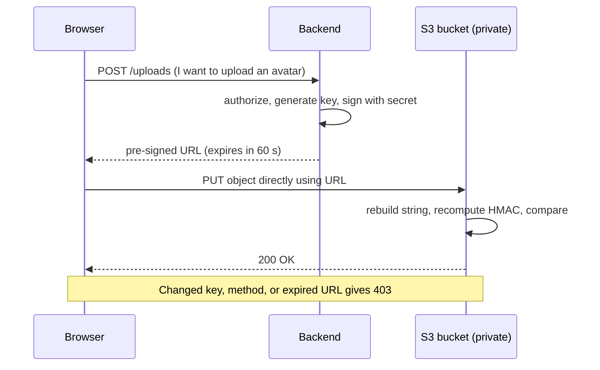

S3 rebuilds the same string from the incoming request, computes the HMAC with its own copy of your secret, and compares. Change one character of the key or method, or use it after expiry, and the signatures don't match → **403 Forbidden**. The secret **never leaves your server**, yet the browser gains a narrowly scoped capability.

```ts
import { S3Client, PutObjectCommand } from "@aws-sdk/client-s3";
import { getSignedUrl } from "@aws-sdk/s3-request-presigner";

const s3 = new S3Client({ region: "ap-south-1" });

export async function presignAvatarUpload(tenantId: string, userId: string) {
  const key = `${tenantId}/${userId}/${crypto.randomUUID()}`;
  const url = await getSignedUrl(
    s3,
    new PutObjectCommand({ Bucket: BUCKET, Key: key, ContentType: "image/png" }),
    { expiresIn: 60 } // seconds
  );
  return { key, url };
}
```

Demo from the video: the page fetches a signed URL (60 s expiry) from the backend; the `PUT` goes to the bucket's own domain with no credentials → 200. Replaying after 60 s → 403. Changing one character of the key → 403 (signature mismatch).

#### The hidden bug: no size limit
A pre-signed PUT URL signs method, bucket and key — **not the body size**. A user given a URL "for a profile picture" can upload **5 GB** to it. In the demo, a 300 MB file uploaded happily to an avatar URL (the bucket ended up holding ~314 million bytes).

#### The fix: pre-signed POST with a policy
Instead of signing a URL, sign a small **JSON policy document** and return a **URL + form fields**. The storage service itself enforces the policy's conditions:
- **`content-length-range`** — hard min/max size enforced by S3, not by your server.
- **`Content-Type` starts-with** `image/`.
- **Key starts-with** `tenantId/userId/` — the client can't write outside its own prefix.

Violations are rejected by S3 and nothing is stored (too large → `400 EntityTooLarge`; policy condition failure → `403` with the failing condition named).

```ts
import { createPresignedPost } from "@aws-sdk/s3-presigned-post";

export async function presignAvatarPost(tenantId: string, userId: string) {
  const prefix = `${tenantId}/${userId}/`;
  const key = `${prefix}${crypto.randomUUID()}`;
  return createPresignedPost(s3, {
    Bucket: BUCKET,
    Key: key,
    Expires: 60,
    Conditions: [
      ["content-length-range", 1024, 5 * 1024 * 1024], // 1 KB to 5 MB
      ["starts-with", "$Content-Type", "image/"],
      ["starts-with", "$key", prefix],
    ],
    Fields: { "Content-Type": "image/jpeg" },
  }); // returns { url, fields }
}
```

Client side — two gotchas: append the **file field last**, and **don't set `Content-Type` yourself** on `fetch` (let the browser generate the multipart boundary).

```ts
const { url, fields } = await (await fetch("/api/uploads", { method: "POST" })).json();
const form = new FormData();
for (const [k, v] of Object.entries(fields)) form.append(k, v as string);
form.append("file", file); // must be LAST
await fetch(url, { method: "POST", body: form }); // no Content-Type header
```

Demo results: 300 MB file with policy → 400 EntityTooLarge, nothing stored; 415 KB image → accepted; writing into another user's prefix → 403 with the failed condition.

| | Pre-signed PUT URL | Pre-signed POST + policy |
|---|---|---|
| HTTP method | PUT with raw body | POST multipart form |
| Enforces size | No | Yes (`content-length-range`) |
| Enforces content type | Only if signed header is exact | Yes (`starts-with` etc.) |
| Enforces key prefix | Exact key only | Exact key or `starts-with` prefix |
| Best for | Simple trusted cases, multipart parts | Browser uploads from untrusted users |

## Telling the backend about the upload: the two-phase flow

If the browser talks to S3 directly, your server never sees the upload — so how does the DB learn about it? Answer: a **two-phase flow**.

**Phase 1 — intent:**
1. Client asks the backend to start an upload.
2. Backend authorizes, **generates the key**, and **inserts a DB row with `status = 'pending'`** (key, expected size/type limits, owner).
3. Backend returns the pre-signed POST plus an **upload ID**.

Before a single byte moves, the database already records the intent and the object's identity.

**Phase 2 — completion:**
4. Client uploads directly to S3.
5. Client calls `POST /uploads/:uploadId/complete` (with the **upload ID**, not the key — the client shouldn't choose keys).
6. Backend issues a **`HEAD` object** request (metadata only, cheap) to verify the object exists, the size is within range, and the content type is as expected.
7. If all checks pass, update the row to **`ready`/`completed`**.

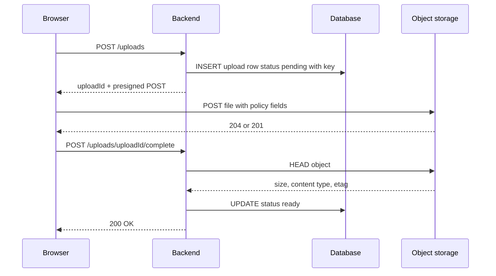

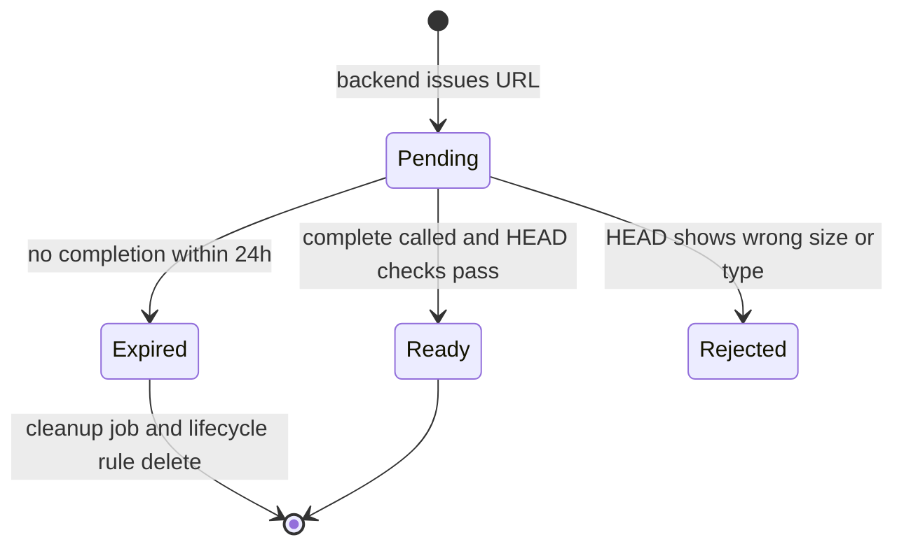

### Cleanup: closing the logic hole
Some uploads are abandoned (tab closed, flaky mobile network, upload done but `complete` never called). So:
- A **bucket lifecycle rule** deletes objects under a pending/staging prefix after e.g. **24 hours** (if you upload to a `pending/` prefix and copy to the final key on completion — or tag objects and expire by tag).
- A small **background job** scans `pending` rows older than 24 h and marks them **expired**.

This keeps the two **sources of truth** from drifting: the **database** is the source of truth for *which files exist*; the **bucket** is the source of truth for *the bytes*. Whenever they disagree, a background reconciler fixes it. This is the pattern that tames Problem 6.

> [!INTERVIEW]
> **"How would you design file uploads for a large-scale app?"** — Never route bytes through the API. The backend authorizes and creates a `pending` DB row with a server-generated key, then returns a short-lived **pre-signed POST** whose policy enforces size, content type and key prefix. The browser uploads directly to S3 (bucket CORS configured). The client calls a completion endpoint; the backend does a `HEAD` to verify, marks the row `ready`. A lifecycle rule plus a cleanup job expire abandoned uploads. Serve downloads with pre-signed GET URLs or a CDN.

## CORS for direct uploads

A browser uploading to `my-bucket.s3.amazonaws.com` from `app.example.com` is making a **cross-origin request**, so **CORS** applies. The bucket's CORS configuration must:
- allow your front-end **origin**,
- allow the **PUT/POST** methods (and needed request headers),
- **expose the `ETag` response header** (needed for multipart uploads in Part 2, where the client must collect each part's ETag).

```json
[
  {
    "AllowedOrigins": ["https://app.example.com"],
    "AllowedMethods": ["PUT", "POST", "GET"],
    "AllowedHeaders": ["*"],
    "ExposeHeaders": ["ETag"],
    "MaxAgeSeconds": 3000
  }
]
```

> [!TIP]
> If an upload works from `curl` or Postman but fails in the browser, it's almost certainly **CORS** — check the bucket's CORS policy. (Non-browser clients don't enforce CORS.)

## Common mistakes & misconceptions
- **Storing uploads on the container's disk** — lost on restart/deploy, invisible to other instances.
- **Thinking a persistent volume solves it** — fixes ephemerality but not horizontal scaling or disk growth.
- **Using the user's file name as the key** — silent overwrites, path traversal, weird characters.
- **Time-based key prefixes** — hot partitions and 503 SlowDown under heavy write load.
- **Believing folders exist** — "renaming a folder" is a copy+delete of every object; empty folders are zero-byte placeholder objects.
- **Calling `ListObjects` to answer user queries** — slow range scans; the DB should be the index.
- **"11 nines means I have backups"** — durability doesn't protect against your own deletes/overwrites; enable versioning and cross-account replication.
- **Adding sleeps/retries after upload "for consistency"** — obsolete since S3's strong consistency (Dec 2020).
- **Assuming every S3-compatible provider supports conditional writes.**
- **Buffering the whole upload in memory** — OOM kills under concurrency; stream and cap body size.
- **Pre-signed PUT URL with no size limit** — users can upload gigabytes to an "avatar" URL; use a POST policy.
- **Trusting the client's "upload done" message** — verify with `HEAD`.
- **No cleanup of abandoned uploads** — orphan objects and pending rows accumulate.
- **Setting `Content-Type` manually on a multipart `fetch`** — breaks the boundary.

## Interview questions

<details>
<summary><strong>Q: Why shouldn't you store user-uploaded files on your application server's local disk?</strong></summary>

1) Container disks are ephemeral — files vanish on restart or deploy. 2) With multiple instances behind a load balancer, a file lives on only one instance, so other instances return 404 (breaks statelessness). 3) Disks are fixed-size and only grow vertically, with downtime and a ceiling. 4) One disk is one copy — no durability. 5) Serving large downloads ties up server workers doing slow I/O. 6) There's no transaction between the file system and the DB, causing orphans or dangling paths. Object storage solves 1–5 and makes 6 manageable.

</details>

<details>
<summary><strong>Q: Compare block, file and object storage.</strong></summary>

Block storage exposes numbered fixed-size blocks (SSD, EBS); it's the fastest (microseconds), attaches to one machine, and databases sit on it. File storage adds a POSIX hierarchy (directories, seek, atomic rename, locking); rich but needs coordination that doesn't scale across networks. Object storage offers only PUT/GET/DELETE/LIST on immutable objects over HTTP; higher latency (ms) but no coordination, so it scales without limit, has huge durability, and is directly addressable by any HTTP client.

</details>

<details>
<summary><strong>Q: Do folders exist in S3? What are the consequences?</strong></summary>

No. A bucket is a flat namespace of string keys; `uploads/2026/cat.png` is one key and `/` is just a character. Consoles show "folders" by listing with a prefix and delimiter and grouping keys into common prefixes. Consequences: renaming/moving a folder means copying and deleting every object under it (slow, costs money), and empty folders can't exist — tools fake them with a zero-byte object whose key ends with `/`.

</details>

<details>
<summary><strong>Q: How would you design object keys for user uploads?</strong></summary>

Generate keys server-side (e.g. UUID); never use the user's file name, which causes silent overwrites (PUT replaces), path traversal, and weird-character bugs — store the original name in the DB instead. Put high-entropy components early to avoid hot index partitions. Encode ownership, e.g. `tenantId/userId/uuid`, so authorization is a prefix check and credentials or policies can be scoped to a prefix.

</details>

<details>
<summary><strong>Q: What is erasure coding and why do object stores prefer it over replication?</strong></summary>

The object is split into k data shards and a Reed–Solomon code produces m parity shards; any k of the k+m shards reconstruct it. With 14+6 you store 20/14 ≈ 1.43x the data and survive any 6 simultaneous shard losses, versus 3x replication storing 3x and surviving 2. It's cheaper and more durable; the cost is CPU for encoding and extra reads during repair — a good trade since drives cost far more than CPU.

</details>

<details>
<summary><strong>Q: S3 promises 11 nines of durability. Does that mean you don't need backups?</strong></summary>

No. Durability protects against hardware failure, not against your actions. If a bug deletes a prefix or overwrites objects with corrupt data, S3 will durably store that result. Protect against it with versioning (overwrites and deletes keep prior versions), replication to a bucket in a separate account (so one compromised credential can't destroy both), and optionally MFA delete or object lock.

</details>

<details>
<summary><strong>Q: What is the difference between availability and durability?</strong></summary>

Availability: can I access the data right now? Durability: does the data still exist anywhere? An availability problem can be waited out (the outage ends). A durability problem can't — lost data is gone. Durability is achieved through redundancy (replication or erasure coding) with checksums and repair processes.

</details>

<details>
<summary><strong>Q: Explain the data plane / metadata plane split. Which is harder?</strong></summary>

The data plane stores bytes durably (huge volume, simple operations). The metadata plane is a distributed sorted index mapping bucket+key to shard locations, size, ETag, and type (small volume, enormous operation count, must be strongly consistent and fast). The metadata plane is harder: storing bytes is a solved problem, but a strongly consistent, globally distributed sorted index over trillions of keys with millisecond lookups is not.

</details>

<details>
<summary><strong>Q: Why should you never call ListObjects in the request path?</strong></summary>

LIST is a paginated range scan over a distributed sorted index — much slower and more expensive than a point lookup, and it gets worse as the bucket grows. Your database should be the index of which files exist and who owns them; the bucket just stores bytes. Querying "files for user X" should hit an indexed DB table.

</details>

<details>
<summary><strong>Q: What are S3 conditional writes and what can you build with them?</strong></summary>

Since 2024, PUT can carry `If-None-Match: *` (create only if the key doesn't exist) or `If-Match: <etag>` (replace only if the object is unchanged since I read it). On conflict, S3 returns 412 Precondition Failed instead of silently overwriting. That's compare-and-swap: it enables optimistic concurrency, distributed locks, leader election, and write-ahead logs stored on S3 (exactly one writer wins, combined with strong consistency). Not all "S3-compatible" providers support it.

</details>

<details>
<summary><strong>Q: How does a pre-signed URL work and why is it secure?</strong></summary>

The backend builds a URL containing the algorithm, access key ID, timestamp, expiry, signed headers, and an HMAC signature computed with the secret key over a canonical description of the request (method, bucket, key, expiry, headers). S3 recomputes the HMAC with its copy of the secret and compares. Any change to the key, method, or use after expiry invalidates it (403). The secret never leaves the server; the client gets one operation on one key for a short time.

</details>

<details>
<summary><strong>Q: A user got a pre-signed URL for an avatar and uploaded a 5 GB file. What went wrong and how do you fix it?</strong></summary>

A pre-signed PUT URL signs method, bucket and key but not body size. Use a pre-signed POST with a policy document containing `content-length-range` (e.g. 1 KB to 5 MB), a `starts-with` condition on Content-Type (`image/`), and a `starts-with` on the key prefix. S3 enforces them itself and rejects violations (EntityTooLarge or 403) without storing anything. Also verify with a HEAD request in the completion step.

</details>

<details>
<summary><strong>Q: The browser uploads directly to S3 — how does your database know the file exists, and what if the upload is abandoned?</strong></summary>

Use a two-phase flow. Phase 1: backend authorizes, generates the key, inserts a `pending` row, and returns an upload ID + pre-signed POST. Phase 2: after uploading, the client calls a completion endpoint with the upload ID; the backend HEADs the object to verify existence, size and type, then marks it `ready`. For abandoned uploads, a bucket lifecycle rule deletes pending objects after ~24h and a background job expires stale pending rows, keeping DB and bucket consistent.

</details>

<details>
<summary><strong>Q: What happens if you proxy a 100 MB upload through a Node or Go server with a default body parser?</strong></summary>

The whole body is buffered in RAM. Twenty concurrent 100 MB uploads use ~2 GB and can OOM-kill the container. Fix by streaming (Go `MultipartReader` piped to the S3 uploader, busboy in Node) and capping body size (`http.MaxBytesReader`). Even then, load balancer idle timeouts, Nginx's 413 body limit, and serverless payload caps remain — which is why direct-to-bucket uploads are preferred.

</details>

<details>
<summary><strong>Q: Direct uploads work in Postman but fail in the browser. Why?</strong></summary>

CORS. The browser is sending a cross-origin request to the bucket's domain and enforces CORS; Postman and curl don't. Configure the bucket's CORS rules to allow your front-end origin and the PUT/POST methods, and expose the ETag header (needed for multipart uploads).

</details>

## Cheat sheet
- **Naive approach failures**: ephemeral disk · horizontal scaling (1/N hit rate) · fixed-size vertical disks · single-copy durability · workers stuck serving downloads · no FS+DB transaction.
- **Storage types**: Block (blocks, µs, one machine, EBS/SSD, DBs) · File (POSIX, rename/lock/seek, NFS) · Object (PUT/GET/DELETE/LIST, ms, HTTP, infinite).
- **Object** = key + bytes + system metadata (size, last-modified, content-type, ETag) + user metadata. Lives in a globally-unique-named **bucket**.
- **Immutable**: no append/edit/rename; rename = copy + delete.
- **Folders** = prefix + delimiter grouping (`CommonPrefixes`). Empty folder = zero-byte `key/` object.
- **Keys**: server-generated · never user file name · entropy early · ownership prefix `tenant/user/uuid`.
- **Hot partition** → `503 SlowDown`.
- **Data plane** = erasure coding (14+6 Reed–Solomon → 1.43x overhead, tolerates 6 failures) vs 3x replication (3x overhead, tolerates 2).
- **11 nines** ≈ lose 1 of 10M objects every 10,000 years. **Durability ≠ backup** → versioning + cross-account replication.
- **Metadata plane** = distributed sorted index (B-tree-like), range-partitioned; LIST = range scan → never in request path; DB is your index.
- **S3 strong read-after-write consistency** since Dec 2020.
- **Conditional writes** (2024): `If-None-Match: *` create-only; `If-Match: etag` CAS → `412`.
- **Proxy uploads**: stream + `MaxBytesReader`; watch LB idle timeout (60s), Nginx `413`, serverless payload caps.
- **Pre-signed URL**: SigV4 HMAC over method/bucket/key/expiry; tampering or expiry → `403`.
- **Pre-signed POST policy**: `content-length-range`, `starts-with $Content-Type image/`, `starts-with $key prefix`.
- **Two-phase**: pending row → direct upload → complete(uploadId) → HEAD verify → ready; lifecycle rule + cleanup job.
- **CORS**: allow origin, PUT/POST, expose `ETag`.

## Glossary
- **Object storage** — storage exposing immutable objects addressed by key over HTTP (S3, R2, B2, GCS).
- **Block storage** — raw numbered fixed-size blocks; lowest-level storage (SSD, AWS EBS).
- **File storage** — hierarchical file system with POSIX semantics on top of blocks.
- **POSIX** — OS standard defining operations like open, seek, rename, and lock.
- **Ephemeral storage** — storage that disappears when its container restarts.
- **Persistent volume** — storage attached to a container that outlives it.
- **Stateless server** — a server holding no state that other instances lack.
- **Bucket** — a named, globally unique container for objects.
- **Key** — the string that is an object's complete identity.
- **ETag** — entity tag; a fingerprint of an object's content/version.
- **User metadata** — custom key-value pairs attached to an object.
- **Prefix / delimiter / common prefix** — LIST parameters used to emulate folders.
- **Hot partition** — one index partition receiving a disproportionate share of traffic.
- **High entropy** — highly random; used in key design to spread load.
- **Data plane** — the subsystem storing object bytes durably.
- **Metadata plane** — the subsystem indexing keys to data locations; strongly consistent.
- **Durability** — the probability that data still exists.
- **Availability** — whether data can be accessed right now.
- **Replication** — keeping full copies of data in multiple places.
- **Erasure coding** — splitting data into k data + m parity shards so any k reconstruct it.
- **Reed–Solomon** — classic erasure-coding algorithm.
- **Failure domain** — a set of components that can fail together (rack, power, building).
- **Versioning** — keeping prior versions of objects on overwrite/delete.
- **Strong consistency** — reads always reflect the latest successful write.
- **Eventual consistency** — reads may be stale for a while, eventually converging.
- **Conditional write** — a write that succeeds only if a precondition (If-Match / If-None-Match) holds.
- **Compare-and-swap (CAS)** — update only if the current value equals the expected value.
- **Write-ahead log (WAL)** — append-only log of changes written before they're applied.
- **S3-compatible** — speaks the S3 API, not necessarily every S3 feature.
- **Pre-signed URL** — a URL carrying a time-limited signature authorizing one operation on one key.
- **HMAC** — keyed hash used to sign requests.
- **Pre-signed POST policy** — signed JSON conditions (size, type, prefix) enforced by the storage service.
- **HEAD request** — fetch only an object's metadata.
- **Lifecycle rule** — bucket rule that automatically expires or transitions objects.
- **CORS** — browser mechanism controlling cross-origin requests.
- **413 Request Entity Too Large** — server/proxy rejection of an oversized body.
- **412 Precondition Failed** — a conditional request's precondition didn't hold.

## Video timestamps
- [00:00](https://www.youtube.com/watch?v=Ie0TjKI9cDI&t=0s) — The requirement: users upload files; the naive save-to-disk approach
- [04:04](https://www.youtube.com/watch?v=Ie0TjKI9cDI&t=244s) — File size problem: 4 GB video, OOM, container restart
- [07:07](https://www.youtube.com/watch?v=Ie0TjKI9cDI&t=427s) — Ephemeral disks, multiple instances, and the wrong assumption
- [08:08](https://www.youtube.com/watch?v=Ie0TjKI9cDI&t=488s) — What this chapter covers
- [10:10](https://www.youtube.com/watch?v=Ie0TjKI9cDI&t=610s) — Problem 1: ephemeral disks and persistent volumes
- [13:16](https://www.youtube.com/watch?v=Ie0TjKI9cDI&t=796s) — Problem 2: horizontal scaling and statelessness
- [16:21](https://www.youtube.com/watch?v=Ie0TjKI9cDI&t=981s) — Problem 3: fixed-size, vertically scaled disks
- [17:23](https://www.youtube.com/watch?v=Ie0TjKI9cDI&t=1043s) — Problem 4: durability vs availability
- [20:31](https://www.youtube.com/watch?v=Ie0TjKI9cDI&t=1231s) — Problem 5: serving downloads, CPU vs I/O bound
- [22:33](https://www.youtube.com/watch?v=Ie0TjKI9cDI&t=1353s) — Problem 6: no transaction between files and DB rows
- [24:34](https://www.youtube.com/watch?v=Ie0TjKI9cDI&t=1474s) — Block storage
- [26:37](https://www.youtube.com/watch?v=Ie0TjKI9cDI&t=1597s) — File storage and POSIX semantics
- [30:40](https://www.youtube.com/watch?v=Ie0TjKI9cDI&t=1840s) — Object storage: the minimal interface and its trade-offs
- [37:51](https://www.youtube.com/watch?v=Ie0TjKI9cDI&t=2271s) — Anatomy of an object and buckets
- [38:53](https://www.youtube.com/watch?v=Ie0TjKI9cDI&t=2333s) — Folders are an illusion: prefixes and delimiters
- [43:01](https://www.youtube.com/watch?v=Ie0TjKI9cDI&t=2581s) — Key design rules
- [48:10](https://www.youtube.com/watch?v=Ie0TjKI9cDI&t=2890s) — Behind a PUT: data plane vs metadata plane
- [50:16](https://www.youtube.com/watch?v=Ie0TjKI9cDI&t=3016s) — Strong vs eventual consistency
- [52:17](https://www.youtube.com/watch?v=Ie0TjKI9cDI&t=3137s) — Replication vs erasure coding
- [56:25](https://www.youtube.com/watch?v=Ie0TjKI9cDI&t=3385s) — 11 nines, and why durability is not backup
- [59:32](https://www.youtube.com/watch?v=Ie0TjKI9cDI&t=3572s) — The metadata plane, LIST cost, read-after-write consistency
- [1:02:35](https://www.youtube.com/watch?v=Ie0TjKI9cDI&t=3755s) — Conditional writes: If-None-Match and If-Match
- [1:08:47](https://www.youtube.com/watch?v=Ie0TjKI9cDI&t=4127s) — S3-compatible providers caveat
- [1:09:47](https://www.youtube.com/watch?v=Ie0TjKI9cDI&t=4187s) — Architecture 1: uploading through your server, buffering vs streaming
- [1:15:59](https://www.youtube.com/watch?v=Ie0TjKI9cDI&t=4559s) — Limits of proxying; Architecture 2: pre-signed URLs
- [1:20:04](https://www.youtube.com/watch?v=Ie0TjKI9cDI&t=4804s) — Pre-signed URL demo and the size-limit bug
- [1:21:06](https://www.youtube.com/watch?v=Ie0TjKI9cDI&t=4866s) — Pre-signed POST with a policy
- [1:24:09](https://www.youtube.com/watch?v=Ie0TjKI9cDI&t=5049s) — Two-phase upload flow and cleanup
- [1:28:11](https://www.youtube.com/watch?v=Ie0TjKI9cDI&t=5291s) — CORS for direct uploads
