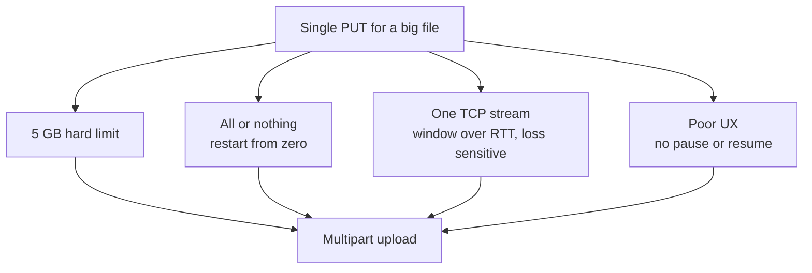
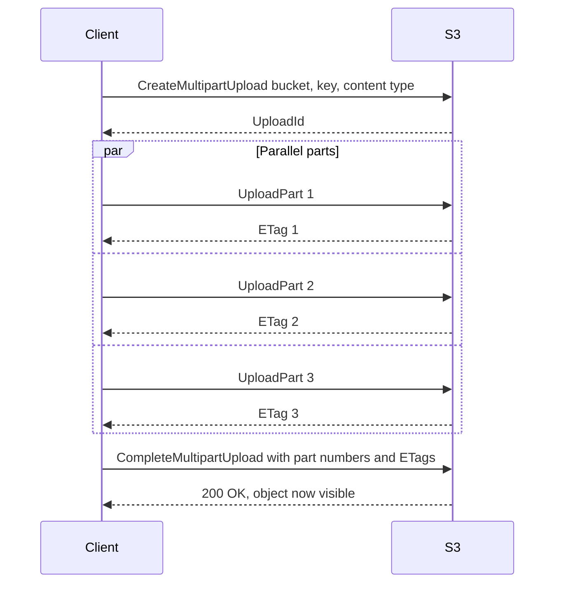
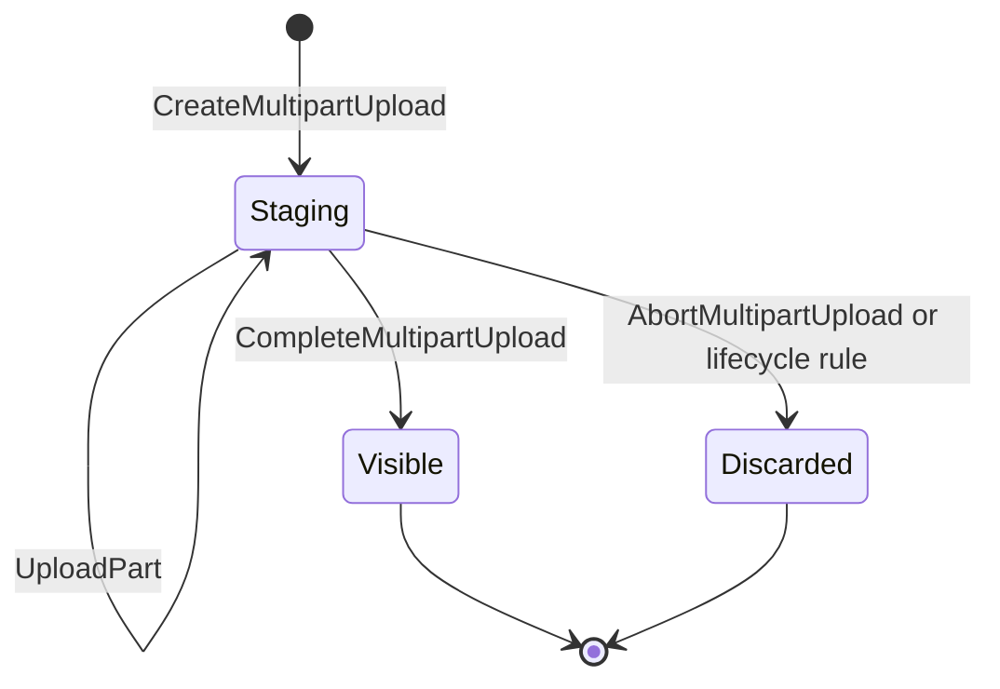
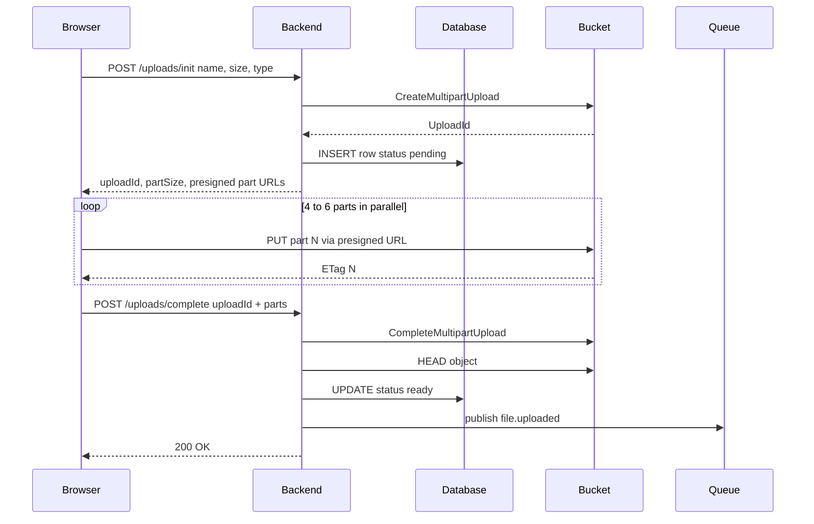
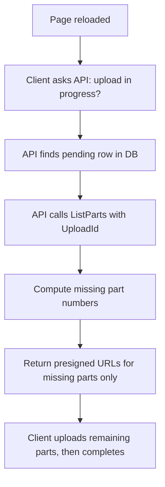
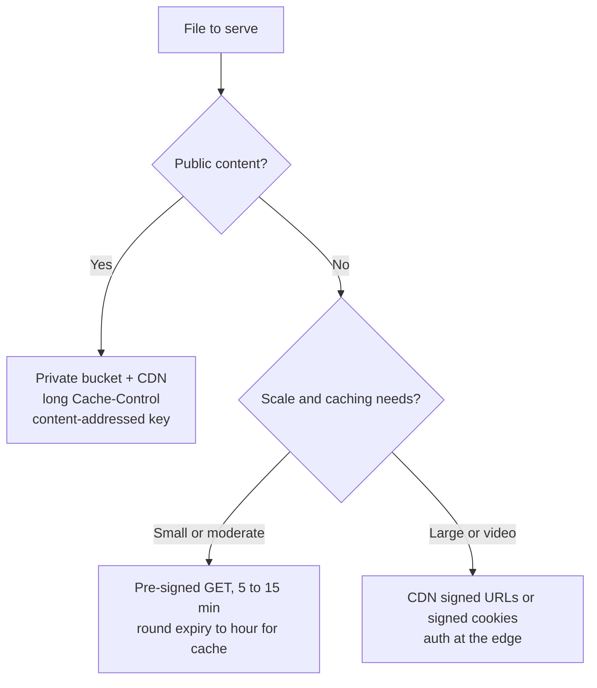
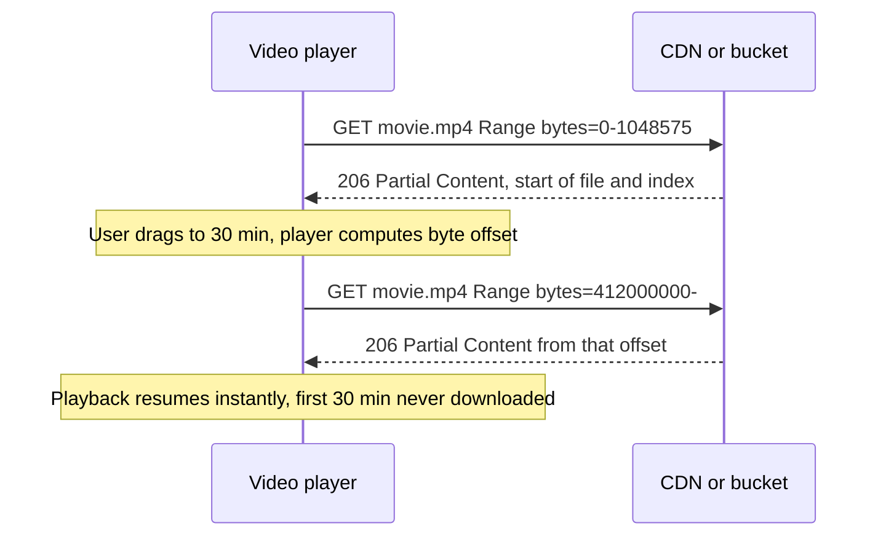
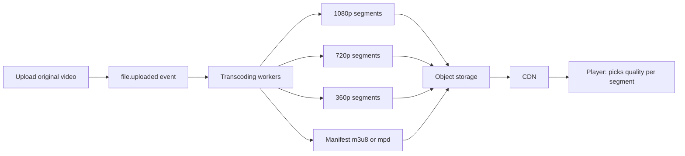

## TL;DR
- A single PUT fails for large files: **5 GB hard limit**, **all-or-nothing** (a Wi-Fi blip restarts from zero), **one TCP connection can't saturate the link**, and **poor UX** (coarse progress, no pause/resume).
- **Multipart upload** = `CreateMultipartUpload` (get an **upload ID**, a staging area) → `UploadPart` × N (independent, parallel, any order, each returns an **ETag**) → `CompleteMultipartUpload` (list of part numbers + ETags; a fast **metadata-only** stitch). Plus `AbortMultipartUpload`.
- Max **10,000 parts** → compute part size as `max(floor, ceil(fileSize / 10,000))`, with a floor of ~16–32 MB; parts are your **retry granularity**, so don't make them huge (sweet spot ~16–64 MB).
- **Multipart ETags are not the MD5 of the file** (they're `md5(concat of part MD5s)-N`). For integrity use **S3 checksums** (CRC32C / SHA-256) or your own SHA-256 in metadata.
- Abandoned multipart uploads are **invisible but billed**. Add a lifecycle rule **"abort incomplete multipart uploads after 7 days"** on every bucket from day one.
- Production browser flow: `POST /uploads/init` → backend creates multipart upload + **pending** row + pre-signed part URLs (in batches) → browser PUTs 4–6 parts in parallel using `File.slice()` → `POST /uploads/complete` with ETags → backend completes, `HEAD`-verifies, marks **ready**, emits `file.uploaded`. **Resume** via `ListParts`. Expose `ETag` in CORS.
- **Never proxy downloads.** Public content: private bucket + **CDN** + long `Cache-Control` + **content-addressed keys**. Private content: **pre-signed GET** (round expiry to the hour for cacheability) or, at scale, **CDN signed URLs/cookies**.
- **Range requests** (`Range` → `206 Partial Content` + `Content-Range`; `416` if invalid) power video seeking, resumable and parallel downloads. Adaptive video uses **HLS/DASH** segments + manifest — all just objects. You pay for **storage**, **requests** (writes ≈ 10x reads) and **egress** (R2 has free egress).

## Why this matters
Part 1 solved uploads of up to a few hundred megabytes. Real products also handle **multi-gigabyte** files (videos, CAD files, database dumps, drone footage) and — far more often — **downloads**, which dominate bandwidth and cost. Large uploads need resilience to flaky networks, downloads need to bypass your server entirely, and the pricing model (especially **egress**) shapes your architecture. Interviewers ask about multipart uploads, resumable uploads, CDNs with private content, and video streaming in system design rounds (design YouTube/Dropbox/Google Drive).

## Why a single PUT breaks for large files

### Reason 1: The hard size limit
A single S3 `PUT` cannot exceed **5 GB**. This is enforced by the object storage API itself, not by any spec or your backend. If your product accepts big videos, CAD files, database dumps, wedding or drone footage, you are **architecturally required** to use something else.

### Reason 2: All-or-nothing
A single PUT either fully succeeds or fails. At 4.8 GB of a 5 GB upload, a one-second Wi-Fi blip (router switching to backup power, mobile handover) cancels it, and the retry **starts from zero**. On typical mobile connections a multi-GB upload takes 20–30 minutes — a glitch somewhere in that window is very likely.

### Reason 3: Throughput of one TCP connection
HTTP runs on TCP. A single TCP connection's throughput is roughly bounded by **window size ÷ round-trip time**, and it is very sensitive to **packet loss**: a lost packet collapses the congestion window, which then has to climb back up. So on a 200–500 Mbps link, a single-stream upload might sit at ~30 Mbps.

The fix is at the network level: **more connections**. Each parallel stream has its own congestion window; one stalling doesn't slow the others. This is exactly how download managers (Internet Download Manager, Free Download Manager) "speed up" downloads — they don't change your physical link; they open ~8 connections and fetch different parts in parallel.

### Reason 4: User experience
One big PUT gives coarse progress, no pause, and no way to survive a closed tab or a network error.



## Multipart upload: the protocol

The whole protocol is three calls (plus abort):

### Step 1: CreateMultipartUpload
Send bucket, key and content type. You get back an **upload ID** — think of it as a **staging area**, like git's staging area: changes accumulated but not yet committed. **Nothing exists at the key yet**; a `GET` on it returns **404** until completion.

### Step 2: UploadPart (once per chunk)
Send upload ID + **part number** (1–10,000) + the bytes. Key properties:
- Each part is an **independent HTTP request**, so parts can go **in parallel** and **in any order** (part 7 may arrive before part 2).
- A failed part is **retried individually** without affecting the others.
- Each successful part returns an **ETag**. **Keep it** — you need it at the end. (This is the second use of ETags after conditional writes in Part 1.)

### Step 3: CompleteMultipartUpload
Send the upload ID + the full list of `(partNumber, ETag)` pairs in order. The service assembles them into one object. Surprisingly, this call is **fast regardless of object size** — 50 GB or 50 MB — because the service doesn't physically concatenate bytes: it's a **metadata-plane operation** recording "this object consists of these parts in this order".

### Step 4: AbortMultipartUpload
Discards the staging area and frees the stored parts.





> [!NOTE]
> Precise S3 limits: parts must be **5 MiB–5 GiB** each (the last part may be smaller), at most **10,000 parts**, and a multipart object can be up to **5 TiB**.

## Choosing the part size

### The 10,000-part trap
With a fixed 5 MB part size, the maximum file is 5 MB × 10,000 = **50 GB**. Upload a 60 GB file with 5 MB parts and it fails at part **10,001** — after 50 GB has already been transferred. Very expensive.

### Compute it dynamically
- Dynamic size = `ceil(fileSize / 10,000)` (the smallest part size that fits in 10,000 parts).
- But for small files that would produce tiny parts, so use a **floor** (default) size, e.g. 16 or 32 MB.
- **Part size = max(floor, ceil(fileSize / 10,000))**.

A 16 MB floor handles files up to 160 GB, a 32 MB floor up to 320 GB, without the formula even kicking in.

```ts
const MAX_PARTS = 10_000;
const FLOOR = 16 * 1024 * 1024; // 16 MiB
const MIN_S3_PART = 5 * 1024 * 1024; // S3 minimum (except last part)

export function choosePartSize(fileSize: number): { partSize: number; partCount: number } {
  const partSize = Math.max(FLOOR, MIN_S3_PART, Math.ceil(fileSize / MAX_PARTS));
  return { partSize, partCount: Math.ceil(fileSize / partSize) };
}
// 2 GiB file -> 16 MiB parts, 128 parts
```

### Why not just use huge parts?
**The part is your retry granularity.** If a 500 MB part fails on a mobile connection, you resend 500 MB. With 16–32 MB parts, retries are cheap. **16 MB to ~64 MB** is the sweet spot.

| Part size | Max file (10,000 parts) | Retry cost | Verdict |
|---|---|---|---|
| 5 MB | 50 GB | Very cheap | Too small for big files |
| 16 MB | 160 GB | Cheap | Good default |
| 32 MB | 320 GB | Cheap | Good default |
| 64 MB | 640 GB | Moderate | Upper sweet spot |
| 500 MB | 5 TB | Expensive on mobile | Avoid for browsers |

## The ETag integrity bug

For a normal single PUT (without SSE-KMS encryption), the ETag is the **MD5 hash of the content**. So people reasonably write integrity checks: "hash the file locally, compare with the ETag."

For multipart uploads, the ETag is **not** the MD5 of the file. It's the **MD5 of the concatenated binary MD5s of each part**, followed by a hyphen and the **number of parts**, e.g. `"9b2cf535f27731c974343645a3985328-42"`. Your local MD5 will never match.

**For real end-to-end integrity, don't use ETags.** Instead:
- Use S3's **checksum feature**: modern AWS SDKs compute **CRC32C** or **SHA-256** per part and can request a full-object checksum that S3 verifies for you.
- Or compute your own **SHA-256 on the client**, send it as **user metadata**, and verify it in a **background job** after upload. Bonus: the hash gives you **deduplication** for free (same hash = same content).

> [!WARNING]
> An ETag ending in `-N` is a multipart ETag. Comparing it with a local MD5 will always fail (or, worse, a check that "skips" multipart objects silently gives you no integrity at all).

## The invisible cost leak: incomplete multipart uploads

Scenario: 300 parts × 32 MB ≈ **10 GB** in the staging area. The user closes the tab. Neither `Complete` nor `Abort` is ever called. Those 10 GB stay stored and **billed every month, forever** — and they're invisible, because `ListObjects` and the console show **objects**, and an uncompleted upload is not an object yet.

Demo from the video: the console showed one 184 MB object, but listing in-progress uploads revealed three uploads started days ago, with ~460 MB of orphaned parts.

```bash
# See the hidden uploads
aws s3api list-multipart-uploads --bucket my-bucket
```

**Fix:** a **lifecycle rule** that aborts incomplete multipart uploads after **7 days** — on every production bucket, before writing any feature code. It costs nothing and permanently closes the leak.

```json
{
  "Rules": [
    {
      "ID": "abort-incomplete-mpu",
      "Status": "Enabled",
      "Filter": {},
      "AbortIncompleteMultipartUpload": { "DaysAfterInitiation": 7 }
    }
  ]
}
```

```bash
aws s3api put-bucket-lifecycle-configuration --bucket my-bucket --lifecycle-configuration file://lifecycle.json
```

> [!IMPORTANT]
> Every bucket gets an **"abort incomplete multipart uploads after 7 days"** lifecycle rule from day one.

## Production architecture: multipart + pre-signed URLs from the browser

Combine Part 1's pre-signed URLs with multipart uploads:

1. **Init** — browser calls `POST /uploads/init` with file name, size and type.
2. Backend **authenticates/authorizes**, **computes the part size**, calls **`CreateMultipartUpload`**, **inserts a `pending` row** (upload ID, key, expected size/type), and **pre-signs a URL per part** (`UploadPart`).
3. Responds with **upload ID, part size, and part URLs**.
4. **Upload** — browser runs **N parallel PUTs** (4–6) directly to the bucket, one per part, collecting each **ETag**.
5. **Complete** — browser calls `POST /uploads/complete` with the upload ID and `[{ partNumber, etag }]`.
6. Backend calls **`CompleteMultipartUpload`**, then **`HEAD` object** to verify size and content type match what was claimed.
7. Backend flips the row **`pending` → `ready`**, and (if you have a queue-based architecture) emits a **`file.uploaded`** event for audit logging, transcoding, or a WebSocket push to the UI.



```ts
// Backend: init and complete
import {
  CreateMultipartUploadCommand, UploadPartCommand, CompleteMultipartUploadCommand, HeadObjectCommand,
} from "@aws-sdk/client-s3";
import { getSignedUrl } from "@aws-sdk/s3-request-presigner";

export async function initUpload(user: User, size: number, type: string) {
  const key = `${user.tenantId}/${user.id}/${crypto.randomUUID()}`;
  const { partSize, partCount } = choosePartSize(size);
  const { UploadId } = await s3.send(new CreateMultipartUploadCommand({ Bucket: BUCKET, Key: key, ContentType: type }));
  await db.uploads.insert({ uploadId: UploadId, key, size, type, status: "pending", ownerId: user.id });
  const first = Math.min(partCount, 100); // sign in batches, not all 10,000
  const urls = await Promise.all(
    Array.from({ length: first }, (_, i) =>
      getSignedUrl(s3, new UploadPartCommand({ Bucket: BUCKET, Key: key, UploadId, PartNumber: i + 1 }), { expiresIn: 900 })
    )
  );
  return { uploadId: UploadId, partSize, partCount, urls };
}

export async function completeUpload(uploadId: string, parts: { PartNumber: number; ETag: string }[]) {
  const row = await db.uploads.findPending(uploadId);
  await s3.send(new CompleteMultipartUploadCommand({
    Bucket: BUCKET, Key: row.key, UploadId: uploadId,
    MultipartUpload: { Parts: parts.sort((a, b) => a.PartNumber - b.PartNumber) },
  }));
  const head = await s3.send(new HeadObjectCommand({ Bucket: BUCKET, Key: row.key }));
  if (head.ContentLength !== row.size) throw new Error("size mismatch");
  await db.uploads.markReady(uploadId);
  await queue.publish("file.uploaded", { key: row.key });
}
```

```ts
// Browser: slice lazily, upload with limited concurrency, collect ETags
async function uploadParts(file: File, partSize: number, urls: string[], concurrency = 5) {
  const etags: { PartNumber: number; ETag: string }[] = [];
  let next = 0;
  async function worker() {
    while (next < urls.length) {
      const i = next++;
      const blob = file.slice(i * partSize, (i + 1) * partSize); // lazy Blob, not loaded yet
      const res = await fetch(urls[i], { method: "PUT", body: blob });
      if (!res.ok) throw new Error(`part ${i + 1} failed`); // retry this part only
      etags.push({ PartNumber: i + 1, ETag: res.headers.get("ETag")! }); // needs CORS ExposeHeaders
    }
  }
  await Promise.all(Array.from({ length: concurrency }, worker));
  return etags;
}
```

### Practical notes
1. **Don't pre-sign 10,000 URLs up front** — the init response would be megabytes of JSON. Pre-sign in **batches (~100)** as the browser progresses.
2. **Concurrency of 4–6** parallel PUTs is the sweet spot; beyond that you fight for the same bandwidth with other devices/processes on the network.
3. **`File.slice()`** returns a **lazy `Blob`** — bytes are read only when sent. Browser memory ≈ **part size × concurrency**, not the file size.
4. **CORS must expose the `ETag` header**, otherwise JavaScript can't read it from the response and you can't complete the upload.

### Resumable uploads for free
If the page refreshes or the tab is reopened:
1. Client asks the API: "do I have an upload in progress for this file?"
2. Backend finds the **pending row**, calls **`ListParts`** with the upload ID to learn which parts the bucket already holds.
3. Returns fresh pre-signed URLs **only for missing parts**.
4. Client resumes from, say, part 341 instead of zero.



### Demo: a 2 GB upload
The server didn't sign one URL; it started a multipart upload with **16 MB parts × 125 parts**, **5 at a time**. The UI grid showed parts as gray (waiting), blue (in flight, five at once) and green (done). The network panel showed ~125 separate PUTs, all to the **bucket's domain, not the backend**. The progress bar and ETA were **computed client-side** from finished/remaining parts — stable numbers, so the bar didn't jump. Finally the browser sent one `complete` call **to the API** (not S3) with the parts and ETags.

## Downloads: never relay through your server

Downloads matter more than uploads: files are fetched far more often than they're uploaded.

**Don't proxy** (`GetObject` in your handler, then copy bytes to the response):
- A worker (goroutine, event-loop connection) is busy for the **whole download**.
- You **pay for bandwidth** (egress) through your servers on every cloud/PaaS.
- It's **slow**: your server sits in one or a few regions, while CDN edges are everywhere.

Bytes should flow **from the bucket, or better from a CDN**, never through your app.

### Pattern 1: Public content — CDN in front of a private bucket
For genuinely public assets (site images, CSS/JS bundles, public product images):
- Simplest: a public bucket. Better: keep the bucket **private** and let **only the CDN read it** (e.g. CloudFront Origin Access Control).
- Set a **very long `Cache-Control`** (e.g. `public, max-age=31536000, immutable`).
- Use **content-addressed keys**: the key is a **hash of the content** (e.g. `assets/3f9a1c...e2.png`). When content changes, the key — and URL — changes, so you never need cache invalidation.

Cheapest and fastest option available.

### Pattern 2: Private content — pre-signed GET
Same mechanics as pre-signed PUT, for GET:
1. Browser asks your backend for the file.
2. Backend **authorizes** (does this user own/can see this object?).
3. Returns a **pre-signed GET URL** valid for ~5–15 minutes.
4. Browser downloads directly from S3/CDN.

```ts
import { GetObjectCommand } from "@aws-sdk/client-s3";

export async function downloadUrl(user: User, fileId: string) {
  const file = await db.files.findOwnedBy(fileId, user.id); // DB is the index
  return getSignedUrl(s3, new GetObjectCommand({
    Bucket: BUCKET, Key: file.key,
    ResponseContentDisposition: `attachment; filename="${encodeURIComponent(file.originalName)}"`,
  }), { expiresIn: 600 });
}
```

**The CDN cache problem:** every signed URL contains a fresh timestamp and signature, so every request is a **different URL** to the CDN → **cache hit rate ≈ 0**. You pay for a CDN that caches nothing, plus full **egress**.

Two fixes:
- **Cheap fix: round the expiry.** Instead of "valid for 15 minutes from now", sign "valid until the top of the next hour" (and with a fixed signing time) so everyone requesting the file in that hour gets the **same URL** → the CDN can cache it. You trade expiry precision for cache hits.
- **Proper fix at scale: CDN signed URLs or signed cookies** (e.g. CloudFront). Authorization happens **at the edge** — small servers spread across the world at network nodes — and the CDN fully controls caching. **Signed cookies** are ideal for **video**: one viewing session fetches hundreds or thousands of segment files; signing each would hammer your backend, while one cookie authorizes the whole session.



| Pattern | Use for | Auth | CDN cacheable | Notes |
|---|---|---|---|---|
| Public via CDN | Public assets | None | Yes, excellent | Content-addressed keys, long max-age |
| Pre-signed GET | Private files, modest scale | Backend signs per request | Poor (unique URLs) unless expiry rounded | Simple; 5–15 min expiry |
| CDN signed URL/cookie | Private at scale, video | At the edge | Yes | Cookies cover many segment requests |
| Proxy through server | Almost never | Backend | N/A | Burns workers and egress |

## Range requests

The client says "don't send everything — send bytes 1,000,000 to 3,000,000":

```http
GET /videos/movie.mp4 HTTP/1.1
Host: cdn.example.com
Range: bytes=1000000-2999999
```

```http
HTTP/1.1 206 Partial Content
Content-Range: bytes 1000000-2999999/734003200
Content-Length: 2000000
Accept-Ranges: bytes
Content-Type: video/mp4
```

- **`206 Partial Content`** + **`Content-Range`** (which bytes, and total size).
- Invalid/unsatisfiable range → **`416 Range Not Satisfiable`**.
- This is **plain HTTP semantics**, not an object-storage invention — but because object storage speaks HTTP natively, S3 supports ranged GETs out of the box. (HTTP + ranges + objects = many features "for free".)

### What range requests unlock
- **Video seeking**: drag the scrubber to 30:00 and the player uses the file's index (e.g. the MP4 `moov` atom) to compute the byte offset for that time, then issues a range request from there. It skips the first 30 minutes entirely and starts playing almost instantly.
- **Resumable downloads**: a download manager stops at byte 400,000,000 when Wi-Fi drops; on reconnect it requests `Range: bytes=400000000-`.
- **Parallel downloads**: open ~6 connections, each fetching a different range of the same object (solves the single-TCP-stream throughput limit, mirror image of multipart upload).
- **File sniffing**: read just the first few bytes to identify the type.



### Demo (against a local MinIO in Docker)
```bash
# First 100 bytes -> HTTP 206
curl -s -o /dev/null -w "%{http_code}\n" -H "Range: bytes=0-99" http://localhost:9000/bucket/cat.png

# First 8 bytes as hex: the PNG signature, without downloading the image
curl -s -H "Range: bytes=0-7" http://localhost:9000/bucket/cat.png | xxd
# 00000000: 8950 4e47 0d0a 1a0a   .PNG....

# Resume an interrupted download from where the local file ends
curl -C - -o big.bin http://localhost:9000/bucket/big.bin
```

## Video streaming: HLS and DASH

Progressive download with ranges works well up to a point, but there's one unfixable limitation: there's **exactly one version of the file**. A user on a weak connection and one on fiber both get the same bitrate.

Streaming platforms (Netflix, YouTube, Prime Video, Hotstar) serve **different files to different users** using **segmented streaming** with **HLS** or **DASH**:
1. **Transcode** the original into multiple qualities (e.g. 240p, 480p, 720p, 1080p, 4K).
2. **Segment** each rendition into chunks of a few seconds.
3. Write a **manifest** (`.m3u8` for HLS, `.mpd` for DASH) listing renditions and segments.
4. The player fetches the manifest, then segments one by one, **measures its own download speed**, and switches up or down in quality per segment — **adaptive bitrate (ABR)** streaming.



Nothing changes on the storage side: **segments are objects and the manifest is an object**. Object storage + CDN is everything you need to serve video. The hard engineering is the **transcoding pipeline** — the background jobs, queues and workers triggered by each upload.

> [!TIP]
> If video is a **small feature** of your product, use a hosted video service (e.g. **Mux**, **Bunny Stream**) that handles transcoding and delivery. If video **is** your product (90% of the platform), build the pipeline yourself so the economics work.

## Cost: what you actually pay for

Pricing shapes architecture. You pay for three things:

| Cost dimension | Unit | Notes |
|---|---|---|
| **Storage** | Per GB-month | Grows forever with uploads; orphaned multipart parts count too |
| **Operations** | Per request | **Writes/mutations (PUT, POST, LIST, COPY) ≈ 10x reads (GET)** |
| **Egress** | Per GB leaving the provider | Often the biggest bill for download-heavy apps |

**Egress** = data going out of the cloud provider (every download counts). **Cloudflare R2** is popular precisely because it offers **zero egress fees**, no matter how much you download — a huge deal for high-volume apps. Prices change every few years, so check providers' pricing pages rather than memorizing numbers.

Architectural consequences:
- Serve through a **CDN with high cache hit rate** to cut origin egress and GETs.
- **Don't LIST** in hot paths (costly requests plus latency).
- Avoid "renames"/folder moves (copy = write requests + storage churn).
- Add **lifecycle rules** (abort incomplete uploads, expire pending/temp objects).

## Recap of both parts
- Object storage exists because local file storage doesn't scale; it gives up **mutability** (no in-place edits, rename, folders, locks) for effectively **infinite capacity**, **11 nines of durability** and a pure **HTTP interface**.
- An object = **key + bytes + metadata** in a **flat namespace** (bucket). Folders = group-by on strings.
- **Generate keys yourself**, high-entropy first, encode ownership; **set metadata at write time** (changing it means rewriting/copying the object).
- **Metadata plane + data plane**; durability from **erasure coding**, cheaper and stronger than replication.
- **Durability ≠ backup** → enable **versioning** and **replication** explicitly.
- **Don't LIST** to answer product questions — the **database** records which files exist and who owns them.
- Small files may go through your server if **streamed** with a **body size limit**; large files go **directly from the browser** with pre-signed URLs.
- Prefer **pre-signed POST with `content-length-range`** over a plain pre-signed PUT (which is an unlimited-size write capability).
- Record **intent (pending row)** before upload, **verify with HEAD** on completion, **clean up** abandoned uploads.
- Large files → **multipart**; compute part size **dynamically**; **don't trust multipart ETags**; **abort-incomplete lifecycle rule** on every bucket.
- Downloads → never relay; **pre-signed GET**, and **CDN + private bucket**.
- **Range requests** enable seeking, resuming and parallel downloads; video → **segments + manifest + adaptive bitrate**.

## Common mistakes & misconceptions
- **Using a single PUT for multi-GB files** — fails above 5 GB, restarts from zero on any glitch.
- **Fixed 5 MB parts** — fails at part 10,001 after 50 GB transferred.
- **Huge parts (hundreds of MB) for browser uploads** — expensive retries on flaky networks.
- **Comparing multipart ETags with a local MD5** — they never match; use checksums.
- **No abort-incomplete lifecycle rule** — invisible, billed staging data piles up forever.
- **Pre-signing all 10,000 part URLs in one response** — multi-MB JSON; sign in batches.
- **Too much client concurrency** — beyond ~4–6 parts, streams fight each other.
- **Reading the whole file into memory in the browser** — use `File.slice()` lazily.
- **Forgetting `ExposeHeaders: ETag` in CORS** — the client can't read ETags, can't complete.
- **Assuming the object exists after the parts are uploaded** — it's a 404 until `Complete`.
- **Proxying downloads through the backend** — burns workers and egress, slow globally.
- **Putting a CDN in front of per-request pre-signed URLs** — 0% cache hit rate.
- **Thinking range requests are an S3 feature** — they're standard HTTP (`Range`, `206`, `416`).
- **Building your own transcoding pipeline when video is a side feature** — use a hosted service.
- **Ignoring egress** when picking a provider.

## Interview questions

<details>
<summary><strong>Q: Why does a single PUT fail for large files, and what replaces it?</strong></summary>

Four reasons: S3 caps a single PUT at 5 GB; a PUT is all-or-nothing so any network blip restarts from zero; one TCP connection can't saturate a fast link (throughput ≈ window/RTT, and packet loss collapses the congestion window); and UX is poor — no fine progress, pause or resume. Multipart upload replaces it: split into independently uploaded parts that can be parallel, out of order, and retried individually.

</details>

<details>
<summary><strong>Q: Walk through the multipart upload protocol.</strong></summary>

`CreateMultipartUpload(bucket, key, contentType)` returns an UploadId — a staging area; the key still 404s. `UploadPart(uploadId, partNumber, bytes)` per chunk, in parallel and any order, each returning an ETag you must keep. `CompleteMultipartUpload(uploadId, [partNumber, ETag]...)` assembles the object — a fast metadata operation regardless of size. `AbortMultipartUpload` discards the staged parts. Limits: 10,000 parts, 5 MiB to 5 GiB per part (except the last), 5 TiB max object.

</details>

<details>
<summary><strong>Q: How do you choose the part size?</strong></summary>

`partSize = max(floor, ceil(fileSize / 10,000))`, with a floor around 16–32 MB (and at least S3's 5 MiB minimum). A fixed 5 MB caps you at 50 GB and fails at part 10,001 after 50 GB transferred. Don't go huge either: the part is the retry granularity, so a failed 500 MB part on mobile is costly. The 16–64 MB range is the sweet spot; a 16 MB floor already covers files up to 160 GB.

</details>

<details>
<summary><strong>Q: Why is CompleteMultipartUpload fast even for a 50 GB object?</strong></summary>

The service doesn't copy or concatenate the bytes. Parts are already durably stored by the data plane; completion is a metadata-plane operation that records "this key consists of these parts in this order" and makes the object visible. Its cost depends on the metadata, not the data size.

</details>

<details>
<summary><strong>Q: You verify uploads by comparing a local MD5 with the ETag. Why does it fail for some files?</strong></summary>

For single-part uploads (without KMS encryption), the ETag is the MD5 of the content. For multipart uploads it's the MD5 of the concatenated part MD5s plus `-<partCount>`, so it never matches a whole-file MD5. For integrity, use S3's checksum feature (CRC32C or SHA-256 per part with a full-object checksum verified by S3) or compute a SHA-256 on the client, store it in user metadata, and verify it in a background job — which also enables deduplication.

</details>

<details>
<summary><strong>Q: Your S3 bill is higher than the total size of objects in the bucket. What could cause it?</strong></summary>

Incomplete multipart uploads: parts uploaded for uploads that were never completed or aborted are stored and billed but don't appear in ListObjects or the console. Check with `aws s3api list-multipart-uploads`. Fix with a lifecycle rule `AbortIncompleteMultipartUpload` after ~7 days on every bucket. Other causes: noncurrent versions if versioning is on, and request/egress charges.

</details>

<details>
<summary><strong>Q: Design resumable large-file uploads from the browser.</strong></summary>

Init: the backend authorizes, computes part size, calls CreateMultipartUpload, stores a pending row with the UploadId and key, and returns pre-signed part URLs in batches. The browser slices the file lazily with `File.slice()`, uploads 4–6 parts in parallel directly to S3, and collects ETags (bucket CORS must expose ETag). On completion, the backend calls CompleteMultipartUpload, HEAD-verifies, marks the row ready, and emits `file.uploaded`. To resume after a reload, the backend finds the pending row, calls ListParts, and returns URLs only for missing parts. A lifecycle rule aborts abandoned uploads.

</details>

<details>
<summary><strong>Q: Why shouldn't downloads go through your API server? What do you do instead?</strong></summary>

Proxying ties up a worker for the whole download, makes you pay egress through your servers, and is slow because your servers are in few regions. Instead: for public content, a private bucket fronted by a CDN with long Cache-Control and content-addressed keys. For private content, the backend authorizes and returns a short-lived pre-signed GET URL, or at scale uses CDN signed URLs or cookies so authorization happens at the edge.

</details>

<details>
<summary><strong>Q: You put a CDN in front of pre-signed GET URLs, but the cache hit rate is zero. Why, and how do you fix it?</strong></summary>

Each pre-signed URL has a unique timestamp and signature, so the CDN sees every request as a different resource. Cheap fix: make the signature deterministic per time window — e.g. expire at the top of the next hour — so all users in that hour get the same URL. Proper fix: use the CDN's own signed URLs or signed cookies (e.g. CloudFront), where the edge validates access and caches by the underlying object.

</details>

<details>
<summary><strong>Q: What are content-addressed keys and why are they good with CDNs?</strong></summary>

The key is derived from a hash of the content (e.g. `assets/3f9a...e2.png`). When the content changes, the key and URL change, so you can set `Cache-Control: max-age=31536000, immutable` and never need cache invalidation — clients and CDNs keep old versions safely, and new versions are new URLs. It also gives deduplication.

</details>

<details>
<summary><strong>Q: How do HTTP range requests work, and what do they enable?</strong></summary>

The client sends `Range: bytes=start-end`; the server replies `206 Partial Content` with `Content-Range: bytes start-end/total`, or `416 Range Not Satisfiable` if invalid. It's standard HTTP, and S3 supports it natively. It enables video seeking (jump straight to the byte offset for a timestamp), resumable downloads (`Range: bytes=N-`), parallel downloads (several connections on different ranges), and reading file headers without downloading whole files.

</details>

<details>
<summary><strong>Q: How do Netflix or YouTube adapt video quality, and where does object storage fit?</strong></summary>

Adaptive bitrate streaming with HLS or DASH: the original is transcoded into several renditions, each cut into segments of a few seconds, plus a manifest listing them. The player downloads the manifest, then segments one at a time, measures its throughput, and switches renditions per segment. Segments and manifests are just objects in object storage served via a CDN; the hard part is the transcoding pipeline (queues and workers triggered on upload).

</details>

<details>
<summary><strong>Q: What are the cost dimensions of object storage, and how do they affect design?</strong></summary>

Storage per GB-month, requests per operation (writes/LIST ≈ 10x GETs), and egress per GB leaving the provider. Design implications: put a CDN with good cache hit rates in front, avoid LIST and copy-based "renames", add lifecycle rules for incomplete uploads and temp data, and consider zero-egress providers like Cloudflare R2 for download-heavy workloads.

</details>

<details>
<summary><strong>Q: What happens if a user GETs the key while its multipart upload is still in progress?</strong></summary>

They get 404 (or the previous version, if an object already existed at that key). Parts sit in a staging area tied to the UploadId; the object only becomes visible atomically when CompleteMultipartUpload succeeds. Readers never see a partially uploaded object.

</details>

## Cheat sheet
- **Single PUT limits**: 5 GB max · all-or-nothing · one TCP stream (≈ window/RTT, loss-sensitive) · poor UX.
- **Multipart**: Create (UploadId, key 404s) → UploadPart (parallel, any order, retry individually, keep ETag) → Complete (part list + ETags, metadata-only, fast) · Abort.
- **Limits**: ≤10,000 parts · 5 MiB–5 GiB per part (last smaller) · 5 TiB object.
- **Part size** = `max(16–32 MB floor, ceil(size / 10,000))`; sweet spot 16–64 MB; part = retry unit.
- **Multipart ETag** = `md5(part md5s)-N` → not file MD5 → use CRC32C/SHA-256 checksums or client SHA-256 in metadata (dedupe bonus).
- **Lifecycle rule**: `AbortIncompleteMultipartUpload` after 7 days, every bucket, day one. Hidden uploads: `list-multipart-uploads`.
- **Browser flow**: init (auth, part size, Create, pending row, sign URLs in batches of ~100) → 4–6 parallel PUTs via `File.slice()` → complete (Complete + HEAD + ready + `file.uploaded` event).
- **Resume**: pending row → `ListParts` → sign only missing parts.
- **CORS**: `ExposeHeaders: ["ETag"]`.
- **Downloads**: never proxy. Public → private bucket + CDN + `max-age=31536000, immutable` + content-addressed keys. Private → pre-signed GET (5–15 min; round expiry to hour for cache) → at scale CDN signed URLs/cookies (cookies for video).
- **Range**: `Range: bytes=a-b` → `206` + `Content-Range: bytes a-b/total`; bad range → `416`. Uses: seeking, resume, parallel download, header sniffing.
- **Video**: transcode → segment → manifest (`.m3u8` HLS / `.mpd` DASH) → ABR player. Hosted: Mux, Bunny Stream.
- **Cost**: storage (GB-month) · requests (writes ≈ 10x reads) · egress (R2 = free egress).

## Glossary
- **Multipart upload** — uploading one object as many independently uploaded parts, then assembling them.
- **Upload ID** — identifier of a multipart upload's staging area.
- **Part number** — 1–10,000 index defining a part's position in the final object.
- **CompleteMultipartUpload** — call that assembles parts into the final object (metadata-only).
- **AbortMultipartUpload** — call that discards an in-progress multipart upload and its parts.
- **ListParts** — lists the parts already uploaded for an upload ID (used for resuming).
- **Retry granularity** — the smallest unit you must resend after a failure (here, one part).
- **Congestion window** — TCP's limit on unacknowledged in-flight data; shrinks on packet loss.
- **RTT (round-trip time)** — time for a packet to reach the peer and an acknowledgment to return.
- **Multipart ETag** — `md5(concatenated part MD5s)-N`; not a content hash of the whole file.
- **Checksum (CRC32C / SHA-256)** — integrity value S3 can compute and verify per part and per object.
- **Lifecycle rule** — bucket rule that automatically expires objects or aborts incomplete uploads.
- **File.slice() / Blob** — browser API returning a lazy view of a byte range of a file.
- **Egress** — data transferred out of a cloud provider; usually billed per GB.
- **CDN** — globally distributed cache servers delivering content from the edge.
- **Edge** — CDN servers located near users at network points of presence.
- **Content-addressed key** — key derived from a hash of the object's content.
- **Pre-signed GET** — time-limited signed URL allowing download of one object.
- **Signed cookie** — CDN cookie authorizing access to many URLs (e.g. all video segments) for a session.
- **Range request** — HTTP request for a byte range via the `Range` header.
- **206 Partial Content** — response status for a satisfied range request.
- **416 Range Not Satisfiable** — response status for an invalid range.
- **Content-Range** — response header indicating which bytes are returned and the total size.
- **Transcoding** — converting video into other codecs, resolutions, or bitrates.
- **HLS / DASH** — segmented HTTP streaming formats (Apple HLS with `.m3u8`; MPEG-DASH with `.mpd`).
- **Manifest** — file listing renditions and their segments for a streaming player.
- **Adaptive bitrate (ABR)** — player switching quality per segment based on measured throughput.
- **MinIO** — open-source, S3-compatible object store often run locally in Docker.

## Video timestamps
- [00:00](https://www.youtube.com/watch?v=iWrVCxexUWY&t=0s) — Why a single PUT breaks: the 5 GB hard limit
- [01:00](https://www.youtube.com/watch?v=iWrVCxexUWY&t=60s) — All-or-nothing uploads on flaky networks
- [02:03](https://www.youtube.com/watch?v=iWrVCxexUWY&t=123s) — Single TCP connection throughput and parallel streams
- [04:07](https://www.youtube.com/watch?v=iWrVCxexUWY&t=247s) — UX problems; multipart upload step 1: CreateMultipartUpload
- [05:07](https://www.youtube.com/watch?v=iWrVCxexUWY&t=307s) — Step 2: UploadPart and ETags
- [06:08](https://www.youtube.com/watch?v=iWrVCxexUWY&t=368s) — Step 3: CompleteMultipartUpload as a metadata operation
- [08:11](https://www.youtube.com/watch?v=iWrVCxexUWY&t=491s) — The 10,000-part limit and dynamic part sizing
- [10:14](https://www.youtube.com/watch?v=iWrVCxexUWY&t=614s) — Why not huge parts: retry granularity
- [11:17](https://www.youtube.com/watch?v=iWrVCxexUWY&t=677s) — The multipart ETag integrity bug and checksums
- [13:20](https://www.youtube.com/watch?v=iWrVCxexUWY&t=800s) — AbortMultipartUpload and the invisible storage leak
- [15:23](https://www.youtube.com/watch?v=iWrVCxexUWY&t=923s) — Lifecycle rule: abort incomplete uploads after 7 days
- [16:25](https://www.youtube.com/watch?v=iWrVCxexUWY&t=985s) — Full architecture: multipart + pre-signed URLs from the browser
- [18:27](https://www.youtube.com/watch?v=iWrVCxexUWY&t=1107s) — Practical notes: batch signing, concurrency, File.slice, CORS ETag
- [20:29](https://www.youtube.com/watch?v=iWrVCxexUWY&t=1229s) — Resumable uploads with ListParts
- [21:32](https://www.youtube.com/watch?v=iWrVCxexUWY&t=1292s) — Demo: 2 GB upload in 125 parts
- [24:35](https://www.youtube.com/watch?v=iWrVCxexUWY&t=1475s) — Downloads: never relay through your server
- [27:36](https://www.youtube.com/watch?v=iWrVCxexUWY&t=1656s) — Pattern 1: public content, CDN, content-addressed keys
- [28:39](https://www.youtube.com/watch?v=iWrVCxexUWY&t=1719s) — Pattern 2: pre-signed GET and the CDN cache problem
- [30:41](https://www.youtube.com/watch?v=iWrVCxexUWY&t=1841s) — Fixes: rounded expiry, CDN signed URLs and cookies
- [32:44](https://www.youtube.com/watch?v=iWrVCxexUWY&t=1964s) — Range requests: 206, Content-Range, 416
- [34:44](https://www.youtube.com/watch?v=iWrVCxexUWY&t=2084s) — Video seeking, resumable and parallel downloads
- [36:45](https://www.youtube.com/watch?v=iWrVCxexUWY&t=2205s) — Range request demo with MinIO
- [38:50](https://www.youtube.com/watch?v=iWrVCxexUWY&t=2330s) — Limits of progressive download; HLS/DASH and adaptive bitrate
- [41:53](https://www.youtube.com/watch?v=iWrVCxexUWY&t=2513s) — Transcoding pipelines and hosted video services
- [42:55](https://www.youtube.com/watch?v=iWrVCxexUWY&t=2575s) — Cost: storage, requests, egress
- [44:58](https://www.youtube.com/watch?v=iWrVCxexUWY&t=2698s) — Recap of both parts
