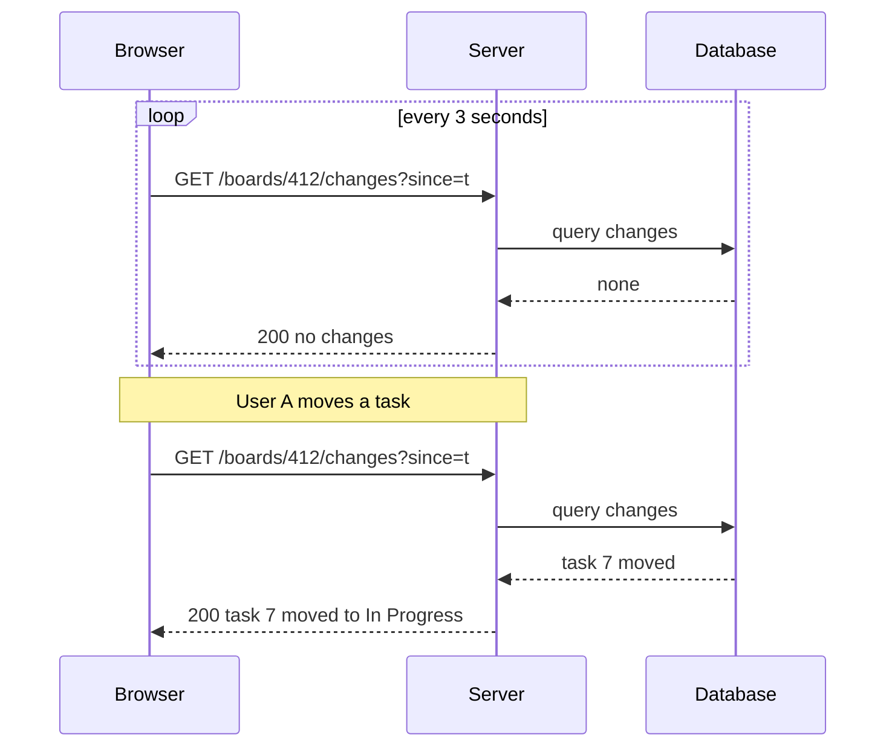
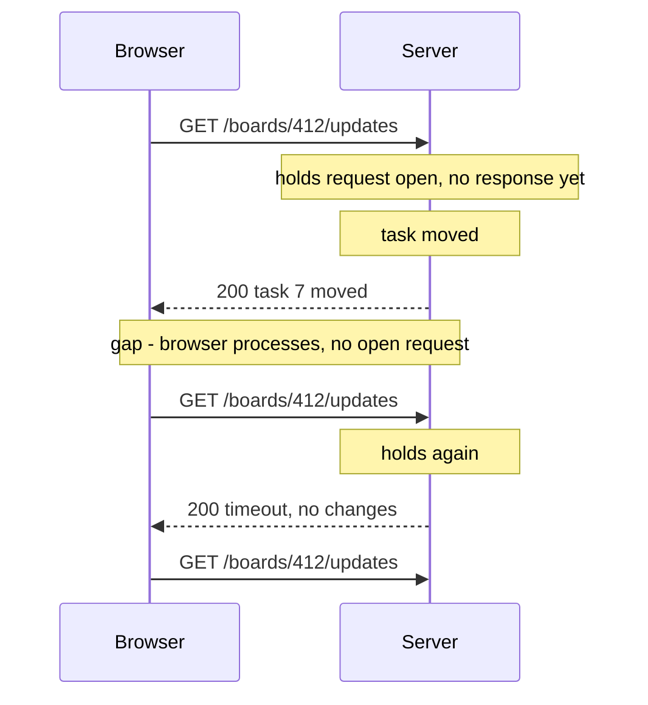
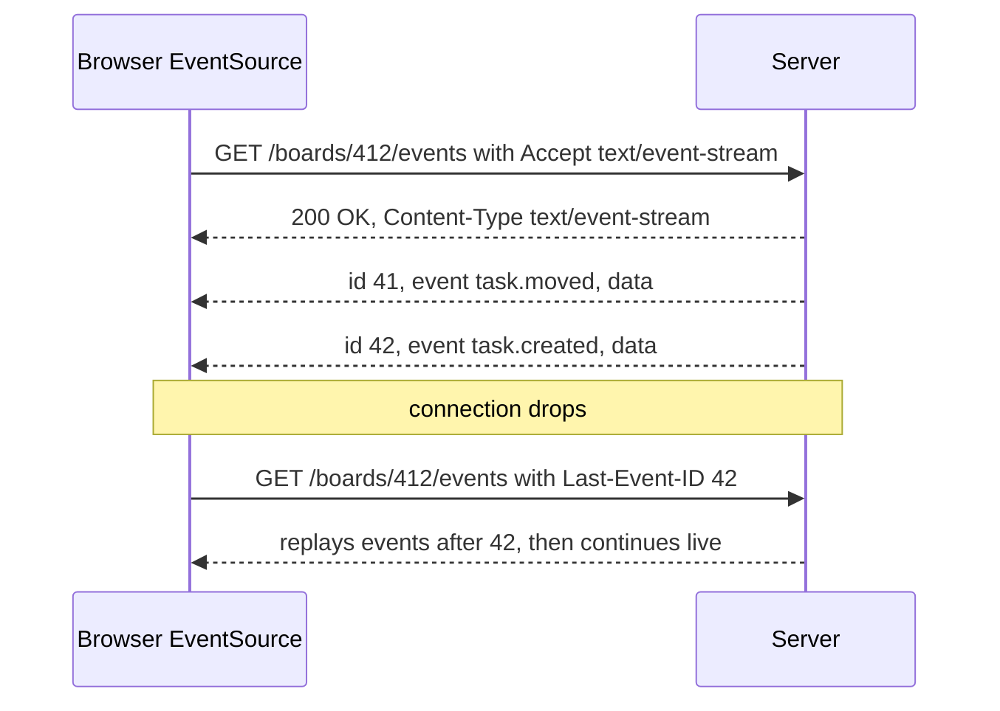
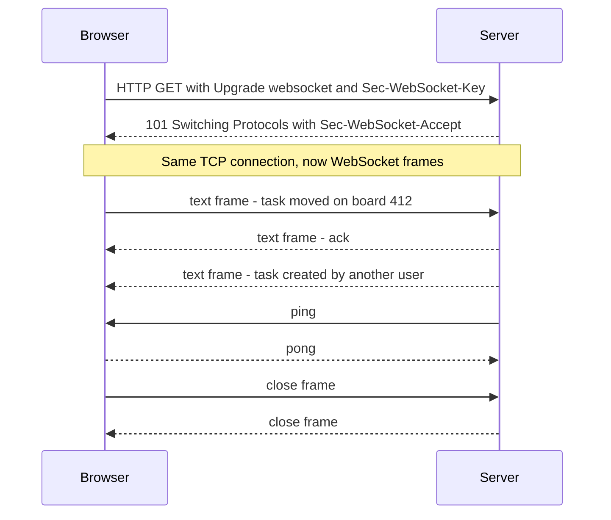
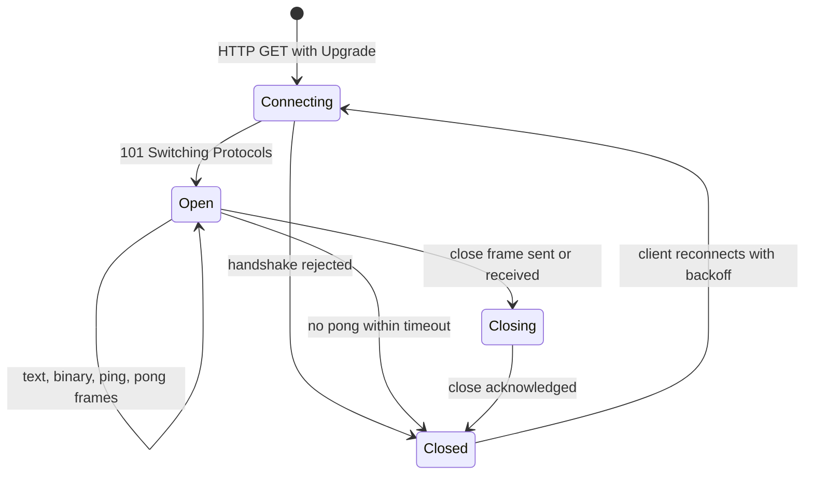
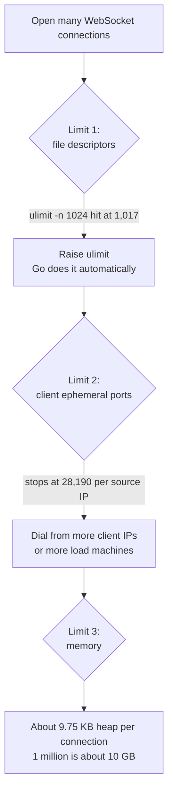
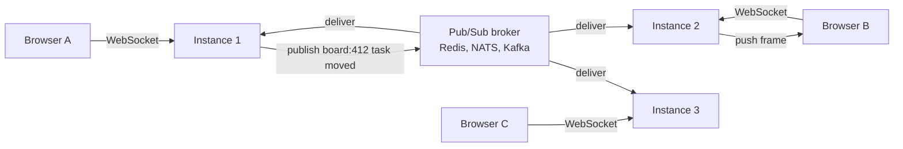
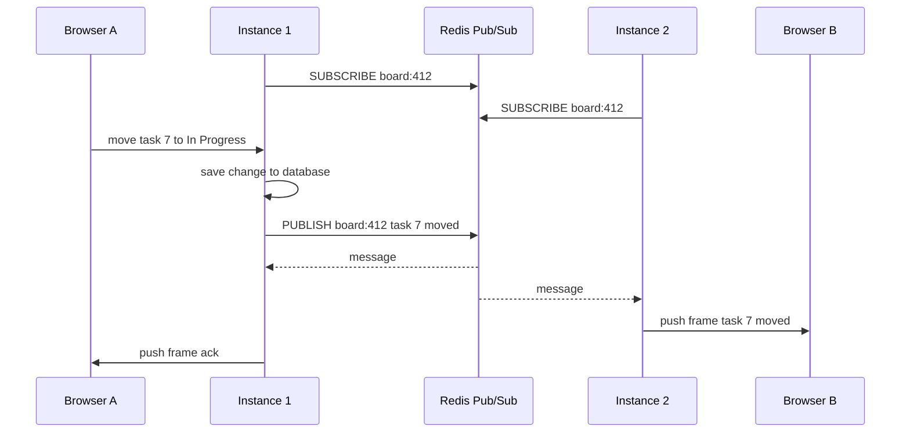
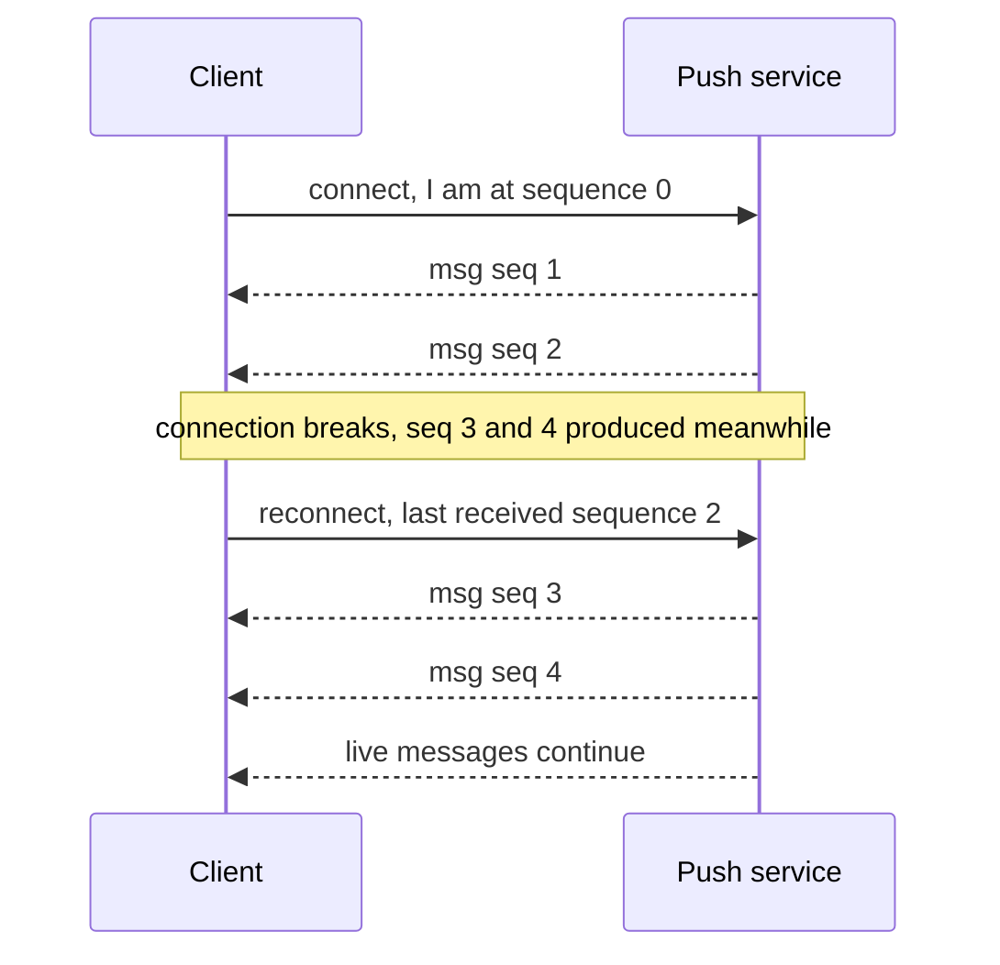
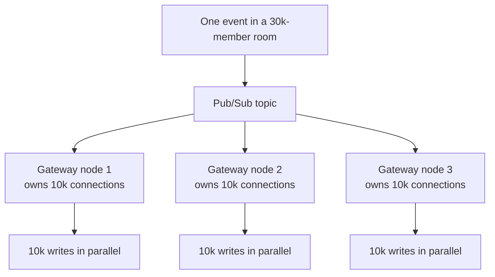

## TL;DR

- HTTP is **client-initiated**: the server can only answer, never speak first. Real-time features (a live task board) need the server to push changes.
- **Short polling** (ask every N seconds) works but has average delay = N/2, and its **cost scales with the number of users watching, not with the number of events**. 10,000 users polling every second = 10,000 full HTTP requests/s, almost all answering "nothing changed". It also drains mobile batteries.
- **Long polling** holds each request open until something happens, then the client immediately re-requests. Better, but there's a gap after each response (RFC 6202: worst-case latency of three network transits) and per-request header overhead.
- **Server-Sent Events (SSE)**: one ordinary HTTP GET whose response never ends (`Content-Type: text/event-stream`). Fields `id`, `event`, `data`, `retry`; browsers auto-reconnect and send `Last-Event-ID`. Used by Uber, LinkedIn and every LLM token-streaming API. Limitation: **server → client only**.
- **WebSockets**: start as HTTP GET with `Upgrade: websocket` + `Sec-WebSocket-Key`; server returns **101 Switching Protocols** + `Sec-WebSocket-Accept` (SHA-1 of key + fixed GUID, base64). Then a **bidirectional stream of frames** with headers as small as 2 bytes. Client frames are **masked** (XOR with a random 4-byte key) to prevent cache-poisoning of proxies, not for secrecy. **Ping/pong** heartbeats detect dead TCP connections.
- Connection limits on one machine: **file descriptors** (`ulimit -n`, default soft limit often 1,024; Go raises it automatically), the load generator's **ephemeral port range** (~28k per source IP — a client-side limit, since TCP connections are identified by a 4-tuple), and finally **memory** (~9.75 KB of Go heap per idle connection ⇒ ~10 GB per million).
- Persistent connections are **state** pinned to one instance. **Sticky sessions don't fix** cross-instance delivery; **pub/sub** (Redis, NATS, Kafka) does. Redis Pub/Sub is **at-most-once** (fire and forget); use Redis Streams/Kafka for at-least-once, and **sequence numbers / last-event IDs** so clients can catch up after reconnecting.
- At scale: **fan-out** cost = events × subscribers (Discord: 0.9–2.1 s for one event to a 30k-member community — spread fan-out across machines), and **reconnect storms** after an instance dies (Slack: serve initial state from an edge cache).

## Why this matters

Everything a backend has done so far follows one shape: the browser asks, the server answers. But many product features — live dashboards, chat, notifications, collaborative boards, AI token streaming, ride tracking — need the **server to speak first**. Choosing between polling, long polling, SSE and WebSockets, and then making that choice survive multiple instances, deployments and flaky mobile networks, is a classic system design interview topic and a real production headache.

**Running example:** a task-management app. Two people look at board `412`. One drags a task from *To Do* to *In Progress*; the other, somewhere else in the world, should see it move **live** — not on refresh, not on navigation.

> [!IMPORTANT]
> The core constraint: in HTTP **the client always initiates**. The server cannot start a conversation; it can only reply to a request (or hold a request open). Every real-time technique is a way around this.

## Short polling

### The intuitive solution

If the server can't tell us something changed, the client keeps asking: every 3 seconds, "has anything on board 412 changed in the last 3 seconds?" Usually the answer is "no". Occasionally "yes" — and the server returns either the specific change or "something changed, refetch the board".



In a demo with two browsers polling every 3 s, the **request counter** and the **unchanged counter** climb together almost every time; only when someone actually moves a task does a request carry useful data. **Most requests are wasted.**

> [!TIP]
> For **internal tools with a handful of users**, polling every few seconds is a perfectly reasonable, simple architecture. The problems below appear with user-facing products at scale.

### Problem 1: delay

With interval N, a change waits on average **N/2** before the next poll picks it up (pure arithmetic). 3 s interval ⇒ ~1.5 s average delay, up to 3 s worst case. The obvious fix: poll faster.

### Problem 2: cost scales with users, not events

Suppose 10,000 people have a board open:
- Every 3 s ⇒ **~3,333 requests/s**, forever.
- Each is a full HTTP request: load balancer → auth middleware (validate token) → logging middleware (write a log line) → service → **database query** → JSON serialization.
- So ~3,333 DB queries/s, nearly all returning "nothing changed".
- Drop the interval to 1 s to make the UI 3× snappier ⇒ **10,000 requests/s** and a cloud bill 3× worse.

> [!IMPORTANT]
> The cost of polling scales with the **number of users watching**, not the **number of events happening**. A board where nothing happens all day costs exactly as much as one with a change every second. You're paying for the *medium* (requests), not the *value* (events).

### Problem 3: mobile battery and data

Every poll from a phone wakes the **cellular radio**, one of the most power-hungry things a phone does. Polling drains battery and data for no changes at all.

### What we actually want

1. The **server should speak first** when something happens.
2. Resources should be spent **per event**, not per user or per request.

## Long polling

**Idea:** since the server can only answer questions, ask a question and let the server **take its time** answering.

1. Browser sends a request.
2. Server **doesn't reply immediately** — it holds the request open (sometimes for a minute or more).
3. The moment a change happens, the server writes the response and the request completes.
4. The browser processes it and **immediately opens a new request**, starting the next cycle.
5. If nothing happens before a timeout, the server returns an empty response and the client re-requests.



Long polling is documented — along with its problems — in **RFC 6202**:
- **The gap:** after the server answers, the browser must process the response and open a fresh request. During that window the server has no open request to that client. Events that happen then must be buffered by the server or are delayed. Average latency is about **one network transit**, but worst case is about **three** (response, new request, next response).
- Each cycle is a full HTTP request with **hundreds of bytes of headers**.
- Held requests still consume server resources and can be cut by proxies' idle timeouts.

Long polling worked and was widely used for years (e.g. early web chat), but we moved on.

## Server-Sent Events (SSE)

### The idea: the response never ends

What if the long-poll response simply **never finished**? The browser sends one ordinary `GET`; the server replies `200 OK` with `Content-Type: text/event-stream` and **keeps the connection open**. Whenever it has something to say, it writes a bit more text to the same response. The connection stays open as long as the tab is open; if it drops (tab closed, network blip), the browser reconnects.

It is **not a new protocol** — it's plain HTTP, using headers and a streaming response body.



### The wire format

```http
GET /boards/412/events HTTP/1.1
Host: api.example.com
Accept: text/event-stream

HTTP/1.1 200 OK
Content-Type: text/event-stream
Cache-Control: no-cache
Connection: keep-alive

retry: 3000

id: 41
event: task.moved
data: {"taskId":7,"from":"todo","to":"in_progress"}

id: 42
event: task.deleted
data: {"taskId":9}

```

The whole format is essentially **four fields**, each event terminated by a blank line:

| Field | Purpose |
|---|---|
| `id` | Event ID. Browser remembers the last one and sends it as `Last-Event-ID` on reconnect, so the server can replay what was missed. |
| `event` | Event type/name (`task.moved`, `task.created`...). Default is `message`. |
| `data` | The payload (often JSON). The client renders it directly, e.g. inserting a card. |
| `retry` | Server tells the browser how many ms to wait before reconnecting. |

Because SSE is in the **HTML standard**, the browser's `EventSource` implements **automatic reconnection** and sends **`Last-Event-ID`** itself — you write no code for that.

```ts
// Client
const es = new EventSource("/boards/412/events");
es.addEventListener("task.moved", (e) => {
  const { taskId, to } = JSON.parse((e as MessageEvent).data);
  moveCard(taskId, to);
});

// Server (Express)
app.get("/boards/:id/events", (req, res) => {
  res.writeHead(200, {
    "Content-Type": "text/event-stream",
    "Cache-Control": "no-cache",
    Connection: "keep-alive",
  });
  const send = (ev: { id: number; type: string; data: unknown }) =>
    res.write(`id: ${ev.id}\nevent: ${ev.type}\ndata: ${JSON.stringify(ev.data)}\n\n`);

  const lastId = Number(req.header("Last-Event-ID") ?? 0);
  for (const ev of eventsSince(req.params.id, lastId)) send(ev); // catch up

  const unsubscribe = subscribe(req.params.id, send);
  req.on("close", unsubscribe);
});
```

### SSE is not a toy

Some think SSE is an inferior WebSocket. It isn't:
- **Uber's push platform** (telling drivers about trips) was built on SSE.
- **LinkedIn's instant messaging**, including typing indicators and read receipts, used SSE.
- **Every major LLM API** streams tokens to your CLI/browser using SSE — the text appearing word by word is the `data` field.

Why? It's plain HTTP, so it works through existing proxies, load balancers, firewalls and on every device — no compatibility worries.

> [!NOTE]
> Practical details: under **HTTP/1.1** browsers limit ~6 connections per domain, which caps how many SSE streams a page can open; **HTTP/2** multiplexes them over one connection. Proxies may buffer or time out streams — disable response buffering (e.g. `X-Accel-Buffering: no` for nginx) and send periodic comment lines (`: ping`) as keep-alives. `EventSource` can't set custom headers, so auth usually uses cookies (or a fetch-based SSE client).

### The limitation: one direction

The name says it: **server-sent** events. The server can talk all day, but the browser can't send anything back on the same connection. When the user drags a task, that's a separate `POST`. For many products that's completely fine (notifications, feeds, dashboards, LLM streaming). But for a live board we may want **both directions on one connection**.

## WebSockets

### The handshake

A WebSocket **doesn't start as a WebSocket** — it starts as a normal HTTP `GET`. That's powerful: it travels through everything that already understands HTTP.

```http
GET /echo HTTP/1.1
Host: localhost:7821
Upgrade: websocket
Connection: Upgrade
Sec-WebSocket-Key: dGhlIHNhbXBsZSBub25jZQ==
Sec-WebSocket-Version: 13

HTTP/1.1 101 Switching Protocols
Upgrade: websocket
Connection: Upgrade
Sec-WebSocket-Accept: s3pPLMBiTxaQ9kYGzzhZRbK+xOo=
```

1. The client sends `Upgrade: websocket` and `Sec-WebSocket-Key` — **16 random bytes, base64-encoded**.
2. The server appends a fixed string (the GUID `258EAFA5-E914-47DA-95CA-C5AB0DC85B11` defined in RFC 6455), takes the **SHA-1** hash, **base64**-encodes it, and returns it as `Sec-WebSocket-Accept` with status **101 Switching Protocols**.
3. The fixed string *sounds* like security but isn't — anyone can compute it. Its job is to **prove the responder actually understood the WebSocket request**, rather than being, say, a cache replaying an old `200` response.

After that the TCP connection stays open but **it's no longer HTTP**: no headers, no methods, no status codes. It's a **bidirectional stream of frames**; either side can write at any time.



### Frames

Per RFC 6455, each frame starts with a compact header:

| Bits | Field | Meaning |
|---|---|---|
| 1 | FIN | 1 = this is the final fragment of a message |
| 3 | RSV1–3 | Reserved (used by extensions such as compression) |
| 4 | Opcode | 0 continuation, 1 text, 2 binary, 8 close, 9 ping, 10 pong |
| 1 | MASK | 1 if payload is masked (always for client → server) |
| 7 | Payload length | 0–125 = actual length. 126 = next 2 bytes hold length. 127 = next 8 bytes hold length |
| 0 or 32 | Masking key | 4 bytes, present if MASK = 1 |

Efficient design: a message under 126 bytes has a **2-byte header** (plus 4 bytes of mask from the client). Compare that with hundreds of bytes of HTTP headers on every long-poll or poll request.

### Masking: protecting proxies, not your data

Every frame **from browser to server** is **masked**: each payload byte is XORed with one byte of a 4-byte key, cycling through the key. The key is sent **in clear text** right before the payload. It is **not encryption** — anyone on the network can unmask it in one line of code. (Server → client frames are not masked.)

**Why it exists:** while the protocol was being designed, researchers showed an attack against real caching proxies deployed on the internet:
1. A malicious page opens a connection to an attacker-controlled server and does something that looks like an HTTP upgrade.
2. It then sends bytes carefully crafted to **look like a fresh HTTP GET for a popular file** — e.g. an analytics/tracking script loaded by thousands of sites.
3. A proxy in the middle that doesn't understand the upgrade sees just "a request and a response" and **caches** the attacker's response.
4. Now **everyone behind that proxy** gets the attacker's file when requesting the real one — **cache poisoning**.

With masking, the browser XORs everything with a fresh random key that the page's JavaScript **cannot predict**, so the attacker chooses what they send but **not what appears on the wire**, making it impossible to forge a fake HTTP request inside the stream. That's why the spec requires the key to be **freshly random for every frame**. Masking protects **the infrastructure between you and your users**, not your payload — use `wss://` (TLS) for confidentiality.

### Heartbeats: ping and pong

Opcode 9 (**ping**) and 10 (**pong**): either side may send a ping; the other must reply with a pong. This is a **heartbeat**, needed because of how TCP behaves:

- If the user walks into an elevator or the phone switches from Wi-Fi to mobile data, the connection can die **silently** — no error, no close frame, nothing.
- The server keeps holding the socket, believing the client is still there, possibly for a very long time.
- To a socket, an **idle connection and a dead connection look identical**. The only way to tell them apart is to send something and see if anything comes back.

Typical rule: if a ping gets no pong within ~30 seconds, consider the connection dead, close it, and free its resources.



## Comparing the four approaches

| | Short polling | Long polling | SSE | WebSockets |
|---|---|---|---|---|
| Direction | Client pulls | Client pulls, server delays answer | Server → client | Bidirectional |
| Transport | Repeated HTTP requests | Repeated held HTTP requests | One long HTTP response | HTTP upgrade then WS frames over TCP |
| Latency | Interval / 2 on average | ~1 transit avg, up to 3 worst | Immediate | Immediate |
| Overhead per message | Full request + headers + DB query | Full request + headers | A few bytes of text framing | 2–14 byte frame header |
| Cost scales with | Users × poll rate | Users + events | Events (plus open connections) | Events (plus open connections) |
| Auto-reconnect / resume | N/A | Manual | Built in, `Last-Event-ID` | Manual — you build it |
| Binary data | Yes | Yes | Text only | Text and binary |
| Proxy/firewall friendliness | Excellent | Good | Very good, plain HTTP | Usually fine, some proxies struggle |
| Good for | Internal tools, rare updates | Legacy fallback | Notifications, feeds, LLM streaming, dashboards | Chat, live collaboration, games, live boards |

> [!INTERVIEW]
> **"SSE or WebSockets?"** If data flows mostly server → client (notifications, live scores, LLM token streams) and client actions can be normal HTTP requests, choose **SSE**: plain HTTP, auto-reconnect and resume via `Last-Event-ID`, works through existing infrastructure. Choose **WebSockets** when you need low-latency **bidirectional** messaging on one connection (chat with typing indicators, multiplayer, collaborative editing) or binary frames — and accept that you must build reconnection, resume and heartbeats yourself.

## How many connections can one machine hold?

An experiment: a 16-core Linux machine with 61 GB free RAM, running a few lines of Go that only **accept connections and hold them** — no application logic.



### Limit 1: file descriptors

In Unix, **everything is a file** — including network sockets. Every connection is a **file descriptor (FD)** to the kernel, so the number of connections is bounded by how many files a process may have open.

```bash
$ ulimit -n
1024
```

- Starting the server with a limit of 1,024 and opening 2,000 connections, it stops at **1,017**: ~7 FDs are already used by stdin, stdout, stderr, the listening socket, and the **epoll** instance the runtime uses to watch everything.
- The **client** saw no "connection refused" — just **timeouts** waiting for the handshake.
- The **server** logged `too many open files` (accept retried with exponential backoff). Crucially, it was **up and healthy**, still answering health checks, but **refusing new connections**. A health check alone wouldn't reveal this.

**Language matters.** In the same shell, a Go program reports an FD limit of **1,048,575**, while Python reports **1,024**. The Go runtime **raises its own soft limit** at startup. The Go source explains: some systems set an artificially low soft limit for compatibility with code using `select`, which has a hard-coded maximum FD because of the size of `fd_set`; Go doesn't use `select`, so it raises the limit for itself and leaves other software alone. It sets the limit to the maximum **minus one** deliberately, so it can detect if someone else changes the limit later — hence 1,048,575, not 1,048,576.

> [!TIP]
> So the famous "you'll hit 1,000 file descriptors" problem is real but **language-dependent**: in Node, Python or Java you typically must raise it yourself (`ulimit -n`, systemd `LimitNOFILE`, container `nofile` ulimits).

### Limit 2: ephemeral ports (on the client!)

With FDs raised to ~1 million, the test stops at **28,190** with a different error: `cannot assign requested address`.

```bash
$ cat /proc/sys/net/ipv4/ip_local_port_range
32768   60999
```

That range gives 60,999 − 32,768 + 1 = **28,232** ports for outgoing connections; 42 were already used by other services on the shared machine ⇒ 28,190. We didn't run out of memory or FDs — we ran out of **port numbers on the load-generating client**, not the server.

> [!IMPORTANT]
> Myth: "a server can only hold 65,535 connections because there are only 65,535 ports." **False.** A TCP connection is identified by a **4-tuple: (source IP, source port, destination IP, destination port)**; each connection only needs a unique tuple. The server's IP and port are fixed, so connections differ by the client's IP and port. With one client IP, only the source port varies — that's the client-side ~28k limit. Many different clients (different IPs) can each use every port.

**Fix:** give the client **three source addresses**, 25,000 connections each ⇒ **75,000 connections, zero failures**; the server holds 75,009 FDs (75,000 sockets + the same overhead). This is why serious **load testing needs several machines** (or several source IPs) to generate enough connections.

### Limit 3: memory

- Idle server: ~7.5 MB. With 75,000 connections: **~722 MB**.
- ⇒ about **9,750 bytes of process heap per connection** (measured three times: ~9,751, 9,752, 9,881 bytes).
- This excludes **kernel** memory for each socket (buffers, TCP state), which doesn't appear in the process's resident memory.
- Extrapolated: **1 million connections ≈ just under 10 GB of heap** plus the kernel's share — very achievable on a 61 GB box.

So for a million **idle** connections, the ceiling is mostly **RAM**. And most of those ~9 KB aren't the socket itself — they're the **goroutine** spawned per connection (its stack) and the **read/write buffers** assigned to it. That's why systems pushing extreme numbers don't use a goroutine per connection; they watch all sockets from one place with **epoll** directly (event-loop style; e.g. libraries like `gobwas/ws` with netpoll).

## Multiple instances: connections are state

### The problem

Production has many instances behind a load balancer (autoscaling, rolling deployments, containers dying and being replaced).

- Browser A connects → load balancer sends it to **instance 1**.
- Browser B connects → **instance 2**.
- A moves a task. **Nothing happens in B.**

Why? Instance 1 holds A's socket in **its own memory** — a goroutine plus a note that this socket watches board 412. Instance 2 has never heard of A and can't; they're separate processes, possibly in different countries.

> [!IMPORTANT]
> The whole series pushed toward **stateless** backends so any instance can serve any request. A persistent connection **is state**: it lives in one specific process's memory and can't be moved or shared. Once an instance accepts a WebSocket, it's the **only** instance in the world that can talk to that user.

### Why sticky sessions don't solve it

**Sticky sessions** make the load balancer route a client (and its reconnections) back to the same instance. A always reaches instance 1 — but B is still on instance 2, which knows nothing of A's change. Sticky sessions solve a *different* problem (session affinity). Here, the **instances themselves must talk to each other**.

### Solution: publish/subscribe

When something happens on board 412, the instance that receives it doesn't try to deliver it to everyone itself. It **publishes** to a topic (e.g. `board:412`) on a pub/sub system — **Redis, NATS, Kafka**. The broker hands the event to **every subscribed instance**; each looks through its **own** connections, finds those watching board 412, and writes the frame. The instance that **receives** the change and the instances that **deliver** it can be on different machines.





### Delivery guarantees: Redis Pub/Sub is fire-and-forget

**Redis Pub/Sub** delivers only to subscribers connected **at that exact moment**. If an instance isn't connected when you publish, the message is **gone forever** — no queue, no delay, no retry.

Scenario: a deployment replaces a container. In the seconds between the old instance dying and the new one subscribing, every message published for the users it served is lost; those users only see the changes after a refresh.

| Delivery semantic | Meaning | Tools |
|---|---|---|
| **At most once** | Delivered 0 or 1 times; may be lost | Redis Pub/Sub |
| **At least once** | Stored and acknowledged; may be redelivered, so handle duplicates | Redis Streams, Kafka, RabbitMQ and other queues |

If you need at-least-once, use a system that **stores messages and tracks acknowledgements**.

> [!NOTE]
> "Exactly once" end-to-end is usually achieved as at-least-once delivery + **idempotent** handling (dedupe by event ID or sequence number) on the receiver.

## Catching up after disconnects

Connections drop constantly: phones switch Wi-Fi ↔ mobile data, laptop lids close, load balancers hit **idle timeouts**. A production real-time system needs a **catch-up strategy**, not just a delivery strategy.

The solution shape is what SSE already does: **number (ID) every message**, have the client tell you the **last ID it received**, and send everything after that. Uber's push platform does exactly this:



This requires the server side to **retain** recent events per topic (e.g. in Redis Streams, Kafka, or a database table keyed by sequence number) — another reason fire-and-forget pub/sub alone isn't enough. In SSE, this is exactly the `id` field + `Last-Event-ID` header.

## Fan-out

Pub/sub solves multiple instances, but consider **30,000 people watching one board**: one task move means **30,000 writes**. The real work is:

> **work = number of events × number of subscribers**

**Discord** wrote about communities with 30,000 people online at once, where publishing a single event took **900 ms to 2.1 s** — for a platform whose core product is messaging. Their solution: don't do the fan-out from one place; **spread it across the machines that actually own the recipients' connections**, so each machine writes only to its own subset.



## Reconnect storms

An instance holding **50,000 connections** dies. All 50,000 clients reconnect **at the same moment**, and each wants its **initial state**: which boards, which tasks, who's online. That's **50,000 expensive requests in about one second** hitting your core services — a **thundering herd**.

**Slack** wrote about this. Their fix: make connecting **cheap** by keeping a **cache at the edge** of the network holding what a client needs to start, so a reconnection storm doesn't reach the origin/core.

> [!TIP]
> Also add **jittered exponential backoff** to client reconnects, so clients spread their retries out instead of all reconnecting in the same instant, and drain connections gracefully during deployments.

## Summary of the journey

| Step | What it solved | What broke next |
|---|---|---|
| Short polling | Updates without server push | Delay = interval/2, cost ∝ users, battery drain |
| Long polling | Near-instant delivery | Gap between requests, header overhead |
| SSE | Endless response, server speaks first, auto-resume | Server → client only |
| WebSockets | Bidirectional frames, tiny headers, masking, heartbeats | Connection limits per machine |
| Raise FDs, more client IPs | FD and ephemeral-port limits | Memory ~9.75 KB/connection is the ceiling |
| Multiple instances | Scale and availability | Connections are state pinned to one instance |
| Pub/Sub | Cross-instance delivery | Redis Pub/Sub loses messages, at most once |
| Sequence numbers / durable streams | Catch-up after disconnect | Fan-out cost, reconnect storms |
| Distributed fan-out, edge caches | Large rooms, mass reconnects | Next frontier: presence, collaborative editing |

**Not covered here (each a deep topic):** **presence** systems (who's online) and **collaborative editing**, where two people change the same thing at once and someone has to win — e.g. live cursors in Notion or Google Docs — which leads into algorithms like **CRDTs** (and operational transformation). Everything in this chapter is the foundation those are built on.

## Common mistakes & misconceptions

- **"SSE is a toy; real apps need WebSockets."** Uber, LinkedIn and LLM APIs use SSE. Choose by direction of data flow.
- **Polling faster to reduce delay** — linearly multiplies load; cost tracks users, not events.
- **"A server can hold at most 65,535 connections."** Connections are identified by the 4-tuple; the ~28k limit seen in tests is the **client's** ephemeral port range per source IP.
- **Assuming a healthy health check means accepting connections** — FD exhaustion leaves the server "healthy" but refusing new sockets.
- **Thinking WebSocket masking is encryption.** It prevents proxy cache poisoning; use `wss://` for confidentiality.
- **No heartbeats** — dead TCP connections look idle and leak resources for hours.
- **Using sticky sessions to "fix" cross-instance delivery** — they don't; you need pub/sub.
- **Relying on Redis Pub/Sub for must-not-lose events** — it's at-most-once; messages during deploys vanish.
- **No resume mechanism** — clients silently miss events after a network switch. Use IDs/sequence numbers.
- **Synchronized reconnects** — without jitter and cheap initial state, one instance death becomes an outage.
- **Load testing from one machine** — you'll hit the client's port limit, not the server's.

## Interview questions

<details>
<summary><strong>Q: Why can't plain HTTP push data to a client, and what are the options?</strong></summary>

HTTP is request-response and client-initiated: the server can only respond to a request. Options: **short polling** (client asks every N seconds), **long polling** (server holds the request until data is available, client re-requests), **SSE** (a single long-lived HTTP response streaming `text/event-stream`, server → client), and **WebSockets** (HTTP upgrade to a persistent, bidirectional framed protocol over the same TCP connection).

</details>

<details>
<summary><strong>Q: What is wrong with short polling at scale?</strong></summary>

Average delay is half the interval, and shrinking the interval multiplies load. Cost scales with **users × poll rate**, not with events: 10,000 users polling every second is 10,000 full HTTP requests/s, each through the load balancer, auth, logging, a DB query and serialization — almost all returning "no change". It also wakes mobile radios, draining battery and data. Fine for small internal tools, wasteful for user-facing products.

</details>

<details>
<summary><strong>Q: How does long polling work and what are its drawbacks?</strong></summary>

The client sends a request; the server holds it open until an event occurs (or a timeout), responds, and the client immediately sends a new request. Drawbacks (RFC 6202): after each response there's a gap with no open request, so events must be buffered or are delayed — average latency ~1 network transit, worst case ~3; every cycle carries full HTTP headers; held requests tie up server resources and hit proxy timeouts.

</details>

<details>
<summary><strong>Q: Explain Server-Sent Events, including reconnection.</strong></summary>

The client makes a GET (via `EventSource`); the server replies 200 with `Content-Type: text/event-stream` and never ends the response, writing events as text blocks with fields `id`, `event`, `data`, `retry`, separated by blank lines. If the connection drops, the browser automatically reconnects after `retry` ms and sends a `Last-Event-ID` header with the last ID it received, so the server can replay missed events. It's plain HTTP, so it works through existing infrastructure. It's one-directional: client → server messages go via separate HTTP requests.

</details>

<details>
<summary><strong>Q: Walk through the WebSocket handshake. What is Sec-WebSocket-Accept for?</strong></summary>

The client sends an HTTP/1.1 GET with `Upgrade: websocket`, `Connection: Upgrade`, `Sec-WebSocket-Version: 13`, and `Sec-WebSocket-Key` (16 random bytes, base64). The server concatenates the key with the fixed GUID from RFC 6455, SHA-1 hashes it, base64-encodes the result, and returns it as `Sec-WebSocket-Accept` with `101 Switching Protocols`. It isn't security — anyone can compute it — it proves the server actually understood the WebSocket request rather than being a cache or a non-WebSocket server replaying a response. Afterwards the TCP connection carries WebSocket frames, not HTTP.

</details>

<details>
<summary><strong>Q: Why are client-to-server WebSocket frames masked?</strong></summary>

To prevent **cache poisoning of intermediary proxies**. Without masking, malicious JavaScript could send bytes on a WebSocket that look exactly like an HTTP request for a popular resource; a proxy that doesn't understand WebSockets might cache the attacker's "response" and serve it to everyone behind it. The browser XORs each frame's payload with a fresh random 4-byte key the script can't predict, so attackers can't control the bytes on the wire. The key is sent in clear, so it's not encryption — use `wss://` for that.

</details>

<details>
<summary><strong>Q: Why do WebSockets need ping/pong heartbeats if TCP is reliable?</strong></summary>

A TCP connection can die silently — a phone switching networks or entering a lift sends no FIN or RST. To the server, an idle connection and a dead one look the same, so it may hold dead sockets (memory, FDs, subscriptions) indefinitely. Sending a ping (opcode 9) and expecting a pong (opcode 10) within a timeout (~30 s) detects dead peers so they can be closed. Heartbeats also keep NAT/load balancer idle timeouts from cutting live connections.

</details>

<details>
<summary><strong>Q: Your WebSocket server stops accepting connections at about 1,000 but health checks pass. What's going on?</strong></summary>

Most likely the per-process **file descriptor limit** (`ulimit -n`, commonly 1,024 soft). Every socket is an FD; a few are used by stdio, the listener and epoll, so it caps around 1,017. `accept` fails with "too many open files" while the server is otherwise healthy, and clients just see handshake timeouts. Fix: raise the limit (`ulimit -n`, systemd `LimitNOFILE`, container ulimits). Go raises its soft limit automatically; Node, Python and Java usually don't.

</details>

<details>
<summary><strong>Q: Is a server limited to 65,535 connections because of port numbers?</strong></summary>

No. A TCP connection is identified by the 4-tuple (source IP, source port, destination IP, destination port). The server listens on one IP:port; each connection just needs a unique tuple, so many client IPs can each use all their ports. The limit you see in load tests (~28,232 with Linux's default ephemeral range 32768–60999) is the **client's** source ports for one source IP. Use multiple client IPs/machines. Real server limits are FDs and memory (~10 KB+ per connection in Go).

</details>

<details>
<summary><strong>Q: Two users are connected to different instances. User A's update doesn't reach user B. How do you fix it? Why not sticky sessions?</strong></summary>

Each WebSocket lives in one instance's memory, so instance 1 can't write to B's socket on instance 2. Sticky sessions only keep a client on the same instance; they don't let instances share events. Fix with **pub/sub**: instances subscribe to topics (e.g. `board:412`) on Redis/NATS/Kafka; whichever instance receives the change publishes it; every subscribed instance pushes it to its own local connections for that board.

</details>

<details>
<summary><strong>Q: What happens to messages published to Redis Pub/Sub during a deployment?</strong></summary>

They're lost for any subscriber not connected at that moment — Redis Pub/Sub is fire-and-forget, **at-most-once**, with no storage or retries. Users served by the restarting instance miss those updates until they refresh. If that's unacceptable, use a durable log with acknowledgements (Redis Streams, Kafka) for **at-least-once** delivery, and give events sequence numbers so reconnecting clients can request everything after their last received ID.

</details>

<details>
<summary><strong>Q: How do clients catch up on events missed during a disconnect?</strong></summary>

Assign every event a monotonically increasing ID/sequence number per stream. The client remembers the last one it processed and sends it on reconnect ("I'm at sequence 2"); the server replays from 3 onward from a retained log, then continues live. SSE has this built in via `id` and `Last-Event-ID`; with WebSockets you implement it (Uber's push platform works this way). The client should dedupe by ID since replays can overlap.

</details>

<details>
<summary><strong>Q: Design live updates for a board watched by 30,000 users. What are the bottlenecks?</strong></summary>

Fan-out: each event costs events × subscribers writes (30,000 per move). Doing that from one node is slow (Discord measured 0.9–2.1 s per event for 30k-member communities). Distribute: publish once to a topic and let each gateway node write only to the connections it owns, in parallel; batch or coalesce rapid updates. Also plan for reconnect storms (jittered backoff, cheap initial state from an edge cache, as Slack did), heartbeats, and per-connection memory sizing.

</details>

<details>
<summary><strong>Q: An instance holding 50,000 WebSocket connections crashes. What happens and how do you mitigate it?</strong></summary>

All 50,000 clients reconnect almost simultaneously and each requests initial state (boards, tasks, presence) — a thundering herd that can overload databases and core services, cascading into a wider outage. Mitigate with jittered exponential backoff on reconnect, serving bootstrap state from an edge cache (Slack's approach) so the origin isn't hit, resume tokens / last sequence IDs so clients fetch only deltas, and graceful connection draining during deploys.

</details>

## Cheat sheet

- HTTP: client initiates, server only answers ⇒ real-time needs workarounds.
- **Short polling:** delay ≈ interval/2; load = users / interval (10k users @ 3 s ≈ 3,333 rps; @ 1 s = 10,000 rps); wastes requests, battery.
- **Long polling:** hold request until event; gap after each response; RFC 6202 worst case ~3 transits.
- **SSE:** GET → `200`, `Content-Type: text/event-stream`, never-ending body; fields `id`, `event`, `data`, `retry`; auto-reconnect + `Last-Event-ID`; server → client only; plain HTTP. Used by Uber, LinkedIn, LLM streaming.
- **WebSocket handshake:** `Upgrade: websocket`, `Sec-WebSocket-Key` (16 random bytes b64) → `101 Switching Protocols`, `Sec-WebSocket-Accept = base64(SHA1(key + GUID))`.
- **Frame:** FIN(1) RSV(3) opcode(4) MASK(1) len(7 → 126: +2 bytes, 127: +8 bytes) [mask key 4 bytes]. Opcodes: 0 cont, 1 text, 2 binary, 8 close, 9 ping, 10 pong. Min header 2 bytes.
- **Masking:** client → server, XOR with fresh random 4-byte key per frame; prevents proxy cache poisoning; not encryption.
- **Heartbeat:** ping/pong; no pong in ~30 s ⇒ dead, close.
- **Limits:** FDs (`ulimit -n` 1,024 → ~1,017 usable; Go auto-raises to 1,048,575), client ephemeral ports (32768–60999 = 28,232 per source IP), memory (~9.75 KB Go heap/conn ⇒ ~10 GB per million, plus kernel).
- TCP connection = 4-tuple (src IP, src port, dst IP, dst port).
- Connections are **state** → sticky sessions don't help → **pub/sub** (Redis, NATS, Kafka).
- Redis Pub/Sub = **at most once**; Redis Streams/Kafka = **at least once** (+ idempotency).
- Catch-up: sequence numbers / last event ID + retained log.
- Fan-out work = events × subscribers → distribute across nodes owning connections (Discord).
- Reconnect storms → jittered backoff + edge-cached initial state (Slack).

## Glossary

- **Real-time backend** — backend that pushes updates to clients as they happen.
- **Short polling** — client repeatedly requests updates at a fixed interval.
- **Long polling** — server holds a request open until data is available, then client re-requests.
- **Server-Sent Events (SSE)** — HTML-standard mechanism for streaming server → client events over a long-lived HTTP response.
- **EventSource** — browser API for consuming SSE, with built-in reconnection.
- **`text/event-stream`** — the MIME type of an SSE response.
- **Last-Event-ID** — header a reconnecting SSE client sends with the ID of the last event it received.
- **WebSocket** — protocol (RFC 6455) providing full-duplex communication over one TCP connection after an HTTP upgrade.
- **101 Switching Protocols** — HTTP status confirming the protocol upgrade.
- **Frame** — unit of WebSocket data with a small binary header (FIN, opcode, mask, length).
- **Opcode** — 4-bit frame type: continuation, text, binary, close, ping, pong.
- **Masking** — XORing client frame payloads with a random 4-byte key to prevent proxy cache poisoning.
- **Cache poisoning** — tricking a cache into storing and serving attacker-controlled content.
- **Heartbeat (ping/pong)** — periodic messages to verify a connection is alive.
- **File descriptor** — kernel handle for an open file, including sockets.
- **ulimit** — shell command showing/setting per-process resource limits such as open files.
- **Ephemeral port** — temporary local port the OS assigns for outgoing connections.
- **4-tuple** — (source IP, source port, destination IP, destination port), uniquely identifying a TCP connection.
- **Sticky session** — load-balancer affinity that routes a client to the same instance.
- **Pub/Sub** — messaging pattern where publishers send to topics and all subscribers receive.
- **At-most-once / at-least-once** — delivery guarantees: may lose messages / may duplicate messages.
- **Redis Streams** — Redis's durable, append-only log with consumer groups and acknowledgements.
- **Sequence number** — monotonically increasing message ID used for ordering and catch-up.
- **Fan-out** — delivering one event to many subscribers.
- **Reconnect storm (thundering herd)** — many clients reconnecting simultaneously after a failure.
- **CRDT** — Conflict-free Replicated Data Type, a data structure that lets concurrent edits merge automatically.

## Video timestamps

- [00:00](https://www.youtube.com/watch?v=wUQryt697cs&t=0s) — The live task board problem
- [01:02](https://www.youtube.com/watch?v=wUQryt697cs&t=62s) — HTTP: the server cannot speak first
- [02:05](https://www.youtube.com/watch?v=wUQryt697cs&t=125s) — Short polling and the polling demo
- [05:10](https://www.youtube.com/watch?v=wUQryt697cs&t=310s) — Problem: delay is half the interval
- [06:12](https://www.youtube.com/watch?v=wUQryt697cs&t=372s) — Problem: cost scales with users, not events
- [08:14](https://www.youtube.com/watch?v=wUQryt697cs&t=494s) — Mobile battery and the radio
- [09:14](https://www.youtube.com/watch?v=wUQryt697cs&t=554s) — Long polling
- [10:17](https://www.youtube.com/watch?v=wUQryt697cs&t=617s) — RFC 6202 and the long-polling gap
- [11:17](https://www.youtube.com/watch?v=wUQryt697cs&t=677s) — Server-Sent Events: the never-ending response
- [13:19](https://www.youtube.com/watch?v=wUQryt697cs&t=799s) — SSE demo: id, event, data, retry
- [15:21](https://www.youtube.com/watch?v=wUQryt697cs&t=921s) — Auto-reconnect and Last-Event-ID
- [16:22](https://www.youtube.com/watch?v=wUQryt697cs&t=982s) — SSE in production: Uber, LinkedIn, LLM streaming
- [17:23](https://www.youtube.com/watch?v=wUQryt697cs&t=1043s) — SSE limitation: one direction only
- [19:25](https://www.youtube.com/watch?v=wUQryt697cs&t=1165s) — WebSocket demo and handshake
- [20:27](https://www.youtube.com/watch?v=wUQryt697cs&t=1227s) — Upgrade, Sec-WebSocket-Key and 101
- [22:29](https://www.youtube.com/watch?v=wUQryt697cs&t=1349s) — Frames: FIN, opcodes, payload length
- [23:31](https://www.youtube.com/watch?v=wUQryt697cs&t=1411s) — Masking and the proxy cache-poisoning attack
- [26:37](https://www.youtube.com/watch?v=wUQryt697cs&t=1597s) — Ping, pong and heartbeats
- [28:37](https://www.youtube.com/watch?v=wUQryt697cs&t=1717s) — How many connections can one machine hold?
- [29:38](https://www.youtube.com/watch?v=wUQryt697cs&t=1778s) — File descriptor limit and ulimit
- [31:42](https://www.youtube.com/watch?v=wUQryt697cs&t=1902s) — Why Go raises its own FD limit
- [32:42](https://www.youtube.com/watch?v=wUQryt697cs&t=1962s) — Ephemeral port exhaustion
- [34:46](https://www.youtube.com/watch?v=wUQryt697cs&t=2086s) — The 4-tuple and the 65k ports myth
- [35:48](https://www.youtube.com/watch?v=wUQryt697cs&t=2148s) — 75,000 connections and memory per connection
- [37:53](https://www.youtube.com/watch?v=wUQryt697cs&t=2273s) — Multiple instances: connections are state
- [39:56](https://www.youtube.com/watch?v=wUQryt697cs&t=2396s) — Why sticky sessions don't help
- [40:57](https://www.youtube.com/watch?v=wUQryt697cs&t=2457s) — Pub/Sub across instances
- [42:57](https://www.youtube.com/watch?v=wUQryt697cs&t=2577s) — Redis Pub/Sub is fire-and-forget: at most once
- [43:58](https://www.youtube.com/watch?v=wUQryt697cs&t=2638s) — Catching up with sequence numbers
- [45:59](https://www.youtube.com/watch?v=wUQryt697cs&t=2759s) — Fan-out: the Discord example
- [47:00](https://www.youtube.com/watch?v=wUQryt697cs&t=2820s) — Reconnect storms: the Slack example
- [48:01](https://www.youtube.com/watch?v=wUQryt697cs&t=2881s) — Summary of the journey
- [50:03](https://www.youtube.com/watch?v=wUQryt697cs&t=3003s) — What's next: presence, collaborative editing, CRDTs
