## TL;DR
- A **test is a second program that runs your program and makes claims about what happened**. Its main job is catching **regressions** — previously working behavior (or fixed bugs) breaking again. A test **runner** generates a `main`, runs every test, and reports results; an **assertion** is the check that fails the test.
- **Unit / integration / end-to-end** describe how much of the system a test touches, but "unit" has no universal definition. A more enforceable model: **small** (one process, no network/DB/FS/sleep), **medium** (one machine, may use local containers), **large** (anything). What makes tests slow and flaky is **leaving the process**, not how much code runs.
- **Test doubles**: **dummy** (passed, never used), **stub** (canned answers), **spy** (stub that records calls), **mock** (pre-set expectations that fail the test), **fake** (working lightweight implementation, e.g. in-memory map).
- Prefer **state verification** ("what is true now?") over **interaction verification** ("which calls happened?"), which yields brittle **change-detector tests**. **Don't mock what you don't own** — wrap third parties in your own interface and contract-test it against their sandbox.
- Make code testable with **dependency injection** and a **functional core, imperative shell** design.
- Test against a **real database**, made cheap via **transaction-per-test rollback** or **Postgres template databases**, started by **Testcontainers**. Use real local HTTP servers (`httptest`, MSW) for network code. Never `sleep` — **wait on a condition** or **inject a clock**. Together these make tests **hermetic**.
- **TDD** = red → green → refactor; great when you know the answer but not the implementation (parsers, pricing rules, state machines), poor for exploratory work. The "unit" is a **behavior**, not a class.
- **Flaky tests** are worse than no tests (top causes: async wait, concurrency, test order dependency); quarantine them with owner/date/reason. **Coverage** shows what didn't run, not test quality (line vs branch); **mutation testing** tests your tests. **Cyclomatic** vs **cognitive** complexity, linters, formatters, type checkers and static analysis are flags, not verdicts.

## Why this matters
Backend code lives for years and is changed by many people. Without tests, every change risks silently breaking something that used to work, and you find out from users. But **bad tests are worse than no tests**: hurried, incomplete or flaky tests give **false confidence** and teach the team to ignore failures. That's why this series deliberately wrote no tests until now — to teach testing properly as its own topic. Interviewers ask about the test pyramid, mocks vs fakes, how to test code that talks to a database or a payment provider, TDD, flaky tests, and whether 100% coverage means good tests.

**Scope:** the testing a backend engineer writes and runs themselves (about 80% of the testing in a typical team). Not covered: corporate manual QA, test-management tools, mobile testing, front-end browser automation.

## The example application: a Go task board
The examples test the real-time task board from the previous chapter (~11 Go files):

| Package | Role |
|---|---|
| `cmd/board` | The binary; `main` is the only place that wires everything together |
| `internal/board` | Domain: tasks, columns, moves |
| `internal/hub` | Rooms of subscribers; each subscriber has its own counter |
| `internal/bus` | Event bus **interface** (2 methods) with two implementations: in-process (for tests) and Redis (production) |
| `internal/store` | Storage **interface** (3 methods) backed by Postgres |
| `internal/httpapi` | The full route table in one file |

Note the design already has **interfaces with multiple implementations** — the same API with different implementations behind it is a core use of interfaces and the key to testability. You don't need to know Go: the ideas map directly to any language.

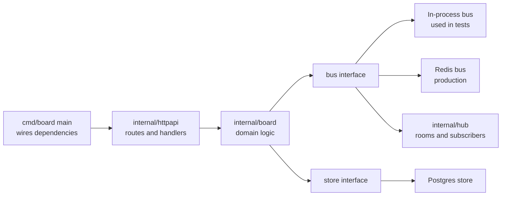

## What a test is

### A test is just a program
A test is code that **calls your code with inputs you chose in advance, looks at the output, and complains** (errors, panics, throws) if it doesn't match expectations. Even with no testing framework at all, a function that calls part of your backend and does `if output != 20 { panic(...) }` is a test.

Frameworks exist because hand-writing runners, conditions, reports and mocks for every project doesn't scale — libraries solve these problems once. Every language ships some built-in testing support (Go has `testing` and `go test`), and libraries add developer-friendly layers on top.

Why write tests?
- **Guidance/design** (TDD: write the goal first).
- **Documentation** (tests show how code is meant to be used).
- **Most important: catching regressions.**

> [!IMPORTANT]
> A **regression** is a bug in something that used to work — often a bug you already fixed coming back because someone changed a function, interface or behavior. Every test type, metric and tool in this chapter is a variation on "a program that runs your program and checks claims, mainly to catch regressions."

### The test runner
A **test runner** finds all test files, runs them, and prints a pass/fail report.

```go
// internal/board/board_test.go
func TestMoveTask(t *testing.T) {
    b := board.New(bus.NewInProcess())
    task := b.AddTask("todo", "write notes")

    if err := b.Move(task.ID, "done"); err != nil {
        t.Fatalf("Move returned error: %v", err)
    }
    got := b.Task(task.ID).Column
    if got != "done" {
        t.Errorf("task column = %q, want %q", got, "done")
    }
}
```

When the expectation is deliberately wrong, the failure shows **file, line, and want vs got** (e.g. got `doing`, want `done`). Fix the expectation and it passes instantly.

What `go test` actually does:

```bash
go test -work ./internal/board   # keep the temp build dir and print its path
go test -x ./internal/board      # print every command the tool runs
```

- Inside the work dir is a generated **`_testmain.go`** you never wrote: `package main`, a list of every test function found, and a `func main()` calling `testing.MainStart(...)` then `os.Exit(...)`.
- `-x` shows it **links a binary `board.test` and runs it**.

So `go test` **writes a `main` function, compiles it into a program, and executes it**. Every runner, in every language, does essentially this: generates the entry point for you and collects results.

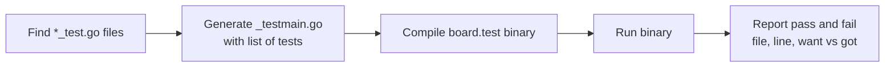

### Assertions
An **assertion** is the check that fails or stops the test when a condition is false. Most languages use a library (`assertEquals`, `expect(x).toBe(y)`, `assert.Equal`). Go's standard library has **no assert function**: you write an `if` and call `t.Errorf` (record failure, continue) or `t.Fatalf` (record failure, stop this test).

> [!TIP]
> Always write **meaningful failure messages**: what was being checked, what you wanted, what you got, and enough context to debug without re-running. `t.Errorf("Move(%s, done): column = %q, want %q", id, got, want)` beats `assert failed`.

### Tests in CI
The real payoff: in **continuous integration** (e.g. GitHub Actions), the whole suite runs on every pull request before merging into `main`/`develop`. If a test fails, you know instantly that the change reintroduces a known bug — you fix it before users see it. A **deterministic** suite lets the team **move fast** without fear of breaking existing features.

## Kinds of tests

### Unit tests
A **unit test** tests one unit of code **in isolation**. But what's a unit — a function, a struct, a package, a service? **There's no universal definition**; you learn to recognize it with experience. If a function calls 2–3 collaborators, you can either let it call the real ones or hand it doubles — **both** are commonly called unit tests.

### The same behavior tested four ways
The video tests one behavior ("move a task") four ways:

| # | Setup | Time |
|---|---|---|
| 1 | Board with a **mock bus** that just records what was published | ~0.00 s |
| 2 | **Real bus + real hub**; a move actually reaches a subscriber | ~0.00 s |
| 3 | A **real HTTP server on a real port**, real POST, real response | ~0.00 s |
| 4 | Against a **real Postgres** database | ~10.5 s (mostly container boot) |

> [!IMPORTANT]
> What makes a test slow is **leaving the process**, not how much code it exercises. Test 3 ran through the entire HTTP stack in ~0 s; only the one that went to an external Postgres cost time.

### Integration tests
An **integration test** checks that **two or more parts work together** — usually your code plus something you didn't write (a database, a cache, a queue).

### End-to-end tests
An **end-to-end (E2E) test** goes through the whole system **the way a real user would**: log in, keep the session/token, open the dashboard, call APIs, create a task. It must follow every step of the user journey, including authentication. An integration test doesn't have to: it can use internal logic directly (e.g. create a task while bypassing the auth middleware).

| | Unit | Integration | End-to-end |
|---|---|---|---|
| Scope | One unit, isolated | Your code + real collaborators (DB, cache) | Whole system as a user |
| Follows user journey | No | No (can bypass auth etc.) | Yes, from login onward |
| Speed | Fastest | Medium | Slowest |
| Typical failures found | Logic bugs | Query, schema, wiring bugs | Integration and config across services |

### The test pyramid
The classic picture: a **wide base of unit tests**, fewer **integration tests**, a small **cap of E2E tests**. It's about **cost**: the higher up, the slower and more expensive (CPU, memory, time — not only money) each test is, so you should have fewer of them.

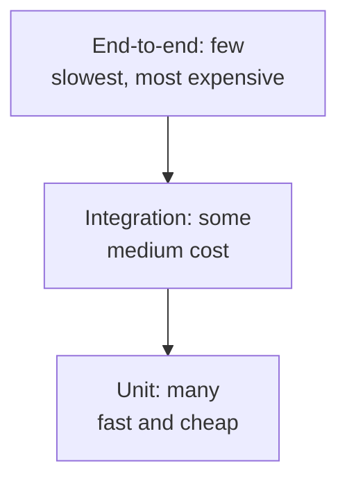

### A better model: small, medium, large
Instead of "how much of the system does the test **cover**?", ask "**what is the test allowed to touch?**" (This is Google's test-size taxonomy.)

| Size | Allowed to touch | Not allowed |
|---|---|---|
| **Small** | One process only | Network, database, file system, sleeping |
| **Medium** | One machine: local containers (Postgres, Redis), localhost | The internet / other machines |
| **Large** | Anything | — |

Why it's better:
- People will argue forever about whether something is "really" a unit test. But the **machine can check** whether a test opened a socket or touched the file system — so it becomes an **enforceable rule**, not an opinion.
- It attacks **flakiness**: a **flaky test** sometimes passes and sometimes fails on the same code. Most flakiness comes from leaving the machine (external services, network latency, other servers' clocks). Keeping tests inside the process/machine pushes **determinism** to its peak.

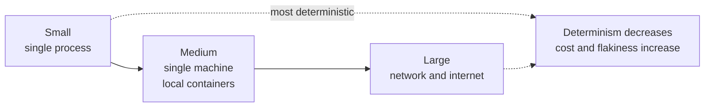

### Variations: regression, functional, performance, security
These answer *different questions*; they are not new kinds beyond unit/integration/E2E:
- **Regression tests** — pin specific past bugs so they stay fixed.
- **Functional tests** — check the feature against its specification (often written first, TDD-style), giving a ready-made "am I done?" check. Close to integration tests in practice.
- **Performance tests** — speed, memory, CPU usage.
- **Security tests** — whether the program bypasses security boundaries or leaks private data (cookies, file system, containers).

A regression test can be a unit test; a security test can be an E2E test. The scope (in-process / in-machine / beyond) is the real axis.

## Why people don't write tests: dependencies

When a task moves, the handler asks the board to apply the change and **publishes an event on the bus** so other browsers update. In a real backend that handler also writes to **Postgres**, maybe calls a **payment provider**, and sends an **email**. How do you test a workflow that talks to all those external systems?

You hand the code something that **looks and acts like** the external service: a **test double** (named after **stunt doubles** in films — the double performs the risky stunt, but on screen it looks like the actor).

### The five test doubles
"Test double" is the category; most people loosely call all of them "mocks".

| Double | What it does | Example |
|---|---|---|
| **Dummy** | Passed because the signature requires it; never actually used | A no-op logger passed to a service constructor |
| **Stub** | Returns canned answers, same response regardless of how often or what you ask | `GetUser(7)` always returns a fixed user object |
| **Spy** | A stub that also **records** how it was called | Records "tried to rename user from X to Y" |
| **Mock** | Pre-programmed with **expectations**; fails the test if they aren't met | "Save must be called exactly once with this argument" |
| **Fake** | A working, simplified implementation unsuitable for production but matching real inputs/outputs | In-memory map instead of Postgres for `CreateUser`/`GetUser` |

```go
// The interface the board depends on
type Bus interface {
    Publish(ctx context.Context, room string, ev Event) error
    Subscribe(room string) (<-chan Event, func())
}

// Spy: does nothing real, records what it was asked to publish
type spyBus struct{ published []Event }

func (s *spyBus) Publish(_ context.Context, _ string, ev Event) error {
    s.published = append(s.published, ev)
    return nil
}
func (s *spyBus) Subscribe(string) (<-chan Event, func()) { return nil, func() {} }

// Fake: a real, simple implementation of a store
type fakeStore struct {
    mu    sync.Mutex
    tasks map[string]Task
}

func (f *fakeStore) Save(_ context.Context, t Task) error {
    f.mu.Lock(); defer f.mu.Unlock()
    f.tasks[t.ID] = t
    return nil
}
```

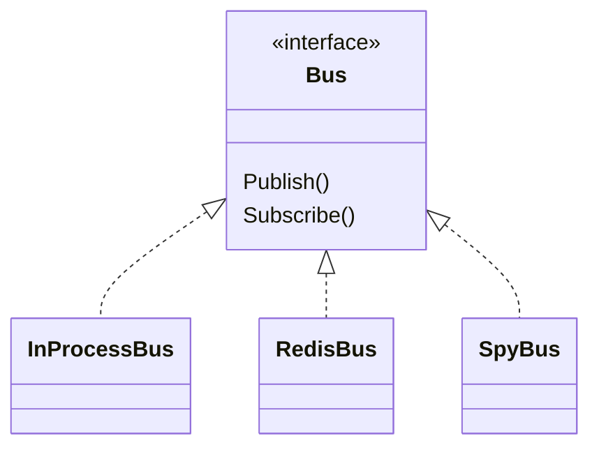

## Mistake 1: verifying interactions instead of state

Two ways to write the final check of a move-handler test:
- **State verification** — ask the system what's true **now**: "Is the task in the `done` column? Did the sequence number go up by one?"
- **Interaction (behavior) verification** — ask the double **what it saw**: "Was `Publish` called once with an event of type `task`?"

Now someone refactors the handler to publish **one combined event instead of two**. From the outside nothing changed — every browser sees the same board.
- The **state** test still passes (end state identical).
- The **interaction** test **fails**, because the call count changed.

A test that fails whenever the implementation changes, even though behavior didn't, is a **change-detector test** (Google's Testing Blog has a well-known post, "Change-Detector Tests Considered Harmful"). It punishes refactoring and adds no safety.

```go
// Prefer: state verification
if got := b.Task(id).Column; got != "done" {
    t.Errorf("column = %q, want done", got)
}

// Avoid unless the interaction IS the requirement
if len(spy.published) != 2 {
    t.Errorf("published %d events, want 2", len(spy.published)) // breaks on harmless refactor
}
```

> [!TIP]
> **Rule of thumb:** assert **what the system is now**, not **how it got there**. Use interaction verification only when the interaction *is* the requirement — e.g. "this email must be sent **exactly once**".

## Mistake 2: mocking what you don't own

Your service calls a payment provider. You obviously don't want to charge a real card dozens of times a day, so you mock their client: "when `Charge` is called with these args, return `{success, message, newBalance}`." Tests pass, you deploy, and **production fails**. Why? Everything that came out of the mock was **what you wrote**: the success object's shape, the field names, the duplicate-charge behavior, the error formats. The test only proved your code agrees with your own assumptions.

> [!WARNING]
> **Don't mock what you don't own.** A mock of a third-party API encodes your guesses about it, and passes even when the guesses are wrong.

Instead:
1. **Wrap the third party in your own small interface** — your own types for success, failure and errors. Use the wrapper both in production and in tests. Since you own the interface, you may double it.
2. **Write a few contract tests** for the wrapper against the provider's **sandbox API**, verifying that real request/response/success/error shapes match what your wrapper expects. These are few, fast, and use no real payment data.

```go
// Your interface, your types
type Payments interface {
    Charge(ctx context.Context, userID string, amountPaise int64) (ChargeResult, error)
}

type ChargeResult struct {
    ID         string
    NewBalance int64
}

var ErrDuplicateCharge = errors.New("duplicate charge")

// stripePayments implements Payments by calling the real SDK.
// Its contract tests run against the provider sandbox.
// Domain tests use a fake Payments that you fully control.
```

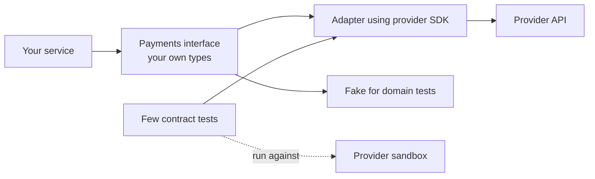

## Designing code that's easy to test

### Dependency injection
The handler was hard to test because it **created its own dependencies out of thin air** — it built the DB client and the Redis client and opened connections itself. If a function creates what it depends on, callers (and tests) can't substitute anything.

**Dependency injection (DI)**: pass dependencies in — through constructor parameters or function arguments — instead of creating them inside. DI frameworks exist and help in large codebases, but they all do this same thing.

```go
// Hard to test: creates its own dependencies
func NewHandler() *Handler {
    db, _ := pgxpool.New(context.Background(), os.Getenv("DATABASE_URL"))
    rdb := redis.NewClient(&redis.Options{Addr: os.Getenv("REDIS_ADDR")})
    return &Handler{store: store.NewPostgres(db), bus: bus.NewRedis(rdb)}
}

// Testable: dependencies are injected; main decides which implementations
func NewHandler(s store.Store, b bus.Bus, log *slog.Logger) *Handler {
    return &Handler{store: s, bus: b, log: log}
}
```

### Functional core, imperative shell
Push all **decisions, calculations and business rules** into **pure functions** that take values and return values (the **functional core**). Keep all talking to the outside world — DB, network, external APIs, clock — in a **thin layer** around it (the **imperative shell**).
- The core is **trivial to test**: nothing to mock, you own everything.
- The shell is harder to test, but it's **thin**, so there's little in it to test.

Code structured this way is far more likely to actually get tests.

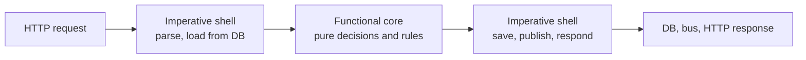

## What to replace and what not to

### The database: don't fake it, make the real one cheap
The common instinct: Postgres is slow, so replace it with an in-memory fake (in-memory repositories in Go/Node, H2 in Java). You gain **speed** and convenience but lose **fidelity**. Consider what bugs actually live in the data layer:
- A wrong **column name**.
- A **missing index** making a query slow.
- A forgotten **unique constraint**.
- A **transaction** that doesn't do what you think (isolation, locking).
- A **JSON operator** that exists in Postgres but not in your fake (or vice versa).

Every one of those lives in **exactly the layer you replaced**. So: **test against a real database, and make it cheap.** Two techniques:

**1. Transaction per test.** Begin a transaction at the start of each test, run everything in it, and **roll back** at the end. The DB is untouched, the next test starts clean, and it's fast. Requirement: code under test must accept a **transaction handle** (not create its own DB connection) — DI again.

```go
// A small interface both *pgxpool.Pool and pgx.Tx satisfy
type DBTX interface {
    Exec(ctx context.Context, sql string, args ...any) (pgconn.CommandTag, error)
    Query(ctx context.Context, sql string, args ...any) (pgx.Rows, error)
    QueryRow(ctx context.Context, sql string, args ...any) pgx.Row
}

func TestCreateTask(t *testing.T) {
    ctx := context.Background()
    tx, err := pool.Begin(ctx)
    if err != nil {
        t.Fatal(err)
    }
    t.Cleanup(func() { tx.Rollback(ctx) }) // DB left untouched

    s := store.NewPostgres(tx) // repository takes DBTX
    // ... exercise s and assert on state
}
```

**2. Template databases (Postgres).** Postgres can create a database as a copy of another: run all **migrations once on a template**, then each test does `CREATE DATABASE test_x TEMPLATE board_template` in **milliseconds**. Each test has its own database, so tests can also run **in parallel**.

```sql
-- once per package
CREATE DATABASE board_template;
-- run migrations against board_template

-- per test (fast file-level copy)
CREATE DATABASE test_move_task TEMPLATE board_template;
-- ... test ...
DROP DATABASE test_move_task;
```

**Testcontainers** (SDKs for most languages) starts a **real container** (Postgres, Redis, Kafka...) from your test code and returns its address.

```go
func TestMain(m *testing.M) {
    ctx := context.Background()
    pg, err := postgres.Run(ctx, "postgres:18",
        postgres.WithDatabase("board_template"),
        testcontainers.WithWaitStrategy(
            wait.ForLog("database system is ready to accept connections").WithOccurrence(2)),
    )
    if err != nil {
        log.Fatal(err)
    }
    dsn, _ := pg.ConnectionString(ctx)
    runMigrations(dsn)
    code := m.Run()
    _ = pg.Terminate(ctx)
    os.Exit(code)
}
```

Demo numbers: the Postgres 18 container took **~7 s** to start and accept connections — **once per package**, not per test. Nine tests each cloned the template and ran in **milliseconds**. Whole package: **~10.5 s**, of which ~7 s was setup and ~3 s actual tests.

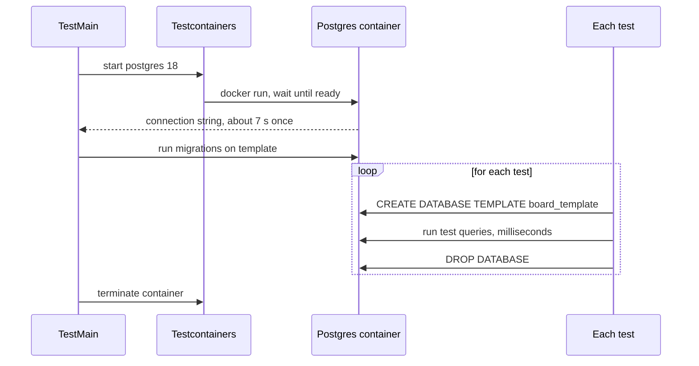

### The network: real local servers
For code that calls someone else's API:
- Normally, **wrap** the external service with your own interface and double that (as above).
- When you want to test the **actual HTTP client code** (headers, serialization, status handling, retries), start a **real HTTP server on a real local port** inside the test and point your client at it. Requests go over real TCP, as in production. Go has **`net/http/httptest`**; Node has **MSW** (Mock Service Worker), which intercepts at the network layer so you don't replace your client; Python and others have equivalents.
- The same tool lets you test **your own handlers from the outside**.

```go
func TestClientSendsAuthHeader(t *testing.T) {
    srv := httptest.NewServer(http.HandlerFunc(func(w http.ResponseWriter, r *http.Request) {
        if got := r.Header.Get("Authorization"); got != "Bearer test-token" {
            t.Errorf("Authorization = %q", got)
        }
        w.Header().Set("Content-Type", "application/json")
        w.Write([]byte(`{"id":"ch_1","balance":900}`))
    }))
    defer srv.Close()

    c := payments.NewClient(srv.URL, "test-token")
    res, err := c.Charge(context.Background(), "u1", 100)
    if err != nil || res.NewBalance != 900 {
        t.Fatalf("Charge = %+v, %v", res, err)
    }
}
```

### Time: never sleep
Scenario: you call something that finishes asynchronously, so the test does `time.Sleep(100 * time.Millisecond)` and then checks. It passes on your laptop and in review, then **fails in CI**, because the busy CI machine took 110 ms. Your logic wasn't wrong — **the clock** was the problem. Bumping the sleep is a non-fix: it fails again on a busier day and makes the suite slower.

Two real fixes:
1. **Wait for a condition, not a duration** — wait for a signal of completion: a channel in Go, a callback/promise in Node.
2. **Inject the clock** — pass a clock interface; in tests use a fake clock you advance manually, so timeouts and expirations are fully controlled.

```go
// Bad: guesses how long the background work takes
// time.Sleep(100 * time.Millisecond)

// Good: wait for the actual event, with a generous upper bound
select {
case ev := <-sub:
    if ev.Type != "task.moved" {
        t.Fatalf("got %q", ev.Type)
    }
case <-time.After(2 * time.Second):
    t.Fatal("timed out waiting for task.moved")
}
```

```go
// Injected clock
type Clock interface{ Now() time.Time }

type fakeClock struct{ t time.Time }

func (f *fakeClock) Now() time.Time          { return f.t }
func (f *fakeClock) Advance(d time.Duration) { f.t = f.t.Add(d) }

// Session expiry test: no real waiting
// clk.Advance(31 * time.Minute); then assert the session is expired
```

### Hermetic tests
A **hermetic** test (hermetic = sealed) **brings its whole environment with it**: it starts everything it needs and stops everything it started. It doesn't depend on a hand-configured database or a service someone left running. That's what lets the same suite run on your laptop, a remote box, or GitHub Actions. **Testcontainers** is hermeticity for the database; the **injected clock** is hermeticity for time.

## Test-driven development (TDD)

TDD is a **workflow, not a kind of test**: you still write unit/integration/E2E tests, but you write them **before** the code.

### Red → green → refactor
1. **Red** — write a test for something that doesn't exist yet; run it; **it must fail**.
2. **Green** — write the **smallest** code that makes it pass (ugly code allowed).
3. **Refactor** — clean up and restructure; rerun; still green → clean, tested code.

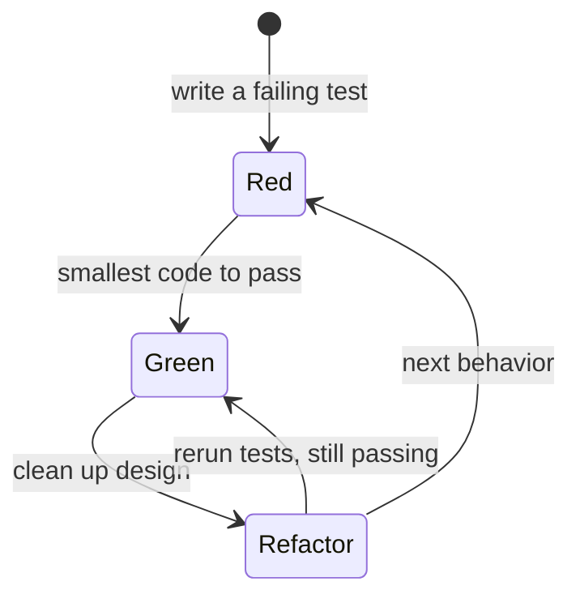

Why each step matters:
- **Red is for design.** Writing the test first forces you to **use** the function before it exists — to think about its API from the caller's side, not its implementation. If the test is awkward or ugly to write, the interface is wrong, and you learn that in minutes instead of after building it.
- **Red-then-green is for proof.** If you write code first and then tests, the tests usually pass first try — you learn nothing; you can't tell whether it passed because the code is right or because the test checks nothing. Seeing it fail first proves the test can detect the problem. (Kent Beck lists properties he expects from tests; this is one.)
- **Refactor is mandatory** and the step most people skip. You were allowed bad code in green *because* you'd come back.

### Worked example: no skipping "doing"
Requirement: a task can't go straight from `todo` to `done`; it must pass through `doing`.

```go
// RED: fails with "expected error, got nil" because Move succeeds
func TestCannotSkipDoing(t *testing.T) {
    b := board.New(bus.NewInProcess())
    task := b.AddTask("todo", "x")
    if err := b.Move(task.ID, "done"); err == nil {
        t.Fatal("expected error moving todo -> done, got nil")
    }
}
```

```go
// GREEN: smallest change, an if inside Move
func (b *Board) Move(id, to string) error {
    b.mu.Lock()
    defer b.mu.Unlock()
    t := b.tasks[id]
    if t.Column == "todo" && to == "done" {
        return ErrInvalidTransition
    }
    t.Column = to
    b.seq++
    b.trimHistory()
    return nil
}
```

```go
// REFACTOR: the business rule was buried in a method that also locks a mutex,
// bumps a sequence number and trims history. Extract a pure function.
func canMove(from, to string) bool {
    return !(from == "todo" && to == "done")
}

func (b *Board) Move(id, to string) error {
    b.mu.Lock()
    defer b.mu.Unlock()
    t := b.tasks[id]
    if !canMove(t.Column, to) {
        return ErrInvalidTransition
    }
    t.Column = to
    b.seq++
    b.trimHistory()
    return nil
}
// Run the package again: still green.
```

Note the refactor moved the rule into the **functional core** (`canMove` takes two columns, nothing else).

### The TDD debate
- **Kent Beck** (author of TDD) wrote a short article in **2023** ("Canon TDD") clarifying what the loop actually is, in response to years of arguments.
- **Ian Cooper — "TDD, Where Did It All Go Wrong"**: people read "unit" as "class", wrote one test class per production class, and mocked everything else. Every refactor then broke hundreds of tests, so people gave up on TDD. His point: **the unit is a behavior**, tested through a module's **public interface**. Then you can rearrange the internals freely and the tests still pass — the same idea as "verify state, not interactions".
- **DHH** (creator of Ruby on Rails), **2014 — "TDD is dead. Long live testing."**: argued against test-first dogma and against distorting designs for mockability ("test-induced design damage"), favoring tests against real systems. It led to public debates with Kent Beck and Martin Fowler ("Is TDD Dead?").

**Practical opinion:**

| TDD fits well | TDD fits poorly |
|---|---|
| You know what the answer looks like but not how to build it | You don't know what the answer looks like yet |
| Parsers (string in → known structure out, e.g. a JSON parser) | Exploratory feature work, trying several designs |
| Pricing/business rules | System-design-heavy backend features with many trade-offs |
| State machines (e.g. allowed task transitions) | Prototypes and spikes |

## Flaky tests

A **flaky test** passes and fails on the **same code** with no changes. It's **worse than no test**:
- A missing test is an honest hole — you know it's there.
- A flaky test **changes team behavior**: CI fails, someone says "that one's flaky, just rerun", it passes, everyone moves on. Eventually a **real** failure happens and the reflex is to rerun instead of investigate.

### Where flakiness comes from
**Luo et al., 2014** ("An Empirical Analysis of Flaky Tests") studied **201 real fixes** of flaky tests in open-source projects. The top three causes:

| Cause | What it is | Fix |
|---|---|---|
| **Async wait** | Test starts async work and waits the wrong way (sleep) | Wait for a condition/signal; inject the clock |
| **Concurrency** | Two things in the test race each other | Synchronization; deterministic concurrency testing (e.g. Go's `testing/synctest`) |
| **Test order dependency** | Test B passes only if test A ran first and left state behind | Make every test set up and tear down its own state |

### Test order dependency
Test B depends on a DB row, a global variable or a file that test A created. As long as the order never changes it always passes — until someone **adds a test in the middle** or **enables parallelism**, and it starts failing. (Transaction-per-test and template DBs prevent this for database state; avoid package-level mutable globals; Go's `go test -shuffle=on` exposes order dependence.)

What to do with a flaky test:
1. **Delete it** — legitimate; it wasn't helping and was creating future problems. Deleting tests pays off more often than people think.
2. **Quarantine it** — move it out of the blocking suite into a separate one that still runs, tagged with **owner, date and reason**. (Recommended: you know who to talk to and why it's there.)
3. **Add retries** — not good practice; it hides the problem.

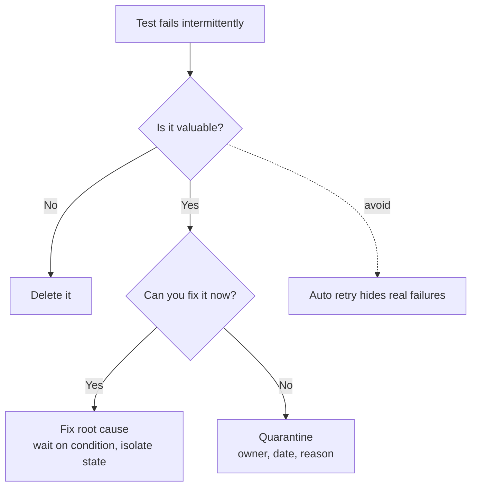

## Measuring tests: coverage

### What coverage measures
**Code coverage** = percentage of your code **executed** while the tests ran. How it works (e.g. `go test -cover`): the tool **rewrites your code** before building, splits each function into **basic blocks** (straight-line code with no branches), inserts a **counter** at the top of each block, runs the tests, then reads the counters. A block with count 0 never ran.

```bash
go test -coverprofile=cover.out ./...
go tool cover -html=cover.out   # red = never executed
```

**The problem:** coverage records only **whether code ran**, not whether anything was **checked**. A test that calls every function and asserts nothing gets 100%.

### Line vs branch coverage
- **Line coverage** — did each line run?
- **Branch coverage** — did each direction of each decision run?

```go
func Discount(price int, premium bool) int {
    if premium {
        price -= 10
    }
    return price
}
// A single test with premium = true executes every line: line coverage 100%.
// The false direction is never taken: branch coverage 50%.
```

### What does the percentage mean?
"80%" is the number everyone quotes. **Inozemtseva and Holmes (ICSE 2014)**, "Coverage Is Not Strongly Correlated with Test Suite Effectiveness": they generated thousands of test suites of varying sizes for large real-world Java programs and measured coverage vs **faults detected** (via mutants). Raw coverage correlates strongly with bugs found — but mostly because **bigger suites cover more and catch more**. **Controlling for suite size** (comparing suites of the same size), the correlation between coverage and effectiveness was **low to moderate**, varying by project. So a fixed coverage target is not a quality target.

Takeaways:
1. Commonly cited guideline: **60% acceptable, 75% commendable, 90% exemplary** — and there's **no ideal number** for every product. (These tiers are popularized by Google's coverage best-practices guidance.)
2. **What isn't covered is more meaningful than what is.** The value of a coverage report is in the **red lines**, not the percentage.
3. **Mandating 100%** makes engineers write low-value tests to hit the number — and stop improving once they reach it (Goodhart's law).

## Testing your tests: mutation testing

**Mutation testing** deliberately damages your code and checks whether your tests notice.
1. The tool makes small changes (**mutants**): `>` → `>=`, `+` → `-`, return value → `0`, `<=` → `<`, etc.
2. It runs the suite against each mutant.
3. A test fails → mutant **killed** (good). All tests pass → mutant **survived** (your tests aren't checking that behavior).
4. **Mutation score** = % of mutants killed.

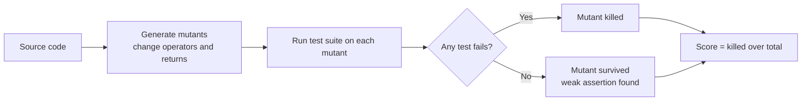

Demo (TypeScript, with **Stryker**): a pagination module that takes a list and returns one page. The tests asserted only "returns something", "is an array", "doesn't throw", "length > 0". **Line coverage: 100%.** Stryker generated **19 mutants**; score **52.63%** — **9 survived**. One survivor changed the loop condition `i <= offset + limit` to `i < offset + limit`, changing how many items are returned, yet every test passed.

```ts
// Weak tests: 100% coverage, but survive mutants
expect(paginate(items, 0, 10)).toBeDefined();
expect(Array.isArray(paginate(items, 0, 10))).toBe(true);
expect(paginate(items, 0, 10).length).toBeGreaterThan(0);

// Strong test: kills the off-by-one mutant
expect(paginate(range(1, 50), 10, 5)).toEqual([11, 12, 13, 14, 15]);
```

| | Coverage | Mutation testing |
|---|---|---|
| Question answered | Did this code run? | Would my tests notice if this code were wrong? |
| Cost | Cheap, every run | Expensive (runs suite once per mutant) |
| Best use | Find untested (red) code | Find weak assertions |
| Tools | `go test -cover`, Istanbul/c8, JaCoCo | Stryker (JS/TS, C#), PIT (Java), go-mutesting |

## Measuring code: complexity metrics

### Cyclomatic complexity
Introduced by **Thomas McCabe (1976)**: the number of **independent paths** through a piece of code. Draw the function as a control-flow graph — each straight run of statements is a node, each jump an edge:

**M = E − N + 2** (edges − nodes + 2)

Shortcut: **M = 1 + number of decision points** (each `if`, loop, `case`, and each `&&`/`||` in a condition).
- No branches → 1. One `if` → 2.
- Common guideline: keep functions **≤ 10** — McCabe himself called it reasonable, not magical.
- His own noted exception: a big **`switch`** over many independent cases. A 20-case switch scores **21**, fails the "under 10" rule, yet is very easy to read.

### Cognitive complexity
Invented by **SonarSource** to measure how **hard code is to understand**, not how many paths it has. Not purely mechanical:
- A flat `switch` adds very little (easy to read).
- **Nesting** increases the score at each level: an `if` inside a loop inside an `if` is hard to hold in your head — much harder than three `if`s in a row.

| Code shape | Cyclomatic | Cognitive |
|---|---|---|
| Long flat switch (20 cases) | High (21) | Low |
| Three levels of nesting | Moderate | High |
| Three sequential ifs | 4 | Low |

Demo: the hub's `Run` method scored **8** on cyclomatic (third, behind two stream handlers) but **19** on cognitive complexity (top of the list, tied with the WebSocket handler). Reading the code confirmed it: eight ways into the function, deeply nested, hard to read.

> [!TIP]
> Don't trust either metric blindly. Treat them as **flags pointing at code worth reading**, then decide as a team.

## Finding problems without running code

| Tool | What it does | What it doesn't do |
|---|---|---|
| **Linter** | Flags suspicious **patterns**: a condition that's always true, an unchecked error return | Syntax checking (compiler's job); proving logic correct (impossible without expectations) |
| **Formatter** | Rewrites code into a standard layout (`gofmt`, Prettier) | Change program behavior |
| **Type checker** | Catches type misuse, e.g. arithmetic on a string (Go compiler, `tsc`, Rust) | Business logic errors |
| **Static analysis** | Advanced linting: follows values through the program checking conditions (nil dereferences, taint, resource leaks) | Run the code |

Examples: ESLint for TypeScript, `go vet` / staticcheck / golangci-lint for Go. Code **quality** beyond this is subjective — there's no objective metric or tool that deterministically decides whether code is "high quality".

## Common mistakes & misconceptions
- **Writing tests in a hurry** — incomplete or flaky tests give false confidence, worse than none.
- **Arguing over what counts as a "unit"** — use enforceable sizes (small/medium/large) instead.
- **Thinking big tests are slow because they cover a lot** — slowness comes from leaving the process.
- **Calling every double a "mock"** — know dummy, stub, spy, mock, fake.
- **Asserting on call counts and arguments by default** — creates change-detector tests that break on harmless refactors.
- **Mocking third-party SDKs directly** — tests prove only your assumptions; wrap and contract-test instead.
- **Functions that construct their own DB/Redis clients** — untestable; inject dependencies.
- **Replacing Postgres with an in-memory fake** — loses the bugs that live in SQL, constraints, indexes, transactions.
- **`sleep` in tests** — flaky in CI; wait for a condition or inject a clock.
- **Tests depending on shared state or order** — break when tests are added or run in parallel.
- **Skipping the refactor step in TDD** — leaves the "make it pass" mess in place.
- **Treating "unit" as "class" in TDD** — test behaviors through public interfaces.
- **Rerunning flaky tests until green** — trains the team to ignore real failures.
- **Chasing a coverage percentage (or mandating 100%)** — low-value tests; read the red lines instead.
- **Equating coverage with test quality** — tests with no assertions get 100%; use mutation testing.
- **Treating complexity numbers as hard rules** — a flat switch can be "too complex" yet perfectly readable.

## Interview questions

<details>
<summary><strong>Q: What is a test, and what is its primary purpose?</strong></summary>

A test is a second program that runs your program with predetermined inputs and asserts claims about the outputs or resulting state, failing if they don't hold. A runner discovers tests, generates the entry point (e.g. `go test` generates `_testmain.go` and builds a `pkg.test` binary), runs them, and reports. Tests can guide design and serve as documentation, but their main value is catching regressions — previously working behavior or fixed bugs breaking again — ideally in CI on every pull request.

</details>

<details>
<summary><strong>Q: Explain unit, integration and end-to-end tests and the test pyramid.</strong></summary>

Unit: one unit in isolation (no universal definition of "unit"). Integration: two or more parts working together, usually your code plus something external like a database. End-to-end: the whole system driven as a real user would, including login and the full journey. The pyramid says to have many cheap, fast unit tests, fewer integration tests, and a few slow, expensive E2E tests — it's about cost in time, CPU, and memory.

</details>

<details>
<summary><strong>Q: What is the small/medium/large test model and why is it more useful than unit/integration?</strong></summary>

It classifies tests by what they're allowed to touch. Small: one process, no network, DB, file system, or sleep. Medium: one machine, may use local containers, no internet. Large: anything. Unlike "unit", this is objectively checkable — the machine can tell if a test opened a socket — so it's an enforceable rule. It also tracks cost and flakiness: speed and nondeterminism come from leaving the process or machine, not from how much code a test exercises.

</details>

<details>
<summary><strong>Q: What's the difference between a dummy, stub, spy, mock and fake?</strong></summary>

Dummy: passed only to satisfy a signature, never used (a no-op logger). Stub: returns canned responses regardless of input. Spy: a stub that also records how it was called. Mock: pre-programmed with expectations (e.g. "Save called exactly once with X") and fails the test if they aren't met. Fake: a working lightweight implementation unsuitable for production, like an in-memory repository. All are "test doubles", named after stunt doubles.

</details>

<details>
<summary><strong>Q: State verification vs interaction verification — which should you prefer and why?</strong></summary>

Prefer state verification: assert what's true after the action (task is in `done`, sequence incremented). Interaction verification asserts which calls were made to doubles; it fails when implementation details change even if behavior doesn't — e.g. publishing one combined event instead of two — producing brittle "change-detector" tests. Use interaction checks only when the interaction is the requirement, such as an email being sent exactly once.

</details>

<details>
<summary><strong>Q: Your payment-provider mock passes all tests but production breaks. What went wrong and how should you test it?</strong></summary>

The mock encoded your own assumptions about response shapes, field names, error formats and duplicate-charge behavior, so the tests just confirmed those assumptions. Rule: don't mock what you don't own. Wrap the provider behind your own interface with your own types, use fakes of that interface in domain tests, and write a small number of contract tests for the adapter against the provider's sandbox to verify real request and response shapes.

</details>

<details>
<summary><strong>Q: What is dependency injection and how does it relate to "functional core, imperative shell"?</strong></summary>

DI means passing dependencies (DB, bus, clock, logger) in via constructor or function parameters instead of creating them inside, so tests can substitute fakes or transaction handles. Functional core, imperative shell is a structure: business decisions live in pure functions (values in, values out) that are trivial to test with no mocks, and I/O lives in a thin outer layer with little logic. DI connects the shell to real or test implementations.

</details>

<details>
<summary><strong>Q: Should you use an in-memory fake database in tests? How do you make real-database tests fast?</strong></summary>

Generally no: you gain speed but lose fidelity, and data-layer bugs — wrong columns, missing constraints or indexes, transaction semantics, Postgres-specific operators — live exactly in the layer you replaced. Use a real Postgres via Testcontainers (started once per package), and isolate tests with either a transaction per test that's rolled back (code must accept a transaction handle) or a per-test database cloned from a migrated template (`CREATE DATABASE ... TEMPLATE ...`), which takes milliseconds and enables parallel tests.

</details>

<details>
<summary><strong>Q: A test with sleep(100ms) passes locally but fails in CI. Why, and how do you fix it properly?</strong></summary>

It guesses how long async work takes; the loaded CI machine took longer (e.g. 110 ms). Increasing the sleep only makes it slower and still fragile. Fix by waiting for a condition — a channel, callback, or event signaling completion, with a generous timeout as a safety net — or by injecting a clock so time-dependent logic (timeouts, expiry) is controlled deterministically in tests.

</details>

<details>
<summary><strong>Q: What is a hermetic test?</strong></summary>

A test that brings its whole environment with it: it starts everything it needs (database container, local HTTP server, fake clock) and tears it down afterward, without relying on manually configured shared services or real time. Hermetic tests run identically on a laptop, a remote server, or CI. Testcontainers gives hermeticity for databases; an injected clock gives hermeticity for time.

</details>

<details>
<summary><strong>Q: Explain TDD's red-green-refactor and when TDD is or isn't a good fit.</strong></summary>

Red: write a failing test for behavior that doesn't exist (designs the API from the caller's side and proves the test can fail). Green: write the minimal code to pass. Refactor: clean up while keeping tests green — the step people skip. It fits when you know the expected output but not the implementation: parsers, pricing rules, state machines. It fits poorly for exploratory work where you don't yet know what the answer should look like. Test behaviors through public interfaces, not one test class per class (Ian Cooper's critique).

</details>

<details>
<summary><strong>Q: What makes tests flaky, and what do you do with a flaky test?</strong></summary>

Luo et al. (2014) found the top causes are async waiting done wrong (sleeps), concurrency races, and test order dependency (relying on state left by another test). Fix by waiting on conditions, synchronizing deterministically, and isolating state per test (shuffle order to detect). If you can't fix it now, delete it if it's low value, or quarantine it out of the blocking suite with owner, date, and reason. Avoid blind retries — they train the team to ignore real failures.

</details>

<details>
<summary><strong>Q: Does 100% code coverage mean your code is well tested?</strong></summary>

No. Coverage only shows code was executed — instrumented basic-block counters — not that anything was asserted; a test with no assertions can hit 100%. Line coverage can be 100% while branch coverage is 50% (an if with no else tested only when true). Inozemtseva and Holmes (2014) found that, controlling for suite size, coverage is only low-to-moderately correlated with fault detection. Use coverage to find untested code (the red lines), not as a target; mandating 100% breeds low-value tests.

</details>

<details>
<summary><strong>Q: What is mutation testing?</strong></summary>

It tests your tests. A tool like Stryker or PIT creates mutants — small code changes like `<=` to `<`, `+` to `-`, or return values to 0 — and runs the suite on each. If a test fails, the mutant is killed; if all pass, it survived, revealing a weak or missing assertion. The score is the percentage killed. Example: a pagination module with 100% line coverage scored about 53% because tests only checked "is an array" and "length > 0".

</details>

<details>
<summary><strong>Q: Cyclomatic vs cognitive complexity?</strong></summary>

Cyclomatic complexity (McCabe, 1976) counts independent paths: E − N + 2, or 1 + the number of decisions (if, loops, cases, && and ||). The guideline is about 10 or less, but a flat 20-case switch scores 21 while being easy to read. Cognitive complexity (SonarSource) estimates how hard code is to understand: flat structures add little, while nesting increases the cost at each level. Both should be used as flags for code worth reviewing, not hard rules.

</details>

## Cheat sheet
- **Test** = program that runs your program + assertions. **Runner** = generates `main`, runs tests, reports (`go test` → `_testmain.go` → `pkg.test`; see with `-work`, `-x`). **Regression** = previously working thing breaks again.
- Go assertions: `if got != want { t.Errorf(...) }` (continue) / `t.Fatalf` (stop). Always "got X, want Y" messages.
- **Unit / Integration / E2E**; **pyramid** = many cheap, few expensive.
- **Small** (1 process, no net/DB/FS/sleep) · **Medium** (1 machine, local containers) · **Large** (anything). Slowness/flakiness = leaving the process.
- Variations (regression, functional, performance, security) ≠ new kinds.
- **Doubles**: dummy (unused) · stub (canned) · spy (canned + records) · mock (expectations) · fake (working lightweight impl).
- **State > interaction** verification; interaction only when it's the requirement (email exactly once). Avoid **change-detector tests**.
- **Don't mock what you don't own** → own wrapper interface + sandbox contract tests.
- **DI**: pass deps in. **Functional core / imperative shell**: pure logic inside, thin I/O outside.
- **Real DB**: Testcontainers (once per package) + **tx-per-test rollback** or **template DB per test**. In-memory fakes lose fidelity.
- **Network**: own interface, or real local server (`httptest`, MSW).
- **Time**: no sleeps → wait on condition (channel/callback) or **inject clock**.
- **Hermetic** = test brings and cleans up its own environment.
- **TDD**: red (design + proof) → green (minimal) → refactor (mandatory). Unit = behavior via public interface. Good: parsers, pricing rules, state machines. Bad: exploration.
- **Flaky causes** (Luo 2014): async wait · concurrency · order dependency. Handle: fix / delete / **quarantine (owner, date, reason)**; not retries.
- **Coverage**: basic-block counters; line vs branch; coverage ≠ quality (Inozemtseva & Holmes 2014); 60/75/90 guideline; read the red lines; don't mandate 100%.
- **Mutation testing**: mutants killed vs survived; score = killed %; Stryker / PIT.
- **Cyclomatic** = E − N + 2 = 1 + decisions; ~10 guideline; flat switch exception. **Cognitive** = nesting-weighted readability (SonarSource).
- **Static tools**: linter (patterns) · formatter (layout) · type checker (types) · static analysis (data-flow, no execution).

## Glossary
- **Test** — a program that runs your code and asserts claims about the results.
- **Test runner** — a tool that discovers, executes and reports tests.
- **Assertion** — a check that fails the test when its condition is false.
- **Regression** — a defect in previously working behavior, often a reintroduced fixed bug.
- **Test suite** — the full collection of tests for a codebase.
- **CI (continuous integration)** — automatically building and testing every change before merge.
- **Unit test** — a test of one unit of code in isolation.
- **Integration test** — a test of multiple components working together, often with external systems.
- **End-to-end test** — a test driving the whole system as a real user would.
- **Test pyramid** — guideline of many cheap unit tests, fewer integration tests, few E2E tests.
- **Small / medium / large tests** — test sizes defined by what resources a test may touch.
- **Flaky test** — a test that passes and fails nondeterministically on the same code.
- **Determinism** — same inputs always produce the same result.
- **Test double** — any stand-in for a real dependency in tests.
- **Dummy** — a double passed to satisfy a signature but never used.
- **Stub** — a double returning canned answers.
- **Spy** — a stub that records how it was called.
- **Mock** — a double with pre-set expectations that fail the test if unmet.
- **Fake** — a simplified working implementation for tests (e.g. in-memory store).
- **State verification** — asserting on the resulting state of the system.
- **Interaction (behavior) verification** — asserting on calls made to collaborators.
- **Change-detector test** — a test that fails on implementation changes without behavior changes.
- **Contract test** — a test verifying your adapter matches a real external API's request and response shapes.
- **Sandbox API** — a provider's non-production environment for testing integrations.
- **Dependency injection** — supplying a component's dependencies from outside.
- **Functional core, imperative shell** — pure logic surrounded by a thin I/O layer.
- **Fidelity** — how faithfully a test environment reproduces production behavior.
- **Transaction-per-test** — running each test inside a transaction that's rolled back.
- **Template database** — a Postgres database cloned to create fresh per-test databases.
- **Testcontainers** — library for starting real dependency containers from test code.
- **httptest / MSW** — tools for real local HTTP servers or network-level request interception in tests.
- **Injected clock** — a time source passed in so tests can control time.
- **Hermetic test** — a self-contained test that starts and stops its own environment.
- **TDD** — test-driven development: red, green, refactor.
- **Test order dependency** — a test relying on state left behind by another test.
- **Quarantine** — moving a flaky test out of the blocking suite with owner, date and reason.
- **Code coverage** — percentage of code executed by tests.
- **Basic block** — a straight-line code sequence with no branches.
- **Line coverage / branch coverage** — executed lines / executed decision outcomes.
- **Mutation testing** — injecting small faults to check whether tests detect them.
- **Mutant (killed / survived)** — a modified program version that tests do or don't catch.
- **Mutation score** — percentage of mutants killed.
- **Cyclomatic complexity** — count of independent paths (E − N + 2).
- **Cognitive complexity** — nesting-aware measure of how hard code is to understand.
- **Linter** — tool flagging suspicious code patterns.
- **Formatter** — tool rewriting code into a standard layout.
- **Type checker** — tool verifying type correctness.
- **Static analysis** — analyzing code without running it, e.g. by tracking values through it.

## Video timestamps
- [00:00](https://www.youtube.com/watch?v=HgVrfHX92y4&t=0s) — Why bad tests are worse than none; what a test is
- [01:02](https://www.youtube.com/watch?v=HgVrfHX92y4&t=62s) — Reasons to test: TDD, documentation, regressions
- [02:04](https://www.youtube.com/watch?v=HgVrfHX92y4&t=124s) — Scope of this chapter
- [03:05](https://www.youtube.com/watch?v=HgVrfHX92y4&t=185s) — The Go task board codebase
- [05:08](https://www.youtube.com/watch?v=HgVrfHX92y4&t=308s) — A test is a program
- [08:12](https://www.youtube.com/watch?v=HgVrfHX92y4&t=492s) — Test runners and what go test generates
- [11:18](https://www.youtube.com/watch?v=HgVrfHX92y4&t=678s) — Assertions and failure messages
- [12:20](https://www.youtube.com/watch?v=HgVrfHX92y4&t=740s) — Regressions and CI
- [14:21](https://www.youtube.com/watch?v=HgVrfHX92y4&t=861s) — Unit tests and the same behavior tested four ways
- [17:26](https://www.youtube.com/watch?v=HgVrfHX92y4&t=1046s) — Integration and end-to-end tests
- [19:29](https://www.youtube.com/watch?v=HgVrfHX92y4&t=1169s) — The test pyramid
- [20:31](https://www.youtube.com/watch?v=HgVrfHX92y4&t=1231s) — Small, medium, large tests and flakiness
- [23:35](https://www.youtube.com/watch?v=HgVrfHX92y4&t=1415s) — Regression, functional, performance and security testing
- [26:40](https://www.youtube.com/watch?v=HgVrfHX92y4&t=1600s) — Why people don't write tests: external dependencies
- [27:43](https://www.youtube.com/watch?v=HgVrfHX92y4&t=1663s) — Test doubles: dummy, stub, spy, mock, fake
- [32:57](https://www.youtube.com/watch?v=HgVrfHX92y4&t=1977s) — State vs interaction verification, change-detector tests
- [35:01](https://www.youtube.com/watch?v=HgVrfHX92y4&t=2101s) — Don't mock what you don't own
- [38:05](https://www.youtube.com/watch?v=HgVrfHX92y4&t=2285s) — Dependency injection
- [39:07](https://www.youtube.com/watch?v=HgVrfHX92y4&t=2347s) — Functional core, imperative shell
- [40:07](https://www.youtube.com/watch?v=HgVrfHX92y4&t=2407s) — Databases: why in-memory fakes lose fidelity
- [43:13](https://www.youtube.com/watch?v=HgVrfHX92y4&t=2593s) — Transaction per test and template databases
- [44:15](https://www.youtube.com/watch?v=HgVrfHX92y4&t=2655s) — Testcontainers demo
- [46:17](https://www.youtube.com/watch?v=HgVrfHX92y4&t=2777s) — Network: wrappers, httptest, MSW
- [47:20](https://www.youtube.com/watch?v=HgVrfHX92y4&t=2840s) — Time: sleeps, waiting on conditions, injected clocks
- [50:25](https://www.youtube.com/watch?v=HgVrfHX92y4&t=3025s) — Hermetic testing
- [51:28](https://www.youtube.com/watch?v=HgVrfHX92y4&t=3088s) — Test-driven development: red, green, refactor
- [55:33](https://www.youtube.com/watch?v=HgVrfHX92y4&t=3333s) — TDD demo: no skipping doing
- [57:36](https://www.youtube.com/watch?v=HgVrfHX92y4&t=3456s) — The TDD debate: Kent Beck, Ian Cooper, DHH
- [1:00:41](https://www.youtube.com/watch?v=HgVrfHX92y4&t=3641s) — When TDD fits and when it doesn't
- [1:01:44](https://www.youtube.com/watch?v=HgVrfHX92y4&t=3704s) — Flaky tests and why they're harmful
- [1:03:49](https://www.youtube.com/watch?v=HgVrfHX92y4&t=3829s) — Causes of flakiness and test order dependency
- [1:05:52](https://www.youtube.com/watch?v=HgVrfHX92y4&t=3952s) — Delete, quarantine, or retry
- [1:06:52](https://www.youtube.com/watch?v=HgVrfHX92y4&t=4012s) — Code coverage: how it works
- [1:08:55](https://www.youtube.com/watch?v=HgVrfHX92y4&t=4135s) — Line vs branch coverage and the coverage study
- [1:11:58](https://www.youtube.com/watch?v=HgVrfHX92y4&t=4318s) — Mutation testing and the Stryker demo
- [1:15:01](https://www.youtube.com/watch?v=HgVrfHX92y4&t=4501s) — Cyclomatic complexity
- [1:18:04](https://www.youtube.com/watch?v=HgVrfHX92y4&t=4684s) — Cognitive complexity
- [1:20:07](https://www.youtube.com/watch?v=HgVrfHX92y4&t=4807s) — Linters, formatters, type checkers, static analysis
