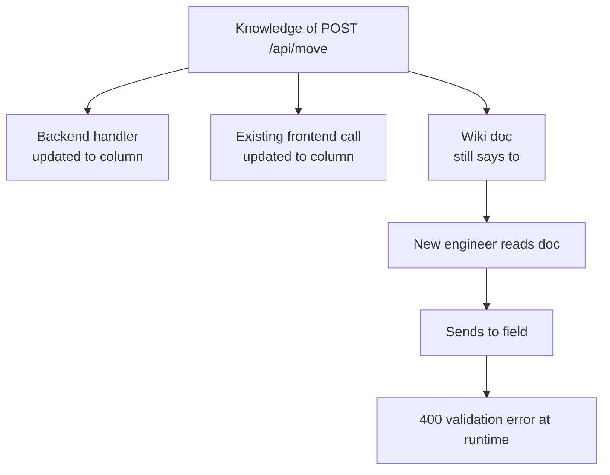
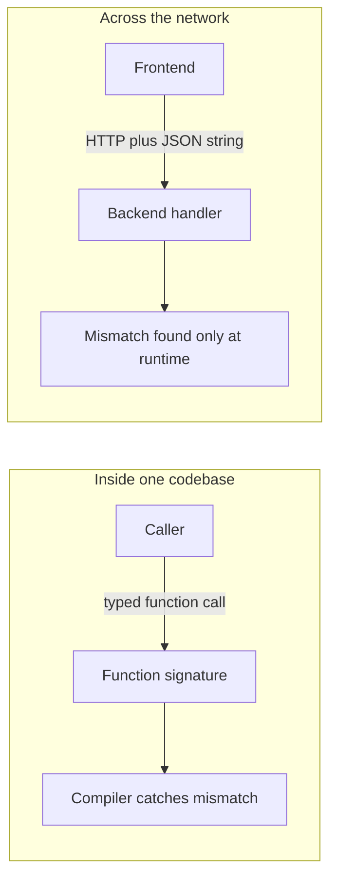
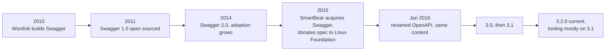
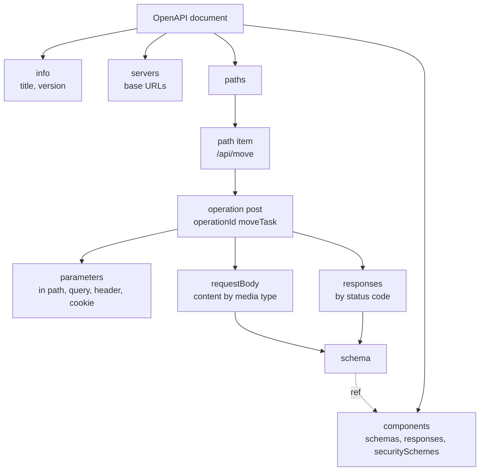
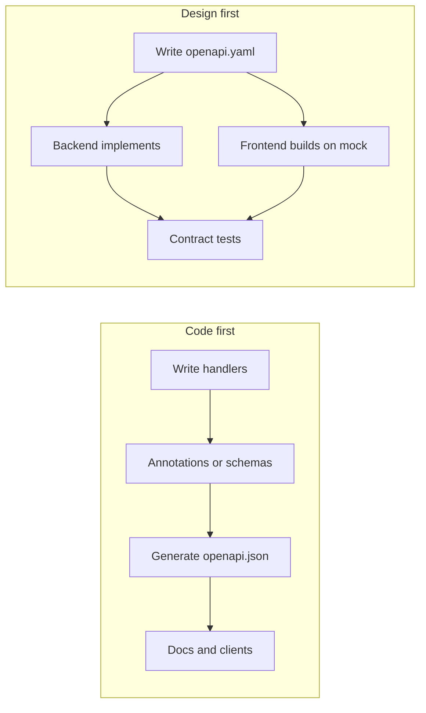
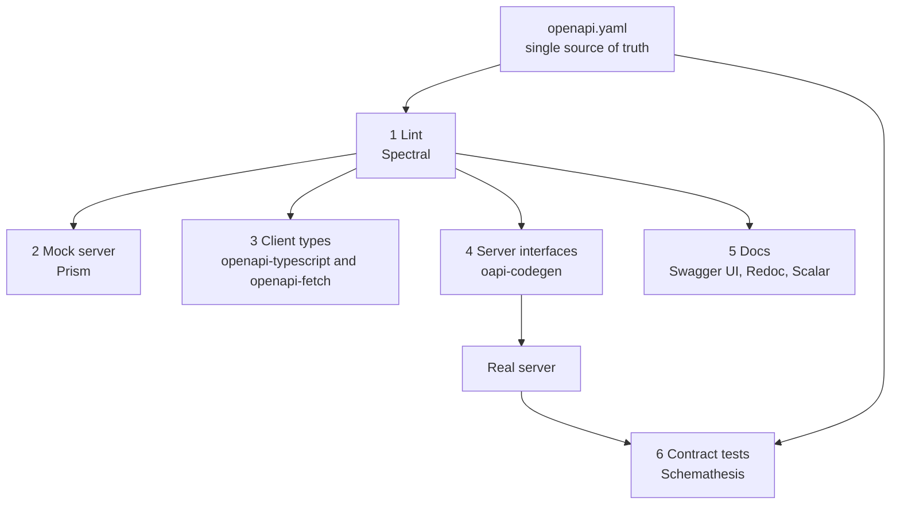
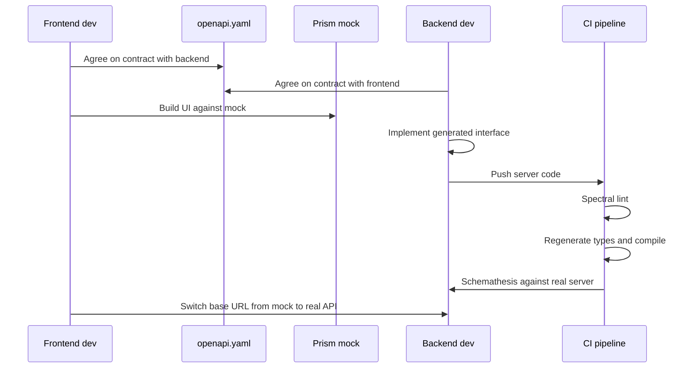

## TL;DR

- Knowledge of an API (path, body fields, types, status codes) usually lives in **three places**: the backend handler, the frontend call, and a human-written doc. They **drift apart**, and the doc goes stale first.
- Inside one codebase a function **signature** lets the **compiler** catch a renamed field or changed type. **Across the network boundary there is no signature**, so mismatches show up only at **runtime**.
- **OpenAPI** fixes this by giving HTTP APIs a signature: a **JSON or YAML file** that describes every endpoint's inputs, outputs and behavior in a **language-agnostic, machine-readable** way.
- Four terms: **OAS** = the specification (rules), **OAD** = your description file (`openapi.yaml`), **OAI** = the OpenAPI Initiative (Linux Foundation), **Swagger** = the old name, now a family of tools (e.g. Swagger UI).
- Minimum file: `openapi` (spec version), `info` (`title`, `version`), and at least one of `paths`, `components`, `webhooks`. Use **3.1.x** in practice (3.2.0 exists but tooling lags).
- Structure: `servers` → `paths` → **path items** → **operations** (one per HTTP method) with `operationId`, `parameters` (`in`: path, query, header, cookie), `requestBody` (`content` by media type), `responses` (by status code) and **schemas**.
- **Code-first** derives the file from code (annotations, comments, types; ts-rest, FastAPI). **Design-first / contract-first** writes the file first so frontend and backend can work **in parallel**.
- Design-first pipeline: **lint** (Spectral) → **mock** (Prism) → **client types** (openapi-typescript + openapi-fetch) → **server interfaces** (oapi-codegen) → **docs** (Swagger UI, Redoc, Scalar) → **contract tests** (Schemathesis). One file, single source of truth.

## Why this matters

Most backend bugs between teams are not algorithm bugs; they are **contract bugs**: someone renamed a field, changed a type, or added a required parameter, and some caller did not find out until production. OpenAPI is the industry-standard way to make an HTTP API's contract explicit and enforceable. GitHub, Stripe and almost every serious API publish an OpenAPI file, and interviewers expect you to know what it is, what goes inside it, and how contract-first development works.

## The problem: three copies of the same truth

### A concrete example
Take the task-board app from the real-time chapter. It has about six routes. One handler, `POST /api/move`, takes a JSON body with three fields: `taskId`, `to` (the target column) and `actor`. Depending on what happens in the service or repository layer it returns:

- `200` on success,
- `400` or `404` for client errors (validation failure, task not found),
- `500` / `502` for server-side problems.

The React frontend "knows" all of this: the URL is `/api/move`, the body needs three fields, and `404` means the task does not exist. **But where does that knowledge actually live?**

1. **The backend handler**: the code that actually parses the body.
2. **The frontend**: the `fetch`/axios call that sends it.
3. **A document**: a wiki page or README the API author (or integrator) wrote.

Three copies of the same knowledge, and nothing keeps them in sync.

### How drift happens
1. A colleague renames `to` to `column` because it reads better.
2. They update the backend handler (it validates field names).
3. They update the frontend (otherwise the backend rejects requests).
4. They **forget the document**, because nothing forces them to update it; it is purely informational.
5. A few sprints later, a new engineer integrates the same endpoint on another page. They trust the doc, which claims to be the source of truth, and send `to`.
6. They get a **400 validation error** from the backend.



### Why this only happens across the network
Inside one codebase this class of bug is caught at compile time. If a Go function's signature changes (a struct field renamed, a `string` changed to an `int`), **every call site fails to compile**. You find out during development, not in production.

A remote call over HTTP has **no signature**. The client builds a JSON string, sends it across the network, and the server parses it. Nothing checks the two sides against each other before runtime.



> [!IMPORTANT]
> The goal of OpenAPI is to **give remote calls a signature**: freeze, in one machine-readable place, the routes, path and query parameters, headers, request body fields down to their data types, and every possible response, so the same protection a compiler gives you locally can extend across the network boundary.

## What OpenAPI is

An **OpenAPI description** is just a **file**, in **JSON or YAML** (both fully supported), that lists all API endpoints and, for each, describes its **inputs, outputs and behavior**.

The specification's own definition contains three key phrases:

| Phrase | Meaning |
|---|---|
| **Language-agnostic** | It does not care whether the server is Go, Node.js, Python, Java or PHP. It describes behavior, not implementation. |
| **Humans and computers** | Humans get interactive docs; programs parse it to generate code and validation without human involvement. |
| **Without access to source code, documentation, or traffic inspection** | You should not need to read the handler, trust a stale doc, or poke at the network tab to understand the API. The file is enough. |

### Why a structured format and not prose?
Because it must be **parsed by programs**. A JSON/YAML document can be validated, searched, transformed and used for code generation; free-form text or markdown cannot.

### What one file gives you

1. **Documentation**: read-only or, more commonly, **interactive** (Swagger UI, Scalar, etc.), where you fill in a sample body, add your token, send a real request and inspect the response.
2. **Client generation**: SDKs or typed clients in any language with ready-made functions, so nobody hand-writes request code for every endpoint.
3. **Server generation**: interfaces / boilerplate the handlers must implement, so the server cannot silently drift.
4. **Request validation**: modern libraries and API gateways can validate path params, query params and bodies **against the spec automatically**, without hand-written validation code.
5. Mocks, contract tests, and (recently) **tool definitions for AI agents**.

## History: from Swagger to OpenAPI

In **2010**, a startup called **Wordnik** (an online dictionary with a public API, around six engineers) had customers asking for client libraries in Python, PHP, JavaScript and more, each with documentation. **Tony Tam** started what became OpenAPI; his motivation in one sentence: **"we often code faster than we can document."**

The original idea: **the server describes itself in a JSON file**, and separate programs read that file to (1) render friendly documentation and (2) generate client libraries in any language. A description is not tied to a language; you only need a **promise that the description is true about your backend**.

Wordnik built the JSON description plus a page that rendered a UI from it; a designer on the team named it **Swagger**.



- 2015: **SmartBear** acquired Swagger and donated the **specification** to the **Linux Foundation**, forming the OpenAPI Initiative with founding members including Google, Microsoft, IBM and PayPal.
- January 2016: renamed **OpenAPI**, content unchanged. **Swagger 2.0 = OpenAPI 2.0.**
- Today the latest version is **3.2.0**, but most people still write **3.1**, because most tools (doc renderers, client generators, type generators) only fully support 3.1.

## Four terms people confuse

| Term | Abbrev. | What it is |
|---|---|---|
| OpenAPI Specification | **OAS** | The **rules**: which fields exist and what they mean. |
| OpenAPI Description | **OAD** | **Your file** (`openapi.json` / `openapi.yaml`), which must obey every OAS rule. |
| OpenAPI Initiative | **OAI** | The **organization** (under the Linux Foundation) that publishes and evolves the spec. |
| Swagger | — | The **old name** of the spec; now the name of a **tool family** (Swagger UI, Swagger Editor, Swagger Codegen). |

> [!TIP]
> "The Swagger file" colloquially means the OpenAPI description (`openapi.json`). "Swagger UI" means the tool that renders that file as interactive docs.

> [!INTERVIEW]
> **"Is Swagger the same as OpenAPI?"** Swagger was the original name of the specification. Since 2016 the specification is called OpenAPI (Swagger 2.0 = OpenAPI 2.0), maintained by the OpenAPI Initiative under the Linux Foundation. "Swagger" now refers to SmartBear's tools such as Swagger UI and Swagger Editor that work with OpenAPI files.

## JSON vs YAML

The file is a JSON object that you can write in **JSON or YAML**; they are interchangeable with identical features. Most tools accept both. Most people write **YAML** because it is less noisy and **supports comments** (JSON does not). YAML 1.2 is a superset of JSON, so valid JSON is valid YAML.

```json
{
  "openapi": "3.1.1",
  "info": { "title": "Task Board API", "version": "1.0.0" },
  "paths": {}
}
```

```yaml
openapi: 3.1.1        # version of the OpenAPI Specification this file follows
info:
  title: Task Board API
  version: 1.0.0      # version of YOUR API
paths: {}
```

That is the **smallest valid OpenAPI description**.

## Anatomy of an OpenAPI description

### Root object
| Field | Required? | Purpose |
|---|---|---|
| `openapi` | **Yes** | Which **spec** version the file follows (e.g. `3.1.1`). Tools need this because many versions are still in use. |
| `info` | **Yes** | `title` and `version` (your API's version), plus optional `description`, `contact`, `license`. |
| `paths` / `components` / `webhooks` | **At least one** | Endpoints, reusable definitions, and webhooks your API sends. |
| `servers` | No | Where the API lives (base URLs). |
| `security` | No | Authentication requirements applied to all operations. |
| `tags` | No | Named groups for organizing operations in docs. |

> [!WARNING]
> There are **two different versions** in the file. `openapi: 3.1.1` is the version of the **OpenAPI specification**. `info.version: 1.0.0` is the version of **your API** (the backend), which relates to the API-versioning ideas from the routing chapter. Do not mix them up.

### `servers`
A **list**, because the same API can be hosted in several places: local, staging, production.

```yaml
servers:
  - url: http://localhost:8080
    description: Local
  - url: https://staging-api.example.com
    description: Staging
  - url: https://api.example.com
    description: Production
```

Once the base URL is declared, each path is written relative to it, so you never repeat the host.

### `paths` and path items
`paths` is a **map**: keys are endpoint paths and **must start with `/`**. Each value is a **path item**: everything you can do at that address, with **one entry per HTTP method** (`get`, `post`, `put`, `patch`, `delete`, and also `head`, `options`, `trace`).

**Dynamic segments** (path parameters) are written in **curly braces**: `/api/tasks/{taskId}`. The concrete value (`1`, `2`, a UUID) is supplied by the client, so it cannot be fixed in the document; it is declared as a parameter instead.

### Operations
Each method under a path is an **operation**, with:

| Field | Purpose |
|---|---|
| `summary` | One-liner. |
| `description` | Longer text; supports **Markdown** (tables, formatting). |
| `tags` | Groups operations in rendered docs (e.g. all task endpoints together). |
| `operationId` | **Unique name across the whole file**, written like a **function name** (`getBoard`, `moveTask`). |
| `parameters` | Inputs in path, query, header or cookie. |
| `requestBody` | The payload for POST/PUT/PATCH. |
| `responses` | Possible outputs by status code. |
| `security` | Per-operation auth override. |

> [!IMPORTANT]
> **`operationId` becomes a real function name** in generated clients and server interfaces. Name it like a function (`getBoard`, not `Get the board`) and keep it unique, or code generation breaks or produces ugly names.

### Parameters
Two kinds of input: **parameters** and the **request body**.

A parameter has:
- `name`,
- `in`: its location, one of **`path`**, **`query`**, **`header`**, **`cookie`** (all are called "parameters"),
- `required`: whether it must be present (and therefore validated),
- `schema`: the type of its value.

**Path parameters must always be `required: true`.** An optional path segment would make it a different URL entirely.

Examples from the task board:
- The **polling** endpoint takes `since`, a **query** parameter of type `integer`: the last sequence number the client has seen.
- The **events** (Server-Sent Events) endpoint takes the same value as a **header**, `Last-Event-ID`, which the browser sends automatically when it reconnects to the stream.

### Request body
`requestBody` is described by `content`: a **map from media type to the body's schema**. The media type is the value of the `Content-Type` header:

| Media type | Typical use |
|---|---|
| `application/json` | Standard JSON APIs. |
| `multipart/form-data` | File uploads. |
| `application/x-www-form-urlencoded` | Classic HTML form posts (less common in the SPA era, still valid). |

For `POST /api/move` (`application/json`): `taskId` and `to` are **required**, so omitting them yields an error; `actor` is **optional** and defaults to `guest` if omitted. The file states the backend's behavior without anyone reading backend code, which is the whole point.

### Responses
`responses` is keyed by **status code, written in quotes** (`"200"`), because YAML/JSON keys must be strings. Recall the classes: **2xx** success, **3xx** redirect, **4xx** client error, **5xx** server error. Each response has a **`description`** (required) and usually `content` (media type + schema), shaped like a request body but for the response.

For `moveTask`, four outcomes are documented:

| Code | Meaning | Body |
|---|---|---|
| `200` | Task moved | The resulting **event** object |
| `400` | Invalid body | Error object |
| `404` | No task with that ID | Error object |
| `502` | The move succeeded but publishing to the message bus failed | Error object |

### Schema object
The schema object describes data shapes and is the part clients use most. (In OpenAPI 3.1 it is aligned with **JSON Schema**.)

| `type` | Useful keywords |
|---|---|
| `string` | `minLength`, `maxLength`, `pattern` (regex), `format` (e.g. `uuid`, `date-time`, `email`), `enum` |
| `number` / `integer` | `minimum`, `maximum` |
| `boolean` | — |
| `array` | `items` (a schema for each element), `minItems`, `maxItems` |
| `object` | `properties` (keys are strings, values are schemas), `required` (list of required keys) |
| `null` | — |

Use **`enum`** for a closed set of values, e.g. a `status` that can only be `active`, `inactive` or `deleted`. Because schemas nest (arrays of objects of arrays...), you can describe **any** data structure by composition. Reusable schemas go in `components/schemas` and are referenced with `$ref`.

There is also a section for **authentication** (`components/securitySchemes` plus `security`) describing what kind of credential the client sends (bearer token, API key, OAuth2, cookie).

### A complete example

```yaml
openapi: 3.1.1
info:
  title: Task Board API
  version: 1.0.0
  contact:
    email: team@example.com
servers:
  - url: http://localhost:8080
tags:
  - name: board
paths:
  /api/board:
    get:
      operationId: getBoard
      summary: Get the full board
      tags: [board]
      responses:
        "200":
          description: Current board state
          content:
            application/json:
              schema:
                $ref: "#/components/schemas/Board"
  /api/move:
    post:
      operationId: moveTask
      summary: Move a task to another column
      description: Moves a task and publishes a **TaskMoved** event.
      tags: [board]
      requestBody:
        required: true
        content:
          application/json:
            schema:
              type: object
              required: [taskId, to]
              properties:
                taskId: { type: string }
                to:
                  type: string
                  enum: [todo, doing, done]
                actor:
                  type: string
                  default: guest
      responses:
        "200":
          description: Task moved
          content:
            application/json:
              schema: { $ref: "#/components/schemas/Event" }
        "400": { $ref: "#/components/responses/Error" }
        "404": { $ref: "#/components/responses/Error" }
        "502": { $ref: "#/components/responses/Error" }
  /api/poll:
    get:
      operationId: pollEvents
      summary: Poll for events after a sequence number
      parameters:
        - name: since
          in: query
          required: false
          description: Last sequence number the client has received
          schema: { type: integer, minimum: 0 }
      responses:
        "200":
          description: Events newer than since
          content:
            application/json:
              schema:
                type: array
                items: { $ref: "#/components/schemas/Event" }
  /api/tasks/{taskId}:
    get:
      operationId: getTask
      summary: Get one task
      parameters:
        - name: taskId
          in: path
          required: true          # path params are always required
          schema: { type: string }
      responses:
        "200":
          description: The task
        "404": { $ref: "#/components/responses/Error" }
components:
  schemas:
    Board:
      type: object
      properties:
        columns: { type: array, items: { type: object } }
    Event:
      type: object
      required: [seq, type]
      properties:
        seq: { type: integer }
        type: { type: string }
        taskId: { type: string }
        to: { type: string }
        actor: { type: string }
  responses:
    Error:
      description: Error response
      content:
        application/json:
          schema:
            type: object
            properties:
              error: { type: string }
```



## Which comes first: the spec or the code?

The file is the **contract** between server and client; both must ground their behavior in it. So which do you write first?

| | **Code-first** | **Design-first (contract-first)** |
|---|---|---|
| Order | Implement handlers, then **derive** the spec | Write the spec, then implement server and client against it |
| Source of truth | The code | The contract file |
| How the spec is made | Annotations / comments on handlers, or from types and schema objects | Hand-written YAML/JSON or a schema DSL, reviewed like code |
| Parallel work | Frontend waits for backend | Frontend and backend start **in parallel** |
| Best for | Existing services adding docs or SDKs | New projects, multi-team APIs, public APIs |
| Risk | Spec reflects what was built, not what was agreed | Requires discipline to keep implementation conforming (use contract tests) |

The Swagger team started **code-first** (they already had a server and wanted the description derived from it), but later concluded that **contract-first makes more sense** (a 2013 talk discusses this). The speaker's experience matches: code-first when retrofitting an existing server; contract-first for essentially every new project.

**Why contract-first wins for new work:** once the contract is agreed, **frontend and backend implementation proceed in parallel**; neither blocks the other. This fits AI-assisted development well: agree on the contract with your agent first, then run one agent on the server and another on the client without them blocking each other.



### Code-first in practice

**ts-rest + Zod (the Tasker app):**
1. **Zod schemas** define the request/response shapes as TypeScript objects.
2. A **ts-rest contract** attaches those schemas to paths, methods and status codes.
3. A **generator** function turns the contract into `openapi.json`.
4. The **Go server serves** that file for interactive docs.

Nobody hand-writes `openapi.json`. This is why you do not need to memorize every corner of the spec: you only need to express **the path, the inputs (path/query params, headers, body) and the responses (status code + schema)**, in plain JavaScript/Zod objects.

```ts
import { initContract } from "@ts-rest/core";
import { z } from "zod";

const c = initContract();

export const contract = c.router({
  moveTask: {
    method: "POST",
    path: "/api/move",
    body: z.object({
      taskId: z.string(),
      to: z.enum(["todo", "doing", "done"]),
      actor: z.string().default("guest"),
    }),
    responses: {
      200: z.object({ seq: z.number().int(), type: z.string() }),
      404: z.object({ error: z.string() }),
    },
    summary: "Move a task to another column",
  },
});
// generateOpenApi(contract, { info: { title: "Tasker", version: "1.0.0" } })
```

This differs from the classic code-first style of **comments/annotations above handlers** that a tool parses (e.g. swaggo in Go). Schema-as-code is preferable because comments are easy to forget or get wrong, while code is type-checked and harder to bypass.

**FastAPI (Python)** is code-first natively: it inspects the handler signatures and type annotations (Pydantic models), generates `openapi.json` behind the scenes, and serves docs at `/docs`, all derived from the handler code itself, not separate comments.

```python
from fastapi import FastAPI
from pydantic import BaseModel

app = FastAPI()

class Move(BaseModel):
    taskId: str
    to: str
    actor: str = "guest"

@app.post("/api/move")
def move_task(body: Move) -> dict:
    ...
```

## The design-first pipeline

The real-time task-board app had no OpenAPI description, and it is small and new, the ideal moment to adopt design-first as a habit. Starting from `openapi.yaml`, five stages plus contract testing:



### Stage 1: Lint (Spectral)
Just like ESLint or golangci-lint for code, **Spectral** lints OpenAPI files with built-in OpenAPI rules: missing descriptions, operations without `operationId`, responses without schemas, and so on. In the demo it reports three problems (no `contact` on `info`, two operations missing descriptions); after fixing them it passes.

```bash
npx @stoplight/spectral-cli lint openapi.yaml
```

### Stage 2: Mock server (Prism)
**Prism** reads the spec and runs a **fake server** that answers every documented request using the **examples in the spec**, and validates incoming requests against the schemas. It exists **before any backend code**. The frontend team builds against the mock while the backend team implements the handlers. In the demo, `GET /api/board` returns the documented example and `POST /api/move` accepts the documented schema.

```bash
npx @stoplight/prism-cli mock openapi.yaml   # serves on http://127.0.0.1:4010
```

### Stage 3: Client (openapi-typescript + openapi-fetch)
**openapi-typescript** converts the spec into **TypeScript types** for every path, field, type and constraint. **openapi-fetch** is a tiny typed `fetch` wrapper that uses them. Misspell a field or pass the wrong type, and **the TypeScript compiler fails**: exactly the compile-time protection we lacked across the network.

```bash
npx openapi-typescript openapi.yaml -o src/api/schema.d.ts
```

```ts
import createClient from "openapi-fetch";
import type { paths } from "./api/schema";

const api = createClient<paths>({ baseUrl: "http://localhost:8080" });

const { data, error } = await api.POST("/api/move", {
  body: { taskId: "t1", to: "done" }, // body: { taskId: "t1", too: "done" } is a compile error
});
```

### Stage 4: Server (oapi-codegen)
**oapi-codegen** turns the spec into **Go interfaces** (and request/response types). Your handler type must **implement the interface**. If the spec changes (say, a new field or operation is added) and you regenerate, **the build fails at the handler** until the implementation matches. The contract now enforces the server's behavior at compile time. Other languages have equivalent generators.

```go
// generated by oapi-codegen (simplified)
type ServerInterface interface {
    GetBoard(w http.ResponseWriter, r *http.Request)
    MoveTask(w http.ResponseWriter, r *http.Request)
    PollEvents(w http.ResponseWriter, r *http.Request, params PollEventsParams)
}

// your code must satisfy it
type Handlers struct{ svc *board.Service }

var _ ServerInterface = (*Handlers)(nil) // compile-time check
```

### Stage 5: Docs (Swagger UI, Redoc, Scalar)
Render the same file as documentation:
- **Swagger UI**: the traditional interactive docs with a "Try it out" button.
- **Redoc**: a clean three-panel reference layout.
- **Scalar**: modern, clean UI with an interactive API client (the speaker's preference).

### Stage 6: Contract testing (Schemathesis)
Generated interfaces check *shapes*, but how do you know the running server actually behaves as the file says (status codes, response bodies, edge cases)? **Schemathesis** reads the spec, **generates requests from the schemas, both valid and invalid** (property-based/fuzz testing), sends them to the **real server**, and checks every response against the contract, flagging any mismatch.

```bash
schemathesis run openapi.yaml --url http://localhost:8080
```

> [!TIP]
> Put lint, type generation (with a "generated files are up to date" check) and Schemathesis in CI. Then a spec change that is not reflected in code, or code that drifts from the spec, fails the pipeline instead of failing a user.

### The pipeline in one sentence
Write (or generate) **one** `openapi.yaml`, lint it, mock it, generate the client, generate the server interface, render the docs, and test the real server against it. **Every artifact derives from the same single source of truth.**

## OpenAPI in the wider industry

- **API gateways** can validate incoming requests against the spec before they reach your service.
- **Public APIs publish their spec**: GitHub's OpenAPI description is around **344,000 lines** and Stripe's around **171,000 lines**, so anyone can generate clients and docs from them. This is what people mean by "OpenAPI is *the* standard for describing HTTP APIs."
- **AI agents**: tool/function definitions for agents can be generated from OpenAPI operations (the `operationId`, description and parameter schemas map naturally to a tool's name, description and input schema).



## Common mistakes & misconceptions

- **Treating a wiki/README as the API's source of truth.** It has no enforcement and goes stale first.
- **"Swagger and OpenAPI are different specs."** Swagger 2.0 *is* OpenAPI 2.0; today Swagger is a tool brand.
- **Confusing `openapi` (spec version) with `info.version` (your API version).**
- **Writing status codes unquoted** (`200:` instead of `"200":`). Keys must be strings; many tools reject or mis-handle numeric keys.
- **Optional path parameters.** Path parameters must be `required: true`.
- **Human-sentence `operationId`s or duplicates.** They become function names in generated code and must be unique.
- **Assuming 3.2 is safe to use everywhere.** Most tooling supports 3.1; check before upgrading.
- **Generating the spec but never verifying it.** A spec that does not match the server is worse than none; use contract tests (Schemathesis) and generated interfaces.
- **Documenting only the happy path.** Clients need the 4xx/5xx responses and their bodies too (e.g. 404, 502).
- **Thinking code-first means comments only.** Schema-as-code (ts-rest + Zod, FastAPI + Pydantic) is also code-first and much more robust.

## Interview questions

<details>
<summary><strong>Q: What problem does OpenAPI solve?</strong></summary>

Within one codebase, function signatures let the compiler catch renamed fields or changed types at build time. HTTP calls cross a network boundary and have no signature, so API knowledge ends up copied in the backend handler, the frontend call and a human doc, and those copies drift; mismatches show up only at runtime as 400s or broken UIs. OpenAPI gives the API a machine-readable signature: one JSON/YAML file describing every endpoint's paths, parameters, bodies, types and responses, from which you can generate docs, clients, server interfaces, mocks, validation and tests.

</details>

<details>
<summary><strong>Q: Explain OAS, OAD, OAI and Swagger.</strong></summary>

OAS (OpenAPI Specification) is the set of rules defining which fields exist and what they mean. OAD (OpenAPI Description) is your concrete file, `openapi.yaml` or `openapi.json`, which must follow the OAS. OAI (OpenAPI Initiative) is the Linux Foundation organization that maintains the spec. Swagger was the spec's original name (Wordnik, 2010; Swagger 2.0 = OpenAPI 2.0 after the 2016 rename) and is now a family of SmartBear tools like Swagger UI.

</details>

<details>
<summary><strong>Q: What are the required fields of an OpenAPI 3.1 document, and what is the difference between the two versions in it?</strong></summary>

Required: `openapi` (the spec version, e.g. `3.1.1`) and `info` with `title` and `version`, plus at least one of `paths`, `components` or `webhooks`. Common optional fields: `servers`, `security`, `tags`. `openapi: 3.1.1` is the version of the OpenAPI specification the file follows (so tools know how to parse it); `info.version` is the version of your own API.

</details>

<details>
<summary><strong>Q: Walk me through how you would describe POST /api/move with a JSON body and multiple outcomes.</strong></summary>

Under `paths`, key `/api/move` (a path item), add a `post` operation with `operationId: moveTask`, a summary and tags. Add `requestBody` with `content: application/json` and a schema of type object with properties `taskId`, `to` (enum of columns) and `actor` (default `guest`), and `required: [taskId, to]`. Under `responses`, add quoted status codes: `"200"` with the event schema, `"400"` and `"404"` with an error schema, and `"502"` for "moved but failed to publish to the message bus". Put reusable schemas under `components/schemas` and reference them with `$ref`.

</details>

<details>
<summary><strong>Q: What are the possible locations of a parameter, and why must path parameters be required?</strong></summary>

The `in` field can be `path`, `query`, `header` or `cookie`. Examples: `/tasks/{taskId}` (path), `?since=42` (query), `Last-Event-ID` (header), a session cookie (cookie). Path parameters must be `required: true` because the parameter is part of the URL template; leaving it out would produce a different URL (`/tasks/` vs `/tasks/{id}`), i.e. a different endpoint. Request bodies are not parameters; they are described separately with `requestBody`.

</details>

<details>
<summary><strong>Q: Why is operationId important?</strong></summary>

It is a unique identifier for an operation across the whole document, and code generators use it as the function or method name in generated clients and server interfaces (e.g. `getBoard()`, `moveTask()`). Write it in function-name style and keep it unique and stable; renaming it is effectively a breaking change for generated SDKs. Docs tools also use it for deep links.

</details>

<details>
<summary><strong>Q: Code-first vs design-first: which would you choose and why?</strong></summary>

Code-first derives the spec from implementation (annotations, comments, or schema-as-code like ts-rest + Zod or FastAPI + Pydantic). It is practical for existing services that need docs or SDKs. Design-first writes the contract before implementation, so it can be reviewed, mocked and used by frontend and backend in parallel, with the contract as the source of truth. For a new or multi-team/public API I would choose design-first; even the Swagger creators moved toward contract-first. In either case, verify the server against the spec in CI.

</details>

<details>
<summary><strong>Q: Describe a design-first toolchain from spec to production.</strong></summary>

1) Lint the spec with Spectral (missing descriptions, operationIds, schemas). 2) Run a Prism mock server from the spec's examples so the frontend can start immediately. 3) Generate TypeScript types with openapi-typescript and call the API through openapi-fetch so wrong fields fail compilation. 4) Generate Go interfaces with oapi-codegen; handlers must implement them, so spec changes break the build until code matches. 5) Render docs with Swagger UI, Redoc or Scalar. 6) Run Schemathesis against the real server to fuzz it with valid and invalid requests and check every response against the contract.

</details>

<details>
<summary><strong>Q: Your generated client compiles fine, but production responses do not match the spec. How could that happen and how do you prevent it?</strong></summary>

Generated client types only prove that the client agrees with the spec, not that the server does. If the server was hand-written or the spec was edited without updating handlers, they drift. Prevent it by generating server interfaces/types from the same spec (oapi-codegen) so mismatched shapes fail compilation, validating requests and responses against the spec in middleware or the gateway, and running contract/fuzz tests like Schemathesis in CI against a real server instance.

</details>

<details>
<summary><strong>Q: What happens if someone renames a request field in the spec in a design-first setup?</strong></summary>

After regenerating, the server interface and request types change, so the Go handler no longer compiles where it reads the old field, and every TypeScript call site that still sends the old name fails type checking. Both sides learn about the change at build time, the same protection a compiler gives local function calls. Because it is a breaking change for external consumers, you would also bump `info.version` or introduce a new versioned endpoint.

</details>

<details>
<summary><strong>Q: Why do most teams still target OpenAPI 3.1 when 3.2 exists?</strong></summary>

The ecosystem lags the specification. Most doc renderers, client generators and type generators fully support 3.1 but not yet 3.2, so writing 3.2 risks tools rejecting the file or ignoring features. 3.1 is also aligned with JSON Schema, which most tooling relies on. Teams upgrade once their whole toolchain supports the new version.

</details>

<details>
<summary><strong>Q: Besides documentation, name practical uses of an OpenAPI file.</strong></summary>

Generating client SDKs in multiple languages; generating server stubs or interfaces; automatic request validation in frameworks and API gateways; mock servers for parallel frontend work; contract and fuzz testing (Schemathesis); breaking-change detection between spec versions in CI; publishing a public API (GitHub's spec is about 344k lines, Stripe's about 171k); and generating tool definitions for AI agents.

</details>

## Cheat sheet

- **Problem:** HTTP calls have no signature → API knowledge in handler, client and doc drifts → runtime errors.
- **OpenAPI:** language-agnostic JSON/YAML description of an HTTP API for humans *and* machines.
- **Terms:** OAS = spec, OAD = your file, OAI = Linux Foundation org, Swagger = old name / tools.
- **History:** Wordnik 2010 (Tony Tam) → Swagger 1.0 2011 → 2.0 2014 → SmartBear 2015, donated to Linux Foundation → renamed OpenAPI Jan 2016 → 3.0, 3.1 → 3.2.0 (tooling mostly 3.1).
- **Minimum file:** `openapi`, `info.title`, `info.version`, plus one of `paths` / `components` / `webhooks`.
- **Root extras:** `servers` (list of base URLs), `security`, `tags`.
- **paths:** keys start with `/`; `{param}` for dynamic segments; value = path item; one operation per method.
- **Operation:** `summary`, `description` (Markdown), `tags`, `operationId` (unique, function-style), `parameters`, `requestBody`, `responses`.
- **Parameter:** `name`, `in` (path | query | header | cookie), `required`, `schema`. Path params always required.
- **requestBody.content:** media type → schema (`application/json`, `multipart/form-data`, `application/x-www-form-urlencoded`).
- **responses:** quoted status codes, each needs `description`, usually `content`.
- **Schema types:** string (`minLength`, `maxLength`, `pattern`, `enum`), number/integer (`minimum`, `maximum`), boolean, array (`items`), object (`properties`, `required`), null. Reuse via `components/schemas` + `$ref`.
- **Code-first:** ts-rest + Zod, FastAPI, annotations. **Design-first:** spec before code, parallel work.

| Stage | Tool | Output |
|---|---|---|
| Lint | Spectral | Style and correctness errors |
| Mock | Prism | Fake server returning examples |
| Client | openapi-typescript + openapi-fetch | Typed TS client |
| Server | oapi-codegen | Go interfaces handlers must satisfy |
| Docs | Swagger UI, Redoc, Scalar | Interactive docs |
| Contract test | Schemathesis | Fuzzed requests checked against spec |

## Glossary

- **OpenAPI Specification (OAS)** — The standard defining how to describe HTTP APIs in JSON/YAML.
- **OpenAPI Description (OAD)** — A concrete file (`openapi.yaml`) describing one API.
- **OpenAPI Initiative (OAI)** — Linux Foundation project that maintains the specification.
- **Swagger** — Original name of the spec; now SmartBear's tool family (Swagger UI, Editor, Codegen).
- **Contract** — The agreed definition of an API's inputs, outputs and behavior that client and server both follow.
- **Network boundary** — The point where a call leaves your process; compilers cannot check across it.
- **Path item** — Everything available at one path, keyed by HTTP method.
- **Operation** — One HTTP method on one path, with parameters, body and responses.
- **operationId** — Unique, function-style name of an operation, used by code generators.
- **Parameter** — An input located in the path, query string, headers or cookies.
- **Request body** — The payload of POST/PUT/PATCH, described per media type.
- **Media type** — The `Content-Type` value (e.g. `application/json`).
- **Schema object** — Description of a data shape (type, properties, constraints), aligned with JSON Schema in 3.1.
- **enum** — A schema keyword restricting a value to a fixed set.
- **components** — Section for reusable schemas, responses, parameters and security schemes.
- **$ref** — Reference to a reusable definition elsewhere in the document.
- **Code-first** — Implement first, derive the spec from code.
- **Design-first / contract-first** — Write the spec first, implement both sides against it.
- **Spectral** — Linter for OpenAPI files.
- **Prism** — Mock server generated from an OpenAPI file.
- **openapi-typescript / openapi-fetch** — Generate TS types from a spec and call the API through a typed fetch client.
- **oapi-codegen** — Generates Go types and server interfaces from a spec.
- **Redoc / Scalar / Swagger UI** — Documentation renderers for OpenAPI files.
- **Schemathesis** — Property-based contract testing tool that fuzzes a live server using the spec.
- **ts-rest** — TypeScript library for defining API contracts (with Zod) that can generate OpenAPI.
- **Zod** — TypeScript schema/validation library.

## Video timestamps

- [00:00](https://www.youtube.com/watch?v=CwKsU84jIWs&t=0s) — The task board route table and status codes
- [01:01](https://www.youtube.com/watch?v=CwKsU84jIWs&t=61s) — API knowledge lives in three places
- [02:02](https://www.youtube.com/watch?v=CwKsU84jIWs&t=122s) — How a renamed field causes drift
- [03:02](https://www.youtube.com/watch?v=CwKsU84jIWs&t=182s) — Compile-time safety vs the network boundary
- [05:03](https://www.youtube.com/watch?v=CwKsU84jIWs&t=303s) — Giving remote calls a signature
- [06:04](https://www.youtube.com/watch?v=CwKsU84jIWs&t=364s) — What an OpenAPI description is, Wordnik origin
- [08:08](https://www.youtube.com/watch?v=CwKsU84jIWs&t=488s) — Why a structured format, benefits of one file
- [10:08](https://www.youtube.com/watch?v=CwKsU84jIWs&t=608s) — Server generation and automatic validation
- [11:08](https://www.youtube.com/watch?v=CwKsU84jIWs&t=668s) — The official definition explained
- [12:09](https://www.youtube.com/watch?v=CwKsU84jIWs&t=729s) — OAS vs OAD vs OAI vs Swagger
- [14:12](https://www.youtube.com/watch?v=CwKsU84jIWs&t=852s) — JSON vs YAML
- [15:14](https://www.youtube.com/watch?v=CwKsU84jIWs&t=914s) — History from Swagger 1.0 to OpenAPI 3.2
- [16:14](https://www.youtube.com/watch?v=CwKsU84jIWs&t=974s) — Why 3.1, the minimal valid file
- [17:16](https://www.youtube.com/watch?v=CwKsU84jIWs&t=1036s) — Spec version vs API version
- [18:16](https://www.youtube.com/watch?v=CwKsU84jIWs&t=1096s) — Root fields and servers
- [19:17](https://www.youtube.com/watch?v=CwKsU84jIWs&t=1157s) — Paths and path items
- [20:18](https://www.youtube.com/watch?v=CwKsU84jIWs&t=1218s) — Path templating and operations
- [21:19](https://www.youtube.com/watch?v=CwKsU84jIWs&t=1279s) — operationId as a function name
- [22:20](https://www.youtube.com/watch?v=CwKsU84jIWs&t=1340s) — Parameters and their locations
- [23:22](https://www.youtube.com/watch?v=CwKsU84jIWs&t=1402s) — Required flag and request bodies
- [24:23](https://www.youtube.com/watch?v=CwKsU84jIWs&t=1463s) — Media types and the move endpoint body
- [25:23](https://www.youtube.com/watch?v=CwKsU84jIWs&t=1523s) — Responses and status codes
- [26:23](https://www.youtube.com/watch?v=CwKsU84jIWs&t=1583s) — The schema object
- [28:26](https://www.youtube.com/watch?v=CwKsU84jIWs&t=1706s) — Code-first vs design-first
- [30:27](https://www.youtube.com/watch?v=CwKsU84jIWs&t=1827s) — Why contract-first for new projects
- [31:27](https://www.youtube.com/watch?v=CwKsU84jIWs&t=1887s) — Code-first demo with Zod and ts-rest
- [33:30](https://www.youtube.com/watch?v=CwKsU84jIWs&t=2010s) — Comments vs schema-as-code, FastAPI
- [34:30](https://www.youtube.com/watch?v=CwKsU84jIWs&t=2070s) — Design-first stage 1: linting with Spectral
- [35:32](https://www.youtube.com/watch?v=CwKsU84jIWs&t=2132s) — Stage 2: mock server with Prism
- [36:33](https://www.youtube.com/watch?v=CwKsU84jIWs&t=2193s) — Stage 3: client types with openapi-typescript
- [37:34](https://www.youtube.com/watch?v=CwKsU84jIWs&t=2254s) — Stage 4: server interfaces with oapi-codegen
- [38:36](https://www.youtube.com/watch?v=CwKsU84jIWs&t=2316s) — Stage 5: docs with Swagger UI, Redoc, Scalar
- [39:36](https://www.youtube.com/watch?v=CwKsU84jIWs&t=2376s) — Contract testing with Schemathesis
- [40:37](https://www.youtube.com/watch?v=CwKsU84jIWs&t=2437s) — The full design-first pipeline recap
- [41:38](https://www.youtube.com/watch?v=CwKsU84jIWs&t=2498s) — GitHub and Stripe specs, industry standard
- [42:39](https://www.youtube.com/watch?v=CwKsU84jIWs&t=2559s) — AI agents and summary
