## TL;DR

- A **webhook** is a plain **HTTP POST** that a provider (Stripe, GitHub, ...) sends to **a URL you registered** when an event happens. It is a **reverse API call**: they call you, instead of you polling them.
- **Polling** wastes requests, adds delay (average = half the interval) and gets you **rate-limited** when thousands of merchants poll; the browser cannot be trusted with critical signals (unreliable network, tampering), so the signal must reach **your server**.
- Your endpoint is **public**, so anyone can POST fake events. HTTPS does not prove who sent a request. The standard defense is an **HMAC-SHA256 signature** over the **raw body bytes** (often plus timestamp and ID) with a **shared secret**, compared with a **constant-time** function.
- Add a **timestamp to the signed content** and reject old requests (Stripe: 5 minutes) to stop **replay attacks**.
- Delivery is **at-least-once**: a lost `200` causes a retry of an event you already processed. Make the receiver **idempotent**: store the **delivery/event ID with a unique constraint in the same transaction as the side effect**.
- Events can arrive **out of order**. Treat the event as a signal and **re-fetch current state**, or apply only if **newer (version/updated_at)**, or buffer.
- Keep the receiver **thin**: read raw body → verify → store → respond `2xx` immediately (GitHub 10 s, Shopify 5 s, Slack 3 s) → process in a **background worker**.
- When **sending** webhooks: write the event to an **outbox table in the same transaction** as the business change, deliver from a **dispatcher** with signing, timeouts, **exponential backoff + jitter**, `Retry-After`, **per-endpoint queues**, auto-disable, and an **SSRF guard on every send**.
- Webhooks are for **notifications**, not for **syncing a copy** of provider data. To sync, read the provider's ordered **events log**, optionally triggered by a webhook.

## Why this matters

Almost every real backend integrates with third parties that report results asynchronously: payments succeeding, subscriptions renewing, code being pushed, emails being delivered. Getting webhooks wrong produces the worst kind of bugs: users charged but not upgraded, plans unlocked by forged requests, duplicate orders from retries, or deleted records resurrected by out-of-order events. "Design a webhook receiver" and "how do you make webhook handling idempotent?" are very common backend interview questions.

## The premise being broken: the server calls you

Throughout the course the rule has been: **the client always starts the conversation**. Even real-time techniques (long polling, SSE, WebSockets) still need the client to open a connection first.

Webhooks are different. They are **service-to-service** communication between two **backends**. No browser, no open stream, no human. Your backend needs to learn about something that happened inside **another** backend.

### Motivating example: a paid plan via Stripe
The task-board app adds a pricing page. A user pays through **Stripe**. The payment succeeds **in Stripe's system, not yours**. How does your backend find out that the payment fully succeeded so it can **unlock the plan**?

**Why not let the browser tell you?**
1. **Reliability.** The user's network can fail, they can close the tab, their machine can crash. The signal would be lost.
2. **Security.** Anything client-side can be modified. A critical signal like "payment approved" must never be trusted from the client.

So **your server** must receive the signal and be the source of truth.

### The naive solution: polling the provider
After creating the payment, your server polls Stripe every second: "is it done yet?"

Problems:
- **Delay:** average latency is **half the polling interval** (0.5 s for 1 s polling).
- **Waste:** every "still pending" response is a wasted request.
- **Load and rate limits:** if 10,000 merchants each poll every second, the provider gets **10,000 requests/second** just for status checks. Providers protect themselves by **rate-limiting aggressively**, so you might be forced to poll every 60 s, which means **30 s average delay**.

### The solution: flip the direction
Instead of asking repeatedly, **trust the provider to tell you** when the event happens. You expose a URL; the provider sends an HTTP POST with the event data. That is a **webhook**: nothing fancy, a normal-looking POST request to an endpoint you control.

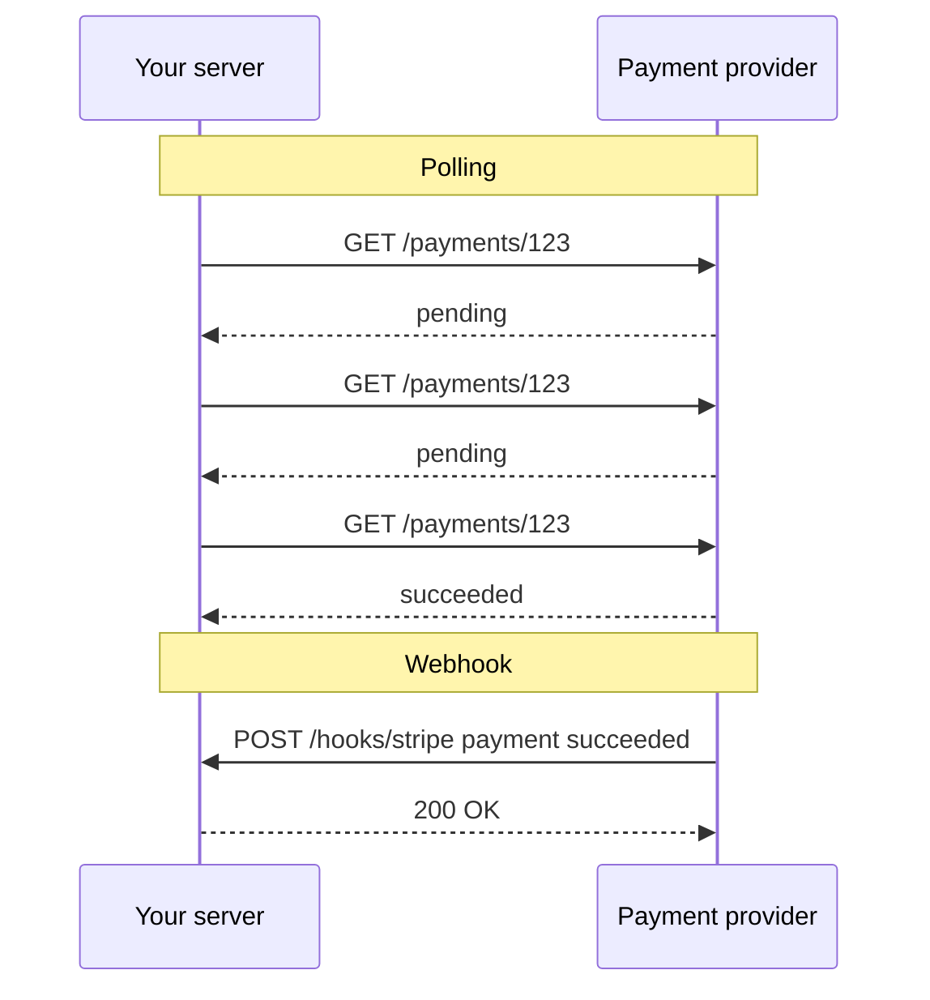

| | Polling | Webhooks |
|---|---|---|
| Who initiates | You, repeatedly | Provider, once per event (plus retries) |
| Latency | ~half the interval | Near real-time |
| Wasted requests | Most of them | None |
| Provider load | Huge at scale, leads to rate limits | Proportional to events |
| Complexity on your side | Low | Public endpoint, security, idempotency, ordering |

### History
- **2007:** **Jeff Lindsay** proposed "web hooks": the web needs something like a **Unix pipe**, a way for one service to push its output to another when an event happens, structured as **user-defined callbacks over HTTP POST** (like redirecting stdout in a terminal).
- **~2009:** Google engineers built **PubSubHubbub** (later standardized as WebSub) on the same idea for blog/feed updates.

## Vocabulary

Every provider's docs use slightly different terms. In this chapter:

| Term | Meaning |
|---|---|
| **Provider / sender** | The system where the event happens (Stripe, GitHub). |
| **Consumer / receiver** | You. |
| **Endpoint** | The URL on your side that the provider POSTs to. |
| **Event** | Something predefined that happened (payment succeeded, task moved). |
| **Delivery** | **One attempt** to send an event to an endpoint. |
| **Subscription** | Your registration: "here is my URL and these are the event types I want". |

> [!IMPORTANT]
> **One event can have many deliveries.** Always implement receivers assuming the same event may arrive more than once.

## Anatomy of a webhook request (GitHub demo)

The demo receiver is a small Go program with three packages: `main` registers one route, `POST /hooks/github`; an `inbox` handler reads the **whole body**, checks the signature with a `verify` package, **stores the delivery ID**, and responds. That is the typical shape of a webhook handler.

It runs on a Linux machine with no public address, so a **tunnel** (ngrok, Cloudflare Tunnel) gives local port 8081 a public HTTPS hostname. On the GitHub repo you add a webhook with that URL, content type JSON, a **secret**, and the `push` event. GitHub immediately sends a **ping** event. Pushing a commit produces a POST; the receiver returns `202`. GitHub's "Recent Deliveries" shows the same headers, payload and response.

```http
POST /hooks/github HTTP/1.1
Host: abc123.ngrok.app
Content-Type: application/json
X-GitHub-Event: push
X-GitHub-Delivery: 72d3162e-cc78-11e3-81ab-4c9367dc0958
X-Hub-Signature-256: sha256=757107ea0eb2509fc211221cce984b8a37570b6d7586c22c46f4379c8b043e17

{"ref":"refs/heads/main","repository":{"full_name":"acme/taskboard"},"commits":[]}
```

| Part | Purpose |
|---|---|
| `POST` to your URL | The delivery |
| `Content-Type: application/json` | Body format |
| `X-GitHub-Event` | Event type |
| `X-GitHub-Delivery` | **Unique delivery ID** (used for deduplication) |
| `X-Hub-Signature-256` | **HMAC signature** of the body |
| Body | Full event data as JSON |

### How the provider decides "delivered"
1. **Status code:** any **2xx** (`200`, `202`, ...) = success. **Anything else**, including **3xx redirects** and 4xx/5xx, = failure.
2. **Time limit:** you must respond within the provider's deadline, or it counts as a failure:

| Provider | Response deadline |
|---|---|
| GitHub | 10 s |
| Shopify | 5 s |
| Slack | 3 s |
| Microsoft Graph | 3 s |

Always check your provider's docs. Failures trigger the provider's retry mechanism (covered below).

## Registering a webhook

A registration form usually asks for: **URL**, **secret**, and **event types**.

> [!TIP]
> **Use a separate endpoint per provider**: `/hooks/github`, `/hooks/stripe`, never one generic `/hooks/callback`. Each provider has its own headers, signature scheme and retry behavior, so each deserves its own handler.

### Handshakes (endpoint verification)
Some providers first verify that you own the URL before sending any events:

| Provider | Handshake |
|---|---|
| Microsoft Graph | Sends a `validationToken`; you must echo it back as plain text |
| Discord | Sends a `PING`; you must reply with a `PONG` |
| Amazon SNS | Sends a `SubscriptionConfirmation` message with a URL you must visit |

**Why?** Without a handshake, an attacker could register a **victim's** URL with a provider, subscribe to every event type, and use the provider's infrastructure to flood the victim: a **DoS attack** by proxy.

### Local development needs a tunnel
A webhook is an **inbound** request from the internet. Your laptop sits behind a home router that will not forward unsolicited inbound traffic, and `localhost` means nothing to a server on the internet. So during development use a **tunnel** (ngrok, Cloudflare Tunnel): it gives you a temporary public HTTPS URL and forwards requests securely to your local port. Many providers also have CLIs that forward events locally (e.g. `stripe listen --forward-to localhost:8080/hooks/stripe`).

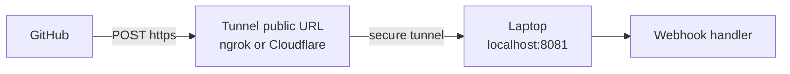

## Security problem 1: anyone can call your endpoint

Your webhook endpoint is a **public URL** that, for example, **unlocks a paid plan** when it receives "payment succeeded". Webhook URLs follow guessable patterns (`/webhooks`, `/hooks`, `/callback`). An attacker who guesses it can POST `{"type":"payment.succeeded","userId":42}` and get a free plan.

> [!WARNING]
> **HTTPS does not solve this.** TLS protects bytes **in transit** (nobody can read or modify them on the wire) and proves the *server's* identity to the client. It says nothing about **who sent** the request to you.

### Five ways to authenticate the sender

| # | Method | How it works | Assessment |
|---|---|---|---|
| 1 | **Secret token in URL** | `https://api.you.com/hooks/x?token=abc` | Weakest: URLs get logged everywhere (app logs, CloudWatch, Elasticsearch), so the token leaks |
| 2 | **IP allow-list** | Provider publishes source IPs; your firewall allows only those | Better, but **not sufficient alone** (IP lists change, shared cloud IPs) |
| 3 | **Mutual TLS (mTLS)** | Provider presents a client certificate you verify | Strong, but operationally heavy |
| 4 | **HMAC signature** | Provider signs the request with a **shared secret**; you recompute and compare | **Most common** (roughly 65 to 80% of providers) |
| 5 | **Public-key signature** | Provider signs with its **private key**; you verify with its **public key** (e.g. Discord, Ed25519) | Strong; no shared secret to leak on your side |

### How HMAC verification works
**HMAC = Hash-based Message Authentication Code.** Recall hashing: a function that maps any input to a **fixed-length fingerprint**; changing even one byte of input changes the whole fingerprint. HMAC mixes a **secret key** into the hash, so only someone with the key can produce the right fingerprint.

1. At registration, you and the provider share a **secret**.
2. The provider computes `HMAC-SHA256(secret, signed_content)` and puts it in a header.
3. You compute the same HMAC over the **same bytes you received** with the same secret.
4. If they match, the request came from someone holding the secret (the provider), and the content was not modified.

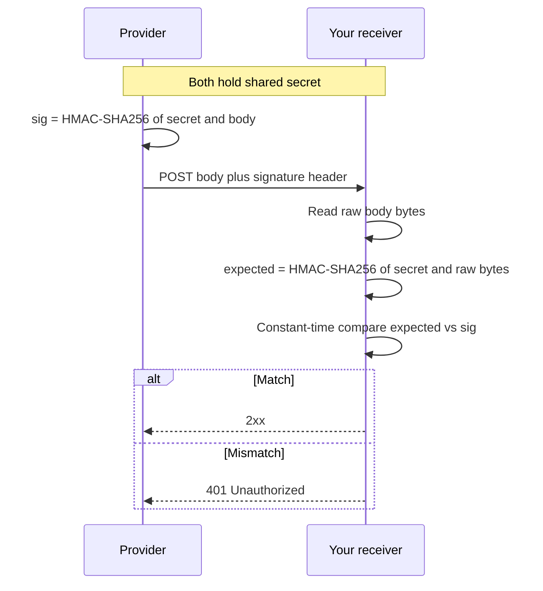

### What exactly is signed differs per provider

| Provider | Header | Signed content | Algorithm |
|---|---|---|---|
| **GitHub** | `X-Hub-Signature-256: sha256=<hex>` | Body only | HMAC-SHA256 |
| **Stripe** | `Stripe-Signature: t=<unix>,v1=<hex>[,v1=...]` | `timestamp + "." + body` (timestamp gives **replay protection**) | HMAC-SHA256 |
| **Standard Webhooks** spec | `webhook-id`, `webhook-timestamp`, `webhook-signature: v1,<base64>` | `id + "." + timestamp + "." + body` (ID also protected) | HMAC-SHA256 |
| **Twilio** | `X-Twilio-Signature` | Full endpoint URL + POST form fields sorted by name | HMAC-SHA1 |

Stripe's Go SDK parses the header: `t` is the Unix timestamp, `v1` is a signature (there can be **several `v1` values**, which supports **secret rotation**), and compares using `hmac.Equal`.

### The raw-bytes rule
The signature is computed over **exact bytes**. A classic bug in Node.js/Express:

1. `express.json()` parses the body into an object before your handler runs.
2. Your handler does `JSON.stringify(req.body)` and computes the HMAC.
3. The provider sent compact JSON (`{"a":1}`), but your re-encoding differs (spacing, key order, number formatting, unicode escaping).
4. Different bytes → different HMAC → **every legitimate delivery fails verification**.

> [!IMPORTANT]
> **Read raw bytes → verify → then parse.** Never parse and re-serialize before verifying.

The demo shows three outcomes: (1) correct secret, verify raw bytes → `202`; (2) secret changed on GitHub → mismatch → `401` (GitHub records the 401); (3) secret fixed but handler parses and re-encodes JSON before verifying → verification fails again.

```ts
import express from "express";
import crypto from "node:crypto";

const app = express();
const SECRET = process.env.GITHUB_WEBHOOK_SECRET!;

// raw body ONLY for this route, no express.json() before verification
app.post("/hooks/github", express.raw({ type: "application/json" }), async (req, res) => {
  const raw = req.body as Buffer;
  const header = req.get("X-Hub-Signature-256") ?? "";
  const expected = "sha256=" + crypto.createHmac("sha256", SECRET).update(raw).digest("hex");

  const a = Buffer.from(header);
  const b = Buffer.from(expected);
  if (a.length !== b.length || !crypto.timingSafeEqual(a, b)) {
    return res.status(401).send("bad signature");
  }

  const event = JSON.parse(raw.toString("utf8")); // parse only after verifying
  await saveDelivery(req.get("X-GitHub-Delivery")!, req.get("X-GitHub-Event")!, event);
  res.status(202).end();
});
```

```go
func verifyGitHub(secret, raw []byte, header string) bool {
    mac := hmac.New(sha256.New, secret)
    mac.Write(raw)
    expected := "sha256=" + hex.EncodeToString(mac.Sum(nil))
    return hmac.Equal([]byte(expected), []byte(header)) // constant time
}

func (h *Inbox) GitHub(w http.ResponseWriter, r *http.Request) {
    raw, err := io.ReadAll(http.MaxBytesReader(w, r.Body, 1<<20))
    if err != nil || !verifyGitHub(h.secret, raw, r.Header.Get("X-Hub-Signature-256")) {
        http.Error(w, "unauthorized", http.StatusUnauthorized)
        return
    }
    // store delivery ID and raw payload, then ack
    w.WriteHeader(http.StatusAccepted)
}
```

## Security problem 2: replay attacks

Suppose an attacker captures one complete, legitimate delivery (headers, body, valid signature), e.g. via a man-in-the-middle or a leaked log. An hour later they resend it, or send it a thousand times. **The signature is genuine**, so plain HMAC verification passes. This is a **replay attack**.

**Defense: sign a timestamp.** Stripe includes the attempt time `t` **inside the signed string**, so it cannot be altered without breaking the signature, and its library **rejects anything older than 5 minutes** (the default tolerance). The Standard Webhooks spec does the same with `webhook-timestamp`, and also signs the ID so you can reject duplicates.

```ts
function verifyStripeStyle(raw: Buffer, header: string, secret: string, toleranceSec = 300) {
  const parts = Object.fromEntries(header.split(",").map((kv) => kv.split("=") as [string, string]));
  const t = Number(parts.t);
  if (!t || Math.abs(Date.now() / 1000 - t) > toleranceSec) return false; // too old, likely a replay
  const signed = Buffer.concat([Buffer.from(`${t}.`), raw]);
  const expected = Buffer.from(crypto.createHmac("sha256", secret).update(signed).digest("hex"));
  const given = Buffer.from(parts.v1 ?? "");
  return given.length === expected.length && crypto.timingSafeEqual(given, expected);
}
```

> [!TIP]
> Within the tolerance window a replay is still possible, so combine timestamps with **deduplication by delivery/event ID** (next sections). Together they defeat replays.

### Constant-time comparison (timing attacks)
A normal string `==` **stops at the first mismatching byte**, so comparing a guess that matches more leading bytes takes slightly longer. An attacker measuring response times over thousands or millions of requests can **recover the expected signature byte by byte**. Always use a **constant-time** comparison, whose duration does not depend on where the strings differ:

| Language | Function |
|---|---|
| Go | `hmac.Equal` (or `subtle.ConstantTimeCompare`) |
| Node.js | `crypto.timingSafeEqual` (buffers must be equal length) |
| Python | `hmac.compare_digest` |

## Security problem 3 (provider side): SSRF

Now think like the **provider**. Your webhook dispatcher POSTs to **whatever URL a customer types in**, from **inside your network**. An attacker registers:

```text
http://169.254.169.254/latest/meta-data/iam/security-credentials/
```

`169.254.169.254` is the **cloud metadata service** on most clouds; it can expose instance **credentials** and internal hostnames. Or they register an internal admin service like `http://10.0.0.5/admin/delete`. Your dispatcher dutifully calls it. This is **Server-Side Request Forgery (SSRF)**: tricking a server into making requests to places only it can reach.

**Why checking at registration is not enough:** the attacker can make the domain resolve to a **public** IP during your registration check and later switch DNS to a **private** IP (**DNS rebinding**), or have the public address **redirect** to a private one.

**Defenses:**
1. **Resolve the hostname yourself at send time** and check the resulting IP against a fixed deny-list of private/reserved ranges (`10.0.0.0/8`, `172.16.0.0/12`, `192.168.0.0/16`, `127.0.0.0/8`, `169.254.0.0/16`, `::1`, `fc00::/7`, ...). Connect to **the IP you checked** so DNS cannot change in between.
2. **Never follow redirects.** Normally HTTP clients follow 3xx automatically; for webhooks that is a security hole. This is why providers treat **anything other than 2xx as failure**, and as a provider you should too.
3. **Send from a separate network via an egress proxy** that enforces these rules. Stripe open-sourced one: **Smokescreen**.

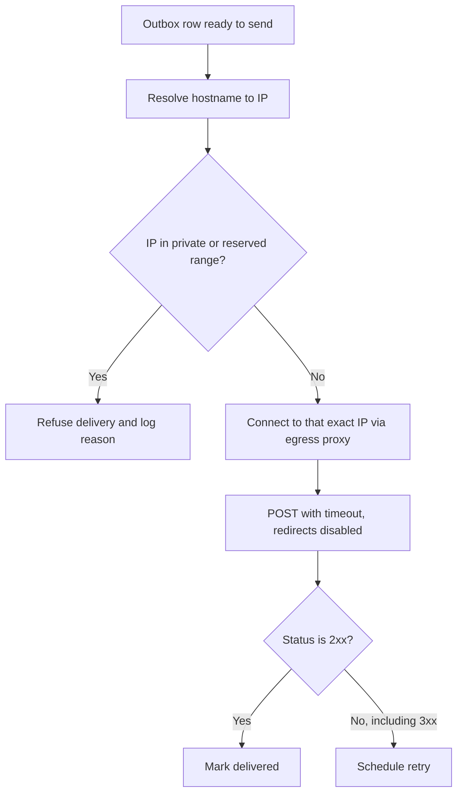

## Reliability problem 1: at-least-once delivery and duplicates

Assume the signature is valid. Your handler does its work (inserts a row, unlocks a plan) and returns `200`, but the **`200` is lost**: connection dropped, load balancer restarted. Common in cloud infrastructure. From the provider's view the delivery **failed**, so it **retries the same payload**, seconds or minutes later, in an unpredictable order.

That is why provider docs say **"at-least-once delivery"**: the event will **never be lost**, but it may arrive **more than once**. It can never be guaranteed **exactly-once**, because the acknowledgment itself can be lost.

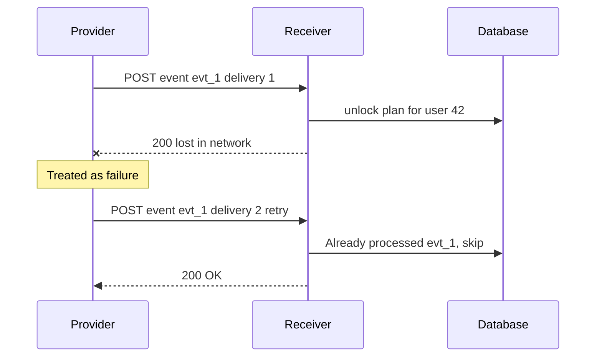

### The fix: idempotent receivers keyed by delivery/event ID
Each event carries an ID that **stays the same across all retries**:

| Provider | Where the ID lives |
|---|---|
| GitHub | `X-GitHub-Delivery` header |
| Stripe | `id` field in the body (`evt_...`) |
| Standard Webhooks | `webhook-id` header |

Keep a table of processed webhooks with the ID as a **unique constraint**: there can never be two rows with the same ID.

### Same transaction, or it is not safe
The dedup row and the side effect must be committed **atomically**:

- **Work first, then store the ID:** crash in between (OOM kill, restart) → work done but no ID stored → retry arrives → work done **again**.
- **Store the ID first, then work:** the work fails → retry arrives → ID already present → you **skip work that never actually happened**.
- **Both in one transaction:** either both happen or neither. This is what makes the handler **idempotent**: processing the same event any number of times has the same effect as processing it once.

```sql
BEGIN;

INSERT INTO processed_webhooks (event_id, provider, received_at)
VALUES ('evt_1NXa...', 'stripe', now())
ON CONFLICT (event_id) DO NOTHING
RETURNING event_id;
-- if no row was returned: already processed, ROLLBACK and return 200

UPDATE subscriptions SET plan = 'pro', active_until = now() + interval '1 month'
WHERE user_id = 42;

COMMIT;
```

> [!INTERVIEW]
> **"How do you make a webhook handler idempotent?"** Deliveries are at-least-once, so duplicates are normal. Use the provider's event/delivery ID as a unique key in a processed-events table, and insert it **in the same database transaction** as the side effect. If the insert conflicts, the event was already processed: return 2xx without doing the work. Doing them in separate steps breaks under crashes in either order.

## Reliability problem 2: ordering

Retries also break **order**. A well-known example from Stripe's API engineers (2017): an object is **created** then **deleted**. The `created` delivery fails (your server was deploying) and is retried 5 minutes later; the `deleted` delivery succeeds immediately. You receive **deleted, then created**. A handler that trusts event payloads at face value ends up with a **row for an object that no longer exists**.

Stripe's docs state plainly that **events are not delivered in order**, and event timestamps have **one-second resolution**, so events created within the same second share a timestamp and cannot be ordered by it.

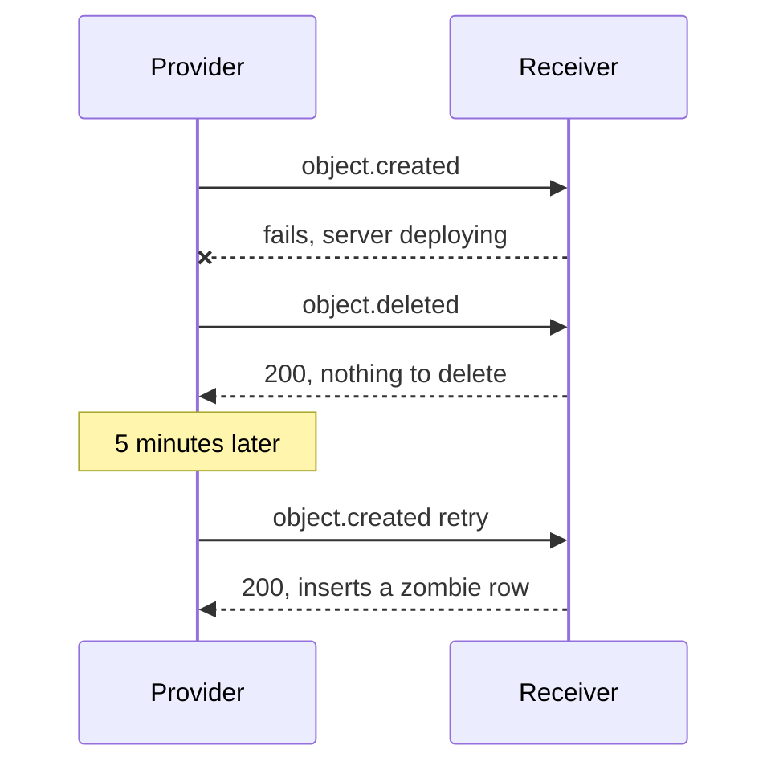

**Solutions:**
1. **Event as a signal, fetch current state.** On any event, call the provider's API for the object's **current** state and act on that. Order no longer matters. Cost: one extra API call per event.
2. **Version / `updated_at` check.** Store the object's version or last-updated time and apply an event **only if it is newer**, in one transaction.
3. **Buffer per object** until all earlier events arrive. Hard to make predictable (how long do you wait?), so generally the weakest option.

Some providers sell **strict ordering** as a paid feature.

```sql
UPDATE customers
SET email = $1, version = $2
WHERE id = $3 AND version < $2;   -- stale events update zero rows
```

## Provider retry schedules

When your endpoint fails (non-2xx, timeout, no response), providers retry, but **every provider has its own schedule**. Check before integrating:

| Provider | Retry behavior |
|---|---|
| **Stripe** | Exponential backoff for **up to 3 days**; if still failing, **disables the endpoint** and emails you |
| **Svix** (webhooks-as-a-service) | Immediately, then 5 s, 5 min, 30 min, 2 h, 5 h, 10 h, 10 h |
| Shopify, Slack, Polar | Each has its own schedule |
| **GitHub** | **No automatic retries.** A failed delivery is gone unless you click "Redeliver" or script redelivery via GitHub's API (list failed deliveries, redeliver each) |

> [!NOTE]
> **Svix** exists because building a production-grade webhook system (signing, retries, SSRF protection, dashboards, endpoint management) is a lot of engineering. Companies delegate sending webhooks to it via its API or embeddable UI.

## Reliability problem 3: load, bursts and the thin receiver

Combine the facts:
- You have **3 to 10 seconds** to respond.
- Every missed deadline becomes a **retry**, which **adds load** on top of your normal user traffic.
- **Bursts are common**: a billing provider renews every subscription **on the 1st of the month**; a marketing tool emails half a million people and sends a delivery receipt **per recipient**.

If your handler does everything inline (verify, update three tables, call other APIs, then respond), under a burst it misses deadlines → retries → more load → more missed deadlines: a **retry storm**.

**The thin receiver pattern:**
1. Read the raw body.
2. Verify the signature.
3. Store the delivery (ID + payload) durably, deduplicated.
4. Respond **2xx immediately**. Stop.
5. A **background worker** pulls from a **queue** (see the task-queues chapter) and does the real processing asynchronously, with its own idempotency.

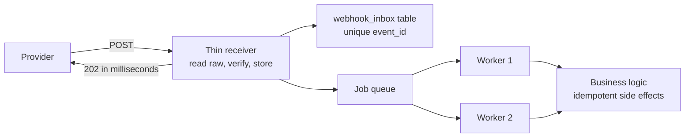

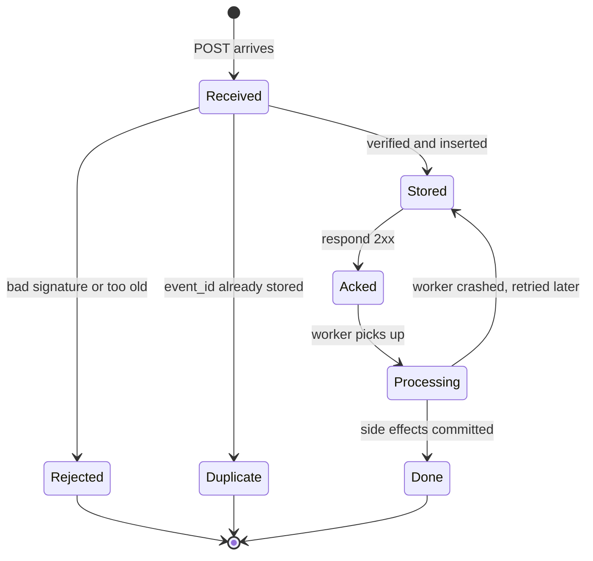

## The sending side: becoming a webhook provider

Now flip roles. In the task board, every move creates a **`task.moved`** event with a sequence number, the task, the actor and the time. A customer wants to be notified programmatically whenever a task moves to **done**, to post it to a chat channel or trigger their own logic. They give you a **URL**; you give them a **secret** (just as Stripe and GitHub did for you).

### The naive implementation and its three failure modes
In the move handler, after saving the move, call `http.Post(customerURL, ...)`:

1. **Their latency becomes yours.** If the customer's endpoint is slow or down, your move handler waits, and your own frontend's request becomes slow.
2. **DB commit succeeds, then crash before POST.** The move happened but the webhook is **never sent**.
3. **POST first, then DB fails or crash.** You told the customer the task moved, but it **did not** happen in your database. A false event.

The core problem is a **dual write**: you cannot atomically update your database and make a network call.

### The solution: the transactional outbox
An **outbox** is an ordinary table **in the same database** as your business data.

1. The move handler opens a transaction, **updates the task** and **inserts an outbox row** with the full event payload, then commits. **Both or neither.**
2. A separate **dispatcher** (background worker) reads outbox rows and performs deliveries asynchronously.

This is the same idea as the **write-ahead log** from the databases chapter: **durably record the intention first**, then let another process act on it. The move handler is fast again because it never waits on the customer's URL.

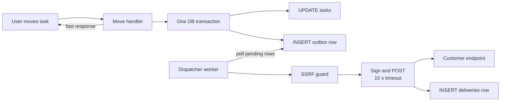

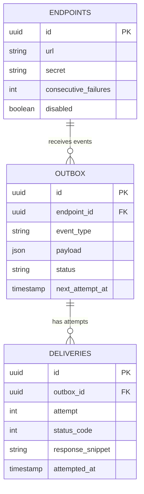

The demo uses three tables: **`endpoints`** (URL + secret), **`outbox`**, and **`deliveries`** (one row per attempt).

```go
func (s *Service) MoveTask(ctx context.Context, taskID, to, actor string) error {
    tx, err := s.db.BeginTx(ctx, nil)
    if err != nil { return err }
    defer tx.Rollback()

    seq, err := moveTaskRow(ctx, tx, taskID, to)
    if err != nil { return err }

    payload, _ := json.Marshal(TaskMoved{Seq: seq, TaskID: taskID, To: to, Actor: actor, At: time.Now()})
    if _, err := tx.ExecContext(ctx,
        `INSERT INTO outbox (id, endpoint_id, event_type, payload, status, next_attempt_at)
         SELECT gen_random_uuid(), e.id, 'task.moved', $1, 'pending', now()
         FROM endpoints e WHERE NOT e.disabled`, payload); err != nil {
        return err
    }
    return tx.Commit() // task update and outbox rows commit together
}
```

> [!TIP]
> Have workers claim outbox rows with `SELECT ... FOR UPDATE SKIP LOCKED` so multiple dispatcher instances can run in parallel without delivering the same row twice at the same time.

### What the dispatcher does per delivery
1. **SSRF guard:** resolve the URL and refuse private/loopback addresses (**on every send**, not only at registration).
2. **Sign** the delivery in the **Standard Webhooks format**: HMAC over `id.timestamp.body` with the endpoint's secret, sent in `webhook-id`, `webhook-timestamp`, `webhook-signature` headers.
3. **POST with a timeout.** The demo uses **10 seconds**, a common standard; pick based on your service's guarantees.
4. **Record the attempt:** status code, **first 2 KB of the response**, and the time.
5. **2xx →** mark the event **delivered**, no more retries.
6. **Anything else →** compute the next attempt with **exponential backoff + jitter**, honoring the receiver's **`Retry-After`** header if present.
7. After the **last attempt**, mark the event **exhausted**. After **10 consecutive failures**, **disable the endpoint** and **email the owner**.
8. Use **one queue per endpoint**, so a dead or slow customer URL does not **stall deliveries to other customers** (head-of-line blocking).

```ts
function signStandardWebhook(id: string, ts: number, body: string, secretB64: string) {
  const key = Buffer.from(secretB64, "base64");
  const sig = crypto.createHmac("sha256", key).update(`${id}.${ts}.${body}`).digest("base64");
  return { "webhook-id": id, "webhook-timestamp": String(ts), "webhook-signature": `v1,${sig}` };
}

function nextDelayMs(attempt: number, retryAfterSec?: number): number {
  if (retryAfterSec) return retryAfterSec * 1000;          // respect the receiver
  const base = Math.min(5_000 * 2 ** attempt, 6 * 3600_000); // exponential, capped
  const jitter = Math.random() * base * 0.3;                // spread retries out
  return base + jitter;
}
```

### Exponential backoff and jitter
- **Exponential backoff:** instead of retrying at a fixed interval (every 5 minutes), **grow the gap** each time: e.g. 5 s, 5 min, 15 min, 1 h, ... This gives a struggling receiver time to recover and avoids hammering it.
- **Jitter:** add a **random** amount to each delay. If 1,000 deliveries all fail at the same moment, without jitter they all retry at exactly the 5-minute mark (a **thundering herd**). With jitter they spread out: 5:01, 5:35, 5:42, ...
- **`Retry-After`:** a receiver under maintenance can say "retry after 1 hour"; a good sender respects it over its own schedule.

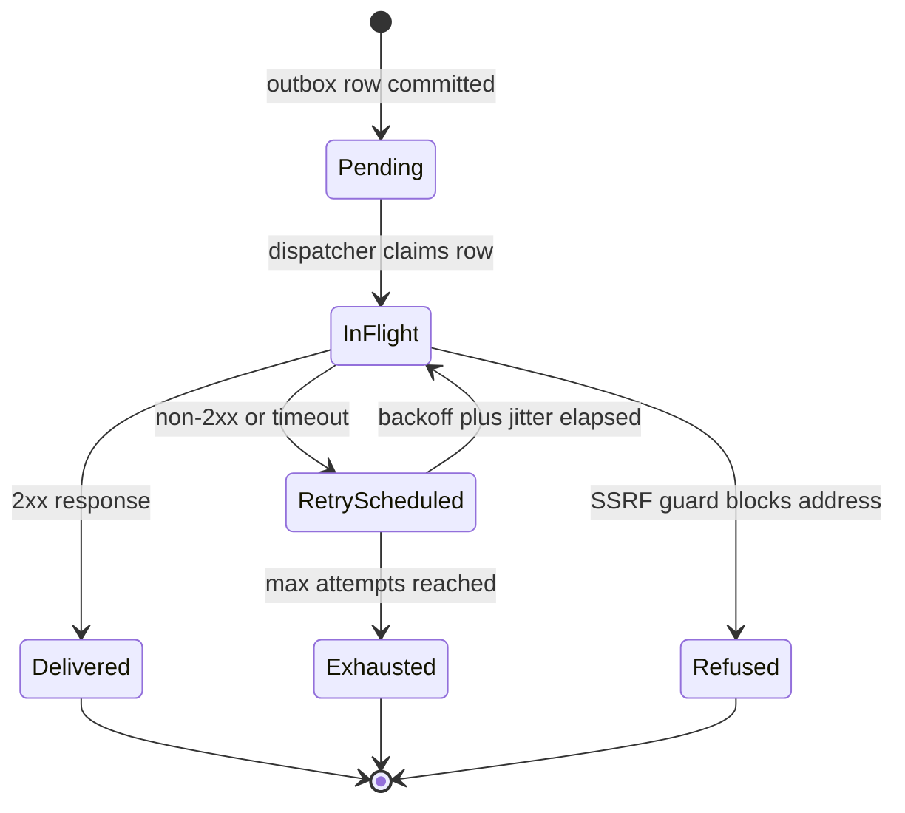

### Demo walkthrough
- Moving a task immediately creates an **outbox row**, before anything is sent.
- The customer's endpoint returns **500**: the first attempt fails, and the `deliveries` table already shows when the next attempt is scheduled; delays **grow** with each attempt.
- After fixing the endpoint, the next attempt gets **200**; the event is marked **delivered** and no further retries happen.
- Registering the task board's **own admin route on the loopback address** as a webhook URL is **refused with a reason**. A hostname that **resolves to a private address** is refused the same way. Because the check runs **at every send**, a URL that was public at registration and later re-pointed is still blocked.

## When webhooks are the right tool, and when they are not

At heart a webhook is a **notification**: "this thing happened, here is its data."

**Good uses (notifications):**
- When an event happens, post it to a chat channel.
- When code is pushed, start a CI/CD pipeline (e.g. GitHub Actions or an external build).
- When a payment succeeds, unlock the user's plan.

**Misuse: syncing a copy of provider data.** Example: **Clerk**, a popular auth provider. It handles email/password, social logins (Google, GitHub OAuth), sign-up/login/password-reset emails, sessions and device management, roles and permissions, so you do not reinvent authentication. All that data lives in **Clerk's database**.

To avoid calling Clerk's API on every request (e.g. **50 to 60 ms** for a local DB query vs **500 to 600 ms** with network calls to the provider), teams keep a **local copy** (`users`, `organizations`, `roles` tables) and keep it in sync by subscribing to `user.created/updated/deleted`, `organization.*`, `role.*` webhooks and applying each payload.

Keeping a local copy is fine. **Syncing it by applying webhook payloads is the problem**: you inherit every edge case (timeouts, missed deliveries, duplicates, replays, **out-of-order events**), and the copy silently drifts.

### The robust approach: read the provider's ordered event log
Providers (Clerk, Stripe, and others) keep an **events log** exposed via an API like `GET /events`. That log is **ordered**, because it is written inside the provider's own infrastructure and transactions; ordering problems only appear once events cross the network as separate deliveries.

**Strategy 1: periodic pull.** If slight staleness (say 5 minutes) is acceptable, run a background worker every 5 minutes that fetches events **after the last processed event ID** (stored in your DB), applies them **in order**, and updates the cursor. No redundant work, no ordering problems.

**Strategy 2: webhook as a trigger, then pull.** Subscribe to a webhook that fires whenever the provider appends to its event log. Example: a user changes their name in the frontend via Clerk's SDK (your backend is not involved); Clerk updates the user and appends an event in the same transaction; it sends you a webhook. You treat that webhook purely as **"something changed"**, immediately start a worker that pulls all events **since your stored cursor**, and applies them in order. Your copy is in sync within milliseconds to seconds, and you are not abusing webhooks.

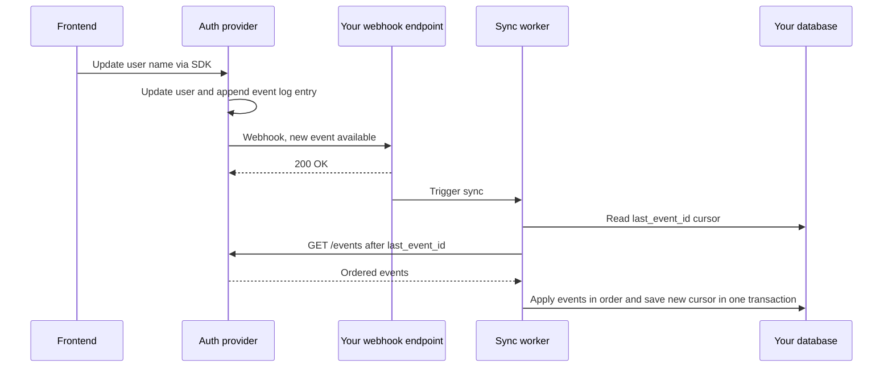

> [!INTERVIEW]
> **"Should you sync a third-party's data into your DB via webhooks?"** Not by applying payloads directly: deliveries are at-least-once, can be missed, and arrive out of order, so the copy drifts. Use the webhook as a signal and pull from the provider's ordered events API using a stored cursor (last event ID), or re-fetch the current object state. If freshness is not critical, just poll the events API periodically.

## Common mistakes & misconceptions

- **Trusting the browser** to report payment success. Use server-to-server signals.
- **"HTTPS means the request is from Stripe."** TLS protects transport, not sender identity. Verify signatures.
- **Secret token in the URL.** Leaks through logs.
- **Parsing JSON then re-serializing to verify.** Verify the **raw bytes**, then parse.
- **Comparing signatures with `==`.** Use constant-time comparison.
- **No timestamp check.** Allows replay attacks; enforce a tolerance (e.g. 5 minutes).
- **Assuming exactly-once delivery.** It is at-least-once; dedupe by event ID.
- **Dedup row and side effect in separate transactions.** Breaks under crashes either way.
- **Assuming events arrive in order.** They do not; re-fetch state or use versions.
- **Doing heavy work inline in the receiver.** Misses provider deadlines, triggers retry storms. Ack fast, process in a worker.
- **One generic `/hooks/callback` for all providers.** Use per-provider endpoints and handlers.
- **Returning 3xx or 4xx for events you choose to ignore.** The provider will retry or disable your endpoint. Return 2xx for valid-but-uninteresting events.
- **Forgetting GitHub never retries.** Build redelivery tooling if you depend on GitHub webhooks.
- **(As a sender) calling the customer's URL inside the request handler.** Use an outbox.
- **(As a sender) validating URLs only at registration.** DNS rebinding and redirects bypass it; check every send and disable redirects.
- **(As a sender) retries without jitter or a shared queue for all endpoints.** Thundering herds and one dead customer stalling everyone.
- **Using webhook payloads to maintain a replica** of provider data. Use the ordered events API.

## Interview questions

<details>
<summary><strong>Q: What is a webhook and how is it different from polling and from a normal API call?</strong></summary>

A webhook is an HTTP POST that a provider sends to a URL you registered when an event occurs, a "reverse API call". In a normal API call you request data when you need it; with polling you make that call repeatedly to detect changes, which wastes requests, adds latency of about half the interval, and gets you rate-limited at scale. Webhooks push the event once (plus retries) near real-time. The trade-off is that you must expose a public endpoint and handle authentication, retries, duplicates and ordering.

</details>

<details>
<summary><strong>Q: How do you verify that a webhook really came from the provider?</strong></summary>

Most providers use an HMAC signature: at registration you share a secret; the provider computes HMAC-SHA256 over the raw body (Stripe: `timestamp.body`, Standard Webhooks: `id.timestamp.body`) and sends it in a header. You read the raw bytes, compute the same HMAC with your secret, and compare using a constant-time function (`hmac.Equal`, `crypto.timingSafeEqual`, `hmac.compare_digest`). Reject on mismatch with 401. Alternatives include IP allow-lists (not sufficient alone), mTLS, public-key signatures (Discord), and the weak option of a token in the URL. HTTPS alone does not prove the sender.

</details>

<details>
<summary><strong>Q: Your signature verification fails for every legitimate request in an Express app. What is the likely bug?</strong></summary>

The body is being parsed by `express.json()` and then re-serialized with `JSON.stringify` before computing the HMAC. Re-serialization changes bytes (whitespace, key order, escaping), so the HMAC differs. Use `express.raw({ type: "application/json" })` (or a `verify` hook to capture the raw buffer) for the webhook route, verify the raw bytes, then parse. Also check you are using the right secret for the right endpoint and the exact signed content the provider documents (e.g. the timestamp prefix for Stripe).

</details>

<details>
<summary><strong>Q: What is a replay attack in the context of webhooks and how do you prevent it?</strong></summary>

An attacker captures a genuine delivery, including its valid signature, and resends it later, possibly many times. Signature checks pass because the signature is real. Prevent it by including a timestamp in the signed content and rejecting requests outside a tolerance window (Stripe defaults to 5 minutes), and by deduplicating on the event/delivery ID so even a replay within the window has no effect.

</details>

<details>
<summary><strong>Q: Why must signature comparison be constant-time?</strong></summary>

Ordinary string equality returns as soon as it hits the first differing byte, so the comparison time leaks how many leading bytes matched. With enough requests and precise timing, an attacker can reconstruct the expected signature byte by byte. Constant-time comparison always takes the same time regardless of where the inputs differ, eliminating that side channel.

</details>

<details>
<summary><strong>Q: Providers say "at-least-once delivery". What does that mean, and how do you design for it?</strong></summary>

The provider guarantees an event will eventually reach you but may deliver it more than once, e.g. when your 2xx response is lost and it retries. Exactly-once is impossible because acknowledgments can be lost. Design an idempotent receiver: store the event ID (GitHub `X-GitHub-Delivery`, Stripe event `id`, `webhook-id`) in a table with a unique constraint, inserted in the same transaction as the side effect. On conflict, skip the work and return 2xx.

</details>

<details>
<summary><strong>Q: Why must the dedup insert and the business side effect be in the same transaction?</strong></summary>

If you do the work first and crash before storing the ID, the retry repeats the work (double charge, duplicate email). If you store the ID first and the work then fails, the retry sees the ID and skips work that never happened. A single transaction makes them atomic: both commit or neither, so retries are both safe and effective.

</details>

<details>
<summary><strong>Q: You receive "customer.deleted" before "customer.created". How do you handle event ordering?</strong></summary>

Assume webhooks are unordered (Stripe documents this, and timestamps have one-second resolution). Options: treat each event as a signal and fetch the object's current state from the provider's API before acting; store a version or `updated_at` and apply an event only if it is newer (`UPDATE ... WHERE version < $new`); or buffer events per object until predecessors arrive, which is fragile. Re-fetching current state is the simplest robust choice; versioning avoids the extra API call when the payload carries a version.

</details>

<details>
<summary><strong>Q: On the 1st of every month your webhook endpoint falls over and the provider keeps retrying. What is happening and how do you fix it?</strong></summary>

A burst (subscription renewals for every customer) arrives at once. If the handler does heavy work inline it exceeds the provider's deadline (GitHub 10 s, Shopify 5 s, Slack 3 s), each timeout triggers a retry, and the retries add more load, creating a retry storm. Fix: a thin receiver that reads raw bytes, verifies, stores the event deduplicated, enqueues it, and returns 2xx immediately; background workers process the queue at a sustainable rate with idempotent logic. Scale workers independently of the receiver.

</details>

<details>
<summary><strong>Q: You are building webhooks for your own product. Why not just POST to the customer's URL inside the request handler?</strong></summary>

Three failures: the customer's slow or down endpoint adds latency to your own request; if your DB commit succeeds but you crash before the POST, the event is lost; if you POST first and then the DB write fails, you sent a false event. This is the dual-write problem. Use a transactional outbox: insert the event into an outbox table in the same transaction as the business change, then a dispatcher delivers asynchronously with signing, timeouts, retries and logging.

</details>

<details>
<summary><strong>Q: Design the retry policy for a webhook dispatcher.</strong></summary>

Treat only 2xx as success; timeouts (e.g. 10 s), connection errors, 3xx, 4xx and 5xx are failures. Retry with exponential backoff (e.g. 5 s, 5 min, 30 min, 2 h, ... up to about 3 days) plus random jitter to avoid thundering herds, and honor the receiver's `Retry-After`. Record every attempt (status, first ~2 KB of response, time). After the final attempt mark the event exhausted; after N consecutive failures (e.g. 10) disable the endpoint and email the owner. Use per-endpoint queues so one dead endpoint does not block others, and let customers manually redeliver.

</details>

<details>
<summary><strong>Q: What is SSRF and why is it a risk for webhook providers? How do you defend against it?</strong></summary>

Server-Side Request Forgery is tricking a server into making requests to destinations only it can reach. A webhook provider calls arbitrary customer-supplied URLs from inside its network, so an attacker can register `http://169.254.169.254/...` (cloud metadata with credentials) or an internal admin service. Checking only at registration fails due to DNS rebinding and redirects. Defend by resolving the hostname at send time, rejecting private/loopback/link-local ranges, connecting to the checked IP, never following redirects, and sending through an isolated egress proxy such as Stripe's Smokescreen.

</details>

<details>
<summary><strong>Q: Why do some providers require a handshake before sending events?</strong></summary>

To prove that whoever registered the URL controls it. Otherwise an attacker could register a victim's URL, subscribe to every event, and use the provider as a DoS amplifier against the victim. Examples: Microsoft Graph sends a `validationToken` you must echo as plain text, Discord sends a PING expecting a PONG, Amazon SNS sends a SubscriptionConfirmation with a URL you must visit.

</details>

<details>
<summary><strong>Q: You keep a local copy of users from an auth provider like Clerk using webhooks, and it keeps drifting. What would you change?</strong></summary>

Applying webhook payloads directly exposes you to missed deliveries, duplicates and out-of-order events. Instead read the provider's ordered events log: store a cursor (last processed event ID) and either poll `GET /events` after that cursor periodically if some staleness is OK, or use a webhook only as a trigger to immediately pull new events since the cursor. Apply events in order and update the cursor in the same transaction. The copy then converges reliably within seconds.

</details>

## Cheat sheet

- **Webhook** = provider POSTs an event to your registered URL. Reverse API call. Service-to-service, no browser.
- **Polling cost:** average delay = interval / 2, wasted calls, rate limits at scale.
- **Terms:** provider/sender, consumer/receiver, endpoint, event, **delivery = one attempt**, subscription.
- **Success = 2xx within deadline** (GitHub 10 s, Shopify 5 s, Slack 3 s, MS Graph 3 s). 3xx counts as failure.
- **One endpoint per provider**: `/hooks/github`, `/hooks/stripe`.
- **Handshakes:** MS Graph `validationToken`, Discord PING/PONG, SNS SubscriptionConfirmation.
- **Local dev:** tunnel (ngrok, Cloudflare Tunnel) or provider CLI.
- **Sender auth options:** URL token (weak) < IP allow-list < mTLS / **HMAC (most common)** / public-key signatures (Discord).
- **Signed content:** GitHub = body; Stripe = `t.body`; Standard Webhooks = `id.t.body`; Twilio = URL + sorted params (SHA1).
- **Receiver order of operations:** raw bytes → verify (constant-time) → check timestamp → dedupe by ID → store → **2xx** → worker processes.
- **Constant-time compare:** Go `hmac.Equal`, Node `crypto.timingSafeEqual`, Python `hmac.compare_digest`.
- **Replay defense:** signed timestamp + tolerance (Stripe 5 min) + ID dedup.
- **At-least-once** → idempotency: unique event ID **in the same transaction** as the side effect.
- **Ordering:** re-fetch current state, or version / `updated_at` guard, or buffer (weakest).
- **Retry schedules:** Stripe backoff up to 3 days then disable + email; Svix 0, 5 s, 5 m, 30 m, 2 h, 5 h, 10 h, 10 h; **GitHub none** (manual or API redelivery).
- **Sending:** transactional **outbox** → dispatcher → SSRF guard every send → sign (Standard Webhooks) → POST with 10 s timeout, no redirects → log attempt (status, 2 KB, time) → backoff + jitter, honor `Retry-After` → exhausted → disable after 10 consecutive failures + email → per-endpoint queue.
- **SSRF:** block `10/8`, `172.16/12`, `192.168/16`, `127/8`, `169.254/16`, IPv6 local; beware DNS rebinding; egress proxy (Smokescreen).
- **Use for notifications**, not replication. To sync: ordered events API with a cursor, optionally triggered by a webhook.

## Glossary

- **Webhook** — An HTTP callback: the provider POSTs event data to a consumer-registered URL.
- **Provider / sender** — The system where the event originates and that sends the webhook.
- **Consumer / receiver** — The system that exposes the endpoint and receives webhooks.
- **Endpoint** — The consumer's URL that receives webhook deliveries.
- **Event** — A predefined occurrence (e.g. `payment_intent.succeeded`, `task.moved`).
- **Delivery** — A single attempt to send an event to an endpoint.
- **Subscription** — Registration of an endpoint URL and the event types it wants.
- **Handshake** — Initial verification exchange proving the registrant controls the URL.
- **Tunnel** — Service exposing a local port through a public HTTPS URL (ngrok, Cloudflare Tunnel).
- **HMAC** — Hash-based Message Authentication Code; a keyed hash proving integrity and authenticity with a shared secret.
- **Shared secret** — Key known only to provider and consumer, used for HMAC.
- **mTLS** — Mutual TLS; both sides present certificates.
- **Replay attack** — Resending a captured, validly signed request.
- **Timing attack** — Inferring secret data by measuring how long comparisons take.
- **Constant-time comparison** — Equality check whose duration does not depend on input contents.
- **At-least-once delivery** — Guarantee that a message arrives one or more times, never zero.
- **Idempotency** — Property that repeating an operation has the same effect as doing it once.
- **Delivery / event ID** — Identifier stable across retries, used for deduplication.
- **Exponential backoff** — Increasing the wait between successive retries.
- **Jitter** — Random variation added to retry delays to avoid synchronized retries.
- **Thundering herd** — Many clients retrying at the same moment and overwhelming a service.
- **Retry-After** — HTTP header telling the sender how long to wait before retrying.
- **Thin receiver** — Handler that only verifies, stores and acknowledges, deferring work to a queue.
- **Transactional outbox** — Writing outgoing events to a table in the same transaction as business data, delivered later by a worker.
- **Dual write** — Updating two systems (e.g. DB and network) without atomicity; the outbox avoids it.
- **Dispatcher** — Background worker that sends outbox events and handles retries.
- **SSRF** — Server-Side Request Forgery; making a server request internal or forbidden destinations.
- **DNS rebinding** — Changing a hostname's resolution after validation to point at a private IP.
- **Egress proxy** — Controlled outbound proxy enforcing destination rules (e.g. Stripe's Smokescreen).
- **Standard Webhooks** — Open specification for webhook headers and signing (`webhook-id`, `webhook-timestamp`, `webhook-signature`).
- **Svix** — Webhooks-as-a-service platform.
- **Events API / event log** — Provider's ordered log of all events, queryable with a cursor.

## Video timestamps

- [00:00](https://www.youtube.com/watch?v=eWM0CVReP04&t=0s) — The client-initiates premise and service-to-service communication
- [01:02](https://www.youtube.com/watch?v=eWM0CVReP04&t=62s) — Example: unlocking a paid plan after a Stripe payment
- [02:03](https://www.youtube.com/watch?v=eWM0CVReP04&t=123s) — Why the browser cannot be the receiver of the signal
- [03:04](https://www.youtube.com/watch?v=eWM0CVReP04&t=184s) — The brute-force approach: polling the provider
- [04:06](https://www.youtube.com/watch?v=eWM0CVReP04&t=246s) — Polling problems: delay, waste, load, rate limits
- [05:08](https://www.youtube.com/watch?v=eWM0CVReP04&t=308s) — Flipping the direction: what a webhook is
- [06:10](https://www.youtube.com/watch?v=eWM0CVReP04&t=370s) — History: Jeff Lindsay and PubSubHubbub
- [07:10](https://www.youtube.com/watch?v=eWM0CVReP04&t=430s) — Vocabulary: provider, receiver, endpoint, event, delivery, subscription
- [08:11](https://www.youtube.com/watch?v=eWM0CVReP04&t=491s) — Receiver code structure in Go
- [09:14](https://www.youtube.com/watch?v=eWM0CVReP04&t=554s) — Tunnel and GitHub webhook demo
- [10:14](https://www.youtube.com/watch?v=eWM0CVReP04&t=614s) — Request anatomy and how success is decided
- [11:15](https://www.youtube.com/watch?v=eWM0CVReP04&t=675s) — Provider deadlines and the registration form
- [12:16](https://www.youtube.com/watch?v=eWM0CVReP04&t=736s) — Separate endpoints per provider, handshakes
- [13:17](https://www.youtube.com/watch?v=eWM0CVReP04&t=797s) — Handshake examples and the DoS reason
- [14:17](https://www.youtube.com/watch?v=eWM0CVReP04&t=857s) — Local development behind routers, tunnels
- [15:19](https://www.youtube.com/watch?v=eWM0CVReP04&t=919s) — The security threat of a public endpoint
- [16:20](https://www.youtube.com/watch?v=eWM0CVReP04&t=980s) — Why HTTPS is not enough, five authentication methods
- [18:21](https://www.youtube.com/watch?v=eWM0CVReP04&t=1101s) — Public-key signatures and HMAC explained
- [19:23](https://www.youtube.com/watch?v=eWM0CVReP04&t=1163s) — Computing and comparing HMAC, Stripe SDK header parsing
- [20:24](https://www.youtube.com/watch?v=eWM0CVReP04&t=1224s) — What GitHub, Stripe, Standard Webhooks and Twilio sign
- [21:26](https://www.youtube.com/watch?v=eWM0CVReP04&t=1286s) — Verify raw bytes before parsing, failure demo
- [22:26](https://www.youtube.com/watch?v=eWM0CVReP04&t=1346s) — Replay attacks
- [23:27](https://www.youtube.com/watch?v=eWM0CVReP04&t=1407s) — Signed timestamps and constant-time comparison
- [24:28](https://www.youtube.com/watch?v=eWM0CVReP04&t=1468s) — Constant-time functions, provider-side SSRF
- [25:28](https://www.youtube.com/watch?v=eWM0CVReP04&t=1528s) — Metadata service attack and DNS tricks
- [26:28](https://www.youtube.com/watch?v=eWM0CVReP04&t=1588s) — SSRF defenses: resolve, deny private ranges, no redirects
- [27:30](https://www.youtube.com/watch?v=eWM0CVReP04&t=1650s) — Egress proxy, lost acknowledgments
- [28:31](https://www.youtube.com/watch?v=eWM0CVReP04&t=1711s) — At-least-once delivery
- [29:33](https://www.youtube.com/watch?v=eWM0CVReP04&t=1773s) — Deduplication by delivery ID
- [30:34](https://www.youtube.com/watch?v=eWM0CVReP04&t=1834s) — Same transaction for dedup and side effect
- [31:36](https://www.youtube.com/watch?v=eWM0CVReP04&t=1896s) — Idempotency and the ordering problem
- [32:37](https://www.youtube.com/watch?v=eWM0CVReP04&t=1957s) — Created vs deleted out of order
- [33:38](https://www.youtube.com/watch?v=eWM0CVReP04&t=2018s) — Ordering solutions and strict-ordering features
- [34:39](https://www.youtube.com/watch?v=eWM0CVReP04&t=2079s) — Provider retry schedules: Stripe
- [35:40](https://www.youtube.com/watch?v=eWM0CVReP04&t=2140s) — Svix schedule and GitHub's lack of retries
- [36:42](https://www.youtube.com/watch?v=eWM0CVReP04&t=2202s) — Deadlines, retries and burst traffic
- [37:42](https://www.youtube.com/watch?v=eWM0CVReP04&t=2262s) — The thin receiver pattern
- [38:42](https://www.youtube.com/watch?v=eWM0CVReP04&t=2322s) — Background workers, becoming a webhook provider
- [39:43](https://www.youtube.com/watch?v=eWM0CVReP04&t=2383s) — Naive sending inside the move handler
- [40:45](https://www.youtube.com/watch?v=eWM0CVReP04&t=2445s) — The three failure modes of naive sending
- [41:46](https://www.youtube.com/watch?v=eWM0CVReP04&t=2506s) — The transactional outbox
- [42:48](https://www.youtube.com/watch?v=eWM0CVReP04&t=2568s) — Endpoints, outbox and deliveries tables, the dispatcher
- [43:50](https://www.youtube.com/watch?v=eWM0CVReP04&t=2630s) — Per-delivery steps: sign, POST with timeout, record
- [44:50](https://www.youtube.com/watch?v=eWM0CVReP04&t=2690s) — Exponential backoff and jitter
- [45:50](https://www.youtube.com/watch?v=eWM0CVReP04&t=2750s) — Retry-After, exhaustion and disabling endpoints
- [46:50](https://www.youtube.com/watch?v=eWM0CVReP04&t=2810s) — Per-endpoint queues and the retry demo
- [47:51](https://www.youtube.com/watch?v=eWM0CVReP04&t=2871s) — SSRF guard demo, when to use webhooks
- [48:54](https://www.youtube.com/watch?v=eWM0CVReP04&t=2934s) — Misuse for syncing: the Clerk example
- [50:57](https://www.youtube.com/watch?v=eWM0CVReP04&t=3057s) — Why teams keep a local copy and sync via webhooks
- [52:59](https://www.youtube.com/watch?v=eWM0CVReP04&t=3179s) — The ordered events log: periodic pull
- [55:01](https://www.youtube.com/watch?v=eWM0CVReP04&t=3301s) — Webhook as a trigger, then pull from the event log
