## TL;DR

- **DevOps** merges *development* (people who ship features) and *operations* (people who keep production stable). It started as a fix for the conflict between those two teams and became a set of practices whose core idea is: **make deployments small, cheap and boring** so you can do them many times a day.
- **DORA metrics** measure delivery: two speed metrics (**change lead time**, **deployment frequency**) and two stability metrics (**change failure rate**, **failed deployment recovery time**). Elite teams are both faster *and* more stable: **speed and stability are not a trade-off**, because small deploys are easy to debug and roll back.
- **Continuous integration (CI)** is a *practice*: everyone merges into one shared branch at least daily, and every merge is checked by an automated build + test run. **Trunk-based development** (one `main`, short-lived feature branches, feature flags for long work) fits web backends better than GitFlow.
- A **build** turns source into a runnable **artifact**; it must be **reproducible** (pinned compiler, lock file) and stamped with the **commit hash**. A **deployment pipeline** chains stages from fast and cheap (compile, unit tests) to slow and expensive (integration, staging, production). GitHub Actions models this as **workflows, events, jobs, runners, steps**; use **OIDC** short-lived credentials instead of long-lived cloud keys.
- We ship the **environment**, not just code: a **container** is an ordinary Linux process that the kernel gives an isolated view (**namespaces**), resource limits (**cgroups**) and a layered root file system (**OverlayFS**). It is *not* a small VM: there is no separate kernel.
- An **image** is content-addressed layers + a config + a manifest; **registries** store blobs by SHA-256 digest so shared layers are stored and pulled once. Order Dockerfile instructions for caching, use **multi-stage builds**, and keep images **small, single-process, non-root, pinned and scanned**.
- Running a service = a **supervisor** (systemd) that restarts it, a **reverse proxy** (Nginx/Caddy) that terminates TLS with automatic **ACME / Let's Encrypt** certificates, and **logs** you can read. Beyond one box: **Kamal** for a few machines, **Kubernetes** (declarative reconciliation, Deployments, Services, probes, rolling updates, HPA) for fleets, deploy strategies (**recreate, rolling, blue-green, canary, progressive**), **GitOps** and **Terraform** IaC (state, drift).
- Operations: **SLI → SLO → SLA**, **error budgets** (99.9% ≈ 43 min/month), on-call and incident roles, **mitigate first**, **blameless postmortems**, **chaos engineering**, and **supply-chain** defense (pin and scan everything).

## Why this matters

Everything built so far in a backend course (handlers, middleware, the database, caching, queues) runs on **one machine, over `localhost`**. Your users cannot reach it. Two questions remain:

1. How does the code on your laptop become **reachable over the internet**?
2. How does it **stay alive** while the team pushes changes every day?

The whole journey from *a commit* to *a running service on the internet that survives constant change* is what people call **DevOps**. Interviewers expect backend engineers to understand this pipeline end to end: what CI really means, what a container actually is at the kernel level, how images are cached, and how to deploy without downtime.

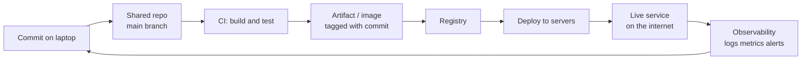

## What DevOps is (and the problem it solved)

### Two teams, opposite incentives

DevOps is literally two words merged: **Dev**elopment + **Op**erations. Traditionally (in mid-size and large companies, not 3-person startups) there were two separate teams:

| | Development team | Operations / infrastructure team |
|---|---|---|
| Who | Backend, frontend, testers: everyone who writes code | People who set up servers, deploy, monitor, respond to alerts |
| Measured by | How **fast** they ship features to production | How **rarely** production goes down |
| Wants | As many deployments as possible | As few deployments as possible |

Every deployment touches production and adds **entropy** (a chance of breakage), so the ops team naturally wants fewer of them, while the dev team's job *is* pushing changes. That is a **conflict of interest**. When something broke, devs blamed the machines and ops blamed the code. Releases had to be coordinated with everyone "on the same page", so they slipped to once a week or once every two weeks.

### The DevOps movement

Teams started solving this, documented what worked at scale, and that collection of ideas became the **DevOps movement**: practices to streamline development *and* deployment together. Key improvements:

- **Infrastructure as code**: instead of a person creating and configuring servers by hand every time, describe the infrastructure in files and automate it.
- **Everything in version control**: application code *and* infrastructure configuration live together in Git/GitHub.
- **One command to build, one command to deploy**, instead of a multi-step manual ritual.
- **Feature flags**: enable or disable features from a central place (a database, an edge config/cache) **without redeploying**.
- **Shared observability**: logs, metrics (CPU, memory), and alerts are visible to developers too, not only to ops, so devs can see how their code behaves in production.

> [!IMPORTANT]
> The single pattern behind all of these: **make deployment small, cheap and boring.** *Small and cheap* means one button, one command, or one merge into a branch starts it, taking seconds instead of a 2–3 hour checklist. *Boring* means nobody hesitates to do it several times a day.

## Measuring DevOps: the DORA metrics

**DORA** (DevOps Research and Assessment) has surveyed tens of thousands of teams over many years and reduced delivery performance to **four numbers**:

| Metric | Type | Meaning | Example |
|---|---|---|---|
| **Change lead time** | Speed | Time from a commit to that change being live in production | Merged at 9:00, users see it at 11:00 → 2 hours |
| **Deployment frequency** | Speed | How often you deploy to production | Several times a day vs once a month |
| **Change failure rate** | Stability | % of deploys that cause a failure in production | 4 bad out of 100 deploys → 4% |
| **Failed deployment recovery time** | Stability | How long it takes to recover after a failed deploy | Under an hour vs a week |

From the 2024 report:

| | Top group (~20% of teams) | Bottom group |
|---|---|---|
| Deploy frequency | On demand | Once every 1–6 months |
| Lead time | Under a day | Months |
| Change failure rate | ~5% | ~40% |
| Recovery time | Under an hour | About a week |

### Why speed and stability are not a trade-off

The intuition of the old ops team ("more deploys means more breakage") turns out to be wrong. The teams that deploy **most often** are also the **most stable**. Why?

- A team that deploys **once a month** ships a month of changes from 10–20 people, maybe **200 commits** in one deploy. When it breaks (and something always eventually breaks), finding *which* commit caused it can take a day. The fix then rides on another big deploy.
- A team that deploys **every commit** ships one change from one person, written an hour or a day ago. When it breaks, the culprit is obvious, it can be rolled back instantly, and the author still has the code fresh in their head, so the fix is fast.

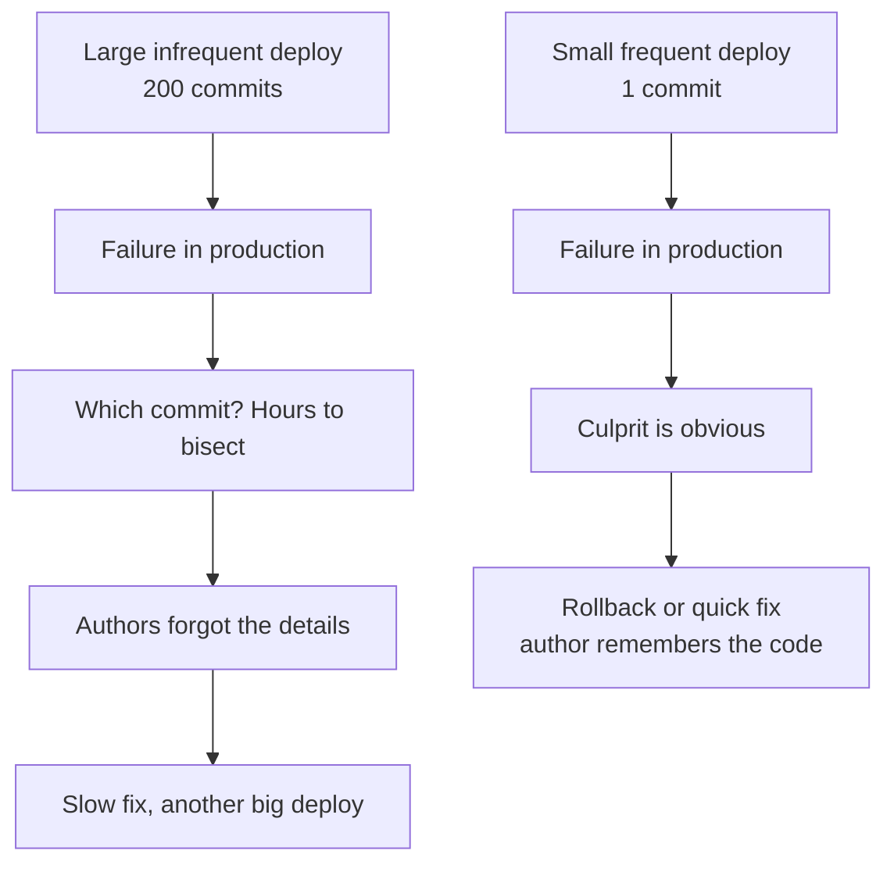

> [!TIP]
> Rule of thumb: **make deployments as frequent as possible and as small as possible.**

> [!INTERVIEW]
> **"Doesn't deploying more often make production less stable?"** No. DORA data shows elite teams deploy on demand *and* have lower failure rates and recovery times under an hour. Small deploys have a small blast radius, are trivial to bisect and roll back, and the author still remembers the change. Big, rare deploys bundle hundreds of commits, so every failure turns into a long investigation.

## Continuous integration (CI)

### The practice

**Continuous integration** means **every developer merges their work into one shared branch at least once a day**, and **every merge is verified by an automated build that runs the full test suite**.

> [!NOTE]
> When people say "CI" they usually mean the server that runs tests on push (GitHub Actions, Jenkins, GitLab CI...). Precisely, **CI is a practice; the server is a tool that enforces part of it.** The server can check that a merge passes the tests, but it cannot force people to merge daily.

### Why merge at least daily?

Imagine two engineers each working on a feature branch for **three weeks**. When they finally merge, their branches have drifted so far from each other and from `main` that resolving the conflicts takes hours, and it is easy to break the intent of someone's change while doing it.

With daily merges, you only ever integrate **one day of drift** against what is already on the mainline. Even if ten engineers pushed that day, conflicts are small, everyone remembers their changes, and resolving them takes minutes.

### Branching models: GitFlow vs trunk-based development

The famous **GitFlow** model has a `develop` branch, `release/*` branches, `hotfix/*` branches and `master`/`main`, where `main` holds only finished releases. It is still widely used. But its own author wrote, about ten years after publishing it, that **for web applications that ship continuously you should use something simpler**.

GitFlow was designed for software that **ships versions to customers who install them** (desktop apps, mobile apps), where you must keep supporting v2 while building v3. A web backend has exactly **one version in production: the latest**. There are no parallel supported versions.

The modern model is **trunk-based development**:

- One long-lived branch: `main` (the trunk).
- **Short-lived feature branches** (a day or two), merged into `main` and then deleted.
- Every deploy/release is cut **from `main`**.
- A feature that takes weeks is still merged within a day or two, but hidden behind a **feature flag** so users cannot reach it even though the code is in production.

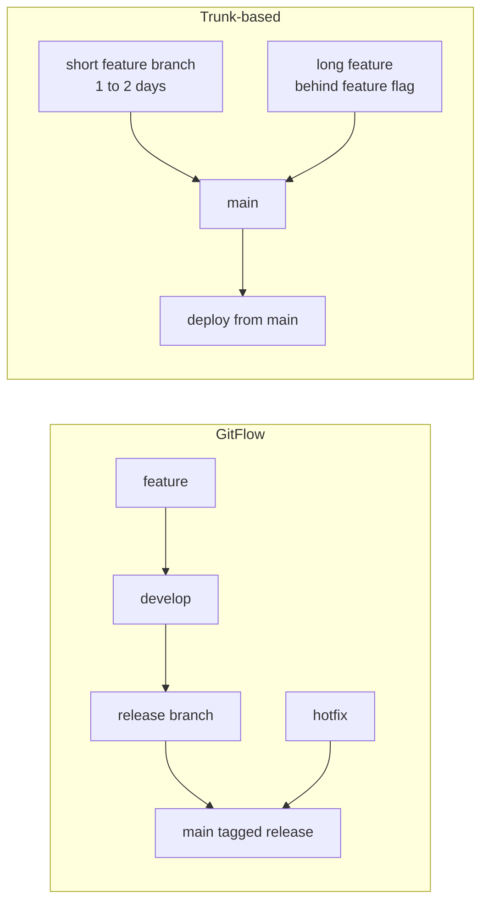

| | GitFlow | Trunk-based development |
|---|---|---|
| Long-lived branches | `main`, `develop` (+ release/hotfix) | Only `main` |
| Feature branch lifetime | Days to weeks | Hours to 1–2 days |
| Best for | Installed software with multiple supported versions | Web apps and backends that deploy continuously |
| Unfinished work | Lives on long branches | Merged, hidden behind feature flags |

## What a build is

A **build** is the step that transforms **source code into something executable**: it compiles the code, downloads dependencies, and packages everything into an **artifact** (a binary, an executable, a bundle, an image).

### Reproducible builds

As in the Twelve-Factor App (factor II and V), an ideal build **must not depend on whatever happens to be installed on the build machine**. It declares its own compiler/runtime version and exact dependency versions, so **the same source + the same build config always produces a byte-identical output**, no matter how many times or where you build it.

The **lock file** is the input list that makes this possible:

| Ecosystem | Pinned toolchain | Lock file | Reproducible install / build |
|---|---|---|---|
| Go | `go` directive / toolchain in `go.mod` | `go.sum` (committed, not gitignored) | `go build` |
| Node.js | `.nvmrc` / `engines` / pinned base image | `package-lock.json` | `npm ci` (not `npm install`) |

```bash
# Go: pinned toolchain + go.sum, stamp the commit into the binary
go build -ldflags "-X main.version=$(git rev-parse --short HEAD)" -o app ./cmd/server

# Node: install exactly what the lock file says (fails if it is out of sync)
npm ci
```

> [!TIP]
> Stamp every artifact with the **commit hash** of `main` it was built from. Then from a running process you can always answer "is production running the latest code?"

## The deployment pipeline

Combine **build + tests** and you get a **deployment pipeline**: a sequence of stages your code passes through, ending with the code live in production.

Stages are ordered **fast and cheap first, slow and expensive last**:

1. **Commit stage** (minutes): compile, run unit tests. If it fails, **stop the pipeline immediately** and notify the developer who pushed, so they fix it while the context is fresh.
2. **Acceptance / integration stage** (slower): integration tests against real databases, deploy to a **staging** environment, sometimes manual verification.
3. **Production stage**: release to users.

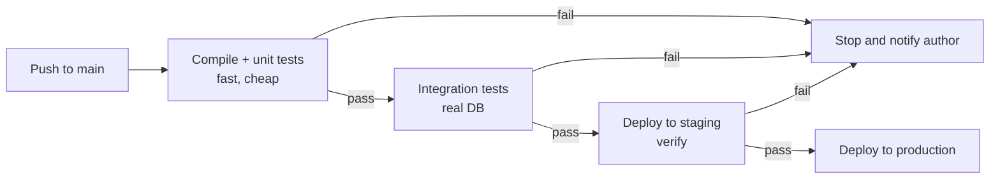

> [!NOTE]
> Precise terms: **Continuous Integration** = merge often + automated build/test. **Continuous Delivery** = every passing build is *deployable* to production at the push of a button. **Continuous Deployment** = every passing build is deployed to production *automatically*, with no human step.

### GitHub Actions vocabulary

GitHub Actions is one of the most widely used pipeline tools. Five words to know:

| Term | Meaning |
|---|---|
| **Workflow** | A YAML file committed in `.github/workflows/`. Decides **when** to run and **what** to run. |
| **Event** | What triggers the workflow: `push`, `pull_request`, `schedule` (cron), or a manual click (`workflow_dispatch`). |
| **Job** | A set of steps that run **on one machine**. Jobs can run in parallel or wait for each other (`needs:`). |
| **Runner** | The machine a job runs on: a **fresh VM** provided by GitHub for that job and discarded afterwards. You can also **self-host** runners on your own infrastructure. |
| **Step** | A single command (`run:`) or reusable action (`uses:`) inside a job. |

Because the runner is **fresh every time**, nothing is pre-installed from previous runs: you must install everything or restore it from a cache. That is why **every workflow starts with a checkout step**.

The example workflow in the video has three jobs: **test** (checkout, set up Go, run tests), **build** (waits for test, builds the binary, uploads it as an artifact), and **image** (waits for both, builds the container image).

```yaml
# .github/workflows/ci.yml
name: ci
on:
  push:
    branches: [main]
  pull_request:

jobs:
  test:
    runs-on: ubuntu-latest
    steps:
      - uses: actions/checkout@v4
      - uses: actions/setup-go@v5
        with:
          go-version-file: go.mod
      - run: go test ./...

  build:
    needs: test
    runs-on: ubuntu-latest
    steps:
      - uses: actions/checkout@v4
      - uses: actions/setup-go@v5
        with:
          go-version-file: go.mod
      - run: go build -ldflags "-X main.version=${{ github.sha }}" -o app ./cmd/server
      - uses: actions/upload-artifact@v4
        with:
          name: app
          path: app

  image:
    needs: [test, build]
    runs-on: ubuntu-latest
    steps:
      - uses: actions/checkout@v4
      - run: docker build -t ghcr.io/acme/app:${{ github.sha }} .
```

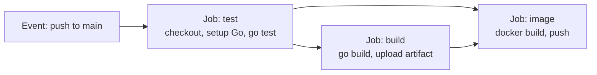

### Giving the pipeline access to the cloud: secrets vs OIDC

At some point the pipeline must touch your **cloud** (push an image, deploy to a machine or cluster). The pipeline runs on GitHub's infrastructure; the cloud is a different company. It needs **credentials**.

**Old way: repository secrets.** You store a long-lived cloud access key as a repo secret and reference it in the workflow. Secrets are masked in logs, but:
- **every** job and action in the repo can read them, and
- if the key ever leaks, **anyone, anywhere** can use your infrastructure **until someone rotates it**.

**Better way: OIDC (OpenID Connect).**

1. When a job starts, GitHub's **identity provider** issues a **short-lived, signed token** (a JWT) whose claims say: "this is a job in repo X, on branch Y, in workflow Z".
2. In your cloud (say AWS) you have configured a trust policy: *trust tokens signed by GitHub only if the claims say repo X and branch `main`*.
3. The job presents the token; AWS verifies the signature and the claims, and returns **temporary credentials** that **expire when the job ends**.

No permanent secret is stored anywhere, and a stolen token is useless minutes later and from any other repo/branch.

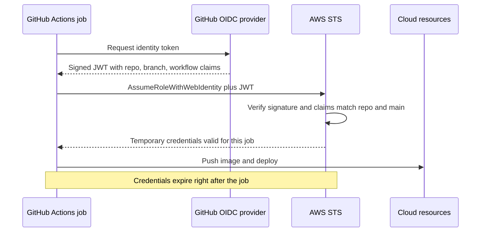

```yaml
permissions:
  id-token: write   # allow the job to request an OIDC token
  contents: read
steps:
  - uses: aws-actions/configure-aws-credentials@v4
    with:
      role-to-assume: arn:aws:iam::123456789012:role/github-deploy
      aws-region: ap-south-1
```

> [!WARNING]
> Long-lived cloud keys in repository secrets are a classic supply-chain risk: any compromised third-party action in any workflow can exfiltrate them. Prefer OIDC federation with trust conditions pinned to the repo **and** branch.

### Versioning deployments: commit hashes, not semver

For **libraries**, versions exist for *users* and follow **semantic versioning** `MAJOR.MINOR.PATCH`:

| Bump | When |
|---|---|
| PATCH | Bug fix, no behavior change |
| MINOR | New backward-compatible feature |
| MAJOR | Breaking change to behavior or interface |

For a **deployed service**, users are just HTTP clients; they do not care which build is running (this is different from API versioning like `/v1/` in routes). The deploy version is **for the team**, so we tag it with the **commit hash** of `main` (sometimes plus a build ID):

- the **artifact** carries the commit hash,
- the **container image** is tagged with the commit hash,
- the **running process** exposes it via a health/info endpoint, so after a deploy you can verify the new code is actually live.

```ts
// GET /version  ->  { "commit": "c7ee6a7", "buildId": "1423" }
app.get("/version", (_req, res) => {
  res.json({ commit: process.env.GIT_COMMIT, buildId: process.env.BUILD_ID });
});
```

## Shipping the environment: why containers exist

You build a Go binary; it runs on your laptop. You copy it to the server and it **fails**: the server has an older system library, a different certificate store, or no time-zone database. Or a Node.js service written against Node 22 uses an API missing from the server's Node 18.

The root problem is that **dev and prod environments differ**. The fix: **don't ship only the code, ship the environment** too. Not a whole OS, but everything the running process needs: the runtime, libraries, files, all at exact versions, packaged as one unit that behaves the same on a laptop, a data-center server or a rented VPS.

That unit is a **container**: a process that has its **own file system** and sees only the small part of the machine it needs.

## Containers vs virtual machines

A common misconception is that "a container is a small virtual machine". It is not.

- A **virtual machine** is created by a **hypervisor** that partitions the hardware: virtual CPUs, virtual disks, and **its own operating system kernel**. Two VMs on one host each run their own kernel; the hypervisor keeps them apart. **Very strong isolation**, but **heavy**: a full OS each, gigabytes of RAM, their own disk, slow boot.
- A **container** has **no kernel of its own**. It is an **ordinary process** started by the **host's kernel**. If you run `ps` on the Linux host, the container's process appears in the list like any other. What makes it a "container" is **special treatment from the host kernel**: its own view of PIDs, hostname, file-system root and network interfaces, plus limits on CPU and memory. It is an **illusion** of a separate machine.

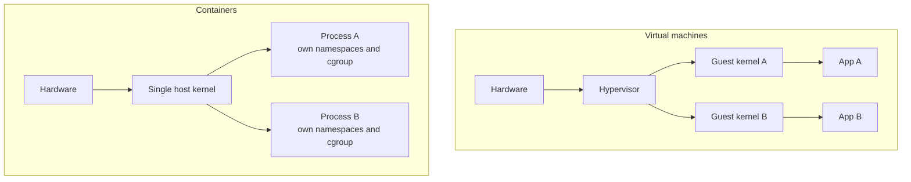

| | Virtual machine | Container |
|---|---|---|
| Kernel | Own guest kernel per VM | Shares the host kernel |
| What it is | Emulated hardware + full OS | A normal process with isolation features |
| Isolation strength | Very strong (hardware-level) | Weaker (kernel-level; kernel bugs can escape) |
| Size / RAM | GBs | MBs |
| Startup | Tens of seconds to minutes | Milliseconds to seconds |
| Visible in host `ps` | No (only the hypervisor process) | Yes |

> [!INTERVIEW]
> **"What is the difference between a container and a VM?"** A VM virtualizes hardware and runs its own kernel, so it gives strong isolation but costs GBs of RAM and slow boots. A container virtualizes the *operating system view*: it is just a host process that the Linux kernel isolates with **namespaces** (what it can see), limits with **cgroups** (what it can use), and gives a layered root file system (**OverlayFS**). It shares the host kernel, so it is light and starts fast, but isolation is weaker.

The three Linux kernel features that make containers possible: **namespaces**, **control groups**, and a **layered file system**.

## Namespaces: controlling what a process can see

A **namespace** wraps a **global resource** of the machine so that a group of processes sees **its own private copy** of it.

A normal OS has global things: the process table (every process has a PID, visible with `ps`), the hostname, mount points, network interfaces. Namespaces let a container have its own version of each, isolated from the host.

| Namespace | Isolates | Effect in a container |
|---|---|---|
| **PID** | Process IDs | The container's first process is **PID 1**; it sees only its own children, nothing outside |
| **UTS** | Hostname (and domain name) | The container has its own hostname |
| **Mount (mnt)** | Mount table | Its own mount points and file-system root |
| **Network (net)** | Interfaces, ports, routing tables | Two containers can both listen on port 80 |
| **IPC** | Shared memory, message queues | No cross-talk with host IPC |
| **User** | UID/GID mapping | Root inside can map to an unprivileged user outside |
| **Cgroup** | View of the cgroup hierarchy | Sees its own cgroup as the root |
| **Time** | Some system clocks | Its own clock offsets |

That is the **eight** namespace types in current Linux.

### The three system calls

Only the kernel can create namespaces, so programs ask via **system calls**:

| Syscall | What it does |
|---|---|
| `clone` | Creates a **new process**; with `CLONE_NEW*` flags, the child starts in **new namespaces** |
| `unshare` | Moves the **calling process** into new namespaces |
| `setns` | **Joins an existing** namespace (this is how `docker exec` gets "inside" a running container) |

Every container tool (Docker, containerd, Kubernetes via runc) uses these same three calls.

### A container in ~70 lines of Go

Liz Rice's well-known talk **"Containers from Scratch"** builds a container in about 76 lines of Go. The program runs **itself twice**:

1. **Parent** (`run`): calls `clone` with `CLONE_NEWUTS | CLONE_NEWPID | CLONE_NEWNS`, re-executing its own binary with the argument `child`.
2. **Child** (now PID 1 in the new PID namespace): sets the hostname to `container` (visible only in its UTS namespace), `chroot`s into a folder holding an **Ubuntu root file system** so `/` is now that folder, mounts a fresh `/proc` so `ps` reads the new PID namespace, and finally runs the requested command (a shell).

```go
// Core of "containers from scratch" (Liz Rice), simplified
func run() {
    cmd := exec.Command("/proc/self/exe", append([]string{"child"}, os.Args[2:]...)...)
    cmd.Stdin, cmd.Stdout, cmd.Stderr = os.Stdin, os.Stdout, os.Stderr
    cmd.SysProcAttr = &syscall.SysProcAttr{
        Cloneflags: syscall.CLONE_NEWUTS | syscall.CLONE_NEWPID | syscall.CLONE_NEWNS,
    }
    must(cmd.Run())
}

func child() {
    must(syscall.Sethostname([]byte("container")))
    must(syscall.Chroot("/home/rootfs-ubuntu"))
    must(os.Chdir("/"))
    must(syscall.Mount("proc", "proc", "proc", 0, ""))
    cmd := exec.Command(os.Args[2], os.Args[3:]...)
    cmd.Stdin, cmd.Stdout, cmd.Stderr = os.Stdin, os.Stdout, os.Stderr
    must(cmd.Run())
    must(syscall.Unmount("proc", 0))
}
```

Result: inside, `hostname` prints `container`, `ps` shows only a few processes with the program itself as PID 1, and the files are Ubuntu's. On the host, the same shell is just another process with an ordinary PID under the program.

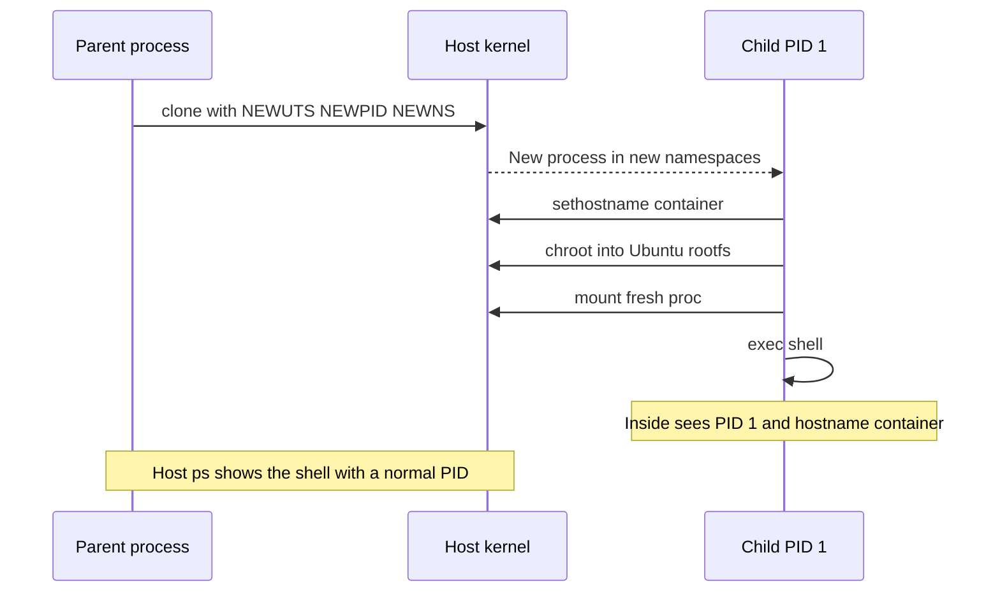

## Control groups (cgroups): limiting what a process can use

Namespaces control **visibility**, not **consumption**. A container that sees only its own processes could still eat all of the host's RAM. The second kernel feature, **control groups (cgroups)**, enforces resource limits.

A cgroup is literally **a folder** in a special file system the kernel exposes at **`/sys/fs/cgroup`**:

- Creating a folder there creates a **group**.
- Inside are plain files such as `memory.max`, `cpu.max`, `pids.max`.
- Writing a value to `memory.max` sets a memory limit **shared by every process in the group**.
- Writing a PID into `cgroup.procs` **moves that process into the group**.

```bash
sudo mkdir /sys/fs/cgroup/demo
echo 100M | sudo tee /sys/fs/cgroup/demo/memory.max     # 100 MB limit
echo "50000 100000" | sudo tee /sys/fs/cgroup/demo/cpu.max  # 0.5 CPU
echo $$ | sudo tee /sys/fs/cgroup/demo/cgroup.procs      # move this shell in
```

When Kubernetes says a container has `limits.memory: 512Mi`, the **kubelet** (through the container runtime) writes that number into the container's `memory.max`. When the process tries to exceed it, the kernel's **OOM (out-of-memory) killer** kills it, and you see the famous **`OOMKilled`** status. The kernel log (`dmesg`) states exactly why.

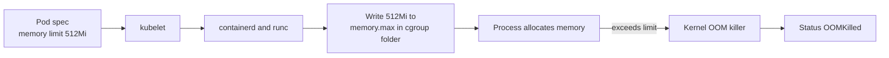

> [!WARNING]
> An `OOMKilled` container is not a "crash in your code" in the usual sense: the **kernel** killed it for crossing its cgroup memory limit. Fix it by finding the leak or raising the limit, not by adding try/catch.

## Layered file systems and images

### Layers and OverlayFS

The toy container `chroot`ed into a folder containing ~100 MB of Ubuntu files. Do we copy 100 MB every time we start a container? No: container file systems are built from **layers**.

- A **layer** is a **tarball of changes**: files added, files modified, files deleted.
- An **image** is a **stack of layers**.
- At runtime the kernel stacks them with **OverlayFS** (on Linux): it takes several **read-only lower directories** plus **one writable upper directory** and presents a single merged view.
  - **Read**: the file comes from the topmost layer that has it.
  - **Write**: the file is first **copied up** into the upper layer and modified there (**copy-on-write**). Lower layers never change.

So **10 containers from the same image share every read-only layer** and each gets only a thin writable layer of its own.

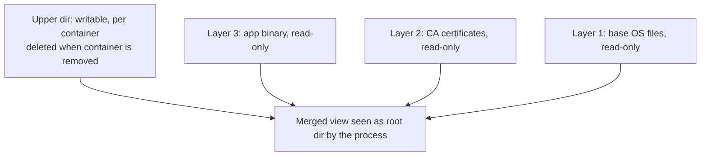

> [!IMPORTANT]
> A container's file system is **disposable**. A file written inside a container lives in its upper layer and is **gone** when the container is removed. Anything that must survive goes to a **volume** or a backing service (database, object storage), exactly as factor VI of the Twelve-Factor App says.

### What a "blob" is

A **blob** (binary large object) is unstructured binary data: a PDF, a video, a compressed tarball. Unlike a text file, you cannot read or edit it character by character; its bytes only make sense as a whole. Image layers are stored as blobs.

### Anatomy of an image

A container image (in the OCI format) is **three kinds of documents plus a set of blobs**:

| Piece | What it is |
|---|---|
| **Layer blobs** | The tarballs of changes, each identified by the **SHA-256 hash of its bytes** (its **digest**) |
| **Config** (JSON) | Ordered list of layers + start settings: command/entrypoint, env vars, working directory, exposed ports, user (what you write in a Dockerfile) |
| **Manifest** (JSON) | Points to the config and every layer, with size and digest |
| **Image ID / digest** | The **hash of the manifest** |

Why hashes everywhere (content addressing)?

- Two images that share a base layer share it **by digest**, so a registry stores it **once** and clients download it **once**.
- Change one line in a Dockerfile and only the layers **from that line onward** change; earlier layers keep the same digest.
- Tags like `ubuntu:24.04` or `myapp:v2.3.1` are just **human-friendly pointers to a digest** (and tags can be moved; digests cannot).

> [!TIP]
> Mental model: **an image is like a Git commit for a file system.** Layers are content-addressed like Git objects; a tag is like a branch name pointing at a hash.

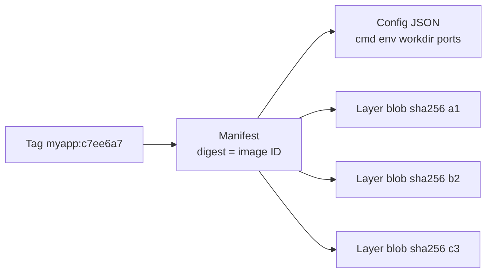

Inspecting a real image (e.g. with the `dive` tool) shows: a base layer, a layer that added CA certificates, and a layer that added the 11 MB application binary, and for each layer exactly which files it changed.

## Dockerfiles, layer caching and multi-stage builds

A **Dockerfile** is the **recipe** that produces the layers. Each instruction that changes the file system produces one layer:

- `FROM` picks the **base image** to build on.
- `COPY` adds files.
- `RUN` executes a command (e.g. install packages).

### Cache rules

The builder caches each layer keyed by **the instruction and its inputs**. The cache is reused **top-down until the first instruction whose inputs changed**; **everything after that is rebuilt**. So **instruction order matters**.

Bad order: copy the whole source tree, then install dependencies. Every code change invalidates the `COPY` layer, so **dependencies are reinstalled on every build**.

Good order: copy only the **dependency manifest** (`package.json` + lock file, `go.mod` + `go.sum`, `Cargo.toml`, `requirements.txt`), install dependencies, **then** copy the source. You change code a hundred times a day but dependencies rarely, so most builds reuse the cached dependency layer and only rebuild the last layers.

```dockerfile
# BAD: any code change busts the npm install cache
FROM node:22-alpine
WORKDIR /app
COPY . .
RUN npm ci
CMD ["node", "dist/server.js"]
```

```dockerfile
# GOOD: dependency layer cached until package*.json changes
FROM node:22.11-alpine
WORKDIR /app
COPY package.json package-lock.json ./
RUN npm ci --omit=dev
COPY . .
USER node
CMD ["node", "dist/server.js"]
```

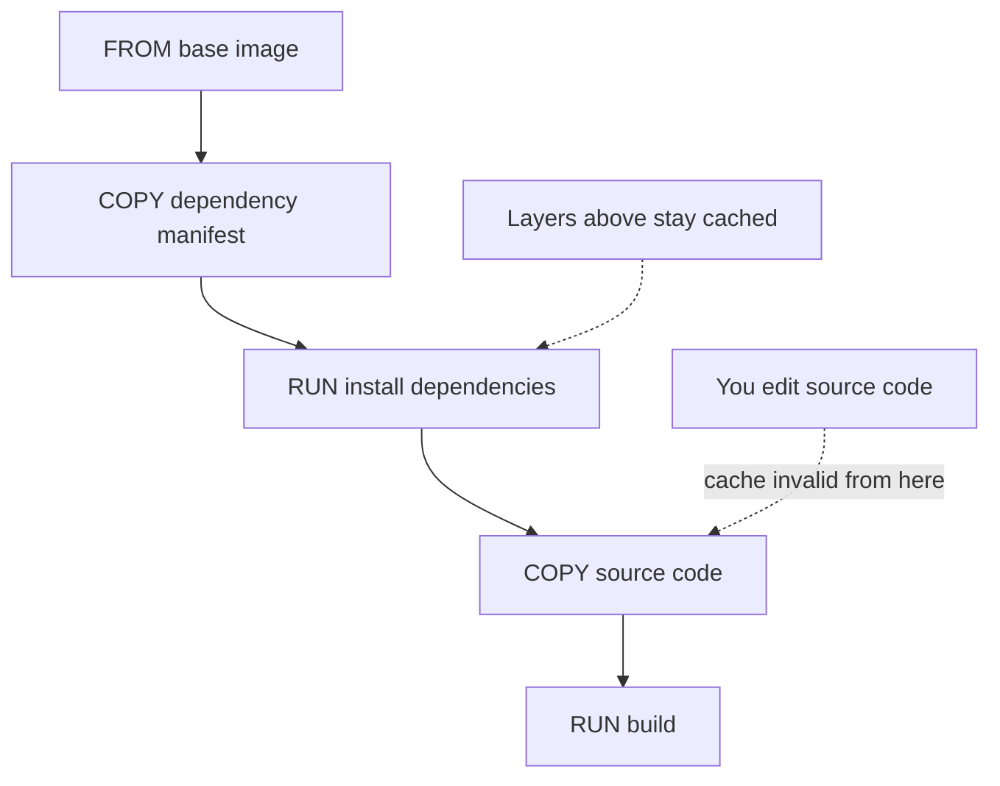

### Multi-stage builds

For compiled languages (Go, Rust) use a **multi-stage build**: stage 1 has the full compiler toolchain and produces the binary; stage 2 starts from a **tiny base image** (e.g. `distroless`, `alpine`, or even `scratch`) and copies **only the binary**. The compiler and build-time dependencies never reach the final image, which can shrink it from ~1 GB to ~10–20 MB.

```dockerfile
# Stage 1: build
FROM golang:1.23 AS build
WORKDIR /src
COPY go.mod go.sum ./
RUN go mod download
COPY . .
ARG GIT_COMMIT
RUN CGO_ENABLED=0 go build -ldflags "-X main.version=${GIT_COMMIT}" -o /out/app ./cmd/server

# Stage 2: run
FROM gcr.io/distroless/static-debian12:nonroot
COPY --from=build /out/app /app
USER nonroot
EXPOSE 8080
ENTRYPOINT ["/app"]
```

## Registries: where images live

A **registry** is where images are stored. The pipeline **pushes** the image after the build stage, and servers **pull** it before the run stage. It is the hand-off point because **build and run may happen on different machines**: an artifact left on the CI runner's disk would be unreachable from the production server.

A registry is just an **HTTP server** holding two kinds of objects:

- **Blobs** (layers and configs), stored and fetched **by digest**.
- **Manifests**, fetched **by tag or digest**.

**Push**: upload every layer blob the registry **does not already have** (checking by digest is a simple lookup), then the config, then the manifest.
**Pull**: download the manifest, read the list of layer digests, fetch **only the layers missing locally**. That is why pulling a new version after a small code change takes seconds: only the last layer is new.

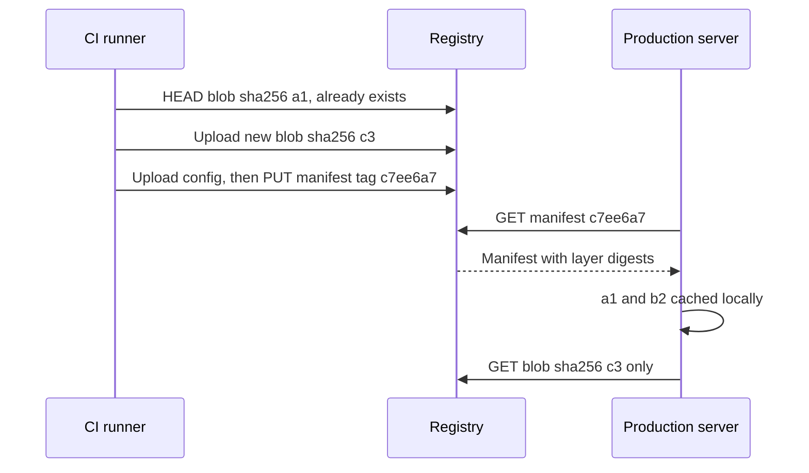

Examples: **Docker Hub**, **GitHub Container Registry (ghcr.io)**, **AWS ECR**, **Google Artifact Registry**, **Azure Container Registry**. You can even run your own registry in a container.

## Who actually runs a container: docker, containerd, runc

When you type `docker run`, the `docker` CLI makes **none** of those `clone` calls. It is only a client:

1. `docker` CLI talks over a **Unix socket** to the **`dockerd`** daemon.
2. `dockerd` hands the job to **`containerd`**, a smaller daemon that manages image and container **lifecycles**: pulling layers, setting up the OverlayFS mount, keeping the process supervised.
3. `containerd` asks **`runc`** to start it. `runc` reads a **JSON description** of the container (the OCI runtime spec), makes the `clone`/`unshare` calls with the namespace flags, writes the cgroup files, changes the root, and `exec`s your process.
4. `runc` then **exits**, leaving a tiny **shim** process as the container's parent (so containerd can restart without killing containers, and exit codes/stdio are collected).

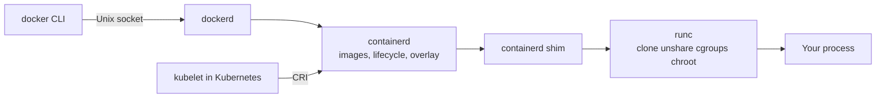

### Why so many pieces? The OCI standard

The **Open Container Initiative (OCI)** standardizes three things:

1. **Image spec**: how an image is laid out (layers, config, manifest).
2. **Runtime spec**: how a runtime is told to run a container (the JSON `runc` reads).
3. **Distribution spec**: how a registry serves images over HTTP.

Because of this, an image built with Docker runs in a Kubernetes cluster that **has no Docker at all**: the kubelet talks to containerd through the **CRI (Container Runtime Interface)**, and containerd calls runc. `runc`'s own C code (`nsexec.c`) creates namespaces in stages (parent clones a child, the child reads the flags and `unshare`s), the very same syscalls as the toy program.

> [!INTERVIEW]
> **"What happens when you run `docker run nginx`?"** The CLI sends the request to `dockerd` over a socket; `dockerd` asks `containerd`, which pulls missing layers from the registry by digest, prepares an OverlayFS root, and calls `runc`. `runc` reads the OCI runtime spec, calls `clone`/`unshare` to create PID, mount, network, UTS, IPC (and other) namespaces, writes cgroup limits under `/sys/fs/cgroup`, pivots the root, and execs nginx as PID 1 in the container, then exits, leaving a shim as parent.

## What makes a good container image

| Property | Why |
|---|---|
| **Small** | Fewer files means fewer things to patch and less to download on every deploy |
| **One process** | The container starts only your service: no init system, no cron daemon, no SSH inside |
| **Non-root** | Run as an unprivileged user so a vulnerability in your code cannot easily escalate to root on the host |
| **Pinned** | Base image at an exact version (or digest), never `latest`, so builds are reproducible next week or next year |
| **Scanned** | Base images and packages accumulate known vulnerabilities (CVEs) weekly; a scanner (e.g. Trivy, Grype) matches the image's package list against vulnerability databases so you can patch, update or drop packages |

```bash
trivy image ghcr.io/acme/app:c7ee6a7
```

> [!WARNING]
> `FROM node:latest` is a reproducibility bug: the same Dockerfile builds a different image tomorrow. Pin `node:22.11-alpine`, or better, pin the digest `node@sha256:...`.

### Buildpacks and Nixpacks

PaaS platforms (Heroku, Render, Railway, and others) deploy straight from a GitHub commit **without a Dockerfile**. They use **buildpacks** (and newer tools like **Nixpacks**) that **detect** the language from files such as `package.json`, `go.mod`, `requirements.txt` or `Cargo.toml`, and build an optimized image using pre-tuned recipes for that runtime. You focus on code; the platform owns the image recipe.

## Running a service on one machine

Before clusters, understand the foundation: running one image on **one Linux machine**. "Running a service" means three things:

1. A **process** the OS starts at boot and **restarts whenever it dies**.
2. A **reverse proxy** in front of it on port **80/443** that **terminates TLS** and forwards to the service's port.
3. **Logs** going somewhere you can read them.

### 1. systemd keeps the process alive

**systemd** is the **init system** (PID 1 of the host) on every mainstream Linux distribution. A **unit file** declares what to run, as which user, and the restart policy:

```ini
# /etc/systemd/system/app.service
[Unit]
Description=My backend
After=network-online.target docker.service
Requires=docker.service

[Service]
User=app
ExecStart=/usr/bin/docker run --rm --name app -p 127.0.0.1:8080:8080 \
  --env-file /etc/app.env ghcr.io/acme/app:c7ee6a7
ExecStop=/usr/bin/docker stop app
Restart=on-failure
RestartSec=5

[Install]
WantedBy=multi-user.target
```

- The process's **stdout/stderr go to the journal**; read them with `journalctl -u app -f`.
- If the process exits, systemd **starts it again** after `RestartSec`.
- In the container world, the "process" in `ExecStart` is simply the `docker run` command.

### 2. The reverse proxy and the request path

Your domain's DNS record resolves to the machine's IP. A **firewall** allows only 80/443 (and SSH). The **reverse proxy** (Nginx or Caddy) receives the traffic, terminates TLS, and forwards to the process on a local port.

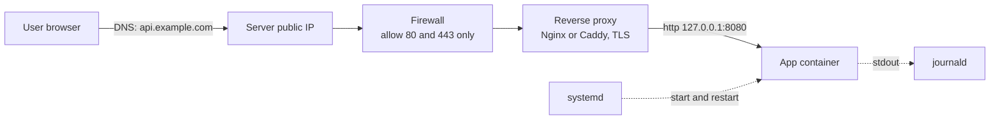

### 3. HTTPS certificates with ACME and Let's Encrypt

To serve **HTTPS** instead of plain HTTP, the reverse proxy needs a **TLS certificate**. Years ago that meant buying one, generating a CSR by hand, emailing files around and remembering to renew it. Today **no human is involved**: issuance is a protocol, **ACME** (Automatic Certificate Management Environment), and **Let's Encrypt** is the free certificate authority (CA) that runs it at internet scale.

How it works:

1. The server's **ACME client** generates a key pair and tells the CA: "I want a certificate for `api.example.com`".
2. The CA replies with a **challenge**: "put this random token at this URL on port 80" (**HTTP-01**) or "publish it as this DNS TXT record" (**DNS-01**).
3. The client completes the challenge.
4. The CA fetches the token **from several vantage points on the internet**. If it sees it, it believes you control the domain.
5. The client sends a **certificate signing request (CSR)**; the CA signs it and returns the certificate.

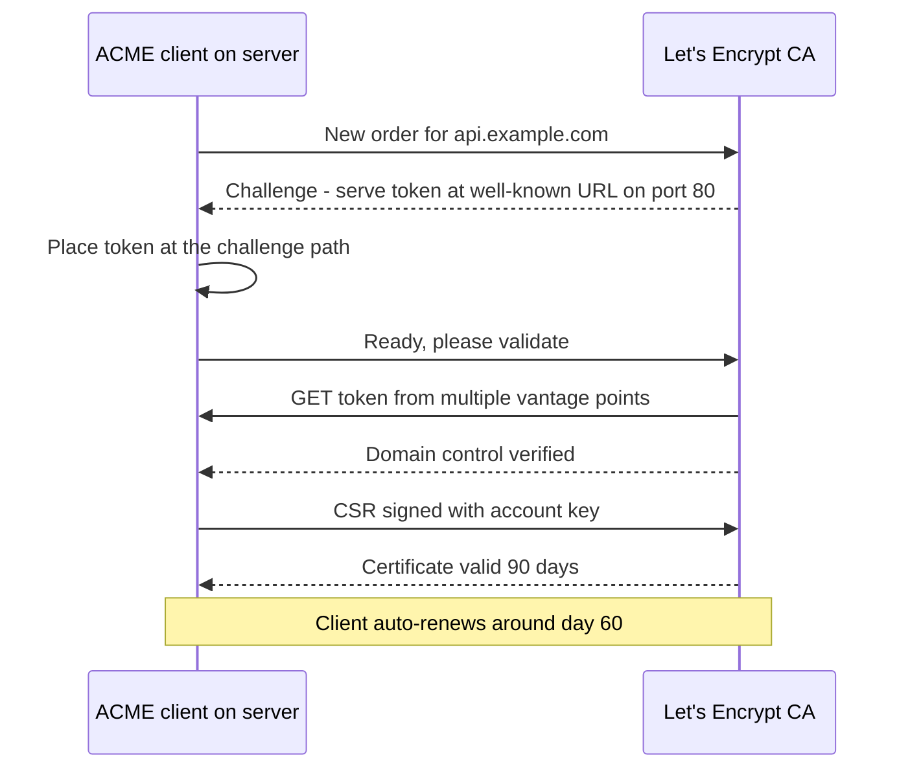

Certificates are valid for only **90 days** on purpose: the client renews automatically around **day 60** anyway, so a short lifetime just means a **stolen key is useful for weeks, not years**.

**Caddy** has ACME built in: give it a domain and it obtains, installs and renews the certificate automatically.

```text
# Caddyfile: that is the whole HTTPS setup
api.example.com {
    reverse_proxy 127.0.0.1:8080
}
```

On startup Caddy's logs show it requesting a certificate, answering the challenge on port 80, and receiving the issued certificate; responses to outside requests then show the issuer (Let's Encrypt) and expiry date.

> [!TIP]
> With Nginx you get the same effect with `certbot` (an ACME client) plus a renewal timer. Either way: DNS A record → server IP, firewall open on 80 (for HTTP-01) and 443.

## Scaling out: multiple machines with Kamal

As users grow, the right way to scale is **horizontal scaling**: add more servers, not more RAM/CPU to one server (vertical scaling). But with, say, three machines, deploying by hand becomes painful: build the image, run it on each machine, start the new version, stop the old one, and do it all **without a single second of downtime** or a single user seeing a 500.

**Kamal** automates exactly this over **SSH** from your laptop or CI:

1. SSH into each host; install Docker if missing.
2. Log in to the registry; **build** the image and **push** it.
3. On each host, **pull** the new image and start the **new container while the old one is still running**.
4. Poll the new container's **health endpoint** (`/health` or `/up`, unauthenticated) until it returns success.
5. Tell the **reverse proxy** (kamal-proxy) to send traffic to the new container.
6. **Stop the old container.**

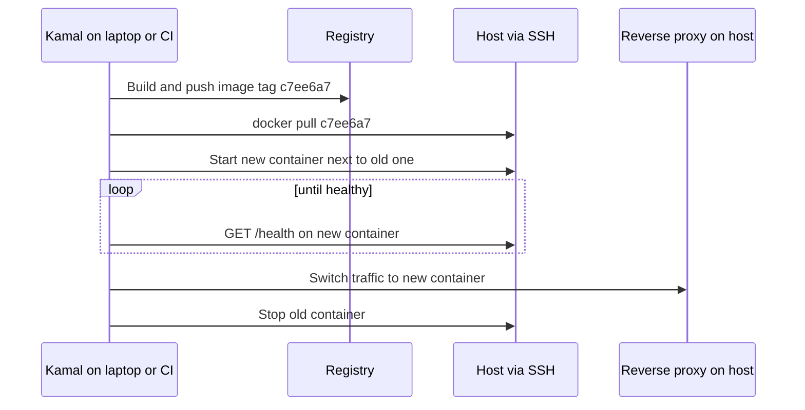

```ts
// A minimal health endpoint used by deploy tools and load balancers
app.get("/health", (_req, res) => res.status(200).json({ status: "ok" }));
```

## Pets vs cattle: immutable infrastructure

Everything so far assumed **the machine is precious**: someone maintains it, patches it, protects it, repairs it when it fails. Over time it becomes more complicated and more unique, and only one or two people know how to fix it. That is the **snowflake server** from the Twelve-Factor App, and when those people leave, the knowledge leaves with them.

The fix, as in the Twelve-Factor chapter:

- **Never configure machines by hand.** Use a code-first, automated approach with minimal human involvement.
- With 3–4 instances running, **never SSH into one to make a change**. Change the code/config and **redeploy**, which **replaces** old instances with new ones. Otherwise that one server **drifts** from the others.
- **Immutable infrastructure**: a server is **never modified after it starts**; it is only ever **replaced** by a new version.

Containers made this cheap: the unit you replace is no longer a physical server with an OS and configuration, it is just a **container image**. Everything about clusters below assumes this: **servers are cheap, replaceable, and never modified in place** (often summarized as "cattle, not pets").

| | Mutable (pets / snowflakes) | Immutable (cattle) |
|---|---|---|
| Change method | SSH in and edit | Build new image, replace instances |
| Drift between servers | Inevitable | Impossible by construction |
| Rollback | Undo by hand, hope | Redeploy previous image |
| Knowledge lives in | People's heads | Code in Git |

## Orchestration with Kubernetes

### The problems an orchestrator solves

With servers cheap and many containers on many machines (say **40 containers on 10 machines**), new questions appear:

- Which container runs on which machine?
- If a machine dies, who notices and who starts replacements elsewhere?
- If traffic doubles or spikes, who starts more copies?
- On a new release, who replaces 40 old containers with 40 new ones, **in the right order**, with **no downtime**?

The program that answers these is an **orchestrator**, and the best known is **Kubernetes** (K8s), the open-source descendant of **Borg**, the system Google ran internally for years. Many real-world failure modes were already found and fixed before it was open-sourced.

### Declarative, not imperative

You do **not** tell Kubernetes *what to do*. You tell it **what you want** (the desired end state), and it works out the steps. You write a document like "I want **3 copies** of this image, listening on this port, with this much memory", submit it to the **API server**, which stores it.

**Controllers** watch the store and run a **reconciliation loop**: compare **desired state** with **actual state** and act on the difference. Want 3, see 2 → start 1. A machine dies, back to 2 → start another.

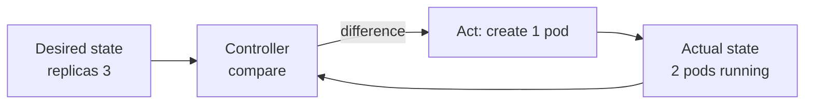

### Architecture: control plane and nodes

| Component | Where | Role |
|---|---|---|
| **API server** | Control plane | The front door; the **only** component that talks to the store |
| **etcd** | Control plane | Distributed, consistent key-value store holding all cluster state |
| **Scheduler** | Control plane | A controller that **picks a machine (node)** for every new pod |
| **Controller manager** | Control plane | Runs the built-in reconciliation loops (ReplicaSet, Deployment, Node...) |
| **kubelet** | Every node | The node agent: asks the API server "what should run here?" and makes it happen via the container runtime (containerd) |
| **kube-proxy** | Every node | Programs networking rules so Service addresses reach the right pods |

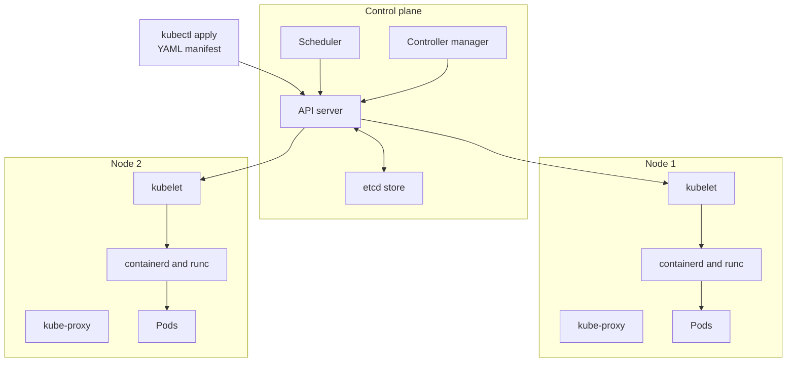

### Pods and labels

The basic unit is not a container but a **pod**: **one or more containers that run together on one machine and share a network namespace (same IP, same `localhost`) and volumes**. Most pods hold just one container (yours). The extra layer exists because sometimes a process needs a **helper (sidecar)**: a log shipper reading the same files, or a proxy on the same localhost.

- The pod is the **unit that gets scheduled**, gets an **IP address**, and gets killed.
- Every pod has its **own IP**, so two pods can both listen on port 80 with no conflict.
- Pods are **mortal**: if their machine dies, the pod is gone forever; a controller creates a *new* pod elsewhere.
- You **never create pods by hand**; everything is declared in config files.
- Pods are grouped and selected by **labels**: key-value pairs like `app=api`, `version=v2`.

### ReplicaSet, Deployment, Service

Three mechanisms turn pods into a running service:

| Object | Job |
|---|---|
| **ReplicaSet** | A controller that keeps **N pods** of a template running |
| **Deployment** | Owns ReplicaSets. When you change the template (e.g. new image), it creates a **new ReplicaSet** and shifts the count from old to new. **You write Deployments, never ReplicaSets directly.** |
| **Service** | A **stable name and virtual IP** (plus DNS name) for a set of pods selected by labels. Pods come and go and their IPs change; the Service forwards to whichever pods currently match its selector. Other services in the cluster call it by name. |

To get **internet traffic into the cluster**: an **Ingress** (now being replaced by the newer **Gateway API**) maps a **hostname + path to a Service**, and an ingress/gateway controller programs a real **load balancer**.

The full chain: **domain → load balancer → Service → pods**. Only the **pods change on each deploy**; everything in front of them is static.

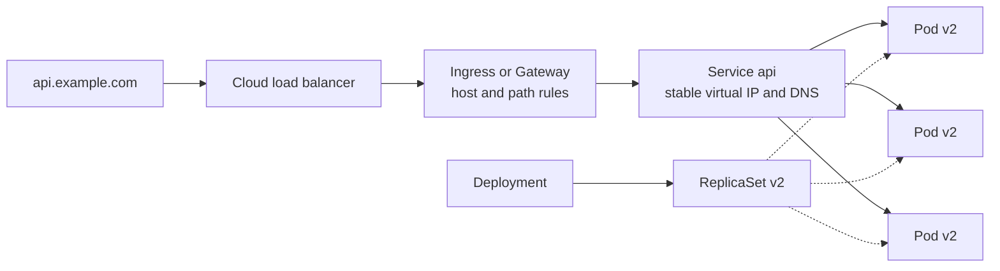

### ConfigMaps, Secrets and resources

- **ConfigMap**: key-value configuration a pod mounts as **environment variables or files**. For **non-sensitive** values (fine if exposed).
- **Secret**: same shape, for **credentials and API keys**, given **only to pods that explicitly reference them**.
- **Resources**, declared per container:
  - **request**: what is **reserved** for you on a node (the scheduler uses it for placement).
  - **limit**: the **hard ceiling** you cannot exceed, enforced by **cgroups**: the memory limit is written to `memory.max`, the CPU limit (a quota) to `cpu.max`. Exceed memory → kernel kills the container → `OOMKilled` → the kubelet restarts it.

> [!NOTE]
> Kubernetes Secrets are only **base64-encoded** by default, not encrypted. Enable encryption at rest for etcd and restrict access with RBAC, or sync from an external secret manager.

```yaml
apiVersion: apps/v1
kind: Deployment
metadata:
  name: api
spec:
  replicas: 3
  selector:
    matchLabels:
      app: api
  strategy:
    type: RollingUpdate
    rollingUpdate:
      maxSurge: 25%
      maxUnavailable: 25%
  template:
    metadata:
      labels:
        app: api
    spec:
      containers:
        - name: api
          image: ghcr.io/acme/api@sha256:3f1c...   # pinned by digest
          ports:
            - containerPort: 8080
          envFrom:
            - configMapRef:
                name: api-config
            - secretRef:
                name: api-secrets
          resources:
            requests:
              cpu: 250m
              memory: 256Mi
            limits:
              cpu: "1"
              memory: 512Mi
          readinessProbe:
            httpGet:
              path: /ready
              port: 8080
            periodSeconds: 5
          livenessProbe:
            httpGet:
              path: /live
              port: 8080
            periodSeconds: 10
            failureThreshold: 3
          startupProbe:
            httpGet:
              path: /live
              port: 8080
            failureThreshold: 30
            periodSeconds: 2
---
apiVersion: v1
kind: Service
metadata:
  name: api
spec:
  selector:
    app: api
  ports:
    - port: 80
      targetPort: 8080
```

### Rolling updates: how a new version goes out

When you push a new image, the **Deployment controller** creates a **new ReplicaSet** for the new template and shifts the count in steps bounded by two numbers:

- **`maxSurge`**: how many pods **above** the desired count may exist during the change.
- **`maxUnavailable`**: how many pods **below** the desired count are allowed during the change.

Both default to **25%**. With 3 replicas (25% of 3 rounds **up** to 1 for surge and **down** to 0 for unavailable), the controller: scales the new set up by 1, **waits for it to be ready**, scales the old set down by 1, waits, and repeats until new = 3 and old = 0.

Two safety mechanisms:

1. **Readiness gate**: a new pod gets **no traffic until it reports ready**. A broken image can only **stall** the rollout; it cannot take the service down.
2. **Old ReplicaSet is kept at 0 replicas, not deleted**, so **rollback** is instant (`kubectl rollout undo`).

In the demo, both versions served traffic side by side for about 30 seconds with no errors: that overlap is what makes the rollout **zero-downtime**.

```mermaid
stateDiagram-v2
    [*] --> S0
    S0: Old 3 and New 0
    S1: Old 3 and New 1 starting
    S2: Old 2 and New 1 ready
    S3: Old 2 and New 2 ready
    S4: Old 1 and New 2
    S5: Old 1 and New 3
    S6: Old 0 and New 3
    S0 --> S1: surge 1 new pod
    S1 --> S2: readiness passes, remove 1 old
    S2 --> S3: surge
    S3 --> S4: remove old
    S4 --> S5: surge
    S5 --> S6: remove last old
    S6 --> [*]
```

```bash
kubectl set image deployment/api api=ghcr.io/acme/api:9b1e2f0
kubectl rollout status deployment/api
kubectl rollout undo deployment/api      # instant rollback to previous ReplicaSet
```

### Probes: readiness, liveness, startup

"Ready" is something **your own code exposes**, typically an HTTP endpoint such as `/health`, `/ready` or `/status` returning **200**. Kubernetes checks it with **probes**: checks the **kubelet** runs against your container on a schedule, either **run a command**, **HTTP GET a path**, or **open a TCP port**.

| Probe | Question it answers | On failure |
|---|---|---|
| **Readiness** | Can this pod serve traffic **right now**? | Pod is **removed from the Service endpoints**; added back when it passes. **Nothing is restarted.** |
| **Liveness** | Is the process **alive / not stuck**? | After enough consecutive failures, the kubelet **kills and restarts** the container |
| **Startup** | Has a slow-starting process **finished starting**? | Holds the other two probes **disabled** until it passes, so slow boots are not killed |

```mermaid
flowchart TD
    S["Container starts"] --> SP{"Startup probe passes?"}
    SP -->|"not yet"| SP
    SP -->|"yes"| RL["Readiness and liveness probes begin"]
    RL --> RP{"Readiness passes?"}
    RP -->|"yes"| IN["In Service endpoints<br/>receives traffic"]
    RP -->|"no"| OUT["Removed from endpoints<br/>no restart"]
    RL --> LP{"Liveness passes?"}
    LP -->|"no, threshold reached"| RS["kubelet restarts container"]
    LP -->|"yes"| OK["Keep running"]
```

> [!WARNING]
> **Never make the liveness probe depend on the database** (or any downstream dependency). If the DB gets slow, every liveness probe times out, the kubelet restarts **perfectly healthy** pods, every pod restarts in a **wave**, the reconnect storm makes the DB **even slower**, and you have turned a slowdown into an outage. **Liveness checks only "is my process stuck?"**; **readiness checks "can I serve right now?"**

```ts
// liveness: is the event loop responsive? (no dependencies)
app.get("/live", (_req, res) => res.sendStatus(200));

// readiness: can we serve right now? (may check critical deps and shutdown state)
let shuttingDown = false;
process.on("SIGTERM", () => { shuttingDown = true; /* then drain, see graceful shutdown */ });
app.get("/ready", async (_req, res) => {
  if (shuttingDown) return res.sendStatus(503);
  try {
    await db.query("SELECT 1");
    res.sendStatus(200);
  } catch {
    res.sendStatus(503);
  }
});
```

### Scaling: one number, or let the autoscaler choose

With an orchestrator, scaling out is **changing a number**: set `replicas: 10` and the ReplicaSet controller starts 7 more pods (you had 3). Nothing else.

The **Horizontal Pod Autoscaler (HPA)** changes that number for you: it watches **average CPU** (or other metrics) across the pods, **adds pods** when it rises above a target and **removes** them when it drops, within a **min/max** you set.

```yaml
apiVersion: autoscaling/v2
kind: HorizontalPodAutoscaler
metadata:
  name: api
spec:
  scaleTargetRef:
    apiVersion: apps/v1
    kind: Deployment
    name: api
  minReplicas: 3
  maxReplicas: 20
  metrics:
    - type: Resource
      resource:
        name: cpu
        target:
          type: Utilization
          averageUtilization: 70
```

### Do you actually need Kubernetes?

Usually **not at the start**. **Start small and add complexity as you earn it** (as users and team grow), so Kubernetes becomes a natural next step rather than a default.

```mermaid
flowchart LR
    A["One machine<br/>systemd or Docker Compose<br/>or a PaaS"] --> B["Several machines<br/>Kamal over SSH"]
    B --> C["Cluster<br/>Kubernetes"]
    C --> D["Kubernetes plus GitOps<br/>Argo CD or Flux"]
```

| Stage | Good for | Cost of operation |
|---|---|---|
| PaaS (Render, Railway, Heroku) | Prototypes, small teams | Lowest; platform does it |
| One VM + systemd / Compose + Caddy | Early product, low traffic | Low |
| Several VMs + Kamal | Real traffic, a few services | Medium |
| Kubernetes | Many services, autoscaling, large teams | High; needs dedicated expertise |

## Continuous delivery vs continuous deployment

The last stages of the pipeline involve two distinct ideas:

- **Continuous delivery**: the software is **always in a deployable state**. Every merged change passes the full pipeline, and at any moment someone can **press a button** to deploy the latest code without worrying.
- **Continuous deployment**: the button press is automated too. **Every change that passes all checks goes to production automatically**, many times a day.

Continuous delivery is a **technical property**. Continuous deployment is a **product/business decision**. A team can have continuous delivery yet still release weekly (customers want a weekly changelog, compliance requires review). The reverse is impossible: **you cannot have continuous deployment without continuous delivery.**

| | Continuous integration | Continuous delivery | Continuous deployment |
|---|---|---|---|
| What | Merge daily, auto build + test | Every build is releasable | Every passing build is released |
| Human step to prod | n/a | Yes, a button | None |
| Nature | Practice | Technical property | Business decision |

> [!INTERVIEW]
> **"Continuous delivery vs continuous deployment?"** Delivery means `main` is always deployable and releasing is a one-click decision; deployment means there is no click, every green build ships automatically. Delivery is a prerequisite for deployment; whether to auto-deploy is a business choice (compliance, release notes, customer expectations).

## Zero-downtime deployment strategies

| Strategy | How | Downtime | Two versions live at once? | Rollback | Extra cost |
|---|---|---|---|---|---|
| **Recreate** | Stop all old, then start all new | **Yes** (the gap) | No | Redeploy old | None |
| **Rolling update** | Replace one (or a few) at a time, gated by readiness | No | **Yes**, briefly | Roll back ReplicaSet | Small surge capacity |
| **Blue-green** | Two full environments; switch router from blue to green | No | No (atomic switch) | **Instant**: switch back | **~2x infrastructure** while both run |
| **Canary** | New version on a small slice (e.g. 1 of 10 pods, 10% traffic); widen as metrics stay healthy | No | Yes, by design | Re-route the slice | Low |
| **Progressive delivery** | Canary automated by a controller that compares metrics at each step | No | Yes | **Automatic** on failed checks | Tooling (e.g. Argo Rollouts, Flagger) |

### Recreate

Simplest: stop every old instance, start the new ones. The gap, even a few seconds, is **downtime**: the frontend's requests fail, users see blank pages, empty states or errors.

### Rolling update

Kubernetes' **default**, shown above. Zero downtime, but **both versions serve traffic at the same time** during the rollout, so a request can land on either. Use it only when that is acceptable: the API, database schema and message formats must be **backward and forward compatible** across adjacent versions.

### Blue-green

Run **two complete production environments**. **Blue** is live and serves all traffic. Deploy the new version to **green**, which gets no user traffic, test it, then **switch the router** so all traffic goes to green. Blue sits idle with the previous version: if errors appear 5–10 minutes later, **switch back instantly**. Best of both worlds (zero downtime and only one version live), at the price of **paying for double the infrastructure** while both exist.

```mermaid
flowchart LR
    U["Users"] --> RT["Router or load balancer"]
    RT -->|"100% before switch"| BL["Blue: v1 live"]
    RT -.->|"100% after switch"| GR["Green: v2 tested"]
    GR -.->|"problem? switch back"| BL
```

### Canary

Named after canaries in coal mines. Deploy the new version to, say, **1 of 10 pods** and route **10%** of traffic to it. Compare its **error rate and latency** against the 9 old pods. If healthy, widen: **10% → 20% → 50% → 75% → 100%**. If metrics worsen at any step, route the traffic back.

```mermaid
flowchart LR
    A["Deploy v2 to 1 pod"] --> B["10% traffic"]
    B --> C{"Errors and latency<br/>OK vs v1?"}
    C -->|"yes"| D["20% then 50% then 75%"]
    D --> E["100% v2"]
    C -->|"no"| F["Route all traffic back to v1"]
```

### Progressive delivery

**Canary, automated.** A controller widens the traffic share on a schedule, compares the same metrics a human would, **programmatically**, at each step, and **rolls back automatically** if a check fails.

## GitOps

So far, the **pipeline pushes** to the cluster. Many large teams instead use **GitOps**, which is a practice/workflow rather than a single tool, defined by its properties:

1. The **desired state of the whole system** (Deployments, Services, ConfigMaps...) is written **declaratively** in files: the end state, not the steps.
2. Those files live in **Git** (GitHub, GitLab, Bitbucket), so every change is **versioned, reviewed and reversible**.
3. An **agent inside the cluster pulls** the files from Git and keeps applying them.
4. If someone changes the cluster directly (not via Git), the agent **detects the drift and corrects it**, making Git the **single source of truth**.

Result: **every deploy is a pull request** that changes an image digest; **merging is the deployment**. The CI pipeline **never holds cluster credentials**: it only builds and pushes the image and opens the PR. The best-known agents are **Argo CD** and **Flux** (themselves controllers).

```mermaid
sequenceDiagram
    participant Dev as Developer
    participant CI as CI pipeline
    participant REG as Registry
    participant GIT as Config repo
    participant AG as Argo CD or Flux in cluster
    participant K as Cluster
    Dev->>CI: Merge code to main
    CI->>REG: Push image sha256 digest
    CI->>GIT: Open PR bumping image digest
    Dev->>GIT: Review and merge PR
    loop continuously
        AG->>GIT: Pull desired state
        AG->>K: Apply diff, fix any drift
    end
```

| | Push-based CD | GitOps (pull-based) |
|---|---|---|
| Who changes the cluster | CI pipeline | Agent inside the cluster |
| Cluster credentials in CI | Yes | **No** |
| Source of truth | Whatever was last applied | **Git** |
| Manual drift | Persists silently | Detected and reverted |
| Rollback | Re-run old pipeline | `git revert` |

GitOps is the balanced **middle ground** between the simple setups (systemd on one box, Kamal on a few) and a full Kubernetes cluster managed by hand.

## Environments, preview environments and promotion

**Environments** (development, staging, production...) are where pipeline stages live. As in the Twelve-Factor App, each is the **same code and the same container image with different configuration**.

- **Preview environment**: a **temporary environment created automatically for each pull request**, so the author and reviewers can try the change live instead of only reading code. It is **destroyed when the PR is merged or closed**.
- **Promotion**: moving the **same artifact** (the exact image digest, not a rebuild) from one environment to the next, usually through an **approval gate** where a human decides whether it proceeds to staging or production.

```mermaid
flowchart LR
    PR["Pull request"] --> PV["Preview env<br/>destroyed on merge"]
    PR -->|"merge"| BLD["Build image once<br/>sha256 digest"]
    BLD --> DEV["Dev"]
    DEV -->|"promote"| STG["Staging"]
    STG -->|"approval gate"| PRD["Production"]
```

> [!IMPORTANT]
> **Build once, promote the same artifact.** Rebuilding per environment means production runs something that was never tested in staging.

## Infrastructure as code (IaC)

### The one-hour test

Everything above runs **on machines**, and someone set those up: the cluster, EC2 hosts, load balancer, DNS records, security groups, clicked through the AWS console or typed into the CLI.

Ask: *If we had to rebuild our entire infrastructure in a brand-new cloud account in **one hour**, identical to today's, could we?* With hand-built infrastructure, maybe, if someone documented every screen; even then, unlikely in an hour without mistakes. Without the document, much harder. Without the person, close to impossible to reproduce **exactly**, with every config and edge case.

**Infrastructure as code**: machines, networks, permissions and configuration are written in **files**, **version-controlled**, stored securely, every change recorded in Git. A tool reads those files and **applies exactly that infrastructure** to a cloud account (AWS, GCP, Azure). Running it any number of times yields the **same infrastructure** (it is **idempotent**).

### Three categories of IaC tools

| Category | Job | Typical tools |
|---|---|---|
| **Provisioning** | Create machines, networks, load balancers, managed services | **Terraform**, **OpenTofu** (open-source fork), Pulumi, CloudFormation |
| **Configuration management** | Given a machine, install and configure everything on it from a script | **Ansible** (also Chef, Puppet) |
| **Image baking** | Build a **machine image** with everything pre-installed so new machines are ready at boot | **Packer** (+ **cloud-init** for the first-boot script) |

### Terraform workflow

You declare resources in **HCL blocks**, run **`terraform plan`** to preview what will be created/changed/destroyed, review it, then **`terraform apply`**. Terraform calls the cloud provider APIs for you; you only need Terraform's language. After Terraform's licence change (to BSL), the community forked it as **OpenTofu**, fully open source and not owned by any corporation.

```hcl
resource "aws_security_group" "web" {
  name = "web"
  ingress {
    from_port   = 443
    to_port     = 443
    protocol    = "tcp"
    cidr_blocks = ["0.0.0.0/0"]
  }
}

resource "aws_instance" "app" {
  count                  = 2
  ami                    = "ami-0abcdef1234567890"
  instance_type          = "t3.small"
  vpc_security_group_ids = [aws_security_group.web.id]
}

terraform {
  backend "s3" {
    bucket       = "acme-tf-state"
    key          = "prod/terraform.tfstate"
    region       = "ap-south-1"
    encrypt      = true
    use_lockfile = true   # state locking
  }
}
```

```bash
terraform init
terraform plan     # review the diff
terraform apply    # make the cloud match the files
```

### Terraform state

When Terraform creates a machine from a block, it must remember **"this block is that machine"**. It records the cloud provider's **resource ID** in a **state file**. On the next run it reads the state, **asks the cloud for the current real attributes**, compares them with your code, and the **difference becomes the plan**.

```mermaid
flowchart LR
    CODE["HCL files<br/>desired"] --> PLAN["terraform plan"]
    ST["State file<br/>block to resource ID"] --> PLAN
    CLOUD["Cloud APIs<br/>actual"] --> PLAN
    PLAN --> DIFF["Diff: create update destroy"]
    DIFF --> APPLY["terraform apply"]
    APPLY --> CLOUD
    APPLY --> ST
```

Three rules about state:

1. **Lose the state and Terraform forgets everything.** It thinks nothing exists and plans to **create it all again**, even though the infrastructure is live.
2. **Two people running Terraform with two copies of state overwrite each other.** Keep state in a **central remote backend with locking** (e.g. S3 with a lock, Terraform Cloud), never on laptops.
3. **State contains every attribute the cloud returned, including secrets.** **Never commit it to Git**; store it **encrypted and access-controlled**.

> [!WARNING]
> Add `*.tfstate` and `*.tfstate.backup` to `.gitignore`. A committed state file can leak database passwords and keys in plain text.

### Drift

**Drift** = the real infrastructure no longer matches the code. Example: during an incident someone opens **port 22** to the world on a security group directly in the console/CLI. The Terraform files do not know. On the next `plan`, Terraform sees a rule that is **not in the code** and, since **code is the source of truth**, plans to **remove** it; `apply` closes the port again.

In the demo: `plan` with two machines and a security group shows **no changes** (files and account agree). After opening port 22 via the CLI, `plan` shows **1 change** to close it; `apply` closes it.

> [!TIP]
> Emergency console changes are sometimes necessary, but **back-port them into code immediately**, or the next apply will silently revert your fix. Run `terraform plan` on a schedule to detect drift early.

## Operations: SLIs, SLOs, SLAs and error budgets

CI/CD, cheap servers and IaC are **internal** practices. Users do not care whether servers were set up by hand or by Terraform; they care about **results**. We need numbers that describe what users experience.

| Term | Meaning | Example |
|---|---|---|
| **SLI** (Service Level Indicator) | A **measurement** of something users care about | % of requests that succeed; % of requests answered within 300 ms |
| **SLO** (Service Level Objective) | A **target for an SLI over a time window** (always has a window) | 99.9% of requests succeed over a rolling 30 days |
| **SLA** (Service Level Agreement) | A **contract with customers** that bets on an SLO, with **penalties** | If availability drops below 99.9% in a month, customers get service credits or refunds |

```mermaid
flowchart LR
    SLI["SLI: measured<br/>success rate 99.95%"] --> SLO["SLO: internal target<br/>99.9% over 30 days"]
    SLO --> SLA["SLA: external contract<br/>refund below 99.9%"]
    SLO --> EB["Error budget<br/>0.1% = 43 min per month"]
```

### The nines

Each extra nine is a **10x stricter promise**:

| Availability | Downtime per 30 days | Downtime per year |
|---|---|---|
| 99% | ~7.2 hours | ~3.65 days |
| 99.9% | **~43 minutes** | ~8.8 hours |
| 99.99% | ~4.3 minutes | **~52.6 minutes** |
| 99.999% | ~26 seconds | ~5.3 minutes |

### Error budgets

If the SLO is 99.9%, then **0.1% failure is allowed**. Teams treat that allowance as an **error budget**: a number tracked like any other resource and **spent deliberately** on deployments, maintenance windows, experiments and risky migrations. It is not permission to be careless; it is a small window where genuine failures are acceptable.

- **Budget left** → ship as fast as you like, many deploys a day.
- **Budget exhausted** (e.g. it is the 23rd and yesterday's outage used all 43 minutes) → **freeze deployments** until the budget recovers (the window rolls forward), and spend all effort on **reliability**.

> [!INTERVIEW]
> **"What is an error budget and why is it useful?"** It is `1 - SLO`: for 99.9% monthly availability, about 43 minutes of allowed failure. It turns the dev-vs-ops argument into arithmetic: while budget remains, teams can take risks and ship fast; when it is spent, feature releases pause and the team works on reliability. It aligns speed and stability with a shared, measurable number.

## On-call, paging and incident response

### On-call rotation

When an SLI drops, someone must look at it. That person is **on call**. With an **on-call rotation**, one engineer per week (in a team of, say, three) is responsible for responding to **pages**, with a **secondary/backup** engineer in case the primary cannot respond (personal emergency, no network).

**Paging** comes from the old **pager** devices. Today it means an urgent notification on your phone from an incident-management service (PagerDuty, Opsgenie, incident.io, etc.). Pages are triggered by **alerts** from your **observability** stack (see the logging/monitoring chapter): e.g. "CPU above 90% → Slack message" for low urgency, "error-rate SLO burning fast → page the on-call" for high urgency.

### Incident response

When a page becomes an **outage** (many errors, users cannot reach the service, blank pages), teams follow a small structure:

| Role | Responsibility |
|---|---|
| **Incident commander** | Coordinates; holds the big picture (impact, symptoms, hypotheses). **Does not fix** the issue themselves |
| **Responder(s) / fixers** | Engineers actually diagnosing and fixing |
| **Communicator** | Updates the public **status page** and internal management, so fixers never have to stop to answer questions |

An **incident document** records the timeline as it happens: when things occurred, symptoms, what was tried, results.

> [!IMPORTANT]
> **First mitigate, then find the root cause.** The first goal in an outage is to **stop the damage**: roll back the last deploy, turn off a feature flag, disable a feature, so the service returns to how it was an hour ago. Only then investigate the root cause and ship a proper fix.

```mermaid
stateDiagram-v2
    [*] --> Detected: alert pages on-call
    Detected --> Triage: assign commander, fixer, communicator
    Triage --> Mitigate: rollback or flag off
    Mitigate --> Stable: users unaffected
    Stable --> RootCause: investigate
    RootCause --> Fixed: proper fix deployed
    Fixed --> Postmortem: blameless writeup
    Postmortem --> [*]
```

### Postmortems and blameless culture

After the outage and once the root cause is known, the team publishes a **postmortem** (an extension of the incident document):

- what happened, with a **minute-by-minute timeline** of symptoms, attempts and their effects,
- **impact** on users (what percentage was affected),
- the **root cause**,
- **action items** so this class of issue never recurs.

Example: **Cloudflare's November 2025 outage**. A **permission change in a database** caused a query to return **duplicate rows**, which made a generated configuration (feature) file **double in size**. The software that read the file had a **size limit**, so it failed, taking down a large part of Cloudflare's traffic. The public postmortem has the timeline, impact table, causes and actions.

Notice: **no person is named or blamed**. This is a **blameless culture**, and it exists for a practical reason, not to be nice. If the postmortem says "Alice typed the wrong command", you never learn **why** the command looked right to her: the confusing tool, missing guardrail, misleading docs. Every software failure involves humans; if you do not understand it from the human's perspective, you cannot prevent it. **Blame systems, never people.**

### Operating principles you will see in postmortems

- **Design for failure**: assume every machine and every dependency will fail at some point; write code that survives it (timeouts, retries with backoff, redundancy, graceful degradation).
- **Keep deployment simple**: files and config, not manual setup.
- **One change at a time**: when something breaks you know what changed, and the fix (often a rollback) is nearly instant.

## Chaos engineering

Everything so far is about **surviving** failure. **Chaos engineering** **causes failure on purpose**, to verify the safety mechanisms actually work **before** a real outage tests them:

- **Kill a pod in production during business hours** and check the ReplicaSet replaces it.
- **Take a machine out** and check pods get rescheduled elsewhere.
- **Inject latency into a dependency** and check that timeouts fire.

In the demo, with three pods running, one is deleted: it goes to Terminating, a replacement immediately appears as Pending, then ContainerCreating, then Running. That self-healing is the reliability you want, and the only way to trust it is to test it. (Netflix's **Chaos Monkey** popularized this.)

```bash
kubectl delete pod api-7d9c8b6f5-x2k4q
kubectl get pods -w     # watch the replacement come up
```

## Software supply chain security

Where does the code in your image come from? Some is yours. The rest is **someone else's**: the base image, the language runtime, and the hundreds of packages from `npm install` or `go mod download`. Each is a place where another party's mistake (or attack) can hurt your service. This is the **software supply chain**.

Two common failure modes:

1. **A dependency disappears or changes**: a package is unpublished or altered in the registry and breaks thousands of builds (the classic example is npm's `left-pad` in 2016).
2. **A dependency is poisoned**: in **2024**, the **xz-utils** compression library, which most Linux systems depend on, shipped a **backdoor** (CVE-2024-3094). It was inserted into the **release tarball** (via the release build scripts), **not visible in the source repository**, so reviewers reading the code did not see it, but anyone building from the tarball got the backdoor.

Defenses:

- **Pin every dependency and every base image** to exact versions (lock files, `@sha256:` digests); never `latest` or floating ranges that change between deploys.
- **Scan** images and dependencies against public vulnerability databases in CI.
- (Beyond the video, standard practice) generate an **SBOM** (software bill of materials), **sign** images (e.g. Sigstore/cosign), and verify provenance.

```mermaid
flowchart TB
    subgraph IMG["Your container image"]
        Y["Your code"]
        D["Hundreds of packages<br/>npm or Go modules"]
        RT["Language runtime"]
        B["Base image OS packages"]
    end
    X1["Package removed or changed"] -.-> D
    X2["Poisoned release tarball<br/>xz-utils 2024"] -.-> B
    P["Pin versions and digests"] --> IMG
    S["Scan for CVEs in CI"] --> IMG
```

## Putting it all together

The goal of this chapter is a **mental model**, not mastery of every tool: DevOps and cloud infrastructure are far too large for one chapter. When you read docs or articles about any of these concepts, you should now know where it fits:

```mermaid
flowchart LR
    A["Commit to main<br/>trunk-based"] --> B["CI: unit and integration tests"]
    B --> C["Build image once<br/>tag commit hash"]
    C --> D["Scan and push to registry"]
    D --> E["Preview or staging<br/>promotion gate"]
    E --> F["Deploy: rolling, blue-green<br/>or canary"]
    F --> G["Cluster on IaC-provisioned<br/>infrastructure"]
    G --> H["SLIs and SLOs<br/>alerts and on-call"]
    H -->|"incident: rollback"| F
    H -->|"postmortem actions"| A
```

## Common mistakes & misconceptions

- **"A container is a lightweight VM."** No. It is a host process with namespaces, cgroups and an overlay root file system. It shares the host kernel.
- **"CI is the Jenkins/GitHub Actions server."** CI is the *practice* of merging into the shared branch at least daily with automated verification. Long-lived feature branches plus a CI server is not continuous integration.
- **"Deploying less often is safer."** DORA data says the opposite: small frequent deploys are easier to debug and roll back.
- **Using GitFlow for a web backend.** Its author himself recommends simpler flows for continuously shipped web apps; use trunk-based development plus feature flags.
- **`npm install` in CI or `FROM node:latest`.** Both break reproducibility. Use `npm ci` with the lock file and pin images by version or digest.
- **Copying the whole source before installing dependencies in a Dockerfile.** Every code change reinstalls all dependencies. Copy the manifest and lock file first.
- **Shipping the compiler in the runtime image.** Use multi-stage builds for compiled languages.
- **Running containers as root.** A code vulnerability then has an easier path to the host.
- **Writing important files inside the container.** The writable layer is discarded with the container; use volumes or backing services.
- **Long-lived cloud keys in repo secrets.** Use OIDC federation with short-lived credentials scoped to repo and branch.
- **Liveness probes that check the database.** A slow DB triggers restart waves across all pods. Liveness = "is my process stuck"; readiness = "can I serve now".
- **Assuming rolling updates mean only one version is live.** Both versions serve traffic during the rollout; changes must be backward compatible. Use blue-green if you need a clean cut-over.
- **SSH-ing into one server to hot-fix it.** Creates drift and snowflakes. Change code and redeploy.
- **Committing Terraform state, or keeping it on a laptop.** It contains secrets, and losing it makes Terraform plan to recreate everything. Use an encrypted, locked remote backend.
- **Console changes during an incident that are never back-ported.** The next `terraform apply` silently reverts them.
- **Hunting for the root cause during an outage before mitigating.** Roll back or flip the feature flag first.
- **Blaming a person in a postmortem.** You lose the information about why the mistake seemed reasonable, so it will happen again.
- **Reaching for Kubernetes on day one.** Start with one machine or a PaaS, then Kamal, then a cluster when the scale justifies it.

## Interview questions

<details>
<summary><strong>Q: What is DevOps, and what problem did it originally solve?</strong></summary>

DevOps merges development and operations. Traditionally developers were rewarded for shipping features fast and ops for keeping production stable, so ops resisted deployments and each side blamed the other when things broke. Releases became rare, large and risky. DevOps is the set of practices that removes that conflict: infrastructure as code, everything in version control, one-command builds and deploys, feature flags, shared observability. The unifying idea is to make deployment small, cheap and boring so it can happen many times a day.

</details>

<details>
<summary><strong>Q: What are the four DORA metrics and why are speed and stability not a trade-off?</strong></summary>

Speed: change lead time (commit to production) and deployment frequency. Stability: change failure rate (% of deploys causing failures) and failed deployment recovery time. Top teams deploy on demand, ship a commit in under a day, fail about 5% of the time and recover in under an hour; bottom teams deploy every 1-6 months, fail about 40% of the time and take a week to recover. Small, frequent deploys have a tiny blast radius, are easy to bisect and roll back, and the author still remembers the code, so frequency improves stability.

</details>

<details>
<summary><strong>Q: Explain continuous integration, continuous delivery and continuous deployment.</strong></summary>

**CI**: every developer merges into one shared branch at least daily, and every merge triggers an automated build and test run. **Continuous delivery**: every change that passes the pipeline leaves `main` in a deployable state; production releases are a button press. **Continuous deployment**: no button, every green build goes to production automatically. Delivery is a technical property; deployment is a business decision built on top of it. You can have delivery without deployment (weekly releases for compliance), never the reverse.

</details>

<details>
<summary><strong>Q: Why is trunk-based development preferred over GitFlow for backends? How do you ship a feature that takes three weeks?</strong></summary>

GitFlow (develop, release, hotfix branches) was designed for installed software where multiple versions are supported at once. A web backend has exactly one production version, the latest, so those branches only add drift and painful merges. Trunk-based development keeps one `main`, feature branches that live a day or two, and releases from `main`. A three-week feature is merged in small pieces daily and hidden behind a feature flag until it is complete, so the code is in production but invisible to users.

</details>

<details>
<summary><strong>Q: What makes a build reproducible and how do you know what version is running in production?</strong></summary>

A reproducible build does not depend on what happens to be installed on the build machine: it pins the compiler/runtime version and installs exact dependency versions from a committed lock file (`go.sum`, `package-lock.json` with `npm ci`), so the same source always produces the same artifact. Base images are pinned by version or digest. Every artifact and image is tagged with the commit hash, and the running service exposes that hash through a version or health endpoint, so after a deploy you can verify which commit is live.

</details>

<details>
<summary><strong>Q: How does a CI pipeline authenticate to AWS securely?</strong></summary>

Instead of storing long-lived access keys as repository secrets (readable by every job, valid until rotated if leaked), use OIDC federation. The job requests a short-lived signed JWT from GitHub's OIDC provider with claims for repo, branch and workflow. AWS is configured to trust GitHub's issuer only when the claims match a specific repo and branch; it verifies the token and returns temporary credentials that expire when the job ends. No permanent secret exists to steal.

</details>

<details>
<summary><strong>Q: What exactly is a container at the Linux level? Contrast it with a VM.</strong></summary>

A container is an ordinary process started by the host kernel, visible in the host's `ps`. The kernel isolates it with **namespaces** (PID, mount, network, UTS, IPC, user, cgroup, time) so it sees its own process tree, hostname, mounts and network stack; limits it with **cgroups** (`memory.max`, `cpu.max`, `pids.max` under `/sys/fs/cgroup`); and gives it a root file system assembled from image layers with **OverlayFS**. A VM runs its own guest kernel on virtualized hardware via a hypervisor: much stronger isolation but GBs of RAM and slower boot. Containers are lighter and faster but share the host kernel.

</details>

<details>
<summary><strong>Q: Your pod keeps showing OOMKilled. What is happening under the hood and what do you do?</strong></summary>

The container's memory limit from the pod spec was written by the runtime into its cgroup's `memory.max`. When the process's memory usage exceeded it, the kernel's OOM killer terminated the process, and the kubelet reports `OOMKilled` and restarts it per the restart policy. Check memory metrics and `kubectl describe pod`; determine whether it is a leak, an unbounded cache or buffer, or a genuinely too-low limit (and for runtimes like the JVM or Node, whether the heap size is configured to fit the limit). Fix the leak or raise the limit and request appropriately.

</details>

<details>
<summary><strong>Q: How are container images structured, and why does pulling a new version after a small change take seconds?</strong></summary>

An OCI image is a set of layer blobs (tarballs of file changes, each identified by its SHA-256 digest), a config JSON (layer order, entrypoint, env, workdir, ports, user), and a manifest JSON pointing to the config and layers; the image digest is the hash of the manifest. Tags are human-readable pointers to digests. Registries store blobs by digest, so shared layers are stored once. On pull, the client fetches the manifest and downloads only the layers it does not already have. A code change usually only changes the last layer, so only that small blob is downloaded.

</details>

<details>
<summary><strong>Q: How would you write a Dockerfile for a Go service that builds fast and produces a small, secure image?</strong></summary>

Use a multi-stage build. In the builder stage (pinned `golang` version), copy `go.mod` and `go.sum` first and run `go mod download` so the dependency layer stays cached, then copy the source and build a static binary stamped with the commit hash. In the final stage start from a tiny pinned base such as distroless or `scratch`, copy only the binary, run as a non-root user, and set a single entrypoint. Then scan the image for CVEs in CI. The result is small, single-process, non-root, pinned and scanned.

</details>

<details>
<summary><strong>Q: What happens step by step when you run `docker run`?</strong></summary>

The `docker` CLI sends the request over a Unix socket to `dockerd`. `dockerd` delegates to `containerd`, which pulls missing layers from the registry, sets up the OverlayFS mount and manages the lifecycle. `containerd` launches `runc` through a shim; `runc` reads the OCI runtime spec JSON, calls `clone`/`unshare` with namespace flags, writes cgroup limits, pivots the root and execs the process, then exits, leaving the shim as parent. Thanks to the OCI standards, Kubernetes can skip Docker entirely and talk to containerd through the CRI.

</details>

<details>
<summary><strong>Q: Explain readiness, liveness and startup probes. What goes wrong if a liveness probe checks the database?</strong></summary>

Readiness decides whether the pod receives traffic; failing removes it from Service endpoints without restarting it. Liveness decides whether the process is alive; repeated failures make the kubelet restart the container. Startup holds the other two off until a slow-starting app has booted. If liveness checks the database and the DB slows down, every pod's liveness probe times out, the kubelet restarts healthy pods in a wave, the reconnecting pods pile more load on the DB, and a slowdown becomes a full outage. Liveness should only detect a stuck process; dependency checks belong, carefully, in readiness.

</details>

<details>
<summary><strong>Q: Walk through a Kubernetes rolling update with 3 replicas. How does it guarantee zero downtime and easy rollback?</strong></summary>

Changing the image in the Deployment creates a new ReplicaSet. With default `maxSurge` 25% (rounds up to 1) and `maxUnavailable` 25% (rounds down to 0), the controller adds one new pod, waits for its readiness probe, removes one old pod, and repeats until the new set has 3 and the old has 0. Traffic only goes to ready pods, so a broken image just stalls the rollout. The old ReplicaSet is kept at 0 replicas, so `kubectl rollout undo` is instant. The catch: both versions serve traffic during the rollout, so changes must be backward compatible.

</details>

<details>
<summary><strong>Q: Compare recreate, rolling, blue-green and canary deployments. When would you choose each?</strong></summary>

**Recreate** stops everything then starts the new version: simple but causes downtime; acceptable only for internal tools or incompatible changes with a maintenance window. **Rolling** replaces instances gradually: zero downtime, cheap, but two versions coexist. **Blue-green** runs two full environments and switches the router atomically: zero downtime, one version at a time, instant rollback, but roughly double infrastructure cost while both run. **Canary** sends a small slice (say 10%) to the new version, compares error rate and latency, then widens to 100% or reverts: best for risky changes at scale. **Progressive delivery** automates the canary analysis and rollback.

</details>

<details>
<summary><strong>Q: What is GitOps and what are its advantages over a pipeline that runs kubectl apply?</strong></summary>

GitOps declares the entire desired state of the cluster in files in Git; an agent inside the cluster (Argo CD, Flux) continuously pulls and applies them and reverts any manual drift, so Git is the single source of truth. A deploy is a pull request that changes an image digest; merging it is the deploy. Advantages: every change is reviewed, versioned and revertible with `git revert`; the CI pipeline never holds cluster credentials because it only pushes images and opens PRs; and out-of-band changes cannot silently persist.

</details>

<details>
<summary><strong>Q: What is Terraform state, and what goes wrong if you lose it, share it badly, or commit it?</strong></summary>

State maps each resource block in your code to the real cloud resource ID and stores its attributes. `plan` compares code, state and the live cloud to compute a diff. If state is lost, Terraform thinks nothing exists and plans to create everything again. If two people run with separate copies, they overwrite each other, so state belongs in a remote backend with locking. State contains all attributes, including secrets, so it must never be committed and should be encrypted with restricted access.

</details>

<details>
<summary><strong>Q: Someone opened port 22 in the AWS console during an incident. What happens on the next Terraform run?</strong></summary>

That is drift: the live infrastructure differs from the code. Terraform treats the code as the source of truth, so `terraform plan` shows a change to remove the rule, and `apply` closes port 22 again. If the change was needed, it should be added to the Terraform code (and reviewed) immediately; otherwise the next apply reverts it. Scheduled `plan` runs help detect drift early.

</details>

<details>
<summary><strong>Q: Define SLI, SLO, SLA and error budget. What does 99.9% availability allow?</strong></summary>

An SLI is a measured indicator users care about, such as the fraction of successful requests or requests under 300 ms. An SLO is a target for an SLI over a window, for example 99.9% success over 30 days. An SLA is a contract with customers, with penalties such as credits if the SLO is missed. The error budget is 1 minus the SLO: 99.9% allows about 43 minutes of failure per 30 days, and 99.99% about 52 minutes per year. While budget remains the team ships fast; when it is spent, deploys freeze and effort goes into reliability.

</details>

<details>
<summary><strong>Q: Production is down after a deploy. Walk through how a mature team handles it.</strong></summary>

The on-call engineer is paged by an SLO or error-rate alert. An incident commander coordinates, one or more responders work the problem, and a communicator updates the status page and stakeholders. The first goal is mitigation, not root cause: roll back the deploy or turn off the feature flag to restore service. Everything is logged in an incident document. After recovery the team finds the root cause, ships a real fix, and writes a blameless postmortem with timeline, user impact, root cause and action items, focusing on what in the system allowed the mistake.

</details>

<details>
<summary><strong>Q: What is software supply chain risk and how do you mitigate it?</strong></summary>

Most of what runs in your image is other people's code: the base image, the runtime and hundreds of packages. A dependency can disappear or change and break builds, or it can be poisoned, as with the 2024 xz-utils backdoor that lived in the release tarball rather than the visible source. Mitigations: pin every dependency and base image to exact versions or digests with lock files, never use `latest`, scan images and dependencies for known CVEs in CI, and ideally generate SBOMs and sign and verify artifacts.

</details>

## Cheat sheet

- **DevOps goal**: deployments small, cheap, boring → many per day.
- **DORA**: lead time, deploy frequency (speed) · change failure rate, recovery time (stability). Elite: on demand, under 1 day, ~5%, under 1 hour.
- **CI** = merge to the shared branch daily + automated build/test. Practice, not a server.
- **Trunk-based**: one `main`, 1–2 day branches, feature flags for long work. GitFlow is for installed, multi-version software.
- **Build**: source → artifact; pinned toolchain + lock file → byte-identical. `go build` + `go.sum`, `npm ci` + `package-lock.json`. Stamp the commit hash.
- **Pipeline**: fast/cheap stages first (compile, unit), then integration/staging, then prod. Fail fast and notify the author.
- **GitHub Actions**: workflow (YAML in `.github/workflows`) · event · job (one machine, `needs:`) · runner (fresh VM) · step. Always checkout first.
- **OIDC** > repo secrets: short-lived JWT → cloud verifies repo + branch → temp creds for that job only.
- **Deploy versions**: commit hash (+ build ID), not semver. Expose it on `/version` or `/health`.
- **Container** = process + **namespaces** (see) + **cgroups** (use) + **OverlayFS** (files). Shares the host kernel.
- **8 namespaces**: PID, mount, network, UTS, IPC, user, cgroup, time. **Syscalls**: `clone`, `unshare`, `setns`.
- **cgroups**: `/sys/fs/cgroup/<group>/memory.max`, `cpu.max`, `pids.max`, `cgroup.procs`. Over memory → OOM killer → `OOMKilled`.
- **OverlayFS**: read-only lower layers + writable upper; copy-on-write; the upper layer dies with the container.
- **Image** = layer blobs (sha256) + config JSON + manifest JSON; image ID = manifest digest; tag → digest.
- **Dockerfile caching**: cache valid until the first changed instruction. Copy the dependency manifest, install, then copy the source.
- **Multi-stage**: build with the compiler, ship only the binary on distroless/scratch.
- **Good image**: small, one process, non-root, pinned, scanned.
- **Registry**: HTTP server; blobs by digest, manifests by tag/digest; push/pull only missing layers.
- **Runtime stack**: docker CLI → dockerd → containerd → shim → runc → process. K8s: kubelet → CRI → containerd. **OCI** = image + runtime + distribution specs.
- **One machine**: systemd (`Restart=on-failure`, journald) + Caddy/Nginx (TLS) + logs. **ACME/Let's Encrypt**: challenge (HTTP-01/DNS-01) → CSR → 90-day cert, auto-renew around day 60.
- **Kamal**: SSH, build, push, pull, start new beside old, wait on `/health`, switch proxy, stop old.
- **Immutable infra**: never modify, only replace. No SSH hot-fixes.
- **K8s**: declarative + reconciliation. API server ↔ etcd; scheduler; controller manager; kubelet + kube-proxy per node.
- **Pod** (1+ containers, shared net/volumes, own IP, mortal) · **ReplicaSet** (N pods) · **Deployment** (owns RS, rollouts) · **Service** (stable VIP/DNS via label selector) · **Ingress/Gateway API** (host/path → Service) · **ConfigMap/Secret** · **requests** (reserved) vs **limits** (cgroup-enforced).
- **Rolling update**: `maxSurge` / `maxUnavailable` default 25%; gated by readiness; old RS kept at 0 for rollback.
- **Probes**: readiness (traffic, no restart) · liveness (restart, never check the DB) · startup (protects slow boots).
- **HPA**: target CPU, min/max replicas.
- **Strategies**: recreate (downtime) · rolling (two versions overlap) · blue-green (2x cost, instant rollback) · canary (10% → 100% by metrics) · progressive (automated canary).
- **GitOps**: desired state in Git, in-cluster agent pulls and fixes drift (Argo CD, Flux), deploy = PR, no cluster creds in CI.
- **Environments**: same image, different config. Preview env per PR. Promote the same artifact through approval gates.
- **IaC**: provisioning (Terraform/OpenTofu) · config management (Ansible) · image baking (Packer + cloud-init). `plan` → review → `apply`.
- **TF state**: remote + locked + encrypted, never in Git. **Drift**: console changes get reverted by the next apply.
- **SLI** (measure) → **SLO** (target over a window) → **SLA** (contract with penalties). 99.9% ≈ 43 min/month; 99.99% ≈ 52 min/year. **Error budget** = 1 − SLO; exhausted → freeze deploys.
- **Incidents**: on-call + backup, paging; commander / fixer / communicator; **mitigate first** (rollback, flag off); blameless postmortem.
- **Principles**: design for failure, simple deploys, one change at a time. **Chaos engineering**: break things on purpose to verify recovery.
- **Supply chain**: pin everything, scan, SBOM/signing. xz-utils 2024 backdoor was in the release tarball.

## Glossary

- **DevOps** — Practices and culture that unify development and operations to deliver changes quickly and reliably.
- **DORA metrics** — Four delivery metrics: change lead time, deployment frequency, change failure rate, failed deployment recovery time.
- **Continuous integration (CI)** — Merging into a shared branch at least daily, with each merge verified by an automated build and tests.
- **Continuous delivery** — Keeping the software always deployable so a release is a one-click decision.
- **Continuous deployment** — Automatically releasing every change that passes the pipeline.
- **Trunk-based development** — Branching model with a single main branch and very short-lived feature branches.
- **GitFlow** — Branching model with develop, release, hotfix and main branches; suited to installed, multi-version software.
- **Feature flag** — A runtime switch that enables or disables a feature without redeploying.
- **Build / artifact** — The step that turns source into an executable, and the executable output itself.
- **Lock file** — File pinning exact dependency versions (`go.sum`, `package-lock.json`) for reproducible builds.
- **Deployment pipeline** — Ordered stages (build, test, staging, production) that every change passes through.
- **Workflow / job / runner / step** — GitHub Actions concepts: YAML pipeline, unit of work on one machine, the machine, and a single command or action.
- **OIDC (OpenID Connect)** — Identity protocol letting CI exchange a short-lived signed token for temporary cloud credentials.
- **Semantic versioning** — `MAJOR.MINOR.PATCH` versioning for libraries based on compatibility.
- **Container** — A host process isolated by namespaces, limited by cgroups, with its own layered root file system.
- **Virtual machine** — An emulated computer with its own kernel, run by a hypervisor.
- **Kernel** — The core of the operating system that manages processes, memory, devices and system calls.
- **Namespace** — Kernel feature giving a group of processes a private view of a global resource (PIDs, mounts, network...).
- **cgroup (control group)** — Kernel feature that limits and accounts resource usage (memory, CPU, PIDs) for a group of processes.
- **OOM killer** — Kernel mechanism that kills a process exceeding available or allowed memory.
- **OverlayFS** — Union file system that merges read-only lower layers with a writable upper layer using copy-on-write.
- **Layer** — A tarball of file-system changes; images are stacks of layers.
- **Blob** — Binary large object; opaque binary data such as an image layer, PDF or video.
- **Digest** — The SHA-256 hash identifying a blob or manifest by its content.
- **Manifest / image config** — JSON documents describing an image's layers and its runtime settings.
- **Dockerfile** — Recipe of instructions (`FROM`, `COPY`, `RUN`...) that builds an image layer by layer.
- **Multi-stage build** — Dockerfile with a build stage and a minimal runtime stage that copies only the outputs.
- **Registry** — HTTP server that stores and serves image blobs and manifests (Docker Hub, GHCR, ECR).
- **dockerd / containerd / runc / shim** — Docker daemon, lifecycle-managing runtime, low-level OCI runtime that creates the container, and the small parent process left behind.
- **OCI (Open Container Initiative)** — Standards for image format, runtime and distribution.
- **CRI (Container Runtime Interface)** — API through which the kubelet talks to container runtimes.
- **Buildpacks / Nixpacks** — Tools that detect an app's language and build an image without a Dockerfile.
- **systemd** — The Linux init system that starts, supervises and restarts services.
- **journald / journalctl** — systemd's log store and the command to read it.
- **Reverse proxy** — Server (Nginx, Caddy) in front of apps that terminates TLS and forwards requests.
- **ACME** — Protocol for automated certificate issuance and renewal.
- **Let's Encrypt** — Free, automated certificate authority implementing ACME.
- **Horizontal scaling** — Adding more machines rather than making one bigger.
- **Kamal** — SSH-based tool that deploys containers to multiple hosts with zero downtime.
- **Snowflake server** — A hand-configured, unique, unreproducible server.
- **Immutable infrastructure** — Servers are never modified after start, only replaced.
- **Orchestrator** — System that schedules, heals, scales and updates containers across machines (Kubernetes).
- **Reconciliation loop / controller** — Program that repeatedly compares desired and actual state and acts on the difference.
- **etcd** — Distributed key-value store holding Kubernetes cluster state.
- **Scheduler** — Kubernetes component that assigns pods to nodes.
- **kubelet** — Node agent that runs the pods assigned to its node.
- **kube-proxy** — Node component that implements Service networking.
- **Pod** — One or more co-located containers sharing a network namespace and volumes; the scheduling unit.
- **Sidecar** — A helper container in the same pod as the main app.
- **Label / selector** — Key-value tags on objects and the queries that match them.
- **ReplicaSet** — Controller keeping N identical pods running.
- **Deployment** — Object managing ReplicaSets and rollouts.
- **Service** — Stable virtual IP and DNS name in front of a set of pods.
- **Ingress / Gateway API** — Rules mapping external hosts and paths to Services.
- **ConfigMap / Secret** — Kubernetes objects for non-sensitive and sensitive configuration.
- **Requests / limits** — Resources reserved for a container versus the hard cap enforced by cgroups.
- **maxSurge / maxUnavailable** — Rolling-update bounds on extra and missing pods.
- **Readiness / liveness / startup probe** — Health checks controlling traffic, restarts and slow starts.
- **HPA (Horizontal Pod Autoscaler)** — Adjusts replica count based on metrics like CPU.
- **Rolling update** — Gradual replacement of old instances with new ones.
- **Blue-green deployment** — Two full environments with an atomic traffic switch.
- **Canary release** — Sending a small share of traffic to a new version before widening.
- **Progressive delivery** — Automated canary with metric analysis and automatic rollback.
- **GitOps** — Declarative desired state in Git, applied and enforced by an in-cluster agent.
- **Argo CD / Flux** — Popular GitOps agents.
- **Preview environment** — Temporary environment per pull request.
- **Promotion** — Moving the same artifact from one environment to the next, often through an approval gate.
- **Infrastructure as code (IaC)** — Defining infrastructure in version-controlled files applied by tools.
- **Terraform / OpenTofu** — Declarative provisioning tool and its open-source fork.
- **Ansible** — Configuration management tool.
- **Packer / cloud-init** — Machine image builder and first-boot configuration tool.
- **Terraform state** — File mapping code resources to real cloud resource IDs and attributes.
- **Drift** — Divergence between declared configuration and actual infrastructure.
- **SLI / SLO / SLA** — Service level indicator, objective and agreement.
- **Error budget** — The allowed failure (1 − SLO) that a team can spend.
- **On-call rotation** — Schedule assigning engineers to respond to alerts.
- **Paging** — Urgent notification to the on-call engineer.
- **Incident commander** — Person coordinating an incident response without doing the fix.
- **Status page** — Public page reporting service health during incidents.
- **Postmortem** — Written analysis of an incident: timeline, impact, root cause, action items.
- **Blameless culture** — Analyzing failures in terms of systems, not individuals.
- **Chaos engineering** — Deliberately injecting failures to verify resilience.
- **Software supply chain** — All third-party code, tools and processes that go into your software.
- **CVE** — Publicly catalogued security vulnerability.
- **SBOM** — Software bill of materials listing every component in an artifact.

## Video timestamps

- [00:00](https://www.youtube.com/watch?v=_E8X5RIJfQ4&t=0s) — Intro: from localhost to a live service
- [01:03](https://www.youtube.com/watch?v=_E8X5RIJfQ4&t=63s) — Dev vs ops: two teams, conflicting incentives
- [04:07](https://www.youtube.com/watch?v=_E8X5RIJfQ4&t=247s) — The DevOps movement and its practices
- [06:16](https://www.youtube.com/watch?v=_E8X5RIJfQ4&t=376s) — DORA metrics
- [09:24](https://www.youtube.com/watch?v=_E8X5RIJfQ4&t=564s) — Why speed and stability are not a trade-off
- [11:27](https://www.youtube.com/watch?v=_E8X5RIJfQ4&t=687s) — Continuous integration
- [13:32](https://www.youtube.com/watch?v=_E8X5RIJfQ4&t=812s) — Branching models: GitFlow vs trunk-based
- [15:37](https://www.youtube.com/watch?v=_E8X5RIJfQ4&t=937s) — What a build is, reproducible builds
- [17:43](https://www.youtube.com/watch?v=_E8X5RIJfQ4&t=1063s) — Deployment pipelines
- [18:47](https://www.youtube.com/watch?v=_E8X5RIJfQ4&t=1127s) — GitHub Actions: workflow, event, job, runner, step
- [21:57](https://www.youtube.com/watch?v=_E8X5RIJfQ4&t=1317s) — Cloud credentials: repo secrets vs OIDC
- [24:00](https://www.youtube.com/watch?v=_E8X5RIJfQ4&t=1440s) — Versioning: semver vs commit hashes
- [26:05](https://www.youtube.com/watch?v=_E8X5RIJfQ4&t=1565s) — Shipping the environment: why containers
- [28:06](https://www.youtube.com/watch?v=_E8X5RIJfQ4&t=1686s) — Containers vs virtual machines
- [31:10](https://www.youtube.com/watch?v=_E8X5RIJfQ4&t=1870s) — Namespaces
- [33:16](https://www.youtube.com/watch?v=_E8X5RIJfQ4&t=1996s) — clone, unshare, setns system calls
- [34:18](https://www.youtube.com/watch?v=_E8X5RIJfQ4&t=2058s) — Containers from scratch in Go
- [36:21](https://www.youtube.com/watch?v=_E8X5RIJfQ4&t=2181s) — Control groups (cgroups) and OOMKilled
- [38:26](https://www.youtube.com/watch?v=_E8X5RIJfQ4&t=2306s) — Layers and OverlayFS
- [40:26](https://www.youtube.com/watch?v=_E8X5RIJfQ4&t=2426s) — Blobs and image anatomy: layers, config, manifest
- [43:32](https://www.youtube.com/watch?v=_E8X5RIJfQ4&t=2612s) — Dockerfiles and layer caching
- [45:36](https://www.youtube.com/watch?v=_E8X5RIJfQ4&t=2736s) — Multi-stage builds
- [46:41](https://www.youtube.com/watch?v=_E8X5RIJfQ4&t=2801s) — Registries: push and pull by digest
- [48:44](https://www.youtube.com/watch?v=_E8X5RIJfQ4&t=2924s) — docker, dockerd, containerd, runc
- [49:45](https://www.youtube.com/watch?v=_E8X5RIJfQ4&t=2985s) — The OCI standard and CRI
- [50:50](https://www.youtube.com/watch?v=_E8X5RIJfQ4&t=3050s) — Properties of a good image
- [52:54](https://www.youtube.com/watch?v=_E8X5RIJfQ4&t=3174s) — Buildpacks and Nixpacks
- [53:55](https://www.youtube.com/watch?v=_E8X5RIJfQ4&t=3235s) — Running a service on one machine
- [54:57](https://www.youtube.com/watch?v=_E8X5RIJfQ4&t=3297s) — systemd and the reverse proxy
- [55:59](https://www.youtube.com/watch?v=_E8X5RIJfQ4&t=3359s) — HTTPS certificates with ACME and Let's Encrypt
- [59:01](https://www.youtube.com/watch?v=_E8X5RIJfQ4&t=3541s) — Horizontal scaling with Kamal
- [1:01:04](https://www.youtube.com/watch?v=_E8X5RIJfQ4&t=3664s) — Snowflakes and immutable infrastructure
- [1:03:09](https://www.youtube.com/watch?v=_E8X5RIJfQ4&t=3789s) — Orchestration and Kubernetes
- [1:05:12](https://www.youtube.com/watch?v=_E8X5RIJfQ4&t=3912s) — Controllers and cluster architecture
- [1:06:15](https://www.youtube.com/watch?v=_E8X5RIJfQ4&t=3975s) — Pods and labels
- [1:07:17](https://www.youtube.com/watch?v=_E8X5RIJfQ4&t=4037s) — ReplicaSets, Deployments, Services, Ingress
- [1:09:19](https://www.youtube.com/watch?v=_E8X5RIJfQ4&t=4159s) — ConfigMaps, Secrets, requests and limits
- [1:10:19](https://www.youtube.com/watch?v=_E8X5RIJfQ4&t=4219s) — Rolling updates: maxSurge and maxUnavailable
- [1:12:26](https://www.youtube.com/watch?v=_E8X5RIJfQ4&t=4346s) — Readiness, liveness and startup probes
- [1:14:32](https://www.youtube.com/watch?v=_E8X5RIJfQ4&t=4472s) — Scaling and the Horizontal Pod Autoscaler
- [1:15:33](https://www.youtube.com/watch?v=_E8X5RIJfQ4&t=4533s) — Do you need Kubernetes?
- [1:16:35](https://www.youtube.com/watch?v=_E8X5RIJfQ4&t=4595s) — Continuous delivery vs continuous deployment
- [1:17:37](https://www.youtube.com/watch?v=_E8X5RIJfQ4&t=4657s) — Recreate and rolling deployments
- [1:18:38](https://www.youtube.com/watch?v=_E8X5RIJfQ4&t=4718s) — Blue-green deployments
- [1:19:42](https://www.youtube.com/watch?v=_E8X5RIJfQ4&t=4782s) — Canary releases
- [1:20:46](https://www.youtube.com/watch?v=_E8X5RIJfQ4&t=4846s) — Progressive delivery
- [1:21:50](https://www.youtube.com/watch?v=_E8X5RIJfQ4&t=4910s) — GitOps
- [1:23:53](https://www.youtube.com/watch?v=_E8X5RIJfQ4&t=5033s) — Environments, preview environments, promotion
- [1:24:58](https://www.youtube.com/watch?v=_E8X5RIJfQ4&t=5098s) — Infrastructure as code
- [1:27:03](https://www.youtube.com/watch?v=_E8X5RIJfQ4&t=5223s) — Provisioning, configuration management, image baking
- [1:29:08](https://www.youtube.com/watch?v=_E8X5RIJfQ4&t=5348s) — Terraform state
- [1:31:14](https://www.youtube.com/watch?v=_E8X5RIJfQ4&t=5474s) — Drift
- [1:32:17](https://www.youtube.com/watch?v=_E8X5RIJfQ4&t=5537s) — SLIs, SLOs and SLAs
- [1:34:22](https://www.youtube.com/watch?v=_E8X5RIJfQ4&t=5662s) — The nines and error budgets
- [1:36:26](https://www.youtube.com/watch?v=_E8X5RIJfQ4&t=5786s) — On-call rotation and paging
- [1:38:31](https://www.youtube.com/watch?v=_E8X5RIJfQ4&t=5911s) — Incident response roles
- [1:40:33](https://www.youtube.com/watch?v=_E8X5RIJfQ4&t=6033s) — Postmortems and blameless culture
- [1:42:36](https://www.youtube.com/watch?v=_E8X5RIJfQ4&t=6156s) — Operating principles
- [1:43:38](https://www.youtube.com/watch?v=_E8X5RIJfQ4&t=6218s) — Chaos engineering
- [1:44:39](https://www.youtube.com/watch?v=_E8X5RIJfQ4&t=6279s) — Software supply chain security
- [1:46:42](https://www.youtube.com/watch?v=_E8X5RIJfQ4&t=6402s) — Wrap-up: a mental model of DevOps
